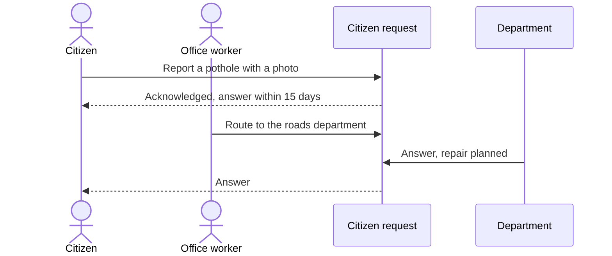

🏠 [Specs](../../../../README.md) › 🏷️ [Sectors](../../../README.md) › 🏛️ [SC20 Public bodies](../../README.md) ›
📝 [Use cases](../README.md) › 📝 [Use cases: FL-SC20-03 Citizen services](README.md) ›
📝 UC-SC20-09 Receive a citizen's request

# 📝 UC-SC20-09 Receive a citizen's request

**Status:** ✅ specified

## Summary

A citizen sends a request to the town hall through the portal on the phone: a certificate, a complaint about a road, a
school registration. The office worker checks it is complete, acknowledges it with a deadline, and follows it to the
answer.

## Personas

- [U56 Citizen](../../../../01-users/personas/u56-citizen.md)
- [U16 Office worker](../../../../01-users/personas/u16-office-worker.md)

## Goal

Every request is acknowledged at once with its deadline and answered in time, and incomplete requests are completed, not
lost.

## Trigger

A citizen submits a request, or the office receives one by post or at the counter.

## Frequency

Dozens a day for a commune.

## Preconditions

- The request types and their deadlines are set
  [UC-F2-30](../../../../02-functional/f02-no-code-configuration/use-cases/12-set-up-request-types/uc-f02-30-set-up-a-request-type.md).
- The citizen has a portal account or gives an email address
  [UC-F2-20](../../../../02-functional/f02-no-code-configuration/use-cases/09-portals-and-offline-forms/uc-f02-20-expose-a-record-type-on-a-portal.md).
- The office worker has the rights of the request type.

## Postconditions

- **Succeeded:** the request is saved ([E-SC20-08 Citizen request](../../data/e-sc20-08-citizen-request.md)) with its
  type, documents, deadline and state, acknowledged to the citizen and routed to the department.
- **Failed:** a request is not left without an acknowledgement, an incomplete request is returned with the missing
  items, and a late one is flagged before its deadline.

## Main flow

1. The citizen opens the portal on the phone and chooses a request type
   ([S-SC20-09 Citizen request](../../screens/03-citizen-services/s-sc20-09-citizen-request.md)).
2. The citizen fills the form and adds the documents and photos.
3. simple-ERP checks that the request is complete and sends the acknowledgement with the deadline
   ([BR-SC20-09](../../business-rules/br-sc20-09-requests-are-acknowledged-with-a-deadline.md)).
4. The office worker sees the request in the queue and routes it to the department.
5. The department answers; the office worker sends the answer to the citizen and closes the request.

## Alternative flows

- 3a. A document is missing: the request is marked Incomplete and the citizen is told what to add and the delay to do
  it.
- 4a. The request is for another authority: it is passed on and the citizen is told.
- 1a. The citizen comes to the counter: the office worker enters the request for them.

## Error flows

- 3e. The citizen gives no way to be answered: the request cannot be sent.
- 5e. The deadline is near and no answer exists: the office worker and the head of department are warned.
- Any step: a service does not answer; the call is retried first
  ([BR-F3-32](../../../../02-functional/f03-assistant/business-rules/br-f03-32-retry-before-an-error.md)), then the
  message follows the error pattern ([D122](../../../../06-decisions/ux/d122-error-message-standard.md)) and what the
  user typed stays on the screen.

## Business rules

- [BR-SC20-09](../../business-rules/br-sc20-09-requests-are-acknowledged-with-a-deadline.md)
- [BR-SC20-10](../../business-rules/br-sc20-10-bookings-follow-the-councils-rates.md)

## Entities

- [E-SC20-08 Citizen request](../../data/e-sc20-08-citizen-request.md): created, acknowledged, answered
- [E-F2-14](../../../../02-functional/f02-no-code-configuration/data/e-f02-14-signature-request.md): read, the
  e-signature a request may need
- [E-F11-09](../../../../02-functional/f11-online-shop/data/e-f11-09-customer-account.md): read, the citizen's account
  on the portal

## Permissions

Citizen creates and reads their own requests; office worker routes and answers; departments read the ones routed to
them. A citizen's request is visible only to the staff who handle it.

## Notifications

The citizen, by email and on the phone: the acknowledgement, a request for a missing item and the answer.

## Audit events

Each request, acknowledgement, completion, routing, answer and closure, who and when.

## AI involvement

No AI step of its own. The AI assistant may open the screen and prefill it from the user's words; the user checks and
confirms
[BR-F3-07](../../../../02-functional/f03-assistant/business-rules/br-f03-07-no-deletes-no-irreversible-acts.md).

## API, MCP and A2A exposure

T5 operations of the capability for the personas above: create, read, update and list. The MCP tool of the
capability may read and propose, never confirm alone. No A2A skill.

## Screens

- [S-SC20-09 Citizen request](../../screens/03-citizen-services/s-sc20-09-citizen-request.md)

## Flowchart

See [FL-SC20-03 Citizen services](../../flows/fl-sc20-03-citizen-services.md#flowchart).

## Sequence diagram

## Acceptance criteria

1. **Given** a complete request **when** the citizen sends it **then** an acknowledgement with the deadline is sent at
   once.
2. **Given** a request missing a document **when** the citizen sends it **then** it is Incomplete and the missing item
   is named.
3. **Given** a deadline in two days with no answer **when** the office worker opens the queue **then** the request is
   flagged.

## Non-functional notes

The screen answers within 2 seconds for 10,000 records; every change is audited.

## Regulatory references

A public body acknowledges a request it receives, stating the date of receipt, the deadline and what silence
means, which depends on the kind of request; an incomplete request is returned with what is missing. Personal data in
requests are kept no longer than needed. The deadlines are data of the France pack. Related:
[CR-FR-052](../../../../10-country-packs/france/data-protection/cr-fr-052-storage-limitation.md),
[CR-FR-051](../../../../10-country-packs/france/data-protection/cr-fr-051-access-and-erasure.md).

## Related use cases

- [UC-SC20-10 Book halls and equipment](uc-sc20-10-book-halls-and-equipment.md)
- [UC-F2-30](../../../../02-functional/f02-no-code-configuration/use-cases/12-set-up-request-types/uc-f02-30-set-up-a-request-type.md)
- [UC-SC20-10 Book halls and equipment](uc-sc20-10-book-halls-and-equipment.md)

## Open questions

None.

---

⬅️ [UC-SC20-08 Follow the public contract](../02-public-procurement/uc-sc20-08-follow-the-public-contract.md) ·
⬆️ [Up](README.md) · ➡️ [UC-SC20-10 Book halls and equipment](uc-sc20-10-book-halls-and-equipment.md)
