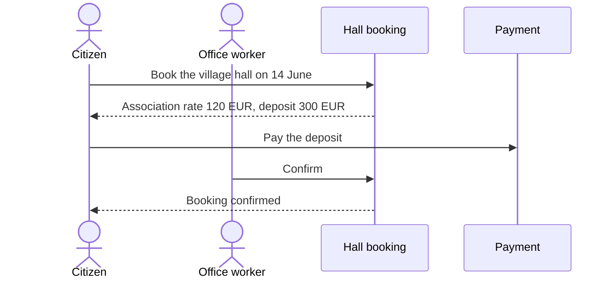

🏠 [Specs](../../../../README.md) › 🏷️ [Sectors](../../../README.md) › 🏛️ [SC20 Public bodies](../../README.md) ›
📝 [Use cases](../README.md) › 📝 [Use cases: FL-SC20-03 Citizen services](README.md) ›
📝 UC-SC20-10 Book halls and equipment

# 📝 UC-SC20-10 Book halls and equipment

**Status:** ✅ specified

## Summary

A citizen or an association books a municipal hall or equipment (tables, chairs, a stage) on the portal on the phone, at
the council's rates for residents, associations and others, with a deposit and the safety capacity checked.

## Personas

- [U56 Citizen](../../../../01-users/personas/u56-citizen.md)

## Goal

A hall is booked only when free, at the right rate, with its deposit and its capacity respected.

## Trigger

A citizen or an association wants a hall or equipment for a date.

## Frequency

Dozens a week.

## Preconditions

- The halls and the equipment are bookable resources
  ([E-F2-18](../../../../02-functional/f02-no-code-configuration/data/e-f02-18-resource-booking.md)).
- The rates of the council are set ([E-SC20-10 Council decision](../../data/e-sc20-10-council-decision.md)).
- The citizen has a portal account.

## Postconditions

- **Succeeded:** the booking is saved ([E-SC20-09 Hall booking](../../data/e-sc20-09-hall-booking.md)) with its
  resource, date, rate, deposit and state, and the revenue is claimed by a title.
- **Failed:** a hall is never booked twice, a rate is never applied to the wrong class of user, and a booking above the
  safety capacity is refused.

## Main flow

1. The citizen opens the halls on the portal
   ([S-SC20-10 Hall booking](../../screens/03-citizen-services/s-sc20-10-hall-booking.md)) and picks a hall and a date.
2. simple-ERP shows the rate for the citizen's class and the deposit
   ([BR-SC20-10](../../business-rules/br-sc20-10-bookings-follow-the-councils-rates.md)).
3. The citizen enters the number of people and the purpose; simple-ERP checks the safety capacity.
4. The office worker confirms the booking and the citizen pays the deposit
   ([UC-SC20-11](uc-sc20-11-take-online-payments.md)).
5. After the use, the hall is checked and the deposit is returned or kept.

## Alternative flows

- 2a. The citizen is an association: its rate and its insurance proof are asked.
- 3a. The number of people is above the capacity: the booking is refused.
- 5a. A damage is found: the deposit is kept and a revenue title for the difference is drafted.

## Error flows

- 1e. The hall is already booked: the free dates are offered.
- 4e. The deposit is not paid in the delay: the booking is released.
- Any step: a service does not answer; the call is retried first
  ([BR-F3-32](../../../../02-functional/f03-assistant/business-rules/br-f03-32-retry-before-an-error.md)), then the
  message follows the error pattern ([D122](../../../../06-decisions/ux/d122-error-message-standard.md)) and what the
  user typed stays on the screen.

## Business rules

- [BR-SC20-10](../../business-rules/br-sc20-10-bookings-follow-the-councils-rates.md)
- [BR-SC20-11](../../business-rules/br-sc20-11-payments-go-to-the-public-treasurys-channel.md)

## Entities

- [E-SC20-09 Hall booking](../../data/e-sc20-09-hall-booking.md): requested, confirmed, paid, closed
- [E-F2-18](../../../../02-functional/f02-no-code-configuration/data/e-f02-18-resource-booking.md): created, the
  resource booking
- [E-SC20-03 Payment order](../../data/e-sc20-03-payment-order.md): created, the revenue title
- [E-F11-06](../../../../02-functional/f11-online-shop/data/e-f11-06-payment-provider.md): read, the online payment

## Permissions

Citizen books and pays for themselves; office worker confirms and closes; the elected official reads the occupancy.
The deposit and the rates are set only by the finance officer.

## Notifications

The citizen, on the phone: the confirmation, the deposit and the reminder. The office worker, in the app: a booking to
confirm.

## Audit events

Each booking, rate, deposit, confirmation, use and return, who and when.

## AI involvement

No AI step of its own. The AI assistant may open the screen and prefill it from the user's words; the user checks and
confirms
[BR-F3-07](../../../../02-functional/f03-assistant/business-rules/br-f03-07-no-deletes-no-irreversible-acts.md).

## API, MCP and A2A exposure

T5 operations of the capability for the personas above: create, read, update and list. The MCP tool of the
capability may read and propose, never confirm alone. No A2A skill.

## Screens

- [S-SC20-10 Hall booking](../../screens/03-citizen-services/s-sc20-10-hall-booking.md)

## Flowchart

See [FL-SC20-03 Citizen services](../../flows/fl-sc20-03-citizen-services.md#flowchart).

## Sequence diagram

## Acceptance criteria

1. **Given** a hall free on the date **when** a resident books it **then** the resident's rate and the deposit are
   shown.
2. **Given** a hall already booked **when** a citizen books it **then** free dates are offered.
3. **Given** 120 people for a hall of 100 **when** the citizen books it **then** it is refused for the capacity.

## Non-functional notes

The screen answers within 2 seconds for 10,000 records; every change is audited.

## Regulatory references

A hall open to the public has a maximum capacity set for safety, and the body may charge different rates by
class of user if the council has voted them. The rates and the capacity are data of the body. Related:
[CR-FR-180](../../../../10-country-packs/france/events/cr-fr-180-venue-safety-register.md).

## Related use cases

- [UC-SC20-09 Receive a citizen's request](uc-sc20-09-receive-a-citizens-request.md)
- [UC-SC20-11 Take online payments](uc-sc20-11-take-online-payments.md)
- [UC-F2-19](../../../../02-functional/f02-no-code-configuration/use-cases/08-views-and-bookings/uc-f02-19-book-a-resource.md)
- [UC-SC20-11 Take online payments](uc-sc20-11-take-online-payments.md)

## Open questions

None.

---

⬅️ [UC-SC20-09 Receive a citizen's request](uc-sc20-09-receive-a-citizens-request.md) · ⬆️ [Up](README.md) ·
➡️ [UC-SC20-11 Take online payments](uc-sc20-11-take-online-payments.md)
