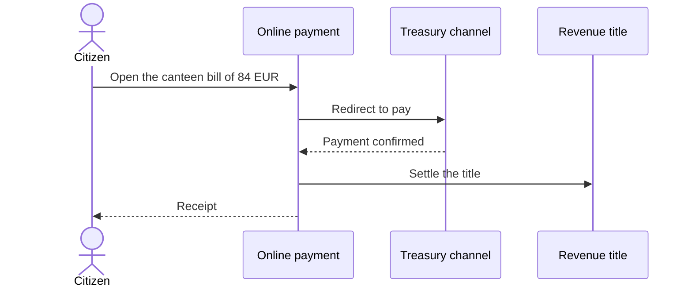

🏠 [Specs](../../../../README.md) › 🏷️ [Sectors](../../../README.md) › 🏛️ [SC20 Public bodies](../../README.md) ›
📝 [Use cases](../README.md) › 📝 [Use cases: FL-SC20-03 Citizen services](README.md) ›
📝 UC-SC20-11 Take online payments

# 📝 UC-SC20-11 Take online payments

**Status:** ✅ specified

## Summary

A citizen pays a municipal bill online on the phone: a canteen bill, a hall deposit, a fee. The payment goes through the
payment channel of the public treasury, not the body's own account, and the payment is matched to the revenue title.

## Personas

- [U56 Citizen](../../../../01-users/personas/u56-citizen.md)

## Goal

The citizen pays online in a few taps, the money reaches the public accountant, and the title is settled without anyone
handling cash.

## Trigger

A citizen opens a bill from the portal or a link, or pays a deposit.

## Frequency

Dozens a day around billing dates.

## Preconditions

- A revenue title or a deposit request exists ([E-SC20-03 Payment order](../../data/e-sc20-03-payment-order.md)).
- The online payment channel of the public treasury is set up for the body.
- The citizen has a portal account or the payment link.

## Postconditions

- **Succeeded:** the payment is made through the treasury's channel and the title is settled, with the receipt sent to
  the citizen.
- **Failed:** no payment is taken on the body's own bank account, a failed payment leaves the title open, and the
  citizen is never charged twice.

## Main flow

1. The citizen opens the bill on the portal
   ([S-SC20-11 Public payments](../../screens/03-citizen-services/s-sc20-11-public-payments.md)) on the phone.
2. SimpleERP shows the amount, the title number and the payment options.
3. The citizen pays by card or by direct debit through the treasury's channel
   ([BR-SC20-11](../../business-rules/br-sc20-11-payments-go-to-the-public-treasurys-channel.md)).
4. The channel confirms the payment and SimpleERP matches it to the title.
5. The citizen receives the receipt and the title is settled.

## Alternative flows

- 3a. The payment fails: the title stays open and the citizen may try again.
- 4a. The payment confirmation is late: the title stays Waiting until the confirmation arrives.
- 3b. The citizen pays at the counter: the office worker records it and the treasury confirms.

## Error flows

- 3e. The channel is unavailable: the citizen is told and the bill stays open.
- 4e. A payment arrives for no known title: it is kept in a list to match.
- Any step: a service does not answer; the call is retried first
  ([BR-F3-32](../../../../02-functional/f03-assistant/business-rules/br-f03-32-retry-before-an-error.md)), then the
  message follows the error pattern ([D122](../../../../06-decisions/ux/d122-error-message-standard.md)) and what the
  user typed stays on the screen.

## Business rules

- [BR-SC20-11](../../business-rules/br-sc20-11-payments-go-to-the-public-treasurys-channel.md)
- [BR-SC20-03](../../business-rules/br-sc20-03-orders-are-signed-by-the-authorising-officer.md)

## Entities

- [E-SC20-03 Payment order](../../data/e-sc20-03-payment-order.md): changed, the revenue title is settled
- [E-F11-06](../../../../02-functional/f11-online-shop/data/e-f11-06-payment-provider.md): read, the payment provider
  pattern
- [E-F6-06](../../../../02-functional/f06-customers-and-sales/data/e-f06-06-customer-payment.md): read, the customer
  payment pattern

## Permissions

Citizen pays their own bills; office worker records counter payments; finance officer reads and reconciles.
The body never sees the card number.

## Notifications

The citizen, by email: the receipt. The finance officer, in the app: an unmatched payment.

## Audit events

Each payment, failure, match and receipt, who and when.

## AI involvement

No AI step of its own. The AI assistant may open the screen and prefill it from the user's words; the user checks and
confirms
[BR-F3-07](../../../../02-functional/f03-assistant/business-rules/br-f03-07-no-deletes-no-irreversible-acts.md).

## API, MCP and A2A exposure

T5 operations of the capability for the personas above: create, read, update and list. The MCP tool of the
capability may read and propose, never confirm alone. No A2A skill.

## Screens

- [S-SC20-11 Public payments](../../screens/03-citizen-services/s-sc20-11-public-payments.md)

## Flowchart

See [FL-SC20-03 Citizen services](../../flows/fl-sc20-03-citizen-services.md#flowchart).

## Sequence diagram

## Acceptance criteria

1. **Given** a bill of 84 EUR **when** the citizen pays by card **then** the payment goes through the treasury's channel
   and the title is settled.
2. **Given** a failed payment **when** the citizen tries again **then** the title stays open and no double charge is
   made.
3. **Given** a payment for an unknown title **when** the confirmation arrives **then** it is kept in the list to match.

## Non-functional notes

The screen answers within 2 seconds for 10,000 records; every change is audited.

## Regulatory references

Public revenue is collected by the public accountant, so an online payment goes through the treasury's
payment channel and not through the body's own account; the authorising officer only issues the title. Card data is
handled by the channel. Related: [CR-FR-023](../../../../10-country-packs/france/payments/cr-fr-023-sepa-formats.md).

## Related use cases

- [UC-SC20-10 Book halls and equipment](uc-sc20-10-book-halls-and-equipment.md)
- [UC-SC20-12 Publish council decisions](uc-sc20-12-publish-council-decisions.md)
- [UC-SC20-10 Book halls and equipment](uc-sc20-10-book-halls-and-equipment.md)
- [UC-F11-06](../../../../02-functional/f11-online-shop/use-cases/02-shop-and-check-out/uc-f11-06-pay-online.md)

## Open questions

None.

---

⬅️ [UC-SC20-10 Book halls and equipment](uc-sc20-10-book-halls-and-equipment.md) · ⬆️ [Up](README.md) ·
➡️ [UC-SC20-12 Publish council decisions](uc-sc20-12-publish-council-decisions.md)
