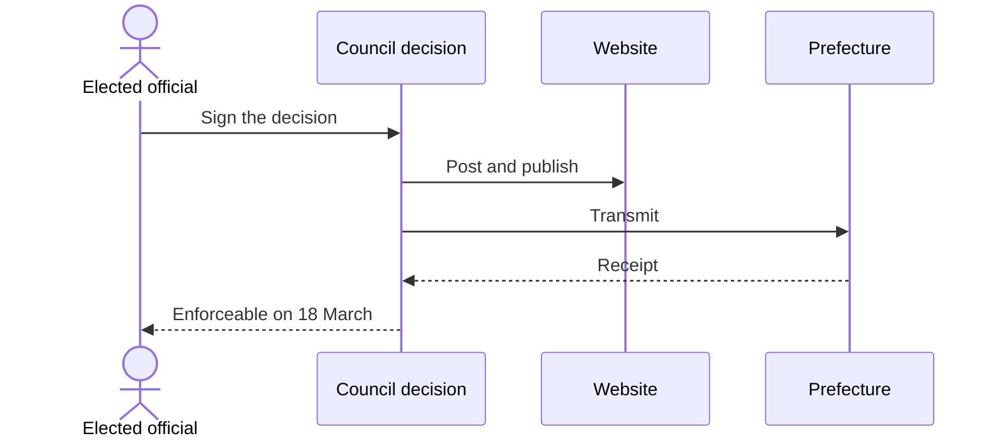

🏠 [Specs](../../../../README.md) › 🏷️ [Sectors](../../../README.md) › 🏛️ [SC20 Public bodies](../../README.md) ›
📝 [Use cases](../README.md) › 📝 [Use cases: FL-SC20-03 Citizen services](README.md) ›
📝 UC-SC20-12 Publish council decisions

# 📝 UC-SC20-12 Publish council decisions

**Status:** ✅ specified

## Summary

The elected official signs and publishes the decisions of the council and the orders of the mayor: the text is posted,
put on the website and sent to the prefecture, and the decision becomes enforceable only once published and transmitted.

## Personas

- [U55 Elected official](../../../../01-users/personas/u55-elected-official.md)

## Goal

Every decision has its dates of posting, publication and transmission, so that the body can show when it became
enforceable.

## Trigger

A deliberation is adopted, or the mayor signs an order.

## Frequency

Several a week.

## Preconditions

- The deliberation is adopted ([E-SC20-12 Deliberation](../../data/e-sc20-12-deliberation.md)).
- The body's website is available
  ([E-F18-01](../../../../02-functional/f18-hosted-websites-and-domains/data/e-f18-01-hosted-website.md)).
- The signature of the elected official is available
  [UC-F2-14](../../../../02-functional/f02-no-code-configuration/use-cases/07-benchmark-additions/uc-f02-14-send-documents-for-e-signature.md).

## Postconditions

- **Succeeded:** the decision is saved ([E-SC20-10 Council decision](../../data/e-sc20-10-council-decision.md)) with its
  text, signature, posting, publication and transmission dates, and is Enforceable.
- **Failed:** a decision is not marked enforceable before it is published and transmitted, and an unpublished one is
  listed.

## Main flow

1. The elected official opens the decisions screen
   ([S-SC20-12 Council decisions](../../screens/03-citizen-services/s-sc20-12-council-decisions.md)) and sees the
   decisions to publish.
2. The elected official reviews and signs the text.
3. simple-ERP posts the decision on the website and the register and records the date
   ([BR-SC20-12](../../business-rules/br-sc20-12-decisions-are-published-to-become-enforceable.md)).
4. simple-ERP transmits the decision to the prefecture and keeps the receipt.
5. When both are done the decision becomes Enforceable and the date is shown.

## Alternative flows

- 2a. The decision is a regulatory order: it is also notified to the people it concerns.
- 4a. The prefecture asks for a document: the decision stays Published and the document is sent.
- 5a. A decision is withdrawn: it is marked Withdrawn with its reason and date.

## Error flows

- 4e. The transmission fails: the decision stays Published and the officer is told.
- 3e. The website is not available: the posting is done at the notice board and recorded by hand.
- Any step: a service does not answer; the call is retried first
  ([BR-F3-32](../../../../02-functional/f03-assistant/business-rules/br-f03-32-retry-before-an-error.md)), then the
  message follows the error pattern ([D122](../../../../06-decisions/ux/d122-error-message-standard.md)) and what the
  user typed stays on the screen.

## Business rules

- [BR-SC20-12](../../business-rules/br-sc20-12-decisions-are-published-to-become-enforceable.md)
- [BR-SC20-17](../../business-rules/br-sc20-17-deliberations-are-sent-to-the-prefecture-to-become-enforceable.md)

## Entities

- [E-SC20-10 Council decision](../../data/e-sc20-10-council-decision.md): prepared, published, made enforceable
- [E-SC20-12 Deliberation](../../data/e-sc20-12-deliberation.md): read, the deliberation behind it
- [E-F18-01](../../../../02-functional/f18-hosted-websites-and-domains/data/e-f18-01-hosted-website.md): read, the
  website that posts it

## Permissions

Elected official signs and publishes; office worker prepares the text; citizens read the published decisions.
Draft decisions are visible only to the staff and elected officials.

## Notifications

The elected official, in the app: a decision to sign. The office worker, in the app: a decision not yet transmitted.

## Audit events

Each text, signature, posting, publication, transmission and withdrawal, who and when.

## AI involvement

No AI step of its own. The AI assistant may open the screen and prefill it from the user's words; the user checks and
confirms
[BR-F3-07](../../../../02-functional/f03-assistant/business-rules/br-f03-07-no-deletes-no-irreversible-acts.md).

## API, MCP and A2A exposure

T5 operations of the capability for the personas above: create, read, update and list. The MCP tool of the
capability may read and propose, never confirm alone. No A2A skill.

## Screens

- [S-SC20-12 Council decisions](../../screens/03-citizen-services/s-sc20-12-council-decisions.md)

## Flowchart

See [FL-SC20-03 Citizen services](../../flows/fl-sc20-03-citizen-services.md#flowchart).

## Sequence diagram

## Acceptance criteria

1. **Given** a signed decision posted and transmitted **when** the receipt arrives **then** the decision is Enforceable.
2. **Given** a decision posted but not transmitted **when** the officer opens the list **then** it is Published and
   listed.
3. **Given** a withdrawn decision **when** the elected official withdraws it **then** it is Withdrawn with its reason.

## Non-functional notes

The screen answers within 2 seconds for 10,000 records; every change is audited.

## Regulatory references

The acts of a local body become enforceable after they are published or notified, and for the main ones after
they are sent to the prefecture, which checks their legality within a delay and may refer them to the administrative
court. The kinds of acts and the delays are data of the France pack.

## Related use cases

- [UC-SC20-11 Take online payments](uc-sc20-11-take-online-payments.md)
- [UC-SC20-17](../05-council-registry-permits-and-assets/uc-sc20-17-run-council-meetings-and-deliberations.md)
- [UC-F3-01](../../../../02-functional/f03-assistant/use-cases/01-ask-the-assistant/uc-f03-01-ask-a-question-about-the-company-s-data.md)

## Open questions

None.

---

⬅️ [UC-SC20-11 Take online payments](uc-sc20-11-take-online-payments.md) · ⬆️ [Up](README.md) ·
➡️ [UC-SC20-13 Manage grades and steps](../04-public-hr-and-pay/uc-sc20-13-manage-grades-and-steps.md)
