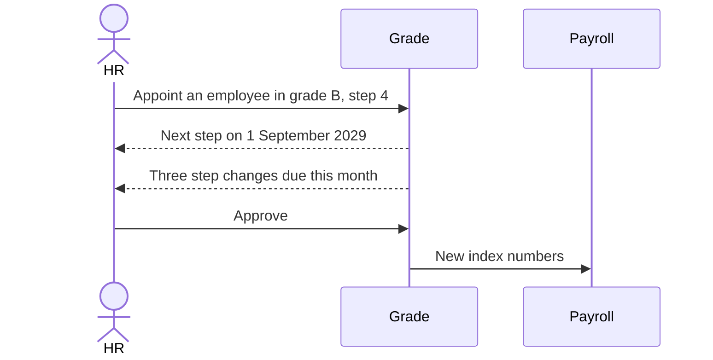

🏠 [Specs](../../../../README.md) › 🏷️ [Sectors](../../../README.md) › 🏛️ [SC20 Public bodies](../../README.md) ›
📝 [Use cases](../README.md) › 📝 [Use cases: FL-SC20-04 Public-sector HR and pay](README.md) ›
📝 UC-SC20-13 Manage grades and steps

# 📝 UC-SC20-13 Manage grades and steps

**Status:** 🔄 waiting for the owner

## Summary

HR keeps the grades of the body's civil servants with their steps: the index number of each step, the time spent in a
step and the rules of advancement, and moves each employee from step to step at the date the rules allow.

## Personas

- [U06 Human resources](../../../../01-users/personas/u06-hr.md)

## Goal

Each employee is in the right grade and step at each date, so that pay and careers follow the statute and no step change
is forgotten or given early.

## Trigger

An employee is appointed, reaches the date of a step change, or is promoted.

## Frequency

Every month for a body of a few hundred staff.

## Preconditions

- The employee has a record and a contract
  ([E-F9-01](../../../../02-functional/f09-hr-and-projects/data/e-f09-01-employee-record.md),
  [E-F9-02 Contract](../../../../02-functional/f09-hr-and-projects/data/e-f09-02-contract.md)).
- The grades and steps of the body's staff categories are loaded from the country pack.
- The service dates of the employee are entered.

## Postconditions

- **Succeeded:** the grade is saved ([E-SC20-11 Grade](../../data/e-sc20-11-grade.md)) with its steps and index numbers,
  and each employee's grade, step and next change date are up to date.
- **Failed:** a step change is not made before its minimum time, an employee is not placed in a grade that does not
  match their post, and a change waits for HR's approval.

## Main flow

1. HR opens the grades screen
   ([S-SC20-13 Grades and steps](../../screens/04-public-hr-and-pay/s-sc20-13-grades-and-steps.md)) and sees the grades
   of the body with their steps.
2. For an appointment, HR picks the grade and the step the employee's previous service gives.
3. SimpleERP shows the date of the next step change from the time rules
   ([BR-SC20-13](../../business-rules/br-sc20-13-step-changes-follow-the-seniority-rules.md)).
4. Each month SimpleERP lists the employees whose step change falls due.
5. HR approves each change; the new index number goes to payroll ([UC-SC20-14](uc-sc20-14-compute-statutory-pay.md)).

## Alternative flows

- 2a. The employee comes from another body: previous service is counted and the date is shown with its proof.
- 4a. The change is advanced or delayed for a reason the statute allows: HR records the reason.
- 3a. The employee is promoted to a higher grade: the new step follows the conversion rule.

## Error flows

- 2e. The grade does not match the post's staff category: the placement is refused.
- 4e. A step change would come before the minimum time: it is refused and the date is shown.
- Any step: a service does not answer; the call is retried first
  ([BR-F3-32](../../../../02-functional/f03-assistant/business-rules/br-f03-32-retry-before-an-error.md)), then the
  message follows the error pattern ([D122](../../../../06-decisions/ux/d122-error-message-standard.md)) and what the
  user typed stays on the screen.

## Business rules

- [BR-SC20-13](../../business-rules/br-sc20-13-step-changes-follow-the-seniority-rules.md)
- [BR-SC20-14](../../business-rules/br-sc20-14-pay-follows-the-index-points-of-the-grade.md)

## Entities

- [E-SC20-11 Grade](../../data/e-sc20-11-grade.md): created, changed, closed
- [E-F9-01](../../../../02-functional/f09-hr-and-projects/data/e-f09-01-employee-record.md): read and changed, the
  employee's grade
- [E-F9-02 Contract](../../../../02-functional/f09-hr-and-projects/data/e-f09-02-contract.md): read, the contract and
  its kind

## Permissions

HR creates and changes grades and approves step changes; payroll reads; the employee reads their own grade.
Elected officials see counts of staff by grade, not names.

## Notifications

HR, in the app: step changes due this month and a grade mismatch. The employee, in the app: a new step.

## Audit events

Each grade created, each placement, step change, promotion and refusal, who and when.

## AI involvement

No AI step of its own. The AI assistant may open the screen and prefill it from the user's words; the user checks and
confirms
[BR-F3-07](../../../../02-functional/f03-assistant/business-rules/br-f03-07-no-deletes-no-irreversible-acts.md).

## API, MCP and A2A exposure

T5 operations of the capability for the personas above: create, read, update and list. The MCP tool of the
capability may read and propose, never confirm alone. No A2A skill.

## Screens

- [S-SC20-13 Grades and steps](../../screens/04-public-hr-and-pay/s-sc20-13-grades-and-steps.md)

## Flowchart

See [FL-SC20-04 Public-sector HR and pay](../../flows/fl-sc20-04-public-hr-and-pay.md#flowchart).

## Sequence diagram

## Acceptance criteria

1. **Given** an employee at the minimum time of their step **when** the month's list is made **then** the employee is
   listed for a step change.
2. **Given** an employee before the minimum time **when** HR approves a change **then** it is refused with the date.
3. **Given** a grade that does not match the post's category **when** HR places the employee **then** it is refused.

## Non-functional notes

The screen answers within 2 seconds for 10,000 records; every change is audited.

## Regulatory references

Civil servants of a local body belong to a staff category and a grade, with steps; each step has an index
number that sets the pay, and a step is changed after a time set by the statute. Contract staff follow their contract.
The grades, steps, index numbers and times are data of the France pack. Related:
[CR-FR-210](../../../../10-country-packs/france/labour/cr-fr-210-qualifications-tied-to-tasks.md).

- France-pack rule, (Proposed) until its law is read:
  [CR-FR-252 Public-sector contributions](../../../../10-country-packs/france/payroll/cr-fr-252-public-sector-contributions.md)

## Related use cases

- [UC-SC20-14 Compute statutory pay](uc-sc20-14-compute-statutory-pay.md)
- [UC-F9-01](../../../../02-functional/f09-hr-and-projects/use-cases/01-people/uc-f09-01-manage-employee-records-and-contracts.md)
- [UC-F9-45](../../../../02-functional/f09-hr-and-projects/use-cases/15-work-location-headcount-and-learning/uc-f09-45-plan-careers-and-successors.md)

## Open questions

None.

---

⬅️ [UC-SC20-12 Publish council decisions](../03-citizen-services/uc-sc20-12-publish-council-decisions.md) ·
⬆️ [Up](README.md) · ➡️ [UC-SC20-14 Compute statutory pay](uc-sc20-14-compute-statutory-pay.md)
