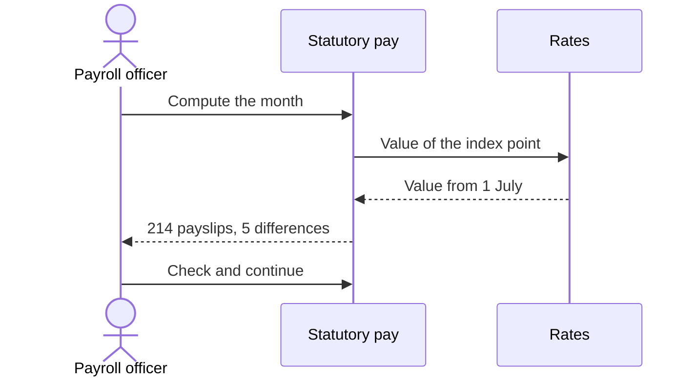

🏠 [Specs](../../../../README.md) › 🏷️ [Sectors](../../../README.md) › 🏛️ [SC20 Public bodies](../../README.md) ›
📝 [Use cases](../README.md) › 📝 [Use cases: FL-SC20-04 Public-sector HR and pay](README.md) ›
📝 UC-SC20-14 Compute statutory pay

# 📝 UC-SC20-14 Compute statutory pay

**Status:** ✅ specified, ⚖️ lawyer review before launch (D574)

## Summary

The payroll officer computes the pay of civil servants from the index number of their grade and step and the value of
the index point, adds the statutory supplements and indemnities, and prepares the payslip.

## Personas

- [U45 Payroll officer](../../../../01-users/personas/u45-payroll-officer.md)

## Goal

Each civil servant is paid exactly what the statute gives for their grade, step and situation, and the value of the
index point is updated from the pack.

## Trigger

The month's pay run starts, the value of the index point changes, or an employee's grade or step changes.

## Frequency

Monthly.

## Preconditions

- Each employee has a grade and a step ([E-SC20-11 Grade](../../data/e-sc20-11-grade.md)).
- The value of the index point and the supplements are loaded from the country pack
  ([E-F13-16 Rate set](../../../../02-functional/f13-payroll/data/e-f13-16-rate-set.md)).
- The pay inputs are collected
  [UC-F13-03](../../../../02-functional/f13-payroll/use-cases/02-monthly-pay-run/uc-f13-03-collect-pay-inputs-from-f9.md).

## Postconditions

- **Succeeded:** each payslip line is computed from the index number and the point value, with the supplements, and the
  run is ready to check.
- **Failed:** no pay is computed without a grade and a step, a point value is never typed by hand, and a difference from
  the last month is explained.

## Main flow

1. The payroll officer opens the statutory pay screen
   ([S-SC20-14 Statutory pay](../../screens/04-public-hr-and-pay/s-sc20-14-statutory-pay.md)) for the month.
2. SimpleERP takes each civil servant's index number and the value of the index point and computes the basic pay
   ([BR-SC20-14](../../business-rules/br-sc20-14-pay-follows-the-index-points-of-the-grade.md)).
3. It adds the statutory supplements and indemnities the employee is entitled to, from the pack.
4. It compares each pay with the previous month and lists the differences.
5. The payroll officer checks the differences and the run goes to the normal pay run
   [UC-F13-07](../../../../02-functional/f13-payroll/use-cases/02-monthly-pay-run/uc-f13-07-check-and-approve-the-pay-run.md).

## Alternative flows

- 3a. The point value changes in the month: the lines are recomputed from its date.
- 2a. A part-time employee: the pay is reduced by the fraction of hours the statute sets.
- 4a. A retroactive step change: the back pay is computed and shown on its own line.

## Error flows

- 2e. An employee has no step: the pay is not computed and the employee is listed.
- 3e. The pack has no value for the month: the run is stopped and the officer is told.
- Any step: a service does not answer; the call is retried first
  ([BR-F3-32](../../../../02-functional/f03-assistant/business-rules/br-f03-32-retry-before-an-error.md)), then the
  message follows the error pattern ([D122](../../../../06-decisions/ux/d122-error-message-standard.md)) and what the
  user typed stays on the screen.

## Business rules

- [BR-SC20-14](../../business-rules/br-sc20-14-pay-follows-the-index-points-of-the-grade.md)
- [BR-SC20-13](../../business-rules/br-sc20-13-step-changes-follow-the-seniority-rules.md)

## Entities

- [E-SC20-11 Grade](../../data/e-sc20-11-grade.md): read, the grade, step and index number
- [E-F13-16 Rate set](../../../../02-functional/f13-payroll/data/e-f13-16-rate-set.md): read, the rates and point value
- [E-F13-04 Payslip line](../../../../02-functional/f13-payroll/data/e-f13-04-payslip-line.md): created, the payslip
  lines

## Permissions

Payroll officer computes and checks; HR reads the differences; the employee reads their own payslip. Elected
officials see totals by grade, never one person's pay.

## Notifications

The payroll officer, in the app: employees with no step and pay differences above a threshold.

## Audit events

Each computation, point value used, supplement, difference and check, who and when.

## AI involvement

No AI step of its own. The AI assistant may open the screen and prefill it from the user's words; the user checks and
confirms
[BR-F3-07](../../../../02-functional/f03-assistant/business-rules/br-f03-07-no-deletes-no-irreversible-acts.md).

## API, MCP and A2A exposure

T5 operations of the capability for the personas above: create, read, update and list. The MCP tool of the
capability may read and propose, never confirm alone. No A2A skill.

## Screens

- [S-SC20-14 Statutory pay](../../screens/04-public-hr-and-pay/s-sc20-14-statutory-pay.md)

## Flowchart

See [FL-SC20-04 Public-sector HR and pay](../../flows/fl-sc20-04-public-hr-and-pay.md#flowchart).

## Sequence diagram

## Acceptance criteria

1. **Given** an employee at index number 410 **when** the pay is computed **then** the basic pay is the index number
   times the point value.
2. **Given** an employee without a step **when** the pay is computed **then** it is not computed and the employee is
   listed.
3. **Given** a new point value from 1 July **when** the July pay is computed **then** the lines use the new value from
   that date.

## Non-functional notes

The screen answers within 2 seconds for 10,000 records; every change is audited.

## Regulatory references

The basic pay of a civil servant is the index number of their grade and step multiplied by the value of the index point,
which changes by a public decision (the yearly pay of the majored index 100 is 5 907.34 EUR since 2023-07-01, décret n°
85-1148, art. 3), plus supplements such as the family supplement and the indemnities set by the body within the statute.
The values and the supplements are data of the France pack. (⚖️ lawyer review before launch, D574) The supplements are still to read:
décret n° 85-1148 and the bonus texts of each cadre. Related:
[CR-FR-182 The payslip](../../../../10-country-packs/france/payroll/cr-fr-182-payslip.md),
[CR-FR-185](../../../../10-country-packs/france/payroll/cr-fr-185-minimum-wage.md).

- France-pack rule (the index point read; the supplements on the lawyer's list):
  [CR-FR-252 Public-sector contributions](../../../../10-country-packs/france/payroll/cr-fr-252-public-sector-contributions.md)

## Related use cases

- [UC-SC20-13 Manage grades and steps](uc-sc20-13-manage-grades-and-steps.md)
- [UC-SC20-15](uc-sc20-15-declare-public-sector-contributions.md)
- [UC-SC20-13 Manage grades and steps](uc-sc20-13-manage-grades-and-steps.md)
- [UC-F13-04](../../../../02-functional/f13-payroll/use-cases/02-monthly-pay-run/uc-f13-04-compute-gross-to-net.md)

## Open questions

None.

---

⬅️ [UC-SC20-13 Manage grades and steps](uc-sc20-13-manage-grades-and-steps.md) · ⬆️ [Up](README.md) ·
➡️ [UC-SC20-15 Declare public-sector contributions](uc-sc20-15-declare-public-sector-contributions.md)
