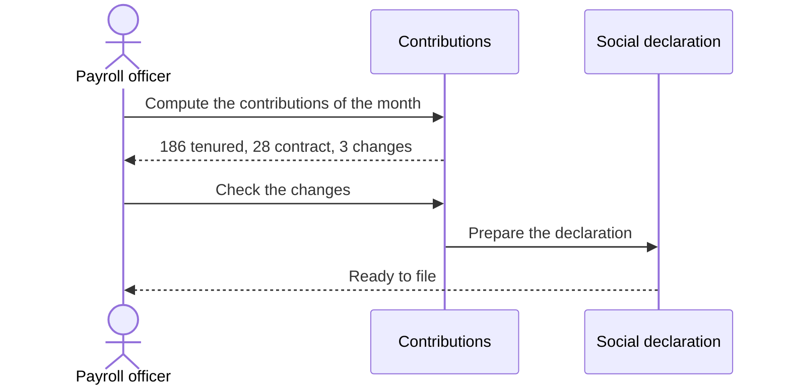

🏠 [Specs](../../../../README.md) › 🏷️ [Sectors](../../../README.md) › 🏛️ [SC20 Public bodies](../../README.md) ›
📝 [Use cases](../README.md) › 📝 [Use cases: FL-SC20-04 Public-sector HR and pay](README.md) ›
📝 UC-SC20-15 Declare public-sector contributions

# 📝 UC-SC20-15 Declare public-sector contributions

**Status:** ✅ specified, ⚖️ lawyer review before launch (D574)

## Summary

The payroll officer computes and declares the contributions of public-sector staff by their pension scheme: tenured
staff to the local civil servants' pension fund, non-tenured and part-time staff to the general scheme and the
supplementary scheme of public contract staff, with the employer's share.

## Personas

- [U45 Payroll officer](../../../../01-users/personas/u45-payroll-officer.md)

## Goal

Each employee is declared with the contributions of their own scheme, so that pension rights are right and the
collectors are paid.

## Trigger

The month's pay run is closed, an employee changes status, or a scheme rate changes.

## Frequency

Monthly.

## Preconditions

- Each employee has a scheme ([E-F13-17](../../../../02-functional/f13-payroll/data/e-f13-17-scheme-membership.md)).
- The pay run is closed ([E-F13-06 Pay run](../../../../02-functional/f13-payroll/data/e-f13-06-pay-run.md)).
- The rates by scheme are loaded from the country pack
  ([E-F13-16 Rate set](../../../../02-functional/f13-payroll/data/e-f13-16-rate-set.md)).

## Postconditions

- **Succeeded:** the declaration is prepared
  ([E-F13-09](../../../../02-functional/f13-payroll/data/e-f13-09-social-declaration.md)) with each employee's
  contributions by scheme and the employer's share, and the payments to the collectors are listed.
- **Failed:** an employee is never declared under a scheme that does not fit their status, a rate is never typed by
  hand, and a change of status gives a correction.

## Main flow

1. The payroll officer opens the contributions screen
   ([S-SC20-15](../../screens/04-public-hr-and-pay/s-sc20-15-public-contributions.md)) after the pay run.
2. SimpleERP assigns each employee to their scheme from their status and hours
   ([BR-SC20-15](../../business-rules/br-sc20-15-contributions-follow-the-employees-scheme.md)).
3. It computes the employee's and employer's contributions by scheme from the pay and the pack's rates.
4. The officer checks the exceptions: a status change, a part-time threshold, a contract end.
5. The officer files the monthly social declaration
   [UC-F13-10](../../../../02-functional/f13-payroll/use-cases/03-declarations-and-payments/uc-f13-10-file-the-monthly-social-declaration-and-handle-returns.md)
   and the payments are prepared
   [UC-F13-12](../../../../02-functional/f13-payroll/use-cases/03-declarations-and-payments/uc-f13-12-pay-contributions-to-the-collectors.md).

## Alternative flows

- 2a. An employee changes from contract to tenured: the scheme changes from that date and the past months are corrected.
- 4a. A part-time employee crosses the hours threshold: their scheme changes and the officer is told.
- 3a. An employee holds two posts: the contributions are split by post.

## Error flows

- 2e. An employee has no status: the declaration cannot be prepared for them.
- 3e. A rate is missing for the scheme: the run is held and the officer is told.
- Any step: a service does not answer; the call is retried first
  ([BR-F3-32](../../../../02-functional/f03-assistant/business-rules/br-f03-32-retry-before-an-error.md)), then the
  message follows the error pattern ([D122](../../../../06-decisions/ux/d122-error-message-standard.md)) and what the
  user typed stays on the screen.

## Business rules

- [BR-SC20-15](../../business-rules/br-sc20-15-contributions-follow-the-employees-scheme.md)
- [BR-SC20-14](../../business-rules/br-sc20-14-pay-follows-the-index-points-of-the-grade.md)

## Entities

- [E-F13-17](../../../../02-functional/f13-payroll/data/e-f13-17-scheme-membership.md): read, the employee's scheme
- [E-F13-09](../../../../02-functional/f13-payroll/data/e-f13-09-social-declaration.md): created, the monthly
  declaration
- [E-F13-11](../../../../02-functional/f13-payroll/data/e-f13-11-contribution-payment.md): created, the contribution
  payments

## Permissions

Payroll officer prepares and files; HR reads the schemes; the finance officer reads the payments. A change of
scheme needs the approval of HR.

## Notifications

The payroll officer, in the app: an employee whose scheme changes and a missing rate.

## Audit events

Each scheme assignment, computation, correction, declaration and payment, who and when.

## AI involvement

No AI step of its own. The AI assistant may open the screen and prefill it from the user's words; the user checks and
confirms
[BR-F3-07](../../../../02-functional/f03-assistant/business-rules/br-f03-07-no-deletes-no-irreversible-acts.md).

## API, MCP and A2A exposure

T5 operations of the capability for the personas above: create, read, update and list. The MCP tool of the
capability may read and propose, never confirm alone. No A2A skill.

## Screens

- [S-SC20-15](../../screens/04-public-hr-and-pay/s-sc20-15-public-contributions.md)

## Flowchart

See [FL-SC20-04 Public-sector HR and pay](../../flows/fl-sc20-04-public-hr-and-pay.md#flowchart).

## Sequence diagram

## Acceptance criteria

1. **Given** a tenured employee above the hours threshold **when** the contributions are computed **then** they follow
   the tenured staff's scheme.
2. **Given** a contract employee **when** the contributions are computed **then** they follow the general and
   supplementary schemes.
3. **Given** an employee with no status **when** the declaration is prepared **then** they are listed and not declared.

## Non-functional notes

The screen answers within 2 seconds for 10,000 records; every change is audited.

## Regulatory references

A tenured employee who works at least 28 hours a week is affiliated to the local civil servants' pension scheme
(CNRACL), other staff to the general scheme and the supplementary scheme of public contract staff (Ircantec); each
scheme has its own rates and bases, and employer and employee both pay: for the CNRACL 11.10 % for the employee and
37.65 % for the employer in 2026, 40.65 % in 2027, 43.65 % in 2028. They are declared through the monthly social
declaration. The thresholds, rates and bases are data of the France pack. (⚖️ lawyer review before launch, D574) The Ircantec rates
are still to read. Related:
[CR-FR-183](../../../../10-country-packs/france/payroll/cr-fr-183-dsn-monthly-declaration.md),
[CR-FR-182 The payslip](../../../../10-country-packs/france/payroll/cr-fr-182-payslip.md).

- France-pack rule (the scheme, the threshold and the CNRACL rates read; the Ircantec rates on the lawyer's list):
  [CR-FR-252 Public-sector contributions](../../../../10-country-packs/france/payroll/cr-fr-252-public-sector-contributions.md)

## Related use cases

- [UC-SC20-14 Compute statutory pay](uc-sc20-14-compute-statutory-pay.md)
- [UC-SC20-16](uc-sc20-16-ask-the-assistant-about-the-budget.md)
- [UC-SC20-14 Compute statutory pay](uc-sc20-14-compute-statutory-pay.md)
- [UC-F13-10](../../../../02-functional/f13-payroll/use-cases/03-declarations-and-payments/uc-f13-10-file-the-monthly-social-declaration-and-handle-returns.md)

## Open questions

None.

---

⬅️ [UC-SC20-14 Compute statutory pay](uc-sc20-14-compute-statutory-pay.md) · ⬆️ [Up](README.md) ·
➡️ [UC-SC20-16 Ask the AI assistant about the budget](uc-sc20-16-ask-the-assistant-about-the-budget.md)
