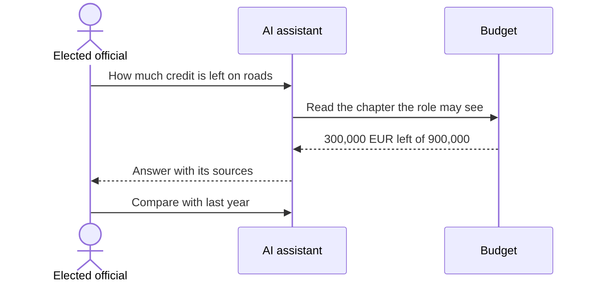

🏠 [Specs](../../../../README.md) › 🏷️ [Sectors](../../../README.md) › 🏛️ [SC20 Public bodies](../../README.md) ›
📝 [Use cases](../README.md) › 📝 [Use cases: FL-SC20-04 Public-sector HR and pay](README.md) ›
📝 UC-SC20-16 Ask the AI assistant about the budget

# 📝 UC-SC20-16 Ask the AI assistant about the budget

**Status:** ✅ specified

## Summary

An elected official asks the AI assistant on the phone about the budget in plain words: how much credit is left on a
chapter, what was paid to a supplier, how the year compares with the last. The answer uses only what the official may
see and shows its sources.

## Personas

- [U55 Elected official](../../../../01-users/personas/u55-elected-official.md)

## Goal

Elected officials get a figure and its source in seconds, without reading the whole budget, and without seeing what
their role does not allow.

## Trigger

An elected official asks a question on the phone or in the app.

## Frequency

A few questions a week before each council.

## Preconditions

- The budget and the commitments are in SimpleERP ([E-SC20-01 Budget](../../data/e-sc20-01-budget.md),
  [E-SC20-02 Commitment](../../data/e-sc20-02-commitment.md)).
- The elected official's role has the right to read budget figures.
- The AI assistant is switched on
  [UC-F3-01](../../../../02-functional/f03-assistant/use-cases/01-ask-the-assistant/uc-f03-01-ask-a-question-about-the-company-s-data.md).

## Postconditions

- **Succeeded:** the answer shows the figure, the period, the chapter and its sources, and the question is kept in the
  conversation.
- **Failed:** the AI assistant never gives a figure the asker's rights do not allow, never invents a figure, and says
  when it cannot answer.

## Main flow

1. The elected official opens the AI assistant on the phone
   ([S-SC20-16 Budget assistant](../../screens/04-public-hr-and-pay/s-sc20-16-budget-assistant.md)) and asks a question.
2. SimpleERP finds the figures the elected official may read and refuses the others
   ([BR-SC20-16](../../business-rules/br-sc20-16-answers-follow-the-askers-rights.md)).
3. The AI assistant answers with the figure, the period and the chapter, and shows its sources.
4. The elected official opens a source to see the commitments or the orders behind a figure.
5. The elected official asks a follow-up question or asks for a chart.

## Alternative flows

- 2a. The question asks for a person's pay: it is refused and the allowed totals are offered.
- 3a. The figures are incomplete for the period: the answer says so and gives what exists.
- 5a. The elected official asks for a summary for the council: a draft is made and marked as a draft.

## Error flows

- 2e. The question cannot be understood: the AI assistant asks for a clearer one.
- 3e. The data source is unavailable: the answer says it cannot be given now.
- Any step: a service does not answer; the call is retried first
  ([BR-F3-32](../../../../02-functional/f03-assistant/business-rules/br-f03-32-retry-before-an-error.md)), then the
  message follows the error pattern ([D122](../../../../06-decisions/ux/d122-error-message-standard.md)) and what the
  user typed stays on the screen.

## Business rules

- [BR-SC20-16](../../business-rules/br-sc20-16-answers-follow-the-askers-rights.md)
- [BR-F3-07](../../../../02-functional/f03-assistant/business-rules/br-f03-07-no-deletes-no-irreversible-acts.md)

## Entities

- [E-F3-01 Conversation](../../../../02-functional/f03-assistant/data/e-f03-01-conversation.md): created, the
  conversation
- [E-SC20-01 Budget](../../data/e-sc20-01-budget.md): read, the budget and its credits
- [E-SC20-02 Commitment](../../data/e-sc20-02-commitment.md): read, the commitments

## Permissions

Elected official asks about the budget; the finance officer asks about everything the role allows. A question
about a person's pay or a citizen's request is refused for an elected official.

## Notifications

None: the answer appears in the conversation.

## Audit events

Each question, the figures read, the sources shown and the refusals, who and when.

## AI involvement

The AI assistant answers questions about the budget in plain words. It reads only figures the asker's role may see,
shows its sources, and never changes a record; the elected official checks the figure at its source
([BR-F3-07](../../../../02-functional/f03-assistant/business-rules/br-f03-07-no-deletes-no-irreversible-acts.md),
[CR-FR-056](../../../../10-country-packs/france/ai-and-recording/cr-fr-056-people-know-they-deal-with-an-ai.md)).

## API, MCP and A2A exposure

T5 operations of the capability for the personas above: create, read, update and list. The MCP tool of the
capability may read and propose, never confirm alone. No A2A skill.

## Screens

- [S-SC20-16 Budget assistant](../../screens/04-public-hr-and-pay/s-sc20-16-budget-assistant.md)

## Flowchart

See [FL-SC20-04 Public-sector HR and pay](../../flows/fl-sc20-04-public-hr-and-pay.md#flowchart).

## Sequence diagram

## Acceptance criteria

1. **Given** a question about a chapter **when** the elected official asks **then** the answer gives the credit left,
   the period and its sources.
2. **Given** a question about a person's pay **when** the elected official asks **then** it is refused and totals are
   offered.
3. **Given** data unavailable **when** the elected official asks **then** the answer says it cannot be given now.

## Non-functional notes

The screen answers within 2 seconds for 10,000 records; every change is audited.

## Regulatory references

People who talk to an AI must know it is one, and the AI assistant must not give personal data to someone not
entitled to it. Related:
[CR-FR-056](../../../../10-country-packs/france/ai-and-recording/cr-fr-056-people-know-they-deal-with-an-ai.md),
[CR-FR-052](../../../../10-country-packs/france/data-protection/cr-fr-052-storage-limitation.md).

## Related use cases

- [UC-SC20-15](uc-sc20-15-declare-public-sector-contributions.md)
- [UC-F3-01](../../../../02-functional/f03-assistant/use-cases/01-ask-the-assistant/uc-f03-01-ask-a-question-about-the-company-s-data.md)
- [UC-SC20-01](../01-public-accounting/uc-sc20-01-prepare-and-vote-the-budget.md)

## Open questions

None.

---

⬅️ [UC-SC20-15 Declare public-sector contributions](uc-sc20-15-declare-public-sector-contributions.md) ·
⬆️ [Up](README.md) ·
➡️ [UC-SC20-17](../05-council-registry-permits-and-assets/uc-sc20-17-run-council-meetings-and-deliberations.md)
