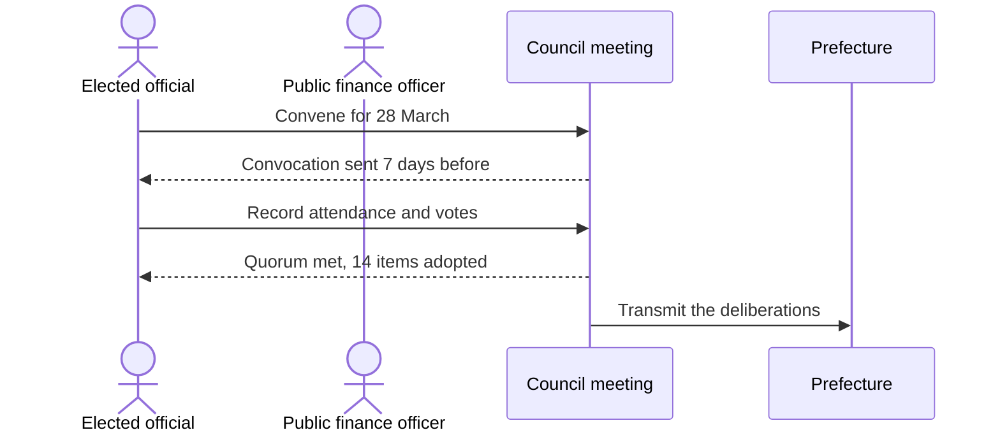

🏠 [Specs](../../../../README.md) › 🏷️ [Sectors](../../../README.md) › 🏛️ [SC20 Public bodies](../../README.md) ›
📝 [Use cases](../README.md) › 📝 [Use cases: FL-SC20-05 Council, civil registry, permits and assets](README.md) ›
📝 UC-SC20-17 Run council meetings and deliberations

# 📝 UC-SC20-17 Run council meetings and deliberations

**Status:** 🔄 waiting for the owner

## Summary

The elected official prepares the council meeting: the convocation with its agenda and notes, the attendance and the
quorum, the vote on each item, the minutes, and the transmission of the deliberations to the prefecture.

## Personas

- [U55 Elected official](../../../../01-users/personas/u55-elected-official.md)
- [U54 Public finance officer](../../../../01-users/personas/u54-public-finance-officer.md)

## Goal

Each meeting is convened in time, held with its quorum, minuted, and every deliberation is sent to the prefecture so
that it becomes enforceable.

## Trigger

A council meeting is to be held, or a deliberation is adopted.

## Frequency

A few meetings a year per body, with dozens of deliberations.

## Preconditions

- The council members are entered with their roles.
- The agenda items have their documents.
- The meeting is in the calendar
  [UC-F4-21](../../../../02-functional/f04-meetings/use-cases/12-rooms-and-client-video/uc-f04-21-book-a-meeting-room-and-equipment.md).

## Postconditions

- **Succeeded:** each deliberation is saved ([E-SC20-12 Deliberation](../../data/e-sc20-12-deliberation.md)) with its
  vote and its transmission, and the minutes are posted.
- **Failed:** a meeting is not held without its quorum, a convocation is not sent after its legal delay, and a
  deliberation is not enforceable before it is transmitted.

## Main flow

1. The elected official opens the council screen
   ([S-SC20-17](../../screens/05-council-registry-permits-and-assets/s-sc20-17-council-meetings.md)) and creates the
   meeting with its date and place.
2. The officer adds the agenda items, each with its explanatory note and documents.
3. SimpleERP sends the convocation to every member within the legal delay
   [BR-SC20-17](../../business-rules/br-sc20-17-deliberations-are-sent-to-the-prefecture-to-become-enforceable.md).
4. At the meeting the attendance is recorded and SimpleERP checks the quorum.
5. For each item the vote is recorded with votes for, against and abstentions, and the result.
6. After the meeting the minutes are posted and each adopted deliberation is transmitted to the prefecture.

## Alternative flows

- 4a. The quorum is not reached: the meeting is adjourned and a second convocation is sent.
- 5a. A member holds a proxy: it is recorded with the member who gave it.
- 6a. A deliberation concerns the budget: it is linked to the budget
  ([UC-SC20-01](../01-public-accounting/uc-sc20-01-prepare-and-vote-the-budget.md)).

## Error flows

- 3e. The convocation would leave less than the legal delay: it cannot be sent.
- 6e. The transmission fails: the deliberation stays Adopted and the officer is told.
- Any step: a service does not answer; the call is retried first
  ([BR-F3-32](../../../../02-functional/f03-assistant/business-rules/br-f03-32-retry-before-an-error.md)), then the
  message follows the error pattern ([D122](../../../../06-decisions/ux/d122-error-message-standard.md)) and what the
  user typed stays on the screen.

## Business rules

- [BR-SC20-17](../../business-rules/br-sc20-17-deliberations-are-sent-to-the-prefecture-to-become-enforceable.md)
- [BR-SC20-12](../../business-rules/br-sc20-12-decisions-are-published-to-become-enforceable.md)

## Entities

- [E-SC20-12 Deliberation](../../data/e-sc20-12-deliberation.md): convened, voted, transmitted
- [E-F4-22 Meeting agenda](../../../../02-functional/f04-meetings/data/e-f04-22-meeting-agenda.md): read, the meeting
  agenda pattern
- [E-SC20-10 Council decision](../../data/e-sc20-10-council-decision.md): created, the decision to publish
- [E-SC20-01 Budget](../../data/e-sc20-01-budget.md): read, the budget voted

## Permissions

Elected official convenes and signs; the officer prepares the items; council members read their convocation and vote in
person. The votes of each member are recorded only where the law requires a roll call.

## Notifications

Each member, by email and on the phone: the convocation with its agenda. The officer, in the app: a deliberation not
transmitted.

## Audit events

Each convocation, attendance, quorum, vote, minutes and transmission, who and when.

## AI involvement

No AI step of its own. The AI assistant may open the screen and prefill it from the user's words; the user checks and
confirms
[BR-F3-07](../../../../02-functional/f03-assistant/business-rules/br-f03-07-no-deletes-no-irreversible-acts.md).

## API, MCP and A2A exposure

T5 operations of the capability for the personas above: create, read, update and list. The MCP tool of the
capability may read and propose, never confirm alone. No A2A skill.

## Screens

- [S-SC20-17](../../screens/05-council-registry-permits-and-assets/s-sc20-17-council-meetings.md)

## Flowchart

See
[FL-SC20-05 Council, civil registry, permits and assets](../../flows/fl-sc20-05-council-registry-permits-and-assets.md#flowchart).

## Sequence diagram

## Acceptance criteria

1. **Given** a convocation sent after the legal delay **when** the officer sends it **then** it is refused and the delay
   is shown.
2. **Given** a meeting where the quorum is not met **when** the elected official records attendance **then** the meeting
   is adjourned.
3. **Given** an adopted deliberation **when** the meeting ends **then** it is transmitted to the prefecture.

## Non-functional notes

The screen answers within 2 seconds for 10,000 records; every change is audited.

## Regulatory references

The members of a municipal council are convened in writing a number of days before the meeting, with the
agenda and an explanatory note; the council deliberates only if the majority of its members in office are present;
deliberations are adopted by majority; the minutes are posted shortly after; and the deliberations are sent to the
prefecture to become enforceable. The delays, the quorum and the sizes of bodies are data of the France pack.

- France-pack rule, (Proposed) until its law is read:
  [CR-FR-262 Deliberations and the legality check](../../../../10-country-packs/france/company/cr-fr-262-deliberations-legality-check.md)

## Related use cases

- [UC-SC20-18 Keep the civil registry](uc-sc20-18-keep-the-civil-registry.md)
- [UC-SC20-12](../03-citizen-services/uc-sc20-12-publish-council-decisions.md)
- [UC-F4-21](../../../../02-functional/f04-meetings/use-cases/12-rooms-and-client-video/uc-f04-21-book-a-meeting-room-and-equipment.md)

## Open questions

None.

---

⬅️ [UC-SC20-16](../04-public-hr-and-pay/uc-sc20-16-ask-the-assistant-about-the-budget.md) · ⬆️ [Up](README.md) ·
➡️ [UC-SC20-18 Keep the civil registry](uc-sc20-18-keep-the-civil-registry.md)
