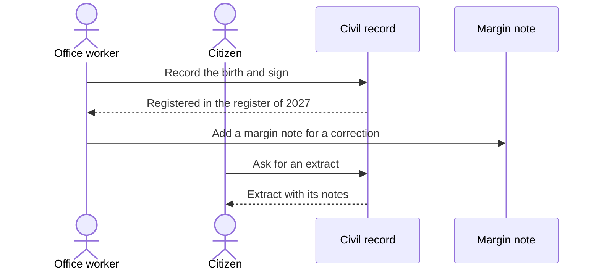

🏠 [Specs](../../../../README.md) › 🏷️ [Sectors](../../../README.md) › 🏛️ [SC20 Public bodies](../../README.md) ›
📝 [Use cases](../README.md) › 📝 [Use cases: FL-SC20-05 Council, civil registry, permits and assets](README.md) ›
📝 UC-SC20-18 Keep the civil registry

# 📝 UC-SC20-18 Keep the civil registry

**Status:** 🔄 waiting for the owner

## Summary

The office worker, as civil-status officer or its delegate, keeps the civil registry: the acts of birth, marriage and
death are written once and signed, never changed, and corrected only by a margin note. Citizens ask for extracts on the
phone.

## Personas

- [U16 Office worker](../../../../01-users/personas/u16-office-worker.md)
- [U56 Citizen](../../../../01-users/personas/u56-citizen.md)

## Goal

Every act is written, signed and kept as the law requires, every correction is a margin note with its legal basis, and
extracts go only to those entitled.

## Trigger

A birth, marriage or death is declared, a correction is ordered, or a citizen asks for an extract.

## Frequency

A few acts a week for a commune, many extracts.

## Preconditions

- The office worker is appointed or delegated to keep the registry.
- The civil-status software is certified or approved where the law requires it.
- The citizen has a portal account for extracts
  [UC-F2-20](../../../../02-functional/f02-no-code-configuration/use-cases/09-portals-and-offline-forms/uc-f02-20-expose-a-record-type-on-a-portal.md).

## Postconditions

- **Succeeded:** the act is saved ([E-SC20-13 Civil record](../../data/e-sc20-13-civil-record.md)) signed and
  registered, each margin note is attached with its basis, and each extract is logged.
- **Failed:** an act is never changed after its signature, a correction is never made except by a margin note, and an
  extract is never given to someone not entitled.

## Main flow

1. The office worker opens the civil registry screen
   ([S-SC20-18](../../screens/05-council-registry-permits-and-assets/s-sc20-18-civil-registry.md)) and records a
   declaration of birth with its documents.
2. The civil-status officer reviews and signs the act, which is then registered in the year's register.
3. Later a correction or a mention is ordered: the office worker adds it as a margin note
   ([BR-SC20-18](../../business-rules/br-sc20-18-civil-records-are-corrected-only-by-a-margin-note.md)).
4. A citizen asks for an extract on the phone and proves who they are.
5. SimpleERP checks they are entitled to it and issues the extract with the margin notes.
6. Each extract and each access is logged.

## Alternative flows

- 3a. The correction needs a court's decision: the decision is attached to the margin note.
- 5a. The citizen is not entitled to a full copy: only the extract the law allows is issued.
- 1a. The act is sent from another body: the office worker records the transcription with its reference.

## Error flows

- 3e. Someone tries to edit a registered act: the edit is refused and only a margin note is offered.
- 4e. The citizen cannot prove who they are: the request is refused.
- Any step: a service does not answer; the call is retried first
  ([BR-F3-32](../../../../02-functional/f03-assistant/business-rules/br-f03-32-retry-before-an-error.md)), then the
  message follows the error pattern ([D122](../../../../06-decisions/ux/d122-error-message-standard.md)) and what the
  user typed stays on the screen.

## Business rules

- [BR-SC20-18](../../business-rules/br-sc20-18-civil-records-are-corrected-only-by-a-margin-note.md)
- [BR-SC20-18](../../business-rules/br-sc20-18-civil-records-are-corrected-only-by-a-margin-note.md)

## Entities

- [E-SC20-13 Civil record](../../data/e-sc20-13-civil-record.md): written, signed, annotated
- [E-F11-09](../../../../02-functional/f11-online-shop/data/e-f11-09-customer-account.md): read, the citizen's portal
  account
- [E-F2-14](../../../../02-functional/f02-no-code-configuration/data/e-f02-14-signature-request.md): read, the signature
  pattern

## Permissions

Civil-status officer signs; the office worker with the delegation records and annotates; the citizen asks for extracts
of their own acts. No other staff may read an act.

## Notifications

The citizen, on the phone: the extract is ready or the request is refused.

## Audit events

Each act written, signed, annotated and extracted, each access, who and when.

## AI involvement

No AI step of its own. The AI assistant may open the screen and prefill it from the user's words; the user checks and
confirms
[BR-F3-07](../../../../02-functional/f03-assistant/business-rules/br-f03-07-no-deletes-no-irreversible-acts.md).

## API, MCP and A2A exposure

T5 operations of the capability for the personas above: create, read, update and list. The MCP tool of the
capability may read and propose, never confirm alone. No A2A skill.

## Screens

- [S-SC20-18](../../screens/05-council-registry-permits-and-assets/s-sc20-18-civil-registry.md)

## Flowchart

See
[FL-SC20-05 Council, civil registry, permits and assets](../../flows/fl-sc20-05-council-registry-permits-and-assets.md#flowchart).

## Sequence diagram

## Acceptance criteria

1. **Given** a registered act **when** someone edits it **then** the edit is refused and a margin note is offered.
2. **Given** a correction ordered by a court **when** the office worker adds it **then** a margin note with the decision
   is attached.
3. **Given** a citizen not entitled to a full copy **when** they ask for it **then** only the allowed extract is issued.

## Non-functional notes

The screen answers within 2 seconds for 10,000 records; every change is audited.

## Regulatory references

Civil-status acts of birth, marriage and death are written by the civil-status officer, signed and kept in a
register; an act is not changed after it is signed: a correction is made by a margin note or by a court's decision, and
full copies are limited to those entitled. Software used to keep the registry usually has to be certified. Personal data
of the registry are not erased on request. The register's kinds, delays and entitlements are data of the France pack.
Related: [CR-FR-051](../../../../10-country-packs/france/data-protection/cr-fr-051-access-and-erasure.md),
[CR-FR-052](../../../../10-country-packs/france/data-protection/cr-fr-052-storage-limitation.md),
[CR-FR-055](../../../../10-country-packs/france/data-protection/cr-fr-055-health-data-hosting.md).

- France-pack rule, (Proposed) until its law is read:
  [CR-FR-260 Civil registry records](../../../../10-country-packs/france/company/cr-fr-260-civil-registry.md)

## Related use cases

- [UC-SC20-17](uc-sc20-17-run-council-meetings-and-deliberations.md)
- [UC-SC20-19 Instruct planning permits](uc-sc20-19-instruct-planning-permits.md)
- [UC-SC20-09](../03-citizen-services/uc-sc20-09-receive-a-citizens-request.md)
- [UC-SC20-19 Instruct planning permits](uc-sc20-19-instruct-planning-permits.md)

## Open questions

None.

---

⬅️ [UC-SC20-17 Run council meetings and deliberations](uc-sc20-17-run-council-meetings-and-deliberations.md) ·
⬆️ [Up](README.md) · ➡️ [UC-SC20-19 Instruct planning permits](uc-sc20-19-instruct-planning-permits.md)
