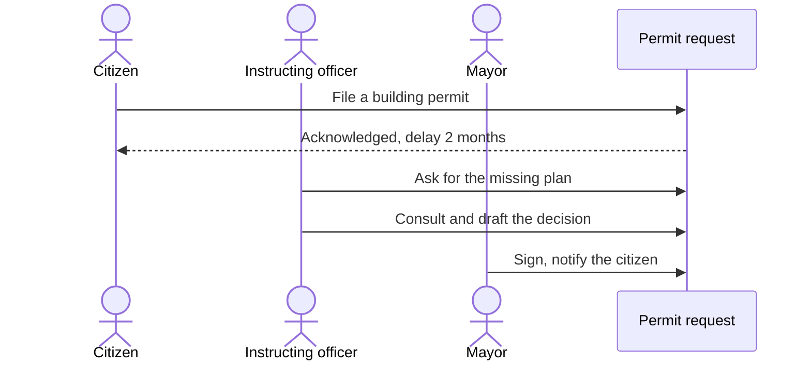

🏠 [Specs](../../../../README.md) › 🏷️ [Sectors](../../../README.md) › 🏛️ [SC20 Public bodies](../../README.md) ›
📝 [Use cases](../README.md) › 📝 [Use cases: FL-SC20-05 Council, civil registry, permits and assets](README.md) ›
📝 UC-SC20-19 Instruct planning permits

# 📝 UC-SC20-19 Instruct planning permits

**Status:** 🔄 waiting for the owner

## Summary

A citizen files a planning permit request through the portal on the phone, and the public finance officer's service
instructs it: completeness check, the legal delay, consultations, the decision and the notification, with the clock
followed from the day the file is complete.

## Personas

- [U54 Public finance officer](../../../../01-users/personas/u54-public-finance-officer.md)
- [U56 Citizen](../../../../01-users/personas/u56-citizen.md)

## Goal

Each request is decided inside its legal delay, and the clock is never lost: a request is acknowledged, completed or
extended in time.

## Trigger

A citizen files a permit request, or a consulted body answers.

## Frequency

A few a week for a commune.

## Preconditions

- The kinds of permit and their delays are loaded from the country pack.
- The citizen has a portal account
  [UC-F2-20](../../../../02-functional/f02-no-code-configuration/use-cases/09-portals-and-offline-forms/uc-f02-20-expose-a-record-type-on-a-portal.md).
- The consulted bodies of the commune are listed.

## Postconditions

- **Succeeded:** the request is saved ([E-SC20-14 Permit request](../../data/e-sc20-14-permit-request.md)) with its
  kind, clock, consultations and decision, notified to the citizen in the delay.
- **Failed:** no request is left without a delay, an incomplete file is returned in the delay that keeps the clock, and
  a request near its delay is flagged.

## Main flow

1. The citizen files a request on the phone
   ([S-SC20-19](../../screens/05-council-registry-permits-and-assets/s-sc20-19-planning-permits.md)) with the form and
   the plans.
2. simple-ERP sends the acknowledgement with the delay and starts the clock
   ([BR-SC20-19](../../business-rules/br-sc20-19-silence-after-the-legal-delay-counts-as-the-law-says.md)).
3. The instructing officer checks completeness and, within the first month, asks for any missing document.
4. The officer sends consultations to the bodies the project needs and follows their answers.
5. The officer drafts the decision and the mayor or the delegated elected official signs it.
6. The decision is notified to the citizen before the delay ends.

## Alternative flows

- 3a. A document is missing: the file is Incomplete, the citizen is told what to add, and the delay restarts when the
  file is complete.
- 4a. A consultation extends the delay: the new delay is shown with its reason.
- 6a. The decision is not notified in the delay: the file is marked Delay passed and the law's effect is recorded.

## Error flows

- 3e. The request for a missing document is sent after the first month: the delay is not restarted.
- 6e. The mayor is absent and no delegate signs: the officer is warned five days before the delay.
- Any step: a service does not answer; the call is retried first
  ([BR-F3-32](../../../../02-functional/f03-assistant/business-rules/br-f03-32-retry-before-an-error.md)), then the
  message follows the error pattern ([D122](../../../../06-decisions/ux/d122-error-message-standard.md)) and what the
  user typed stays on the screen.

## Business rules

- [BR-SC20-19](../../business-rules/br-sc20-19-silence-after-the-legal-delay-counts-as-the-law-says.md)
- [BR-SC20-19](../../business-rules/br-sc20-19-silence-after-the-legal-delay-counts-as-the-law-says.md)

## Entities

- [E-SC20-14 Permit request](../../data/e-sc20-14-permit-request.md): filed, instructed, decided
- [E-SC20-08 Citizen request](../../data/e-sc20-08-citizen-request.md): read, the citizen's request pattern
- [E-SC20-10 Council decision](../../data/e-sc20-10-council-decision.md): created, the decision to publish

## Permissions

Citizen files and reads their own request; instructing officer checks and drafts; the mayor or delegate signs.
The plans are visible only to the officers and the consulted bodies.

## Notifications

The citizen, by email and on the phone: the acknowledgement, the missing documents and the decision. The officer, in the
app: a delay in five days.

## Audit events

Each filing, completion, consultation, decision, notification and delay, who and when.

## AI involvement

No AI step of its own. The AI assistant may open the screen and prefill it from the user's words; the user checks and
confirms
[BR-F3-07](../../../../02-functional/f03-assistant/business-rules/br-f03-07-no-deletes-no-irreversible-acts.md).

## API, MCP and A2A exposure

T5 operations of the capability for the personas above: create, read, update and list. The MCP tool of the
capability may read and propose, never confirm alone. No A2A skill.

## Screens

- [S-SC20-19](../../screens/05-council-registry-permits-and-assets/s-sc20-19-planning-permits.md)

## Flowchart

See
[FL-SC20-05 Council, civil registry, permits and assets](../../flows/fl-sc20-05-council-registry-permits-and-assets.md#flowchart).

## Sequence diagram

## Acceptance criteria

1. **Given** a complete request **when** the citizen files it **then** the acknowledgement with the delay is sent and
   the clock starts.
2. **Given** a missing document asked in the first month **when** the citizen completes it **then** the delay restarts
   from the day it is complete.
3. **Given** a request near its delay **when** the officer opens the list **then** it is flagged five days before.

## Non-functional notes

The screen answers within 2 seconds for 10,000 records; every change is audited.

## Regulatory references

A planning-permit request is acknowledged with the delay the law gives, which depends on the kind of permit;
a missing document must be asked for within a short time after filing, and the delay starts or restarts when the file is
complete; consultations may extend it; and when no decision is notified in the delay, the law gives silence an effect
that depends on the kind of permit, usually an approval, sometimes a refusal. Bodies of a size must accept requests
electronically. The kinds, delays and effects are data of the France pack.

- France-pack rule, (Proposed) until its law is read:
  [CR-FR-261 Planning permit instruction delays](../../../../10-country-packs/france/real-estate/cr-fr-261-planning-permit-delays.md)

## Related use cases

- [UC-SC20-18 Keep the civil registry](uc-sc20-18-keep-the-civil-registry.md)
- [UC-SC20-20 Keep the public assets register](uc-sc20-20-keep-the-public-assets-register.md)
- [UC-SC20-09](../03-citizen-services/uc-sc20-09-receive-a-citizens-request.md)
- [UC-SC20-12](../03-citizen-services/uc-sc20-12-publish-council-decisions.md)

## Open questions

None.

---

⬅️ [UC-SC20-18 Keep the civil registry](uc-sc20-18-keep-the-civil-registry.md) · ⬆️ [Up](README.md) ·
➡️ [UC-SC20-20 Keep the public assets register](uc-sc20-20-keep-the-public-assets-register.md)
