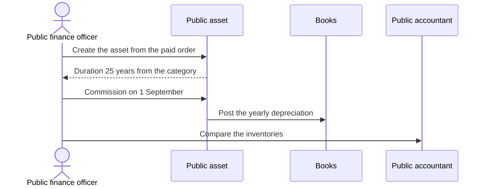

🏠 [Specs](../../../../README.md) › 🏷️ [Sectors](../../../README.md) › 🏛️ [SC20 Public bodies](../../README.md) ›
📝 [Use cases](../README.md) › 📝 [Use cases: FL-SC20-05 Council, civil registry, permits and assets](README.md) ›
📝 UC-SC20-20 Keep the public assets register

# 📝 UC-SC20-20 Keep the public assets register

**Status:** ✅ specified

## Summary

The public finance officer keeps the register of the body's assets: buildings, roads, vehicles, equipment, with their
inventory number, value, date of commissioning and depreciation under the M57 framework. The register agrees with the
public accountant's.

## Personas

- [U54 Public finance officer](../../../../01-users/personas/u54-public-finance-officer.md)

## Goal

Every asset is in the register once, depreciated from its commissioning over the duration the framework sets, and the
register of the body agrees with that of the public accountant.

## Trigger

An asset is acquired or finished, the year closes, or an asset is sold or scrapped.

## Frequency

Dozens a month; the whole register is depreciated at year end.

## Preconditions

- The accounting framework M57 is set
  ([E-F8-01 Account](../../../../02-functional/f08-accounting/data/e-f08-01-account.md)).
- The depreciation durations by category are loaded from the country pack.
- The acquisition has a payment order ([E-SC20-03 Payment order](../../data/e-sc20-03-payment-order.md)).

## Postconditions

- **Succeeded:** the asset is saved ([E-SC20-15 Public asset](../../data/e-sc20-15-public-asset.md)) with its inventory
  number, value, commissioning date, duration and yearly depreciation, and agrees with the accountant's inventory.
- **Failed:** an asset is not depreciated before its commissioning, a duration is not typed by hand, and a difference
  with the accountant's inventory is listed.

## Main flow

1. The public finance officer opens the assets screen
   ([S-SC20-20](../../screens/05-council-registry-permits-and-assets/s-sc20-20-public-assets.md)) and creates an asset
   from a paid acquisition.
2. The officer picks the category; SimpleERP gives the depreciation duration of the category
   ([BR-SC20-20](../../business-rules/br-sc20-20-assets-follow-the-m57-depreciation-rules.md)).
3. While the asset is a work in progress it is not depreciated; on commissioning the officer enters the date and the
   depreciation starts.
4. At year end SimpleERP computes the depreciation of each asset and posts it
   [UC-F8-08](../../../../02-functional/f08-accounting/use-cases/04-tax-assets-and-analytics/uc-f08-08-manage-fixed-assets-and-deferrals.md).
5. The officer compares the register with the public accountant's inventory and explains each difference.

## Alternative flows

- 3a. The asset was inherited from the previous framework: it keeps its previous value and its remaining duration.
- 5a. An asset is sold or scrapped: it is marked Disposed and the gain or loss is computed.
- 2a. An asset financed by a grant: the grant is depreciated over the same duration.

## Error flows

- 2e. The category has no duration in the pack: the asset cannot be commissioned.
- 5e. A difference with the accountant's inventory is not explained: the year cannot be closed.
- Any step: a service does not answer; the call is retried first
  ([BR-F3-32](../../../../02-functional/f03-assistant/business-rules/br-f03-32-retry-before-an-error.md)), then the
  message follows the error pattern ([D122](../../../../06-decisions/ux/d122-error-message-standard.md)) and what the
  user typed stays on the screen.

## Business rules

- [BR-SC20-20](../../business-rules/br-sc20-20-assets-follow-the-m57-depreciation-rules.md)
- [BR-SC20-20](../../business-rules/br-sc20-20-assets-follow-the-m57-depreciation-rules.md)

## Entities

- [E-SC20-15 Public asset](../../data/e-sc20-15-public-asset.md): created, commissioned, depreciated
- [E-F8-07 Fixed asset](../../../../02-functional/f08-accounting/data/e-f08-07-fixed-asset.md): read, the fixed asset
  pattern this register extends
- [E-F8-18 Grant](../../../../02-functional/f08-accounting/data/e-f08-18-grant.md): read, the grants received
- [E-SC20-03 Payment order](../../data/e-sc20-03-payment-order.md): read, the payment order of the acquisition

## Permissions

Public finance officer keeps the register; the elected official reads the totals; departments read their own assets.
A disposal needs a deliberation or a delegation of the council.

## Notifications

The officer, in the app: assets not commissioned after a year and a difference with the accountant.

## Audit events

Each asset created, commissioned, depreciated, changed, disposed and compared, who and when.

## AI involvement

No AI step of its own. The AI assistant may open the screen and prefill it from the user's words; the user checks and
confirms
[BR-F3-07](../../../../02-functional/f03-assistant/business-rules/br-f03-07-no-deletes-no-irreversible-acts.md).

## API, MCP and A2A exposure

T5 operations of the capability for the personas above: create, read, update and list. The MCP tool of the
capability may read and propose, never confirm alone. No A2A skill.

## Screens

- [S-SC20-20](../../screens/05-council-registry-permits-and-assets/s-sc20-20-public-assets.md)

## Flowchart

See
[FL-SC20-05 Council, civil registry, permits and assets](../../flows/fl-sc20-05-council-registry-permits-and-assets.md#flowchart).

## Sequence diagram

## Acceptance criteria

1. **Given** an asset commissioned on 1 September **when** the year closes **then** the depreciation is computed from
   that date.
2. **Given** a category without a duration **when** the officer commissions the asset **then** it is refused.
3. **Given** a difference with the accountant's inventory **when** the officer closes the year **then** it is listed and
   must be explained.

## Non-functional notes

The screen answers within 2 seconds for 10,000 records; every change is audited.

## Regulatory references

Under M57, local bodies depreciate their assets from the date they are put into service over a duration set
by category, except land and some heritage assets; work in progress is not depreciated; grants received for an asset are
depreciated over the same duration; and the inventory of the authorising officer and the accounting of the public
accountant must agree. The assets of the previous framework, M14, keep their value and their remaining duration.
Durations are data of the France pack. Related:
[CR-FR-064](../../../../10-country-packs/france/accounting/cr-fr-064-accounting-frameworks.md).

## Related use cases

- [UC-SC20-19 Instruct planning permits](uc-sc20-19-instruct-planning-permits.md)
- [UC-F8-08](../../../../02-functional/f08-accounting/use-cases/04-tax-assets-and-analytics/uc-f08-08-manage-fixed-assets-and-deferrals.md)
- [UC-SC20-03](../01-public-accounting/uc-sc20-03-issue-payment-orders-and-revenue-titles.md)

## Open questions

None.

---

⬅️ [UC-SC20-19 Instruct planning permits](uc-sc20-19-instruct-planning-permits.md) · ⬆️ [Up](README.md)
