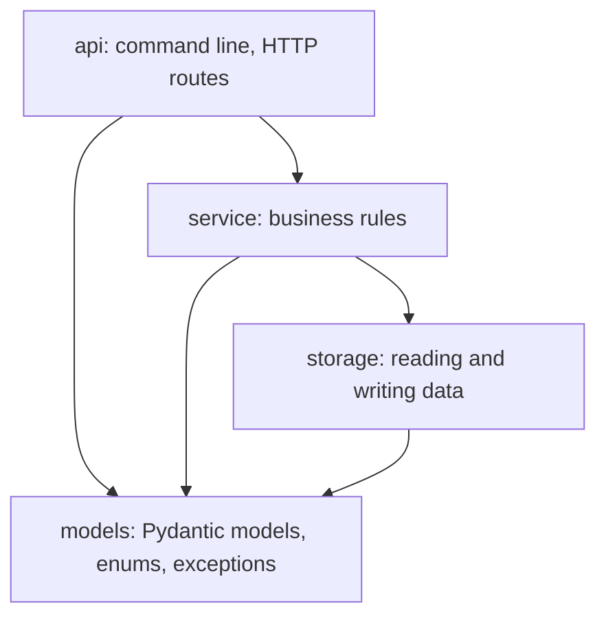

# Architecture

simple-erp is written in Python 3.13 with uv. Its code is split in four layers, each calling only the one below it,
so that business rules live in one place and storage can change without touching them.

## Layers

- `api` never imports `storage`, and no layer imports one above it. `tests/conventions/test_layers.py` enforces it.
- Every runnable class has the `initialize()`, `run()`, `close()` lifecycle and is built by a factory
  (`AGENT.md`, "Lifecycle and factories").
- Each class has its own file, and a folder holds five Python files at most.

## Current layout

One package, `src/{api,service,storage,models}`, built with `uv_build` (`pyproject.toml`). The console script
`simple-erp` runs `api.cli.main:main`.

## Target layout

A mono-repo of services and front ends, each with its own Docker image (`AGENT.md`, "Mono-repo"):

| Path | Holds |
|---|---|
| `services/<service>/` | A back-end service: its `Dockerfile`, `pyproject.toml`, `conf/`, `src/<service>/{api,service,storage,models}/`, `tests/` |
| `frontends/<frontend>/` | A front end: its `Dockerfile`, `src/`, and its Playwright tests in `e2e/` |
| `packages/` | Python code services share, with no business rules |
| `compose.e2e.yaml` | Starts the real images for Playwright and for the stages |

The framework of the front ends is still to be decided.

## The harness's own code

The Claude Code harness has its own uv workspace in `.claude/skills/` (shared package `harness-core` and one package
per tool). It follows the same rules as the application, and is checked by CI's `harness tools` job. See
[Development process](development-process.md).

Last reviewed: 2026-11-10 (GH-1)
