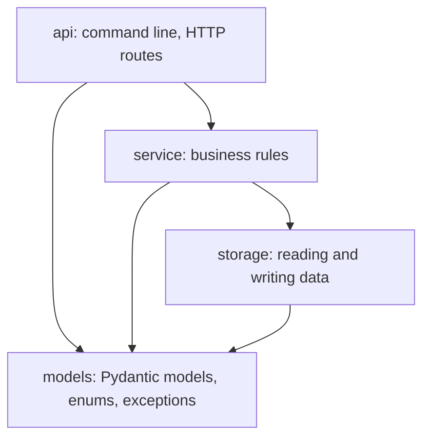
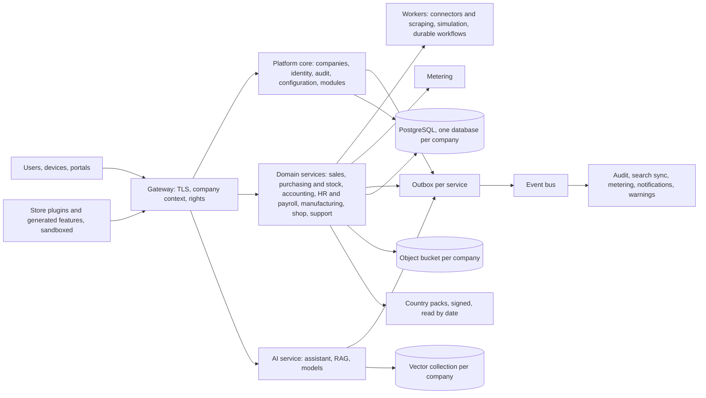

# Architecture

simple-erp is written in Python 3.13 with uv. Its code is split in four layers, each calling only the one below it,
so that business rules live in one place and storage can change without touching them.

## Layers

- `api` never imports `storage`, and no layer imports one above it. `tests/conventions/test_layers.py` enforces it.
- Every runnable class has the `initialize()`, `run()`, `close()` lifecycle and is built by a factory
  (`AGENT.md`, "Lifecycle and factories").
- Each class has its own file, and a folder holds five Python files at most.

## Current layout

One package, `src/{api,service,storage,models}`, built with `uv_build` (`pyproject.toml`). The console script
`simple-erp` runs `api.cli.main:main`.

## Target layout

A mono-repo of services and front ends, each with its own Docker image (`AGENT.md`, "Mono-repo"):

| Path | Holds |
|---|---|
| `services/<service>/` | A back-end service: its `Dockerfile`, `pyproject.toml`, `conf/`, `src/<service>/{api,service,storage,models}/`, `tests/` |
| `frontends/<frontend>/` | A front end: its `Dockerfile`, `src/`, and its Playwright tests in `e2e/` |
| `packages/` | Python code services share, with no business rules |
| `compose.e2e.yaml` | Starts the real images for Playwright and for the stages |

The framework of the front ends is still to be decided.

## The harness's own code

The Claude Code harness has its own uv workspace in `.claude/skills/` (shared package `harness-core` and one package
per tool). It follows the same rules as the application, and is checked by CI's `harness tools` job. See
[Development process](../delivery/development-process.md).

## Target design (specified in GH-2, not built yet)

**Services (D405).** A mono-repo of micro-services, one image each (`AGENT.md`), cut by business domain:

- a platform core: companies, identity, audit, configuration, the module registry;
- one service per business domain: sales, purchasing and stock, accounting, HR and payroll, manufacturing, point of sale
  and online shop, support;
- an AI service (assistant, RAG, models, through the AI gateway of [AI operations](../operations/ai-operations.md));
- a connectors and scraping worker, a simulation worker, a metering service;
- plugins in the plugin runtime.

**Tenancy (TC-01).** One set of services per cluster serves many companies; each company has its own PostgreSQL database
(D19), object-storage bucket and vector collection; the company context is checked at the gateway, in each service and
in storage. A dedicated namespace or cluster only for plans that need it (health data, large companies).

**Messaging.** Synchronous HTTP between services for reads and commands; an event bus for what happened (audit, search
sync, metering, notifications, simulations, warnings), self-hosted (for example NATS or Kafka), fed through an outbox in
each service so that no event is lost.

**Plugins (TC-02, TC-12).** First-party industry modules (F10 to F13) run as normal services; store plugins and
generated features run in a sandbox (WebAssembly or an isolated container per plugin) and reach the ERP only through the
public API with their declared permissions.

**Reference sizes.** Self-hosted: one company up to 250 users; an IT provider: 200 client companies on one platform; the
hosted edition: 5 000 companies per cluster, adding clusters beyond. Services are stateless and scale horizontally;
workers scale on queue length. The resource profiles are in
[Performance and capacity](../infrastructure/performance-and-capacity.md).

**Offline devices (TC-06).** Tills, waiters' tablets, field workers, carers and drivers use offline-first apps: a local
encrypted store, a sync protocol, number ranges reserved per device, conflict rules per record type.

**Country packs (TC-04).** Each pack is a signed, versioned catalogue of values with validity dates, read by one shared
rules library by the date of the fact, released apart from the software; complex rules (payroll formulas) are small
signed modules.

**Long runs (TC-11, TC-14, TC-22).** A self-hosted durable workflow engine (for example Temporal) runs multi-step work:
resumable, progress streamed, a Stop button, time and cost budgets; short tasks run on simple queue workers.

**Metering (TC-21).** Every paid call goes through one metering gateway or shared library: budget check, reservation,
call, settlement, usage event; a legal-duty flag bypasses the stop (F22).

**Overview.** The services and stores above, as specified (not built yet):

Decided in [D405](../../specs/06-decisions/technical/d405-architecture-and-scalability.md).

Last reviewed: 2026-11-12 (GH-2)
