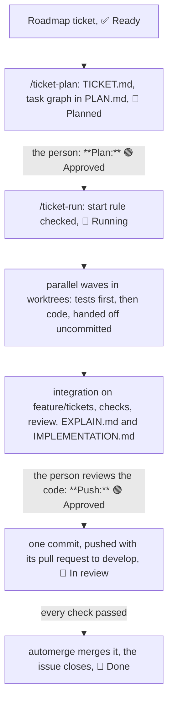

# Development process

How a change goes from a roadmap ticket to a release, with the Claude Code harness versioned in `.claude/`. The rules
are in [.claude/rules/tickets.md](../../../.claude/rules/tickets.md) (TKT-1 to TKT-26), and `CLAUDE.md` sums them up.

## Tracking

- Work follows the roadmap of `docs/specs/00-vision/roadmap/phases/`: phases P0 to P11, each made of epics and
  tickets. A ticket's ID is `T<phase>.<nn>` (`T2.04`), an epic's `E<phase>.<n>`, a phase's `P<n>`; the prerequisites
  of each ticket are in `phases/gantt/ticket-graph.json`.
- The GitHub project **SimpleERP roadmap** mirrors it (TKT-17): one issue per phase, epic and ticket, the tickets as
  sub-issues of their epic and the epics of their phase, one milestone per phase, a **Blocked by** link per
  prerequisite. `python3 .claude/scripts/github/board.py bootstrap` creates them once.
- Every ticket sits in one column: 📥 Backlog (a prerequisite is open), ✅ Ready, 📝 Planned, 🔄 Running, 👀 In review,
  🏁 Done. The workflows move the cards; `/board` shows the board in the terminal, and the Claude Code status line the
  open tickets and the counts.
- **Customer issues** are the only issues outside the roadmap: a customer's request, from the issue forms or brought
  by the DevOps agents (F25), is labelled `USER-FEATURE-REQUEST` or `USER-REPORTED-BUG`. One created by an agent
  carries `needs-maintainer-approval` and stays in Backlog until a maintainer removes the label.
- A ticket's working folder `docs/tickets/<ID>/` holds `TICKET.md`, `PLAN.md`, `PROGRESS.md` (events, timings and
  tokens), then `EXPLAIN.md`, `IMPLEMENTATION.md`, `REVIEW.md` and `tests-evidences/` (TKT-1).

## A ticket's life

- **Plan** (TKT-2, TKT-3, TKT-4): `TICKET.md` states what to deliver and how it is accepted, from the specifications
  only, every link resolving. `PLAN.md` splits the work into tasks that run in parallel as much as possible. Nothing is
  built before the person approves the plan.
- **Run** (TKT-5, TKT-16): every worker runs in its own worktree and hands its changes off uncommitted. Every running
  ticket lives in the main checkout, on the shared branch `feature/tickets`, and owns only its own files. The start
  rule lets a ticket run once its prerequisites are done and no open ticket changes the same service, front end or
  package. `/ticket-run <ID> --force` starts anyway, on the person's decision.
- **Done** (TKT-6, TKT-12, TKT-14): the checks pass, the review converges, and `EXPLAIN.md` and `IMPLEMENTATION.md`
  explain the work and its choices. A ticket that changes a front end lists its screens and has its Playwright tests
  (TKT-21).
- **Push** (TKT-18, TKT-15): nothing is committed or pushed before the person has reviewed the code. The ticket is then
  one commit on `feature/tickets`, with its own `Closes #<issue>`, and its pull request to `develop` is merged by
  `automerge.yml` once every check passed.
- **Groups** (TKT-20): `/issue-plan <refs>` plans an issue with its child issues, or a group of tickets, epics and
  phases, in one go; the person approves the group once; `/issue-run <refs>` runs it as fast as the start rule
  allows.
- **Progress** (TKT-9, TKT-10): a report every 2 minutes while a ticket workflow runs, and the time and tokens of
  every step in `PROGRESS.md`.
- **Release** (TKT-26): `/release` starts `release.yml` on `develop`; the release reaches `master` by itself
  ([CI/CD and stages](ci-cd-and-stages.md#releases)).

## Rules

| File | IDs | About |
|---|---|---|
| `AGENT.md` | | How code is written: layout, layers, file shape, typing, naming, docstrings, exceptions, logging, models, tests |
| `.claude/rules/tickets.md` | TKT | Tickets, plans, worktrees, done, models and cost, reviews, GitFlow, the board, releases |
| `.claude/rules/enforcement.json` | | What enforces each rule, more than a reading alone (TKT-22) |

**A gap found in the harness is closed with three things:** the fix, a test that fails without it, and the rule that
makes it a gap, with its enforcers.

## Hooks

| Event | Hook | Does |
|---|---|---|
| PreToolUse (Bash) | `.claude/hooks/guard_git.py` | Refuses `--no-verify`, a rebase, reset or forced push of `develop` or `master`, and asks before a push to them or a release |
| PostToolUse (Edit, Write) | `.claude/hooks/format_edited.py` | Formats only the edited file, with the formatter of its language (TKT-13) |
| SubagentStop | `.claude/hooks/check_touched.py` | Runs, in a worker's worktree, the checks of the layers its task touched (TKT-13) |
| git pre-commit, commit-msg, pre-push | `.githooks/` | Refuse a commit or push on `develop` or `master`, a branch outside GitFlow and a ticket commit without its ID (TKT-15) |

Last reviewed: 2026-11-27
