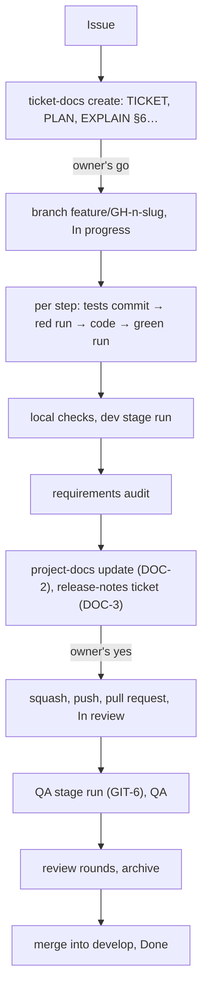

# Development process

How a change goes from a GitHub issue to a release, with the Claude Code harness versioned in `.claude/`. The
harness's own documentation is in [.claude/harness-docs/](../../../.claude/harness-docs/README.md).

## Tracking

- Work is planned as **features made of tickets** (GIT-10): a feature is a parent issue labelled `feature` and one
  family (`HARNESS`, `SPECS`, `PRODUCT`, `TESTS`, `USER`); its tickets are sub-issues with exactly one component label
  allowed by the family (`HARNESS`, `SPECS`, `INFRA`, `BACKEND`, `FRONTEND`, `E2E-TESTS`, `LOAD-TESTS`, `UNIT-TESTS`,
  `USER-FEATURE-REQUEST`, `USER-REPORTED-BUG`), titled `[LABEL] Verb phrase`, with the sections Description,
  Implementation, Acceptance criteria, Tests, References and Attachments, every reference pinned to a commit.
- A customer's feature request or bug report, brought by the DevOps agents, is a `USER` feature holding exactly one
  ticket, labelled `USER-FEATURE-REQUEST` or `USER-REPORTED-BUG`.
- A feature or ticket created by an agent carries the label `needs-maintainer-approval` and stays in Backlog until a
  maintainer removes the label, which approves it. GIT-10's check reports such an issue in any other Status.
- The catalogue `.claude/skills/ticket-docs/conf/issue-rules.yaml` holds these rules for the tools: the families and
  their components, the ticket limit per family, the approval label and the statuses it allows.
- A ticket is a GitHub issue `#<n>`, written `GH-<n>`. The project board "simple-erp" holds its status: Backlog,
  Ready, In progress, In review, QA, Done.
- Its working folder `docs/tickets/GH-<n>/` is local: plan, progress and times, decisions, evidence. It is archived
  to the pre-release `evidence-GH-<n>` at hand-over.

## A ticket's life

## Rules

| File | IDs | About |
|---|---|---|
| `AGENT.md` | | How code is written |
| `.claude/rules/coding-style.md` | CS | Code rules on top of `AGENT.md` |
| `.claude/rules/git-rules-and-deploy.md` | GIT, DEP | Branches, commits, pull requests, stages, releases, dependencies |
| `.claude/rules/testing.md` | TEST | Tests first, evidence, kept reports, Bruno, Playwright, paid AI |
| `.claude/rules/ticket-documentation.md` | DOC | EXPLAIN.md, the project documentation, release notes |

Every squash and every push waits for the owner's explicit yes (GIT-1).

## Hooks

| Event | Hook | Does |
|---|---|---|
| UserPromptSubmit | `pr-watch hook-inbox` | Hands the PR watcher's events to the ticket's own session |
| PreToolUse (Bash) | `ai-cost gate` | Refuses a paid AI test not run through the cost guard |
| PreToolUse (Bash) | `ticket-docs git-gate` | Refuses production code committed before its red tests |
| PostToolUse (Bash) | `ticket-docs time-reminder` | Asks to update PROGRESS.md's times after a commit |

Last reviewed: 2026-11-12 (GH-23)
