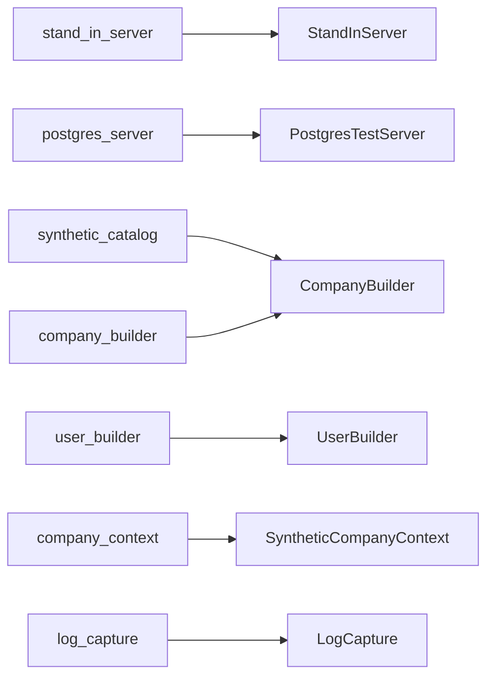
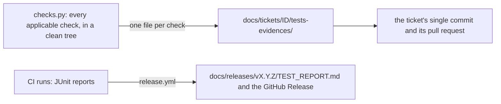

# Tests and traceability

How SimpleERP is tested, and how every test result stays provable.

## Levels

| Level | Tool | Where | Proves |
|---|---|---|---|
| Unit | pytest, two workers | local, CI | Each class does what its tests say |
| Conventions | `tests/conventions/` | local, CI | The house rules of `AGENT.md` that a test can enforce |
| Harness and CI | `tests/harness/`, `tests/ci/` | local, CI | The ticket harness and the workflows do what their rules say |
| Static | ruff, mypy, eslint, tsc | local, CI | Style and types |
| GUI | Playwright in `frontend/<app>/e2e/` | local, CI, dev, QA | Screens and flows, against the real images of `compose.e2e.yaml` |
| API | Bruno collection in `bruno/` (to come) | dev, QA | The HTTP APIs, headless |
| Upgrade | an upgrade test (to come) | QA | The previous release's data under the new images |

Each service's tests live in `backend/services/<service>/tests/` and mirror its `src/`; they use real stand-ins
rather than mocks (a local server, a git sandbox, a fake executable), and are named as sentences (`AGENT.md`, "Tests").

## Playwright

The back office's end-to-end tests live in `frontend/backoffice/e2e/`. They test the screens and flows against the real
images started by `compose.e2e.yaml`, never against a development server, so that they test what ships
([TKT-21](../../../.claude/rules/tickets.md), [AGENT.md](../../../AGENT.md)).

- **Configuration.** `frontend/backoffice/e2e/playwright.config.ts`. Tests are named `*.e2e.ts` and sit under
  `e2e/shell/`, `e2e/preferences/`, `e2e/accessibility/` and `e2e/scaffold/`; shared fixtures are in `e2e/fixtures/`.
- **Projects.** Four projects, `light-en`, `dark-en`, `light-fr` and `dark-fr`, one per theme of
  [D43](../../specs/06-decisions/ux/d43-light-and-dark.md) and language of [D21](../../specs/06-decisions/foundations/d21-languages.md),
  each at 1440 x 900. The tests that check the phone layout also run at 390 x 844 (D121).
- **Tags.** Every test of the scaffold is tagged `@smoke`. The dev stage runs `--grep @smoke`; QA runs the full suite
  ([D426](../../specs/06-decisions/technical/d426-testing-strategy.md), [CI/CD and stages](ci-cd-and-stages.md)).
- **Accessibility.** axe-core runs after every test with the WCAG 2.2 AA tags of
  [D46](../../specs/06-decisions/ux/d46-accessibility-standard.md). A violation fails the test.
- **Base URL.** The tests read `ERP_E2E_BASE_URL`. It defaults to the back-office port that `compose.e2e.yaml`
  publishes.
- **Reports.** On failure, the trace, the video and the screenshot are kept in `frontend/backoffice/test-results/`, and
  the HTML report in `frontend/backoffice/playwright-report/`. `images.yml` uploads both when a test fails, and
  `stage.yml` always keeps them.
- **Runner.** `.github/scripts/playwright.sh` passes `--config e2e/playwright.config.ts` to each front end that has
  one, and forwards its other arguments to `playwright test`.

Run them locally, from the root of the repository:

```bash
docker compose -f compose.e2e.yaml up --detach --wait
bash .github/scripts/playwright.sh --grep @smoke
pnpm --filter ./frontend/backoffice exec playwright show-report playwright-report
```

## Test helpers

The shared test library `backend/shared/testing` (package `erp_testing`, uv package `erp-testing`) holds the helpers
every service's tests use. It holds no business rules: it only starts stand-ins, builds synthetic data and captures
logs. Its helpers are, by class and module:

- `StandInServer` (`erp_testing.stand_in`): a local HTTP stand-in. A route with no configured answer answers a valid
  empty value of its real model, `[]` for a list (TEST-2).
- `PostgresTestServer` (`erp_testing.postgres`): a PostgreSQL started once per session from the local PostgreSQL
  binaries. The tests that need it are skipped, with the reason, where those binaries are missing.
- `SyntheticCompanyContext` (`erp_testing.context`): a company context for a synthetic company and user, built on the
  context library of `backend/shared/context`.
- `LogCapture` (`erp_testing.logs`): captures what a test's code logs, so that a test can assert on it.
- `CompanyBuilder` and `UserBuilder` (`erp_testing.synthetic`): build a company and a user seeded by sector and seed,
  from `conf/catalogs/synthetic.yaml`. Their e-mail addresses are on a reserved test domain, never a real one.

The library registers its pytest fixtures through `TestingPlugin` (`erp_testing.plugin`): `stand_in_server`,
`postgres_server`, `synthetic_catalog`, `company_builder`, `user_builder`, `company_context` and `log_capture`. A
service's `conftest.py` registers the plugin in three lines:

```python
from erp_testing.plugin import TestingPlugin


def pytest_configure(config):
    config.pluginmanager.register(TestingPlugin(), "erp_testing")
```



No mock library is used in any test, as [D426](../../specs/06-decisions/technical/d426-testing-strategy.md) requires:
the tests use the real stand-ins above instead. A test of the library checks that no test imports a mock library. The
layout of the library follows [D438](../../specs/06-decisions/technical/d438-repository-layout.md).

## Tests first

In a ticket's plan, the `test-writer` agent writes the tests of a task before the implementers write its code, from
the ticket's acceptance criteria ([TKT-3, TKT-4](../../../.claude/rules/tickets.md)). A front-end ticket plans a
Playwright test for every screen it builds (TKT-21).

## Evidence and kept reports



- The verifier runs `.claude/scripts/tickets/checks.py`, which decides which checks apply, runs them in a clean
  worktree holding only the ticket's files, and saves each output in the ticket's `tests-evidences/` (TKT-6).
- A ticket is done only when its checks pass, its review approves and its `EXPLAIN.md` and `IMPLEMENTATION.md` are
  written (TKT-6, TKT-14); the ticket folder is versioned with the code in its single commit.
- CI uploads every JUnit report as an artifact; a release gathers them into its test report, kept in the repository
  and attached to the GitHub Release (TKT-26).

## Country-rules tests

The country-rules library's tests (in `backend/shared/country-rules/tests/`) check every rate change of its test pack on the day before and on the day of the change ([REQ-T11-06](../../specs/03-technical/t11-legal-corpora/requirements/req-t11-06-tests-per-date.md), criterion 1).

## Target design (specified in GH-2, not built yet)

**Levels (D426).** Unit tests first; contract tests generated from each OpenAPI; the Bruno collection on the
API; Playwright against the real images (TKT-21) with one seeded company per sector (16); country-pack rules
tested per date in force; AI evaluation sets (D417); acceptance tests generated from the use cases' Given/When/Then. QA
runs the whole suite.

**Coverage.** 100 % coverage, errors and edge cases included (the owner's requirement): every error flow of the use
cases and every error case of the D122 pattern has its test.

**Load and resilience.** k6 load tests per release against the targets of D408 on the three reference sizes, the laptop
profile included; failure tests in staging (a pod, a node, the bus, a database failover); an upgrade test from the
previous release and the last LTS.

**Test data.** Only synthetic data: one generated company per sector and size, with history; never production data in
tests; anonymised copies only for the hosted support assistant's reproductions, inside the customer's namespace.

Decided in [D426](../../specs/06-decisions/technical/d426-testing-strategy.md).

Last reviewed: 2026-11-28 (T0.22)
