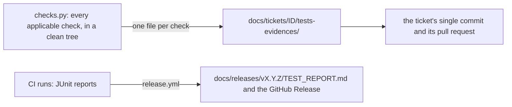

# Tests and traceability

How SimpleERP is tested, and how every test result stays provable.

## Levels

| Level | Tool | Where | Proves |
|---|---|---|---|
| Unit | pytest, two workers | local, CI | Each class does what its tests say |
| Conventions | `tests/conventions/` | local, CI | The house rules of `AGENT.md` that a test can enforce |
| Harness and CI | `tests/harness/`, `tests/ci/` | local, CI | The ticket harness and the workflows do what their rules say |
| Static | ruff, mypy, eslint, tsc | local, CI | Style and types |
| GUI | Playwright in `frontend/<app>/e2e/` | local, CI, dev, QA | Screens and flows, against the real images of `compose.e2e.yaml` |
| API | Bruno collection in `bruno/` (to come) | dev, QA | The HTTP APIs, headless |
| Upgrade | an upgrade test (to come) | QA | The previous release's data under the new images |

Each service's tests live in `backend/services/<service>/tests/` and mirror its `src/`; they use real stand-ins
rather than mocks (a local server, a git sandbox, a fake executable), and are named as sentences (`AGENT.md`, "Tests").

## Tests first

In a ticket's plan, the `test-writer` agent writes the tests of a task before the implementers write its code, from
the ticket's acceptance criteria ([TKT-3, TKT-4](../../../.claude/rules/tickets.md)). A front-end ticket plans a
Playwright test for every screen it builds (TKT-21).

## Evidence and kept reports

- The verifier runs `.claude/scripts/tickets/checks.py`, which decides which checks apply, runs them in a clean
  worktree holding only the ticket's files, and saves each output in the ticket's `tests-evidences/` (TKT-6).
- A ticket is done only when its checks pass, its review approves and its `EXPLAIN.md` and `IMPLEMENTATION.md` are
  written (TKT-6, TKT-14); the ticket folder is versioned with the code in its single commit.
- CI uploads every JUnit report as an artifact; a release gathers them into its test report, kept in the repository
  and attached to the GitHub Release (TKT-26).

## Country-rules tests

The country-rules library's tests (in `backend/shared/country-rules/tests/`) check every rate change of its test pack on the day before and on the day of the change ([REQ-T11-06](../../specs/03-technical/t11-legal-corpora/requirements/req-t11-06-tests-per-date.md), criterion 1).

## Target design (specified in GH-2, not built yet)

**Levels (D426).** Unit tests first; contract tests generated from each OpenAPI; the Bruno collection on the
API; Playwright against the real images (TKT-21) with one seeded company per sector (16); country-pack rules
tested per date in force; AI evaluation sets (D417); acceptance tests generated from the use cases' Given/When/Then. QA
runs the whole suite.

**Coverage.** 100 % coverage, errors and edge cases included (the owner's requirement): every error flow of the use
cases and every error case of the D122 pattern has its test.

**Load and resilience.** k6 load tests per release against the targets of D408 on the three reference sizes, the laptop
profile included; failure tests in staging (a pod, a node, the bus, a database failover); an upgrade test from the
previous release and the last LTS.

**Test data.** Only synthetic data: one generated company per sector and size, with history; never production data in
tests; anonymised copies only for the hosted support assistant's reproductions, inside the customer's namespace.

Decided in [D426](../../specs/06-decisions/technical/d426-testing-strategy.md).

Last reviewed: 2026-11-27 (T0.12)
