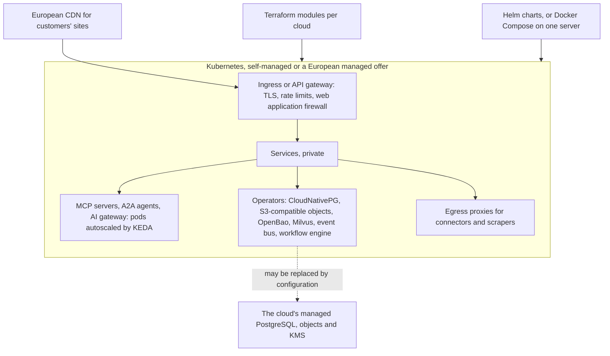

# Infrastructure deployment

The deployment targets, self-hosted and the fully managed hosted edition: clusters, regions, sizing, networks,
Terraform. Nothing of the target is built yet.

## Today

The Terraform skeleton exists, in [`infra/terraform/README.md`](../../../infra/terraform/README.md): six interface
modules (`network`, `kubernetes-cluster`, `storage`, `registry`, `dns`, `helm-release`), the provider modules of
OVHcloud and Scaleway, and one root per cloud that calls them, each checked by `terraform fmt`, `validate` and
`test` in CI (`terraform.yml`). The modules hold no resource yet: applying a root creates nothing. The working
deployment comes in phase P2 (T9), under REQ-T09-08. The targets of D18 are in [Deployment](deployment.md).

## Target design (specified in GH-2, not built yet)

**Principle (D421).** Fully CNCF compatible: only portable components and Kubernetes-native operators, so that nothing
requires a cloud's proprietary service. It works on a self-managed Kubernetes and on the managed Kubernetes of European
clouds (for example Scaleway and OVHcloud, D375).

**Data services.** Operators run them in the cluster by default: CloudNativePG for PostgreSQL, an S3-compatible server
(for example Garage or MinIO) for objects, OpenBao for secrets, Milvus for vectors, the event bus and the workflow
engine. On a European managed Kubernetes, the cloud's managed PostgreSQL, object storage and KMS may replace them by
configuration, never required.

**Packaging.** Docker Compose and Helm are both supported everywhere, from the same images: Compose for one server and
the laptop profile (an installer checks the machine and the 8 GB budget, D408), Helm charts for every Kubernetes (an IT
provider's platform, a large company, the hosted edition); air-gapped installs work from a mirrored registry. MCP
servers, A2A agents and the AI gateway are pods behind Kubernetes Services, autoscaled by KEDA (D411, D412, D417).

**Network.** One ingress or API gateway per cluster with TLS, rate limits and a web application firewall; every service
private behind it; network policies between namespaces; customers' sites (F18) behind a European CDN; outbound calls of
connectors and scrapers through controlled egress proxies.

**Hosted clusters.** One region per cluster, in France first, a second region for disaster recovery; up to 5 000
companies per cluster (D405); GPU node pools only where AI needs them; Terraform modules per cloud behind one interface.

**Overview.** One cluster, as specified (not built yet):

Decided in [D421](../../specs/06-decisions/technical/d421-infrastructure-cncf.md).

Last reviewed: 2026-11-27 (T0.08, GH-2)
