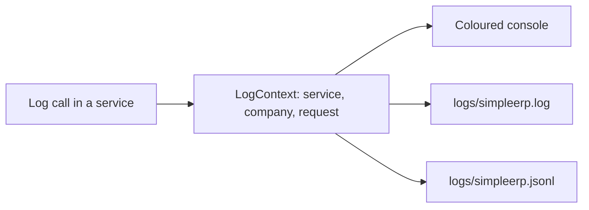

# Observability

Logs, metrics and dashboards (Loki, Prometheus, Grafana), alerts. Only the logging library is built; the rest is not yet.

## Today

The logging library `backend/shared/logging` (package `erp_logging`, [pyproject](../../../backend/shared/logging/pyproject.toml))
writes every log line in three places, configured by the reference
[`logger.yaml`](../../../backend/shared/logging/conf/logger.yaml) and applied by `erp_logging.setup.logging_setup.LoggingSetup`:

- a coloured console;
- a coloured rotating file, `logs/simpleerp.log`;
- `logs/simpleerp.jsonl`, written by `JsonLinesFormatter` as one JSON object per line with the time, the level, the
  logger, the message and the three tags.

Each line carries the tags `service`, `company` (an opaque id) and `request`, as [D416](../../specs/06-decisions/technical/d416-observability-design.md)
and the [non-functional observability page](../../specs/05-non-functional/observability.md) require. The company and the
request come from `LogContext`, which the request middleware of T0.09 will bind for each call; until then they are empty.

## Target design (specified in GH-2, not built yet)

**Signals (D416).** Logs to Loki, metrics to Prometheus, traces through OpenTelemetry to Tempo, dashboards and alerts in
Grafana; every signal tagged with the service, the company (as an opaque id) and the request; personal data and secrets
masked at collection; the same stack, smaller, on the laptop profile.

**What customers see.** A public status page for the hosted edition; each company sees its own service health, usage and
incidents in the app; IT providers see their clients'; raw logs stay with operators and the hosted support assistant
(F20).

**Service levels.** Service level objectives per user journey (sign-in, invoicing, till, assistant) with error budgets;
alerts on symptoms users feel, routed to on-call ([DevOps](devops.md)); targets per hosted plan, for example 99.9 %
monthly availability for business plans.

**AI.** Each AI call is traced with its model, prompt template version, tools used, tokens, cost, latency and outcome
(inputs masked), linked to the user's request; quality scores from evaluations and user ratings sit on the same
dashboards.

Decided in [D416](../../specs/06-decisions/technical/d416-observability-design.md).

Last reviewed: 2026-11-12 (GH-2)
