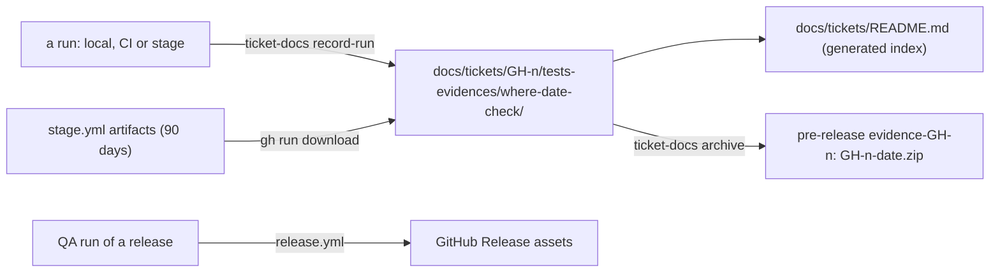

# Tests and traceability

How simple-erp is tested, and how every test result stays provable.

## Levels

| Level | Tool | Where | Proves |
|---|---|---|---|
| Unit | pytest, two workers | local, CI, stages | Each class does what its tests say |
| Conventions | `tests/conventions/` | local, CI | The house rules of `AGENT.md` that a test can enforce |
| Workflows | `tests/workflows/` | local, CI | The workflows' key steps and the pages that show how to start them (text checks) |
| Static | ruff, mypy | local, CI | Style and types |
| GUI | Playwright in `frontends/<frontend>/e2e/` | local, dev, QA | Screens and flows, against the real images |
| API | Bruno collection in `bruno/` | dev, QA | The HTTP APIs, headless |
| Upgrade | `scripts/stage/upgrade-test.sh` (to come) | QA | The previous release's data under the new images |

Tests mirror `src/`, use real stand-ins rather than mocks (a local server, a git sandbox, a fake executable), and are
named as sentences (`AGENT.md`, "Tests"). How to run each level: `.claude/rules/TESTS-NOTICE.md`.

## Tests first (TEST-7)

Every code step of a ticket goes: the tests, committed alone; a red run, recorded; the code; a green run, recorded. A
`PreToolUse` hook refuses a production-code commit that skips it, and `ticket-docs check` verifies the order in the
history (saved in a bundle before each squash).

## Evidence (TEST-8) and kept reports (TEST-9)

- A result counts only with its evidence folder: the command, the commit, the raw output and the verdict.
- Every report is kept, failed and invalid runs included: unit (`report.xml`, `report.html`), GUI and E2E (Playwright
  report and `results.json`, Bruno reports, failure traces), CI and stage runs (their artifacts and log).
- `docs/tickets/` is local. Each ticket folder is archived to its GitHub pre-release at every hand-over, and each
  release carries its QA reports.

Last reviewed: 2026-11-17 (GH-13)
