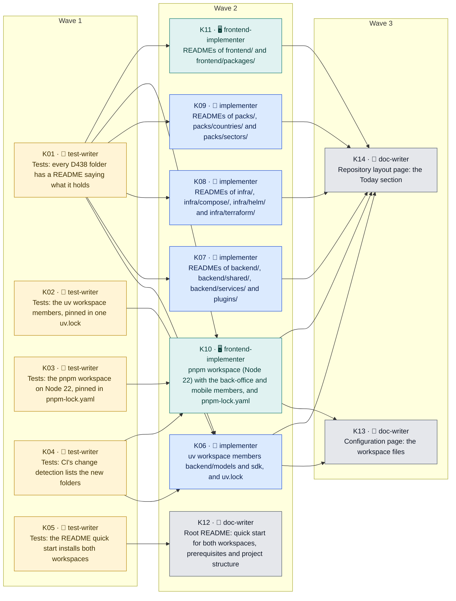

# T0.01: Mono-repo folders and workspaces, plan

**Plan:** 🟢 Approved

**Push:** 🟢 Approved

<!-- ticket:specs -->
## 📚 Specifications

The specification and design pages of [TICKET.md](TICKET.md), copied by `python3 .claude/scripts/tickets/ticket_refs.py sync`.

- [Repository layout](../../technical/architecture/repository-layout.md)
- [D406 Back end](../../specs/06-decisions/technical/d406-back-end.md)
- [D407 Front end](../../specs/06-decisions/technical/d407-front-end.md)
- [Configuration](../../technical/architecture/configuration.md)
- [📜 D438 Repository layout](../../specs/06-decisions/technical/d438-repository-layout.md)
- [📜 D415 Supply chain controls](../../specs/06-decisions/technical/d415-supply-chain-controls.md)
- [🏗️ Supply chain and licences](../../technical/security/supply-chain-and-licences.md)
<!-- /ticket:specs -->

## Summary

T0.01 creates the D438 folder skeleton, with a README in every folder, and the two workspaces. On the Python side, `backend/models` and `sdk` become uv members and `uv.lock` is regenerated. On the front-end side, it adds the root `package.json`, `pnpm-workspace.yaml` and `pnpm-lock.yaml` (Node 22), plus minimal private `package.json` files for `frontend/backoffice` and `frontend/mobile`. It also updates `README.md`, `configuration.md` and the "Today" section of `repository-layout.md`.

Wave 1 has five test-writer tasks: folder READMEs, the uv workspace, the pnpm workspace, CI change detection against the real repository, and the README quick start. Wave 2 has seven tasks: four implementer, two frontend-implementer and one doc-writer, one area each with no shared files. Wave 3 has two doc-writer tasks for the technical pages, which describe the files actually built.

The ticket lists no screen, so no Playwright task is needed (TKT-21).

## Assumptions

- The roadmap row names no use case, business rule, entity, flow or requirement; decisions D438, D406, D407, D415 and the design pages settle what it builds.
- The roadmap row names no budget, so `Budgets touched` says none.
- Configuration and README are only said to be updated; only what the new layout requires is changed.
- This ticket creates the parent folders of `backend/shared` libraries and `frontend/packages` only; later tickets name the libraries.
- No bash tool was available, so `check_ticket.py` was not run; the links and anchors (`#s01`, `#epics`) were not machine-checked.
- uv refuses a folder that a workspace member path matches when it holds files but no `pyproject.toml`. So `backend/models` and `sdk` cannot hold only a README: they become real uv members, with no dependency and no code. `backend/models` holds the empty `erp_models` package, named by AGENT.md; the models are T0.03. `sdk` is a virtual member with no `src`. Their project names, `erp-models` and `erp-sdk`, follow the fixtures already in `tests/ci/detect_changes/helpers.py`, because no specification names them.
- Acceptance criterion 3 ("CI's change detection lists the new folders") is read as: the new workspace members are listed. `.github/scripts/detect_changes.py` only lists folders that hold a project manifest, so it needs no change. Folders that hold only a README (infra, packs, the parents of services, libraries, plugins and packages) still select nothing, because no CI check applies to them yet.
- To make the pnpm workspace have members that change detection lists, `frontend/backoffice` and `frontend/mobile` get a minimal private `package.json` (`@simpleerp/backoffice` and `@simpleerp/mobile`, version 0.0.0, no scripts, no dependencies). The `@simpleerp/` scope is not settled by the specifications. The back-office app itself comes with T0.17.
- The root `package.json` pins pnpm with an exact `packageManager` version, the one installed where K10 runs, because `pnpm/action-setup` in `typescript.yml` needs it. It pins Node 22 through `engines.node` (`>=22 <23`). It has no root dependency. The specifications name neither the pnpm version nor the package names.
- "Every folder of the D438 layout" is read as also covering the parent folders `backend/`, `frontend/`, `infra/` and `packs/`, so each of them gets a README too. `frontend/portals/` is not created, because the ticket's list of folders leaves it out. The pnpm workspace glob `frontend/portals/*` lets a portal join later with no change.
- A README "saying what it holds" is tested as: a level-1 title, at least one line of prose, and a link that resolves to D438. The text of each README comes only from `docs/technical/architecture/repository-layout.md` and the Mono-repo table of `AGENT.md`.
- The tests go in a new repository-level folder, `tests/layout/`, and in `tests/ci/detect_changes/`, not in `tests/conventions/` (T0.02's area). The ticket graph's area for T0.01 names neither folder.
- The pytest checks of the two workspaces are static: they parse the manifests and the locks. Actually running `uv sync --locked` and `pnpm install --frozen-lockfile` is left to the tasks' `done_when` commands, the verifier's `checks.py` and CI, because CI's repository job has no Node.
- K06 regenerates `uv.lock` with `uv lock`, without `--upgrade`, so that only the new members are added and every existing pin stays the same (D415).
- The ticket only says `configuration.md` and the README are "updated". Only what the new layout requires is changed: the Workspaces table and where `conf/` sits in `configuration.md`, and the quick start, prerequisites and project-structure paragraph in the README. The "Today" section of `docs/technical/architecture/repository-layout.md` is also updated, because the ticket would make it false.
- The ticket lists no screen ("No screen"), so the plan has no Playwright task (TKT-21).

<!-- plan:graph -->

> [!NOTE]
> Generated from the json block at the end of this page by `python3 .claude/scripts/tickets/plan.py render`.
> To change a task, edit the json block, then render again: never edit this view by hand.

## Waves

| Wave | Tasks | Agents running at once |
| --- | --- | --- |
| 1 | [K01](#k01), [K02](#k02), [K03](#k03), [K04](#k04), [K05](#k05) | 5 of 5 |
| 2 | [K06](#k06), [K07](#k07), [K08](#k08), [K09](#k09), [K10](#k10), [K11](#k11), [K12](#k12) | 7 of 7 |
| 3 | [K13](#k13), [K14](#k14) | 2 of 2 |

| Wave | Task | Agent | Depends on | Unblocks |
| --- | --- | --- | --- | --- |
| 1 | [K01](#k01) Tests: every D438 folder has a README saying what it holds | 🧪 test-writer | none | [K06](#k06), [K07](#k07), [K08](#k08), [K09](#k09), [K10](#k10), [K11](#k11) |
| 1 | [K02](#k02) Tests: the uv workspace members, pinned in one uv.lock | 🧪 test-writer | none | [K06](#k06) |
| 1 | [K03](#k03) Tests: the pnpm workspace on Node 22, pinned in pnpm-lock.yaml | 🧪 test-writer | none | [K10](#k10) |
| 1 | [K04](#k04) Tests: CI's change detection lists the new folders | 🧪 test-writer | none | [K06](#k06), [K10](#k10) |
| 1 | [K05](#k05) Tests: the README quick start installs both workspaces | 🧪 test-writer | none | [K12](#k12) |
| 2 | [K06](#k06) uv workspace members backend/models and sdk, and uv.lock | 🐍 implementer | [K01](#k01), [K02](#k02), [K04](#k04) | [K13](#k13), [K14](#k14) |
| 2 | [K07](#k07) READMEs of backend/, backend/shared/, backend/services/ and plugins/ | 🐍 implementer | [K01](#k01) | [K14](#k14) |
| 2 | [K08](#k08) READMEs of infra/, infra/compose/, infra/helm/ and infra/terraform/ | 🐍 implementer | [K01](#k01) | [K14](#k14) |
| 2 | [K09](#k09) READMEs of packs/, packs/countries/ and packs/sectors/ | 🐍 implementer | [K01](#k01) | [K14](#k14) |
| 2 | [K10](#k10) pnpm workspace (Node 22) with the back-office and mobile members, and pnpm-lock.yaml | 🖥️ frontend-implementer | [K01](#k01), [K03](#k03), [K04](#k04) | [K13](#k13), [K14](#k14) |
| 2 | [K11](#k11) READMEs of frontend/ and frontend/packages/ | 🖥️ frontend-implementer | [K01](#k01) | [K14](#k14) |
| 2 | [K12](#k12) Root README: quick start for both workspaces, prerequisites and project structure | 📝 doc-writer | [K05](#k05) | none |
| 3 | [K13](#k13) Configuration page: the workspace files | 📝 doc-writer | [K06](#k06), [K10](#k10) | none |
| 3 | [K14](#k14) Repository layout page: the Today section | 📝 doc-writer | [K06](#k06), [K07](#k07), [K08](#k08), [K09](#k09), [K10](#k10), [K11](#k11) | none |

## Dependency graph



## Tasks

### <a id="k01"></a>K01: Tests: every D438 folder has a README saying what it holds

| Agent | Wave | Depends on | Unblocks |
| --- | --- | --- | --- |
| 🧪 test-writer | 1 | none | [K06](#k06), [K07](#k07), [K08](#k08), [K09](#k09), [K10](#k10), [K11](#k11) |

**Files** (only this task may change them in its wave):

- `tests/layout/test_folder_readmes.py`

**Done when:** `uv run pytest tests/layout/test_folder_readmes.py -n 2` collects 68 cases (17 folders, 4 tests) that fail on missing README files, and `uv run ruff check tests/layout/test_folder_readmes.py` and `uv run ruff format --check tests/layout/test_folder_readmes.py` pass.

**Brief:**

Write the repository-level pytest file `tests/layout/test_folder_readmes.py` (one class `TestFolderReadmes`, following the Tests section of `AGENT.md`; constants as `ClassVar`s of the class; no `__init__.py`). It covers acceptance criterion 4 of `docs/tickets/T0.01/TICKET.md`: every folder of the D438 layout has a README saying what it holds. Specifications: D438 `docs/specs/06-decisions/technical/d438-repository-layout.md`; the layout tree of `docs/technical/architecture/repository-layout.md`; the Mono-repo table of `AGENT.md`.

Find the repository root from `Path(__file__).resolve().parents[2]`. Parametrise over these folders, using the folder path itself as the pytest id (for example `ids=lambda folder: folder`) so that one task can select its own cases with `-k "[infra/compose]"`: `backend`, `backend/models`, `backend/shared`, `backend/services`, `frontend`, `frontend/backoffice`, `frontend/mobile`, `frontend/packages`, `plugins`, `sdk`, `infra`, `infra/compose`, `infra/helm`, `infra/terraform`, `packs`, `packs/countries`, `packs/sectors`. For each folder, assert that:
1. `<folder>/README.md` exists;
2. its first non-blank line is a level-1 Markdown heading (`# `);
3. at least one non-blank line of prose follows the heading;
4. it holds a Markdown link whose target ends with `d438-repository-layout.md` and resolves, relative to the README, to `docs/specs/06-decisions/technical/d438-repository-layout.md`.

Use test names written as sentences, for example `test_the_folder_has_a_readme`, `test_the_readme_starts_with_a_title`, `test_the_readme_says_what_the_folder_holds` and `test_the_readme_links_d438`. The tests must fail now because the folders do not exist, and never because of an error in the test. Start with `python3 .claude/scripts/tickets/ticket_tree.py start --ticket T0.01` and finish with `python3 .claude/scripts/tickets/ticket_tree.py handoff --ticket T0.01 --task K01`.

### <a id="k02"></a>K02: Tests: the uv workspace members, pinned in one uv.lock

| Agent | Wave | Depends on | Unblocks |
| --- | --- | --- | --- |
| 🧪 test-writer | 1 | none | [K06](#k06) |

**Files** (only this task may change them in its wave):

- `tests/layout/test_uv_workspace.py`

**Done when:** `uv run pytest tests/layout/test_uv_workspace.py -n 2` fails only on the missing `backend/models` and `sdk` members and the missing `erp_models` package, and ruff check and format check pass on the file.

**Brief:**

Write the repository-level pytest file `tests/layout/test_uv_workspace.py` (one class `TestUvWorkspace`, following the Tests section of `AGENT.md`; constants as `ClassVar`s; read TOML with `tomllib`). It covers acceptance criterion 1 of `docs/tickets/T0.01/TICKET.md`: `uv sync --locked` passes, with the workspace members pinned in one `uv.lock`. Specifications: D406 `docs/specs/06-decisions/technical/d406-back-end.md` (Python 3.13 with uv), D438 `docs/specs/06-decisions/technical/d438-repository-layout.md`, D415 `docs/specs/06-decisions/technical/d415-supply-chain-controls.md` (dependencies locked), and `docs/technical/security/supply-chain-and-licences.md` (every dependency pinned in `uv.lock`).

The repository root is `Path(__file__).resolve().parents[2]`. Write these tests:
1. The members of `[tool.uv.workspace]` in the root `pyproject.toml` include `backend/models`, `backend/shared/*`, `backend/services/*`, `plugins/*` and `sdk`.
2. `requires-python` in the root `pyproject.toml` is `>=3.13,<3.14`, and `.python-version` starts with `3.13`.
3. Parametrised over the members `backend/models` and `sdk`: `<member>/pyproject.toml` exists, its `project.name` is not empty, and its `project.requires-python` is `>=3.13,<3.14`.
4. Parametrised the same way: the member's normalised `project.name` (lower case, `_` replaced by `-`) is listed in `[manifest].members` of `uv.lock`. This proves the lock was regenerated with the member.
5. `backend/models/src/erp_models/__init__.py` exists, because AGENT.md names the shared models package `erp_models`.

Keep the tests static: they parse files and run no `uv` command, because the verifier and CI run `uv sync --locked` themselves. Tests 3 to 5 must fail now because the members are missing. Start with `python3 .claude/scripts/tickets/ticket_tree.py start --ticket T0.01` and finish with `python3 .claude/scripts/tickets/ticket_tree.py handoff --ticket T0.01 --task K02`.

### <a id="k03"></a>K03: Tests: the pnpm workspace on Node 22, pinned in pnpm-lock.yaml

| Agent | Wave | Depends on | Unblocks |
| --- | --- | --- | --- |
| 🧪 test-writer | 1 | none | [K10](#k10) |

**Files** (only this task may change them in its wave):

- `tests/layout/test_pnpm_workspace.py`

**Done when:** `uv run pytest tests/layout/test_pnpm_workspace.py -n 2` fails only on the missing workspace files, and ruff check and format check pass on the file.

**Brief:**

Write the repository-level pytest file `tests/layout/test_pnpm_workspace.py` (one class `TestPnpmWorkspace`, following the Tests section of `AGENT.md`; constants as `ClassVar`s; read JSON with `json` and YAML with `yaml.safe_load`, since PyYAML is a dev dependency). It covers acceptance criterion 2 of `docs/tickets/T0.01/TICKET.md`: `pnpm install --frozen-lockfile` passes with `pnpm-lock.yaml` pinned. Specifications: D407 `docs/specs/06-decisions/technical/d407-front-end.md`, D438 `docs/specs/06-decisions/technical/d438-repository-layout.md`, D415 `docs/specs/06-decisions/technical/d415-supply-chain-controls.md`, and `docs/technical/security/supply-chain-and-licences.md` (the front end's lock file).

The repository root is `Path(__file__).resolve().parents[2]`. Write these tests:
1. The root `package.json` has `"private": true`. Its `packageManager` matches `^pnpm@\d+\.\d+\.\d+$`, an exact version, which `pnpm/action-setup` in `.github/workflows/typescript.yml` reads. Its `engines.node` names major version 22: the string holds `22`, and no other major version is allowed.
2. `pnpm-workspace.yaml` has a `packages` list holding `frontend/backoffice`, `frontend/mobile`, `frontend/portals/*` and `frontend/packages/*`.
3. `pnpm-lock.yaml` exists, has a `lockfileVersion`, and its `importers` mapping has the keys `.`, `frontend/backoffice` and `frontend/mobile`.
4. Parametrised over `frontend/backoffice` and `frontend/mobile`: the app's `package.json` exists, is `private`, and has a non-empty `name`.

Keep the tests static: they parse files and run no `pnpm` command, because the repository job of CI has no Node. The verifier runs `pnpm install --frozen-lockfile`. The tests must fail now because the files are missing. Start with `python3 .claude/scripts/tickets/ticket_tree.py start --ticket T0.01` and finish with `python3 .claude/scripts/tickets/ticket_tree.py handoff --ticket T0.01 --task K03`.

### <a id="k04"></a>K04: Tests: CI's change detection lists the new folders

| Agent | Wave | Depends on | Unblocks |
| --- | --- | --- | --- |
| 🧪 test-writer | 1 | none | [K06](#k06), [K10](#k10) |

**Files** (only this task may change them in its wave):

- `tests/ci/detect_changes/test_repository_layout.py`

**Done when:** `uv run pytest tests/ci/detect_changes/test_repository_layout.py -n 2` fails on tests 1 to 4 only, because the members are missing. Test 5 passes. `uv run pytest tests/ci/detect_changes -n 2` shows no other change, and ruff check and format check pass on the file.

**Brief:**

Write `tests/ci/detect_changes/test_repository_layout.py` (one class `TestRepositoryLayout`). It covers acceptance criterion 3 of `docs/tickets/T0.01/TICKET.md`: given the new folders, CI's change detection lists them. Specifications: D438 `docs/specs/06-decisions/technical/d438-repository-layout.md` and the CI/CD section of `AGENT.md`. The detector is `.github/scripts/detect_changes.py` (read its docstring). It lists a folder only once the folder holds a project manifest (`pyproject.toml` or `package.json`).

Unlike the other files of this folder, these tests run the detector against the **real repository root** (`Path(__file__).resolve().parents[3]`), never against a `tmp_path` fixture repository. Reuse `run_detector`, `outputs`, `compact`, `nothing` and the key constants of `tests/ci/detect_changes/helpers.py`, which you import and do not change. Write these tests, with these exact names so that the implementation tasks can select them with `-k`:
1. `test_the_python_workspace_members_are_listed_as_packages`: with `--all`, the `packages` list includes `backend/models` and `sdk`. Use inclusion, not equality, because later tickets add more.
2. `test_a_change_to_the_sdk_selects_only_the_sdk`: the changed path `sdk/README.md` gives `{**nothing(), packages: compact(["sdk"])}`.
3. `test_the_front_end_apps_are_listed_as_typescript_projects`: with `--all`, the `typescript` list includes `frontend/backoffice` and `frontend/mobile`, and `images` holds neither, since no Dockerfile exists yet.
4. `test_a_change_to_a_front_end_app_selects_only_that_app`: the changed path `frontend/mobile/README.md` selects `typescript == ["frontend/mobile"]` and nothing else.
5. `test_a_readme_of_a_folder_without_a_project_selects_nothing`: parametrised over `infra/compose/README.md`, `infra/helm/README.md`, `infra/terraform/README.md`, `packs/countries/README.md`, `packs/sectors/README.md`, `backend/services/README.md`, `plugins/README.md` and `frontend/packages/README.md`; each gives `nothing()`.

Tests 1 to 4 must fail now. This folder then holds five Python files, the most AGENT.md allows. Start with `python3 .claude/scripts/tickets/ticket_tree.py start --ticket T0.01` and finish with `python3 .claude/scripts/tickets/ticket_tree.py handoff --ticket T0.01 --task K04`.

### <a id="k05"></a>K05: Tests: the README quick start installs both workspaces

| Agent | Wave | Depends on | Unblocks |
| --- | --- | --- | --- |
| 🧪 test-writer | 1 | none | [K12](#k12) |

**Files** (only this task may change them in its wave):

- `tests/layout/test_readme_quick_start.py`

**Done when:** `uv run pytest tests/layout/test_readme_quick_start.py -n 2` fails on tests 1 to 4 only, and ruff check and format check pass on the file.

**Brief:**

Write `tests/layout/test_readme_quick_start.py` (one class `TestReadmeQuickStart`, following the Tests section of `AGENT.md`; constants as `ClassVar`s). It covers acceptance criterion 5 of `docs/tickets/T0.01/TICKET.md`: the README's quick start works. It also covers the roadmap's "done when" of T0.01 in `docs/specs/00-vision/roadmap/phases/01-p0-foundations.md` (S01): `uv sync --locked` and `pnpm install --frozen-lockfile` pass from a clean clone, with both locks pinned (D415, `docs/specs/06-decisions/technical/d415-supply-chain-controls.md`). Node 22 comes from D407 (`docs/specs/06-decisions/technical/d407-front-end.md`) as the ticket states it, and Python 3.13 from D406 (`docs/specs/06-decisions/technical/d406-back-end.md`).

Read the root `README.md` (`Path(__file__).resolve().parents[2] / "README.md"`). Find the section whose heading holds `Development setup`, and its fenced `bash` block. Write these tests:
1. A line of the block starts with `uv sync --locked`.
2. A line of the block starts with `pnpm install --frozen-lockfile`.
3. The block no longer holds the words `once frontend/ exists`.
4. In the Prerequisites table, the row of Node.js names `22`.
5. The row of uv still names `3.13`.

Tests 1 to 4 must fail on the current README. Start with `python3 .claude/scripts/tickets/ticket_tree.py start --ticket T0.01` and finish with `python3 .claude/scripts/tickets/ticket_tree.py handoff --ticket T0.01 --task K05`.

### <a id="k06"></a>K06: uv workspace members backend/models and sdk, and uv.lock

| Agent | Wave | Depends on | Unblocks |
| --- | --- | --- | --- |
| 🐍 implementer | 2 | [K01](#k01), [K02](#k02), [K04](#k04) | [K13](#k13), [K14](#k14) |

**Files** (only this task may change them in its wave):

- `pyproject.toml`
- `uv.lock`
- `backend/models/pyproject.toml`
- `backend/models/README.md`
- `backend/models/src/erp_models/__init__.py`
- `sdk/pyproject.toml`
- `sdk/README.md`

**Done when:** `uv sync --locked` passes. These all pass: `uv run pytest tests/layout/test_uv_workspace.py -n 2`, `uv run pytest tests/layout/test_folder_readmes.py -n 2 -k "[backend/models] or [sdk]"`, `uv run pytest tests/ci/detect_changes/test_repository_layout.py -n 2 -k "python_workspace_members or the_sdk"`, `uv run pytest tests/conventions -n 2` and `uv run mypy backend/models/src`.

**Brief:**

Make `backend/models` and `sdk` the members of the uv workspace (Python 3.13), pinned in the one root `uv.lock`. Specifications: D406 `docs/specs/06-decisions/technical/d406-back-end.md`, D438 `docs/specs/06-decisions/technical/d438-repository-layout.md`, D415 `docs/specs/06-decisions/technical/d415-supply-chain-controls.md`, `docs/technical/architecture/repository-layout.md`, `docs/technical/security/supply-chain-and-licences.md`, the Mono-repo section of `AGENT.md` and `docs/tickets/T0.01/TICKET.md`. The root `pyproject.toml` already lists the members `backend/models`, `backend/shared/*`, `backend/services/*`, `plugins/*` and `sdk`. uv refuses a matched member folder that has no `pyproject.toml`, so a folder that holds only a README would break `uv sync`. That is why both members get their manifest here.

- `backend/models/pyproject.toml`: project `erp-models`, version `0.1.0`, a short description, `requires-python = ">=3.13,<3.14"`, licence `AGPL-3.0-only`, no dependency. Add a build system so that the src-layout package `erp_models` installs. Use `uv_build` (with an upper bound) or `hatchling`, and report the choice as a decision. Add an empty `backend/models/src/erp_models/__init__.py`. The models themselves come with T0.03 and are out of scope.
- `sdk/pyproject.toml`: project `erp-sdk`, the same Python and licence, no dependency and no build system, which makes it a virtual member. Its package name and code come with the SDK's own ticket (D425).
- `backend/models/README.md` and `sdk/README.md`: a `# ` title, then what the folder holds, taken only from `docs/technical/architecture/repository-layout.md` and the AGENT.md Mono-repo table. For `backend/models`: the shared Pydantic models of every public contract (API resources, events, plugin and connector contracts, enums and their SE exceptions), package `erp_models`, imported by the services, `plugins/` and `sdk/`. For `sdk`: the plugin SDK and its command line, built on `backend/models`. Each README links D438 by a relative path (`../docs/specs/06-decisions/technical/d438-repository-layout.md` from `sdk/`, `../../docs/...` from `backend/models/`) and the Repository layout page. Plain British English, no em dash.
- Run `uv lock`, without `--upgrade`, so that every existing pin stays the same. Change the root `pyproject.toml` only if `uv lock` needs it. Its comment on members may say they now exist.
- `uv run ruff check backend`, `uv run mypy backend/models/src` and `uv run pytest tests/conventions -n 2` must pass.

Start with `python3 .claude/scripts/tickets/ticket_tree.py start --ticket T0.01` and finish with `python3 .claude/scripts/tickets/ticket_tree.py handoff --ticket T0.01 --task K06`.

### <a id="k07"></a>K07: READMEs of backend/, backend/shared/, backend/services/ and plugins/

| Agent | Wave | Depends on | Unblocks |
| --- | --- | --- | --- |
| 🐍 implementer | 2 | [K01](#k01) | [K14](#k14) |

**Files** (only this task may change them in its wave):

- `backend/README.md`
- `backend/shared/README.md`
- `backend/services/README.md`
- `plugins/README.md`

**Done when:** `uv run pytest tests/layout/test_folder_readmes.py -n 2 -k "[backend] or [backend/shared] or [backend/services] or [plugins]"` passes.

**Brief:**

Write the README of each of these D438 folders: `backend/`, `backend/shared/`, `backend/services/` and `plugins/`. Each README has a `# ` title, then says what the folder holds, then links D438 by a relative path that resolves to `docs/specs/06-decisions/technical/d438-repository-layout.md`, and links `docs/technical/architecture/repository-layout.md`. Specifications: D438 `docs/specs/06-decisions/technical/d438-repository-layout.md`, D406 `docs/specs/06-decisions/technical/d406-back-end.md`, `docs/technical/architecture/repository-layout.md`, the Layout and Mono-repo sections of `AGENT.md`, and `docs/tickets/T0.01/TICKET.md` (acceptance criterion 4).

Take the content from those pages only:
- `backend/`: the Python back end, made of `models/`, `shared/` and `services/`.
- `backend/shared/`: the libraries the services share, with no business rules (lifecycle, logging, configuration, company context and rights, event outbox, metering client, country-pack rules, test helpers), one uv package per `backend/shared/<lib>/`. Each library is added by its own later ticket. A service never imports another service.
- `backend/services/`: one back-end service per folder, each with one image (`Dockerfile`, `pyproject.toml`, `conf/`, `src/<service_pkg>/{api,service,storage,models}/`, `tests/`), layered api → service → storage → models.
- `plugins/`: the first-party plugins, one uv package per `plugins/<plugin>/`, built on `backend/models` and reaching SimpleERP only through the public API.

Add only these README files, never a `pyproject.toml` or a sub-folder. The parents' globs (`backend/shared/*`, `backend/services/*`, `plugins/*`) must keep matching no member folder. Plain British English, no em dash. Start with `python3 .claude/scripts/tickets/ticket_tree.py start --ticket T0.01` and finish with `python3 .claude/scripts/tickets/ticket_tree.py handoff --ticket T0.01 --task K07`.

### <a id="k08"></a>K08: READMEs of infra/, infra/compose/, infra/helm/ and infra/terraform/

| Agent | Wave | Depends on | Unblocks |
| --- | --- | --- | --- |
| 🐍 implementer | 2 | [K01](#k01) | [K14](#k14) |

**Files** (only this task may change them in its wave):

- `infra/README.md`
- `infra/compose/README.md`
- `infra/helm/README.md`
- `infra/terraform/README.md`

**Done when:** `uv run pytest tests/layout/test_folder_readmes.py -n 2 -k "[infra] or [infra/compose] or [infra/helm] or [infra/terraform]"` passes.

**Brief:**

Write the README of each of these D438 folders: `infra/`, `infra/compose/`, `infra/helm/` and `infra/terraform/`. Each README has a `# ` title, then says what the folder holds, then links D438 by a relative path that resolves to `docs/specs/06-decisions/technical/d438-repository-layout.md`, and links `docs/technical/architecture/repository-layout.md`. Specifications: D438 `docs/specs/06-decisions/technical/d438-repository-layout.md`, `docs/technical/architecture/repository-layout.md` (the `infra/` lines of its tree), the Mono-repo table of `AGENT.md`, and `docs/tickets/T0.01/TICKET.md` (acceptance criterion 4).

Take the content from those pages only, citing the decisions they cite:
- `infra/`: the deployment, made of Compose, Helm and Terraform.
- `infra/compose/`: the laptop and one-server Compose profiles (D408, D421).
- `infra/helm/`: an umbrella chart and a chart per service.
- `infra/terraform/`: `modules/`, `ovhcloud/` and `scaleway/`, fully working deployments (REQ-T09-08).

Say that the profiles, charts and modules come with later tickets of phase P0. Write no `.tf`, chart or Compose file. Plain British English, no em dash. Start with `python3 .claude/scripts/tickets/ticket_tree.py start --ticket T0.01` and finish with `python3 .claude/scripts/tickets/ticket_tree.py handoff --ticket T0.01 --task K08`.

### <a id="k09"></a>K09: READMEs of packs/, packs/countries/ and packs/sectors/

| Agent | Wave | Depends on | Unblocks |
| --- | --- | --- | --- |
| 🐍 implementer | 2 | [K01](#k01) | [K14](#k14) |

**Files** (only this task may change them in its wave):

- `packs/README.md`
- `packs/countries/README.md`
- `packs/sectors/README.md`

**Done when:** `uv run pytest tests/layout/test_folder_readmes.py -n 2 -k "[packs] or [packs/countries] or [packs/sectors]"` passes.

**Brief:**

Write the README of each of these D438 folders: `packs/`, `packs/countries/` and `packs/sectors/`. Each README has a `# ` title, then says what the folder holds, then links D438 by a relative path that resolves to `docs/specs/06-decisions/technical/d438-repository-layout.md`, and links `docs/technical/architecture/repository-layout.md`. Specifications: D438 `docs/specs/06-decisions/technical/d438-repository-layout.md`, `docs/technical/architecture/repository-layout.md` (the `packs/` lines of its tree), the Mono-repo table of `AGENT.md`, and `docs/tickets/T0.01/TICKET.md` (acceptance criterion 4).

Take the content from those pages only:
- `packs/`: the country and sector packs, as data.
- `packs/countries/`: signed country packs, as data (T11).
- `packs/sectors/`: sector packs.

You may link the existing pages `docs/specs/10-country-packs/README.md` and `docs/specs/08-sectors/README.md`, with relative paths that resolve. Add no pack data. Plain British English, no em dash. Start with `python3 .claude/scripts/tickets/ticket_tree.py start --ticket T0.01` and finish with `python3 .claude/scripts/tickets/ticket_tree.py handoff --ticket T0.01 --task K09`.

### <a id="k10"></a>K10: pnpm workspace (Node 22) with the back-office and mobile members, and pnpm-lock.yaml

| Agent | Wave | Depends on | Unblocks |
| --- | --- | --- | --- |
| 🖥️ frontend-implementer | 2 | [K01](#k01), [K03](#k03), [K04](#k04) | [K13](#k13), [K14](#k14) |

**Files** (only this task may change them in its wave):

- `package.json`
- `pnpm-workspace.yaml`
- `pnpm-lock.yaml`
- `frontend/backoffice/package.json`
- `frontend/backoffice/README.md`
- `frontend/mobile/package.json`
- `frontend/mobile/README.md`

**Done when:** `pnpm install --frozen-lockfile` passes from a fresh worktree. These all pass: `uv run pytest tests/layout/test_pnpm_workspace.py -n 2`, `uv run pytest tests/layout/test_folder_readmes.py -n 2 -k "[frontend/backoffice] or [frontend/mobile]"` and `uv run pytest tests/ci/detect_changes/test_repository_layout.py -n 2 -k "front_end"`.

**Brief:**

Create the pnpm workspace of the front ends. Specifications: D407 `docs/specs/06-decisions/technical/d407-front-end.md`, D438 `docs/specs/06-decisions/technical/d438-repository-layout.md`, D415 `docs/specs/06-decisions/technical/d415-supply-chain-controls.md` (the lock pinned), `docs/technical/security/supply-chain-and-licences.md`, `docs/technical/architecture/repository-layout.md`, the Mono-repo and Front ends sections of `AGENT.md`, and `docs/tickets/T0.01/TICKET.md` (Node 22, `package.json`, `pnpm-workspace.yaml`, `pnpm-lock.yaml`).

- Root `package.json`: name `simpleerp`, `"private": true`, licence `AGPL-3.0-only`, `engines.node` set to `>=22 <23`, and `packageManager` set to `pnpm@<exact version>`. Take the version from `pnpm --version` where you run, and report it. `pnpm/action-setup` in `.github/workflows/typescript.yml` reads this field. Add no dependency and no script.
- `pnpm-workspace.yaml`: `packages` holding `frontend/backoffice`, `frontend/mobile`, `frontend/portals/*` and `frontend/packages/*`. With these globs, a portal or a shared package added later joins the workspace with no change here.
- `frontend/backoffice/package.json` and `frontend/mobile/package.json`: the minimal members `{"name": "@simpleerp/backoffice" | "@simpleerp/mobile", "version": "0.0.0", "private": true}`, with no script and no dependency. The app code comes with later tickets (the back-office shell is T0.17).
- `frontend/backoffice/README.md` and `frontend/mobile/README.md`: a `# ` title, then what the folder holds, then a link to D438 (`../../docs/specs/06-decisions/technical/d438-repository-layout.md`) and to the Repository layout page. For the back office: the back-office web app, Vue 3 with TypeScript, Vite and Pinia (D407). For mobile: the offline-first mobile app, a progressive web app (D407). Its Playwright tests go in its `e2e/` folder. Plain British English, no em dash.
- Run `pnpm install` to write `pnpm-lock.yaml`, then check `pnpm install --frozen-lockfile`. `node_modules/` is already ignored by git.

Start with `python3 .claude/scripts/tickets/ticket_tree.py start --ticket T0.01` and finish with `python3 .claude/scripts/tickets/ticket_tree.py handoff --ticket T0.01 --task K10`.

### <a id="k11"></a>K11: READMEs of frontend/ and frontend/packages/

| Agent | Wave | Depends on | Unblocks |
| --- | --- | --- | --- |
| 🖥️ frontend-implementer | 2 | [K01](#k01) | [K14](#k14) |

**Files** (only this task may change them in its wave):

- `frontend/README.md`
- `frontend/packages/README.md`

**Done when:** `uv run pytest tests/layout/test_folder_readmes.py -n 2 -k "[frontend] or [frontend/packages]"` passes.

**Brief:**

Write the README of each of these D438 folders: `frontend/` and `frontend/packages/`. Each README has a `# ` title, then says what the folder holds, then links D438 by a relative path that resolves to `docs/specs/06-decisions/technical/d438-repository-layout.md`, and links `docs/technical/architecture/repository-layout.md`. Specifications: D438 `docs/specs/06-decisions/technical/d438-repository-layout.md`, D407 `docs/specs/06-decisions/technical/d407-front-end.md`, `docs/technical/architecture/repository-layout.md`, the Mono-repo and Front ends sections of `AGENT.md`, and `docs/tickets/T0.01/TICKET.md` (acceptance criterion 4).

Take the content from those pages only:
- `frontend/`: the Vue 3 front ends, in one pnpm workspace with one image each: `backoffice/` (the back-office web app), `portals/<portal>/` (the customer and supplier portals, added by later tickets), `mobile/` (the offline-first app) and `packages/`. Each app's Playwright tests are in its `e2e/` folder and run against the real images of `compose.e2e.yaml`.
- `frontend/packages/`: the shared TypeScript packages (design tokens, components, API client), one per `frontend/packages/<pkg>/`, each added by its own later ticket.

Add only these two files, never a `package.json` or a sub-folder. Plain British English, no em dash. Start with `python3 .claude/scripts/tickets/ticket_tree.py start --ticket T0.01` and finish with `python3 .claude/scripts/tickets/ticket_tree.py handoff --ticket T0.01 --task K11`.

### <a id="k12"></a>K12: Root README: quick start for both workspaces, prerequisites and project structure

| Agent | Wave | Depends on | Unblocks |
| --- | --- | --- | --- |
| 📝 doc-writer | 2 | [K05](#k05) | none |

**Files** (only this task may change them in its wave):

- `README.md`

**Done when:** `uv run pytest tests/layout/test_readme_quick_start.py -n 2` passes.

**Brief:**

Update the root `README.md` for the new layout, as `docs/tickets/T0.01/TICKET.md` asks ("Configuration and the README updated", acceptance criterion 5: the quick start works). Specifications: D438 `docs/specs/06-decisions/technical/d438-repository-layout.md`, D406 `docs/specs/06-decisions/technical/d406-back-end.md`, D407 `docs/specs/06-decisions/technical/d407-front-end.md`, D415 `docs/specs/06-decisions/technical/d415-supply-chain-controls.md`, and `docs/technical/architecture/repository-layout.md`. Change only what the new layout requires:
- **Prerequisites table:** the Node.js with pnpm row gives version `22`, with pnpm at the version that `packageManager` pins in `package.json`. The uv row keeps Python 3.13.
- **Development setup block:** use `uv sync --locked` instead of `uv sync`, and `pnpm install --frozen-lockfile`, without the "once frontend/ exists" caveat. Each comment says that the command installs from its lock file (`uv.lock`, `pnpm-lock.yaml`). Keep the two other lines.
- **Project structure:** the paragraph under the tree no longer says that the repository holds only the specifications, the documentation and the harness. Say instead that every folder of the tree exists with a README saying what it holds, and that the services, libraries, plugins, packages and portals come with the tickets that build them.

Leave the rest unchanged. Every link must still resolve. Plain British English, no em dash. Start with `python3 .claude/scripts/tickets/ticket_tree.py start --ticket T0.01` and finish with `python3 .claude/scripts/tickets/ticket_tree.py handoff --ticket T0.01 --task K12`.

### <a id="k13"></a>K13: Configuration page: the workspace files

| Agent | Wave | Depends on | Unblocks |
| --- | --- | --- | --- |
| 📝 doc-writer | 3 | [K06](#k06), [K10](#k10) | none |

**Files** (only this task may change them in its wave):

- `docs/technical/architecture/configuration.md`

**Done when:** `grep -n 'Workspaces' docs/technical/architecture/configuration.md` finds the new section. Each of the six files it names exists at the repository root, and every relative link of the page opens an existing file.

**Brief:**

Update `docs/technical/architecture/configuration.md`, which `docs/tickets/T0.01/TICKET.md` says this ticket updates. Change only what the new layout requires (the ticket's assumption 3). Specifications: D438 `docs/specs/06-decisions/technical/d438-repository-layout.md`, D406 `docs/specs/06-decisions/technical/d406-back-end.md`, D407 `docs/specs/06-decisions/technical/d407-front-end.md`, D415 `docs/specs/06-decisions/technical/d415-supply-chain-controls.md`, and `docs/technical/security/supply-chain-and-licences.md`.
- In the table, say that `conf/logger.yaml`, `conf/app.yaml` and `conf/catalogs/` sit in each service's own folder, `backend/services/<service>/conf/` (AGENT.md Layout).
- Add a short section, `Workspaces`, with a table of the root files that set up the toolchains, describing them as they are on disk after K06 and K10:
  - `pyproject.toml`: the uv workspace root, with its members `backend/models`, `backend/shared/*`, `backend/services/*`, `plugins/*` and `sdk`;
  - `uv.lock`: every Python dependency pinned (D415);
  - `.python-version`: Python 3.13;
  - `package.json`: the pnpm workspace root, with `packageManager` pinning pnpm and `engines.node` set to Node 22;
  - `pnpm-workspace.yaml`: the front-end members `frontend/backoffice`, `frontend/mobile`, `frontend/portals/*` and `frontend/packages/*`;
  - `pnpm-lock.yaml`: every front-end dependency pinned (D415).
  Link D438 and D415 by relative paths that resolve.

Leave the target design section unchanged. Plain British English, no em dash. Start with `python3 .claude/scripts/tickets/ticket_tree.py start --ticket T0.01` and finish with `python3 .claude/scripts/tickets/ticket_tree.py handoff --ticket T0.01 --task K13`.

### <a id="k14"></a>K14: Repository layout page: the Today section

| Agent | Wave | Depends on | Unblocks |
| --- | --- | --- | --- |
| 📝 doc-writer | 3 | [K06](#k06), [K07](#k07), [K08](#k08), [K09](#k09), [K10](#k10), [K11](#k11) | none |

**Files** (only this task may change them in its wave):

- `docs/technical/architecture/repository-layout.md`

**Done when:** `grep -c 'not moved to yet' docs/technical/architecture/repository-layout.md` prints 0. The Today section names the uv and pnpm workspace members that exist on disk, and every relative link of the page opens an existing file.

**Brief:**

Update the "Today" section of `docs/technical/architecture/repository-layout.md`. It still says "The root `src/` layout and AGENT.md's Mono-repo section, not moved to yet", which this ticket makes false. Specifications: D438 `docs/specs/06-decisions/technical/d438-repository-layout.md`, D406 `docs/specs/06-decisions/technical/d406-back-end.md`, D407 `docs/specs/06-decisions/technical/d407-front-end.md`, and `docs/tickets/T0.01/TICKET.md`.

Describe what exists after this ticket, as the files on disk show it:
- every folder of the tree (`backend/`, `backend/models`, `backend/shared`, `backend/services`, `frontend/`, `frontend/backoffice`, `frontend/mobile`, `frontend/packages`, `plugins`, `sdk`, `infra/`, `infra/compose`, `infra/helm`, `infra/terraform`, `packs/`, `packs/countries`, `packs/sectors`) exists, with a README saying what it holds;
- the uv workspace has the members `backend/models` (package `erp_models`, still empty) and `sdk`;
- the pnpm workspace has the members `frontend/backoffice` and `frontend/mobile`;
- `frontend/portals/`, the services, the shared libraries, the plugins and the front-end packages come with the later tickets of the roadmap.

Leave the target design and its rules unchanged. Every link must resolve. Plain British English, no em dash. Start with `python3 .claude/scripts/tickets/ticket_tree.py start --ticket T0.01` and finish with `python3 .claude/scripts/tickets/ticket_tree.py handoff --ticket T0.01 --task K14`.

<!-- /plan:graph -->

## Task graph

<details>
<summary>🤖 Task graph as read by <code>/ticket-run</code> (json)</summary>

```json
[
  {
    "id": "K01",
    "title": "Tests: every D438 folder has a README saying what it holds",
    "agent": "test-writer",
    "depends_on": [],
    "files": [
      "tests/layout/test_folder_readmes.py"
    ],
    "brief": "Write the repository-level pytest file `tests/layout/test_folder_readmes.py` (one class `TestFolderReadmes`, following the Tests section of `AGENT.md`; constants as `ClassVar`s of the class; no `__init__.py`). It covers acceptance criterion 4 of `docs/tickets/T0.01/TICKET.md`: every folder of the D438 layout has a README saying what it holds. Specifications: D438 `docs/specs/06-decisions/technical/d438-repository-layout.md`; the layout tree of `docs/technical/architecture/repository-layout.md`; the Mono-repo table of `AGENT.md`.\n\nFind the repository root from `Path(__file__).resolve().parents[2]`. Parametrise over these folders, using the folder path itself as the pytest id (for example `ids=lambda folder: folder`) so that one task can select its own cases with `-k \"[infra/compose]\"`: `backend`, `backend/models`, `backend/shared`, `backend/services`, `frontend`, `frontend/backoffice`, `frontend/mobile`, `frontend/packages`, `plugins`, `sdk`, `infra`, `infra/compose`, `infra/helm`, `infra/terraform`, `packs`, `packs/countries`, `packs/sectors`. For each folder, assert that:\n1. `<folder>/README.md` exists;\n2. its first non-blank line is a level-1 Markdown heading (`# `);\n3. at least one non-blank line of prose follows the heading;\n4. it holds a Markdown link whose target ends with `d438-repository-layout.md` and resolves, relative to the README, to `docs/specs/06-decisions/technical/d438-repository-layout.md`.\n\nUse test names written as sentences, for example `test_the_folder_has_a_readme`, `test_the_readme_starts_with_a_title`, `test_the_readme_says_what_the_folder_holds` and `test_the_readme_links_d438`. The tests must fail now because the folders do not exist, and never because of an error in the test. Start with `python3 .claude/scripts/tickets/ticket_tree.py start --ticket T0.01` and finish with `python3 .claude/scripts/tickets/ticket_tree.py handoff --ticket T0.01 --task K01`.",
    "done_when": "`uv run pytest tests/layout/test_folder_readmes.py -n 2` collects 68 cases (17 folders, 4 tests) that fail on missing README files, and `uv run ruff check tests/layout/test_folder_readmes.py` and `uv run ruff format --check tests/layout/test_folder_readmes.py` pass.",
    "wave": 1
  },
  {
    "id": "K02",
    "title": "Tests: the uv workspace members, pinned in one uv.lock",
    "agent": "test-writer",
    "depends_on": [],
    "files": [
      "tests/layout/test_uv_workspace.py"
    ],
    "brief": "Write the repository-level pytest file `tests/layout/test_uv_workspace.py` (one class `TestUvWorkspace`, following the Tests section of `AGENT.md`; constants as `ClassVar`s; read TOML with `tomllib`). It covers acceptance criterion 1 of `docs/tickets/T0.01/TICKET.md`: `uv sync --locked` passes, with the workspace members pinned in one `uv.lock`. Specifications: D406 `docs/specs/06-decisions/technical/d406-back-end.md` (Python 3.13 with uv), D438 `docs/specs/06-decisions/technical/d438-repository-layout.md`, D415 `docs/specs/06-decisions/technical/d415-supply-chain-controls.md` (dependencies locked), and `docs/technical/security/supply-chain-and-licences.md` (every dependency pinned in `uv.lock`).\n\nThe repository root is `Path(__file__).resolve().parents[2]`. Write these tests:\n1. The members of `[tool.uv.workspace]` in the root `pyproject.toml` include `backend/models`, `backend/shared/*`, `backend/services/*`, `plugins/*` and `sdk`.\n2. `requires-python` in the root `pyproject.toml` is `>=3.13,<3.14`, and `.python-version` starts with `3.13`.\n3. Parametrised over the members `backend/models` and `sdk`: `<member>/pyproject.toml` exists, its `project.name` is not empty, and its `project.requires-python` is `>=3.13,<3.14`.\n4. Parametrised the same way: the member's normalised `project.name` (lower case, `_` replaced by `-`) is listed in `[manifest].members` of `uv.lock`. This proves the lock was regenerated with the member.\n5. `backend/models/src/erp_models/__init__.py` exists, because AGENT.md names the shared models package `erp_models`.\n\nKeep the tests static: they parse files and run no `uv` command, because the verifier and CI run `uv sync --locked` themselves. Tests 3 to 5 must fail now because the members are missing. Start with `python3 .claude/scripts/tickets/ticket_tree.py start --ticket T0.01` and finish with `python3 .claude/scripts/tickets/ticket_tree.py handoff --ticket T0.01 --task K02`.",
    "done_when": "`uv run pytest tests/layout/test_uv_workspace.py -n 2` fails only on the missing `backend/models` and `sdk` members and the missing `erp_models` package, and ruff check and format check pass on the file.",
    "wave": 1
  },
  {
    "id": "K03",
    "title": "Tests: the pnpm workspace on Node 22, pinned in pnpm-lock.yaml",
    "agent": "test-writer",
    "depends_on": [],
    "files": [
      "tests/layout/test_pnpm_workspace.py"
    ],
    "brief": "Write the repository-level pytest file `tests/layout/test_pnpm_workspace.py` (one class `TestPnpmWorkspace`, following the Tests section of `AGENT.md`; constants as `ClassVar`s; read JSON with `json` and YAML with `yaml.safe_load`, since PyYAML is a dev dependency). It covers acceptance criterion 2 of `docs/tickets/T0.01/TICKET.md`: `pnpm install --frozen-lockfile` passes with `pnpm-lock.yaml` pinned. Specifications: D407 `docs/specs/06-decisions/technical/d407-front-end.md`, D438 `docs/specs/06-decisions/technical/d438-repository-layout.md`, D415 `docs/specs/06-decisions/technical/d415-supply-chain-controls.md`, and `docs/technical/security/supply-chain-and-licences.md` (the front end's lock file).\n\nThe repository root is `Path(__file__).resolve().parents[2]`. Write these tests:\n1. The root `package.json` has `\"private\": true`. Its `packageManager` matches `^pnpm@\\d+\\.\\d+\\.\\d+$`, an exact version, which `pnpm/action-setup` in `.github/workflows/typescript.yml` reads. Its `engines.node` names major version 22: the string holds `22`, and no other major version is allowed.\n2. `pnpm-workspace.yaml` has a `packages` list holding `frontend/backoffice`, `frontend/mobile`, `frontend/portals/*` and `frontend/packages/*`.\n3. `pnpm-lock.yaml` exists, has a `lockfileVersion`, and its `importers` mapping has the keys `.`, `frontend/backoffice` and `frontend/mobile`.\n4. Parametrised over `frontend/backoffice` and `frontend/mobile`: the app's `package.json` exists, is `private`, and has a non-empty `name`.\n\nKeep the tests static: they parse files and run no `pnpm` command, because the repository job of CI has no Node. The verifier runs `pnpm install --frozen-lockfile`. The tests must fail now because the files are missing. Start with `python3 .claude/scripts/tickets/ticket_tree.py start --ticket T0.01` and finish with `python3 .claude/scripts/tickets/ticket_tree.py handoff --ticket T0.01 --task K03`.",
    "done_when": "`uv run pytest tests/layout/test_pnpm_workspace.py -n 2` fails only on the missing workspace files, and ruff check and format check pass on the file.",
    "wave": 1
  },
  {
    "id": "K04",
    "title": "Tests: CI's change detection lists the new folders",
    "agent": "test-writer",
    "depends_on": [],
    "files": [
      "tests/ci/detect_changes/test_repository_layout.py"
    ],
    "brief": "Write `tests/ci/detect_changes/test_repository_layout.py` (one class `TestRepositoryLayout`). It covers acceptance criterion 3 of `docs/tickets/T0.01/TICKET.md`: given the new folders, CI's change detection lists them. Specifications: D438 `docs/specs/06-decisions/technical/d438-repository-layout.md` and the CI/CD section of `AGENT.md`. The detector is `.github/scripts/detect_changes.py` (read its docstring). It lists a folder only once the folder holds a project manifest (`pyproject.toml` or `package.json`).\n\nUnlike the other files of this folder, these tests run the detector against the **real repository root** (`Path(__file__).resolve().parents[3]`), never against a `tmp_path` fixture repository. Reuse `run_detector`, `outputs`, `compact`, `nothing` and the key constants of `tests/ci/detect_changes/helpers.py`, which you import and do not change. Write these tests, with these exact names so that the implementation tasks can select them with `-k`:\n1. `test_the_python_workspace_members_are_listed_as_packages`: with `--all`, the `packages` list includes `backend/models` and `sdk`. Use inclusion, not equality, because later tickets add more.\n2. `test_a_change_to_the_sdk_selects_only_the_sdk`: the changed path `sdk/README.md` gives `{**nothing(), packages: compact([\"sdk\"])}`.\n3. `test_the_front_end_apps_are_listed_as_typescript_projects`: with `--all`, the `typescript` list includes `frontend/backoffice` and `frontend/mobile`, and `images` holds neither, since no Dockerfile exists yet.\n4. `test_a_change_to_a_front_end_app_selects_only_that_app`: the changed path `frontend/mobile/README.md` selects `typescript == [\"frontend/mobile\"]` and nothing else.\n5. `test_a_readme_of_a_folder_without_a_project_selects_nothing`: parametrised over `infra/compose/README.md`, `infra/helm/README.md`, `infra/terraform/README.md`, `packs/countries/README.md`, `packs/sectors/README.md`, `backend/services/README.md`, `plugins/README.md` and `frontend/packages/README.md`; each gives `nothing()`.\n\nTests 1 to 4 must fail now. This folder then holds five Python files, the most AGENT.md allows. Start with `python3 .claude/scripts/tickets/ticket_tree.py start --ticket T0.01` and finish with `python3 .claude/scripts/tickets/ticket_tree.py handoff --ticket T0.01 --task K04`.",
    "done_when": "`uv run pytest tests/ci/detect_changes/test_repository_layout.py -n 2` fails on tests 1 to 4 only, because the members are missing. Test 5 passes. `uv run pytest tests/ci/detect_changes -n 2` shows no other change, and ruff check and format check pass on the file.",
    "wave": 1
  },
  {
    "id": "K05",
    "title": "Tests: the README quick start installs both workspaces",
    "agent": "test-writer",
    "depends_on": [],
    "files": [
      "tests/layout/test_readme_quick_start.py"
    ],
    "brief": "Write `tests/layout/test_readme_quick_start.py` (one class `TestReadmeQuickStart`, following the Tests section of `AGENT.md`; constants as `ClassVar`s). It covers acceptance criterion 5 of `docs/tickets/T0.01/TICKET.md`: the README's quick start works. It also covers the roadmap's \"done when\" of T0.01 in `docs/specs/00-vision/roadmap/phases/01-p0-foundations.md` (S01): `uv sync --locked` and `pnpm install --frozen-lockfile` pass from a clean clone, with both locks pinned (D415, `docs/specs/06-decisions/technical/d415-supply-chain-controls.md`). Node 22 comes from D407 (`docs/specs/06-decisions/technical/d407-front-end.md`) as the ticket states it, and Python 3.13 from D406 (`docs/specs/06-decisions/technical/d406-back-end.md`).\n\nRead the root `README.md` (`Path(__file__).resolve().parents[2] / \"README.md\"`). Find the section whose heading holds `Development setup`, and its fenced `bash` block. Write these tests:\n1. A line of the block starts with `uv sync --locked`.\n2. A line of the block starts with `pnpm install --frozen-lockfile`.\n3. The block no longer holds the words `once frontend/ exists`.\n4. In the Prerequisites table, the row of Node.js names `22`.\n5. The row of uv still names `3.13`.\n\nTests 1 to 4 must fail on the current README. Start with `python3 .claude/scripts/tickets/ticket_tree.py start --ticket T0.01` and finish with `python3 .claude/scripts/tickets/ticket_tree.py handoff --ticket T0.01 --task K05`.",
    "done_when": "`uv run pytest tests/layout/test_readme_quick_start.py -n 2` fails on tests 1 to 4 only, and ruff check and format check pass on the file.",
    "wave": 1
  },
  {
    "id": "K06",
    "title": "uv workspace members backend/models and sdk, and uv.lock",
    "agent": "implementer",
    "depends_on": [
      "K01",
      "K02",
      "K04"
    ],
    "files": [
      "pyproject.toml",
      "uv.lock",
      "backend/models/pyproject.toml",
      "backend/models/README.md",
      "backend/models/src/erp_models/__init__.py",
      "sdk/pyproject.toml",
      "sdk/README.md"
    ],
    "brief": "Make `backend/models` and `sdk` the members of the uv workspace (Python 3.13), pinned in the one root `uv.lock`. Specifications: D406 `docs/specs/06-decisions/technical/d406-back-end.md`, D438 `docs/specs/06-decisions/technical/d438-repository-layout.md`, D415 `docs/specs/06-decisions/technical/d415-supply-chain-controls.md`, `docs/technical/architecture/repository-layout.md`, `docs/technical/security/supply-chain-and-licences.md`, the Mono-repo section of `AGENT.md` and `docs/tickets/T0.01/TICKET.md`. The root `pyproject.toml` already lists the members `backend/models`, `backend/shared/*`, `backend/services/*`, `plugins/*` and `sdk`. uv refuses a matched member folder that has no `pyproject.toml`, so a folder that holds only a README would break `uv sync`. That is why both members get their manifest here.\n\n- `backend/models/pyproject.toml`: project `erp-models`, version `0.1.0`, a short description, `requires-python = \">=3.13,<3.14\"`, licence `AGPL-3.0-only`, no dependency. Add a build system so that the src-layout package `erp_models` installs. Use `uv_build` (with an upper bound) or `hatchling`, and report the choice as a decision. Add an empty `backend/models/src/erp_models/__init__.py`. The models themselves come with T0.03 and are out of scope.\n- `sdk/pyproject.toml`: project `erp-sdk`, the same Python and licence, no dependency and no build system, which makes it a virtual member. Its package name and code come with the SDK's own ticket (D425).\n- `backend/models/README.md` and `sdk/README.md`: a `# ` title, then what the folder holds, taken only from `docs/technical/architecture/repository-layout.md` and the AGENT.md Mono-repo table. For `backend/models`: the shared Pydantic models of every public contract (API resources, events, plugin and connector contracts, enums and their SE exceptions), package `erp_models`, imported by the services, `plugins/` and `sdk/`. For `sdk`: the plugin SDK and its command line, built on `backend/models`. Each README links D438 by a relative path (`../docs/specs/06-decisions/technical/d438-repository-layout.md` from `sdk/`, `../../docs/...` from `backend/models/`) and the Repository layout page. Plain British English, no em dash.\n- Run `uv lock`, without `--upgrade`, so that every existing pin stays the same. Change the root `pyproject.toml` only if `uv lock` needs it. Its comment on members may say they now exist.\n- `uv run ruff check backend`, `uv run mypy backend/models/src` and `uv run pytest tests/conventions -n 2` must pass.\n\nStart with `python3 .claude/scripts/tickets/ticket_tree.py start --ticket T0.01` and finish with `python3 .claude/scripts/tickets/ticket_tree.py handoff --ticket T0.01 --task K06`.",
    "done_when": "`uv sync --locked` passes. These all pass: `uv run pytest tests/layout/test_uv_workspace.py -n 2`, `uv run pytest tests/layout/test_folder_readmes.py -n 2 -k \"[backend/models] or [sdk]\"`, `uv run pytest tests/ci/detect_changes/test_repository_layout.py -n 2 -k \"python_workspace_members or the_sdk\"`, `uv run pytest tests/conventions -n 2` and `uv run mypy backend/models/src`.",
    "wave": 2
  },
  {
    "id": "K07",
    "title": "READMEs of backend/, backend/shared/, backend/services/ and plugins/",
    "agent": "implementer",
    "depends_on": [
      "K01"
    ],
    "files": [
      "backend/README.md",
      "backend/shared/README.md",
      "backend/services/README.md",
      "plugins/README.md"
    ],
    "brief": "Write the README of each of these D438 folders: `backend/`, `backend/shared/`, `backend/services/` and `plugins/`. Each README has a `# ` title, then says what the folder holds, then links D438 by a relative path that resolves to `docs/specs/06-decisions/technical/d438-repository-layout.md`, and links `docs/technical/architecture/repository-layout.md`. Specifications: D438 `docs/specs/06-decisions/technical/d438-repository-layout.md`, D406 `docs/specs/06-decisions/technical/d406-back-end.md`, `docs/technical/architecture/repository-layout.md`, the Layout and Mono-repo sections of `AGENT.md`, and `docs/tickets/T0.01/TICKET.md` (acceptance criterion 4).\n\nTake the content from those pages only:\n- `backend/`: the Python back end, made of `models/`, `shared/` and `services/`.\n- `backend/shared/`: the libraries the services share, with no business rules (lifecycle, logging, configuration, company context and rights, event outbox, metering client, country-pack rules, test helpers), one uv package per `backend/shared/<lib>/`. Each library is added by its own later ticket. A service never imports another service.\n- `backend/services/`: one back-end service per folder, each with one image (`Dockerfile`, `pyproject.toml`, `conf/`, `src/<service_pkg>/{api,service,storage,models}/`, `tests/`), layered api → service → storage → models.\n- `plugins/`: the first-party plugins, one uv package per `plugins/<plugin>/`, built on `backend/models` and reaching SimpleERP only through the public API.\n\nAdd only these README files, never a `pyproject.toml` or a sub-folder. The parents' globs (`backend/shared/*`, `backend/services/*`, `plugins/*`) must keep matching no member folder. Plain British English, no em dash. Start with `python3 .claude/scripts/tickets/ticket_tree.py start --ticket T0.01` and finish with `python3 .claude/scripts/tickets/ticket_tree.py handoff --ticket T0.01 --task K07`.",
    "done_when": "`uv run pytest tests/layout/test_folder_readmes.py -n 2 -k \"[backend] or [backend/shared] or [backend/services] or [plugins]\"` passes.",
    "wave": 2
  },
  {
    "id": "K08",
    "title": "READMEs of infra/, infra/compose/, infra/helm/ and infra/terraform/",
    "agent": "implementer",
    "depends_on": [
      "K01"
    ],
    "files": [
      "infra/README.md",
      "infra/compose/README.md",
      "infra/helm/README.md",
      "infra/terraform/README.md"
    ],
    "brief": "Write the README of each of these D438 folders: `infra/`, `infra/compose/`, `infra/helm/` and `infra/terraform/`. Each README has a `# ` title, then says what the folder holds, then links D438 by a relative path that resolves to `docs/specs/06-decisions/technical/d438-repository-layout.md`, and links `docs/technical/architecture/repository-layout.md`. Specifications: D438 `docs/specs/06-decisions/technical/d438-repository-layout.md`, `docs/technical/architecture/repository-layout.md` (the `infra/` lines of its tree), the Mono-repo table of `AGENT.md`, and `docs/tickets/T0.01/TICKET.md` (acceptance criterion 4).\n\nTake the content from those pages only, citing the decisions they cite:\n- `infra/`: the deployment, made of Compose, Helm and Terraform.\n- `infra/compose/`: the laptop and one-server Compose profiles (D408, D421).\n- `infra/helm/`: an umbrella chart and a chart per service.\n- `infra/terraform/`: `modules/`, `ovhcloud/` and `scaleway/`, fully working deployments (REQ-T09-08).\n\nSay that the profiles, charts and modules come with later tickets of phase P0. Write no `.tf`, chart or Compose file. Plain British English, no em dash. Start with `python3 .claude/scripts/tickets/ticket_tree.py start --ticket T0.01` and finish with `python3 .claude/scripts/tickets/ticket_tree.py handoff --ticket T0.01 --task K08`.",
    "done_when": "`uv run pytest tests/layout/test_folder_readmes.py -n 2 -k \"[infra] or [infra/compose] or [infra/helm] or [infra/terraform]\"` passes.",
    "wave": 2
  },
  {
    "id": "K09",
    "title": "READMEs of packs/, packs/countries/ and packs/sectors/",
    "agent": "implementer",
    "depends_on": [
      "K01"
    ],
    "files": [
      "packs/README.md",
      "packs/countries/README.md",
      "packs/sectors/README.md"
    ],
    "brief": "Write the README of each of these D438 folders: `packs/`, `packs/countries/` and `packs/sectors/`. Each README has a `# ` title, then says what the folder holds, then links D438 by a relative path that resolves to `docs/specs/06-decisions/technical/d438-repository-layout.md`, and links `docs/technical/architecture/repository-layout.md`. Specifications: D438 `docs/specs/06-decisions/technical/d438-repository-layout.md`, `docs/technical/architecture/repository-layout.md` (the `packs/` lines of its tree), the Mono-repo table of `AGENT.md`, and `docs/tickets/T0.01/TICKET.md` (acceptance criterion 4).\n\nTake the content from those pages only:\n- `packs/`: the country and sector packs, as data.\n- `packs/countries/`: signed country packs, as data (T11).\n- `packs/sectors/`: sector packs.\n\nYou may link the existing pages `docs/specs/10-country-packs/README.md` and `docs/specs/08-sectors/README.md`, with relative paths that resolve. Add no pack data. Plain British English, no em dash. Start with `python3 .claude/scripts/tickets/ticket_tree.py start --ticket T0.01` and finish with `python3 .claude/scripts/tickets/ticket_tree.py handoff --ticket T0.01 --task K09`.",
    "done_when": "`uv run pytest tests/layout/test_folder_readmes.py -n 2 -k \"[packs] or [packs/countries] or [packs/sectors]\"` passes.",
    "wave": 2
  },
  {
    "id": "K10",
    "title": "pnpm workspace (Node 22) with the back-office and mobile members, and pnpm-lock.yaml",
    "agent": "frontend-implementer",
    "depends_on": [
      "K01",
      "K03",
      "K04"
    ],
    "files": [
      "package.json",
      "pnpm-workspace.yaml",
      "pnpm-lock.yaml",
      "frontend/backoffice/package.json",
      "frontend/backoffice/README.md",
      "frontend/mobile/package.json",
      "frontend/mobile/README.md"
    ],
    "brief": "Create the pnpm workspace of the front ends. Specifications: D407 `docs/specs/06-decisions/technical/d407-front-end.md`, D438 `docs/specs/06-decisions/technical/d438-repository-layout.md`, D415 `docs/specs/06-decisions/technical/d415-supply-chain-controls.md` (the lock pinned), `docs/technical/security/supply-chain-and-licences.md`, `docs/technical/architecture/repository-layout.md`, the Mono-repo and Front ends sections of `AGENT.md`, and `docs/tickets/T0.01/TICKET.md` (Node 22, `package.json`, `pnpm-workspace.yaml`, `pnpm-lock.yaml`).\n\n- Root `package.json`: name `simpleerp`, `\"private\": true`, licence `AGPL-3.0-only`, `engines.node` set to `>=22 <23`, and `packageManager` set to `pnpm@<exact version>`. Take the version from `pnpm --version` where you run, and report it. `pnpm/action-setup` in `.github/workflows/typescript.yml` reads this field. Add no dependency and no script.\n- `pnpm-workspace.yaml`: `packages` holding `frontend/backoffice`, `frontend/mobile`, `frontend/portals/*` and `frontend/packages/*`. With these globs, a portal or a shared package added later joins the workspace with no change here.\n- `frontend/backoffice/package.json` and `frontend/mobile/package.json`: the minimal members `{\"name\": \"@simpleerp/backoffice\" | \"@simpleerp/mobile\", \"version\": \"0.0.0\", \"private\": true}`, with no script and no dependency. The app code comes with later tickets (the back-office shell is T0.17).\n- `frontend/backoffice/README.md` and `frontend/mobile/README.md`: a `# ` title, then what the folder holds, then a link to D438 (`../../docs/specs/06-decisions/technical/d438-repository-layout.md`) and to the Repository layout page. For the back office: the back-office web app, Vue 3 with TypeScript, Vite and Pinia (D407). For mobile: the offline-first mobile app, a progressive web app (D407). Its Playwright tests go in its `e2e/` folder. Plain British English, no em dash.\n- Run `pnpm install` to write `pnpm-lock.yaml`, then check `pnpm install --frozen-lockfile`. `node_modules/` is already ignored by git.\n\nStart with `python3 .claude/scripts/tickets/ticket_tree.py start --ticket T0.01` and finish with `python3 .claude/scripts/tickets/ticket_tree.py handoff --ticket T0.01 --task K10`.",
    "done_when": "`pnpm install --frozen-lockfile` passes from a fresh worktree. These all pass: `uv run pytest tests/layout/test_pnpm_workspace.py -n 2`, `uv run pytest tests/layout/test_folder_readmes.py -n 2 -k \"[frontend/backoffice] or [frontend/mobile]\"` and `uv run pytest tests/ci/detect_changes/test_repository_layout.py -n 2 -k \"front_end\"`.",
    "wave": 2
  },
  {
    "id": "K11",
    "title": "READMEs of frontend/ and frontend/packages/",
    "agent": "frontend-implementer",
    "depends_on": [
      "K01"
    ],
    "files": [
      "frontend/README.md",
      "frontend/packages/README.md"
    ],
    "brief": "Write the README of each of these D438 folders: `frontend/` and `frontend/packages/`. Each README has a `# ` title, then says what the folder holds, then links D438 by a relative path that resolves to `docs/specs/06-decisions/technical/d438-repository-layout.md`, and links `docs/technical/architecture/repository-layout.md`. Specifications: D438 `docs/specs/06-decisions/technical/d438-repository-layout.md`, D407 `docs/specs/06-decisions/technical/d407-front-end.md`, `docs/technical/architecture/repository-layout.md`, the Mono-repo and Front ends sections of `AGENT.md`, and `docs/tickets/T0.01/TICKET.md` (acceptance criterion 4).\n\nTake the content from those pages only:\n- `frontend/`: the Vue 3 front ends, in one pnpm workspace with one image each: `backoffice/` (the back-office web app), `portals/<portal>/` (the customer and supplier portals, added by later tickets), `mobile/` (the offline-first app) and `packages/`. Each app's Playwright tests are in its `e2e/` folder and run against the real images of `compose.e2e.yaml`.\n- `frontend/packages/`: the shared TypeScript packages (design tokens, components, API client), one per `frontend/packages/<pkg>/`, each added by its own later ticket.\n\nAdd only these two files, never a `package.json` or a sub-folder. Plain British English, no em dash. Start with `python3 .claude/scripts/tickets/ticket_tree.py start --ticket T0.01` and finish with `python3 .claude/scripts/tickets/ticket_tree.py handoff --ticket T0.01 --task K11`.",
    "done_when": "`uv run pytest tests/layout/test_folder_readmes.py -n 2 -k \"[frontend] or [frontend/packages]\"` passes.",
    "wave": 2
  },
  {
    "id": "K12",
    "title": "Root README: quick start for both workspaces, prerequisites and project structure",
    "agent": "doc-writer",
    "depends_on": [
      "K05"
    ],
    "files": [
      "README.md"
    ],
    "brief": "Update the root `README.md` for the new layout, as `docs/tickets/T0.01/TICKET.md` asks (\"Configuration and the README updated\", acceptance criterion 5: the quick start works). Specifications: D438 `docs/specs/06-decisions/technical/d438-repository-layout.md`, D406 `docs/specs/06-decisions/technical/d406-back-end.md`, D407 `docs/specs/06-decisions/technical/d407-front-end.md`, D415 `docs/specs/06-decisions/technical/d415-supply-chain-controls.md`, and `docs/technical/architecture/repository-layout.md`. Change only what the new layout requires:\n- **Prerequisites table:** the Node.js with pnpm row gives version `22`, with pnpm at the version that `packageManager` pins in `package.json`. The uv row keeps Python 3.13.\n- **Development setup block:** use `uv sync --locked` instead of `uv sync`, and `pnpm install --frozen-lockfile`, without the \"once frontend/ exists\" caveat. Each comment says that the command installs from its lock file (`uv.lock`, `pnpm-lock.yaml`). Keep the two other lines.\n- **Project structure:** the paragraph under the tree no longer says that the repository holds only the specifications, the documentation and the harness. Say instead that every folder of the tree exists with a README saying what it holds, and that the services, libraries, plugins, packages and portals come with the tickets that build them.\n\nLeave the rest unchanged. Every link must still resolve. Plain British English, no em dash. Start with `python3 .claude/scripts/tickets/ticket_tree.py start --ticket T0.01` and finish with `python3 .claude/scripts/tickets/ticket_tree.py handoff --ticket T0.01 --task K12`.",
    "done_when": "`uv run pytest tests/layout/test_readme_quick_start.py -n 2` passes.",
    "wave": 2
  },
  {
    "id": "K13",
    "title": "Configuration page: the workspace files",
    "agent": "doc-writer",
    "depends_on": [
      "K06",
      "K10"
    ],
    "files": [
      "docs/technical/architecture/configuration.md"
    ],
    "brief": "Update `docs/technical/architecture/configuration.md`, which `docs/tickets/T0.01/TICKET.md` says this ticket updates. Change only what the new layout requires (the ticket's assumption 3). Specifications: D438 `docs/specs/06-decisions/technical/d438-repository-layout.md`, D406 `docs/specs/06-decisions/technical/d406-back-end.md`, D407 `docs/specs/06-decisions/technical/d407-front-end.md`, D415 `docs/specs/06-decisions/technical/d415-supply-chain-controls.md`, and `docs/technical/security/supply-chain-and-licences.md`.\n- In the table, say that `conf/logger.yaml`, `conf/app.yaml` and `conf/catalogs/` sit in each service's own folder, `backend/services/<service>/conf/` (AGENT.md Layout).\n- Add a short section, `Workspaces`, with a table of the root files that set up the toolchains, describing them as they are on disk after K06 and K10:\n  - `pyproject.toml`: the uv workspace root, with its members `backend/models`, `backend/shared/*`, `backend/services/*`, `plugins/*` and `sdk`;\n  - `uv.lock`: every Python dependency pinned (D415);\n  - `.python-version`: Python 3.13;\n  - `package.json`: the pnpm workspace root, with `packageManager` pinning pnpm and `engines.node` set to Node 22;\n  - `pnpm-workspace.yaml`: the front-end members `frontend/backoffice`, `frontend/mobile`, `frontend/portals/*` and `frontend/packages/*`;\n  - `pnpm-lock.yaml`: every front-end dependency pinned (D415).\n  Link D438 and D415 by relative paths that resolve.\n\nLeave the target design section unchanged. Plain British English, no em dash. Start with `python3 .claude/scripts/tickets/ticket_tree.py start --ticket T0.01` and finish with `python3 .claude/scripts/tickets/ticket_tree.py handoff --ticket T0.01 --task K13`.",
    "done_when": "`grep -n 'Workspaces' docs/technical/architecture/configuration.md` finds the new section. Each of the six files it names exists at the repository root, and every relative link of the page opens an existing file.",
    "wave": 3
  },
  {
    "id": "K14",
    "title": "Repository layout page: the Today section",
    "agent": "doc-writer",
    "depends_on": [
      "K06",
      "K07",
      "K08",
      "K09",
      "K10",
      "K11"
    ],
    "files": [
      "docs/technical/architecture/repository-layout.md"
    ],
    "brief": "Update the \"Today\" section of `docs/technical/architecture/repository-layout.md`. It still says \"The root `src/` layout and AGENT.md's Mono-repo section, not moved to yet\", which this ticket makes false. Specifications: D438 `docs/specs/06-decisions/technical/d438-repository-layout.md`, D406 `docs/specs/06-decisions/technical/d406-back-end.md`, D407 `docs/specs/06-decisions/technical/d407-front-end.md`, and `docs/tickets/T0.01/TICKET.md`.\n\nDescribe what exists after this ticket, as the files on disk show it:\n- every folder of the tree (`backend/`, `backend/models`, `backend/shared`, `backend/services`, `frontend/`, `frontend/backoffice`, `frontend/mobile`, `frontend/packages`, `plugins`, `sdk`, `infra/`, `infra/compose`, `infra/helm`, `infra/terraform`, `packs/`, `packs/countries`, `packs/sectors`) exists, with a README saying what it holds;\n- the uv workspace has the members `backend/models` (package `erp_models`, still empty) and `sdk`;\n- the pnpm workspace has the members `frontend/backoffice` and `frontend/mobile`;\n- `frontend/portals/`, the services, the shared libraries, the plugins and the front-end packages come with the later tickets of the roadmap.\n\nLeave the target design and its rules unchanged. Every link must resolve. Plain British English, no em dash. Start with `python3 .claude/scripts/tickets/ticket_tree.py start --ticket T0.01` and finish with `python3 .claude/scripts/tickets/ticket_tree.py handoff --ticket T0.01 --task K14`.",
    "done_when": "`grep -c 'not moved to yet' docs/technical/architecture/repository-layout.md` prints 0. The Today section names the uv and pnpm workspace members that exist on disk, and every relative link of the page opens an existing file.",
    "wave": 3
  }
]
```

</details>
