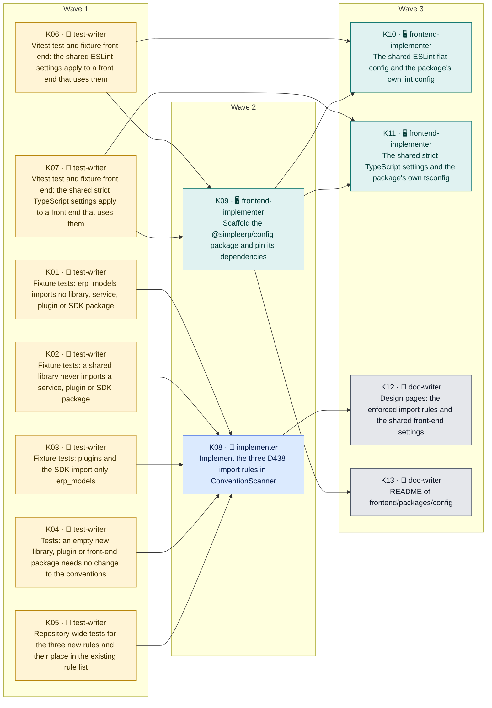

# T0.02: Plan

**Plan:** 🟢 Approved

**Push:** 🟢 Approved

<!-- ticket:specs -->
## 📚 Specifications

The specification and design pages of [TICKET.md](TICKET.md), copied by `python3 .claude/scripts/tickets/ticket_refs.py sync`.

- [Repository layout](../../technical/architecture/repository-layout.md)
- [D407](../../specs/06-decisions/technical/d407-front-end.md)
- [📜 D438 Repository layout](../../specs/06-decisions/technical/d438-repository-layout.md)
<!-- /ticket:specs -->

## Summary

T0.02 extends `tests/conventions/` with three D438 import-boundary rules and adds the shared ESLint and strict TypeScript settings in `frontend/packages/config` (D407). The plan has 13 tasks in 3 waves.

Wave 1 has seven test-writer tasks:

- K01 to K03 write one broken fixture per new scanner rule, each asserting exactly one offender. The rules are `shared_models_imports`, `shared_library_imports` and `plugin_and_sdk_imports`.
- K04 proves that adding an empty library, plugin or front-end package needs no change to the tests.
- K05 adds the repository-wide assertions to `test_layers.py` and the new rule names to the existing scanner test.
- K06 and K07 write the Vitest tests and fixture front ends that show the shared ESLint and strict TypeScript settings apply to a front end that uses them.

Wave 2:

- K08 (implementer) adds the three rules to `ConventionScanner` and its helpers.
- K09 (frontend-implementer) scaffolds the `@simpleerp/config` package and the pnpm lock.

Wave 3:

- K10 builds the shared ESLint flat config.
- K11 builds the shared strict tsconfig.
- K12 updates the design pages (`repository-layout.md`, `frontend.md`).
- K13 writes the package README.

No screen is touched, so no Playwright task is needed (TKT-21). The prerequisite is T0.01, which provides the uv and pnpm workspaces.

## Assumptions

- The roadmap row has no anchor of its own, so the ticket links to the sprint anchor `#s01`.
- The criteria are derived from the roadmap row's Delivers and Done when text, as no use case or business rule applies.
- No screen is built (`frontend/packages/config` holds only lint and TypeScript settings), so Screens touched says No screen.
- No budget of `docs/specs/05-non-functional` is given to the ticket.
- `check_ticket.py` was not run by the planner; the workflow runs it next.
- T0.01 is done before T0.02 runs (ticket-graph prerequisite). It provides the uv workspace members and a pnpm workspace that globs `frontend/packages/*`.
- The scanner code `tests/conventions/convention_scanner.py` and `tests/conventions/helpers.py` is the code under test, not a test. It goes to the `implementer` agent, the only Python implementer, even though `tests/` is not among its listed folders.
- "Library" in D438 and the roadmap row means a package under `backend/shared/*/src/`. The rules cover only absolute imports of first-party packages, found from `SOURCE_GLOBS`. The standard library, third-party packages and relative imports are not restricted.
- Conservative reading of "`erp_models` imports no library or service": `erp_models` imports no first-party package but itself, so plugins and the SDK are forbidden too.
- Conservative reading of "`backend/shared` imports `erp_models` and other libraries but never a service": a shared library may import only `erp_models`, itself and other shared libraries. Plugins and the SDK are forbidden too.
- "`plugins/` and `sdk/` import only `erp_models`" is applied literally: a plugin or the SDK may import only `erp_models` and its own package. That includes a plugin importing the SDK, which may need revisiting once D425's SDK exists.
- "Fails each new rule once" means each deliberately broken fixture gives exactly one offender for its rule. The existing rule `foreign_service_imports` may also report the same import.
- The deliberately broken Python fixtures are written to `tmp_path` by the tests, as the existing scanner tests do, and are not committed as broken source trees: the repository-wide conventions would scan those and fail.
- `tests/conventions/` already holds five Python files, the folder limit. The new scanner tests go in `tests/conventions/scanner/` (five files after this ticket), each self-contained, so that no wave-1 file is shared.
- No front end exists yet, so acceptance criterion 5 is shown by Vitest tests in `frontend/packages/config`. They run deliberately broken fixture front ends that extend the shared settings. Making each app use them is left to the tickets that create the apps (T0.15, T0.17 and later).
- No Python convention test inspects front-end packages. For the front-end side of criterion 4, the pnpm workspace glob and the CI change detection pick a new package up with no test change, and K04 checks that an added front-end package leaves every scanner rule passing.
- The package is named `@simpleerp/config`, exporting `./eslint` (`eslint.base.js`) and `./tsconfig` (`tsconfig.base.json`). The specifications name no npm scope, so the scope of the root `package.json` from T0.01 wins if it differs.
- "Strict TypeScript settings" means `strict: true` at least. Any further flag is reported as a decision. The shared ESLint settings are `@eslint/js` recommended, `typescript-eslint` recommended (not type-aware) and `eslint-plugin-vue` `flat/recommended` for Vue 3 (D407).
- `AGENT.md` is not changed: its Layout and Mono-repo sections already state these import rules, and "Rules a test enforces" already lists "An import that Layout does not allow".
- Documentation is limited to the "Today" sections of `docs/technical/architecture/repository-layout.md` and `frontend.md`, and the README of the new package. The ticket names no documentation change, and `docs/specs/` stays read-only.

<!-- plan:graph -->

> [!NOTE]
> Generated from the json block at the end of this page by `python3 .claude/scripts/tickets/plan.py render`.
> To change a task, edit the json block, then render again: never edit this view by hand.

## Waves

| Wave | Tasks | Agents running at once |
| --- | --- | --- |
| 1 | [K01](#k01), [K02](#k02), [K03](#k03), [K04](#k04), [K05](#k05), [K06](#k06), [K07](#k07) | 7 of 7 |
| 2 | [K08](#k08), [K09](#k09) | 2 of 2 |
| 3 | [K10](#k10), [K11](#k11), [K12](#k12), [K13](#k13) | 4 of 4 |

| Wave | Task | Agent | Depends on | Unblocks |
| --- | --- | --- | --- | --- |
| 1 | [K01](#k01) Fixture tests: erp_models imports no library, service, plugin or SDK package | 🧪 test-writer | none | [K08](#k08) |
| 1 | [K02](#k02) Fixture tests: a shared library never imports a service, plugin or SDK package | 🧪 test-writer | none | [K08](#k08) |
| 1 | [K03](#k03) Fixture tests: plugins and the SDK import only erp_models | 🧪 test-writer | none | [K08](#k08) |
| 1 | [K04](#k04) Tests: an empty new library, plugin or front-end package needs no change to the conventions | 🧪 test-writer | none | [K08](#k08) |
| 1 | [K05](#k05) Repository-wide tests for the three new rules and their place in the existing rule list | 🧪 test-writer | none | [K08](#k08) |
| 1 | [K06](#k06) Vitest test and fixture front end: the shared ESLint settings apply to a front end that uses them | 🧪 test-writer | none | [K09](#k09), [K10](#k10) |
| 1 | [K07](#k07) Vitest test and fixture front end: the shared strict TypeScript settings apply to a front end that uses them | 🧪 test-writer | none | [K09](#k09), [K11](#k11) |
| 2 | [K08](#k08) Implement the three D438 import rules in ConventionScanner | 🐍 implementer | [K01](#k01), [K02](#k02), [K03](#k03), [K04](#k04), [K05](#k05) | [K12](#k12) |
| 2 | [K09](#k09) Scaffold the @simpleerp/config package and pin its dependencies | 🖥️ frontend-implementer | [K06](#k06), [K07](#k07) | [K10](#k10), [K11](#k11), [K13](#k13) |
| 3 | [K10](#k10) The shared ESLint flat config and the package's own lint config | 🖥️ frontend-implementer | [K06](#k06), [K09](#k09) | none |
| 3 | [K11](#k11) The shared strict TypeScript settings and the package's own tsconfig | 🖥️ frontend-implementer | [K07](#k07), [K09](#k09) | none |
| 3 | [K12](#k12) Design pages: the enforced import rules and the shared front-end settings | 📝 doc-writer | [K08](#k08) | none |
| 3 | [K13](#k13) README of frontend/packages/config | 📝 doc-writer | [K09](#k09) | none |

## Dependency graph



## Tasks

### <a id="k01"></a>K01: Fixture tests: erp_models imports no library, service, plugin or SDK package

| Agent | Wave | Depends on | Unblocks |
| --- | --- | --- | --- |
| 🧪 test-writer | 1 | none | [K08](#k08) |

**Files** (only this task may change them in its wave):

- `tests/conventions/scanner/test_shared_models_imports.py`

**Done when:** `uv run pytest tests/conventions/scanner/test_shared_models_imports.py -n 2` collects the tests, which fail only with AttributeError on `shared_models_imports`. `uv run ruff check tests/conventions/scanner/test_shared_models_imports.py` and `uv run ruff format --check tests/conventions/scanner/test_shared_models_imports.py` pass.

**Brief:**

Write the tests, first, for a new rule `ConventionScanner.shared_models_imports() -> List[str]` of tests/conventions/convention_scanner.py (the rule is implemented by K08). Acceptance criterion 1 of docs/tickets/T0.02/TICKET.md. Specification: D438 (docs/specs/06-decisions/technical/d438-repository-layout.md). Design page: docs/technical/architecture/repository-layout.md (Rules: `backend/models/` is imported by services, plugins and the SDK). AGENT.md, Layout: `erp_models` "imports no service and no library of backend/shared/".

The rule's contract, which K08 implements exactly:
- It reads every `.py` file under `backend/models/src/` of the scanned root.
- It reports each absolute import (`import x` or `from x import y` with level 0) whose first dotted segment is a first-party package other than `erp_models`. A first-party package is a package folder found under any of the source globs of tests/conventions/helpers.py `SOURCE_GLOBS`: a shared library (`backend/shared/*/src/<pkg>`), a service (`backend/services/*/src/<pkg>`), a plugin (`plugins/*/src/<pkg>`) or the SDK (`sdk/src/<pkg>`).
- The standard library and third-party packages (`typing`, `pydantic`) are not reported.
- Each offender is the text `<path relative to root>:<line of the import> erp_models imports <first segment>`, one per import statement and offending package.

Write one class `TestSharedModelsImports` in tests/conventions/scanner/test_shared_models_imports.py. Follow the style of tests/conventions/scanner/test_convention_scanner.py: build a small tree in `tmp_path` with a module-level `write(root, files)` helper in this file, and give it a clean service (`backend/services/sales/src/erp_sales/{api,service,storage,models}/__init__.py`), a library (`backend/shared/log/src/erp_log/__init__.py`), a plugin (`plugins/shop/src/erp_shop/__init__.py`) and the SDK (`sdk/src/erp_sdk/__init__.py`). Keep the file self-contained so that it shares no file with another task. Tests, named as sentences:
- An empty tree passes.
- The clean tree passes.
- Parametrised deliberately broken fixtures in `backend/models/src/erp_models/a.py`: `import erp_log`, `from erp_log.x import y`, `import erp_sales.models`, `from erp_shop import z`, `import erp_sdk`. Each gives exactly one offender, equal to the text above (for example `backend/models/src/erp_models/a.py:1 erp_models imports erp_log`).
- Imports of `erp_models.money`, `typing`, `pydantic` and relative imports (`from . import x`) pass.

No `unittest.mock`, no docstrings needed (AGENT.md, Tests). The tests must fail now only because `shared_models_imports` does not exist yet.

### <a id="k02"></a>K02: Fixture tests: a shared library never imports a service, plugin or SDK package

| Agent | Wave | Depends on | Unblocks |
| --- | --- | --- | --- |
| 🧪 test-writer | 1 | none | [K08](#k08) |

**Files** (only this task may change them in its wave):

- `tests/conventions/scanner/test_shared_library_imports.py`

**Done when:** `uv run pytest tests/conventions/scanner/test_shared_library_imports.py -n 2` collects the tests, which fail only with AttributeError on `shared_library_imports`. `uv run ruff check` and `uv run ruff format --check` pass on the file.

**Brief:**

Write the tests, first, for a new rule `ConventionScanner.shared_library_imports() -> List[str]` of tests/conventions/convention_scanner.py (the rule is implemented by K08). Acceptance criterion 2 of docs/tickets/T0.02/TICKET.md. Specification: D438 (docs/specs/06-decisions/technical/d438-repository-layout.md). Design page: docs/technical/architecture/repository-layout.md ("a service never imports another service"; `backend/shared/` holds libraries imported by the services). Roadmap row T0.02: `backend/shared` imports `erp_models` and other libraries but never a service.

The rule's contract, which K08 implements exactly:
- It reads every `.py` file under each `backend/shared/*/src/` folder.
- It reports each absolute import (level 0) whose first dotted segment is a first-party package that is neither `erp_models` nor a shared library package (any package under `backend/shared/*/src/`). In practice that is a service, plugin or SDK package, found from tests/conventions/helpers.py `SOURCE_GLOBS`.
- The standard library and third-party packages are not reported.
- Each offender is the text `<path relative to root>:<line> <own package> imports <first segment>`, one per import statement and offending package.

Write one class `TestSharedLibraryImports` in tests/conventions/scanner/test_shared_library_imports.py. Keep it self-contained, with a module-level `write(root, files)` helper as in tests/conventions/scanner/test_convention_scanner.py. Use a tree with a clean service `backend/services/sales/src/erp_sales/{api,service,storage,models}/__init__.py`, two libraries `backend/shared/log/src/erp_log/` and `backend/shared/conf/src/erp_conf/`, a plugin `plugins/shop/src/erp_shop/` and the SDK `sdk/src/erp_sdk/`. Tests, named as sentences:
- An empty tree passes.
- The clean tree passes.
- Parametrised deliberately broken fixtures in `backend/shared/log/src/erp_log/a.py`: `import erp_sales`, `from erp_sales.service.quotes import QuoteService`, `import erp_shop`, `from erp_sdk import x`. Each gives exactly one offender, for example `backend/shared/log/src/erp_log/a.py:1 erp_log imports erp_sales`.
- Imports of `erp_models`, `erp_conf.x`, the library's own `erp_log.y`, `logging` and `yaml` pass.

The tests must fail now only because the rule does not exist yet.

### <a id="k03"></a>K03: Fixture tests: plugins and the SDK import only erp_models

| Agent | Wave | Depends on | Unblocks |
| --- | --- | --- | --- |
| 🧪 test-writer | 1 | none | [K08](#k08) |

**Files** (only this task may change them in its wave):

- `tests/conventions/scanner/test_plugin_and_sdk_imports.py`

**Done when:** `uv run pytest tests/conventions/scanner/test_plugin_and_sdk_imports.py -n 2` collects the tests, which fail only with AttributeError on `plugin_and_sdk_imports`. `uv run ruff check` and `uv run ruff format --check` pass on the file.

**Brief:**

Write the tests, first, for a new rule `ConventionScanner.plugin_and_sdk_imports() -> List[str]` of tests/conventions/convention_scanner.py (the rule is implemented by K08). Acceptance criterion 3 of docs/tickets/T0.02/TICKET.md. Specification: D438 (docs/specs/06-decisions/technical/d438-repository-layout.md: the shared models "used by the services, plugins/ and sdk/"). Design page: docs/technical/architecture/repository-layout.md. AGENT.md, Mono-repo: "plugins/ and sdk/ import erp_models, never a service". Roadmap row T0.02: `plugins/` and `sdk/` import only `erp_models`.

The rule's contract, which K08 implements exactly:
- It reads every `.py` file under each `plugins/*/src/` folder and under `sdk/src/`.
- It reports each absolute import (level 0) whose first dotted segment is a first-party package (found from tests/conventions/helpers.py `SOURCE_GLOBS`) other than `erp_models` and the file's own package. This covers a service, a shared library, another plugin, and the SDK imported by a plugin.
- The standard library and third-party packages are not reported.
- Each offender is the text `<path relative to root>:<line> <own package> imports <first segment>`.

Write one class `TestPluginAndSdkImports` in tests/conventions/scanner/test_plugin_and_sdk_imports.py. Keep it self-contained, with a module-level `write(root, files)` helper as in tests/conventions/scanner/test_convention_scanner.py. Use a tree with a clean service `backend/services/sales/src/erp_sales/{api,service,storage,models}/__init__.py`, a library `backend/shared/log/src/erp_log/`, two plugins `plugins/shop/src/erp_shop/` and `plugins/bank/src/erp_bank/`, and the SDK `sdk/src/erp_sdk/`. Tests, named as sentences:
- An empty tree passes.
- The clean tree passes.
- Parametrised deliberately broken fixtures: in `plugins/shop/src/erp_shop/a.py` import `erp_sales.api`, `erp_log`, `erp_bank` and `erp_sdk`; in `sdk/src/erp_sdk/a.py` import `erp_sales` and `erp_log`. Each gives exactly one offender, for example `plugins/shop/src/erp_shop/a.py:1 erp_shop imports erp_sales`.
- Imports of `erp_models.x`, the file's own package, `httpx` and `typing` pass.

The tests must fail now only because the rule does not exist yet.

### <a id="k04"></a>K04: Tests: an empty new library, plugin or front-end package needs no change to the conventions

| Agent | Wave | Depends on | Unblocks |
| --- | --- | --- | --- |
| 🧪 test-writer | 1 | none | [K08](#k08) |

**Files** (only this task may change them in its wave):

- `tests/conventions/scanner/test_new_packages.py`

**Done when:** `uv run pytest tests/conventions/scanner/test_new_packages.py -n 2` collects the tests. Only the cases calling the three new rules fail, with AttributeError, and the existing 15 rules pass on the additions. `uv run ruff check` and `uv run ruff format --check` pass on the file.

**Brief:**

Write the tests for acceptance criterion 4 of docs/tickets/T0.02/TICKET.md: given an empty library or front-end package is added, when the conventions run, then no change to the tests is needed. Specification: D438 (docs/specs/06-decisions/technical/d438-repository-layout.md). Design page: docs/technical/architecture/repository-layout.md. AGENT.md, Mono-repo: "Adding a service must not need a change to tests/conventions/".

Write one class `TestNewPackages` in tests/conventions/scanner/test_new_packages.py. Keep it self-contained, with a module-level `write(root, files)` helper as in tests/conventions/scanner/test_convention_scanner.py, over a clean service `backend/services/sales/src/erp_sales/{api,service,storage,models}/__init__.py` and `backend/models/src/erp_models/__init__.py`. List in a class constant `RULES` every rule of `ConventionScanner`: the 15 of `TestConventionScanner.RULES` in tests/conventions/scanner/test_convention_scanner.py plus the new `shared_models_imports`, `shared_library_imports` and `plugin_and_sdk_imports` (contracts in K01 to K03: offenders are `path:line <package> imports <package>` texts). Tests, named as sentences:
- Parametrised over RULES and over three additions, each rule returns `[]`:
  - an empty library `backend/shared/newlib/src/erp_newlib/__init__.py`;
  - an empty plugin `plugins/newplugin/src/erp_newplugin/__init__.py`;
  - an empty front-end package `frontend/packages/newpkg/package.json` (holding `{"name": "@simpleerp/newpkg", "private": true}`).
- The new library is recognised with no list of names. `backend/models/src/erp_models/a.py` importing `erp_newlib` gives exactly one `shared_models_imports` offender, and `plugins/newplugin/src/erp_newplugin/a.py` importing `erp_newlib` gives exactly one `plugin_and_sdk_imports` offender. A service file `backend/services/sales/src/erp_sales/service/a.py` importing `erp_newlib` gives no offender for any rule.

The tests must fail now only because the three new rules do not exist yet.

### <a id="k05"></a>K05: Repository-wide tests for the three new rules and their place in the existing rule list

| Agent | Wave | Depends on | Unblocks |
| --- | --- | --- | --- |
| 🧪 test-writer | 1 | none | [K08](#k08) |

**Files** (only this task may change them in its wave):

- `tests/conventions/test_layers.py`
- `tests/conventions/scanner/test_convention_scanner.py`

**Done when:** `uv run pytest tests/conventions/test_layers.py tests/conventions/scanner/test_convention_scanner.py -n 2` runs. Every pre-existing test still passes, and only the new cases fail, with AttributeError on the three missing rules. `uv run ruff check` and `uv run ruff format --check` pass on both files.

**Brief:**

Wire the three new D438 import rules into the existing conventions tests. Ticket: docs/tickets/T0.02/TICKET.md, acceptance criteria 1 to 3 and "What it delivers". Specification: D438 (docs/specs/06-decisions/technical/d438-repository-layout.md). Design page: docs/technical/architecture/repository-layout.md (Rules). The rules are `ConventionScanner.shared_models_imports()`, `shared_library_imports()` and `plugin_and_sdk_imports()`, each returning `List[str]` offenders `path:line <package> imports <package>`; K08 implements them.

1. In tests/conventions/test_layers.py, add three tests to `TestLayers` that assert each rule finds nothing on the real repository (`ConventionScanner(ROOT)`), in the style of the existing ones: `test_shared_models_import_no_library_or_service`, `test_shared_libraries_never_import_a_service`, `test_plugins_and_the_sdk_import_only_the_shared_models`.
2. In tests/conventions/scanner/test_convention_scanner.py:
   - Add the three names to `TestConventionScanner.RULES`, so that the empty tree and the clean service pass them.
   - Add one violation row per rule to `test_each_rule_catches_its_violation`: `backend/models/src/erp_models/a.py` with `import erp_log`, which needs a `backend/shared/log/src/erp_log/__init__.py` in the same fixture or added to the row's text; `backend/shared/log/src/erp_log/a.py` with `import erp_sales.models`; `plugins/shop/src/erp_shop/a.py` with `import erp_sales`. If a row needs a second file, extend the parametrisation in the simplest way that keeps `write` unchanged for the other rows.
   - Assert the three new rules are empty in `test_what_the_layout_allows_passes`.

Do not change the other tests. tests/conventions/ already holds five Python files: add no file there.

### <a id="k06"></a>K06: Vitest test and fixture front end: the shared ESLint settings apply to a front end that uses them

| Agent | Wave | Depends on | Unblocks |
| --- | --- | --- | --- |
| 🧪 test-writer | 1 | none | [K09](#k09), [K10](#k10) |

**Files** (only this task may change them in its wave):

- `frontend/packages/config/tests/eslint-settings.test.ts`
- `frontend/packages/config/tests/fixtures/eslint-front-end/eslint.config.js`
- `frontend/packages/config/tests/fixtures/eslint-front-end/src/clean.ts`
- `frontend/packages/config/tests/fixtures/eslint-front-end/src/broken.ts`
- `frontend/packages/config/tests/fixtures/eslint-front-end/src/Clean.vue`
- `frontend/packages/config/tests/fixtures/eslint-front-end/src/Broken.vue`

**Done when:** The six files exist as described. Each fixture holds exactly the deliberate violation named above, and the test names the fixture folder relative to its own file. It runs green once K09 and K10 land (`pnpm --filter ./frontend/packages/config exec vitest run tests/eslint-settings.test.ts`).

**Brief:**

Write the Vitest test for the ESLint half of acceptance criterion 5 of docs/tickets/T0.02/TICKET.md: given the shared eslint settings of `frontend/packages/config`, when a front end uses them, then they apply to it. Specification: D407 (docs/specs/06-decisions/technical/d407-front-end.md: Vue 3 with TypeScript). AGENT.md, Front ends: Vue 3 with TypeScript and Vite.

No front end exists yet, so the test uses a deliberately broken fixture front end. Names agreed with K09 and K10:
- the package is `@simpleerp/config`, an ES module (`"type": "module"`);
- its shared flat config is `frontend/packages/config/eslint.base.js`, whose default export is a flat-config array covering `.ts` and `.vue` files, with `@eslint/js` recommended, `typescript-eslint` recommended and `eslint-plugin-vue` `flat/recommended` (Vue 3).

Files:
- `tests/fixtures/eslint-front-end/eslint.config.js`: `import shared from "../../../eslint.base.js"; export default [...shared];`
- `src/clean.ts` and `src/Clean.vue`: code with no finding. `Clean.vue` is a multi-word component file with `<script setup lang="ts">` and a simple template.
- `src/broken.ts`: `export const value: any = 1;`, which `@typescript-eslint/no-explicit-any` flags.
- `src/Broken.vue`: a template with `v-if` and `v-for` on the same element, which `vue/no-use-v-if-with-v-for` flags.
- `tests/eslint-settings.test.ts`, one `describe`:
  - It runs the Node API `new ESLint({ cwd: <fixture dir> })` (from `eslint`) on each file.
  - Each clean file gives no error.
  - `broken.ts` gives exactly one error, whose `ruleId` is `@typescript-eslint/no-explicit-any`.
  - `Broken.vue` gives at least one error whose `ruleId` is `vue/no-use-v-if-with-v-for`.
  - Resolve the fixture folder from `import.meta.url`.

The test fails now because the package and `eslint.base.js` do not exist yet (K09, K10).

### <a id="k07"></a>K07: Vitest test and fixture front end: the shared strict TypeScript settings apply to a front end that uses them

| Agent | Wave | Depends on | Unblocks |
| --- | --- | --- | --- |
| 🧪 test-writer | 1 | none | [K09](#k09), [K11](#k11) |

**Files** (only this task may change them in its wave):

- `frontend/packages/config/tests/strict-typescript.test.ts`
- `frontend/packages/config/tests/fixtures/strict-front-end/tsconfig.json`
- `frontend/packages/config/tests/fixtures/strict-front-end/src/clean.ts`
- `frontend/packages/config/tests/fixtures/strict-front-end/src/broken.ts`

**Done when:** The four files exist as described, and `broken.ts` holds exactly the two violations named. The test runs green once K09 and K11 land (`pnpm --filter ./frontend/packages/config exec vitest run tests/strict-typescript.test.ts`).

**Brief:**

Write the Vitest test for the TypeScript half of acceptance criterion 5 of docs/tickets/T0.02/TICKET.md: given the shared strict TypeScript settings of `frontend/packages/config`, when a front end uses them, then they apply to it. Specification: D407 (docs/specs/06-decisions/technical/d407-front-end.md: Vue 3 with TypeScript). AGENT.md, Front ends.

Name agreed with K11: the shared settings are `frontend/packages/config/tsconfig.base.json`, with `compilerOptions.strict: true`.

Files:
- `tests/fixtures/strict-front-end/tsconfig.json`: `{ "extends": "../../../tsconfig.base.json", "compilerOptions": { "noEmit": true }, "include": ["src/**/*.ts"] }`.
- `src/clean.ts`: strict-clean code.
- `src/broken.ts`: exactly two deliberate strict violations, `export function echo(value) { return value; }` (TS7006, implicit any) and `export const name: string = null;` (TS2322 under strictNullChecks).
- `tests/strict-typescript.test.ts`, one `describe`, using the `typescript` compiler API:
  - It reads the fixture config with `ts.readConfigFile` and `ts.parseJsonConfigFileContent`.
  - It asserts the parsed `options.strict` is `true`.
  - It builds the program with `ts.createProgram` and reads `ts.getPreEmitDiagnostics`.
  - It asserts no diagnostic for `clean.ts`, and diagnostics with codes 7006 and 2322 for `broken.ts`.
  - Resolve the fixture folder from `import.meta.url`.

The test fails now because the package and `tsconfig.base.json` do not exist yet (K09, K11).

### <a id="k08"></a>K08: Implement the three D438 import rules in ConventionScanner

| Agent | Wave | Depends on | Unblocks |
| --- | --- | --- | --- |
| 🐍 implementer | 2 | [K01](#k01), [K02](#k02), [K03](#k03), [K04](#k04), [K05](#k05) | [K12](#k12) |

**Files** (only this task may change them in its wave):

- `tests/conventions/convention_scanner.py`
- `tests/conventions/helpers.py`

**Done when:** `uv run pytest tests/conventions -n 2` passes, which includes the repository-wide tests on the real tree. `uv run ruff check tests/conventions` and `uv run ruff format --check tests/conventions/convention_scanner.py tests/conventions/helpers.py` pass.

**Brief:**

Add three rules to `ConventionScanner` in tests/conventions/convention_scanner.py, with the constants they need in tests/conventions/helpers.py, so that the tests of K01 to K05 pass without being changed. Ticket: docs/tickets/T0.02/TICKET.md (acceptance criteria 1 to 4). Specification: D438 (docs/specs/06-decisions/technical/d438-repository-layout.md). Design page: docs/technical/architecture/repository-layout.md (Rules). AGENT.md: Layout and Mono-repo.

Rules, each returning `List[str]` offenders `<path relative to root>:<line> <own package> imports <first segment>`, one per absolute (level 0) import statement and offending package:
- `shared_models_imports()`: files under `backend/models/src/`. It reports any first-party package other than `erp_models`. The own-package text is `erp_models`.
- `shared_library_imports()`: files under `backend/shared/*/src/`. It reports any first-party package that is neither `erp_models` nor a shared library package.
- `plugin_and_sdk_imports()`: files under `plugins/*/src/` and `sdk/src/`. It reports any first-party package other than `erp_models` and the file's own package.

First-party packages are found, never listed: the package folders (`_packages`) under every folder of `SOURCE_GLOBS`. Adding an empty library, plugin or front-end package must need no change (criterion 4). Reuse the existing helpers `_source_trees`, `_imported`, `_layer_of`, `_packages` and `where`. Add to helpers.py only glob constants such as `SHARED_LIBRARY_SOURCE_GLOB = "backend/shared/*/src"`, `PLUGIN_AND_SDK_SOURCE_GLOBS = ("plugins/*/src", "sdk/src")` and `SHARED_MODELS_PACKAGE = "erp_models"`, each with a comment like its neighbours. Keep the class's style: one docstring line per rule, private helpers under the Internal Helpers banner, rules under Publicly Exposed Methods, sync before async, no nested function, no staticmethod, no `Any`, no new file in tests/conventions/ (it already holds five). The existing rules and their results must not change.

### <a id="k09"></a>K09: Scaffold the @simpleerp/config package and pin its dependencies

| Agent | Wave | Depends on | Unblocks |
| --- | --- | --- | --- |
| 🖥️ frontend-implementer | 2 | [K06](#k06), [K07](#k07) | [K10](#k10), [K11](#k11), [K13](#k13) |

**Files** (only this task may change them in its wave):

- `frontend/packages/config/package.json`
- `frontend/packages/config/vitest.config.ts`
- `pnpm-lock.yaml`

**Done when:** `pnpm install --frozen-lockfile` passes from the repository root, and `pnpm --filter ./frontend/packages/config ls --depth 0` lists eslint, typescript, typescript-eslint, eslint-plugin-vue and vitest.

**Brief:**

Create the pnpm package of the front ends' shared settings in `frontend/packages/config`. The pnpm workspace already globs `frontend/packages/*` (T0.01). Ticket: docs/tickets/T0.02/TICKET.md ("What it delivers", acceptance criterion 5). Specification: D407 (docs/specs/06-decisions/technical/d407-front-end.md: Vue 3 with TypeScript). AGENT.md: Front ends, Commands (`pnpm --filter ./frontend/<app> run lint|typecheck`). CI (.github/workflows/typescript.yml) runs the `lint`, `typecheck` and `test` scripts when they are present.

`package.json`:
- `name` `@simpleerp/config`. Use the scope of the root `package.json` if T0.01 set another, and report it.
- `private: true`, `type: module`, and `exports` `{"./eslint": "./eslint.base.js", "./tsconfig": "./tsconfig.base.json"}` plus `files`.
- scripts `lint: eslint .`, `typecheck: tsc --noEmit -p tsconfig.json`, `test: vitest run`.
- The ESLint plugins a consuming front end needs as `dependencies`: `@eslint/js`, `typescript-eslint`, `eslint-plugin-vue`, `vue-eslint-parser`, `globals`.
- `eslint` and `typescript` as `peerDependencies`, and as `devDependencies` with `vitest` and `@types/node`.

`vitest.config.ts`: include `tests/**/*.test.ts`, exclude `tests/fixtures/**`. Run `pnpm install` so that pnpm-lock.yaml pins every version (D415, supply chain). Report the dependency layout as a decision. The files `eslint.base.js`, `eslint.config.js`, `tsconfig.base.json` and `tsconfig.json` belong to K10 and K11: do not create them.

### <a id="k10"></a>K10: The shared ESLint flat config and the package's own lint config

| Agent | Wave | Depends on | Unblocks |
| --- | --- | --- | --- |
| 🖥️ frontend-implementer | 3 | [K06](#k06), [K09](#k09) | none |

**Files** (only this task may change them in its wave):

- `frontend/packages/config/eslint.base.js`
- `frontend/packages/config/eslint.config.js`

**Done when:** `pnpm --filter ./frontend/packages/config run lint` passes, and `pnpm --filter ./frontend/packages/config exec vitest run tests/eslint-settings.test.ts` passes.

**Brief:**

Write the front ends' shared ESLint settings. Ticket: docs/tickets/T0.02/TICKET.md ("What it delivers", acceptance criterion 5). Specification: D407 (docs/specs/06-decisions/technical/d407-front-end.md: Vue 3 with TypeScript). AGENT.md: Front ends.

`frontend/packages/config/eslint.base.js`: an ES module whose default export is a flat-config array, exported as `@simpleerp/config/eslint`. It holds:
- `@eslint/js` recommended;
- `typescript-eslint` recommended, without type-aware rules so that a consumer needs no project setup (report this as a decision);
- `eslint-plugin-vue` `flat/recommended` for Vue 3, with `vue-eslint-parser` delegating `<script lang="ts">` to the typescript-eslint parser;
- browser and ES2022 `globals`.
It must cover `.ts`, `.js` and `.vue` files.

`frontend/packages/config/eslint.config.js`: the package's own lint config. It spreads `eslint.base.js`, adds Node globals for the config files and tests, and ignores `tests/fixtures/**`, which are deliberately broken (K06). Make the test of K06 (`tests/eslint-settings.test.ts`) pass without changing it or its fixtures.

### <a id="k11"></a>K11: The shared strict TypeScript settings and the package's own tsconfig

| Agent | Wave | Depends on | Unblocks |
| --- | --- | --- | --- |
| 🖥️ frontend-implementer | 3 | [K07](#k07), [K09](#k09) | none |

**Files** (only this task may change them in its wave):

- `frontend/packages/config/tsconfig.base.json`
- `frontend/packages/config/tsconfig.json`

**Done when:** `pnpm --filter ./frontend/packages/config run typecheck` passes, and `pnpm --filter ./frontend/packages/config exec vitest run tests/strict-typescript.test.ts` passes. Once K10 is also integrated, `pnpm --filter ./frontend/packages/config run test` passes.

**Brief:**

Write the front ends' shared strict TypeScript settings. Ticket: docs/tickets/T0.02/TICKET.md ("What it delivers", acceptance criterion 5). Specification: D407 (docs/specs/06-decisions/technical/d407-front-end.md: Vue 3 with TypeScript and Vite, per AGENT.md Front ends).

`frontend/packages/config/tsconfig.base.json` is exported as `@simpleerp/config/tsconfig`. Its `compilerOptions` hold `strict: true` with the settings a Vite and Vue 3 front end needs: `target` ES2022, `module` ESNext, `moduleResolution` Bundler, `lib` [ES2022, DOM, DOM.Iterable], `isolatedModules`, `skipLibCheck`, `jsx: preserve`, `useDefineForClassFields`. Add any strict flag beyond `strict: true` (for example `noUncheckedIndexedAccess` or `noImplicitOverride`) only if you report it as a decision. It has no `include`, so each front end sets its own.

`frontend/packages/config/tsconfig.json`: the package's own type check. It extends `./tsconfig.base.json` with `types: ["node"]`, includes `tests/**/*.ts` and `vitest.config.ts`, and excludes `tests/fixtures/**`, which are deliberately broken (K07). Make the test of K07 (`tests/strict-typescript.test.ts`) pass without changing it or its fixtures.

### <a id="k12"></a>K12: Design pages: the enforced import rules and the shared front-end settings

| Agent | Wave | Depends on | Unblocks |
| --- | --- | --- | --- |
| 📝 doc-writer | 3 | [K08](#k08) | none |

**Files** (only this task may change them in its wave):

- `docs/technical/architecture/repository-layout.md`
- `docs/technical/architecture/frontend.md`

**Done when:** Both pages hold the new text in their "Today" sections, every link resolves, and `git diff --stat` shows changes in these two files only.

**Brief:**

Update two design pages of docs/technical/ to say what T0.02 builds. Ticket: docs/tickets/T0.02/TICKET.md. Specifications: D438 (docs/specs/06-decisions/technical/d438-repository-layout.md) and D407 (docs/specs/06-decisions/technical/d407-front-end.md). The specifications under docs/specs/ are read-only.

1. docs/technical/architecture/repository-layout.md, in its "Today" section: one short paragraph saying that `tests/conventions/` enforces the import rules of the layout, each named after its `ConventionScanner` rule in tests/conventions/convention_scanner.py:
   - `shared_models_imports`: `erp_models` imports no other package of the repository;
   - `shared_library_imports`: a library of `backend/shared/` imports only `erp_models` and other libraries;
   - `plugin_and_sdk_imports`: `plugins/` and `sdk/` import only `erp_models`.
   Add that packages are found from the folders, so a new library or plugin needs no change to the tests. Keep the rest of the page.
2. docs/technical/architecture/frontend.md, in its "Today" section: replace or extend the text to say that `frontend/packages/config` (`@simpleerp/config`) holds the front ends' shared ESLint flat config (`@simpleerp/config/eslint`) and strict TypeScript settings (`@simpleerp/config/tsconfig`), which every front end extends, and that no app is built yet.

Plain British English, no em dashes, links relative to each page (AGENT.md, Formatting and prose). State nothing the ticket or these files do not.

### <a id="k13"></a>K13: README of frontend/packages/config

| Agent | Wave | Depends on | Unblocks |
| --- | --- | --- | --- |
| 📝 doc-writer | 3 | [K09](#k09) | none |

**Files** (only this task may change them in its wave):

- `frontend/packages/config/README.md`

**Done when:** frontend/packages/config/README.md exists with these sections, and the package name and export paths in it match frontend/packages/config/package.json.

**Brief:**

Write `frontend/packages/config/README.md`, saying what the package holds and how a front end uses it. Ticket: docs/tickets/T0.02/TICKET.md ("What it delivers"). Specification: D407 (docs/specs/06-decisions/technical/d407-front-end.md: Vue 3 with TypeScript). Repository layout: D438 (docs/specs/06-decisions/technical/d438-repository-layout.md, `frontend/packages/<pkg>`).

Content:
- One paragraph on what `@simpleerp/config` is: the front ends' shared ESLint and strict TypeScript settings.
- How a front end uses them:
  - `eslint.config.js` with `import shared from "@simpleerp/config/eslint"; export default [...shared];`;
  - `tsconfig.json` with `"extends": "@simpleerp/config/tsconfig"` and its own `include`;
  - add `@simpleerp/config` as a `workspace:*` dev dependency.
- The package's scripts (`lint`, `typecheck`, `test`) with the `pnpm --filter ./frontend/packages/config run <script>` commands of AGENT.md.
- That `tests/fixtures/` holds deliberately broken fixture front ends, which the tests use to show the settings apply.

Read frontend/packages/config/package.json for the exact names. Plain British English, no em dashes.

<!-- /plan:graph -->

## Task graph

<details>
<summary>🤖 Task graph as read by <code>/ticket-run</code> (json)</summary>

```json
[
  {
    "id": "K01",
    "title": "Fixture tests: erp_models imports no library, service, plugin or SDK package",
    "agent": "test-writer",
    "depends_on": [],
    "files": [
      "tests/conventions/scanner/test_shared_models_imports.py"
    ],
    "brief": "Write the tests, first, for a new rule `ConventionScanner.shared_models_imports() -> List[str]` of tests/conventions/convention_scanner.py (the rule is implemented by K08). Acceptance criterion 1 of docs/tickets/T0.02/TICKET.md. Specification: D438 (docs/specs/06-decisions/technical/d438-repository-layout.md). Design page: docs/technical/architecture/repository-layout.md (Rules: `backend/models/` is imported by services, plugins and the SDK). AGENT.md, Layout: `erp_models` \"imports no service and no library of backend/shared/\".\n\nThe rule's contract, which K08 implements exactly:\n- It reads every `.py` file under `backend/models/src/` of the scanned root.\n- It reports each absolute import (`import x` or `from x import y` with level 0) whose first dotted segment is a first-party package other than `erp_models`. A first-party package is a package folder found under any of the source globs of tests/conventions/helpers.py `SOURCE_GLOBS`: a shared library (`backend/shared/*/src/<pkg>`), a service (`backend/services/*/src/<pkg>`), a plugin (`plugins/*/src/<pkg>`) or the SDK (`sdk/src/<pkg>`).\n- The standard library and third-party packages (`typing`, `pydantic`) are not reported.\n- Each offender is the text `<path relative to root>:<line of the import> erp_models imports <first segment>`, one per import statement and offending package.\n\nWrite one class `TestSharedModelsImports` in tests/conventions/scanner/test_shared_models_imports.py. Follow the style of tests/conventions/scanner/test_convention_scanner.py: build a small tree in `tmp_path` with a module-level `write(root, files)` helper in this file, and give it a clean service (`backend/services/sales/src/erp_sales/{api,service,storage,models}/__init__.py`), a library (`backend/shared/log/src/erp_log/__init__.py`), a plugin (`plugins/shop/src/erp_shop/__init__.py`) and the SDK (`sdk/src/erp_sdk/__init__.py`). Keep the file self-contained so that it shares no file with another task. Tests, named as sentences:\n- An empty tree passes.\n- The clean tree passes.\n- Parametrised deliberately broken fixtures in `backend/models/src/erp_models/a.py`: `import erp_log`, `from erp_log.x import y`, `import erp_sales.models`, `from erp_shop import z`, `import erp_sdk`. Each gives exactly one offender, equal to the text above (for example `backend/models/src/erp_models/a.py:1 erp_models imports erp_log`).\n- Imports of `erp_models.money`, `typing`, `pydantic` and relative imports (`from . import x`) pass.\n\nNo `unittest.mock`, no docstrings needed (AGENT.md, Tests). The tests must fail now only because `shared_models_imports` does not exist yet.",
    "done_when": "`uv run pytest tests/conventions/scanner/test_shared_models_imports.py -n 2` collects the tests, which fail only with AttributeError on `shared_models_imports`. `uv run ruff check tests/conventions/scanner/test_shared_models_imports.py` and `uv run ruff format --check tests/conventions/scanner/test_shared_models_imports.py` pass.",
    "wave": 1
  },
  {
    "id": "K02",
    "title": "Fixture tests: a shared library never imports a service, plugin or SDK package",
    "agent": "test-writer",
    "depends_on": [],
    "files": [
      "tests/conventions/scanner/test_shared_library_imports.py"
    ],
    "brief": "Write the tests, first, for a new rule `ConventionScanner.shared_library_imports() -> List[str]` of tests/conventions/convention_scanner.py (the rule is implemented by K08). Acceptance criterion 2 of docs/tickets/T0.02/TICKET.md. Specification: D438 (docs/specs/06-decisions/technical/d438-repository-layout.md). Design page: docs/technical/architecture/repository-layout.md (\"a service never imports another service\"; `backend/shared/` holds libraries imported by the services). Roadmap row T0.02: `backend/shared` imports `erp_models` and other libraries but never a service.\n\nThe rule's contract, which K08 implements exactly:\n- It reads every `.py` file under each `backend/shared/*/src/` folder.\n- It reports each absolute import (level 0) whose first dotted segment is a first-party package that is neither `erp_models` nor a shared library package (any package under `backend/shared/*/src/`). In practice that is a service, plugin or SDK package, found from tests/conventions/helpers.py `SOURCE_GLOBS`.\n- The standard library and third-party packages are not reported.\n- Each offender is the text `<path relative to root>:<line> <own package> imports <first segment>`, one per import statement and offending package.\n\nWrite one class `TestSharedLibraryImports` in tests/conventions/scanner/test_shared_library_imports.py. Keep it self-contained, with a module-level `write(root, files)` helper as in tests/conventions/scanner/test_convention_scanner.py. Use a tree with a clean service `backend/services/sales/src/erp_sales/{api,service,storage,models}/__init__.py`, two libraries `backend/shared/log/src/erp_log/` and `backend/shared/conf/src/erp_conf/`, a plugin `plugins/shop/src/erp_shop/` and the SDK `sdk/src/erp_sdk/`. Tests, named as sentences:\n- An empty tree passes.\n- The clean tree passes.\n- Parametrised deliberately broken fixtures in `backend/shared/log/src/erp_log/a.py`: `import erp_sales`, `from erp_sales.service.quotes import QuoteService`, `import erp_shop`, `from erp_sdk import x`. Each gives exactly one offender, for example `backend/shared/log/src/erp_log/a.py:1 erp_log imports erp_sales`.\n- Imports of `erp_models`, `erp_conf.x`, the library's own `erp_log.y`, `logging` and `yaml` pass.\n\nThe tests must fail now only because the rule does not exist yet.",
    "done_when": "`uv run pytest tests/conventions/scanner/test_shared_library_imports.py -n 2` collects the tests, which fail only with AttributeError on `shared_library_imports`. `uv run ruff check` and `uv run ruff format --check` pass on the file.",
    "wave": 1
  },
  {
    "id": "K03",
    "title": "Fixture tests: plugins and the SDK import only erp_models",
    "agent": "test-writer",
    "depends_on": [],
    "files": [
      "tests/conventions/scanner/test_plugin_and_sdk_imports.py"
    ],
    "brief": "Write the tests, first, for a new rule `ConventionScanner.plugin_and_sdk_imports() -> List[str]` of tests/conventions/convention_scanner.py (the rule is implemented by K08). Acceptance criterion 3 of docs/tickets/T0.02/TICKET.md. Specification: D438 (docs/specs/06-decisions/technical/d438-repository-layout.md: the shared models \"used by the services, plugins/ and sdk/\"). Design page: docs/technical/architecture/repository-layout.md. AGENT.md, Mono-repo: \"plugins/ and sdk/ import erp_models, never a service\". Roadmap row T0.02: `plugins/` and `sdk/` import only `erp_models`.\n\nThe rule's contract, which K08 implements exactly:\n- It reads every `.py` file under each `plugins/*/src/` folder and under `sdk/src/`.\n- It reports each absolute import (level 0) whose first dotted segment is a first-party package (found from tests/conventions/helpers.py `SOURCE_GLOBS`) other than `erp_models` and the file's own package. This covers a service, a shared library, another plugin, and the SDK imported by a plugin.\n- The standard library and third-party packages are not reported.\n- Each offender is the text `<path relative to root>:<line> <own package> imports <first segment>`.\n\nWrite one class `TestPluginAndSdkImports` in tests/conventions/scanner/test_plugin_and_sdk_imports.py. Keep it self-contained, with a module-level `write(root, files)` helper as in tests/conventions/scanner/test_convention_scanner.py. Use a tree with a clean service `backend/services/sales/src/erp_sales/{api,service,storage,models}/__init__.py`, a library `backend/shared/log/src/erp_log/`, two plugins `plugins/shop/src/erp_shop/` and `plugins/bank/src/erp_bank/`, and the SDK `sdk/src/erp_sdk/`. Tests, named as sentences:\n- An empty tree passes.\n- The clean tree passes.\n- Parametrised deliberately broken fixtures: in `plugins/shop/src/erp_shop/a.py` import `erp_sales.api`, `erp_log`, `erp_bank` and `erp_sdk`; in `sdk/src/erp_sdk/a.py` import `erp_sales` and `erp_log`. Each gives exactly one offender, for example `plugins/shop/src/erp_shop/a.py:1 erp_shop imports erp_sales`.\n- Imports of `erp_models.x`, the file's own package, `httpx` and `typing` pass.\n\nThe tests must fail now only because the rule does not exist yet.",
    "done_when": "`uv run pytest tests/conventions/scanner/test_plugin_and_sdk_imports.py -n 2` collects the tests, which fail only with AttributeError on `plugin_and_sdk_imports`. `uv run ruff check` and `uv run ruff format --check` pass on the file.",
    "wave": 1
  },
  {
    "id": "K04",
    "title": "Tests: an empty new library, plugin or front-end package needs no change to the conventions",
    "agent": "test-writer",
    "depends_on": [],
    "files": [
      "tests/conventions/scanner/test_new_packages.py"
    ],
    "brief": "Write the tests for acceptance criterion 4 of docs/tickets/T0.02/TICKET.md: given an empty library or front-end package is added, when the conventions run, then no change to the tests is needed. Specification: D438 (docs/specs/06-decisions/technical/d438-repository-layout.md). Design page: docs/technical/architecture/repository-layout.md. AGENT.md, Mono-repo: \"Adding a service must not need a change to tests/conventions/\".\n\nWrite one class `TestNewPackages` in tests/conventions/scanner/test_new_packages.py. Keep it self-contained, with a module-level `write(root, files)` helper as in tests/conventions/scanner/test_convention_scanner.py, over a clean service `backend/services/sales/src/erp_sales/{api,service,storage,models}/__init__.py` and `backend/models/src/erp_models/__init__.py`. List in a class constant `RULES` every rule of `ConventionScanner`: the 15 of `TestConventionScanner.RULES` in tests/conventions/scanner/test_convention_scanner.py plus the new `shared_models_imports`, `shared_library_imports` and `plugin_and_sdk_imports` (contracts in K01 to K03: offenders are `path:line <package> imports <package>` texts). Tests, named as sentences:\n- Parametrised over RULES and over three additions, each rule returns `[]`:\n  - an empty library `backend/shared/newlib/src/erp_newlib/__init__.py`;\n  - an empty plugin `plugins/newplugin/src/erp_newplugin/__init__.py`;\n  - an empty front-end package `frontend/packages/newpkg/package.json` (holding `{\"name\": \"@simpleerp/newpkg\", \"private\": true}`).\n- The new library is recognised with no list of names. `backend/models/src/erp_models/a.py` importing `erp_newlib` gives exactly one `shared_models_imports` offender, and `plugins/newplugin/src/erp_newplugin/a.py` importing `erp_newlib` gives exactly one `plugin_and_sdk_imports` offender. A service file `backend/services/sales/src/erp_sales/service/a.py` importing `erp_newlib` gives no offender for any rule.\n\nThe tests must fail now only because the three new rules do not exist yet.",
    "done_when": "`uv run pytest tests/conventions/scanner/test_new_packages.py -n 2` collects the tests. Only the cases calling the three new rules fail, with AttributeError, and the existing 15 rules pass on the additions. `uv run ruff check` and `uv run ruff format --check` pass on the file.",
    "wave": 1
  },
  {
    "id": "K05",
    "title": "Repository-wide tests for the three new rules and their place in the existing rule list",
    "agent": "test-writer",
    "depends_on": [],
    "files": [
      "tests/conventions/test_layers.py",
      "tests/conventions/scanner/test_convention_scanner.py"
    ],
    "brief": "Wire the three new D438 import rules into the existing conventions tests. Ticket: docs/tickets/T0.02/TICKET.md, acceptance criteria 1 to 3 and \"What it delivers\". Specification: D438 (docs/specs/06-decisions/technical/d438-repository-layout.md). Design page: docs/technical/architecture/repository-layout.md (Rules). The rules are `ConventionScanner.shared_models_imports()`, `shared_library_imports()` and `plugin_and_sdk_imports()`, each returning `List[str]` offenders `path:line <package> imports <package>`; K08 implements them.\n\n1. In tests/conventions/test_layers.py, add three tests to `TestLayers` that assert each rule finds nothing on the real repository (`ConventionScanner(ROOT)`), in the style of the existing ones: `test_shared_models_import_no_library_or_service`, `test_shared_libraries_never_import_a_service`, `test_plugins_and_the_sdk_import_only_the_shared_models`.\n2. In tests/conventions/scanner/test_convention_scanner.py:\n   - Add the three names to `TestConventionScanner.RULES`, so that the empty tree and the clean service pass them.\n   - Add one violation row per rule to `test_each_rule_catches_its_violation`: `backend/models/src/erp_models/a.py` with `import erp_log`, which needs a `backend/shared/log/src/erp_log/__init__.py` in the same fixture or added to the row's text; `backend/shared/log/src/erp_log/a.py` with `import erp_sales.models`; `plugins/shop/src/erp_shop/a.py` with `import erp_sales`. If a row needs a second file, extend the parametrisation in the simplest way that keeps `write` unchanged for the other rows.\n   - Assert the three new rules are empty in `test_what_the_layout_allows_passes`.\n\nDo not change the other tests. tests/conventions/ already holds five Python files: add no file there.",
    "done_when": "`uv run pytest tests/conventions/test_layers.py tests/conventions/scanner/test_convention_scanner.py -n 2` runs. Every pre-existing test still passes, and only the new cases fail, with AttributeError on the three missing rules. `uv run ruff check` and `uv run ruff format --check` pass on both files.",
    "wave": 1
  },
  {
    "id": "K06",
    "title": "Vitest test and fixture front end: the shared ESLint settings apply to a front end that uses them",
    "agent": "test-writer",
    "depends_on": [],
    "files": [
      "frontend/packages/config/tests/eslint-settings.test.ts",
      "frontend/packages/config/tests/fixtures/eslint-front-end/eslint.config.js",
      "frontend/packages/config/tests/fixtures/eslint-front-end/src/clean.ts",
      "frontend/packages/config/tests/fixtures/eslint-front-end/src/broken.ts",
      "frontend/packages/config/tests/fixtures/eslint-front-end/src/Clean.vue",
      "frontend/packages/config/tests/fixtures/eslint-front-end/src/Broken.vue"
    ],
    "brief": "Write the Vitest test for the ESLint half of acceptance criterion 5 of docs/tickets/T0.02/TICKET.md: given the shared eslint settings of `frontend/packages/config`, when a front end uses them, then they apply to it. Specification: D407 (docs/specs/06-decisions/technical/d407-front-end.md: Vue 3 with TypeScript). AGENT.md, Front ends: Vue 3 with TypeScript and Vite.\n\nNo front end exists yet, so the test uses a deliberately broken fixture front end. Names agreed with K09 and K10:\n- the package is `@simpleerp/config`, an ES module (`\"type\": \"module\"`);\n- its shared flat config is `frontend/packages/config/eslint.base.js`, whose default export is a flat-config array covering `.ts` and `.vue` files, with `@eslint/js` recommended, `typescript-eslint` recommended and `eslint-plugin-vue` `flat/recommended` (Vue 3).\n\nFiles:\n- `tests/fixtures/eslint-front-end/eslint.config.js`: `import shared from \"../../../eslint.base.js\"; export default [...shared];`\n- `src/clean.ts` and `src/Clean.vue`: code with no finding. `Clean.vue` is a multi-word component file with `<script setup lang=\"ts\">` and a simple template.\n- `src/broken.ts`: `export const value: any = 1;`, which `@typescript-eslint/no-explicit-any` flags.\n- `src/Broken.vue`: a template with `v-if` and `v-for` on the same element, which `vue/no-use-v-if-with-v-for` flags.\n- `tests/eslint-settings.test.ts`, one `describe`:\n  - It runs the Node API `new ESLint({ cwd: <fixture dir> })` (from `eslint`) on each file.\n  - Each clean file gives no error.\n  - `broken.ts` gives exactly one error, whose `ruleId` is `@typescript-eslint/no-explicit-any`.\n  - `Broken.vue` gives at least one error whose `ruleId` is `vue/no-use-v-if-with-v-for`.\n  - Resolve the fixture folder from `import.meta.url`.\n\nThe test fails now because the package and `eslint.base.js` do not exist yet (K09, K10).",
    "done_when": "The six files exist as described. Each fixture holds exactly the deliberate violation named above, and the test names the fixture folder relative to its own file. It runs green once K09 and K10 land (`pnpm --filter ./frontend/packages/config exec vitest run tests/eslint-settings.test.ts`).",
    "wave": 1
  },
  {
    "id": "K07",
    "title": "Vitest test and fixture front end: the shared strict TypeScript settings apply to a front end that uses them",
    "agent": "test-writer",
    "depends_on": [],
    "files": [
      "frontend/packages/config/tests/strict-typescript.test.ts",
      "frontend/packages/config/tests/fixtures/strict-front-end/tsconfig.json",
      "frontend/packages/config/tests/fixtures/strict-front-end/src/clean.ts",
      "frontend/packages/config/tests/fixtures/strict-front-end/src/broken.ts"
    ],
    "brief": "Write the Vitest test for the TypeScript half of acceptance criterion 5 of docs/tickets/T0.02/TICKET.md: given the shared strict TypeScript settings of `frontend/packages/config`, when a front end uses them, then they apply to it. Specification: D407 (docs/specs/06-decisions/technical/d407-front-end.md: Vue 3 with TypeScript). AGENT.md, Front ends.\n\nName agreed with K11: the shared settings are `frontend/packages/config/tsconfig.base.json`, with `compilerOptions.strict: true`.\n\nFiles:\n- `tests/fixtures/strict-front-end/tsconfig.json`: `{ \"extends\": \"../../../tsconfig.base.json\", \"compilerOptions\": { \"noEmit\": true }, \"include\": [\"src/**/*.ts\"] }`.\n- `src/clean.ts`: strict-clean code.\n- `src/broken.ts`: exactly two deliberate strict violations, `export function echo(value) { return value; }` (TS7006, implicit any) and `export const name: string = null;` (TS2322 under strictNullChecks).\n- `tests/strict-typescript.test.ts`, one `describe`, using the `typescript` compiler API:\n  - It reads the fixture config with `ts.readConfigFile` and `ts.parseJsonConfigFileContent`.\n  - It asserts the parsed `options.strict` is `true`.\n  - It builds the program with `ts.createProgram` and reads `ts.getPreEmitDiagnostics`.\n  - It asserts no diagnostic for `clean.ts`, and diagnostics with codes 7006 and 2322 for `broken.ts`.\n  - Resolve the fixture folder from `import.meta.url`.\n\nThe test fails now because the package and `tsconfig.base.json` do not exist yet (K09, K11).",
    "done_when": "The four files exist as described, and `broken.ts` holds exactly the two violations named. The test runs green once K09 and K11 land (`pnpm --filter ./frontend/packages/config exec vitest run tests/strict-typescript.test.ts`).",
    "wave": 1
  },
  {
    "id": "K08",
    "title": "Implement the three D438 import rules in ConventionScanner",
    "agent": "implementer",
    "depends_on": [
      "K01",
      "K02",
      "K03",
      "K04",
      "K05"
    ],
    "files": [
      "tests/conventions/convention_scanner.py",
      "tests/conventions/helpers.py"
    ],
    "brief": "Add three rules to `ConventionScanner` in tests/conventions/convention_scanner.py, with the constants they need in tests/conventions/helpers.py, so that the tests of K01 to K05 pass without being changed. Ticket: docs/tickets/T0.02/TICKET.md (acceptance criteria 1 to 4). Specification: D438 (docs/specs/06-decisions/technical/d438-repository-layout.md). Design page: docs/technical/architecture/repository-layout.md (Rules). AGENT.md: Layout and Mono-repo.\n\nRules, each returning `List[str]` offenders `<path relative to root>:<line> <own package> imports <first segment>`, one per absolute (level 0) import statement and offending package:\n- `shared_models_imports()`: files under `backend/models/src/`. It reports any first-party package other than `erp_models`. The own-package text is `erp_models`.\n- `shared_library_imports()`: files under `backend/shared/*/src/`. It reports any first-party package that is neither `erp_models` nor a shared library package.\n- `plugin_and_sdk_imports()`: files under `plugins/*/src/` and `sdk/src/`. It reports any first-party package other than `erp_models` and the file's own package.\n\nFirst-party packages are found, never listed: the package folders (`_packages`) under every folder of `SOURCE_GLOBS`. Adding an empty library, plugin or front-end package must need no change (criterion 4). Reuse the existing helpers `_source_trees`, `_imported`, `_layer_of`, `_packages` and `where`. Add to helpers.py only glob constants such as `SHARED_LIBRARY_SOURCE_GLOB = \"backend/shared/*/src\"`, `PLUGIN_AND_SDK_SOURCE_GLOBS = (\"plugins/*/src\", \"sdk/src\")` and `SHARED_MODELS_PACKAGE = \"erp_models\"`, each with a comment like its neighbours. Keep the class's style: one docstring line per rule, private helpers under the Internal Helpers banner, rules under Publicly Exposed Methods, sync before async, no nested function, no staticmethod, no `Any`, no new file in tests/conventions/ (it already holds five). The existing rules and their results must not change.",
    "done_when": "`uv run pytest tests/conventions -n 2` passes, which includes the repository-wide tests on the real tree. `uv run ruff check tests/conventions` and `uv run ruff format --check tests/conventions/convention_scanner.py tests/conventions/helpers.py` pass.",
    "wave": 2
  },
  {
    "id": "K09",
    "title": "Scaffold the @simpleerp/config package and pin its dependencies",
    "agent": "frontend-implementer",
    "depends_on": [
      "K06",
      "K07"
    ],
    "files": [
      "frontend/packages/config/package.json",
      "frontend/packages/config/vitest.config.ts",
      "pnpm-lock.yaml"
    ],
    "brief": "Create the pnpm package of the front ends' shared settings in `frontend/packages/config`. The pnpm workspace already globs `frontend/packages/*` (T0.01). Ticket: docs/tickets/T0.02/TICKET.md (\"What it delivers\", acceptance criterion 5). Specification: D407 (docs/specs/06-decisions/technical/d407-front-end.md: Vue 3 with TypeScript). AGENT.md: Front ends, Commands (`pnpm --filter ./frontend/<app> run lint|typecheck`). CI (.github/workflows/typescript.yml) runs the `lint`, `typecheck` and `test` scripts when they are present.\n\n`package.json`:\n- `name` `@simpleerp/config`. Use the scope of the root `package.json` if T0.01 set another, and report it.\n- `private: true`, `type: module`, and `exports` `{\"./eslint\": \"./eslint.base.js\", \"./tsconfig\": \"./tsconfig.base.json\"}` plus `files`.\n- scripts `lint: eslint .`, `typecheck: tsc --noEmit -p tsconfig.json`, `test: vitest run`.\n- The ESLint plugins a consuming front end needs as `dependencies`: `@eslint/js`, `typescript-eslint`, `eslint-plugin-vue`, `vue-eslint-parser`, `globals`.\n- `eslint` and `typescript` as `peerDependencies`, and as `devDependencies` with `vitest` and `@types/node`.\n\n`vitest.config.ts`: include `tests/**/*.test.ts`, exclude `tests/fixtures/**`. Run `pnpm install` so that pnpm-lock.yaml pins every version (D415, supply chain). Report the dependency layout as a decision. The files `eslint.base.js`, `eslint.config.js`, `tsconfig.base.json` and `tsconfig.json` belong to K10 and K11: do not create them.",
    "done_when": "`pnpm install --frozen-lockfile` passes from the repository root, and `pnpm --filter ./frontend/packages/config ls --depth 0` lists eslint, typescript, typescript-eslint, eslint-plugin-vue and vitest.",
    "wave": 2
  },
  {
    "id": "K10",
    "title": "The shared ESLint flat config and the package's own lint config",
    "agent": "frontend-implementer",
    "depends_on": [
      "K06",
      "K09"
    ],
    "files": [
      "frontend/packages/config/eslint.base.js",
      "frontend/packages/config/eslint.config.js"
    ],
    "brief": "Write the front ends' shared ESLint settings. Ticket: docs/tickets/T0.02/TICKET.md (\"What it delivers\", acceptance criterion 5). Specification: D407 (docs/specs/06-decisions/technical/d407-front-end.md: Vue 3 with TypeScript). AGENT.md: Front ends.\n\n`frontend/packages/config/eslint.base.js`: an ES module whose default export is a flat-config array, exported as `@simpleerp/config/eslint`. It holds:\n- `@eslint/js` recommended;\n- `typescript-eslint` recommended, without type-aware rules so that a consumer needs no project setup (report this as a decision);\n- `eslint-plugin-vue` `flat/recommended` for Vue 3, with `vue-eslint-parser` delegating `<script lang=\"ts\">` to the typescript-eslint parser;\n- browser and ES2022 `globals`.\nIt must cover `.ts`, `.js` and `.vue` files.\n\n`frontend/packages/config/eslint.config.js`: the package's own lint config. It spreads `eslint.base.js`, adds Node globals for the config files and tests, and ignores `tests/fixtures/**`, which are deliberately broken (K06). Make the test of K06 (`tests/eslint-settings.test.ts`) pass without changing it or its fixtures.",
    "done_when": "`pnpm --filter ./frontend/packages/config run lint` passes, and `pnpm --filter ./frontend/packages/config exec vitest run tests/eslint-settings.test.ts` passes.",
    "wave": 3
  },
  {
    "id": "K11",
    "title": "The shared strict TypeScript settings and the package's own tsconfig",
    "agent": "frontend-implementer",
    "depends_on": [
      "K07",
      "K09"
    ],
    "files": [
      "frontend/packages/config/tsconfig.base.json",
      "frontend/packages/config/tsconfig.json"
    ],
    "brief": "Write the front ends' shared strict TypeScript settings. Ticket: docs/tickets/T0.02/TICKET.md (\"What it delivers\", acceptance criterion 5). Specification: D407 (docs/specs/06-decisions/technical/d407-front-end.md: Vue 3 with TypeScript and Vite, per AGENT.md Front ends).\n\n`frontend/packages/config/tsconfig.base.json` is exported as `@simpleerp/config/tsconfig`. Its `compilerOptions` hold `strict: true` with the settings a Vite and Vue 3 front end needs: `target` ES2022, `module` ESNext, `moduleResolution` Bundler, `lib` [ES2022, DOM, DOM.Iterable], `isolatedModules`, `skipLibCheck`, `jsx: preserve`, `useDefineForClassFields`. Add any strict flag beyond `strict: true` (for example `noUncheckedIndexedAccess` or `noImplicitOverride`) only if you report it as a decision. It has no `include`, so each front end sets its own.\n\n`frontend/packages/config/tsconfig.json`: the package's own type check. It extends `./tsconfig.base.json` with `types: [\"node\"]`, includes `tests/**/*.ts` and `vitest.config.ts`, and excludes `tests/fixtures/**`, which are deliberately broken (K07). Make the test of K07 (`tests/strict-typescript.test.ts`) pass without changing it or its fixtures.",
    "done_when": "`pnpm --filter ./frontend/packages/config run typecheck` passes, and `pnpm --filter ./frontend/packages/config exec vitest run tests/strict-typescript.test.ts` passes. Once K10 is also integrated, `pnpm --filter ./frontend/packages/config run test` passes.",
    "wave": 3
  },
  {
    "id": "K12",
    "title": "Design pages: the enforced import rules and the shared front-end settings",
    "agent": "doc-writer",
    "depends_on": [
      "K08"
    ],
    "files": [
      "docs/technical/architecture/repository-layout.md",
      "docs/technical/architecture/frontend.md"
    ],
    "brief": "Update two design pages of docs/technical/ to say what T0.02 builds. Ticket: docs/tickets/T0.02/TICKET.md. Specifications: D438 (docs/specs/06-decisions/technical/d438-repository-layout.md) and D407 (docs/specs/06-decisions/technical/d407-front-end.md). The specifications under docs/specs/ are read-only.\n\n1. docs/technical/architecture/repository-layout.md, in its \"Today\" section: one short paragraph saying that `tests/conventions/` enforces the import rules of the layout, each named after its `ConventionScanner` rule in tests/conventions/convention_scanner.py:\n   - `shared_models_imports`: `erp_models` imports no other package of the repository;\n   - `shared_library_imports`: a library of `backend/shared/` imports only `erp_models` and other libraries;\n   - `plugin_and_sdk_imports`: `plugins/` and `sdk/` import only `erp_models`.\n   Add that packages are found from the folders, so a new library or plugin needs no change to the tests. Keep the rest of the page.\n2. docs/technical/architecture/frontend.md, in its \"Today\" section: replace or extend the text to say that `frontend/packages/config` (`@simpleerp/config`) holds the front ends' shared ESLint flat config (`@simpleerp/config/eslint`) and strict TypeScript settings (`@simpleerp/config/tsconfig`), which every front end extends, and that no app is built yet.\n\nPlain British English, no em dashes, links relative to each page (AGENT.md, Formatting and prose). State nothing the ticket or these files do not.",
    "done_when": "Both pages hold the new text in their \"Today\" sections, every link resolves, and `git diff --stat` shows changes in these two files only.",
    "wave": 3
  },
  {
    "id": "K13",
    "title": "README of frontend/packages/config",
    "agent": "doc-writer",
    "depends_on": [
      "K09"
    ],
    "files": [
      "frontend/packages/config/README.md"
    ],
    "brief": "Write `frontend/packages/config/README.md`, saying what the package holds and how a front end uses it. Ticket: docs/tickets/T0.02/TICKET.md (\"What it delivers\"). Specification: D407 (docs/specs/06-decisions/technical/d407-front-end.md: Vue 3 with TypeScript). Repository layout: D438 (docs/specs/06-decisions/technical/d438-repository-layout.md, `frontend/packages/<pkg>`).\n\nContent:\n- One paragraph on what `@simpleerp/config` is: the front ends' shared ESLint and strict TypeScript settings.\n- How a front end uses them:\n  - `eslint.config.js` with `import shared from \"@simpleerp/config/eslint\"; export default [...shared];`;\n  - `tsconfig.json` with `\"extends\": \"@simpleerp/config/tsconfig\"` and its own `include`;\n  - add `@simpleerp/config` as a `workspace:*` dev dependency.\n- The package's scripts (`lint`, `typecheck`, `test`) with the `pnpm --filter ./frontend/packages/config run <script>` commands of AGENT.md.\n- That `tests/fixtures/` holds deliberately broken fixture front ends, which the tests use to show the settings apply.\n\nRead frontend/packages/config/package.json for the exact names. Plain British English, no em dashes.",
    "done_when": "frontend/packages/config/README.md exists with these sections, and the package name and export paths in it match frontend/packages/config/package.json.",
    "wave": 3
  }
]
```

</details>
