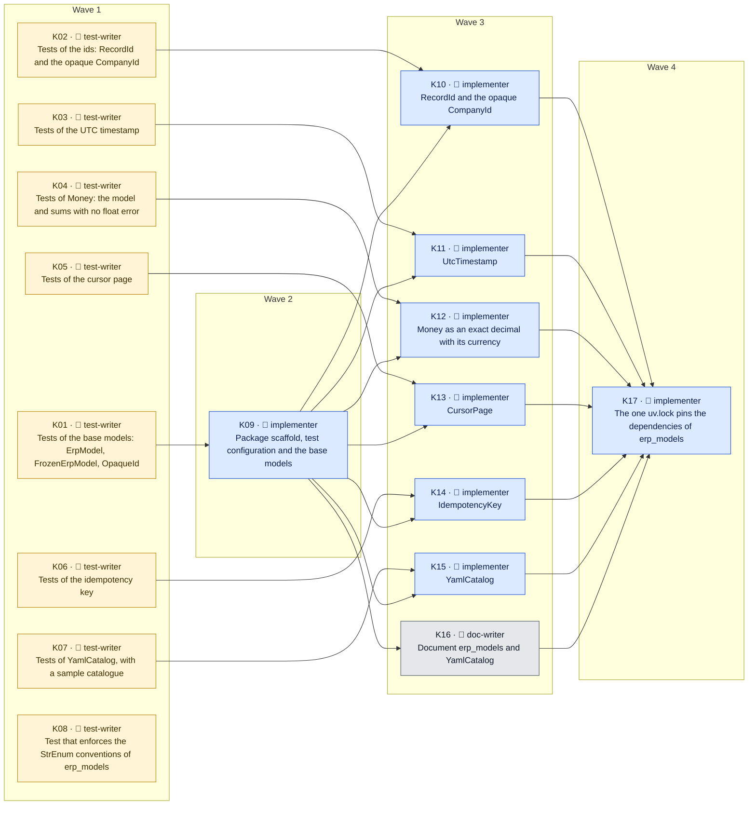

# T0.03: Shared base model and enums, plan

**Plan:** 🟢 Approved

**Push:** 🟢 Approved

<!-- ticket:specs -->
## 📚 Specifications

The specification and design pages of [TICKET.md](TICKET.md), copied by `python3 .claude/scripts/tickets/ticket_refs.py sync`.

- [Repository layout](../../technical/architecture/repository-layout.md)
- [E-T01-01](../../specs/03-technical/t01-companies-and-data-isolation/data/e-t01-01-company.md)
- [REQ-T10-03](../../specs/03-technical/t10-translations-and-notifications/requirements/req-t10-03-money-decimals.md)
- [REQ-T05-02](../../specs/03-technical/t05-api-and-webhooks/requirements/req-t05-02-paging-and-idempotency.md)
- [Configuration](../../technical/architecture/configuration.md)
- [📜 D438 Repository layout](../../specs/06-decisions/technical/d438-repository-layout.md)
- [📜 D406 Back end](../../specs/06-decisions/technical/d406-back-end.md)
- [🏗️ Back end](../../technical/architecture/backend.md)
- [📜 D293](../../specs/06-decisions/country-packs/d293-capabilities-take-legal-rules-from-the-pack.md)
<!-- /ticket:specs -->

## Summary

T0.03 builds the first shared models of `erp_models` in `backend/models`. They are the base models (`ErpModel`, `FrozenErpModel`, and `OpaqueId` as the base of opaque texts), the record and company ids (E-T01-01), the UTC timestamp, `Money` as an exact decimal with its currency and same-currency sums (REQ-T10-03), the generic `CursorPage` and the `IdempotencyKey` (REQ-T05-02), `YamlCatalog` for `conf/catalogs/` data, and a package test that enforces the `StrEnum` conventions of AGENT.md. The graph has 16 tasks in 3 waves. Wave 1 has eight test-writer tasks, one per behaviour and folder. Wave 2 has one implementer task: the package scaffold, its pytest and ruff configuration, the dependencies and the base models, which every other model subclasses. Wave 3 has six implementer tasks, one per sub-package (ids, times, money, paging, idempotency, catalogs), and a doc-writer task for `backend/models/README.md` and the Configuration design page. Every module path, class, field, validation rule and exception name is fixed in the briefs so that the tests and the code agree. No task shares a file with another task of its wave, and no front end is touched (the ticket lists no screen).

## Assumptions

- The roadmap names no use case, business rule or screen for this ticket, so none is linked; "No screen" is stated because no front end changes.
- The names of the models and of the currency type are not fixed by the specifications; they follow AGENT.md and are chosen in the plan.
- Criterion 3 states only what REQ-T05-02 says (cursor paging, idempotency key); model fields are left to the plan.
- The ticket touches no budget: neither the roadmap row nor the specifications give it a measure.
- The roadmap ticket row has no anchor of its own, so the ticket link points to the sprint anchor `#s01`.
- `check_ticket.py` could not be run (no shell available in this session), so the ticket is unchecked by the script; links were written from verified file paths.
- T0.01, the only prerequisite in the ticket graph, has created `backend/models/` with its README and a `pyproject.toml` that makes it a uv workspace member. K09 keeps T0.01's package name and only adds the dependencies (`pydantic`, `pyyaml`), the package's pytest table and a lock refresh.
- The field exceptions of the models delivered here (`SEInvalid<Model>Exception`, `SE<Model>Invalid<Field>`, `SEMoneyCurrencyMismatch`, `SEYamlCatalogUnreadable`) belong to T0.03, because AGENT.md requires each validator to raise its own exception. T0.04 keeps the shared `SE` bases and the error code catalogue, and may re-parent these exceptions without renaming them. Until then they subclass `Exception` directly, not `ValueError`, so that Pydantic does not wrap them.
- The ids are frozen models with one `value` field (`{"value": "C-12"}` in JSON), not Pydantic `RootModel`s, because a `RootModel` cannot forbid extra keys as the base model requires. They are opaque, stripped, non-empty texts, with no format, no length bound and no id generation, because the specifications fix none.
- The company id of E-T01-01 is opaque in that it is its own type, `CompanyId`, never parsed and never equal to a `RecordId` or another id of the same text.
- `OpaqueId` is the shared base of `RecordId`, `CompanyId` and `IdempotencyKey`, so that their common `validate_value` lives in one class (AGENT.md: classes that share a method name share a base class). Each subclass sets its own `INVALID_VALUE` exception.
- UTC times are a `UtcTimestamp` model with one `instant` field. It accepts aware datetimes or ISO 8601 texts with an offset, converts them to UTC, and refuses naive times and epoch numbers, the most conservative reading of "UTC times".
- Money keeps the amount as an exact `Decimal` with no rounding and no change of scale, because rounding and conversion follow the country pack (D293, out of scope). Floats, NaN and infinities are refused, and negative amounts are allowed. The currency is three upper-case ASCII letters (the ISO 4217 alphabetic form): lower case is refused rather than corrected, and no list of currencies is held, because the specifications give none. Summing lines of different currencies is refused.
- `CursorPage` holds `items`, an opaque `next_cursor` (`None` on the last page) and `has_more`. The page size, filters and sorting of REQ-T05-02 are not modelled, because the ticket names only the cursor page and the idempotency key. How a cursor is encoded is left to the services that page.
- `IdempotencyKey` is an opaque text with no imposed format (such as a UUID). Storing keys and skipping repeated writes belong to the services that write. Its text lives in `value`, because AGENT.md reserves `*_key` field names for secret store entries.
- The StrEnum conventions are delivered as a package test (`backend/models/tests/test_str_enum_conventions.py`) that enforces AGENT.md's enum rules on every `StrEnum` of `erp_models`, plus a README section. No enum is invented, because the specifications name none for this ticket. The test stays in `backend/models` so that the ticket does not take the `tests/conventions` area owned by T0.02.
- `YamlCatalog` is frozen. An empty or non-mapping YAML file counts as unreadable. Each catalogue overrides the `UNREADABLE` class variable, which defaults to `SEYamlCatalogUnreadable`.
- The package's own pytest table in `backend/models/pyproject.toml` (with `pythonpath = ["."]`) is what makes AGENT.md's full-path helper imports (`from tests.catalogs...`) resolve to `backend/models/tests/`. The root ruff `per-file-ignores` entry `tests/**` reaches only the root `tests/`, so K09 adds `**/tests/**` only if ruff reports docstring codes on package tests. Until then, the wave-1 test-writers check ruff with `--ignore D`.
- No budget is touched and no screen is built, as TICKET.md states, so the plan has no Playwright task (TKT-21 does not apply: no `frontend/` change).

<!-- plan:graph -->

> [!NOTE]
> Generated from the json block at the end of this page by `python3 .claude/scripts/tickets/plan.py render`.
> To change a task, edit the json block, then render again: never edit this view by hand.

## Waves

| Wave | Tasks | Agents running at once |
| --- | --- | --- |
| 1 | [K01](#k01), [K02](#k02), [K03](#k03), [K04](#k04), [K05](#k05), [K06](#k06), [K07](#k07), [K08](#k08) | 8 of 8 |
| 2 | [K09](#k09) | 1 of 1 |
| 3 | [K10](#k10), [K11](#k11), [K12](#k12), [K13](#k13), [K14](#k14), [K15](#k15), [K16](#k16) | 7 of 7 |
| 4 | [K17](#k17) | 1 of 1 |

| Wave | Task | Agent | Depends on | Unblocks |
| --- | --- | --- | --- | --- |
| 1 | [K01](#k01) Tests of the base models: ErpModel, FrozenErpModel, OpaqueId | 🧪 test-writer | none | [K09](#k09) |
| 1 | [K02](#k02) Tests of the ids: RecordId and the opaque CompanyId | 🧪 test-writer | none | [K10](#k10) |
| 1 | [K03](#k03) Tests of the UTC timestamp | 🧪 test-writer | none | [K11](#k11) |
| 1 | [K04](#k04) Tests of Money: the model and sums with no float error | 🧪 test-writer | none | [K12](#k12) |
| 1 | [K05](#k05) Tests of the cursor page | 🧪 test-writer | none | [K13](#k13) |
| 1 | [K06](#k06) Tests of the idempotency key | 🧪 test-writer | none | [K14](#k14) |
| 1 | [K07](#k07) Tests of YamlCatalog, with a sample catalogue | 🧪 test-writer | none | [K15](#k15) |
| 1 | [K08](#k08) Test that enforces the StrEnum conventions of erp_models | 🧪 test-writer | none | none |
| 2 | [K09](#k09) Package scaffold, test configuration and the base models | 🐍 implementer | [K01](#k01) | [K10](#k10), [K11](#k11), [K12](#k12), [K13](#k13), [K14](#k14), [K15](#k15), [K16](#k16) |
| 3 | [K10](#k10) RecordId and the opaque CompanyId | 🐍 implementer | [K02](#k02), [K09](#k09) | [K17](#k17) |
| 3 | [K11](#k11) UtcTimestamp | 🐍 implementer | [K03](#k03), [K09](#k09) | [K17](#k17) |
| 3 | [K12](#k12) Money as an exact decimal with its currency | 🐍 implementer | [K04](#k04), [K09](#k09) | [K17](#k17) |
| 3 | [K13](#k13) CursorPage | 🐍 implementer | [K05](#k05), [K09](#k09) | [K17](#k17) |
| 3 | [K14](#k14) IdempotencyKey | 🐍 implementer | [K06](#k06), [K09](#k09) | [K17](#k17) |
| 3 | [K15](#k15) YamlCatalog | 🐍 implementer | [K07](#k07), [K09](#k09) | [K17](#k17) |
| 3 | [K16](#k16) Document erp_models and YamlCatalog | 📝 doc-writer | [K09](#k09) | [K17](#k17) |
| 4 | [K17](#k17) The one uv.lock pins the dependencies of erp_models | 🐍 implementer | [K10](#k10), [K11](#k11), [K12](#k12), [K13](#k13), [K14](#k14), [K15](#k15), [K16](#k16) | none |

## Dependency graph



## Tasks

### <a id="k01"></a>K01: Tests of the base models: ErpModel, FrozenErpModel, OpaqueId

| Agent | Wave | Depends on | Unblocks |
| --- | --- | --- | --- |
| 🧪 test-writer | 1 | none | [K09](#k09) |

**Files** (only this task may change them in its wave):

- `backend/models/tests/base/test_erp_model.py`
- `backend/models/tests/base/test_frozen_erp_model.py`
- `backend/models/tests/base/test_opaque_id.py`

**Done when:** `uv run ruff check --ignore D backend/models/tests/base` and `uv run ruff format --check backend/models/tests/base` report nothing; `uv run pytest tests/conventions -n 2` passes; `uv run pytest backend/models/tests/base` fails only with `ModuleNotFoundError` for `erp_models`.

**Brief:**

Write the pytest tests, before the code, of the three base models of `erp_models` that K09 implements. They are the base of every shared Pydantic model, as the D438 layout makes `backend/models/` the one shared models library.

Specifications: D438 `docs/specs/06-decisions/technical/d438-repository-layout.md`, D406 `docs/specs/06-decisions/technical/d406-back-end.md`, design pages `docs/technical/architecture/repository-layout.md` and `docs/technical/architecture/backend.md`. Rules: `AGENT.md` (Tests, Pydantic models, Exceptions), TKT-4 and TKT-8 of `.claude/rules/tickets.md`.

The contract under test (import by full path):
- `from erp_models.base.erp_model import ErpModel`: a `pydantic.BaseModel` with `model_config = ConfigDict(extra="forbid")`, no fields and not frozen.
- `from erp_models.base.frozen_erp_model import FrozenErpModel`: subclasses `ErpModel` with `ConfigDict(extra="forbid", frozen=True)`. Assigning a field raises `pydantic.ValidationError`, and an instance is hashable: two equal instances have the same hash.
- `from erp_models.base.opaque_id import OpaqueId`: a `FrozenErpModel` with one required field, `value: str`, an opaque text. Its `validate_value` validator (mode before) refuses anything that is not a `str` (including `None`, `bool`, `int`, a list), strips the text, and refuses an empty or blank text. It raises `cls.INVALID_VALUE`, a `ClassVar[Type[Exception]]` whose default on `OpaqueId` is `SEOpaqueIdInvalidValue`. Exceptions come `from erp_models.base.exceptions import SEInvalidOpaqueIdException, SEOpaqueIdInvalidValue`, and `SEOpaqueIdInvalidValue` subclasses `SEInvalidOpaqueIdException`. Neither subclasses `ValueError`, so Pydantic lets them through unwrapped and `pytest.raises(SEOpaqueIdInvalidValue)` catches them.

The tests:
- `test_erp_model.py`, `TestErpModel`: build a sample subclass with `pydantic.create_model("SampleModel", __base__=ErpModel, name=(str, Field(default="a", description="A name.")))`, so that no extra class file is needed. Write the six model tests of AGENT.md (`test_defaults`, `test_full_valid_construction`, `test_none_becomes_the_default`, `test_rejects_bad_values`, `test_rejects_unknown_keys`, `test_round_trip`), adapted to a field-less base. Unknown keys are refused with `pydantic.ValidationError`, a field can be reassigned (the model is not frozen), and the round trip goes through `model_dump(mode="json")` / `model_validate` and `model_dump_json` / `model_validate_json`.
- `test_frozen_erp_model.py`, `TestFrozenErpModel`: the same sample pattern on `FrozenErpModel`, the six tests, plus a test that assignment is refused with `ValidationError` and a test that equal instances hash alike.
- `test_opaque_id.py`, `TestOpaqueId`: the six tests. `value` has no default, so `test_defaults` asserts that a missing `value` is refused with `pydantic.ValidationError`, and `test_none_becomes_the_default` asserts that `value=None` is refused with `SEOpaqueIdInvalidValue` (AGENT.md: `None` becomes the default only when the field has one). Parametrise the bad values (`""`, `"   "`, `True`, `12`, `["a"]`). Also test that `" C-12 "` is stored as `"C-12"`, that `OpaqueId.INVALID_VALUE is SEOpaqueIdInvalidValue`, that two ids with the same value are equal and hash alike, and that assignment is refused.

File rules: no `__init__.py`, one `Test<Subject>` class per file, test names written as sentences, no `unittest.mock`, no docstrings, `pytest.mark.parametrize` for the cases of one behaviour, `JsonValue` from pydantic for raw values. Sort imports with `uv run ruff check --fix <your files>` (ruff classifies `erp_models` itself). Until K09 extends the root `per-file-ignores` to `**/tests/**`, ruff may report pydocstyle `D` codes on these files only because the root pattern `tests/**` does not reach `backend/models/tests/`. Do not add docstrings for them: record it as an assumption. The tests fail now only because `erp_models.base` does not exist yet.

### <a id="k02"></a>K02: Tests of the ids: RecordId and the opaque CompanyId

| Agent | Wave | Depends on | Unblocks |
| --- | --- | --- | --- |
| 🧪 test-writer | 1 | none | [K10](#k10) |

**Files** (only this task may change them in its wave):

- `backend/models/tests/ids/test_record_id.py`
- `backend/models/tests/ids/test_company_id.py`

**Done when:** `uv run ruff check --ignore D backend/models/tests/ids` and `uv run ruff format --check backend/models/tests/ids` report nothing; `uv run pytest tests/conventions -n 2` passes; `uv run pytest backend/models/tests/ids` fails only with `ModuleNotFoundError` for `erp_models`.

**Brief:**

Write the pytest tests, before the code, of the two id models that K10 implements: a record id and the company id of E-T01-01, taken as an opaque type.

Specifications: E-T01-01 `docs/specs/03-technical/t01-companies-and-data-isolation/data/e-t01-01-company.md` (the company `id` field, example `C-12`), D438 `docs/specs/06-decisions/technical/d438-repository-layout.md`, D406 `docs/specs/06-decisions/technical/d406-back-end.md`, design page `docs/technical/architecture/repository-layout.md`. Rules: `AGENT.md` (Tests, Pydantic models, Exceptions), TKT-4 and TKT-8.

The contract under test:
- `from erp_models.ids.record_id import RecordId` and `from erp_models.ids.company_id import CompanyId` both subclass `erp_models.base.opaque_id.OpaqueId`, a frozen model with extra keys forbidden and one required field, `value: str`. The value is stripped, and anything that is not a non-empty text is refused.
- Each sets its own `INVALID_VALUE`: `RecordId.INVALID_VALUE is SERecordIdInvalidValue` and `CompanyId.INVALID_VALUE is SECompanyIdInvalidValue`, imported `from erp_models.ids.exceptions import SEInvalidRecordIdException, SERecordIdInvalidValue, SEInvalidCompanyIdException, SECompanyIdInvalidValue`. Each field exception subclasses its model base (`SERecordIdInvalidValue` subclasses `SEInvalidRecordIdException`, and the same for company), and none subclasses `ValueError`.

The tests: `TestRecordId` in `test_record_id.py` and `TestCompanyId` in `test_company_id.py`, each with the six model tests of AGENT.md. `value` is required, so `test_defaults` asserts that a missing `value` is refused with `pydantic.ValidationError`, and `test_none_becomes_the_default` asserts that `value=None` is refused with the model's own exception. Parametrise the bad values (`""`, `"  "`, `True`, `12`, `["C-12"]`). Unknown keys are refused with `ValidationError`. The round trip goes through `model_dump(mode="json")` and `model_dump_json`, whose shape is `{"value": "C-12"}`. In `TestCompanyId`, also test the opaque type: `CompanyId(value="C-12")` never equals `RecordId(value="C-12")`; two company ids with the same text are equal and hash alike; the text is kept as given (`"C-12"` stays `"C-12"`, no parsing and no case change); and assignment is refused.

File rules: no `__init__.py`, one `Test<Subject>` class per file, test names written as sentences, no mocks, no docstrings, `pytest.mark.parametrize`, unique file basenames. Sort imports with `uv run ruff check --fix <your files>`. Pydocstyle `D` codes reported only because the root ruff `per-file-ignores` pattern `tests/**` does not reach `backend/models/tests/` are fixed by K09: do not add docstrings, and record it as an assumption. The tests fail now only because `erp_models` does not exist yet.

### <a id="k03"></a>K03: Tests of the UTC timestamp

| Agent | Wave | Depends on | Unblocks |
| --- | --- | --- | --- |
| 🧪 test-writer | 1 | none | [K11](#k11) |

**Files** (only this task may change them in its wave):

- `backend/models/tests/times/test_utc_timestamp.py`

**Done when:** `uv run ruff check --ignore D backend/models/tests/times` and `uv run ruff format --check backend/models/tests/times` report nothing; `uv run pytest tests/conventions -n 2` passes; `uv run pytest backend/models/tests/times` fails only with `ModuleNotFoundError` for `erp_models`.

**Brief:**

Write the pytest tests, before the code, of `UtcTimestamp`, the shared UTC time of `erp_models` that K11 implements (the roadmap row of T0.03: "ids, UTC times").

Specifications: D438 `docs/specs/06-decisions/technical/d438-repository-layout.md`, D406 `docs/specs/06-decisions/technical/d406-back-end.md`, design pages `docs/technical/architecture/repository-layout.md` and `docs/technical/architecture/backend.md`. Rules: `AGENT.md` (Tests, Pydantic models, Exceptions), TKT-4 and TKT-8.

The contract under test:
- `from erp_models.times.utc_timestamp import UtcTimestamp`: a frozen model (subclass of `erp_models.base.frozen_erp_model.FrozenErpModel`, extra keys forbidden) with one required field, `instant: datetime`.
- Its validator `validate_instant` (mode before) accepts a timezone-aware `datetime`, or an ISO 8601 text (stripped, parsed with `datetime.fromisoformat`, `Z` accepted) that carries an offset. It converts the value to UTC, so `instant.tzinfo` is `timezone.utc`.
- It refuses with `SEUtcTimestampInvalidInstant`: a naive datetime, a text without an offset (`"2026-12-07T09:00:00"`, `"2026-12-07"`), an unparsable or empty text, `None`, `bool`, `int`, `float` (no epoch numbers) and any other type.
- `UtcTimestamp.now()` is a classmethod that returns the current instant in UTC.
- Exceptions come `from erp_models.times.exceptions import SEInvalidUtcTimestampException, SEUtcTimestampInvalidInstant`, and the second subclasses the first (not `ValueError`).

The tests (`TestUtcTimestamp`):
- the six model tests of AGENT.md: `instant` is required, so `test_defaults` asserts that a missing `instant` is refused with `pydantic.ValidationError`, and `test_none_becomes_the_default` asserts that `None` is refused with `SEUtcTimestampInvalidInstant`;
- `"2026-12-07T10:00:00+01:00"` becomes `datetime(2026, 12, 7, 9, 0, tzinfo=timezone.utc)`, with a zero `utcoffset()`;
- `"2026-12-07T09:00:00Z"` is accepted;
- `now()` is aware, in UTC, and within a few seconds of `datetime.now(timezone.utc)`;
- the round trip goes through `model_dump(mode="json")` / `model_validate` and the JSON methods, and gives an equal model;
- assignment is refused, and equal timestamps hash alike.

File rules: no `__init__.py`, one test class, test names written as sentences, no mocks, no docstrings, parametrised bad values. Sort imports with `uv run ruff check --fix <your file>`. Pydocstyle `D` codes reported only because the root ruff `per-file-ignores` pattern `tests/**` does not reach `backend/models/tests/` are fixed by K09: do not add docstrings, and record it as an assumption.

### <a id="k04"></a>K04: Tests of Money: the model and sums with no float error

| Agent | Wave | Depends on | Unblocks |
| --- | --- | --- | --- |
| 🧪 test-writer | 1 | none | [K12](#k12) |

**Files** (only this task may change them in its wave):

- `backend/models/tests/money/money/test_money.py`
- `backend/models/tests/money/money/test_money_sums.py`

**Done when:** `uv run ruff check --ignore D backend/models/tests/money` and `uv run ruff format --check backend/models/tests/money` report nothing; `uv run pytest tests/conventions -n 2` passes; `uv run pytest backend/models/tests/money` fails only with `ModuleNotFoundError` for `erp_models`.

**Brief:**

Write the pytest tests, before the code, of `Money`, which K12 implements. REQ-T10-03 says money is an exact decimal with its currency, and its criterion 2 says a sum of lines has no float error.

Specifications: REQ-T10-03 `docs/specs/03-technical/t10-translations-and-notifications/requirements/req-t10-03-money-decimals.md`, D438 `docs/specs/06-decisions/technical/d438-repository-layout.md`, D406 `docs/specs/06-decisions/technical/d406-back-end.md`, design page `docs/technical/architecture/backend.md`. Out of scope: rounding and conversion, which follow the country pack (D293). Rules: `AGENT.md` (Tests, Pydantic models, Exceptions), TKT-4 and TKT-8.

The contract under test:
- `from erp_models.money.money import Money`: a frozen model (subclass of `FrozenErpModel`, extra keys forbidden) with two required fields.
- `amount: Decimal`. Its validator `validate_amount` (mode before) accepts a finite `Decimal`, an `int` (not `bool`), or a text (stripped) that parses to a finite `Decimal`. It refuses with `SEMoneyInvalidAmount`: any `float` (`0.1`), `bool`, `None`, an empty or unparsable text, `NaN`, `Infinity` (as text or `Decimal`), and any other type. The amount is kept exactly as given, with no rounding and no change of scale. Negative amounts are allowed.
- `currency: str`. Its validator `validate_currency` (mode before) strips the text and accepts only three upper-case ASCII letters (the ISO 4217 alphabetic form, for example `"EUR"`). It refuses with `SEMoneyInvalidCurrency`: `"eur"`, `"EURO"`, `"EU"`, `""`, `None`, `978` and `True`.
- `Money.zero(currency: str) -> Money` is a classmethod giving a zero amount.
- `money.add(other: Money) -> Money` returns a new `Money`. It raises `SEMoneyCurrencyMismatch` when the currencies differ.
- `Money.total(currency: str, lines: List[Money]) -> Money` is a classmethod. It sums the lines exactly, returns zero in that currency for no line, and raises `SEMoneyCurrencyMismatch` when a line has another currency.
- Exceptions come `from erp_models.money.exceptions import SEInvalidMoneyException, SEMoneyInvalidAmount, SEMoneyInvalidCurrency, SEMoneyCurrencyMismatch`. Each subclasses `SEInvalidMoneyException`, and none subclasses `ValueError`.

The tests:
- `test_money.py`, `TestMoney`: the six model tests of AGENT.md. Both fields are required, so `test_defaults` asserts that missing fields are refused with `pydantic.ValidationError`, and `test_none_becomes_the_default` asserts that `None` is refused with each field's own exception. Parametrise the bad values listed above with their exception. Also test that `" 12.50 "` and `" EUR "` are stripped, that `amount` is a `Decimal` equal to `Decimal("12.50")`, and that the round trip through `model_dump(mode="json")` and the JSON methods keeps the amount exact (it is serialised as a text).
- `test_money_sums.py`, `TestMoneySums` (acceptance criterion 2 of TICKET.md):
  - ten lines of `"0.10"` EUR total exactly `Decimal("1.00")`;
  - `"0.1"` plus `"0.2"` gives exactly `Decimal("0.3")`, while the float sum `0.1 + 0.2 != 0.3`, shown in the same test as the contrast;
  - lines with negative amounts (a credit note) sum exactly;
  - large amounts such as `"12345678901234.56"` sum exactly;
  - `add` leaves both operands unchanged;
  - `add` and `total` refuse a line in another currency with `SEMoneyCurrencyMismatch`;
  - `total` of no line is `Money.zero(currency)`;
  - `zero` with a bad currency raises `SEMoneyInvalidCurrency`.

File rules: no `__init__.py`, one test class per file, test names written as sentences, no mocks, no docstrings, parametrise. Sort imports with `uv run ruff check --fix <your files>`. Pydocstyle `D` codes reported only because the root ruff `per-file-ignores` pattern `tests/**` does not reach `backend/models/tests/` are fixed by K09: do not add docstrings, and record it as an assumption.

### <a id="k05"></a>K05: Tests of the cursor page

| Agent | Wave | Depends on | Unblocks |
| --- | --- | --- | --- |
| 🧪 test-writer | 1 | none | [K13](#k13) |

**Files** (only this task may change them in its wave):

- `backend/models/tests/paging/test_cursor_page.py`

**Done when:** `uv run ruff check --ignore D backend/models/tests/paging` and `uv run ruff format --check backend/models/tests/paging` report nothing; `uv run pytest tests/conventions -n 2` passes; `uv run pytest backend/models/tests/paging` fails only with `ModuleNotFoundError` for `erp_models`.

**Brief:**

Write the pytest tests, before the code, of `CursorPage`, the page of a list paged by a cursor, which K13 implements. REQ-T05-02 says lists use cursor paging, and its criterion 2 says a list of a million rows is paged.

Specifications: REQ-T05-02 `docs/specs/03-technical/t05-api-and-webhooks/requirements/req-t05-02-paging-and-idempotency.md`, D438 `docs/specs/06-decisions/technical/d438-repository-layout.md`, D406 `docs/specs/06-decisions/technical/d406-back-end.md`, design page `docs/technical/architecture/backend.md`. Rules: `AGENT.md` (Tests, Pydantic models, Exceptions), TKT-4 and TKT-8.

The contract under test:
- `from erp_models.paging.cursor_page import CursorPage`: a generic frozen model, `class CursorPage[ItemT](FrozenErpModel)` (PEP 695 syntax), with extra keys forbidden and used as `CursorPage[int]`. It has two fields:
  - `items: List[ItemT]`, defaulting to an empty list. `validate_items` (mode before) turns `None` into the default and refuses anything that is not a `list` with `SECursorPageInvalidItems`. Pydantic validates each item against `ItemT`, so `CursorPage[int](items=["x"])` raises `pydantic.ValidationError`.
  - `next_cursor: Optional[str]`, the opaque cursor of the next page, defaulting to `None` (the last page). `validate_next_cursor` (mode before) keeps `None`, strips a text, and refuses an empty or blank text, `bool`, `int` and any other type with `SECursorPageInvalidNextCursor`.
- The property `has_more` is `True` when `next_cursor` is not `None`.
- Exceptions come `from erp_models.paging.exceptions import SEInvalidCursorPageException, SECursorPageInvalidItems, SECursorPageInvalidNextCursor`, each subclassing `SEInvalidCursorPageException` and not `ValueError`.

The tests (`TestCursorPage`, on `CursorPage[int]` only, so that this task needs no other model of the ticket):
- the six model tests of AGENT.md: `test_defaults` checks an empty page, no next cursor and `has_more` false; `test_none_becomes_the_default` is parametrised on both fields; the bad values are `items` as `"abc"`, `{"a": 1}` or `12`, and `next_cursor` as `""`, `"  "`, `12` or `True`, each with its exception; unknown keys are refused with `ValidationError`; the round trip goes through `model_dump(mode="json")` / `CursorPage[int].model_validate` and the JSON methods;
- a wrongly typed item is refused with `ValidationError`;
- acceptance criterion 3 of TICKET.md: a page in the middle of a list carries its next cursor and `has_more` is true, while the last page has no cursor and `has_more` is false;
- assignment is refused.

File rules: no `__init__.py`, one test class, test names written as sentences, no mocks, no docstrings, parametrise. Sort imports with `uv run ruff check --fix <your file>`. Pydocstyle `D` codes reported only because the root ruff `per-file-ignores` pattern `tests/**` does not reach `backend/models/tests/` are fixed by K09: do not add docstrings, and record it as an assumption.

### <a id="k06"></a>K06: Tests of the idempotency key

| Agent | Wave | Depends on | Unblocks |
| --- | --- | --- | --- |
| 🧪 test-writer | 1 | none | [K14](#k14) |

**Files** (only this task may change them in its wave):

- `backend/models/tests/idempotency/test_idempotency_key.py`

**Done when:** `uv run ruff check --ignore D backend/models/tests/idempotency` and `uv run ruff format --check backend/models/tests/idempotency` report nothing; `uv run pytest tests/conventions -n 2` passes; `uv run pytest backend/models/tests/idempotency` fails only with `ModuleNotFoundError` for `erp_models`.

**Brief:**

Write the pytest tests, before the code, of `IdempotencyKey`, which K14 implements. REQ-T05-02 says writes accept an idempotency key, and its criterion 1 says a write repeated with its key is done once.

Specifications: REQ-T05-02 `docs/specs/03-technical/t05-api-and-webhooks/requirements/req-t05-02-paging-and-idempotency.md`, D438 `docs/specs/06-decisions/technical/d438-repository-layout.md`, D406 `docs/specs/06-decisions/technical/d406-back-end.md`, design page `docs/technical/architecture/backend.md`. Rules: `AGENT.md` (Tests, Pydantic models, Exceptions), TKT-4 and TKT-8.

The contract under test:
- `from erp_models.idempotency.idempotency_key import IdempotencyKey` subclasses `erp_models.base.opaque_id.OpaqueId`, a frozen model with extra keys forbidden and one required field, `value: str`. The value is opaque text, stripped, and anything that is not a non-empty text is refused.
- `IdempotencyKey.INVALID_VALUE is SEIdempotencyKeyInvalidValue`, imported `from erp_models.idempotency.exceptions import SEInvalidIdempotencyKeyException, SEIdempotencyKeyInvalidValue`. The second subclasses the first, and neither subclasses `ValueError`.

The tests (`TestIdempotencyKey`):
- the six model tests of AGENT.md: `value` is required, so `test_defaults` asserts that a missing `value` is refused with `pydantic.ValidationError`, and `test_none_becomes_the_default` asserts that `None` is refused with `SEIdempotencyKeyInvalidValue`; the bad values `""`, `"  "`, `True`, `12` and `["k"]` are parametrised; unknown keys are refused with `ValidationError`; the round trip goes through `model_dump(mode="json")` and the JSON methods;
- acceptance criterion 3 of TICKET.md: a write repeated with the same key carries an equal key, so that it is done once. `IdempotencyKey(value="k-1")` and `IdempotencyKey(value=" k-1 ")` are equal, hash alike, and a set of the keys of the repeated writes holds one key, while two different keys are kept apart;
- an `IdempotencyKey` never equals an `OpaqueId` with the same text;
- assignment is refused.

File rules: no `__init__.py`, one test class, test names written as sentences, no mocks, no docstrings, parametrise. Sort imports with `uv run ruff check --fix <your file>`. Pydocstyle `D` codes reported only because the root ruff `per-file-ignores` pattern `tests/**` does not reach `backend/models/tests/` are fixed by K09: do not add docstrings, and record it as an assumption.

### <a id="k07"></a>K07: Tests of YamlCatalog, with a sample catalogue

| Agent | Wave | Depends on | Unblocks |
| --- | --- | --- | --- |
| 🧪 test-writer | 1 | none | [K15](#k15) |

**Files** (only this task may change them in its wave):

- `backend/models/tests/catalogs/yaml_catalog/test_yaml_catalog.py`
- `backend/models/tests/catalogs/yaml_catalog/sample_catalog.py`
- `backend/models/tests/catalogs/yaml_catalog/se_sample_catalog_unreadable.py`
- `backend/models/tests/catalogs/yaml_catalog/se_sample_catalog_invalid_names.py`

**Done when:** `uv run ruff check --ignore D backend/models/tests/catalogs` and `uv run ruff format --check backend/models/tests/catalogs` report nothing; `uv run pytest tests/conventions -n 2` passes; `uv run pytest backend/models/tests/catalogs` fails only because `erp_models` (or, before K09, the `tests.catalogs` helper path) cannot be imported yet.

**Brief:**

Write the pytest tests, before the code, of `YamlCatalog`, the base of the catalogues that load data from `conf/catalogs/` (Configuration design page: `conf/catalogs/` holds data that would otherwise be hard-coded, loaded by `YamlCatalog` models). K15 implements it.

Specifications: design page `docs/technical/architecture/configuration.md`, D438 `docs/specs/06-decisions/technical/d438-repository-layout.md`, D406 `docs/specs/06-decisions/technical/d406-back-end.md`, design page `docs/technical/architecture/backend.md`. Rules: `AGENT.md` (Data and enums, Tests, Pydantic models, Exceptions), TKT-4 and TKT-8.

The contract under test:
- `from erp_models.catalogs.yaml_catalog import YamlCatalog` is a frozen model (subclass of `FrozenErpModel`, extra keys forbidden) with `UNREADABLE: ClassVar[Type[Exception]]`, which defaults to `SEYamlCatalogUnreadable`.
- The classmethod `load(path: Path)` returns an instance of the subclass it is called on. It opens the file with `encoding="utf-8"` and reads it with `yaml.safe_load`. It raises `cls.UNREADABLE` from the original error when the file cannot be read (`OSError`) or is not valid YAML (`yaml.YAMLError`). It also raises `cls.UNREADABLE` when the content is not a mapping, which includes an empty file. Otherwise it validates the content with `model_validate`: the subclass's own field exceptions propagate, and unknown keys raise `pydantic.ValidationError`.
- Exceptions come `from erp_models.catalogs.exceptions import SEInvalidYamlCatalogException, SEYamlCatalogUnreadable`. The second subclasses the first, and neither subclasses `ValueError`.

The helper files, one class each, in this folder:
- `se_sample_catalog_unreadable.py`: `class SESampleCatalogUnreadable(SEYamlCatalogUnreadable)`;
- `se_sample_catalog_invalid_names.py`: `class SESampleCatalogInvalidNames(Exception)`;
- `sample_catalog.py`: `class SampleCatalog(YamlCatalog)` with `UNREADABLE: ClassVar[Type[Exception]] = SESampleCatalogUnreadable` and one field, `names: List[str] = Field(default_factory=list, description="The names the sample catalogue lists.")`. Its validator `validate_names` (mode before, AGENT.md shape) turns `None` into the default, refuses a value that is not a list, or an item that is not a non-empty text, with `SESampleCatalogInvalidNames`, and strips each item.

The test file imports the helpers by full path: `from tests.catalogs.yaml_catalog.sample_catalog import SampleCatalog`. K09 configures the package's pytest so that `tests` is `backend/models/tests`.

The tests (`TestYamlCatalog`; use pytest's `tmp_path` and write files with `encoding="utf-8"`; fixtures, if any, are methods of the class):
- the six model tests of AGENT.md on `SampleCatalog`;
- a valid file, holding a non-ASCII name such as `Café`, loads into a frozen `SampleCatalog`;
- a missing file raises `SESampleCatalogUnreadable` whose `__cause__` is an `OSError`;
- invalid YAML raises it with a `yaml.YAMLError` cause;
- an empty file, and a file whose top level is a list, raise `SESampleCatalogUnreadable`;
- an unknown key in the file raises `ValidationError`;
- a bad `names` raises `SESampleCatalogInvalidNames`;
- a catalogue that keeps the base default (built with `pydantic.create_model("PlainCatalog", __base__=YamlCatalog)`) raises `SEYamlCatalogUnreadable` on a missing file;
- `YamlCatalog.UNREADABLE is SEYamlCatalogUnreadable`.

File rules: no `__init__.py`, one class per file, test names written as sentences, no mocks, and no docstrings needed in tests. The helper classes are test code, but they follow the Pydantic model shape (field description, validator). Sort imports with `uv run ruff check --fix <your files>`. Pydocstyle `D` codes reported only because the root ruff `per-file-ignores` pattern `tests/**` does not reach `backend/models/tests/` are fixed by K09: do not add docstrings, and record it as an assumption.

### <a id="k08"></a>K08: Test that enforces the StrEnum conventions of erp_models

| Agent | Wave | Depends on | Unblocks |
| --- | --- | --- | --- |
| 🧪 test-writer | 1 | none | none |

**Files** (only this task may change them in its wave):

- `backend/models/tests/test_str_enum_conventions.py`

**Done when:** `uv run ruff check --ignore D backend/models/tests/test_str_enum_conventions.py` and `uv run ruff format --check backend/models/tests/test_str_enum_conventions.py` report nothing; `uv run pytest backend/models/tests/test_str_enum_conventions.py` passes; `uv run pytest tests/conventions -n 2` passes.

**Brief:**

Deliver the `StrEnum` conventions of the T0.03 roadmap row as a test of the `erp_models` package. It checks every `StrEnum` of `backend/models/src/erp_models/` against AGENT.md ("Data and enums", "File shape"), so that the enums added by later tickets follow them. The specifications name no enum for this ticket, so the test needs no implementation task.

Specifications: D438 `docs/specs/06-decisions/technical/d438-repository-layout.md` (`backend/models/` holds the shared models and enums), D406 `docs/specs/06-decisions/technical/d406-back-end.md`, design page `docs/technical/architecture/repository-layout.md`. Rules: `AGENT.md` ("A string that selects behaviour is a `StrEnum` with `@unique`, in its own file named after it, with its members listed under `Attributes:`"; "An `enums/` package's `__init__.py` re-exports everything under it"), TKT-4 and TKT-8.

Write `TestStrEnumConventions` in `backend/models/tests/test_str_enum_conventions.py`. It reads the source with `ast`, never by importing it. Its private helper methods take a root folder, so that the same checks run on the real tree and on small trees written in `tmp_path`. For each top-level class whose bases include `StrEnum` (written `StrEnum` or `enum.StrEnum`), it checks four rules:
1. the class is decorated with `unique` or `enum.unique`;
2. the file's stem is the class name in snake case (`PaymentStatus` in `payment_status.py`);
3. its docstring has an `Attributes:` section that names every member;
4. when the file sits under an `enums/` folder, the nearest `enums/__init__.py` lists the class in its `__all__`.

Tests:
- the real tree (`Path(__file__).resolve().parents[1] / "src" / "erp_models"`) has no offender (a missing tree has none either);
- a well-formed enum written in `tmp_path` passes;
- each of the four broken cases (no `@unique`, wrong file name, a member missing from `Attributes:`, not re-exported by `enums/__init__.py`) is reported once, parametrised;
- a class that is not a `StrEnum` is ignored.

File rules: one test class, no nested function, no `@staticmethod`, no `Any`, no `self._x` attribute, sync methods before async ones, test names written as sentences, no mocks, no docstrings. Sort imports with `uv run ruff check --fix <your file>`. Pydocstyle `D` codes reported only because the root ruff `per-file-ignores` pattern `tests/**` does not reach `backend/models/tests/` are fixed by K09: do not add docstrings, and record it as an assumption.

### <a id="k09"></a>K09: Package scaffold, test configuration and the base models

| Agent | Wave | Depends on | Unblocks |
| --- | --- | --- | --- |
| 🐍 implementer | 2 | [K01](#k01) | [K10](#k10), [K11](#k11), [K12](#k12), [K13](#k13), [K14](#k14), [K15](#k15), [K16](#k16) |

**Files** (only this task may change them in its wave):

- `backend/models/pyproject.toml`
- `pyproject.toml`
- `uv.lock`
- `backend/models/src/erp_models/__init__.py`
- `backend/models/src/erp_models/py.typed`
- `backend/models/src/erp_models/base/__init__.py`
- `backend/models/src/erp_models/base/erp_model.py`
- `backend/models/src/erp_models/base/frozen_erp_model.py`
- `backend/models/src/erp_models/base/opaque_id.py`
- `backend/models/src/erp_models/base/exceptions/__init__.py`
- `backend/models/src/erp_models/base/exceptions/se_invalid_opaque_id_exception.py`
- `backend/models/src/erp_models/base/exceptions/se_opaque_id_invalid_value.py`

**Done when:** `uv lock --check` passes; `uv run pytest backend/models/tests/base -n 2` and `uv run pytest backend/models/tests/test_str_enum_conventions.py` pass; `uv run mypy backend/models/src` passes; `uv run ruff check backend/models` and `uv run ruff format --check backend/models/src` report nothing; `uv run pytest tests/conventions -n 2` passes.

**Brief:**

Make `erp_models` ready for its models, and write the three base models that every model of T0.03 subclasses. The Repository layout page makes `backend/models/` the one shared Pydantic models library, so that every public contract is defined once.

Specifications: D438 `docs/specs/06-decisions/technical/d438-repository-layout.md`, D406 `docs/specs/06-decisions/technical/d406-back-end.md` (Python 3.13, uv, Pydantic), design pages `docs/technical/architecture/repository-layout.md` and `docs/technical/architecture/backend.md`. Rules: `AGENT.md` (all of it, in particular Pydantic models, Exceptions, File shape, Imports, Typing, Docstrings, and the `exception-and-log-messages` skill for every `raise`), TKT-8 and TKT-19. The tests to pass are those of K01, in `backend/models/tests/base/`. Do not change them; report a wrong test as blocked.

1. **Package.** T0.01 created `backend/models/` (README, uv member). In `backend/models/pyproject.toml`, keep its name and build settings, and make sure the package `erp_models` under `src/` is built and that it depends on `pydantic>=2.9` and `pyyaml>=6.0`. Add a `[tool.pytest.ini_options]` table with `pythonpath = ["."]`, `asyncio_mode = "auto"`, `asyncio_default_fixture_loop_scope = "function"` and `addopts = "--strict-markers --timeout=300"`. With it, `uv run pytest backend/models/tests` takes `backend/models` as its root and `from tests.catalogs.yaml_catalog.sample_catalog import ...` resolves to `backend/models/tests/` (AGENT.md: helpers imported by their full path). If T0.01 already set these, leave them. Run `uv lock` so that `uv.lock` matches.
2. **Ruff on package tests.** If `uv run ruff check backend/models/tests` reports pydocstyle `D` codes on test files, the cause is that the root `[tool.ruff.lint.per-file-ignores]` entry `"tests/**"` matches only the root `tests/`. Add `"**/tests/**" = ["D"]` beside it in the root `pyproject.toml`, so that the tests of every package need no docstrings (AGENT.md, Tests), and change nothing else in that file.
3. **Files.** Add an empty `erp_models/__init__.py` and `base/__init__.py`, and `py.typed` (empty).
4. **`base/erp_model.py`, `ErpModel(BaseModel)`.** `model_config = ConfigDict(extra="forbid")`. Its docstring says it is the base of every shared model.
5. **`base/frozen_erp_model.py`, `FrozenErpModel(ErpModel)`.** `model_config = ConfigDict(extra="forbid", frozen=True)`, for models that must not change.
6. **`base/opaque_id.py`, `OpaqueId(FrozenErpModel)`.** It has `INVALID_VALUE: ClassVar[Type[Exception]] = SEOpaqueIdInvalidValue`, placed above the field, and one required field, `value: str = Field(description=...)`. `validate_value(cls, value: JsonValue) -> JsonValue` runs in mode before and has no `@classmethod`. It raises `cls.INVALID_VALUE` for a non-`str` (including `None` and `bool`) and for an empty text after stripping, and returns the stripped text. Subclasses (RecordId, CompanyId, IdempotencyKey) only set their own `INVALID_VALUE`, so the rule lives in one place (AGENT.md: classes that share a method name share a base class). Messages follow `Invalid value: {value!r}.` then `Must be a non-empty text.`, one sentence per line, the first ending with `# noqa: E501`.
7. **`base/exceptions/`.** `SEInvalidOpaqueIdException(Exception)` ("Exception raised when an invalid OpaqueId is provided.") and `SEOpaqueIdInvalidValue(SEInvalidOpaqueIdException)`, one per file. `__init__.py` re-exports them through a sorted `__all__`. They subclass `Exception`, not `ValueError`, so that Pydantic does not wrap them. T0.04 adds the shared `SE` bases later.

Every class has a Google docstring listing its `Attributes:` (constants included), with the reasoning in `Notes:`. `from __future__ import annotations` comes first, import groups have their comments, and typing uses `typing` generics. Models never log.

### <a id="k10"></a>K10: RecordId and the opaque CompanyId

| Agent | Wave | Depends on | Unblocks |
| --- | --- | --- | --- |
| 🐍 implementer | 3 | [K02](#k02), [K09](#k09) | [K17](#k17) |

**Files** (only this task may change them in its wave):

- `backend/models/src/erp_models/ids/__init__.py`
- `backend/models/src/erp_models/ids/record_id.py`
- `backend/models/src/erp_models/ids/company_id.py`
- `backend/models/src/erp_models/ids/exceptions/__init__.py`
- `backend/models/src/erp_models/ids/exceptions/se_invalid_record_id_exception.py`
- `backend/models/src/erp_models/ids/exceptions/se_record_id_invalid_value.py`
- `backend/models/src/erp_models/ids/exceptions/se_invalid_company_id_exception.py`
- `backend/models/src/erp_models/ids/exceptions/se_company_id_invalid_value.py`

**Done when:** `uv run pytest backend/models/tests/ids -n 2` passes; `uv run mypy backend/models/src` passes; `uv run ruff check backend/models/src/erp_models/ids` and `uv run ruff format --check backend/models/src/erp_models/ids` report nothing; `uv run pytest tests/conventions -n 2` passes.

**Brief:**

Implement the shared ids of `erp_models`: `RecordId`, the opaque id of any record, and `CompanyId`, the id of a company of E-T01-01 taken as an opaque type. Services never parse it, and it never equals another kind of id.

Specifications: E-T01-01 `docs/specs/03-technical/t01-companies-and-data-isolation/data/e-t01-01-company.md`, D438 `docs/specs/06-decisions/technical/d438-repository-layout.md`, D406 `docs/specs/06-decisions/technical/d406-back-end.md`, design page `docs/technical/architecture/repository-layout.md`. Rules: `AGENT.md` (Pydantic models, Exceptions, File shape, Docstrings, the `exception-and-log-messages` skill), TKT-8 and TKT-19. The tests to pass are those of K02, in `backend/models/tests/ids/`. Do not change them.

- `ids/record_id.py`, `RecordId(OpaqueId)` (from `erp_models.base.opaque_id`): sets only `INVALID_VALUE: ClassVar[Type[Exception]] = SERecordIdInvalidValue`. Its docstring says what the id is.
- `ids/company_id.py`, `CompanyId(OpaqueId)`: sets only `INVALID_VALUE = SECompanyIdInvalidValue`. Its `Notes:` explain the opaque type: E-T01-01 gives the id only as a record (example `C-12`), so the text is kept as given and never parsed, and a `CompanyId` never equals a `RecordId` of the same text, because Pydantic compares the model types.
- `ids/exceptions/`: `SEInvalidRecordIdException(Exception)`, `SERecordIdInvalidValue(SEInvalidRecordIdException)`, `SEInvalidCompanyIdException(Exception)` and `SECompanyIdInvalidValue(SEInvalidCompanyIdException)`, one per file named in snake case, with the docstrings of AGENT.md's exception table. The package `__init__.py` re-exports all four through a sorted `__all__`.
- `ids/__init__.py` is empty. Do not redefine `value` or the validator: they live in `OpaqueId`.

Docstrings follow Google style with `Attributes:`. `from __future__ import annotations` comes first, and import groups have their comments.

### <a id="k11"></a>K11: UtcTimestamp

| Agent | Wave | Depends on | Unblocks |
| --- | --- | --- | --- |
| 🐍 implementer | 3 | [K03](#k03), [K09](#k09) | [K17](#k17) |

**Files** (only this task may change them in its wave):

- `backend/models/src/erp_models/times/__init__.py`
- `backend/models/src/erp_models/times/utc_timestamp.py`
- `backend/models/src/erp_models/times/exceptions/__init__.py`
- `backend/models/src/erp_models/times/exceptions/se_invalid_utc_timestamp_exception.py`
- `backend/models/src/erp_models/times/exceptions/se_utc_timestamp_invalid_instant.py`

**Done when:** `uv run pytest backend/models/tests/times -n 2` passes; `uv run mypy backend/models/src` passes; `uv run ruff check backend/models/src/erp_models/times` and `uv run ruff format --check backend/models/src/erp_models/times` report nothing; `uv run pytest tests/conventions -n 2` passes.

**Brief:**

Implement `UtcTimestamp`, the shared UTC time of `erp_models` (the T0.03 roadmap row: "ids, UTC times").

Specifications: D438 `docs/specs/06-decisions/technical/d438-repository-layout.md`, D406 `docs/specs/06-decisions/technical/d406-back-end.md`, design pages `docs/technical/architecture/repository-layout.md` and `docs/technical/architecture/backend.md`. Rules: `AGENT.md` (Pydantic models, Exceptions, File shape, Docstrings, the `exception-and-log-messages` skill), TKT-8 and TKT-19. The tests to pass are those of K03, in `backend/models/tests/times/`. Do not change them.

- `times/utc_timestamp.py`, `UtcTimestamp(FrozenErpModel)` (from `erp_models.base.frozen_erp_model`), with one required field, `instant: datetime = Field(description=...)`.
- `validate_instant(cls, value: JsonValue) -> JsonValue` runs in mode before and has no `@classmethod`. It refuses `bool`, `int`, `float`, `None` and any type other than `datetime` or `str` with `SEUtcTimestampInvalidInstant`. A text is stripped, refused when empty, and parsed with `datetime.fromisoformat`; a `ValueError` is re-raised as `SEUtcTimestampInvalidInstant` from the error. A naive result (no `tzinfo`, or `utcoffset()` is `None`) is refused. Otherwise it returns `value.astimezone(timezone.utc)`.
- The classmethod `now() -> UtcTimestamp` returns the current UTC instant and goes under the public banner. Messages read `Invalid instant: {value!r}.` then `Must be ...`, one sentence per line.
- `times/exceptions/`: `SEInvalidUtcTimestampException(Exception)` and `SEUtcTimestampInvalidInstant(SEInvalidUtcTimestampException)`, one per file, re-exported through a sorted `__all__`. Neither subclasses `ValueError`.
- `times/__init__.py` is empty.

The docstring explains in `Notes:` why naive times are refused (no zone means no instant) and why numbers are refused (an epoch's unit is ambiguous). Docstrings follow Google style with `Attributes:`, and models never log.

### <a id="k12"></a>K12: Money as an exact decimal with its currency

| Agent | Wave | Depends on | Unblocks |
| --- | --- | --- | --- |
| 🐍 implementer | 3 | [K04](#k04), [K09](#k09) | [K17](#k17) |

**Files** (only this task may change them in its wave):

- `backend/models/src/erp_models/money/__init__.py`
- `backend/models/src/erp_models/money/money.py`
- `backend/models/src/erp_models/money/exceptions/__init__.py`
- `backend/models/src/erp_models/money/exceptions/se_invalid_money_exception.py`
- `backend/models/src/erp_models/money/exceptions/se_money_invalid_amount.py`
- `backend/models/src/erp_models/money/exceptions/se_money_invalid_currency.py`
- `backend/models/src/erp_models/money/exceptions/se_money_currency_mismatch.py`

**Done when:** `uv run pytest backend/models/tests/money -n 2` passes; `uv run mypy backend/models/src` passes; `uv run ruff check backend/models/src/erp_models/money` and `uv run ruff format --check backend/models/src/erp_models/money` report nothing; `uv run pytest tests/conventions -n 2` passes.

**Brief:**

Implement `Money`. REQ-T10-03 says money is an exact decimal with its currency, and its criterion 2 says a sum of lines has no float error. Rounding and conversion follow the country pack (D293) and are out of scope: no rounding here.

Specifications: REQ-T10-03 `docs/specs/03-technical/t10-translations-and-notifications/requirements/req-t10-03-money-decimals.md`, D438 `docs/specs/06-decisions/technical/d438-repository-layout.md`, D406 `docs/specs/06-decisions/technical/d406-back-end.md`, design page `docs/technical/architecture/backend.md`. Rules: `AGENT.md` (Pydantic models, Exceptions, File shape, Naming, Docstrings, the `exception-and-log-messages` skill), TKT-8 and TKT-19. The tests to pass are those of K04, in `backend/models/tests/money/money/`. Do not change them.

- `money/money.py`, `Money(FrozenErpModel)`. It has the ClassVar `CURRENCY_PATTERN: ClassVar[str] = r"^[A-Z]{3}$"` (the ISO 4217 alphabetic form) above two required fields: `amount: Decimal = Field(description=...)` and `currency: str = Field(description=...)`.
- `validate_amount` (mode before, no `@classmethod`) refuses `bool` and `float` first, with a message saying an amount must be an exact decimal given as a text, an integer or a `Decimal`, never a float. It accepts an `int`, a `Decimal`, or a stripped non-empty text parsed with `Decimal(...)` (a `decimal.InvalidOperation` is re-raised from the error). It refuses non-finite values (`is_finite()`) and any other type, `None` included, with `SEMoneyInvalidAmount`. It returns the `Decimal` unchanged, keeping its scale.
- `validate_currency` strips a `str` and refuses anything that does not match `CURRENCY_PATTERN`, `None` and non-text values included, with `SEMoneyInvalidCurrency`.
- Public methods: the classmethod `zero(currency: str) -> Money`; `add(self, other: Money) -> Money`, which raises `SEMoneyCurrencyMismatch` when the currencies differ and returns a new `Money` with `self.amount + other.amount`; and the classmethod `total(currency: str, lines: List[Money]) -> Money`, which starts from `zero(currency)` and adds each line through `add`, so the mismatch rule lives in one place.
- `Notes:` explain why floats are refused and why no rounding is applied (the pack's rules, D293).
- `money/exceptions/`: `SEInvalidMoneyException(Exception)`, then `SEMoneyInvalidAmount`, `SEMoneyInvalidCurrency` and `SEMoneyCurrencyMismatch`, each subclassing it, one per file. They are re-exported through a sorted `__all__`, and none subclasses `ValueError`.
- `money/__init__.py` is empty.

Messages follow AGENT.md: `Invalid amount: {value!r}.` then `Must be ...`, one sentence per line, the first ending with `# noqa: E501`. Models never log.

### <a id="k13"></a>K13: CursorPage

| Agent | Wave | Depends on | Unblocks |
| --- | --- | --- | --- |
| 🐍 implementer | 3 | [K05](#k05), [K09](#k09) | [K17](#k17) |

**Files** (only this task may change them in its wave):

- `backend/models/src/erp_models/paging/__init__.py`
- `backend/models/src/erp_models/paging/cursor_page.py`
- `backend/models/src/erp_models/paging/exceptions/__init__.py`
- `backend/models/src/erp_models/paging/exceptions/se_invalid_cursor_page_exception.py`
- `backend/models/src/erp_models/paging/exceptions/se_cursor_page_invalid_items.py`
- `backend/models/src/erp_models/paging/exceptions/se_cursor_page_invalid_next_cursor.py`

**Done when:** `uv run pytest backend/models/tests/paging -n 2` passes; `uv run mypy backend/models/src` passes; `uv run ruff check backend/models/src/erp_models/paging` and `uv run ruff format --check backend/models/src/erp_models/paging` report nothing; `uv run pytest tests/conventions -n 2` passes.

**Brief:**

Implement `CursorPage`, the shared page of a list paged by a cursor. REQ-T05-02 says lists use cursor paging, and its criterion 2 says a list of a million rows is paged.

Specifications: REQ-T05-02 `docs/specs/03-technical/t05-api-and-webhooks/requirements/req-t05-02-paging-and-idempotency.md`, D438 `docs/specs/06-decisions/technical/d438-repository-layout.md`, D406 `docs/specs/06-decisions/technical/d406-back-end.md`, design page `docs/technical/architecture/backend.md`. Rules: `AGENT.md` (Pydantic models, Exceptions, File shape, Typing, Docstrings, the `exception-and-log-messages` skill), TKT-8 and TKT-19. The tests to pass are those of K05, in `backend/models/tests/paging/`. Do not change them.

- `paging/cursor_page.py`, `class CursorPage[ItemT](FrozenErpModel)`. Use the PEP 695 syntax, so that no module-level `TypeVar` is needed (AGENT.md: nothing else sits at module level); ruff's `UP` rules ask for it too.
- Fields: `items: List[ItemT] = Field(default_factory=list, description=...)` and `next_cursor: Optional[str] = Field(default=None, description="The opaque cursor of the next page, or None on the last page.")`.
- `validate_items` (mode before) turns `None` into the default (`cls.model_fields["items"].get_default(call_default_factory=True)`) and refuses a non-`list` with `SECursorPageInvalidItems`. Pydantic then validates each item.
- `validate_next_cursor` keeps `None`, refuses non-text values and `bool` with `SECursorPageInvalidNextCursor`, strips the text, and refuses an empty one.
- The `@property` `has_more -> bool` returns `self.next_cursor is not None` and goes under the public banner.
- `Notes:` say that the cursor is opaque (its encoding belongs to the service that pages) and that the last page has no cursor.
- `paging/exceptions/`: `SEInvalidCursorPageException(Exception)`, `SECursorPageInvalidItems` and `SECursorPageInvalidNextCursor`, each subclassing it, one per file. They are re-exported through a sorted `__all__`, and none subclasses `ValueError`.
- `paging/__init__.py` is empty.

If Pydantic or mypy refuses the PEP 695 form, stop and report it as blocked with the error, rather than adding a module-level `TypeVar`.

### <a id="k14"></a>K14: IdempotencyKey

| Agent | Wave | Depends on | Unblocks |
| --- | --- | --- | --- |
| 🐍 implementer | 3 | [K06](#k06), [K09](#k09) | [K17](#k17) |

**Files** (only this task may change them in its wave):

- `backend/models/src/erp_models/idempotency/__init__.py`
- `backend/models/src/erp_models/idempotency/idempotency_key.py`
- `backend/models/src/erp_models/idempotency/exceptions/__init__.py`
- `backend/models/src/erp_models/idempotency/exceptions/se_invalid_idempotency_key_exception.py`
- `backend/models/src/erp_models/idempotency/exceptions/se_idempotency_key_invalid_value.py`

**Done when:** `uv run pytest backend/models/tests/idempotency -n 2` passes; `uv run mypy backend/models/src` passes; `uv run ruff check backend/models/src/erp_models/idempotency` and `uv run ruff format --check backend/models/src/erp_models/idempotency` report nothing; `uv run pytest tests/conventions -n 2` passes.

**Brief:**

Implement `IdempotencyKey`, the key a write carries. REQ-T05-02 says writes accept an idempotency key, and its criterion 1 says a write repeated with its key is done once. Storing the keys and skipping the repeated write belong to the services that write, not to this model.

Specifications: REQ-T05-02 `docs/specs/03-technical/t05-api-and-webhooks/requirements/req-t05-02-paging-and-idempotency.md`, D438 `docs/specs/06-decisions/technical/d438-repository-layout.md`, D406 `docs/specs/06-decisions/technical/d406-back-end.md`, design page `docs/technical/architecture/backend.md`. Rules: `AGENT.md` (Pydantic models, Exceptions, File shape, Naming, Docstrings, the `exception-and-log-messages` skill), TKT-8 and TKT-19. The tests to pass are those of K06, in `backend/models/tests/idempotency/`. Do not change them.

- `idempotency/idempotency_key.py`, `IdempotencyKey(OpaqueId)` (from `erp_models.base.opaque_id`): sets only `INVALID_VALUE: ClassVar[Type[Exception]] = SEIdempotencyKeyInvalidValue`.
- `Notes:` explain the design. A frozen key is hashable and equal by value, so a service can tell a repeated write by its key. The key is not a secret: AGENT.md's `_key` naming is for fields that name a secret store entry, which is why the text lives in `value`, never in a `*_key` field.
- `idempotency/exceptions/`: `SEInvalidIdempotencyKeyException(Exception)` and `SEIdempotencyKeyInvalidValue(SEInvalidIdempotencyKeyException)`, one per file, re-exported through a sorted `__all__`. Neither subclasses `ValueError`.
- `idempotency/__init__.py` is empty.

### <a id="k15"></a>K15: YamlCatalog

| Agent | Wave | Depends on | Unblocks |
| --- | --- | --- | --- |
| 🐍 implementer | 3 | [K07](#k07), [K09](#k09) | [K17](#k17) |

**Files** (only this task may change them in its wave):

- `backend/models/src/erp_models/catalogs/__init__.py`
- `backend/models/src/erp_models/catalogs/yaml_catalog.py`
- `backend/models/src/erp_models/catalogs/exceptions/__init__.py`
- `backend/models/src/erp_models/catalogs/exceptions/se_invalid_yaml_catalog_exception.py`
- `backend/models/src/erp_models/catalogs/exceptions/se_yaml_catalog_unreadable.py`

**Done when:** `uv run pytest backend/models/tests/catalogs -n 2` passes; `uv run mypy backend/models/src` passes; `uv run ruff check backend/models/src/erp_models/catalogs` and `uv run ruff format --check backend/models/src/erp_models/catalogs` report nothing; `uv run pytest tests/conventions -n 2` passes.

**Brief:**

Implement `YamlCatalog`, the base of every catalogue loaded from `conf/catalogs/`. The Configuration design page says `conf/catalogs/` holds data that would otherwise be hard-coded, loaded by `YamlCatalog` models, and AGENT.md says the base provides `load(path)` and raises the model's `UNREADABLE` exception. T0.04's error code catalogue is the first to build on it.

Specifications: design page `docs/technical/architecture/configuration.md`, D438 `docs/specs/06-decisions/technical/d438-repository-layout.md`, D406 `docs/specs/06-decisions/technical/d406-back-end.md`, design page `docs/technical/architecture/backend.md`. Rules: `AGENT.md` (Data and enums, Pydantic models, Exceptions, File shape, Docstrings, the `exception-and-log-messages` skill), TKT-8 and TKT-19. The tests to pass are those of K07, in `backend/models/tests/catalogs/yaml_catalog/`. Do not change them.

- `catalogs/yaml_catalog.py`, `YamlCatalog(FrozenErpModel)`, with `UNREADABLE: ClassVar[Type[Exception]] = SEYamlCatalogUnreadable` and no field.
- The public classmethod `load(cls, path: Path) -> Self` (`typing.Self`):
  - it opens the file with `encoding="utf-8"` and reads it with `yaml.safe_load`;
  - on `OSError` or `yaml.YAMLError` it raises `cls.UNREADABLE(...) from error`;
  - when the content is not a `dict`, an empty file included, it raises `cls.UNREADABLE(...)`;
  - otherwise it returns `cls.model_validate(content)`, so that the subclass's field exceptions and Pydantic's unknown-key errors propagate.
- Messages name the path and the problem, one sentence per line, for example `Unreadable catalogue: {path}.` then `It must be a YAML mapping.` They never quote the file's content. Models never log.
- `Notes:` say that each catalogue sets its own `UNREADABLE`, preferably a subclass of `SEYamlCatalogUnreadable` so that callers can catch one type, and that the catalogue is frozen because catalogue data does not change at run time.
- `catalogs/exceptions/`: `SEInvalidYamlCatalogException(Exception)` ("Exception raised when an invalid YamlCatalog is provided.") and `SEYamlCatalogUnreadable(SEInvalidYamlCatalogException)`, one per file, re-exported through a sorted `__all__`. Neither subclasses `ValueError`.
- `catalogs/__init__.py` is empty.

### <a id="k16"></a>K16: Document erp_models and YamlCatalog

| Agent | Wave | Depends on | Unblocks |
| --- | --- | --- | --- |
| 📝 doc-writer | 3 | [K09](#k09) | [K17](#k17) |

**Files** (only this task may change them in its wave):

- `backend/models/README.md`
- `docs/technical/architecture/configuration.md`

**Done when:** `backend/models/README.md` lists the seven sub-packages with their models and the StrEnum conventions, and `docs/technical/architecture/configuration.md` names `YamlCatalog` in `erp_models.catalogs.yaml_catalog`; every relative link in both files resolves (`python3 .claude/scripts/tickets/ticket_tree.py docs --ticket T0.03` reports no broken link in them); no file under `docs/specs/` is changed.

**Brief:**

Document what T0.03 adds to `backend/models`, beside the code of wave 3. Change no specification under `docs/specs/`.

Specifications: D438 `docs/specs/06-decisions/technical/d438-repository-layout.md`, D406 `docs/specs/06-decisions/technical/d406-back-end.md`, E-T01-01 `docs/specs/03-technical/t01-companies-and-data-isolation/data/e-t01-01-company.md`, REQ-T10-03 `docs/specs/03-technical/t10-translations-and-notifications/requirements/req-t10-03-money-decimals.md`, REQ-T05-02 `docs/specs/03-technical/t05-api-and-webhooks/requirements/req-t05-02-paging-and-idempotency.md`, design pages `docs/technical/architecture/repository-layout.md`, `docs/technical/architecture/backend.md` and `docs/technical/architecture/configuration.md`. Rules: `AGENT.md` (Formatting and prose: plain British English, no em dashes), TKT-4 and TKT-8.

1. **`backend/models/README.md`** (created by T0.01). Keep what it says, and add:
   - one table of the `erp_models` sub-packages and what each holds, with the import path of each model:
     - `base`: `ErpModel` (extra keys forbidden), `FrozenErpModel` (also frozen), and `OpaqueId`, the base of opaque texts;
     - `ids`: `RecordId`, and `CompanyId`, the opaque company id of E-T01-01;
     - `times`: `UtcTimestamp`, aware instants converted to UTC, with naive times refused;
     - `money`: `Money`, an exact `Decimal` with an ISO 4217 alphabetic currency code, floats refused, no rounding (the country pack's, D293), with `zero`, `add` and `total`, and sums in different currencies refused (REQ-T10-03);
     - `paging`: `CursorPage[ItemT]`, with `items`, `next_cursor` and `has_more` (REQ-T05-02);
     - `idempotency`: `IdempotencyKey`, equal and hashable by value (REQ-T05-02);
     - `catalogs`: `YamlCatalog.load(path)` and the `UNREADABLE` exception each catalogue sets;
   - where each model's `SE` exceptions live (`<sub-package>/exceptions/`), and the fact that T0.04 adds the shared `SE` bases and the error codes;
   - the `StrEnum` conventions that `backend/models/tests/test_str_enum_conventions.py` enforces: `@unique`, one file named after the enum, members under `Attributes:`, re-exported by `enums/__init__.py`;
   - how to run the package's checks: `uv run pytest backend/models/tests -n 2` and `uv run mypy backend/models/src`.
   Link the specification pages above by relative path.
2. **`docs/technical/architecture/configuration.md`.** In the `conf/catalogs/` row, say that the base `YamlCatalog` now exists in `erp_models.catalogs.yaml_catalog` (it reads UTF-8 YAML mappings and raises the catalogue's `UNREADABLE` exception), and that the catalogue files themselves come with the tickets that need them. Keep the rest of the page, and update its `Last reviewed` line to the date of the change with `T0.03`.

### <a id="k17"></a>K17: The one uv.lock pins the dependencies of erp_models

| Agent | Wave | Depends on | Unblocks |
| --- | --- | --- | --- |
| 🐍 implementer | 4 | [K10](#k10), [K11](#k11), [K12](#k12), [K13](#k13), [K14](#k14), [K15](#k15), [K16](#k16) | none |

**Files** (only this task may change them in its wave):

- `uv.lock`

**Done when:** `uv lock --check` and `uv sync --locked --all-packages` pass, `git diff HEAD -- uv.lock` only touches the `erp-models` package and the packages it adds (pydantic, pyyaml and what they pull in), and `uv run --all-packages pytest backend/models/tests -n 2` passes.

**Brief:**

Plan change of 2026-11-27 21:00 (owner's P0 approval). `uv.lock` was refused to this ticket while T0.05 owned it; T0.05 is now committed, so this task owns it. Run `uv lock` (no `--upgrade`) from the root of your worktree, which holds this ticket's `backend/models/pyproject.toml` (pydantic, pyyaml), so that the lock gains only the `erp-models` dependencies and `requires-dist`, and every other pin stays the same (D415). Change no other file.

<!-- /plan:graph -->

## Task graph

<details>
<summary>🤖 Task graph as read by <code>/ticket-run</code> (json)</summary>

```json
[
  {
    "id": "K01",
    "title": "Tests of the base models: ErpModel, FrozenErpModel, OpaqueId",
    "agent": "test-writer",
    "depends_on": [],
    "files": [
      "backend/models/tests/base/test_erp_model.py",
      "backend/models/tests/base/test_frozen_erp_model.py",
      "backend/models/tests/base/test_opaque_id.py"
    ],
    "brief": "Write the pytest tests, before the code, of the three base models of `erp_models` that K09 implements. They are the base of every shared Pydantic model, as the D438 layout makes `backend/models/` the one shared models library.\n\nSpecifications: D438 `docs/specs/06-decisions/technical/d438-repository-layout.md`, D406 `docs/specs/06-decisions/technical/d406-back-end.md`, design pages `docs/technical/architecture/repository-layout.md` and `docs/technical/architecture/backend.md`. Rules: `AGENT.md` (Tests, Pydantic models, Exceptions), TKT-4 and TKT-8 of `.claude/rules/tickets.md`.\n\nThe contract under test (import by full path):\n- `from erp_models.base.erp_model import ErpModel`: a `pydantic.BaseModel` with `model_config = ConfigDict(extra=\"forbid\")`, no fields and not frozen.\n- `from erp_models.base.frozen_erp_model import FrozenErpModel`: subclasses `ErpModel` with `ConfigDict(extra=\"forbid\", frozen=True)`. Assigning a field raises `pydantic.ValidationError`, and an instance is hashable: two equal instances have the same hash.\n- `from erp_models.base.opaque_id import OpaqueId`: a `FrozenErpModel` with one required field, `value: str`, an opaque text. Its `validate_value` validator (mode before) refuses anything that is not a `str` (including `None`, `bool`, `int`, a list), strips the text, and refuses an empty or blank text. It raises `cls.INVALID_VALUE`, a `ClassVar[Type[Exception]]` whose default on `OpaqueId` is `SEOpaqueIdInvalidValue`. Exceptions come `from erp_models.base.exceptions import SEInvalidOpaqueIdException, SEOpaqueIdInvalidValue`, and `SEOpaqueIdInvalidValue` subclasses `SEInvalidOpaqueIdException`. Neither subclasses `ValueError`, so Pydantic lets them through unwrapped and `pytest.raises(SEOpaqueIdInvalidValue)` catches them.\n\nThe tests:\n- `test_erp_model.py`, `TestErpModel`: build a sample subclass with `pydantic.create_model(\"SampleModel\", __base__=ErpModel, name=(str, Field(default=\"a\", description=\"A name.\")))`, so that no extra class file is needed. Write the six model tests of AGENT.md (`test_defaults`, `test_full_valid_construction`, `test_none_becomes_the_default`, `test_rejects_bad_values`, `test_rejects_unknown_keys`, `test_round_trip`), adapted to a field-less base. Unknown keys are refused with `pydantic.ValidationError`, a field can be reassigned (the model is not frozen), and the round trip goes through `model_dump(mode=\"json\")` / `model_validate` and `model_dump_json` / `model_validate_json`.\n- `test_frozen_erp_model.py`, `TestFrozenErpModel`: the same sample pattern on `FrozenErpModel`, the six tests, plus a test that assignment is refused with `ValidationError` and a test that equal instances hash alike.\n- `test_opaque_id.py`, `TestOpaqueId`: the six tests. `value` has no default, so `test_defaults` asserts that a missing `value` is refused with `pydantic.ValidationError`, and `test_none_becomes_the_default` asserts that `value=None` is refused with `SEOpaqueIdInvalidValue` (AGENT.md: `None` becomes the default only when the field has one). Parametrise the bad values (`\"\"`, `\"   \"`, `True`, `12`, `[\"a\"]`). Also test that `\" C-12 \"` is stored as `\"C-12\"`, that `OpaqueId.INVALID_VALUE is SEOpaqueIdInvalidValue`, that two ids with the same value are equal and hash alike, and that assignment is refused.\n\nFile rules: no `__init__.py`, one `Test<Subject>` class per file, test names written as sentences, no `unittest.mock`, no docstrings, `pytest.mark.parametrize` for the cases of one behaviour, `JsonValue` from pydantic for raw values. Sort imports with `uv run ruff check --fix <your files>` (ruff classifies `erp_models` itself). Until K09 extends the root `per-file-ignores` to `**/tests/**`, ruff may report pydocstyle `D` codes on these files only because the root pattern `tests/**` does not reach `backend/models/tests/`. Do not add docstrings for them: record it as an assumption. The tests fail now only because `erp_models.base` does not exist yet.",
    "done_when": "`uv run ruff check --ignore D backend/models/tests/base` and `uv run ruff format --check backend/models/tests/base` report nothing; `uv run pytest tests/conventions -n 2` passes; `uv run pytest backend/models/tests/base` fails only with `ModuleNotFoundError` for `erp_models`.",
    "wave": 1
  },
  {
    "id": "K02",
    "title": "Tests of the ids: RecordId and the opaque CompanyId",
    "agent": "test-writer",
    "depends_on": [],
    "files": [
      "backend/models/tests/ids/test_record_id.py",
      "backend/models/tests/ids/test_company_id.py"
    ],
    "brief": "Write the pytest tests, before the code, of the two id models that K10 implements: a record id and the company id of E-T01-01, taken as an opaque type.\n\nSpecifications: E-T01-01 `docs/specs/03-technical/t01-companies-and-data-isolation/data/e-t01-01-company.md` (the company `id` field, example `C-12`), D438 `docs/specs/06-decisions/technical/d438-repository-layout.md`, D406 `docs/specs/06-decisions/technical/d406-back-end.md`, design page `docs/technical/architecture/repository-layout.md`. Rules: `AGENT.md` (Tests, Pydantic models, Exceptions), TKT-4 and TKT-8.\n\nThe contract under test:\n- `from erp_models.ids.record_id import RecordId` and `from erp_models.ids.company_id import CompanyId` both subclass `erp_models.base.opaque_id.OpaqueId`, a frozen model with extra keys forbidden and one required field, `value: str`. The value is stripped, and anything that is not a non-empty text is refused.\n- Each sets its own `INVALID_VALUE`: `RecordId.INVALID_VALUE is SERecordIdInvalidValue` and `CompanyId.INVALID_VALUE is SECompanyIdInvalidValue`, imported `from erp_models.ids.exceptions import SEInvalidRecordIdException, SERecordIdInvalidValue, SEInvalidCompanyIdException, SECompanyIdInvalidValue`. Each field exception subclasses its model base (`SERecordIdInvalidValue` subclasses `SEInvalidRecordIdException`, and the same for company), and none subclasses `ValueError`.\n\nThe tests: `TestRecordId` in `test_record_id.py` and `TestCompanyId` in `test_company_id.py`, each with the six model tests of AGENT.md. `value` is required, so `test_defaults` asserts that a missing `value` is refused with `pydantic.ValidationError`, and `test_none_becomes_the_default` asserts that `value=None` is refused with the model's own exception. Parametrise the bad values (`\"\"`, `\"  \"`, `True`, `12`, `[\"C-12\"]`). Unknown keys are refused with `ValidationError`. The round trip goes through `model_dump(mode=\"json\")` and `model_dump_json`, whose shape is `{\"value\": \"C-12\"}`. In `TestCompanyId`, also test the opaque type: `CompanyId(value=\"C-12\")` never equals `RecordId(value=\"C-12\")`; two company ids with the same text are equal and hash alike; the text is kept as given (`\"C-12\"` stays `\"C-12\"`, no parsing and no case change); and assignment is refused.\n\nFile rules: no `__init__.py`, one `Test<Subject>` class per file, test names written as sentences, no mocks, no docstrings, `pytest.mark.parametrize`, unique file basenames. Sort imports with `uv run ruff check --fix <your files>`. Pydocstyle `D` codes reported only because the root ruff `per-file-ignores` pattern `tests/**` does not reach `backend/models/tests/` are fixed by K09: do not add docstrings, and record it as an assumption. The tests fail now only because `erp_models` does not exist yet.",
    "done_when": "`uv run ruff check --ignore D backend/models/tests/ids` and `uv run ruff format --check backend/models/tests/ids` report nothing; `uv run pytest tests/conventions -n 2` passes; `uv run pytest backend/models/tests/ids` fails only with `ModuleNotFoundError` for `erp_models`.",
    "wave": 1
  },
  {
    "id": "K03",
    "title": "Tests of the UTC timestamp",
    "agent": "test-writer",
    "depends_on": [],
    "files": [
      "backend/models/tests/times/test_utc_timestamp.py"
    ],
    "brief": "Write the pytest tests, before the code, of `UtcTimestamp`, the shared UTC time of `erp_models` that K11 implements (the roadmap row of T0.03: \"ids, UTC times\").\n\nSpecifications: D438 `docs/specs/06-decisions/technical/d438-repository-layout.md`, D406 `docs/specs/06-decisions/technical/d406-back-end.md`, design pages `docs/technical/architecture/repository-layout.md` and `docs/technical/architecture/backend.md`. Rules: `AGENT.md` (Tests, Pydantic models, Exceptions), TKT-4 and TKT-8.\n\nThe contract under test:\n- `from erp_models.times.utc_timestamp import UtcTimestamp`: a frozen model (subclass of `erp_models.base.frozen_erp_model.FrozenErpModel`, extra keys forbidden) with one required field, `instant: datetime`.\n- Its validator `validate_instant` (mode before) accepts a timezone-aware `datetime`, or an ISO 8601 text (stripped, parsed with `datetime.fromisoformat`, `Z` accepted) that carries an offset. It converts the value to UTC, so `instant.tzinfo` is `timezone.utc`.\n- It refuses with `SEUtcTimestampInvalidInstant`: a naive datetime, a text without an offset (`\"2026-12-07T09:00:00\"`, `\"2026-12-07\"`), an unparsable or empty text, `None`, `bool`, `int`, `float` (no epoch numbers) and any other type.\n- `UtcTimestamp.now()` is a classmethod that returns the current instant in UTC.\n- Exceptions come `from erp_models.times.exceptions import SEInvalidUtcTimestampException, SEUtcTimestampInvalidInstant`, and the second subclasses the first (not `ValueError`).\n\nThe tests (`TestUtcTimestamp`):\n- the six model tests of AGENT.md: `instant` is required, so `test_defaults` asserts that a missing `instant` is refused with `pydantic.ValidationError`, and `test_none_becomes_the_default` asserts that `None` is refused with `SEUtcTimestampInvalidInstant`;\n- `\"2026-12-07T10:00:00+01:00\"` becomes `datetime(2026, 12, 7, 9, 0, tzinfo=timezone.utc)`, with a zero `utcoffset()`;\n- `\"2026-12-07T09:00:00Z\"` is accepted;\n- `now()` is aware, in UTC, and within a few seconds of `datetime.now(timezone.utc)`;\n- the round trip goes through `model_dump(mode=\"json\")` / `model_validate` and the JSON methods, and gives an equal model;\n- assignment is refused, and equal timestamps hash alike.\n\nFile rules: no `__init__.py`, one test class, test names written as sentences, no mocks, no docstrings, parametrised bad values. Sort imports with `uv run ruff check --fix <your file>`. Pydocstyle `D` codes reported only because the root ruff `per-file-ignores` pattern `tests/**` does not reach `backend/models/tests/` are fixed by K09: do not add docstrings, and record it as an assumption.",
    "done_when": "`uv run ruff check --ignore D backend/models/tests/times` and `uv run ruff format --check backend/models/tests/times` report nothing; `uv run pytest tests/conventions -n 2` passes; `uv run pytest backend/models/tests/times` fails only with `ModuleNotFoundError` for `erp_models`.",
    "wave": 1
  },
  {
    "id": "K04",
    "title": "Tests of Money: the model and sums with no float error",
    "agent": "test-writer",
    "depends_on": [],
    "files": [
      "backend/models/tests/money/money/test_money.py",
      "backend/models/tests/money/money/test_money_sums.py"
    ],
    "brief": "Write the pytest tests, before the code, of `Money`, which K12 implements. REQ-T10-03 says money is an exact decimal with its currency, and its criterion 2 says a sum of lines has no float error.\n\nSpecifications: REQ-T10-03 `docs/specs/03-technical/t10-translations-and-notifications/requirements/req-t10-03-money-decimals.md`, D438 `docs/specs/06-decisions/technical/d438-repository-layout.md`, D406 `docs/specs/06-decisions/technical/d406-back-end.md`, design page `docs/technical/architecture/backend.md`. Out of scope: rounding and conversion, which follow the country pack (D293). Rules: `AGENT.md` (Tests, Pydantic models, Exceptions), TKT-4 and TKT-8.\n\nThe contract under test:\n- `from erp_models.money.money import Money`: a frozen model (subclass of `FrozenErpModel`, extra keys forbidden) with two required fields.\n- `amount: Decimal`. Its validator `validate_amount` (mode before) accepts a finite `Decimal`, an `int` (not `bool`), or a text (stripped) that parses to a finite `Decimal`. It refuses with `SEMoneyInvalidAmount`: any `float` (`0.1`), `bool`, `None`, an empty or unparsable text, `NaN`, `Infinity` (as text or `Decimal`), and any other type. The amount is kept exactly as given, with no rounding and no change of scale. Negative amounts are allowed.\n- `currency: str`. Its validator `validate_currency` (mode before) strips the text and accepts only three upper-case ASCII letters (the ISO 4217 alphabetic form, for example `\"EUR\"`). It refuses with `SEMoneyInvalidCurrency`: `\"eur\"`, `\"EURO\"`, `\"EU\"`, `\"\"`, `None`, `978` and `True`.\n- `Money.zero(currency: str) -> Money` is a classmethod giving a zero amount.\n- `money.add(other: Money) -> Money` returns a new `Money`. It raises `SEMoneyCurrencyMismatch` when the currencies differ.\n- `Money.total(currency: str, lines: List[Money]) -> Money` is a classmethod. It sums the lines exactly, returns zero in that currency for no line, and raises `SEMoneyCurrencyMismatch` when a line has another currency.\n- Exceptions come `from erp_models.money.exceptions import SEInvalidMoneyException, SEMoneyInvalidAmount, SEMoneyInvalidCurrency, SEMoneyCurrencyMismatch`. Each subclasses `SEInvalidMoneyException`, and none subclasses `ValueError`.\n\nThe tests:\n- `test_money.py`, `TestMoney`: the six model tests of AGENT.md. Both fields are required, so `test_defaults` asserts that missing fields are refused with `pydantic.ValidationError`, and `test_none_becomes_the_default` asserts that `None` is refused with each field's own exception. Parametrise the bad values listed above with their exception. Also test that `\" 12.50 \"` and `\" EUR \"` are stripped, that `amount` is a `Decimal` equal to `Decimal(\"12.50\")`, and that the round trip through `model_dump(mode=\"json\")` and the JSON methods keeps the amount exact (it is serialised as a text).\n- `test_money_sums.py`, `TestMoneySums` (acceptance criterion 2 of TICKET.md):\n  - ten lines of `\"0.10\"` EUR total exactly `Decimal(\"1.00\")`;\n  - `\"0.1\"` plus `\"0.2\"` gives exactly `Decimal(\"0.3\")`, while the float sum `0.1 + 0.2 != 0.3`, shown in the same test as the contrast;\n  - lines with negative amounts (a credit note) sum exactly;\n  - large amounts such as `\"12345678901234.56\"` sum exactly;\n  - `add` leaves both operands unchanged;\n  - `add` and `total` refuse a line in another currency with `SEMoneyCurrencyMismatch`;\n  - `total` of no line is `Money.zero(currency)`;\n  - `zero` with a bad currency raises `SEMoneyInvalidCurrency`.\n\nFile rules: no `__init__.py`, one test class per file, test names written as sentences, no mocks, no docstrings, parametrise. Sort imports with `uv run ruff check --fix <your files>`. Pydocstyle `D` codes reported only because the root ruff `per-file-ignores` pattern `tests/**` does not reach `backend/models/tests/` are fixed by K09: do not add docstrings, and record it as an assumption.",
    "done_when": "`uv run ruff check --ignore D backend/models/tests/money` and `uv run ruff format --check backend/models/tests/money` report nothing; `uv run pytest tests/conventions -n 2` passes; `uv run pytest backend/models/tests/money` fails only with `ModuleNotFoundError` for `erp_models`.",
    "wave": 1
  },
  {
    "id": "K05",
    "title": "Tests of the cursor page",
    "agent": "test-writer",
    "depends_on": [],
    "files": [
      "backend/models/tests/paging/test_cursor_page.py"
    ],
    "brief": "Write the pytest tests, before the code, of `CursorPage`, the page of a list paged by a cursor, which K13 implements. REQ-T05-02 says lists use cursor paging, and its criterion 2 says a list of a million rows is paged.\n\nSpecifications: REQ-T05-02 `docs/specs/03-technical/t05-api-and-webhooks/requirements/req-t05-02-paging-and-idempotency.md`, D438 `docs/specs/06-decisions/technical/d438-repository-layout.md`, D406 `docs/specs/06-decisions/technical/d406-back-end.md`, design page `docs/technical/architecture/backend.md`. Rules: `AGENT.md` (Tests, Pydantic models, Exceptions), TKT-4 and TKT-8.\n\nThe contract under test:\n- `from erp_models.paging.cursor_page import CursorPage`: a generic frozen model, `class CursorPage[ItemT](FrozenErpModel)` (PEP 695 syntax), with extra keys forbidden and used as `CursorPage[int]`. It has two fields:\n  - `items: List[ItemT]`, defaulting to an empty list. `validate_items` (mode before) turns `None` into the default and refuses anything that is not a `list` with `SECursorPageInvalidItems`. Pydantic validates each item against `ItemT`, so `CursorPage[int](items=[\"x\"])` raises `pydantic.ValidationError`.\n  - `next_cursor: Optional[str]`, the opaque cursor of the next page, defaulting to `None` (the last page). `validate_next_cursor` (mode before) keeps `None`, strips a text, and refuses an empty or blank text, `bool`, `int` and any other type with `SECursorPageInvalidNextCursor`.\n- The property `has_more` is `True` when `next_cursor` is not `None`.\n- Exceptions come `from erp_models.paging.exceptions import SEInvalidCursorPageException, SECursorPageInvalidItems, SECursorPageInvalidNextCursor`, each subclassing `SEInvalidCursorPageException` and not `ValueError`.\n\nThe tests (`TestCursorPage`, on `CursorPage[int]` only, so that this task needs no other model of the ticket):\n- the six model tests of AGENT.md: `test_defaults` checks an empty page, no next cursor and `has_more` false; `test_none_becomes_the_default` is parametrised on both fields; the bad values are `items` as `\"abc\"`, `{\"a\": 1}` or `12`, and `next_cursor` as `\"\"`, `\"  \"`, `12` or `True`, each with its exception; unknown keys are refused with `ValidationError`; the round trip goes through `model_dump(mode=\"json\")` / `CursorPage[int].model_validate` and the JSON methods;\n- a wrongly typed item is refused with `ValidationError`;\n- acceptance criterion 3 of TICKET.md: a page in the middle of a list carries its next cursor and `has_more` is true, while the last page has no cursor and `has_more` is false;\n- assignment is refused.\n\nFile rules: no `__init__.py`, one test class, test names written as sentences, no mocks, no docstrings, parametrise. Sort imports with `uv run ruff check --fix <your file>`. Pydocstyle `D` codes reported only because the root ruff `per-file-ignores` pattern `tests/**` does not reach `backend/models/tests/` are fixed by K09: do not add docstrings, and record it as an assumption.",
    "done_when": "`uv run ruff check --ignore D backend/models/tests/paging` and `uv run ruff format --check backend/models/tests/paging` report nothing; `uv run pytest tests/conventions -n 2` passes; `uv run pytest backend/models/tests/paging` fails only with `ModuleNotFoundError` for `erp_models`.",
    "wave": 1
  },
  {
    "id": "K06",
    "title": "Tests of the idempotency key",
    "agent": "test-writer",
    "depends_on": [],
    "files": [
      "backend/models/tests/idempotency/test_idempotency_key.py"
    ],
    "brief": "Write the pytest tests, before the code, of `IdempotencyKey`, which K14 implements. REQ-T05-02 says writes accept an idempotency key, and its criterion 1 says a write repeated with its key is done once.\n\nSpecifications: REQ-T05-02 `docs/specs/03-technical/t05-api-and-webhooks/requirements/req-t05-02-paging-and-idempotency.md`, D438 `docs/specs/06-decisions/technical/d438-repository-layout.md`, D406 `docs/specs/06-decisions/technical/d406-back-end.md`, design page `docs/technical/architecture/backend.md`. Rules: `AGENT.md` (Tests, Pydantic models, Exceptions), TKT-4 and TKT-8.\n\nThe contract under test:\n- `from erp_models.idempotency.idempotency_key import IdempotencyKey` subclasses `erp_models.base.opaque_id.OpaqueId`, a frozen model with extra keys forbidden and one required field, `value: str`. The value is opaque text, stripped, and anything that is not a non-empty text is refused.\n- `IdempotencyKey.INVALID_VALUE is SEIdempotencyKeyInvalidValue`, imported `from erp_models.idempotency.exceptions import SEInvalidIdempotencyKeyException, SEIdempotencyKeyInvalidValue`. The second subclasses the first, and neither subclasses `ValueError`.\n\nThe tests (`TestIdempotencyKey`):\n- the six model tests of AGENT.md: `value` is required, so `test_defaults` asserts that a missing `value` is refused with `pydantic.ValidationError`, and `test_none_becomes_the_default` asserts that `None` is refused with `SEIdempotencyKeyInvalidValue`; the bad values `\"\"`, `\"  \"`, `True`, `12` and `[\"k\"]` are parametrised; unknown keys are refused with `ValidationError`; the round trip goes through `model_dump(mode=\"json\")` and the JSON methods;\n- acceptance criterion 3 of TICKET.md: a write repeated with the same key carries an equal key, so that it is done once. `IdempotencyKey(value=\"k-1\")` and `IdempotencyKey(value=\" k-1 \")` are equal, hash alike, and a set of the keys of the repeated writes holds one key, while two different keys are kept apart;\n- an `IdempotencyKey` never equals an `OpaqueId` with the same text;\n- assignment is refused.\n\nFile rules: no `__init__.py`, one test class, test names written as sentences, no mocks, no docstrings, parametrise. Sort imports with `uv run ruff check --fix <your file>`. Pydocstyle `D` codes reported only because the root ruff `per-file-ignores` pattern `tests/**` does not reach `backend/models/tests/` are fixed by K09: do not add docstrings, and record it as an assumption.",
    "done_when": "`uv run ruff check --ignore D backend/models/tests/idempotency` and `uv run ruff format --check backend/models/tests/idempotency` report nothing; `uv run pytest tests/conventions -n 2` passes; `uv run pytest backend/models/tests/idempotency` fails only with `ModuleNotFoundError` for `erp_models`.",
    "wave": 1
  },
  {
    "id": "K07",
    "title": "Tests of YamlCatalog, with a sample catalogue",
    "agent": "test-writer",
    "depends_on": [],
    "files": [
      "backend/models/tests/catalogs/yaml_catalog/test_yaml_catalog.py",
      "backend/models/tests/catalogs/yaml_catalog/sample_catalog.py",
      "backend/models/tests/catalogs/yaml_catalog/se_sample_catalog_unreadable.py",
      "backend/models/tests/catalogs/yaml_catalog/se_sample_catalog_invalid_names.py"
    ],
    "brief": "Write the pytest tests, before the code, of `YamlCatalog`, the base of the catalogues that load data from `conf/catalogs/` (Configuration design page: `conf/catalogs/` holds data that would otherwise be hard-coded, loaded by `YamlCatalog` models). K15 implements it.\n\nSpecifications: design page `docs/technical/architecture/configuration.md`, D438 `docs/specs/06-decisions/technical/d438-repository-layout.md`, D406 `docs/specs/06-decisions/technical/d406-back-end.md`, design page `docs/technical/architecture/backend.md`. Rules: `AGENT.md` (Data and enums, Tests, Pydantic models, Exceptions), TKT-4 and TKT-8.\n\nThe contract under test:\n- `from erp_models.catalogs.yaml_catalog import YamlCatalog` is a frozen model (subclass of `FrozenErpModel`, extra keys forbidden) with `UNREADABLE: ClassVar[Type[Exception]]`, which defaults to `SEYamlCatalogUnreadable`.\n- The classmethod `load(path: Path)` returns an instance of the subclass it is called on. It opens the file with `encoding=\"utf-8\"` and reads it with `yaml.safe_load`. It raises `cls.UNREADABLE` from the original error when the file cannot be read (`OSError`) or is not valid YAML (`yaml.YAMLError`). It also raises `cls.UNREADABLE` when the content is not a mapping, which includes an empty file. Otherwise it validates the content with `model_validate`: the subclass's own field exceptions propagate, and unknown keys raise `pydantic.ValidationError`.\n- Exceptions come `from erp_models.catalogs.exceptions import SEInvalidYamlCatalogException, SEYamlCatalogUnreadable`. The second subclasses the first, and neither subclasses `ValueError`.\n\nThe helper files, one class each, in this folder:\n- `se_sample_catalog_unreadable.py`: `class SESampleCatalogUnreadable(SEYamlCatalogUnreadable)`;\n- `se_sample_catalog_invalid_names.py`: `class SESampleCatalogInvalidNames(Exception)`;\n- `sample_catalog.py`: `class SampleCatalog(YamlCatalog)` with `UNREADABLE: ClassVar[Type[Exception]] = SESampleCatalogUnreadable` and one field, `names: List[str] = Field(default_factory=list, description=\"The names the sample catalogue lists.\")`. Its validator `validate_names` (mode before, AGENT.md shape) turns `None` into the default, refuses a value that is not a list, or an item that is not a non-empty text, with `SESampleCatalogInvalidNames`, and strips each item.\n\nThe test file imports the helpers by full path: `from tests.catalogs.yaml_catalog.sample_catalog import SampleCatalog`. K09 configures the package's pytest so that `tests` is `backend/models/tests`.\n\nThe tests (`TestYamlCatalog`; use pytest's `tmp_path` and write files with `encoding=\"utf-8\"`; fixtures, if any, are methods of the class):\n- the six model tests of AGENT.md on `SampleCatalog`;\n- a valid file, holding a non-ASCII name such as `Café`, loads into a frozen `SampleCatalog`;\n- a missing file raises `SESampleCatalogUnreadable` whose `__cause__` is an `OSError`;\n- invalid YAML raises it with a `yaml.YAMLError` cause;\n- an empty file, and a file whose top level is a list, raise `SESampleCatalogUnreadable`;\n- an unknown key in the file raises `ValidationError`;\n- a bad `names` raises `SESampleCatalogInvalidNames`;\n- a catalogue that keeps the base default (built with `pydantic.create_model(\"PlainCatalog\", __base__=YamlCatalog)`) raises `SEYamlCatalogUnreadable` on a missing file;\n- `YamlCatalog.UNREADABLE is SEYamlCatalogUnreadable`.\n\nFile rules: no `__init__.py`, one class per file, test names written as sentences, no mocks, and no docstrings needed in tests. The helper classes are test code, but they follow the Pydantic model shape (field description, validator). Sort imports with `uv run ruff check --fix <your files>`. Pydocstyle `D` codes reported only because the root ruff `per-file-ignores` pattern `tests/**` does not reach `backend/models/tests/` are fixed by K09: do not add docstrings, and record it as an assumption.",
    "done_when": "`uv run ruff check --ignore D backend/models/tests/catalogs` and `uv run ruff format --check backend/models/tests/catalogs` report nothing; `uv run pytest tests/conventions -n 2` passes; `uv run pytest backend/models/tests/catalogs` fails only because `erp_models` (or, before K09, the `tests.catalogs` helper path) cannot be imported yet.",
    "wave": 1
  },
  {
    "id": "K08",
    "title": "Test that enforces the StrEnum conventions of erp_models",
    "agent": "test-writer",
    "depends_on": [],
    "files": [
      "backend/models/tests/test_str_enum_conventions.py"
    ],
    "brief": "Deliver the `StrEnum` conventions of the T0.03 roadmap row as a test of the `erp_models` package. It checks every `StrEnum` of `backend/models/src/erp_models/` against AGENT.md (\"Data and enums\", \"File shape\"), so that the enums added by later tickets follow them. The specifications name no enum for this ticket, so the test needs no implementation task.\n\nSpecifications: D438 `docs/specs/06-decisions/technical/d438-repository-layout.md` (`backend/models/` holds the shared models and enums), D406 `docs/specs/06-decisions/technical/d406-back-end.md`, design page `docs/technical/architecture/repository-layout.md`. Rules: `AGENT.md` (\"A string that selects behaviour is a `StrEnum` with `@unique`, in its own file named after it, with its members listed under `Attributes:`\"; \"An `enums/` package's `__init__.py` re-exports everything under it\"), TKT-4 and TKT-8.\n\nWrite `TestStrEnumConventions` in `backend/models/tests/test_str_enum_conventions.py`. It reads the source with `ast`, never by importing it. Its private helper methods take a root folder, so that the same checks run on the real tree and on small trees written in `tmp_path`. For each top-level class whose bases include `StrEnum` (written `StrEnum` or `enum.StrEnum`), it checks four rules:\n1. the class is decorated with `unique` or `enum.unique`;\n2. the file's stem is the class name in snake case (`PaymentStatus` in `payment_status.py`);\n3. its docstring has an `Attributes:` section that names every member;\n4. when the file sits under an `enums/` folder, the nearest `enums/__init__.py` lists the class in its `__all__`.\n\nTests:\n- the real tree (`Path(__file__).resolve().parents[1] / \"src\" / \"erp_models\"`) has no offender (a missing tree has none either);\n- a well-formed enum written in `tmp_path` passes;\n- each of the four broken cases (no `@unique`, wrong file name, a member missing from `Attributes:`, not re-exported by `enums/__init__.py`) is reported once, parametrised;\n- a class that is not a `StrEnum` is ignored.\n\nFile rules: one test class, no nested function, no `@staticmethod`, no `Any`, no `self._x` attribute, sync methods before async ones, test names written as sentences, no mocks, no docstrings. Sort imports with `uv run ruff check --fix <your file>`. Pydocstyle `D` codes reported only because the root ruff `per-file-ignores` pattern `tests/**` does not reach `backend/models/tests/` are fixed by K09: do not add docstrings, and record it as an assumption.",
    "done_when": "`uv run ruff check --ignore D backend/models/tests/test_str_enum_conventions.py` and `uv run ruff format --check backend/models/tests/test_str_enum_conventions.py` report nothing; `uv run pytest backend/models/tests/test_str_enum_conventions.py` passes; `uv run pytest tests/conventions -n 2` passes.",
    "wave": 1
  },
  {
    "id": "K09",
    "title": "Package scaffold, test configuration and the base models",
    "agent": "implementer",
    "depends_on": [
      "K01"
    ],
    "files": [
      "backend/models/pyproject.toml",
      "pyproject.toml",
      "uv.lock",
      "backend/models/src/erp_models/__init__.py",
      "backend/models/src/erp_models/py.typed",
      "backend/models/src/erp_models/base/__init__.py",
      "backend/models/src/erp_models/base/erp_model.py",
      "backend/models/src/erp_models/base/frozen_erp_model.py",
      "backend/models/src/erp_models/base/opaque_id.py",
      "backend/models/src/erp_models/base/exceptions/__init__.py",
      "backend/models/src/erp_models/base/exceptions/se_invalid_opaque_id_exception.py",
      "backend/models/src/erp_models/base/exceptions/se_opaque_id_invalid_value.py"
    ],
    "brief": "Make `erp_models` ready for its models, and write the three base models that every model of T0.03 subclasses. The Repository layout page makes `backend/models/` the one shared Pydantic models library, so that every public contract is defined once.\n\nSpecifications: D438 `docs/specs/06-decisions/technical/d438-repository-layout.md`, D406 `docs/specs/06-decisions/technical/d406-back-end.md` (Python 3.13, uv, Pydantic), design pages `docs/technical/architecture/repository-layout.md` and `docs/technical/architecture/backend.md`. Rules: `AGENT.md` (all of it, in particular Pydantic models, Exceptions, File shape, Imports, Typing, Docstrings, and the `exception-and-log-messages` skill for every `raise`), TKT-8 and TKT-19. The tests to pass are those of K01, in `backend/models/tests/base/`. Do not change them; report a wrong test as blocked.\n\n1. **Package.** T0.01 created `backend/models/` (README, uv member). In `backend/models/pyproject.toml`, keep its name and build settings, and make sure the package `erp_models` under `src/` is built and that it depends on `pydantic>=2.9` and `pyyaml>=6.0`. Add a `[tool.pytest.ini_options]` table with `pythonpath = [\".\"]`, `asyncio_mode = \"auto\"`, `asyncio_default_fixture_loop_scope = \"function\"` and `addopts = \"--strict-markers --timeout=300\"`. With it, `uv run pytest backend/models/tests` takes `backend/models` as its root and `from tests.catalogs.yaml_catalog.sample_catalog import ...` resolves to `backend/models/tests/` (AGENT.md: helpers imported by their full path). If T0.01 already set these, leave them. Run `uv lock` so that `uv.lock` matches.\n2. **Ruff on package tests.** If `uv run ruff check backend/models/tests` reports pydocstyle `D` codes on test files, the cause is that the root `[tool.ruff.lint.per-file-ignores]` entry `\"tests/**\"` matches only the root `tests/`. Add `\"**/tests/**\" = [\"D\"]` beside it in the root `pyproject.toml`, so that the tests of every package need no docstrings (AGENT.md, Tests), and change nothing else in that file.\n3. **Files.** Add an empty `erp_models/__init__.py` and `base/__init__.py`, and `py.typed` (empty).\n4. **`base/erp_model.py`, `ErpModel(BaseModel)`.** `model_config = ConfigDict(extra=\"forbid\")`. Its docstring says it is the base of every shared model.\n5. **`base/frozen_erp_model.py`, `FrozenErpModel(ErpModel)`.** `model_config = ConfigDict(extra=\"forbid\", frozen=True)`, for models that must not change.\n6. **`base/opaque_id.py`, `OpaqueId(FrozenErpModel)`.** It has `INVALID_VALUE: ClassVar[Type[Exception]] = SEOpaqueIdInvalidValue`, placed above the field, and one required field, `value: str = Field(description=...)`. `validate_value(cls, value: JsonValue) -> JsonValue` runs in mode before and has no `@classmethod`. It raises `cls.INVALID_VALUE` for a non-`str` (including `None` and `bool`) and for an empty text after stripping, and returns the stripped text. Subclasses (RecordId, CompanyId, IdempotencyKey) only set their own `INVALID_VALUE`, so the rule lives in one place (AGENT.md: classes that share a method name share a base class). Messages follow `Invalid value: {value!r}.` then `Must be a non-empty text.`, one sentence per line, the first ending with `# noqa: E501`.\n7. **`base/exceptions/`.** `SEInvalidOpaqueIdException(Exception)` (\"Exception raised when an invalid OpaqueId is provided.\") and `SEOpaqueIdInvalidValue(SEInvalidOpaqueIdException)`, one per file. `__init__.py` re-exports them through a sorted `__all__`. They subclass `Exception`, not `ValueError`, so that Pydantic does not wrap them. T0.04 adds the shared `SE` bases later.\n\nEvery class has a Google docstring listing its `Attributes:` (constants included), with the reasoning in `Notes:`. `from __future__ import annotations` comes first, import groups have their comments, and typing uses `typing` generics. Models never log.",
    "done_when": "`uv lock --check` passes; `uv run pytest backend/models/tests/base -n 2` and `uv run pytest backend/models/tests/test_str_enum_conventions.py` pass; `uv run mypy backend/models/src` passes; `uv run ruff check backend/models` and `uv run ruff format --check backend/models/src` report nothing; `uv run pytest tests/conventions -n 2` passes.",
    "wave": 2
  },
  {
    "id": "K10",
    "title": "RecordId and the opaque CompanyId",
    "agent": "implementer",
    "depends_on": [
      "K02",
      "K09"
    ],
    "files": [
      "backend/models/src/erp_models/ids/__init__.py",
      "backend/models/src/erp_models/ids/record_id.py",
      "backend/models/src/erp_models/ids/company_id.py",
      "backend/models/src/erp_models/ids/exceptions/__init__.py",
      "backend/models/src/erp_models/ids/exceptions/se_invalid_record_id_exception.py",
      "backend/models/src/erp_models/ids/exceptions/se_record_id_invalid_value.py",
      "backend/models/src/erp_models/ids/exceptions/se_invalid_company_id_exception.py",
      "backend/models/src/erp_models/ids/exceptions/se_company_id_invalid_value.py"
    ],
    "brief": "Implement the shared ids of `erp_models`: `RecordId`, the opaque id of any record, and `CompanyId`, the id of a company of E-T01-01 taken as an opaque type. Services never parse it, and it never equals another kind of id.\n\nSpecifications: E-T01-01 `docs/specs/03-technical/t01-companies-and-data-isolation/data/e-t01-01-company.md`, D438 `docs/specs/06-decisions/technical/d438-repository-layout.md`, D406 `docs/specs/06-decisions/technical/d406-back-end.md`, design page `docs/technical/architecture/repository-layout.md`. Rules: `AGENT.md` (Pydantic models, Exceptions, File shape, Docstrings, the `exception-and-log-messages` skill), TKT-8 and TKT-19. The tests to pass are those of K02, in `backend/models/tests/ids/`. Do not change them.\n\n- `ids/record_id.py`, `RecordId(OpaqueId)` (from `erp_models.base.opaque_id`): sets only `INVALID_VALUE: ClassVar[Type[Exception]] = SERecordIdInvalidValue`. Its docstring says what the id is.\n- `ids/company_id.py`, `CompanyId(OpaqueId)`: sets only `INVALID_VALUE = SECompanyIdInvalidValue`. Its `Notes:` explain the opaque type: E-T01-01 gives the id only as a record (example `C-12`), so the text is kept as given and never parsed, and a `CompanyId` never equals a `RecordId` of the same text, because Pydantic compares the model types.\n- `ids/exceptions/`: `SEInvalidRecordIdException(Exception)`, `SERecordIdInvalidValue(SEInvalidRecordIdException)`, `SEInvalidCompanyIdException(Exception)` and `SECompanyIdInvalidValue(SEInvalidCompanyIdException)`, one per file named in snake case, with the docstrings of AGENT.md's exception table. The package `__init__.py` re-exports all four through a sorted `__all__`.\n- `ids/__init__.py` is empty. Do not redefine `value` or the validator: they live in `OpaqueId`.\n\nDocstrings follow Google style with `Attributes:`. `from __future__ import annotations` comes first, and import groups have their comments.",
    "done_when": "`uv run pytest backend/models/tests/ids -n 2` passes; `uv run mypy backend/models/src` passes; `uv run ruff check backend/models/src/erp_models/ids` and `uv run ruff format --check backend/models/src/erp_models/ids` report nothing; `uv run pytest tests/conventions -n 2` passes.",
    "wave": 3
  },
  {
    "id": "K11",
    "title": "UtcTimestamp",
    "agent": "implementer",
    "depends_on": [
      "K03",
      "K09"
    ],
    "files": [
      "backend/models/src/erp_models/times/__init__.py",
      "backend/models/src/erp_models/times/utc_timestamp.py",
      "backend/models/src/erp_models/times/exceptions/__init__.py",
      "backend/models/src/erp_models/times/exceptions/se_invalid_utc_timestamp_exception.py",
      "backend/models/src/erp_models/times/exceptions/se_utc_timestamp_invalid_instant.py"
    ],
    "brief": "Implement `UtcTimestamp`, the shared UTC time of `erp_models` (the T0.03 roadmap row: \"ids, UTC times\").\n\nSpecifications: D438 `docs/specs/06-decisions/technical/d438-repository-layout.md`, D406 `docs/specs/06-decisions/technical/d406-back-end.md`, design pages `docs/technical/architecture/repository-layout.md` and `docs/technical/architecture/backend.md`. Rules: `AGENT.md` (Pydantic models, Exceptions, File shape, Docstrings, the `exception-and-log-messages` skill), TKT-8 and TKT-19. The tests to pass are those of K03, in `backend/models/tests/times/`. Do not change them.\n\n- `times/utc_timestamp.py`, `UtcTimestamp(FrozenErpModel)` (from `erp_models.base.frozen_erp_model`), with one required field, `instant: datetime = Field(description=...)`.\n- `validate_instant(cls, value: JsonValue) -> JsonValue` runs in mode before and has no `@classmethod`. It refuses `bool`, `int`, `float`, `None` and any type other than `datetime` or `str` with `SEUtcTimestampInvalidInstant`. A text is stripped, refused when empty, and parsed with `datetime.fromisoformat`; a `ValueError` is re-raised as `SEUtcTimestampInvalidInstant` from the error. A naive result (no `tzinfo`, or `utcoffset()` is `None`) is refused. Otherwise it returns `value.astimezone(timezone.utc)`.\n- The classmethod `now() -> UtcTimestamp` returns the current UTC instant and goes under the public banner. Messages read `Invalid instant: {value!r}.` then `Must be ...`, one sentence per line.\n- `times/exceptions/`: `SEInvalidUtcTimestampException(Exception)` and `SEUtcTimestampInvalidInstant(SEInvalidUtcTimestampException)`, one per file, re-exported through a sorted `__all__`. Neither subclasses `ValueError`.\n- `times/__init__.py` is empty.\n\nThe docstring explains in `Notes:` why naive times are refused (no zone means no instant) and why numbers are refused (an epoch's unit is ambiguous). Docstrings follow Google style with `Attributes:`, and models never log.",
    "done_when": "`uv run pytest backend/models/tests/times -n 2` passes; `uv run mypy backend/models/src` passes; `uv run ruff check backend/models/src/erp_models/times` and `uv run ruff format --check backend/models/src/erp_models/times` report nothing; `uv run pytest tests/conventions -n 2` passes.",
    "wave": 3
  },
  {
    "id": "K12",
    "title": "Money as an exact decimal with its currency",
    "agent": "implementer",
    "depends_on": [
      "K04",
      "K09"
    ],
    "files": [
      "backend/models/src/erp_models/money/__init__.py",
      "backend/models/src/erp_models/money/money.py",
      "backend/models/src/erp_models/money/exceptions/__init__.py",
      "backend/models/src/erp_models/money/exceptions/se_invalid_money_exception.py",
      "backend/models/src/erp_models/money/exceptions/se_money_invalid_amount.py",
      "backend/models/src/erp_models/money/exceptions/se_money_invalid_currency.py",
      "backend/models/src/erp_models/money/exceptions/se_money_currency_mismatch.py"
    ],
    "brief": "Implement `Money`. REQ-T10-03 says money is an exact decimal with its currency, and its criterion 2 says a sum of lines has no float error. Rounding and conversion follow the country pack (D293) and are out of scope: no rounding here.\n\nSpecifications: REQ-T10-03 `docs/specs/03-technical/t10-translations-and-notifications/requirements/req-t10-03-money-decimals.md`, D438 `docs/specs/06-decisions/technical/d438-repository-layout.md`, D406 `docs/specs/06-decisions/technical/d406-back-end.md`, design page `docs/technical/architecture/backend.md`. Rules: `AGENT.md` (Pydantic models, Exceptions, File shape, Naming, Docstrings, the `exception-and-log-messages` skill), TKT-8 and TKT-19. The tests to pass are those of K04, in `backend/models/tests/money/money/`. Do not change them.\n\n- `money/money.py`, `Money(FrozenErpModel)`. It has the ClassVar `CURRENCY_PATTERN: ClassVar[str] = r\"^[A-Z]{3}$\"` (the ISO 4217 alphabetic form) above two required fields: `amount: Decimal = Field(description=...)` and `currency: str = Field(description=...)`.\n- `validate_amount` (mode before, no `@classmethod`) refuses `bool` and `float` first, with a message saying an amount must be an exact decimal given as a text, an integer or a `Decimal`, never a float. It accepts an `int`, a `Decimal`, or a stripped non-empty text parsed with `Decimal(...)` (a `decimal.InvalidOperation` is re-raised from the error). It refuses non-finite values (`is_finite()`) and any other type, `None` included, with `SEMoneyInvalidAmount`. It returns the `Decimal` unchanged, keeping its scale.\n- `validate_currency` strips a `str` and refuses anything that does not match `CURRENCY_PATTERN`, `None` and non-text values included, with `SEMoneyInvalidCurrency`.\n- Public methods: the classmethod `zero(currency: str) -> Money`; `add(self, other: Money) -> Money`, which raises `SEMoneyCurrencyMismatch` when the currencies differ and returns a new `Money` with `self.amount + other.amount`; and the classmethod `total(currency: str, lines: List[Money]) -> Money`, which starts from `zero(currency)` and adds each line through `add`, so the mismatch rule lives in one place.\n- `Notes:` explain why floats are refused and why no rounding is applied (the pack's rules, D293).\n- `money/exceptions/`: `SEInvalidMoneyException(Exception)`, then `SEMoneyInvalidAmount`, `SEMoneyInvalidCurrency` and `SEMoneyCurrencyMismatch`, each subclassing it, one per file. They are re-exported through a sorted `__all__`, and none subclasses `ValueError`.\n- `money/__init__.py` is empty.\n\nMessages follow AGENT.md: `Invalid amount: {value!r}.` then `Must be ...`, one sentence per line, the first ending with `# noqa: E501`. Models never log.",
    "done_when": "`uv run pytest backend/models/tests/money -n 2` passes; `uv run mypy backend/models/src` passes; `uv run ruff check backend/models/src/erp_models/money` and `uv run ruff format --check backend/models/src/erp_models/money` report nothing; `uv run pytest tests/conventions -n 2` passes.",
    "wave": 3
  },
  {
    "id": "K13",
    "title": "CursorPage",
    "agent": "implementer",
    "depends_on": [
      "K05",
      "K09"
    ],
    "files": [
      "backend/models/src/erp_models/paging/__init__.py",
      "backend/models/src/erp_models/paging/cursor_page.py",
      "backend/models/src/erp_models/paging/exceptions/__init__.py",
      "backend/models/src/erp_models/paging/exceptions/se_invalid_cursor_page_exception.py",
      "backend/models/src/erp_models/paging/exceptions/se_cursor_page_invalid_items.py",
      "backend/models/src/erp_models/paging/exceptions/se_cursor_page_invalid_next_cursor.py"
    ],
    "brief": "Implement `CursorPage`, the shared page of a list paged by a cursor. REQ-T05-02 says lists use cursor paging, and its criterion 2 says a list of a million rows is paged.\n\nSpecifications: REQ-T05-02 `docs/specs/03-technical/t05-api-and-webhooks/requirements/req-t05-02-paging-and-idempotency.md`, D438 `docs/specs/06-decisions/technical/d438-repository-layout.md`, D406 `docs/specs/06-decisions/technical/d406-back-end.md`, design page `docs/technical/architecture/backend.md`. Rules: `AGENT.md` (Pydantic models, Exceptions, File shape, Typing, Docstrings, the `exception-and-log-messages` skill), TKT-8 and TKT-19. The tests to pass are those of K05, in `backend/models/tests/paging/`. Do not change them.\n\n- `paging/cursor_page.py`, `class CursorPage[ItemT](FrozenErpModel)`. Use the PEP 695 syntax, so that no module-level `TypeVar` is needed (AGENT.md: nothing else sits at module level); ruff's `UP` rules ask for it too.\n- Fields: `items: List[ItemT] = Field(default_factory=list, description=...)` and `next_cursor: Optional[str] = Field(default=None, description=\"The opaque cursor of the next page, or None on the last page.\")`.\n- `validate_items` (mode before) turns `None` into the default (`cls.model_fields[\"items\"].get_default(call_default_factory=True)`) and refuses a non-`list` with `SECursorPageInvalidItems`. Pydantic then validates each item.\n- `validate_next_cursor` keeps `None`, refuses non-text values and `bool` with `SECursorPageInvalidNextCursor`, strips the text, and refuses an empty one.\n- The `@property` `has_more -> bool` returns `self.next_cursor is not None` and goes under the public banner.\n- `Notes:` say that the cursor is opaque (its encoding belongs to the service that pages) and that the last page has no cursor.\n- `paging/exceptions/`: `SEInvalidCursorPageException(Exception)`, `SECursorPageInvalidItems` and `SECursorPageInvalidNextCursor`, each subclassing it, one per file. They are re-exported through a sorted `__all__`, and none subclasses `ValueError`.\n- `paging/__init__.py` is empty.\n\nIf Pydantic or mypy refuses the PEP 695 form, stop and report it as blocked with the error, rather than adding a module-level `TypeVar`.",
    "done_when": "`uv run pytest backend/models/tests/paging -n 2` passes; `uv run mypy backend/models/src` passes; `uv run ruff check backend/models/src/erp_models/paging` and `uv run ruff format --check backend/models/src/erp_models/paging` report nothing; `uv run pytest tests/conventions -n 2` passes.",
    "wave": 3
  },
  {
    "id": "K14",
    "title": "IdempotencyKey",
    "agent": "implementer",
    "depends_on": [
      "K06",
      "K09"
    ],
    "files": [
      "backend/models/src/erp_models/idempotency/__init__.py",
      "backend/models/src/erp_models/idempotency/idempotency_key.py",
      "backend/models/src/erp_models/idempotency/exceptions/__init__.py",
      "backend/models/src/erp_models/idempotency/exceptions/se_invalid_idempotency_key_exception.py",
      "backend/models/src/erp_models/idempotency/exceptions/se_idempotency_key_invalid_value.py"
    ],
    "brief": "Implement `IdempotencyKey`, the key a write carries. REQ-T05-02 says writes accept an idempotency key, and its criterion 1 says a write repeated with its key is done once. Storing the keys and skipping the repeated write belong to the services that write, not to this model.\n\nSpecifications: REQ-T05-02 `docs/specs/03-technical/t05-api-and-webhooks/requirements/req-t05-02-paging-and-idempotency.md`, D438 `docs/specs/06-decisions/technical/d438-repository-layout.md`, D406 `docs/specs/06-decisions/technical/d406-back-end.md`, design page `docs/technical/architecture/backend.md`. Rules: `AGENT.md` (Pydantic models, Exceptions, File shape, Naming, Docstrings, the `exception-and-log-messages` skill), TKT-8 and TKT-19. The tests to pass are those of K06, in `backend/models/tests/idempotency/`. Do not change them.\n\n- `idempotency/idempotency_key.py`, `IdempotencyKey(OpaqueId)` (from `erp_models.base.opaque_id`): sets only `INVALID_VALUE: ClassVar[Type[Exception]] = SEIdempotencyKeyInvalidValue`.\n- `Notes:` explain the design. A frozen key is hashable and equal by value, so a service can tell a repeated write by its key. The key is not a secret: AGENT.md's `_key` naming is for fields that name a secret store entry, which is why the text lives in `value`, never in a `*_key` field.\n- `idempotency/exceptions/`: `SEInvalidIdempotencyKeyException(Exception)` and `SEIdempotencyKeyInvalidValue(SEInvalidIdempotencyKeyException)`, one per file, re-exported through a sorted `__all__`. Neither subclasses `ValueError`.\n- `idempotency/__init__.py` is empty.",
    "done_when": "`uv run pytest backend/models/tests/idempotency -n 2` passes; `uv run mypy backend/models/src` passes; `uv run ruff check backend/models/src/erp_models/idempotency` and `uv run ruff format --check backend/models/src/erp_models/idempotency` report nothing; `uv run pytest tests/conventions -n 2` passes.",
    "wave": 3
  },
  {
    "id": "K15",
    "title": "YamlCatalog",
    "agent": "implementer",
    "depends_on": [
      "K07",
      "K09"
    ],
    "files": [
      "backend/models/src/erp_models/catalogs/__init__.py",
      "backend/models/src/erp_models/catalogs/yaml_catalog.py",
      "backend/models/src/erp_models/catalogs/exceptions/__init__.py",
      "backend/models/src/erp_models/catalogs/exceptions/se_invalid_yaml_catalog_exception.py",
      "backend/models/src/erp_models/catalogs/exceptions/se_yaml_catalog_unreadable.py"
    ],
    "brief": "Implement `YamlCatalog`, the base of every catalogue loaded from `conf/catalogs/`. The Configuration design page says `conf/catalogs/` holds data that would otherwise be hard-coded, loaded by `YamlCatalog` models, and AGENT.md says the base provides `load(path)` and raises the model's `UNREADABLE` exception. T0.04's error code catalogue is the first to build on it.\n\nSpecifications: design page `docs/technical/architecture/configuration.md`, D438 `docs/specs/06-decisions/technical/d438-repository-layout.md`, D406 `docs/specs/06-decisions/technical/d406-back-end.md`, design page `docs/technical/architecture/backend.md`. Rules: `AGENT.md` (Data and enums, Pydantic models, Exceptions, File shape, Docstrings, the `exception-and-log-messages` skill), TKT-8 and TKT-19. The tests to pass are those of K07, in `backend/models/tests/catalogs/yaml_catalog/`. Do not change them.\n\n- `catalogs/yaml_catalog.py`, `YamlCatalog(FrozenErpModel)`, with `UNREADABLE: ClassVar[Type[Exception]] = SEYamlCatalogUnreadable` and no field.\n- The public classmethod `load(cls, path: Path) -> Self` (`typing.Self`):\n  - it opens the file with `encoding=\"utf-8\"` and reads it with `yaml.safe_load`;\n  - on `OSError` or `yaml.YAMLError` it raises `cls.UNREADABLE(...) from error`;\n  - when the content is not a `dict`, an empty file included, it raises `cls.UNREADABLE(...)`;\n  - otherwise it returns `cls.model_validate(content)`, so that the subclass's field exceptions and Pydantic's unknown-key errors propagate.\n- Messages name the path and the problem, one sentence per line, for example `Unreadable catalogue: {path}.` then `It must be a YAML mapping.` They never quote the file's content. Models never log.\n- `Notes:` say that each catalogue sets its own `UNREADABLE`, preferably a subclass of `SEYamlCatalogUnreadable` so that callers can catch one type, and that the catalogue is frozen because catalogue data does not change at run time.\n- `catalogs/exceptions/`: `SEInvalidYamlCatalogException(Exception)` (\"Exception raised when an invalid YamlCatalog is provided.\") and `SEYamlCatalogUnreadable(SEInvalidYamlCatalogException)`, one per file, re-exported through a sorted `__all__`. Neither subclasses `ValueError`.\n- `catalogs/__init__.py` is empty.",
    "done_when": "`uv run pytest backend/models/tests/catalogs -n 2` passes; `uv run mypy backend/models/src` passes; `uv run ruff check backend/models/src/erp_models/catalogs` and `uv run ruff format --check backend/models/src/erp_models/catalogs` report nothing; `uv run pytest tests/conventions -n 2` passes.",
    "wave": 3
  },
  {
    "id": "K16",
    "title": "Document erp_models and YamlCatalog",
    "agent": "doc-writer",
    "depends_on": [
      "K09"
    ],
    "files": [
      "backend/models/README.md",
      "docs/technical/architecture/configuration.md"
    ],
    "brief": "Document what T0.03 adds to `backend/models`, beside the code of wave 3. Change no specification under `docs/specs/`.\n\nSpecifications: D438 `docs/specs/06-decisions/technical/d438-repository-layout.md`, D406 `docs/specs/06-decisions/technical/d406-back-end.md`, E-T01-01 `docs/specs/03-technical/t01-companies-and-data-isolation/data/e-t01-01-company.md`, REQ-T10-03 `docs/specs/03-technical/t10-translations-and-notifications/requirements/req-t10-03-money-decimals.md`, REQ-T05-02 `docs/specs/03-technical/t05-api-and-webhooks/requirements/req-t05-02-paging-and-idempotency.md`, design pages `docs/technical/architecture/repository-layout.md`, `docs/technical/architecture/backend.md` and `docs/technical/architecture/configuration.md`. Rules: `AGENT.md` (Formatting and prose: plain British English, no em dashes), TKT-4 and TKT-8.\n\n1. **`backend/models/README.md`** (created by T0.01). Keep what it says, and add:\n   - one table of the `erp_models` sub-packages and what each holds, with the import path of each model:\n     - `base`: `ErpModel` (extra keys forbidden), `FrozenErpModel` (also frozen), and `OpaqueId`, the base of opaque texts;\n     - `ids`: `RecordId`, and `CompanyId`, the opaque company id of E-T01-01;\n     - `times`: `UtcTimestamp`, aware instants converted to UTC, with naive times refused;\n     - `money`: `Money`, an exact `Decimal` with an ISO 4217 alphabetic currency code, floats refused, no rounding (the country pack's, D293), with `zero`, `add` and `total`, and sums in different currencies refused (REQ-T10-03);\n     - `paging`: `CursorPage[ItemT]`, with `items`, `next_cursor` and `has_more` (REQ-T05-02);\n     - `idempotency`: `IdempotencyKey`, equal and hashable by value (REQ-T05-02);\n     - `catalogs`: `YamlCatalog.load(path)` and the `UNREADABLE` exception each catalogue sets;\n   - where each model's `SE` exceptions live (`<sub-package>/exceptions/`), and the fact that T0.04 adds the shared `SE` bases and the error codes;\n   - the `StrEnum` conventions that `backend/models/tests/test_str_enum_conventions.py` enforces: `@unique`, one file named after the enum, members under `Attributes:`, re-exported by `enums/__init__.py`;\n   - how to run the package's checks: `uv run pytest backend/models/tests -n 2` and `uv run mypy backend/models/src`.\n   Link the specification pages above by relative path.\n2. **`docs/technical/architecture/configuration.md`.** In the `conf/catalogs/` row, say that the base `YamlCatalog` now exists in `erp_models.catalogs.yaml_catalog` (it reads UTF-8 YAML mappings and raises the catalogue's `UNREADABLE` exception), and that the catalogue files themselves come with the tickets that need them. Keep the rest of the page, and update its `Last reviewed` line to the date of the change with `T0.03`.",
    "done_when": "`backend/models/README.md` lists the seven sub-packages with their models and the StrEnum conventions, and `docs/technical/architecture/configuration.md` names `YamlCatalog` in `erp_models.catalogs.yaml_catalog`; every relative link in both files resolves (`python3 .claude/scripts/tickets/ticket_tree.py docs --ticket T0.03` reports no broken link in them); no file under `docs/specs/` is changed.",
    "wave": 3
  },
  {
    "id": "K17",
    "title": "The one uv.lock pins the dependencies of erp_models",
    "agent": "implementer",
    "depends_on": [
      "K10",
      "K11",
      "K12",
      "K13",
      "K14",
      "K15",
      "K16"
    ],
    "files": [
      "uv.lock"
    ],
    "brief": "Plan change of 2026-11-27 21:00 (owner's P0 approval). `uv.lock` was refused to this ticket while T0.05 owned it; T0.05 is now committed, so this task owns it. Run `uv lock` (no `--upgrade`) from the root of your worktree, which holds this ticket's `backend/models/pyproject.toml` (pydantic, pyyaml), so that the lock gains only the `erp-models` dependencies and `requires-dist`, and every other pin stays the same (D415). Change no other file.",
    "done_when": "`uv lock --check` and `uv sync --locked --all-packages` pass, `git diff HEAD -- uv.lock` only touches the `erp-models` package and the packages it adds (pydantic, pyyaml and what they pull in), and `uv run --all-packages pytest backend/models/tests -n 2` passes.",
    "wave": 4
  }
]
```

</details>
