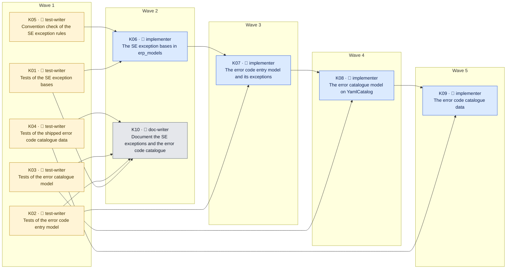

# T0.04: SE exceptions and error codes: plan

**Plan:** 🟢 Approved

**Push:** 🟢 Approved

<!-- ticket:specs -->
## 📚 Specifications

The specification and design pages of [TICKET.md](TICKET.md), copied by `python3 .claude/scripts/tickets/ticket_refs.py sync`.

- [🏗️ Back end](../../technical/architecture/backend.md)
- [📜 D122 Error message standard](../../specs/06-decisions/ux/d122-error-message-standard.md)
- [📌 REQ-T05-03 problem+json errors](../../specs/03-technical/t05-api-and-webhooks/requirements/req-t05-03-problem-json.md)
- [📜 D406 Back end](../../specs/06-decisions/technical/d406-back-end.md)
- [📜 D438 Repository layout](../../specs/06-decisions/technical/d438-repository-layout.md)
- [🏗️ Repository layout](../../technical/architecture/repository-layout.md)
- [🏗️ Configuration](../../technical/architecture/configuration.md)
- [🏗️ API](../../technical/interfaces/api.md)
- [REQ-T10-01](../../specs/03-technical/t10-translations-and-notifications/requirements/req-t10-01-translation-catalogues.md)
<!-- /ticket:specs -->

## Summary

T0.04 adds the `SE` exception bases and the D122 error-code catalogue to `erp_models` (`backend/models`). It also adds a convention check under `tests/conventions/exceptions/` that enforces the AGENT.md exception rules (acceptance criterion 4). The plan has 10 tasks in 5 waves.

- **Wave 1 (5 test-writer tasks):** K01 tests the exception bases, K02 the `ErrorCodeEntry` model, K03 the `ErrorCatalog` model, K04 the catalogue data (criteria 1 and 3, including the no-secret check), and K05 writes the exception convention scanner and its tests.
- **Wave 2:** K06 builds the three bases in `erp_models/exceptions/`: `SEException`, `SEError` and `SEInvalidModelException`, each with a `CODE` class constant. Alongside it, K10 updates `backend/models/README.md` and `docs/technical/architecture/configuration.md`.
- **Then, one task per wave:** K07 builds the entry model and its exceptions, K08 builds the catalogue model on T0.03's `YamlCatalog`, with `resolve()` and refusal of unknown codes, and K09 writes `backend/models/conf/catalogs/error_codes.yaml`.

K06 to K09 form a chain because each one builds on the classes of the one before. No front end changes and no screen is touched, so no Playwright task is needed (TKT-21). No two tasks of the same wave share a file.

## Assumptions

- The specifications fix no list of error codes: the catalogue holds the codes the exception bases need and the D122 pattern's sample code (SITE-CLOSE-01); later tickets add their own.
- The roadmap row has no anchor of its own, so the ticket links to its sprint anchor #s01.
- Message keys are keys only: their French and English texts belong to the translation catalogues of P2 (T10).
- No budget is given to this ticket by the roadmap row or the specifications.
- I could not run check_ticket.py or spec_ids.py (no shell tool available), so link targets were checked only by reading the roadmap page and neighbouring pages.
- The 'Wait: tests-evidences/' folder was created with a .gitkeep file.
- The specifications fix no root exception or base codes. The plan adds a root `SEException` above the two AGENT.md bases (`SEError` for layer errors, `SEInvalidModelException` for model exceptions) and gives them the codes `UNEXPECTED-ERROR-01`, `SERVICE-FAILURE-01` and `INVALID-INPUT-01`. These are the 'codes the exception bases need' of TICKET.md, and they are recorded for review.
- Each exception carries its support reference as a `CODE: ClassVar[str]`, inherited unless a subclass sets its own. This is how the problem+json handler of T0.14 can map an exception to a catalogue code. The specifications do not fix the mechanism.
- The bases never subclass `ValueError`, `TypeError` or `AssertionError`. Pydantic wraps those raised by a validator in `ValidationError`, which would break AGENT.md's `pytest.raises(SE...Invalid...)` model tests.
- The entry fields are named `title`, `why`, `action` and `reference`, not `title_key` and so on. AGENT.md reserves the `_key` suffix for secret store entries.
- The format of codes and references (upper-case words and digits joined by hyphens, ending in a two-digit number) is inferred from the D122 sample `SITE-CLOSE-01`. The format of message keys (lower-case dotted, such as `errors.site_close_01.title`) is chosen by the plan. Neither is stated by the specifications. Being strict about them is what makes 'no message holds a secret' checkable.
- The support reference of each code equals the code itself, as in the pattern's anatomy (`ref. SITE-CLOSE-01`). It stays a separate field because the ticket lists it separately. The model enforces no rule that the two are equal.
- The catalogue file lives in `backend/models/conf/catalogs/error_codes.yaml`, mirroring a service's `conf/catalogs/`. `ErrorCatalog.load(path)` takes the path from its caller and has no default path. How an installed plugin or the SDK finds the file is left to later tickets.
- The catalogue holds only the four codes above. The specifications fix no list, and later tickets add their own codes.
- `YamlCatalog`, the package `backend/models/src/erp_models/` and `backend/models/pyproject.toml`, including its project name and the PyYAML dependency, are delivered by T0.03 and T0.01. The workers locate and read them, and change none of them. If T0.03 provides a shared base model, the two new models use it.
- Acceptance criterion 4 needs `tests/conventions/` to check the exception naming, file names and sorted `__all__`, which it does not check today. The check goes in a new subfolder, `tests/conventions/exceptions/`, without touching the five existing files that T0.02 extends. This crosses the `tests/conventions` area of T0.02, so the start rule may hold T0.04 until T0.02 is done.
- A Python class is recognised as an exception by the convention check when one of its bases is `Exception` or `BaseException`, or is an exception class defined in the scanned tree.

<!-- plan:graph -->

> [!NOTE]
> Generated from the json block at the end of this page by `python3 .claude/scripts/tickets/plan.py render`.
> To change a task, edit the json block, then render again: never edit this view by hand.

## Waves

| Wave | Tasks | Agents running at once |
| --- | --- | --- |
| 1 | [K01](#k01), [K02](#k02), [K03](#k03), [K04](#k04), [K05](#k05) | 5 of 5 |
| 2 | [K06](#k06), [K10](#k10) | 2 of 2 |
| 3 | [K07](#k07) | 1 of 1 |
| 4 | [K08](#k08) | 1 of 1 |
| 5 | [K09](#k09) | 1 of 1 |

| Wave | Task | Agent | Depends on | Unblocks |
| --- | --- | --- | --- | --- |
| 1 | [K01](#k01) Tests of the SE exception bases | 🧪 test-writer | none | [K06](#k06), [K10](#k10) |
| 1 | [K02](#k02) Tests of the error code entry model | 🧪 test-writer | none | [K10](#k10), [K07](#k07) |
| 1 | [K03](#k03) Tests of the error catalogue model | 🧪 test-writer | none | [K10](#k10), [K08](#k08) |
| 1 | [K04](#k04) Tests of the shipped error code catalogue data | 🧪 test-writer | none | [K10](#k10), [K09](#k09) |
| 1 | [K05](#k05) Convention check of the SE exception rules | 🧪 test-writer | none | [K06](#k06) |
| 2 | [K06](#k06) The SE exception bases in erp_models | 🐍 implementer | [K01](#k01), [K05](#k05) | [K07](#k07) |
| 2 | [K10](#k10) Document the SE exceptions and the error code catalogue | 📝 doc-writer | [K01](#k01), [K02](#k02), [K03](#k03), [K04](#k04) | none |
| 3 | [K07](#k07) The error code entry model and its exceptions | 🐍 implementer | [K02](#k02), [K06](#k06) | [K08](#k08) |
| 4 | [K08](#k08) The error catalogue model on YamlCatalog | 🐍 implementer | [K03](#k03), [K07](#k07) | [K09](#k09) |
| 5 | [K09](#k09) The error code catalogue data | 🐍 implementer | [K04](#k04), [K08](#k08) | none |

## Dependency graph



## Tasks

### <a id="k01"></a>K01: Tests of the SE exception bases

| Agent | Wave | Depends on | Unblocks |
| --- | --- | --- | --- |
| 🧪 test-writer | 1 | none | [K06](#k06), [K10](#k10) |

**Files** (only this task may change them in its wave):

- `backend/models/tests/exceptions/test_se_exception.py`
- `backend/models/tests/exceptions/test_se_error.py`
- `backend/models/tests/exceptions/test_se_invalid_model_exception.py`

**Done when:** `uv run ruff check backend/models/tests/exceptions` passes. `uv run --package <project name in backend/models/pyproject.toml> pytest backend/models/tests/exceptions -n 2` collects the three files and fails only because `erp_models.exceptions` does not provide the bases yet (ImportError).

**Brief:**

Write the failing tests of the three shared `SE` exception bases that K06 will add to `erp_models`, in `backend/models/tests/exceptions/` (mirrors `backend/models/src/erp_models/exceptions/`). Applies: AGENT.md "Exceptions", "Naming" and "Tests"; [D438](docs/specs/06-decisions/technical/d438-repository-layout.md) (`backend/models` holds the shared models and their `SE` exceptions); [D406](docs/specs/06-decisions/technical/d406-back-end.md); [D122](docs/specs/06-decisions/ux/d122-error-message-standard.md) and [Error messages pattern](docs/specs/04-ux/design-system/patterns/error-messages.md) (each error carries a support reference code); [REQ-T05-03](docs/specs/03-technical/t05-api-and-webhooks/requirements/req-t05-03-problem-json.md) (errors carry the codes of the error pattern); design pages [Back end](docs/technical/architecture/backend.md) and [API](docs/technical/interfaces/api.md).

The contract fixed by this plan, all imported from the package `erp_models.exceptions` (never from the defining file):
- `SEException(Exception)`: the root of every SimpleERP exception. Class constant `CODE: ClassVar[str] = "UNEXPECTED-ERROR-01"`.
- `SEError(SEException)`: the base of every layer error (`SE<Domain>Error`). `CODE = "SERVICE-FAILURE-01"`.
- `SEInvalidModelException(SEException)`: the base of every model exception (`SEInvalid<Model>Exception`). `CODE = "INVALID-INPUT-01"`.
- None of them subclasses `ValueError`, `TypeError` or `AssertionError`. Otherwise Pydantic would wrap a field validator's exception in `ValidationError`, and `pytest.raises(SE...)` would no longer see it.

One file per base, one `Test<Subject>` class per file. Name the tests as sentences, for example `test_a_layer_error_is_an_se_exception`. Use `pytest.mark.parametrize` for cases of the same behaviour. Cover:
- the inheritance;
- the `CODE` of each class;
- that a subclass that does not set its own `CODE` inherits its base's;
- that the message passed to the constructor is kept (`str(error)`);
- that the cause is kept by `raise ... from error`;
- that the base is not a `ValueError` subclass;
- that each name is in `erp_models.exceptions.__all__`.

No `__init__.py`, no mocks, no docstrings needed. Test file basenames must be unique in the repository. `T0.03` has already created the package `backend/models/src/erp_models/` and `backend/models/pyproject.toml`: read them, but change neither.

### <a id="k02"></a>K02: Tests of the error code entry model

| Agent | Wave | Depends on | Unblocks |
| --- | --- | --- | --- |
| 🧪 test-writer | 1 | none | [K10](#k10), [K07](#k07) |

**Files** (only this task may change them in its wave):

- `backend/models/tests/errors/entries/test_error_code_entry.py`

**Done when:** `uv run ruff check backend/models/tests/errors/entries` passes. `uv run --package <project name in backend/models/pyproject.toml> pytest backend/models/tests/errors/entries -n 2` collects the file and fails only because `erp_models.errors.entries` does not exist yet.

**Brief:**

Write the failing tests of `ErrorCodeEntry`, the model of one code of the D122 error catalogue, which K07 adds in `backend/models/src/erp_models/errors/entries/error_code_entry.py`. Applies: [D122](docs/specs/06-decisions/ux/d122-error-message-standard.md) and the [Error messages pattern](docs/specs/04-ux/design-system/patterns/error-messages.md): a title, one sentence saying why, the action, and a small support reference such as `SITE-CLOSE-01`. Also [REQ-T05-03](docs/specs/03-technical/t05-api-and-webhooks/requirements/req-t05-03-problem-json.md) criterion 2 (no secret in an error), [D438](docs/specs/06-decisions/technical/d438-repository-layout.md), and AGENT.md "Pydantic models", "Tests" and "Exceptions". Design page: [Configuration](docs/technical/architecture/configuration.md).

The contract fixed by this plan:
- `from erp_models.errors.entries.error_code_entry import ErrorCodeEntry`. Its exceptions come from `erp_models.errors.entries.exceptions`.
- Pydantic `BaseModel` (or T0.03's base model if it provides one), `extra="forbid"`, `frozen=True`. All four fields are required strings and are stripped:
  - `title`, `why` and `action` are the translation keys of the title, the why sentence and the action. They are lower-case dotted keys matching `^[a-z][a-z0-9_]*(\.[a-z0-9_]+)+$`, for example `errors.site_close_01.title`. The field names deliberately avoid the `_key` suffix, which AGENT.md reserves for secret store entries.
  - `reference` is the support reference. It is upper-case words and digits joined by hyphens, ending in a two-digit number, matching `^[A-Z][A-Z0-9]*(-[A-Z0-9]+)*-[0-9]{2}$`, for example `SITE-CLOSE-01`.
- Exceptions: `SEInvalidErrorCodeEntryException` (a subclass of `erp_models.exceptions.SEInvalidModelException`), and its subclasses `SEErrorCodeEntryInvalidTitle`, `SEErrorCodeEntryInvalidWhy`, `SEErrorCodeEntryInvalidAction` and `SEErrorCodeEntryInvalidReference`.

Write one `TestErrorCodeEntry` class with the six model tests of AGENT.md, adapted to a model whose fields are all required:
- `test_defaults`: omitting any field is refused by Pydantic's `ValidationError`.
- `test_full_valid_construction`: a full entry is built, and its values are stripped.
- `test_none_becomes_the_default`: parametrised over the four fields, `None` is refused with that field's own exception, since no field has a default.
- `test_rejects_bad_values`: parametrised. Cover the empty and blank string, a non-string, `bool`, a key with upper case or spaces, a single-segment key, free text such as a sentence, a reference without its two-digit number, and a lower-case reference. Each is refused with its field's exception.
- `test_rejects_unknown_keys`.
- `test_round_trip`: `model_dump`, then `model_validate`.

Also check that the entry is frozen, and that every field exception is a `SEInvalidErrorCodeEntryException`. No `__init__.py`, no mocks.

### <a id="k03"></a>K03: Tests of the error catalogue model

| Agent | Wave | Depends on | Unblocks |
| --- | --- | --- | --- |
| 🧪 test-writer | 1 | none | [K10](#k10), [K08](#k08) |

**Files** (only this task may change them in its wave):

- `backend/models/tests/errors/catalogs/test_error_catalog.py`

**Done when:** `uv run ruff check backend/models/tests/errors/catalogs/test_error_catalog.py` passes. `uv run --package <project name in backend/models/pyproject.toml> pytest backend/models/tests/errors/catalogs/test_error_catalog.py -n 2` collects the file and fails only because `erp_models.errors.catalogs` does not exist yet.

**Brief:**

Write the failing tests of `ErrorCatalog`, which K08 adds in `backend/models/src/erp_models/errors/catalogs/error_catalog.py`. It is the model of the error code catalogue that resolves every code to its three message keys and its support reference, and refuses an unknown code. It is built on `YamlCatalog` of T0.03; find it with `grep -rn 'class YamlCatalog' backend/models/src` and follow its `load(path)` and `UNREADABLE` contract. Applies: [D122](docs/specs/06-decisions/ux/d122-error-message-standard.md); the [Error messages pattern](docs/specs/04-ux/design-system/patterns/error-messages.md); [REQ-T05-03](docs/specs/03-technical/t05-api-and-webhooks/requirements/req-t05-03-problem-json.md) (an unknown code is refused: acceptance criterion 2 of TICKET.md); [D438](docs/specs/06-decisions/technical/d438-repository-layout.md); design pages [Configuration](docs/technical/architecture/configuration.md) (`conf/catalogs/` is loaded by `YamlCatalog` models) and [Back end](docs/technical/architecture/backend.md); AGENT.md "Pydantic models", "Data and enums" and "Tests".

The contract fixed by this plan:
- `from erp_models.errors.catalogs.error_catalog import ErrorCatalog`. Its exceptions come from `erp_models.errors.catalogs.exceptions`.
- `ErrorCatalog(YamlCatalog)`, with `extra="forbid"` and `frozen=True`. It has one required field, `codes: Dict[str, ErrorCodeEntry]` (`ErrorCodeEntry` from `erp_models.errors.entries.error_code_entry`). It must be a non-empty mapping whose keys match `^[A-Z][A-Z0-9]*(-[A-Z0-9]+)*-[0-9]{2}$`. Otherwise it raises `SEErrorCatalogInvalidCodes`.
- `resolve(code: str) -> ErrorCodeEntry` returns the entry. It raises `SEErrorCatalogUnknownCode` for a code that is not in the catalogue.
- `UNREADABLE = SEErrorCatalogUnreadable`, raised by `load(path)` on a missing file or malformed YAML.
- Every catalogue exception is a subclass of `SEInvalidErrorCatalogException`, which is a subclass of `erp_models.exceptions.SEInvalidModelException`.
- The YAML shape is `codes: {SITE-CLOSE-01: {title: errors.site_close_01.title, why: errors.site_close_01.why, action: errors.site_close_01.action, reference: SITE-CLOSE-01}}`.

Write one `TestErrorCatalog` class:
- the six model tests of AGENT.md: a missing `codes` is refused by `ValidationError`, `None` raises `SEErrorCatalogInvalidCodes`, and the bad values are an empty mapping, a list, a lower-case code, a code without its number, and a bad entry, which raises the entry's exception;
- `resolve` gives the four values of a known code (criterion 1);
- an unknown code is refused with `SEErrorCatalogUnknownCode`, parametrised over a missing code, an empty string and a lower-case variant of a known code (criterion 2);
- `load` reads a YAML file written in `tmp_path`;
- a missing or malformed file raises `SEErrorCatalogUnreadable`.

No `__init__.py`, no mocks. The file basename must stay unique in the repository.

### <a id="k04"></a>K04: Tests of the shipped error code catalogue data

| Agent | Wave | Depends on | Unblocks |
| --- | --- | --- | --- |
| 🧪 test-writer | 1 | none | [K10](#k10), [K09](#k09) |

**Files** (only this task may change them in its wave):

- `backend/models/tests/errors/catalogs/test_error_codes_data.py`

**Done when:** `uv run ruff check backend/models/tests/errors/catalogs/test_error_codes_data.py` passes. `uv run --package <project name in backend/models/pyproject.toml> pytest backend/models/tests/errors/catalogs/test_error_codes_data.py -n 2` collects the file and fails only because the catalogue model or its data does not exist yet.

**Brief:**

Write the failing tests of the data file `backend/models/conf/catalogs/error_codes.yaml`, which K09 writes. They cover acceptance criteria 1 and 3 of `docs/tickets/T0.04/TICKET.md`. Applies:
- [D122](docs/specs/06-decisions/ux/d122-error-message-standard.md) and the [Error messages pattern](docs/specs/04-ux/design-system/patterns/error-messages.md): every code has its title, why and action keys and its support reference.
- [REQ-T05-03](docs/specs/03-technical/t05-api-and-webhooks/requirements/req-t05-03-problem-json.md) criterion 2: no secret in an error.
- [Configuration](docs/technical/architecture/configuration.md): data in `conf/catalogs/`, loaded by `YamlCatalog` models.
- [D438](docs/specs/06-decisions/technical/d438-repository-layout.md).
- AGENT.md "Data and enums" and "Tests".

Locate the file from the test's own path (`Path(__file__).resolve().parents[3] / "conf" / "catalogs" / "error_codes.yaml"`), in a fixture or a `ClassVar` (no module constant). Load it with `ErrorCatalog.load(path)` (`erp_models.errors.catalogs.error_catalog`; the contract is in K03's brief).

Write one `TestErrorCodesData` class:
1. The file loads.
2. Every code resolves to non-empty `title`, `why`, `action` and `reference` values.
3. The `CODE` of each base resolves: `SEException` `UNEXPECTED-ERROR-01`, `SEError` `SERVICE-FAILURE-01` and `SEInvalidModelException` `INVALID-INPUT-01`, read from `erp_models.exceptions`, not written out.
4. The D122 sample code `SITE-CLOSE-01` is present, with the reference `SITE-CLOSE-01`.
5. No message holds a secret (criterion 3):
   - each key matches the lower-case dotted key pattern, so it holds no free text or value;
   - no key or reference contains a secret-like word (`secret`, `password`, `passwd`, `token`, `credential`, `private`, `api_key`), parametrised over the words;
   - the raw file text holds no `{` placeholder that could carry a value at run time.

No `__init__.py`, no mocks.

### <a id="k05"></a>K05: Convention check of the SE exception rules

| Agent | Wave | Depends on | Unblocks |
| --- | --- | --- | --- |
| 🧪 test-writer | 1 | none | [K06](#k06) |

**Files** (only this task may change them in its wave):

- `tests/conventions/exceptions/exception_scanner.py`
- `tests/conventions/exceptions/test_exception_conventions.py`
- `tests/conventions/exceptions/test_exception_scanner.py`

**Done when:** `uv run ruff check tests/conventions` and `uv run ruff format --check tests/conventions/exceptions` pass. `uv run pytest tests/conventions -n 2` passes, including every broken-tree case of `test_exception_scanner.py`.

**Brief:**

Extend `tests/conventions/` so that it enforces the exception rules of AGENT.md "Exceptions" and "Naming". This is acceptance criterion 4 of `docs/tickets/T0.04/TICKET.md`. Applies: [D438](docs/specs/06-decisions/technical/d438-repository-layout.md) (the conventions tests follow the layout), [REQ-T05-03](docs/specs/03-technical/t05-api-and-webhooks/requirements/req-t05-03-problem-json.md), and the design page [Repository layout](docs/technical/architecture/repository-layout.md).

**Do not change any existing file of `tests/conventions/`.** `tests/conventions/` already holds five Python files, so a sixth would break the five-file rule. T0.02 also extends those files. Work in the new subfolder `tests/conventions/exceptions/` only. Read `tests/conventions/helpers.py` (`ROOT`, `SOURCE_GLOBS`) and `tests/conventions/convention_scanner.py` to follow their style: a scanner class over a root path, whose rules each return offenders as `path:line` texts.

1. `exception_scanner.py` holds one `ExceptionScanner` class, with a constructor that takes `root: Path`. It reads the Python files of every source folder of `SOURCE_GLOBS` with `ast`. A class is an exception when one of its bases is `Exception` or `BaseException`, or is an exception class defined in the scanned tree (resolved by name, transitively). Its rules:
   - `misnamed_exceptions()`: an exception whose name does not start with `SE`.
   - `misplaced_exceptions()`: an exception whose file name is not the snake case of its class name (`SEDatabaseConfigInvalidPort` gives `se_database_config_invalid_port.py`, `SEInvalidModelException` gives `se_invalid_model_exception.py`), or that does not sit under a folder named `exceptions`.
   - `unexported_exceptions()`: an `exceptions/` package whose `__init__.py` has no `__all__` list literal, an `__all__` that is not sorted, or one that misses any exception defined under that package (sub-folders included).
2. `test_exception_scanner.py`, class `TestExceptionScanner`, works on small trees written in `tmp_path`, under `backend/models/src/erp_models/...`. A clean tree has no offender. Each broken tree fails its rule exactly once: an exception not named `SE...`, a wrong file name, an exception outside `exceptions/`, a missing `__all__`, an unsorted `__all__`, an exception missing from `__all__`, and a sub-folder exception missing from the parent `__all__`. A non-exception class is ignored.
3. `test_exception_conventions.py`, class `TestExceptionConventions`, asserts that each of the three rules returns nothing on `ROOT`.

Follow AGENT.md "Tests": no `__init__.py`, sentence names, `pytest.mark.parametrize`. The scanner class is test code: give it docstrings like `convention_scanner.py`, no nested functions, no `@staticmethod`, no attribute starting with an underscore.

### <a id="k06"></a>K06: The SE exception bases in erp_models

| Agent | Wave | Depends on | Unblocks |
| --- | --- | --- | --- |
| 🐍 implementer | 2 | [K01](#k01), [K05](#k05) | [K07](#k07) |

**Files** (only this task may change them in its wave):

- `backend/models/src/erp_models/exceptions/__init__.py`
- `backend/models/src/erp_models/exceptions/se_exception.py`
- `backend/models/src/erp_models/exceptions/se_error.py`
- `backend/models/src/erp_models/exceptions/se_invalid_model_exception.py`

**Done when:** `uv run --package <project name in backend/models/pyproject.toml> pytest backend/models/tests/exceptions -n 2` passes. `uv run pytest tests/conventions -n 2` passes. `uv run ruff check backend/models` and `uv run mypy backend/models/src` pass.

**Brief:**

Add the shared `SE` exception bases to `erp_models`, in `backend/models/src/erp_models/exceptions/`, so that the tests of K01 (`backend/models/tests/exceptions/`) and the convention check of K05 (`tests/conventions/exceptions/`) pass. Applies: AGENT.md "Exceptions" (layer base `SE<Domain>Error`, model base `SEInvalid<Model>Exception`, one exception per file named in snake case, re-exported by `exceptions/__init__.py` through a sorted `__all__`), "Naming", "File shape", "Imports" and "Docstrings". Also [D438](docs/specs/06-decisions/technical/d438-repository-layout.md) and the design page [Back end](docs/technical/architecture/backend.md) (`erp_models` is the shared home of the public contracts and their `SE` exceptions). Also [D406](docs/specs/06-decisions/technical/d406-back-end.md), [D122](docs/specs/06-decisions/ux/d122-error-message-standard.md) (the support reference) and [REQ-T05-03](docs/specs/03-technical/t05-api-and-webhooks/requirements/req-t05-03-problem-json.md) (errors carry the codes of the error pattern, which the problem+json handler of T0.14 will read from `CODE`).

Files and classes:
- `se_exception.py` holds `SEException(Exception)`, with `CODE: ClassVar[str] = "UNEXPECTED-ERROR-01"`. Its docstring is `Base class for every exception raised by SimpleERP.`
- `se_error.py` holds `SEError(SEException)`, with `CODE = "SERVICE-FAILURE-01"`. Its docstring is `Base class for every error raised by a layer of a service, a library or a plugin.`
- `se_invalid_model_exception.py` holds `SEInvalidModelException(SEException)`, with `CODE = "INVALID-INPUT-01"`. Its docstring is `Exception raised when an invalid model is provided.`
- `__init__.py` imports the three and exposes `__all__ = ["SEError", "SEException", "SEInvalidModelException"]`.

Do not subclass `ValueError`, `TypeError` or `AssertionError`: Pydantic must let the field validators' `SE` exceptions propagate unwrapped. `models` never logs. Every class has a Google docstring listing `CODE` under `Attributes:`, and a `Notes:` section on why `CODE` exists: the support reference of D122, resolved through the error catalogue. Exception files need no import-group comments. Start each non-empty file with `from __future__ import annotations`.

### <a id="k10"></a>K10: Document the SE exceptions and the error code catalogue

| Agent | Wave | Depends on | Unblocks |
| --- | --- | --- | --- |
| 📝 doc-writer | 2 | [K01](#k01), [K02](#k02), [K03](#k03), [K04](#k04) | none |

**Files** (only this task may change them in its wave):

- `backend/models/README.md`
- `docs/technical/architecture/configuration.md`

**Done when:** Both files hold the new content, and every relative link in them resolves. `grep -n 'error_codes.yaml' backend/models/README.md docs/technical/architecture/configuration.md` finds both files.

**Brief:**

Document what T0.04 adds, in plain British English, with no em dashes. Do not change any page of `docs/specs/`. Applies:
- [D122](docs/specs/06-decisions/ux/d122-error-message-standard.md) and the [Error messages pattern](docs/specs/04-ux/design-system/patterns/error-messages.md);
- [REQ-T05-03](docs/specs/03-technical/t05-api-and-webhooks/requirements/req-t05-03-problem-json.md);
- [D438](docs/specs/06-decisions/technical/d438-repository-layout.md);
- the design pages [Configuration](docs/technical/architecture/configuration.md), [Back end](docs/technical/architecture/backend.md) and [API](docs/technical/interfaces/api.md).

The names below are fixed by the plan and by the tests of K01 to K04.

1. `backend/models/README.md` was written by T0.01 and T0.03. Keep their content and add a section "Exceptions and error codes". It covers:
   - the three bases of `erp_models.exceptions`: `SEException` (root, `CODE` `UNEXPECTED-ERROR-01`), `SEError` (base of every layer error `SE<Domain>Error`, `SERVICE-FAILURE-01`) and `SEInvalidModelException` (base of every model exception `SEInvalid<Model>Exception`, `INVALID-INPUT-01`);
   - the rule that they never subclass `ValueError`, and why: Pydantic would wrap them;
   - the catalogue `conf/catalogs/error_codes.yaml`: each code with its `title`, `why` and `action` translation keys and its `reference`;
   - the model `erp_models.errors.catalogs.error_catalog.ErrorCatalog`, with `load(path)` and `resolve(code)`, which refuses an unknown code with `SEErrorCatalogUnknownCode`;
   - how a later ticket adds a code: a new entry in the YAML, and its exception sets `CODE`;
   - that the message texts belong to the translation catalogues of P2.
2. `docs/technical/architecture/configuration.md`: in the `conf/catalogs/` row, say that the first catalogue is the error code catalogue `backend/models/conf/catalogs/error_codes.yaml` (T0.04), loaded by `ErrorCatalog`. Leave the rest of the page as it is.

### <a id="k07"></a>K07: The error code entry model and its exceptions

| Agent | Wave | Depends on | Unblocks |
| --- | --- | --- | --- |
| 🐍 implementer | 3 | [K02](#k02), [K06](#k06) | [K08](#k08) |

**Files** (only this task may change them in its wave):

- `backend/models/src/erp_models/errors/__init__.py`
- `backend/models/src/erp_models/errors/entries/__init__.py`
- `backend/models/src/erp_models/errors/entries/error_code_entry.py`
- `backend/models/src/erp_models/errors/entries/exceptions/__init__.py`
- `backend/models/src/erp_models/errors/entries/exceptions/se_invalid_error_code_entry_exception.py`
- `backend/models/src/erp_models/errors/entries/exceptions/se_error_code_entry_invalid_title.py`
- `backend/models/src/erp_models/errors/entries/exceptions/se_error_code_entry_invalid_why.py`
- `backend/models/src/erp_models/errors/entries/exceptions/se_error_code_entry_invalid_action.py`
- `backend/models/src/erp_models/errors/entries/exceptions/se_error_code_entry_invalid_reference.py`

**Done when:** `uv run --package <project name in backend/models/pyproject.toml> pytest backend/models/tests/errors/entries -n 2` passes. `uv run pytest tests/conventions -n 2` passes. `uv run ruff check backend/models` and `uv run mypy backend/models/src` pass.

**Brief:**

Implement `ErrorCodeEntry`, the model of one code of the error catalogue, so that `backend/models/tests/errors/entries/test_error_code_entry.py` (K02) passes. Applies:
- [D122](docs/specs/06-decisions/ux/d122-error-message-standard.md) and the [Error messages pattern](docs/specs/04-ux/design-system/patterns/error-messages.md): title, why, action, and a small support reference like `SITE-CLOSE-01`.
- [REQ-T05-03](docs/specs/03-technical/t05-api-and-webhooks/requirements/req-t05-03-problem-json.md) criterion 2: the strict key patterns leave no room for free text or a secret.
- [D438](docs/specs/06-decisions/technical/d438-repository-layout.md), and the design page [Configuration](docs/technical/architecture/configuration.md).
- AGENT.md "Pydantic models" (`Field(description=...)` on every field, `@field_validator(..., mode="before")` named `validate_<field>` without `@classmethod`, strip strings and reject empty ones, reject `bool`, `extra="forbid"`, `frozen=True`), "Exceptions", "Messages" (use the `exception-and-log-messages` skill: `Invalid <field>: {value!r}.` then `Must be ...`, with the `# noqa: E501` two-line form), "Naming" (bounds and patterns are `ClassVar`s in UPPER_CASE) and "File shape".

The model, in `error_code_entry.py`: use T0.03's base model of `erp_models` if it provides one, otherwise Pydantic `BaseModel`. It has four required `str` fields:
- `title`, `why` and `action`: translation keys matching `MESSAGE_KEY_PATTERN: ClassVar[str] = r"^[a-z][a-z0-9_]*(\.[a-z0-9_]+)+$"`;
- `reference`: it matches `REFERENCE_PATTERN: ClassVar[str] = r"^[A-Z][A-Z0-9]*(-[A-Z0-9]+)*-[0-9]{2}$"`.

Give each field its own exception: `SEErrorCodeEntryInvalidTitle`, `SEErrorCodeEntryInvalidWhy`, `SEErrorCodeEntryInvalidAction` and `SEErrorCodeEntryInvalidReference`. All of them subclass `SEInvalidErrorCodeEntryException`, which subclasses `erp_models.exceptions.SEInvalidModelException`. Since `None` has no default to become, it is refused with the field's exception. Write each exception in its own file, re-exported by `entries/exceptions/__init__.py` through a sorted `__all__`. The `errors/__init__.py` and `entries/__init__.py` files are empty. Do not use the `_key` suffix for field names: AGENT.md reserves it for secret store entries. `models` never logs.

### <a id="k08"></a>K08: The error catalogue model on YamlCatalog

| Agent | Wave | Depends on | Unblocks |
| --- | --- | --- | --- |
| 🐍 implementer | 4 | [K03](#k03), [K07](#k07) | [K09](#k09) |

**Files** (only this task may change them in its wave):

- `backend/models/src/erp_models/errors/catalogs/__init__.py`
- `backend/models/src/erp_models/errors/catalogs/error_catalog.py`
- `backend/models/src/erp_models/errors/catalogs/exceptions/__init__.py`
- `backend/models/src/erp_models/errors/catalogs/exceptions/se_invalid_error_catalog_exception.py`
- `backend/models/src/erp_models/errors/catalogs/exceptions/se_error_catalog_invalid_codes.py`
- `backend/models/src/erp_models/errors/catalogs/exceptions/se_error_catalog_unreadable.py`
- `backend/models/src/erp_models/errors/catalogs/exceptions/se_error_catalog_unknown_code.py`

**Done when:** `uv run --package <project name in backend/models/pyproject.toml> pytest backend/models/tests/errors/catalogs/test_error_catalog.py -n 2` passes. `uv run pytest tests/conventions -n 2` passes. `uv run ruff check backend/models` and `uv run mypy backend/models/src` pass.

**Brief:**

Implement `ErrorCatalog`, the model of the error code catalogue, so that `backend/models/tests/errors/catalogs/test_error_catalog.py` (K03) passes. Applies:
- [D122](docs/specs/06-decisions/ux/d122-error-message-standard.md) and the [Error messages pattern](docs/specs/04-ux/design-system/patterns/error-messages.md): every code resolves to its title, why and action keys and its support reference (criterion 1).
- [REQ-T05-03](docs/specs/03-technical/t05-api-and-webhooks/requirements/req-t05-03-problem-json.md): an unknown code is refused (criterion 2).
- The design pages [Configuration](docs/technical/architecture/configuration.md) (`conf/catalogs/` is loaded by `YamlCatalog` models) and [Back end](docs/technical/architecture/backend.md).
- [D438](docs/specs/06-decisions/technical/d438-repository-layout.md).
- AGENT.md "Data and enums" (subclass `YamlCatalog`, which provides `load(path)` and raises the model's `UNREADABLE` exception), "Pydantic models", "Exceptions", "Messages" (use the `exception-and-log-messages` skill) and "File shape" (banners; async after sync).

Find `YamlCatalog` with `grep -rn 'class YamlCatalog' backend/models/src` (it is T0.03's) and follow its contract. Do not change it.

The model, `ErrorCatalog(YamlCatalog)`, with `extra="forbid"` and `frozen=True`:
- `UNREADABLE = SEErrorCatalogUnreadable`.
- `CODE_PATTERN: ClassVar[str] = r"^[A-Z][A-Z0-9]*(-[A-Z0-9]+)*-[0-9]{2}$"`.
- One required field, `codes: Dict[str, ErrorCodeEntry]`, with `Field(description=...)`. Its `validate_codes` (`mode="before"`) refuses `None`, a non-mapping, an empty mapping, and any key that is not a string matching `CODE_PATTERN`, with `SEErrorCatalogInvalidCodes`. The entries are validated by `ErrorCodeEntry` (K07).
- `resolve(self, code: str) -> ErrorCodeEntry`, under the `Publicly Exposed Methods` banner, returns the entry or raises `SEErrorCatalogUnknownCode`, with the message `Unknown error code: {code!r}.` then `Must be a code of the error catalogue.`

Exceptions, one per file, re-exported by `catalogs/exceptions/__init__.py` through a sorted `__all__`: `SEInvalidErrorCatalogException` subclasses `erp_models.exceptions.SEInvalidModelException`, and `SEErrorCatalogInvalidCodes`, `SEErrorCatalogUnreadable` and `SEErrorCatalogUnknownCode` subclass it. `catalogs/__init__.py` is empty. `models` never logs.

### <a id="k09"></a>K09: The error code catalogue data

| Agent | Wave | Depends on | Unblocks |
| --- | --- | --- | --- |
| 🐍 implementer | 5 | [K04](#k04), [K08](#k08) | none |

**Files** (only this task may change them in its wave):

- `backend/models/conf/catalogs/error_codes.yaml`

**Done when:** `uv run --package <project name in backend/models/pyproject.toml> pytest backend/models/tests/errors -n 2` passes.

**Brief:**

Write the error code catalogue as data in `backend/models/conf/catalogs/error_codes.yaml`, so that `backend/models/tests/errors/catalogs/test_error_codes_data.py` (K04) passes. Applies:
- [D122](docs/specs/06-decisions/ux/d122-error-message-standard.md) and the [Error messages pattern](docs/specs/04-ux/design-system/patterns/error-messages.md): each code with its title key, why key, action key and support reference, the sample being `SITE-CLOSE-01`.
- [REQ-T05-03](docs/specs/03-technical/t05-api-and-webhooks/requirements/req-t05-03-problem-json.md) criterion 2: no secret in any message.
- The design page [Configuration](docs/technical/architecture/configuration.md): `conf/catalogs/` holds data that would otherwise be hard-coded.
- [D438](docs/specs/06-decisions/technical/d438-repository-layout.md).
- AGENT.md "Data and enums".

The shape is the one `ErrorCatalog` (K08, `backend/models/src/erp_models/errors/catalogs/error_catalog.py`) loads: a top-level `codes:` mapping. Each code maps to `title`, `why`, `action` and `reference`. The keys are `errors.<code in snake case>.title`, `.why` and `.action`, and the reference is the code itself. Hold exactly these four codes, the ones the exception bases need plus the D122 sample:
- `UNEXPECTED-ERROR-01` (`SEException.CODE`);
- `SERVICE-FAILURE-01` (`SEError.CODE`);
- `INVALID-INPUT-01` (`SEInvalidModelException.CODE`);
- `SITE-CLOSE-01`.

Use keys only: no French or English text (that belongs to the translation catalogues of P2, REQ-T10-01) and no `{...}` placeholder. Put a short comment at the top saying what the file holds and that later tickets add their own codes. UTF-8, two-space indentation.

<!-- /plan:graph -->

## Task graph

<details>
<summary>🤖 Task graph as read by <code>/ticket-run</code> (json)</summary>

```json
[
  {
    "id": "K01",
    "title": "Tests of the SE exception bases",
    "agent": "test-writer",
    "depends_on": [],
    "files": [
      "backend/models/tests/exceptions/test_se_exception.py",
      "backend/models/tests/exceptions/test_se_error.py",
      "backend/models/tests/exceptions/test_se_invalid_model_exception.py"
    ],
    "brief": "Write the failing tests of the three shared `SE` exception bases that K06 will add to `erp_models`, in `backend/models/tests/exceptions/` (mirrors `backend/models/src/erp_models/exceptions/`). Applies: AGENT.md \"Exceptions\", \"Naming\" and \"Tests\"; [D438](docs/specs/06-decisions/technical/d438-repository-layout.md) (`backend/models` holds the shared models and their `SE` exceptions); [D406](docs/specs/06-decisions/technical/d406-back-end.md); [D122](docs/specs/06-decisions/ux/d122-error-message-standard.md) and [Error messages pattern](docs/specs/04-ux/design-system/patterns/error-messages.md) (each error carries a support reference code); [REQ-T05-03](docs/specs/03-technical/t05-api-and-webhooks/requirements/req-t05-03-problem-json.md) (errors carry the codes of the error pattern); design pages [Back end](docs/technical/architecture/backend.md) and [API](docs/technical/interfaces/api.md).\n\nThe contract fixed by this plan, all imported from the package `erp_models.exceptions` (never from the defining file):\n- `SEException(Exception)`: the root of every SimpleERP exception. Class constant `CODE: ClassVar[str] = \"UNEXPECTED-ERROR-01\"`.\n- `SEError(SEException)`: the base of every layer error (`SE<Domain>Error`). `CODE = \"SERVICE-FAILURE-01\"`.\n- `SEInvalidModelException(SEException)`: the base of every model exception (`SEInvalid<Model>Exception`). `CODE = \"INVALID-INPUT-01\"`.\n- None of them subclasses `ValueError`, `TypeError` or `AssertionError`. Otherwise Pydantic would wrap a field validator's exception in `ValidationError`, and `pytest.raises(SE...)` would no longer see it.\n\nOne file per base, one `Test<Subject>` class per file. Name the tests as sentences, for example `test_a_layer_error_is_an_se_exception`. Use `pytest.mark.parametrize` for cases of the same behaviour. Cover:\n- the inheritance;\n- the `CODE` of each class;\n- that a subclass that does not set its own `CODE` inherits its base's;\n- that the message passed to the constructor is kept (`str(error)`);\n- that the cause is kept by `raise ... from error`;\n- that the base is not a `ValueError` subclass;\n- that each name is in `erp_models.exceptions.__all__`.\n\nNo `__init__.py`, no mocks, no docstrings needed. Test file basenames must be unique in the repository. `T0.03` has already created the package `backend/models/src/erp_models/` and `backend/models/pyproject.toml`: read them, but change neither.",
    "done_when": "`uv run ruff check backend/models/tests/exceptions` passes. `uv run --package <project name in backend/models/pyproject.toml> pytest backend/models/tests/exceptions -n 2` collects the three files and fails only because `erp_models.exceptions` does not provide the bases yet (ImportError).",
    "wave": 1
  },
  {
    "id": "K02",
    "title": "Tests of the error code entry model",
    "agent": "test-writer",
    "depends_on": [],
    "files": [
      "backend/models/tests/errors/entries/test_error_code_entry.py"
    ],
    "brief": "Write the failing tests of `ErrorCodeEntry`, the model of one code of the D122 error catalogue, which K07 adds in `backend/models/src/erp_models/errors/entries/error_code_entry.py`. Applies: [D122](docs/specs/06-decisions/ux/d122-error-message-standard.md) and the [Error messages pattern](docs/specs/04-ux/design-system/patterns/error-messages.md): a title, one sentence saying why, the action, and a small support reference such as `SITE-CLOSE-01`. Also [REQ-T05-03](docs/specs/03-technical/t05-api-and-webhooks/requirements/req-t05-03-problem-json.md) criterion 2 (no secret in an error), [D438](docs/specs/06-decisions/technical/d438-repository-layout.md), and AGENT.md \"Pydantic models\", \"Tests\" and \"Exceptions\". Design page: [Configuration](docs/technical/architecture/configuration.md).\n\nThe contract fixed by this plan:\n- `from erp_models.errors.entries.error_code_entry import ErrorCodeEntry`. Its exceptions come from `erp_models.errors.entries.exceptions`.\n- Pydantic `BaseModel` (or T0.03's base model if it provides one), `extra=\"forbid\"`, `frozen=True`. All four fields are required strings and are stripped:\n  - `title`, `why` and `action` are the translation keys of the title, the why sentence and the action. They are lower-case dotted keys matching `^[a-z][a-z0-9_]*(\\.[a-z0-9_]+)+$`, for example `errors.site_close_01.title`. The field names deliberately avoid the `_key` suffix, which AGENT.md reserves for secret store entries.\n  - `reference` is the support reference. It is upper-case words and digits joined by hyphens, ending in a two-digit number, matching `^[A-Z][A-Z0-9]*(-[A-Z0-9]+)*-[0-9]{2}$`, for example `SITE-CLOSE-01`.\n- Exceptions: `SEInvalidErrorCodeEntryException` (a subclass of `erp_models.exceptions.SEInvalidModelException`), and its subclasses `SEErrorCodeEntryInvalidTitle`, `SEErrorCodeEntryInvalidWhy`, `SEErrorCodeEntryInvalidAction` and `SEErrorCodeEntryInvalidReference`.\n\nWrite one `TestErrorCodeEntry` class with the six model tests of AGENT.md, adapted to a model whose fields are all required:\n- `test_defaults`: omitting any field is refused by Pydantic's `ValidationError`.\n- `test_full_valid_construction`: a full entry is built, and its values are stripped.\n- `test_none_becomes_the_default`: parametrised over the four fields, `None` is refused with that field's own exception, since no field has a default.\n- `test_rejects_bad_values`: parametrised. Cover the empty and blank string, a non-string, `bool`, a key with upper case or spaces, a single-segment key, free text such as a sentence, a reference without its two-digit number, and a lower-case reference. Each is refused with its field's exception.\n- `test_rejects_unknown_keys`.\n- `test_round_trip`: `model_dump`, then `model_validate`.\n\nAlso check that the entry is frozen, and that every field exception is a `SEInvalidErrorCodeEntryException`. No `__init__.py`, no mocks.",
    "done_when": "`uv run ruff check backend/models/tests/errors/entries` passes. `uv run --package <project name in backend/models/pyproject.toml> pytest backend/models/tests/errors/entries -n 2` collects the file and fails only because `erp_models.errors.entries` does not exist yet.",
    "wave": 1
  },
  {
    "id": "K03",
    "title": "Tests of the error catalogue model",
    "agent": "test-writer",
    "depends_on": [],
    "files": [
      "backend/models/tests/errors/catalogs/test_error_catalog.py"
    ],
    "brief": "Write the failing tests of `ErrorCatalog`, which K08 adds in `backend/models/src/erp_models/errors/catalogs/error_catalog.py`. It is the model of the error code catalogue that resolves every code to its three message keys and its support reference, and refuses an unknown code. It is built on `YamlCatalog` of T0.03; find it with `grep -rn 'class YamlCatalog' backend/models/src` and follow its `load(path)` and `UNREADABLE` contract. Applies: [D122](docs/specs/06-decisions/ux/d122-error-message-standard.md); the [Error messages pattern](docs/specs/04-ux/design-system/patterns/error-messages.md); [REQ-T05-03](docs/specs/03-technical/t05-api-and-webhooks/requirements/req-t05-03-problem-json.md) (an unknown code is refused: acceptance criterion 2 of TICKET.md); [D438](docs/specs/06-decisions/technical/d438-repository-layout.md); design pages [Configuration](docs/technical/architecture/configuration.md) (`conf/catalogs/` is loaded by `YamlCatalog` models) and [Back end](docs/technical/architecture/backend.md); AGENT.md \"Pydantic models\", \"Data and enums\" and \"Tests\".\n\nThe contract fixed by this plan:\n- `from erp_models.errors.catalogs.error_catalog import ErrorCatalog`. Its exceptions come from `erp_models.errors.catalogs.exceptions`.\n- `ErrorCatalog(YamlCatalog)`, with `extra=\"forbid\"` and `frozen=True`. It has one required field, `codes: Dict[str, ErrorCodeEntry]` (`ErrorCodeEntry` from `erp_models.errors.entries.error_code_entry`). It must be a non-empty mapping whose keys match `^[A-Z][A-Z0-9]*(-[A-Z0-9]+)*-[0-9]{2}$`. Otherwise it raises `SEErrorCatalogInvalidCodes`.\n- `resolve(code: str) -> ErrorCodeEntry` returns the entry. It raises `SEErrorCatalogUnknownCode` for a code that is not in the catalogue.\n- `UNREADABLE = SEErrorCatalogUnreadable`, raised by `load(path)` on a missing file or malformed YAML.\n- Every catalogue exception is a subclass of `SEInvalidErrorCatalogException`, which is a subclass of `erp_models.exceptions.SEInvalidModelException`.\n- The YAML shape is `codes: {SITE-CLOSE-01: {title: errors.site_close_01.title, why: errors.site_close_01.why, action: errors.site_close_01.action, reference: SITE-CLOSE-01}}`.\n\nWrite one `TestErrorCatalog` class:\n- the six model tests of AGENT.md: a missing `codes` is refused by `ValidationError`, `None` raises `SEErrorCatalogInvalidCodes`, and the bad values are an empty mapping, a list, a lower-case code, a code without its number, and a bad entry, which raises the entry's exception;\n- `resolve` gives the four values of a known code (criterion 1);\n- an unknown code is refused with `SEErrorCatalogUnknownCode`, parametrised over a missing code, an empty string and a lower-case variant of a known code (criterion 2);\n- `load` reads a YAML file written in `tmp_path`;\n- a missing or malformed file raises `SEErrorCatalogUnreadable`.\n\nNo `__init__.py`, no mocks. The file basename must stay unique in the repository.",
    "done_when": "`uv run ruff check backend/models/tests/errors/catalogs/test_error_catalog.py` passes. `uv run --package <project name in backend/models/pyproject.toml> pytest backend/models/tests/errors/catalogs/test_error_catalog.py -n 2` collects the file and fails only because `erp_models.errors.catalogs` does not exist yet.",
    "wave": 1
  },
  {
    "id": "K04",
    "title": "Tests of the shipped error code catalogue data",
    "agent": "test-writer",
    "depends_on": [],
    "files": [
      "backend/models/tests/errors/catalogs/test_error_codes_data.py"
    ],
    "brief": "Write the failing tests of the data file `backend/models/conf/catalogs/error_codes.yaml`, which K09 writes. They cover acceptance criteria 1 and 3 of `docs/tickets/T0.04/TICKET.md`. Applies:\n- [D122](docs/specs/06-decisions/ux/d122-error-message-standard.md) and the [Error messages pattern](docs/specs/04-ux/design-system/patterns/error-messages.md): every code has its title, why and action keys and its support reference.\n- [REQ-T05-03](docs/specs/03-technical/t05-api-and-webhooks/requirements/req-t05-03-problem-json.md) criterion 2: no secret in an error.\n- [Configuration](docs/technical/architecture/configuration.md): data in `conf/catalogs/`, loaded by `YamlCatalog` models.\n- [D438](docs/specs/06-decisions/technical/d438-repository-layout.md).\n- AGENT.md \"Data and enums\" and \"Tests\".\n\nLocate the file from the test's own path (`Path(__file__).resolve().parents[3] / \"conf\" / \"catalogs\" / \"error_codes.yaml\"`), in a fixture or a `ClassVar` (no module constant). Load it with `ErrorCatalog.load(path)` (`erp_models.errors.catalogs.error_catalog`; the contract is in K03's brief).\n\nWrite one `TestErrorCodesData` class:\n1. The file loads.\n2. Every code resolves to non-empty `title`, `why`, `action` and `reference` values.\n3. The `CODE` of each base resolves: `SEException` `UNEXPECTED-ERROR-01`, `SEError` `SERVICE-FAILURE-01` and `SEInvalidModelException` `INVALID-INPUT-01`, read from `erp_models.exceptions`, not written out.\n4. The D122 sample code `SITE-CLOSE-01` is present, with the reference `SITE-CLOSE-01`.\n5. No message holds a secret (criterion 3):\n   - each key matches the lower-case dotted key pattern, so it holds no free text or value;\n   - no key or reference contains a secret-like word (`secret`, `password`, `passwd`, `token`, `credential`, `private`, `api_key`), parametrised over the words;\n   - the raw file text holds no `{` placeholder that could carry a value at run time.\n\nNo `__init__.py`, no mocks.",
    "done_when": "`uv run ruff check backend/models/tests/errors/catalogs/test_error_codes_data.py` passes. `uv run --package <project name in backend/models/pyproject.toml> pytest backend/models/tests/errors/catalogs/test_error_codes_data.py -n 2` collects the file and fails only because the catalogue model or its data does not exist yet.",
    "wave": 1
  },
  {
    "id": "K05",
    "title": "Convention check of the SE exception rules",
    "agent": "test-writer",
    "depends_on": [],
    "files": [
      "tests/conventions/exceptions/exception_scanner.py",
      "tests/conventions/exceptions/test_exception_conventions.py",
      "tests/conventions/exceptions/test_exception_scanner.py"
    ],
    "brief": "Extend `tests/conventions/` so that it enforces the exception rules of AGENT.md \"Exceptions\" and \"Naming\". This is acceptance criterion 4 of `docs/tickets/T0.04/TICKET.md`. Applies: [D438](docs/specs/06-decisions/technical/d438-repository-layout.md) (the conventions tests follow the layout), [REQ-T05-03](docs/specs/03-technical/t05-api-and-webhooks/requirements/req-t05-03-problem-json.md), and the design page [Repository layout](docs/technical/architecture/repository-layout.md).\n\n**Do not change any existing file of `tests/conventions/`.** `tests/conventions/` already holds five Python files, so a sixth would break the five-file rule. T0.02 also extends those files. Work in the new subfolder `tests/conventions/exceptions/` only. Read `tests/conventions/helpers.py` (`ROOT`, `SOURCE_GLOBS`) and `tests/conventions/convention_scanner.py` to follow their style: a scanner class over a root path, whose rules each return offenders as `path:line` texts.\n\n1. `exception_scanner.py` holds one `ExceptionScanner` class, with a constructor that takes `root: Path`. It reads the Python files of every source folder of `SOURCE_GLOBS` with `ast`. A class is an exception when one of its bases is `Exception` or `BaseException`, or is an exception class defined in the scanned tree (resolved by name, transitively). Its rules:\n   - `misnamed_exceptions()`: an exception whose name does not start with `SE`.\n   - `misplaced_exceptions()`: an exception whose file name is not the snake case of its class name (`SEDatabaseConfigInvalidPort` gives `se_database_config_invalid_port.py`, `SEInvalidModelException` gives `se_invalid_model_exception.py`), or that does not sit under a folder named `exceptions`.\n   - `unexported_exceptions()`: an `exceptions/` package whose `__init__.py` has no `__all__` list literal, an `__all__` that is not sorted, or one that misses any exception defined under that package (sub-folders included).\n2. `test_exception_scanner.py`, class `TestExceptionScanner`, works on small trees written in `tmp_path`, under `backend/models/src/erp_models/...`. A clean tree has no offender. Each broken tree fails its rule exactly once: an exception not named `SE...`, a wrong file name, an exception outside `exceptions/`, a missing `__all__`, an unsorted `__all__`, an exception missing from `__all__`, and a sub-folder exception missing from the parent `__all__`. A non-exception class is ignored.\n3. `test_exception_conventions.py`, class `TestExceptionConventions`, asserts that each of the three rules returns nothing on `ROOT`.\n\nFollow AGENT.md \"Tests\": no `__init__.py`, sentence names, `pytest.mark.parametrize`. The scanner class is test code: give it docstrings like `convention_scanner.py`, no nested functions, no `@staticmethod`, no attribute starting with an underscore.",
    "done_when": "`uv run ruff check tests/conventions` and `uv run ruff format --check tests/conventions/exceptions` pass. `uv run pytest tests/conventions -n 2` passes, including every broken-tree case of `test_exception_scanner.py`.",
    "wave": 1
  },
  {
    "id": "K06",
    "title": "The SE exception bases in erp_models",
    "agent": "implementer",
    "depends_on": [
      "K01",
      "K05"
    ],
    "files": [
      "backend/models/src/erp_models/exceptions/__init__.py",
      "backend/models/src/erp_models/exceptions/se_exception.py",
      "backend/models/src/erp_models/exceptions/se_error.py",
      "backend/models/src/erp_models/exceptions/se_invalid_model_exception.py"
    ],
    "brief": "Add the shared `SE` exception bases to `erp_models`, in `backend/models/src/erp_models/exceptions/`, so that the tests of K01 (`backend/models/tests/exceptions/`) and the convention check of K05 (`tests/conventions/exceptions/`) pass. Applies: AGENT.md \"Exceptions\" (layer base `SE<Domain>Error`, model base `SEInvalid<Model>Exception`, one exception per file named in snake case, re-exported by `exceptions/__init__.py` through a sorted `__all__`), \"Naming\", \"File shape\", \"Imports\" and \"Docstrings\". Also [D438](docs/specs/06-decisions/technical/d438-repository-layout.md) and the design page [Back end](docs/technical/architecture/backend.md) (`erp_models` is the shared home of the public contracts and their `SE` exceptions). Also [D406](docs/specs/06-decisions/technical/d406-back-end.md), [D122](docs/specs/06-decisions/ux/d122-error-message-standard.md) (the support reference) and [REQ-T05-03](docs/specs/03-technical/t05-api-and-webhooks/requirements/req-t05-03-problem-json.md) (errors carry the codes of the error pattern, which the problem+json handler of T0.14 will read from `CODE`).\n\nFiles and classes:\n- `se_exception.py` holds `SEException(Exception)`, with `CODE: ClassVar[str] = \"UNEXPECTED-ERROR-01\"`. Its docstring is `Base class for every exception raised by SimpleERP.`\n- `se_error.py` holds `SEError(SEException)`, with `CODE = \"SERVICE-FAILURE-01\"`. Its docstring is `Base class for every error raised by a layer of a service, a library or a plugin.`\n- `se_invalid_model_exception.py` holds `SEInvalidModelException(SEException)`, with `CODE = \"INVALID-INPUT-01\"`. Its docstring is `Exception raised when an invalid model is provided.`\n- `__init__.py` imports the three and exposes `__all__ = [\"SEError\", \"SEException\", \"SEInvalidModelException\"]`.\n\nDo not subclass `ValueError`, `TypeError` or `AssertionError`: Pydantic must let the field validators' `SE` exceptions propagate unwrapped. `models` never logs. Every class has a Google docstring listing `CODE` under `Attributes:`, and a `Notes:` section on why `CODE` exists: the support reference of D122, resolved through the error catalogue. Exception files need no import-group comments. Start each non-empty file with `from __future__ import annotations`.",
    "done_when": "`uv run --package <project name in backend/models/pyproject.toml> pytest backend/models/tests/exceptions -n 2` passes. `uv run pytest tests/conventions -n 2` passes. `uv run ruff check backend/models` and `uv run mypy backend/models/src` pass.",
    "wave": 2
  },
  {
    "id": "K10",
    "title": "Document the SE exceptions and the error code catalogue",
    "agent": "doc-writer",
    "depends_on": [
      "K01",
      "K02",
      "K03",
      "K04"
    ],
    "files": [
      "backend/models/README.md",
      "docs/technical/architecture/configuration.md"
    ],
    "brief": "Document what T0.04 adds, in plain British English, with no em dashes. Do not change any page of `docs/specs/`. Applies:\n- [D122](docs/specs/06-decisions/ux/d122-error-message-standard.md) and the [Error messages pattern](docs/specs/04-ux/design-system/patterns/error-messages.md);\n- [REQ-T05-03](docs/specs/03-technical/t05-api-and-webhooks/requirements/req-t05-03-problem-json.md);\n- [D438](docs/specs/06-decisions/technical/d438-repository-layout.md);\n- the design pages [Configuration](docs/technical/architecture/configuration.md), [Back end](docs/technical/architecture/backend.md) and [API](docs/technical/interfaces/api.md).\n\nThe names below are fixed by the plan and by the tests of K01 to K04.\n\n1. `backend/models/README.md` was written by T0.01 and T0.03. Keep their content and add a section \"Exceptions and error codes\". It covers:\n   - the three bases of `erp_models.exceptions`: `SEException` (root, `CODE` `UNEXPECTED-ERROR-01`), `SEError` (base of every layer error `SE<Domain>Error`, `SERVICE-FAILURE-01`) and `SEInvalidModelException` (base of every model exception `SEInvalid<Model>Exception`, `INVALID-INPUT-01`);\n   - the rule that they never subclass `ValueError`, and why: Pydantic would wrap them;\n   - the catalogue `conf/catalogs/error_codes.yaml`: each code with its `title`, `why` and `action` translation keys and its `reference`;\n   - the model `erp_models.errors.catalogs.error_catalog.ErrorCatalog`, with `load(path)` and `resolve(code)`, which refuses an unknown code with `SEErrorCatalogUnknownCode`;\n   - how a later ticket adds a code: a new entry in the YAML, and its exception sets `CODE`;\n   - that the message texts belong to the translation catalogues of P2.\n2. `docs/technical/architecture/configuration.md`: in the `conf/catalogs/` row, say that the first catalogue is the error code catalogue `backend/models/conf/catalogs/error_codes.yaml` (T0.04), loaded by `ErrorCatalog`. Leave the rest of the page as it is.",
    "done_when": "Both files hold the new content, and every relative link in them resolves. `grep -n 'error_codes.yaml' backend/models/README.md docs/technical/architecture/configuration.md` finds both files.",
    "wave": 2
  },
  {
    "id": "K07",
    "title": "The error code entry model and its exceptions",
    "agent": "implementer",
    "depends_on": [
      "K02",
      "K06"
    ],
    "files": [
      "backend/models/src/erp_models/errors/__init__.py",
      "backend/models/src/erp_models/errors/entries/__init__.py",
      "backend/models/src/erp_models/errors/entries/error_code_entry.py",
      "backend/models/src/erp_models/errors/entries/exceptions/__init__.py",
      "backend/models/src/erp_models/errors/entries/exceptions/se_invalid_error_code_entry_exception.py",
      "backend/models/src/erp_models/errors/entries/exceptions/se_error_code_entry_invalid_title.py",
      "backend/models/src/erp_models/errors/entries/exceptions/se_error_code_entry_invalid_why.py",
      "backend/models/src/erp_models/errors/entries/exceptions/se_error_code_entry_invalid_action.py",
      "backend/models/src/erp_models/errors/entries/exceptions/se_error_code_entry_invalid_reference.py"
    ],
    "brief": "Implement `ErrorCodeEntry`, the model of one code of the error catalogue, so that `backend/models/tests/errors/entries/test_error_code_entry.py` (K02) passes. Applies:\n- [D122](docs/specs/06-decisions/ux/d122-error-message-standard.md) and the [Error messages pattern](docs/specs/04-ux/design-system/patterns/error-messages.md): title, why, action, and a small support reference like `SITE-CLOSE-01`.\n- [REQ-T05-03](docs/specs/03-technical/t05-api-and-webhooks/requirements/req-t05-03-problem-json.md) criterion 2: the strict key patterns leave no room for free text or a secret.\n- [D438](docs/specs/06-decisions/technical/d438-repository-layout.md), and the design page [Configuration](docs/technical/architecture/configuration.md).\n- AGENT.md \"Pydantic models\" (`Field(description=...)` on every field, `@field_validator(..., mode=\"before\")` named `validate_<field>` without `@classmethod`, strip strings and reject empty ones, reject `bool`, `extra=\"forbid\"`, `frozen=True`), \"Exceptions\", \"Messages\" (use the `exception-and-log-messages` skill: `Invalid <field>: {value!r}.` then `Must be ...`, with the `# noqa: E501` two-line form), \"Naming\" (bounds and patterns are `ClassVar`s in UPPER_CASE) and \"File shape\".\n\nThe model, in `error_code_entry.py`: use T0.03's base model of `erp_models` if it provides one, otherwise Pydantic `BaseModel`. It has four required `str` fields:\n- `title`, `why` and `action`: translation keys matching `MESSAGE_KEY_PATTERN: ClassVar[str] = r\"^[a-z][a-z0-9_]*(\\.[a-z0-9_]+)+$\"`;\n- `reference`: it matches `REFERENCE_PATTERN: ClassVar[str] = r\"^[A-Z][A-Z0-9]*(-[A-Z0-9]+)*-[0-9]{2}$\"`.\n\nGive each field its own exception: `SEErrorCodeEntryInvalidTitle`, `SEErrorCodeEntryInvalidWhy`, `SEErrorCodeEntryInvalidAction` and `SEErrorCodeEntryInvalidReference`. All of them subclass `SEInvalidErrorCodeEntryException`, which subclasses `erp_models.exceptions.SEInvalidModelException`. Since `None` has no default to become, it is refused with the field's exception. Write each exception in its own file, re-exported by `entries/exceptions/__init__.py` through a sorted `__all__`. The `errors/__init__.py` and `entries/__init__.py` files are empty. Do not use the `_key` suffix for field names: AGENT.md reserves it for secret store entries. `models` never logs.",
    "done_when": "`uv run --package <project name in backend/models/pyproject.toml> pytest backend/models/tests/errors/entries -n 2` passes. `uv run pytest tests/conventions -n 2` passes. `uv run ruff check backend/models` and `uv run mypy backend/models/src` pass.",
    "wave": 3
  },
  {
    "id": "K08",
    "title": "The error catalogue model on YamlCatalog",
    "agent": "implementer",
    "depends_on": [
      "K03",
      "K07"
    ],
    "files": [
      "backend/models/src/erp_models/errors/catalogs/__init__.py",
      "backend/models/src/erp_models/errors/catalogs/error_catalog.py",
      "backend/models/src/erp_models/errors/catalogs/exceptions/__init__.py",
      "backend/models/src/erp_models/errors/catalogs/exceptions/se_invalid_error_catalog_exception.py",
      "backend/models/src/erp_models/errors/catalogs/exceptions/se_error_catalog_invalid_codes.py",
      "backend/models/src/erp_models/errors/catalogs/exceptions/se_error_catalog_unreadable.py",
      "backend/models/src/erp_models/errors/catalogs/exceptions/se_error_catalog_unknown_code.py"
    ],
    "brief": "Implement `ErrorCatalog`, the model of the error code catalogue, so that `backend/models/tests/errors/catalogs/test_error_catalog.py` (K03) passes. Applies:\n- [D122](docs/specs/06-decisions/ux/d122-error-message-standard.md) and the [Error messages pattern](docs/specs/04-ux/design-system/patterns/error-messages.md): every code resolves to its title, why and action keys and its support reference (criterion 1).\n- [REQ-T05-03](docs/specs/03-technical/t05-api-and-webhooks/requirements/req-t05-03-problem-json.md): an unknown code is refused (criterion 2).\n- The design pages [Configuration](docs/technical/architecture/configuration.md) (`conf/catalogs/` is loaded by `YamlCatalog` models) and [Back end](docs/technical/architecture/backend.md).\n- [D438](docs/specs/06-decisions/technical/d438-repository-layout.md).\n- AGENT.md \"Data and enums\" (subclass `YamlCatalog`, which provides `load(path)` and raises the model's `UNREADABLE` exception), \"Pydantic models\", \"Exceptions\", \"Messages\" (use the `exception-and-log-messages` skill) and \"File shape\" (banners; async after sync).\n\nFind `YamlCatalog` with `grep -rn 'class YamlCatalog' backend/models/src` (it is T0.03's) and follow its contract. Do not change it.\n\nThe model, `ErrorCatalog(YamlCatalog)`, with `extra=\"forbid\"` and `frozen=True`:\n- `UNREADABLE = SEErrorCatalogUnreadable`.\n- `CODE_PATTERN: ClassVar[str] = r\"^[A-Z][A-Z0-9]*(-[A-Z0-9]+)*-[0-9]{2}$\"`.\n- One required field, `codes: Dict[str, ErrorCodeEntry]`, with `Field(description=...)`. Its `validate_codes` (`mode=\"before\"`) refuses `None`, a non-mapping, an empty mapping, and any key that is not a string matching `CODE_PATTERN`, with `SEErrorCatalogInvalidCodes`. The entries are validated by `ErrorCodeEntry` (K07).\n- `resolve(self, code: str) -> ErrorCodeEntry`, under the `Publicly Exposed Methods` banner, returns the entry or raises `SEErrorCatalogUnknownCode`, with the message `Unknown error code: {code!r}.` then `Must be a code of the error catalogue.`\n\nExceptions, one per file, re-exported by `catalogs/exceptions/__init__.py` through a sorted `__all__`: `SEInvalidErrorCatalogException` subclasses `erp_models.exceptions.SEInvalidModelException`, and `SEErrorCatalogInvalidCodes`, `SEErrorCatalogUnreadable` and `SEErrorCatalogUnknownCode` subclass it. `catalogs/__init__.py` is empty. `models` never logs.",
    "done_when": "`uv run --package <project name in backend/models/pyproject.toml> pytest backend/models/tests/errors/catalogs/test_error_catalog.py -n 2` passes. `uv run pytest tests/conventions -n 2` passes. `uv run ruff check backend/models` and `uv run mypy backend/models/src` pass.",
    "wave": 4
  },
  {
    "id": "K09",
    "title": "The error code catalogue data",
    "agent": "implementer",
    "depends_on": [
      "K04",
      "K08"
    ],
    "files": [
      "backend/models/conf/catalogs/error_codes.yaml"
    ],
    "brief": "Write the error code catalogue as data in `backend/models/conf/catalogs/error_codes.yaml`, so that `backend/models/tests/errors/catalogs/test_error_codes_data.py` (K04) passes. Applies:\n- [D122](docs/specs/06-decisions/ux/d122-error-message-standard.md) and the [Error messages pattern](docs/specs/04-ux/design-system/patterns/error-messages.md): each code with its title key, why key, action key and support reference, the sample being `SITE-CLOSE-01`.\n- [REQ-T05-03](docs/specs/03-technical/t05-api-and-webhooks/requirements/req-t05-03-problem-json.md) criterion 2: no secret in any message.\n- The design page [Configuration](docs/technical/architecture/configuration.md): `conf/catalogs/` holds data that would otherwise be hard-coded.\n- [D438](docs/specs/06-decisions/technical/d438-repository-layout.md).\n- AGENT.md \"Data and enums\".\n\nThe shape is the one `ErrorCatalog` (K08, `backend/models/src/erp_models/errors/catalogs/error_catalog.py`) loads: a top-level `codes:` mapping. Each code maps to `title`, `why`, `action` and `reference`. The keys are `errors.<code in snake case>.title`, `.why` and `.action`, and the reference is the code itself. Hold exactly these four codes, the ones the exception bases need plus the D122 sample:\n- `UNEXPECTED-ERROR-01` (`SEException.CODE`);\n- `SERVICE-FAILURE-01` (`SEError.CODE`);\n- `INVALID-INPUT-01` (`SEInvalidModelException.CODE`);\n- `SITE-CLOSE-01`.\n\nUse keys only: no French or English text (that belongs to the translation catalogues of P2, REQ-T10-01) and no `{...}` placeholder. Put a short comment at the top saying what the file holds and that later tickets add their own codes. UTF-8, two-space indentation.",
    "done_when": "`uv run --package <project name in backend/models/pyproject.toml> pytest backend/models/tests/errors -n 2` passes.",
    "wave": 5
  }
]
```

</details>
