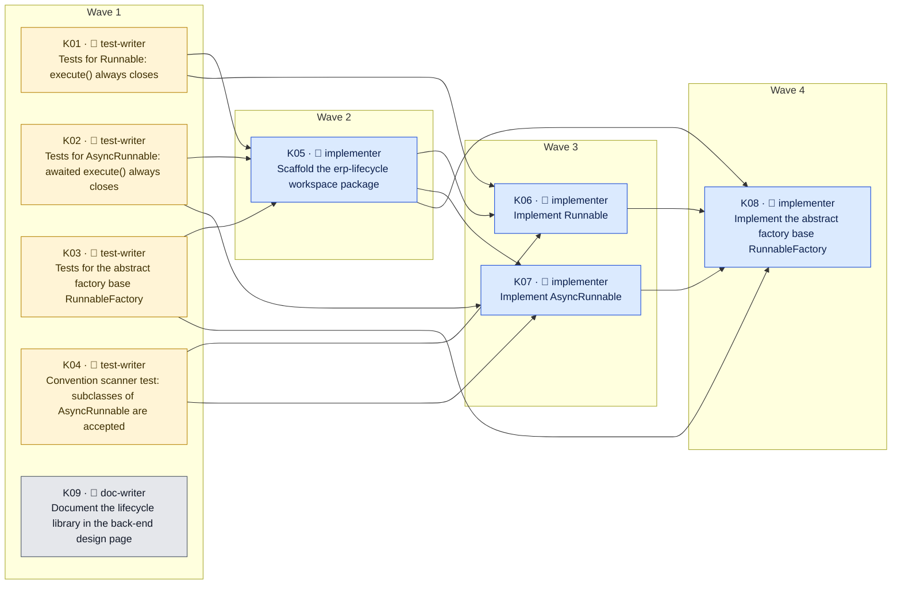

# T0.05: Lifecycle and factories library

**Plan:** 🟢 Approved

**Push:** 🟢 Approved

<!-- ticket:specs -->
## 📚 Specifications

The specification and design pages of [TICKET.md](TICKET.md), copied by `python3 .claude/scripts/tickets/ticket_refs.py sync`.

- [Architecture](../../technical/architecture/architecture.md)
- [Back end](../../technical/architecture/backend.md)
- [📜 D406 Back end](../../specs/06-decisions/technical/d406-back-end.md)
- [📜 D438 Repository layout](../../specs/06-decisions/technical/d438-repository-layout.md)
- [🏗️ Repository layout](../../technical/architecture/repository-layout.md)
<!-- /ticket:specs -->

## Summary

T0.05 creates the first shared library, `backend/shared/lifecycle` (package `erp_lifecycle`, the name the harness tests already use). It holds `Runnable` and `AsyncRunnable` (abstract `initialize`/`run`/`close`, plus `execute()`, which always closes) in `erp_lifecycle/runnables/`, and the generic abstract factory base `RunnableFactory` in `erp_lifecycle/factories/`. The plan has 9 tasks in 4 waves.

- **Wave 1 (5 tasks):** test-writers K01 (Runnable tests, criterion 1), K02 (AsyncRunnable tests, criterion 2), K03 (factory tests, criterion 4) and K04 (an AsyncRunnable case in the convention scanner tests, criterion 3), plus the doc-writer K09 (a line about the library in the "Today" section of `docs/technical/architecture/backend.md`).
- **Wave 2:** K05 sets up the package: its `pyproject.toml`, the empty package `__init__.py` files, `py.typed`, the root workspace dependency and `uv.lock`. The CI job and the verifier run `uv sync --locked` / `uv run pytest` from the root, so the root project has to depend on the member for it to be importable.
- **Wave 3:** K06 writes `Runnable` and K07 writes `AsyncRunnable`, side by side.
- **Wave 4:** K08 writes `RunnableFactory`, whose type bound imports both runnables. It ends with the CI script `.github/scripts/check_python_project.sh` on the library (criterion 5).

No front end is touched, so no Playwright task is needed (TICKET.md says "➖ No screen").

## Assumptions

- The roadmap row names no use case, business rule or requirement: the ticket links decisions D406 and D438 and the design pages that settle the lifecycle kit, and draws its criteria from the roadmap's "done when" and AGENT.md.
- Criteria 2 (async close after a failed initialize) and 4 (runnables built by a factory) come from AGENT.md "Lifecycle and factories", not from a spec page.
- Roadmap rows carry no ticket anchor, so links use the sprint anchor #s01 and the epics table anchor #epics.
- No Bash tool was available, so check_ticket.py was not run by me, and the tests-evidences folder holds a .gitkeep.
- The package is named `erp_lifecycle` (uv project `erp-lifecycle`), the name the harness tests already use (`tests/harness/check_touched/test_check_touched_layout.py`, `tests/harness/format_edited/test_format_edited.py`). The specifications only name the folder `backend/shared/lifecycle` (D572).
- The abstract factory base is named `RunnableFactory`, in `erp_lifecycle/factories/runnable_factory.py`. It is generic over `Union[Runnable, AsyncRunnable]` and has one abstract, argument-free `create()`, because AGENT.md says inputs go to the constructor. AGENT.md names concrete factories (`ServiceFactory`, `CommandFactory`) but not the base, nor its method.
- `execute()` re-raises the original exception unchanged after `close()`, and wraps it in no `SE` exception. If `close()` itself raises, its exception propagates with the first one as its context (plain `try`/`finally`). The specifications only say it closes whatever happens.
- `initialize`, `run` and `close` are abstract on both bases. Neither base provides a default `close()`: making `close()` safe after a failed `initialize()` is the subclass's duty (AGENT.md).
- `Runnable` and `AsyncRunnable` share method names without a common base class. AGENT.md names both, and their methods differ in being sync or async, so the rule "classes that share a method name share a base class" is taken not to apply.
- The root `pyproject.toml` gains `erp-lifecycle` as a workspace dependency, and `uv.lock` is updated. CI (`uv sync --locked`) and the verifier (`uv run pytest <folder>` from the root) install only the root project, so the library is importable only this way. This touches root files, which other running tickets may also change.
- Package tests import their helper classes by their full path from the repository root (`backend.shared.lifecycle.tests...`), which the root pytest config (`pythonpath = ["."]`, no `__init__.py`) resolves. The library's `pyproject.toml` has no pytest or ruff section of its own.
- The root ruff `per-file-ignores` exempts only the top-level `tests/` from the `D` rules. So the package's test files carry one-line docstrings rather than changing the root ruff configuration, which AGENT.md allows ("Add a docstring only if the purpose is not obvious").
- Criterion 3 is closed by new cases in `tests/conventions/scanner/test_convention_scanner.py` and by `tests/conventions/test_structure.py` scanning the real library. The scanner itself is not changed, because it already accepts bases named `Runnable` and `AsyncRunnable`. This touches the `tests/conventions` area beside the ticket's `backend/shared/lifecycle` area.
- No convention test is added to refuse a runnable's constructor called outside a factory. Criterion 4 is tested on the factory itself, and such a rule would be a follow-up.

<!-- plan:graph -->

> [!NOTE]
> Generated from the json block at the end of this page by `python3 .claude/scripts/tickets/plan.py render`.
> To change a task, edit the json block, then render again: never edit this view by hand.

## Waves

| Wave | Tasks | Agents running at once |
| --- | --- | --- |
| 1 | [K01](#k01), [K02](#k02), [K03](#k03), [K04](#k04), [K09](#k09) | 5 of 5 |
| 2 | [K05](#k05) | 1 of 1 |
| 3 | [K06](#k06), [K07](#k07) | 2 of 2 |
| 4 | [K08](#k08) | 1 of 1 |

| Wave | Task | Agent | Depends on | Unblocks |
| --- | --- | --- | --- | --- |
| 1 | [K01](#k01) Tests for Runnable: execute() always closes | 🧪 test-writer | none | [K05](#k05), [K06](#k06) |
| 1 | [K02](#k02) Tests for AsyncRunnable: awaited execute() always closes | 🧪 test-writer | none | [K05](#k05), [K07](#k07) |
| 1 | [K03](#k03) Tests for the abstract factory base RunnableFactory | 🧪 test-writer | none | [K05](#k05), [K08](#k08) |
| 1 | [K04](#k04) Convention scanner test: subclasses of AsyncRunnable are accepted | 🧪 test-writer | none | [K06](#k06), [K07](#k07) |
| 1 | [K09](#k09) Document the lifecycle library in the back-end design page | 📝 doc-writer | none | none |
| 2 | [K05](#k05) Scaffold the erp-lifecycle workspace package | 🐍 implementer | [K01](#k01), [K02](#k02), [K03](#k03) | [K06](#k06), [K07](#k07), [K08](#k08) |
| 3 | [K06](#k06) Implement Runnable | 🐍 implementer | [K01](#k01), [K04](#k04), [K05](#k05) | [K08](#k08) |
| 3 | [K07](#k07) Implement AsyncRunnable | 🐍 implementer | [K02](#k02), [K04](#k04), [K05](#k05) | [K08](#k08) |
| 4 | [K08](#k08) Implement the abstract factory base RunnableFactory | 🐍 implementer | [K03](#k03), [K05](#k05), [K06](#k06), [K07](#k07) | none |

## Dependency graph



## Tasks

### <a id="k01"></a>K01: Tests for Runnable: execute() always closes

| Agent | Wave | Depends on | Unblocks |
| --- | --- | --- | --- |
| 🧪 test-writer | 1 | none | [K05](#k05), [K06](#k06) |

**Files** (only this task may change them in its wave):

- `backend/shared/lifecycle/tests/runnables/test_runnable.py`
- `backend/shared/lifecycle/tests/runnables/recording_runnable.py`

**Done when:** `uv run ruff check backend/shared/lifecycle/tests/runnables/test_runnable.py backend/shared/lifecycle/tests/runnables/recording_runnable.py` and `uv run ruff format --check` on the same files pass, and `uv run pytest tests/conventions -n 2` passes. The tests themselves fail only because `erp_lifecycle` does not exist yet.

**Brief:**

Write the tests of the sync lifecycle base class `Runnable`, before it exists (TKT-4). It will be `erp_lifecycle.runnables.runnable.Runnable`, in `backend/shared/lifecycle/src/erp_lifecycle/runnables/runnable.py` (task K06).

Specifications this applies: [D406 Back end](docs/specs/06-decisions/technical/d406-back-end.md) (the service kit with the lifecycle base classes), [D438 Repository layout](docs/specs/06-decisions/technical/d438-repository-layout.md) (`backend/shared/<lib>`), [Architecture](docs/technical/architecture/architecture.md) ("Every runnable class has the `initialize()`, `run()`, `close()` lifecycle and is built by a factory"), [Back end](docs/technical/architecture/backend.md), [Repository layout](docs/technical/architecture/repository-layout.md), and the ticket row T0.05 of [P0 Foundations](docs/specs/00-vision/roadmap/phases/01-p0-foundations.md). The rules are `AGENT.md` ("Lifecycle and factories", "Tests", "File shape") and acceptance criterion 1 of `docs/tickets/T0.05/TICKET.md`.

The contract to test:
- `Runnable` is an `abc.ABC` with `__init__(self, logger: Optional[Logger] = None) -> None`. It sets `self.logger` to the given logger, or to `getLogger(...)` when none is given.
- `initialize(self) -> None`, `run(self) -> None` and `close(self) -> None` are abstract and take no arguments.
- `execute(self) -> None` calls `initialize()`, then `run()`, and always calls `close()`, even when `initialize()` or `run()` raises. The original exception then propagates unchanged.

Files:
1. `backend/shared/lifecycle/tests/runnables/recording_runnable.py`: one class, `RecordingRunnable(Runnable)`. Its constructor is `(fail_initialize: bool = False, fail_run: bool = False, logger: Optional[Logger] = None)`. It appends `"initialize"`, `"run"` and `"close"` to a public `calls: List[str]` attribute. When asked to, it raises `RuntimeError` with a distinctive message from `initialize` or `run`.
2. `backend/shared/lifecycle/tests/runnables/test_runnable.py`: one class, `TestRunnable`, with tests named as sentences:
   - `execute` calls initialize, run and close in that order.
   - When `initialize` fails, `close` is still called, `run` is not, and `pytest.raises(RuntimeError, match=...)` sees the original error (criterion 1).
   - When `run` fails, `close` is still called and the error propagates.
   - `Runnable` itself cannot be instantiated (`TypeError`).
   - A subclass missing any one of the three methods cannot be instantiated (`TypeError`). Parametrize this, building the incomplete subclasses with `type(name, (Runnable,), {...})` and lambdas, because nested functions and a second class in a file are refused.
   - Without a logger, `logger` is a `logging.Logger`, and a given logger is kept.

How to write them:
- Import the helper by its full path from the repository root, which the root pytest config puts on the path: `from backend.shared.lifecycle.tests.runnables.recording_runnable import RecordingRunnable`.
- Add no `__init__.py`.
- Write one class per file and no nested function, with `from __future__ import annotations` first.
- Give each class and public method a one-line docstring. The root ruff `D` exemption only covers the top-level `tests/`, so package tests need them to pass `ruff check`.
- Use no `unittest.mock`.

### <a id="k02"></a>K02: Tests for AsyncRunnable: awaited execute() always closes

| Agent | Wave | Depends on | Unblocks |
| --- | --- | --- | --- |
| 🧪 test-writer | 1 | none | [K05](#k05), [K07](#k07) |

**Files** (only this task may change them in its wave):

- `backend/shared/lifecycle/tests/runnables/test_async_runnable.py`
- `backend/shared/lifecycle/tests/runnables/recording_async_runnable.py`

**Done when:** `uv run ruff check` and `uv run ruff format --check` on the two files pass, and `uv run pytest tests/conventions -n 2` passes. The tests themselves fail only because `erp_lifecycle` does not exist yet.

**Brief:**

Write the tests of the async lifecycle base class `AsyncRunnable`, before it exists (TKT-4). It will be `erp_lifecycle.runnables.async_runnable.AsyncRunnable`, in `backend/shared/lifecycle/src/erp_lifecycle/runnables/async_runnable.py` (task K07).

Specifications this applies: [D406 Back end](docs/specs/06-decisions/technical/d406-back-end.md), [D438 Repository layout](docs/specs/06-decisions/technical/d438-repository-layout.md), [Architecture](docs/technical/architecture/architecture.md) (the `initialize()`, `run()`, `close()` lifecycle), [Back end](docs/technical/architecture/backend.md), [Repository layout](docs/technical/architecture/repository-layout.md), and the ticket row T0.05 of [P0 Foundations](docs/specs/00-vision/roadmap/phases/01-p0-foundations.md). The rules are `AGENT.md` ("Lifecycle and factories", "Tests": `asyncio_mode` is `auto`, so async tests need no marker) and acceptance criterion 2 of `docs/tickets/T0.05/TICKET.md`.

The contract to test:
- `AsyncRunnable` is an `abc.ABC` with `__init__(self, logger: Optional[Logger] = None) -> None`, which sets `self.logger`.
- `async def initialize(self) -> None`, `async def run(self) -> None` and `async def close(self) -> None` are abstract.
- `async def execute(self) -> None` awaits `initialize()`, then `run()`, and always awaits `close()`, even when `initialize()` or `run()` raises. The original exception then propagates unchanged.

Files:
1. `backend/shared/lifecycle/tests/runnables/recording_async_runnable.py`: one class, `RecordingAsyncRunnable(AsyncRunnable)`. Its constructor is `(fail_initialize: bool = False, fail_run: bool = False, logger: Optional[Logger] = None)`, with a public `calls: List[str]` attribute. It raises `RuntimeError` with a distinctive message when asked to.
2. `backend/shared/lifecycle/tests/runnables/test_async_runnable.py`: one class, `TestAsyncRunnable`, with tests named as sentences:
   - The awaited `execute` runs initialize, run and close in order.
   - When `initialize` fails, `close` is still awaited, `run` is not, and the original error propagates (criterion 2).
   - When `run` fails, `close` is still awaited.
   - `execute`, `initialize`, `run` and `close` are coroutine functions (`inspect.iscoroutinefunction`).
   - `AsyncRunnable` and any subclass missing one of the three methods cannot be instantiated (`TypeError`). Parametrize this, building the subclasses with `type(...)`.
   - The logger default is kept as described above.

How to write them:
- **Put every sync test method before the first async one**: `tests/conventions` refuses a sync method after an async one in the same section.
- Import the helper by its full path: `from backend.shared.lifecycle.tests.runnables.recording_async_runnable import RecordingAsyncRunnable`.
- Add no `__init__.py`, keep one class per file, and use no nested function and no `unittest.mock`.
- Give each class and public method a one-line docstring, for ruff's `D` rules.

### <a id="k03"></a>K03: Tests for the abstract factory base RunnableFactory

| Agent | Wave | Depends on | Unblocks |
| --- | --- | --- | --- |
| 🧪 test-writer | 1 | none | [K05](#k05), [K08](#k08) |

**Files** (only this task may change them in its wave):

- `backend/shared/lifecycle/tests/factories/test_runnable_factory.py`
- `backend/shared/lifecycle/tests/factories/stand_in_runnable.py`
- `backend/shared/lifecycle/tests/factories/stand_in_runnable_factory.py`

**Done when:** `uv run ruff check` and `uv run ruff format --check` on the three files pass, and `uv run pytest tests/conventions -n 2` passes. The tests themselves fail only because `erp_lifecycle` does not exist yet.

**Brief:**

Write the tests of the abstract factory base that runnables are built by, before it exists (TKT-4). It will be `erp_lifecycle.factories.runnable_factory.RunnableFactory`, in `backend/shared/lifecycle/src/erp_lifecycle/factories/runnable_factory.py` (task K08).

Specifications this applies: [D406 Back end](docs/specs/06-decisions/technical/d406-back-end.md), [Architecture](docs/technical/architecture/architecture.md) ("Every runnable class ... is built by a factory"), [Back end](docs/technical/architecture/backend.md), [D438 Repository layout](docs/specs/06-decisions/technical/d438-repository-layout.md), [Repository layout](docs/technical/architecture/repository-layout.md), and the ticket row T0.05 of [P0 Foundations](docs/specs/00-vision/roadmap/phases/01-p0-foundations.md). The rules are `AGENT.md` ("Lifecycle and factories": runnables are created by an abstract factory in their layer's `factories/` package, with concrete ones in its sub-folders, and inputs go to the constructor) and acceptance criterion 4 of `docs/tickets/T0.05/TICKET.md`.

The contract to test:
- `RunnableFactory` is a generic `abc.ABC`, `RunnableFactory[RunnableT]`, with `RunnableT` bound to `Union[Runnable, AsyncRunnable]`.
- Its constructor is `__init__(self, logger: Optional[Logger] = None) -> None`, which sets `self.logger`.
- It has one abstract method, `create(self) -> RunnableT`, which takes no arguments: a concrete factory gets its inputs at its constructor.
- `Runnable` (`erp_lifecycle.runnables.runnable`) is an ABC with abstract `initialize`/`run`/`close` and `execute()`, and `__init__(self, logger=None)`.

Files:
1. `stand_in_runnable.py`: `StandInRunnable(Runnable)`, built with a `name: str` and a logger. It records its calls in `calls: List[str]`.
2. `stand_in_runnable_factory.py`: `StandInRunnableFactory(RunnableFactory[StandInRunnable])`, built with `name: str` and a logger. Its `create()` returns a new `StandInRunnable` holding that name.
3. `test_runnable_factory.py`: one class, `TestRunnableFactory`, with these tests:
   - The concrete factory builds a `StandInRunnable` carrying the factory's inputs (criterion 4).
   - Each `create()` returns a new instance.
   - The built runnable runs its whole lifecycle through `execute()`.
   - `RunnableFactory` itself cannot be instantiated (`TypeError`).
   - A subclass without `create` cannot be instantiated (`TypeError`), built with `type(...)`.
   - The logger default is kept as described above.

How to write them:
- Import the helpers by their full path: `from backend.shared.lifecycle.tests.factories.stand_in_runnable_factory import StandInRunnableFactory`.
- Add no `__init__.py`, keep one class per file, and use no nested function and no `unittest.mock`.
- Give each class and public method a one-line docstring, for ruff's `D` rules.

### <a id="k04"></a>K04: Convention scanner test: subclasses of AsyncRunnable are accepted

| Agent | Wave | Depends on | Unblocks |
| --- | --- | --- | --- |
| 🧪 test-writer | 1 | none | [K06](#k06), [K07](#k07) |

**Files** (only this task may change them in its wave):

- `tests/conventions/scanner/test_convention_scanner.py`

**Done when:** `uv run pytest tests/conventions/scanner -n 2` passes, and `uv run ruff check tests/conventions/scanner/test_convention_scanner.py` and `uv run ruff format --check tests/conventions/scanner/test_convention_scanner.py` pass.

**Brief:**

Close acceptance criterion 3 of `docs/tickets/T0.05/TICKET.md`: "Given a class that subclasses `Runnable` or `AsyncRunnable`, when the convention test that requires a lifecycle base for a class with `run` runs, then it accepts the class."

Specifications this applies: [D438 Repository layout](docs/specs/06-decisions/technical/d438-repository-layout.md) (AGENT.md and the convention tests follow from it), [D406 Back end](docs/specs/06-decisions/technical/d406-back-end.md), [Architecture](docs/technical/architecture/architecture.md), and the ticket row T0.05 of [P0 Foundations](docs/specs/00-vision/roadmap/phases/01-p0-foundations.md) ("the convention test that requires a lifecycle base accepts its subclasses"). The rule is `AGENT.md`, "Rules a test enforces": "A class outside `src/models/` ... with `run` but no lifecycle base class".

In `tests/conventions/scanner/test_convention_scanner.py`, extend the parametrize list of `test_what_the_layout_allows_passes` (`ConventionScanner.lifecycle_offenders`, `RUNNABLE_BASES` of `tests/conventions/helpers.py`) with these cases:
- A shared-library class `class Job(AsyncRunnable):` with `async def run(self) -> None: ...`.
- A service module (`f"{SERVICE}/service/a.py"`) that imports the real paths `from erp_lifecycle.runnables.runnable import Runnable` and `from erp_lifecycle.runnables.async_runnable import AsyncRunnable`, and subclasses each of them with a `run` method. This proves that the layer-import and lifecycle rules both accept the library.

Also add a failing case to `test_each_rule_catches_its_violation`: a class with `async def run` and no base is caught.

Keep the existing style: no docstrings needed in `tests/`, one class, no nested function. Do not change `tests/conventions/convention_scanner.py` or `helpers.py`: the scanner already reads bases by name. If a case fails, report it rather than changing the scanner.

### <a id="k09"></a>K09: Document the lifecycle library in the back-end design page

| Agent | Wave | Depends on | Unblocks |
| --- | --- | --- | --- |
| 📝 doc-writer | 1 | none | none |

**Files** (only this task may change them in its wave):

- `docs/technical/architecture/backend.md`

**Done when:** `grep -n 'backend/shared/lifecycle' docs/technical/architecture/backend.md` finds the new sentence, every relative link of the page resolves to an existing file, and the page is otherwise unchanged.

**Brief:**

Update the design page [Back end](docs/technical/architecture/backend.md) so that its "Today" section says what ticket T0.05 builds.

T0.05 builds the first shared library, `backend/shared/lifecycle` (package `erp_lifecycle`). It holds:
- `Runnable` and `AsyncRunnable`, in `erp_lifecycle/runnables/`: `initialize()`, `run()` and `close()`, and `execute()`, which always closes, even after a failed `initialize()`;
- the abstract factory base `RunnableFactory`, in `erp_lifecycle/factories/`, with `create()`, which every concrete factory of a service subclasses.

Specifications this applies: [D406 Back end](docs/specs/06-decisions/technical/d406-back-end.md) (the service kit), [D438 Repository layout](docs/specs/06-decisions/technical/d438-repository-layout.md) (`backend/shared/<lib>`), [Architecture](docs/technical/architecture/architecture.md) ("Every runnable class has the `initialize()`, `run()`, `close()` lifecycle and is built by a factory"), [Repository layout](docs/technical/architecture/repository-layout.md), and the ticket row T0.05 of [P0 Foundations](docs/specs/00-vision/roadmap/phases/01-p0-foundations.md).

Add one or two sentences to "Today", with relative links to [D406](../../specs/06-decisions/technical/d406-back-end.md) and to `AGENT.md` ("Lifecycle and factories"). Update the `Last reviewed` line with today's date and `T0.05`. Do not rewrite the "Target design" section, and touch no page of `docs/specs/`, which is read-only. Write plain British English, with no em dash.

### <a id="k05"></a>K05: Scaffold the erp-lifecycle workspace package

| Agent | Wave | Depends on | Unblocks |
| --- | --- | --- | --- |
| 🐍 implementer | 2 | [K01](#k01), [K02](#k02), [K03](#k03) | [K06](#k06), [K07](#k07), [K08](#k08) |

**Files** (only this task may change them in its wave):

- `backend/shared/lifecycle/pyproject.toml`
- `backend/shared/lifecycle/src/erp_lifecycle/__init__.py`
- `backend/shared/lifecycle/src/erp_lifecycle/py.typed`
- `backend/shared/lifecycle/src/erp_lifecycle/runnables/__init__.py`
- `backend/shared/lifecycle/src/erp_lifecycle/factories/__init__.py`
- `pyproject.toml`
- `uv.lock`

**Done when:** `uv lock --check` and `uv sync --locked` succeed, `uv run python -c "import erp_lifecycle.runnables, erp_lifecycle.factories"` exits 0, `uv run ruff check backend/shared/lifecycle/src` passes, and `uv run pytest tests/conventions -n 2` passes.

**Brief:**

Create the uv package of the lifecycle library in `backend/shared/lifecycle`, the first member of `backend/shared/*`, without its classes: K06, K07 and K08 write those.

Specifications this applies: [D438 Repository layout](docs/specs/06-decisions/technical/d438-repository-layout.md) (`backend/shared/<lib>` libraries, one uv workspace), [Repository layout](docs/technical/architecture/repository-layout.md) (`shared/` holds lifecycle among the libraries), [D406 Back end](docs/specs/06-decisions/technical/d406-back-end.md) (a service kit with no business rules), [Back end](docs/technical/architecture/backend.md), and the folder name confirmed in [P0 Foundations](docs/specs/00-vision/roadmap/phases/01-p0-foundations.md) (D572). The rules are `AGENT.md` ("Mono-repo", "Layout") and TKT-4.

What to do:
1. Write `backend/shared/lifecycle/pyproject.toml`:
   - project `erp-lifecycle`, version `0.1.0`, a one-line description, `requires-python = ">=3.13,<3.14"`, and no dependencies;
   - a build backend that maps the module `erp_lifecycle` in `src/` (`uv_build`, as `uv init --lib` writes it);
   - no `[tool.pytest.ini_options]` and no `[tool.ruff]`, so that the root configuration (pythonpath `.`, `asyncio_mode = auto`, ruff and mypy) applies.
2. Create the empty package files: `src/erp_lifecycle/__init__.py`, `src/erp_lifecycle/runnables/__init__.py` and `src/erp_lifecycle/factories/__init__.py`. These packages re-export nothing (AGENT.md: only `enums/` and `exceptions/` do). Also add `py.typed`.
3. In the root `pyproject.toml`, add `erp-lifecycle` to `dependencies`, with `[tool.uv.sources] erp-lifecycle = { workspace = true }`. CI (`.github/workflows/python.yml`: `uv sync --locked`, then `uv run pytest <folder>`) and the verifier's `checks.py` install the root project only, so the library is importable only through this dependency. Change nothing else in the root file.
4. Run `uv lock` to update `uv.lock`.

Do not add a `Dockerfile`: a library is not an image. Do not touch the tests of K01 to K03. They import `erp_lifecycle` and the helpers by their full path `backend.shared.lifecycle.tests...`, which the root pytest config resolves. If they need the package configured differently, report it (TKT-19).

### <a id="k06"></a>K06: Implement Runnable

| Agent | Wave | Depends on | Unblocks |
| --- | --- | --- | --- |
| 🐍 implementer | 3 | [K01](#k01), [K04](#k04), [K05](#k05) | [K08](#k08) |

**Files** (only this task may change them in its wave):

- `backend/shared/lifecycle/src/erp_lifecycle/runnables/runnable.py`

**Done when:** `uv run pytest backend/shared/lifecycle/tests/runnables/test_runnable.py -n 2` passes. `uv run ruff check backend/shared/lifecycle/src`, `uv run ruff format --check backend/shared/lifecycle/src/erp_lifecycle/runnables/runnable.py` and `MYPYPATH=backend/shared/lifecycle/src uv run mypy backend/shared/lifecycle/src` pass, and `uv run pytest tests/conventions -n 2` passes.

**Brief:**

Write `Runnable` in `backend/shared/lifecycle/src/erp_lifecycle/runnables/runnable.py`, so that the tests of K01 (`backend/shared/lifecycle/tests/runnables/test_runnable.py`) pass.

Specifications this applies: [Architecture](docs/technical/architecture/architecture.md) ("Every runnable class has the `initialize()`, `run()`, `close()` lifecycle"), [D406 Back end](docs/specs/06-decisions/technical/d406-back-end.md) and [Back end](docs/technical/architecture/backend.md) (the service kit with the lifecycle base classes and no business rules), [D438 Repository layout](docs/specs/06-decisions/technical/d438-repository-layout.md), [Repository layout](docs/technical/architecture/repository-layout.md), and the ticket row T0.05 of [P0 Foundations](docs/specs/00-vision/roadmap/phases/01-p0-foundations.md). Acceptance criteria 1, 3 and 5 of `docs/tickets/T0.05/TICKET.md`. The rules are `AGENT.md`: "Lifecycle and factories", "File shape", "Imports", "Typing", "Docstrings", "Logging" and "Messages" (use the `exception-and-log-messages` skill for each log call).

The contract:
- `class Runnable(ABC)`.
- `__init__(self, logger: Optional[Logger] = None) -> None` sets `self.logger = logger if logger else getLogger(__name__)`.
- Abstract `initialize(self) -> None`, `run(self) -> None` and `close(self) -> None`.
- `execute(self) -> None`: `initialize()`, then `run()`, with `close()` in a `finally`, so that it closes whatever happens and the original exception propagates unchanged.
- Log at `DEBUG` the steps of `execute`, with lazy arguments and the class name. On failure, log the failure at `ERROR` with `type(error).__name__` only, then re-raise.
- Everything goes under the `Publicly Exposed Methods` banner.
- Write a Google docstring for the class (Attributes: `logger`, plus Notes saying that `close()` must be safe after a failed or partial `initialize()`) and for every method.
- No module-level code besides imports, and no `Any`.

The class is named `Runnable`, which `RUNNABLE_BASES` of `tests/conventions/helpers.py` lists, so the lifecycle convention accepts it.

### <a id="k07"></a>K07: Implement AsyncRunnable

| Agent | Wave | Depends on | Unblocks |
| --- | --- | --- | --- |
| 🐍 implementer | 3 | [K02](#k02), [K04](#k04), [K05](#k05) | [K08](#k08) |

**Files** (only this task may change them in its wave):

- `backend/shared/lifecycle/src/erp_lifecycle/runnables/async_runnable.py`

**Done when:** `uv run pytest backend/shared/lifecycle/tests/runnables/test_async_runnable.py -n 2` passes. `uv run ruff check backend/shared/lifecycle/src`, `uv run ruff format --check backend/shared/lifecycle/src/erp_lifecycle/runnables/async_runnable.py` and `MYPYPATH=backend/shared/lifecycle/src uv run mypy backend/shared/lifecycle/src` pass, and `uv run pytest tests/conventions -n 2` passes.

**Brief:**

Write `AsyncRunnable` in `backend/shared/lifecycle/src/erp_lifecycle/runnables/async_runnable.py`, so that the tests of K02 (`backend/shared/lifecycle/tests/runnables/test_async_runnable.py`) pass.

Specifications this applies: [Architecture](docs/technical/architecture/architecture.md) (the `initialize()`, `run()`, `close()` lifecycle), [D406 Back end](docs/specs/06-decisions/technical/d406-back-end.md), [Back end](docs/technical/architecture/backend.md), [D438 Repository layout](docs/specs/06-decisions/technical/d438-repository-layout.md), [Repository layout](docs/technical/architecture/repository-layout.md), and the ticket row T0.05 of [P0 Foundations](docs/specs/00-vision/roadmap/phases/01-p0-foundations.md). Acceptance criteria 2, 3 and 5 of `docs/tickets/T0.05/TICKET.md`. The rules are `AGENT.md`: "Lifecycle and factories", "File shape" (async methods after the sync ones of their section), "Imports", "Typing", "Docstrings", "Logging" and "Messages" (use the `exception-and-log-messages` skill).

The contract:
- `class AsyncRunnable(ABC)`.
- `__init__(self, logger: Optional[Logger] = None) -> None` sets `self.logger`.
- Abstract `async def initialize(self) -> None`, `async def run(self) -> None` and `async def close(self) -> None`.
- `async def execute(self) -> None` awaits `initialize()`, then `run()`, with `await self.close()` in a `finally`, and the original exception propagates unchanged.
- Log the same way as the sync `Runnable` of K06: `DEBUG` steps, and `ERROR` with `type(error).__name__` before re-raising.
- Write a Google docstring for the class and every method.
- Keep it separate from `Runnable`, with no shared base: their methods differ in being sync or async, and AGENT.md names both classes.

The name `AsyncRunnable` is in `RUNNABLE_BASES` of `tests/conventions/helpers.py`.

### <a id="k08"></a>K08: Implement the abstract factory base RunnableFactory

| Agent | Wave | Depends on | Unblocks |
| --- | --- | --- | --- |
| 🐍 implementer | 4 | [K03](#k03), [K05](#k05), [K06](#k06), [K07](#k07) | none |

**Files** (only this task may change them in its wave):

- `backend/shared/lifecycle/src/erp_lifecycle/factories/runnable_factory.py`

**Done when:** `bash .github/scripts/check_python_project.sh backend/shared/lifecycle lifecycle` passes (ruff, ruff format, mypy, and every test of `backend/shared/lifecycle/tests`), and `uv run pytest tests/conventions -n 2` passes.

**Brief:**

Write the abstract factory base in `backend/shared/lifecycle/src/erp_lifecycle/factories/runnable_factory.py`, so that the tests of K03 (`backend/shared/lifecycle/tests/factories/test_runnable_factory.py`) pass. The concrete factories of the services (`ServiceFactory` in `service/factories/`, `CommandFactory` in `api/factories/`, ticket T0.14) will subclass it.

Specifications this applies: [Architecture](docs/technical/architecture/architecture.md) ("Every runnable class ... is built by a factory"), [D406 Back end](docs/specs/06-decisions/technical/d406-back-end.md), [Back end](docs/technical/architecture/backend.md), [D438 Repository layout](docs/specs/06-decisions/technical/d438-repository-layout.md), [Repository layout](docs/technical/architecture/repository-layout.md), and the ticket row T0.05 of [P0 Foundations](docs/specs/00-vision/roadmap/phases/01-p0-foundations.md). Acceptance criteria 4 and 5 of `docs/tickets/T0.05/TICKET.md`. The rules are `AGENT.md`: "Lifecycle and factories", "File shape", "Imports", "Typing", "Docstrings" and "Logging".

The contract:
- `class RunnableFactory[RunnableT: Union[Runnable, AsyncRunnable]](ABC)`. Use the Python 3.13 type-parameter syntax, because AGENT.md allows nothing at module level, so no module-level `TypeVar`.
- `__init__(self, logger: Optional[Logger] = None) -> None` sets `self.logger`.
- One abstract method, `create(self) -> RunnableT`, which takes no arguments: a concrete factory gets its inputs at its own constructor.
- Import `Runnable` and `AsyncRunnable` from `erp_lifecycle.runnables.runnable` and `erp_lifecycle.runnables.async_runnable`.
- Write a Google docstring with Attributes and Notes: the factory is the only place in `src/` where a runnable's constructor is called.
- No `run`, `start` or `stop` method.

Then run the CI script of the library to close criterion 5.

<!-- /plan:graph -->

## Task graph

<details>
<summary>🤖 Task graph as read by <code>/ticket-run</code> (json)</summary>

```json
[
  {
    "id": "K01",
    "title": "Tests for Runnable: execute() always closes",
    "agent": "test-writer",
    "depends_on": [],
    "files": [
      "backend/shared/lifecycle/tests/runnables/test_runnable.py",
      "backend/shared/lifecycle/tests/runnables/recording_runnable.py"
    ],
    "brief": "Write the tests of the sync lifecycle base class `Runnable`, before it exists (TKT-4). It will be `erp_lifecycle.runnables.runnable.Runnable`, in `backend/shared/lifecycle/src/erp_lifecycle/runnables/runnable.py` (task K06).\n\nSpecifications this applies: [D406 Back end](docs/specs/06-decisions/technical/d406-back-end.md) (the service kit with the lifecycle base classes), [D438 Repository layout](docs/specs/06-decisions/technical/d438-repository-layout.md) (`backend/shared/<lib>`), [Architecture](docs/technical/architecture/architecture.md) (\"Every runnable class has the `initialize()`, `run()`, `close()` lifecycle and is built by a factory\"), [Back end](docs/technical/architecture/backend.md), [Repository layout](docs/technical/architecture/repository-layout.md), and the ticket row T0.05 of [P0 Foundations](docs/specs/00-vision/roadmap/phases/01-p0-foundations.md). The rules are `AGENT.md` (\"Lifecycle and factories\", \"Tests\", \"File shape\") and acceptance criterion 1 of `docs/tickets/T0.05/TICKET.md`.\n\nThe contract to test:\n- `Runnable` is an `abc.ABC` with `__init__(self, logger: Optional[Logger] = None) -> None`. It sets `self.logger` to the given logger, or to `getLogger(...)` when none is given.\n- `initialize(self) -> None`, `run(self) -> None` and `close(self) -> None` are abstract and take no arguments.\n- `execute(self) -> None` calls `initialize()`, then `run()`, and always calls `close()`, even when `initialize()` or `run()` raises. The original exception then propagates unchanged.\n\nFiles:\n1. `backend/shared/lifecycle/tests/runnables/recording_runnable.py`: one class, `RecordingRunnable(Runnable)`. Its constructor is `(fail_initialize: bool = False, fail_run: bool = False, logger: Optional[Logger] = None)`. It appends `\"initialize\"`, `\"run\"` and `\"close\"` to a public `calls: List[str]` attribute. When asked to, it raises `RuntimeError` with a distinctive message from `initialize` or `run`.\n2. `backend/shared/lifecycle/tests/runnables/test_runnable.py`: one class, `TestRunnable`, with tests named as sentences:\n   - `execute` calls initialize, run and close in that order.\n   - When `initialize` fails, `close` is still called, `run` is not, and `pytest.raises(RuntimeError, match=...)` sees the original error (criterion 1).\n   - When `run` fails, `close` is still called and the error propagates.\n   - `Runnable` itself cannot be instantiated (`TypeError`).\n   - A subclass missing any one of the three methods cannot be instantiated (`TypeError`). Parametrize this, building the incomplete subclasses with `type(name, (Runnable,), {...})` and lambdas, because nested functions and a second class in a file are refused.\n   - Without a logger, `logger` is a `logging.Logger`, and a given logger is kept.\n\nHow to write them:\n- Import the helper by its full path from the repository root, which the root pytest config puts on the path: `from backend.shared.lifecycle.tests.runnables.recording_runnable import RecordingRunnable`.\n- Add no `__init__.py`.\n- Write one class per file and no nested function, with `from __future__ import annotations` first.\n- Give each class and public method a one-line docstring. The root ruff `D` exemption only covers the top-level `tests/`, so package tests need them to pass `ruff check`.\n- Use no `unittest.mock`.",
    "done_when": "`uv run ruff check backend/shared/lifecycle/tests/runnables/test_runnable.py backend/shared/lifecycle/tests/runnables/recording_runnable.py` and `uv run ruff format --check` on the same files pass, and `uv run pytest tests/conventions -n 2` passes. The tests themselves fail only because `erp_lifecycle` does not exist yet.",
    "wave": 1
  },
  {
    "id": "K02",
    "title": "Tests for AsyncRunnable: awaited execute() always closes",
    "agent": "test-writer",
    "depends_on": [],
    "files": [
      "backend/shared/lifecycle/tests/runnables/test_async_runnable.py",
      "backend/shared/lifecycle/tests/runnables/recording_async_runnable.py"
    ],
    "brief": "Write the tests of the async lifecycle base class `AsyncRunnable`, before it exists (TKT-4). It will be `erp_lifecycle.runnables.async_runnable.AsyncRunnable`, in `backend/shared/lifecycle/src/erp_lifecycle/runnables/async_runnable.py` (task K07).\n\nSpecifications this applies: [D406 Back end](docs/specs/06-decisions/technical/d406-back-end.md), [D438 Repository layout](docs/specs/06-decisions/technical/d438-repository-layout.md), [Architecture](docs/technical/architecture/architecture.md) (the `initialize()`, `run()`, `close()` lifecycle), [Back end](docs/technical/architecture/backend.md), [Repository layout](docs/technical/architecture/repository-layout.md), and the ticket row T0.05 of [P0 Foundations](docs/specs/00-vision/roadmap/phases/01-p0-foundations.md). The rules are `AGENT.md` (\"Lifecycle and factories\", \"Tests\": `asyncio_mode` is `auto`, so async tests need no marker) and acceptance criterion 2 of `docs/tickets/T0.05/TICKET.md`.\n\nThe contract to test:\n- `AsyncRunnable` is an `abc.ABC` with `__init__(self, logger: Optional[Logger] = None) -> None`, which sets `self.logger`.\n- `async def initialize(self) -> None`, `async def run(self) -> None` and `async def close(self) -> None` are abstract.\n- `async def execute(self) -> None` awaits `initialize()`, then `run()`, and always awaits `close()`, even when `initialize()` or `run()` raises. The original exception then propagates unchanged.\n\nFiles:\n1. `backend/shared/lifecycle/tests/runnables/recording_async_runnable.py`: one class, `RecordingAsyncRunnable(AsyncRunnable)`. Its constructor is `(fail_initialize: bool = False, fail_run: bool = False, logger: Optional[Logger] = None)`, with a public `calls: List[str]` attribute. It raises `RuntimeError` with a distinctive message when asked to.\n2. `backend/shared/lifecycle/tests/runnables/test_async_runnable.py`: one class, `TestAsyncRunnable`, with tests named as sentences:\n   - The awaited `execute` runs initialize, run and close in order.\n   - When `initialize` fails, `close` is still awaited, `run` is not, and the original error propagates (criterion 2).\n   - When `run` fails, `close` is still awaited.\n   - `execute`, `initialize`, `run` and `close` are coroutine functions (`inspect.iscoroutinefunction`).\n   - `AsyncRunnable` and any subclass missing one of the three methods cannot be instantiated (`TypeError`). Parametrize this, building the subclasses with `type(...)`.\n   - The logger default is kept as described above.\n\nHow to write them:\n- **Put every sync test method before the first async one**: `tests/conventions` refuses a sync method after an async one in the same section.\n- Import the helper by its full path: `from backend.shared.lifecycle.tests.runnables.recording_async_runnable import RecordingAsyncRunnable`.\n- Add no `__init__.py`, keep one class per file, and use no nested function and no `unittest.mock`.\n- Give each class and public method a one-line docstring, for ruff's `D` rules.",
    "done_when": "`uv run ruff check` and `uv run ruff format --check` on the two files pass, and `uv run pytest tests/conventions -n 2` passes. The tests themselves fail only because `erp_lifecycle` does not exist yet.",
    "wave": 1
  },
  {
    "id": "K03",
    "title": "Tests for the abstract factory base RunnableFactory",
    "agent": "test-writer",
    "depends_on": [],
    "files": [
      "backend/shared/lifecycle/tests/factories/test_runnable_factory.py",
      "backend/shared/lifecycle/tests/factories/stand_in_runnable.py",
      "backend/shared/lifecycle/tests/factories/stand_in_runnable_factory.py"
    ],
    "brief": "Write the tests of the abstract factory base that runnables are built by, before it exists (TKT-4). It will be `erp_lifecycle.factories.runnable_factory.RunnableFactory`, in `backend/shared/lifecycle/src/erp_lifecycle/factories/runnable_factory.py` (task K08).\n\nSpecifications this applies: [D406 Back end](docs/specs/06-decisions/technical/d406-back-end.md), [Architecture](docs/technical/architecture/architecture.md) (\"Every runnable class ... is built by a factory\"), [Back end](docs/technical/architecture/backend.md), [D438 Repository layout](docs/specs/06-decisions/technical/d438-repository-layout.md), [Repository layout](docs/technical/architecture/repository-layout.md), and the ticket row T0.05 of [P0 Foundations](docs/specs/00-vision/roadmap/phases/01-p0-foundations.md). The rules are `AGENT.md` (\"Lifecycle and factories\": runnables are created by an abstract factory in their layer's `factories/` package, with concrete ones in its sub-folders, and inputs go to the constructor) and acceptance criterion 4 of `docs/tickets/T0.05/TICKET.md`.\n\nThe contract to test:\n- `RunnableFactory` is a generic `abc.ABC`, `RunnableFactory[RunnableT]`, with `RunnableT` bound to `Union[Runnable, AsyncRunnable]`.\n- Its constructor is `__init__(self, logger: Optional[Logger] = None) -> None`, which sets `self.logger`.\n- It has one abstract method, `create(self) -> RunnableT`, which takes no arguments: a concrete factory gets its inputs at its constructor.\n- `Runnable` (`erp_lifecycle.runnables.runnable`) is an ABC with abstract `initialize`/`run`/`close` and `execute()`, and `__init__(self, logger=None)`.\n\nFiles:\n1. `stand_in_runnable.py`: `StandInRunnable(Runnable)`, built with a `name: str` and a logger. It records its calls in `calls: List[str]`.\n2. `stand_in_runnable_factory.py`: `StandInRunnableFactory(RunnableFactory[StandInRunnable])`, built with `name: str` and a logger. Its `create()` returns a new `StandInRunnable` holding that name.\n3. `test_runnable_factory.py`: one class, `TestRunnableFactory`, with these tests:\n   - The concrete factory builds a `StandInRunnable` carrying the factory's inputs (criterion 4).\n   - Each `create()` returns a new instance.\n   - The built runnable runs its whole lifecycle through `execute()`.\n   - `RunnableFactory` itself cannot be instantiated (`TypeError`).\n   - A subclass without `create` cannot be instantiated (`TypeError`), built with `type(...)`.\n   - The logger default is kept as described above.\n\nHow to write them:\n- Import the helpers by their full path: `from backend.shared.lifecycle.tests.factories.stand_in_runnable_factory import StandInRunnableFactory`.\n- Add no `__init__.py`, keep one class per file, and use no nested function and no `unittest.mock`.\n- Give each class and public method a one-line docstring, for ruff's `D` rules.",
    "done_when": "`uv run ruff check` and `uv run ruff format --check` on the three files pass, and `uv run pytest tests/conventions -n 2` passes. The tests themselves fail only because `erp_lifecycle` does not exist yet.",
    "wave": 1
  },
  {
    "id": "K04",
    "title": "Convention scanner test: subclasses of AsyncRunnable are accepted",
    "agent": "test-writer",
    "depends_on": [],
    "files": [
      "tests/conventions/scanner/test_convention_scanner.py"
    ],
    "brief": "Close acceptance criterion 3 of `docs/tickets/T0.05/TICKET.md`: \"Given a class that subclasses `Runnable` or `AsyncRunnable`, when the convention test that requires a lifecycle base for a class with `run` runs, then it accepts the class.\"\n\nSpecifications this applies: [D438 Repository layout](docs/specs/06-decisions/technical/d438-repository-layout.md) (AGENT.md and the convention tests follow from it), [D406 Back end](docs/specs/06-decisions/technical/d406-back-end.md), [Architecture](docs/technical/architecture/architecture.md), and the ticket row T0.05 of [P0 Foundations](docs/specs/00-vision/roadmap/phases/01-p0-foundations.md) (\"the convention test that requires a lifecycle base accepts its subclasses\"). The rule is `AGENT.md`, \"Rules a test enforces\": \"A class outside `src/models/` ... with `run` but no lifecycle base class\".\n\nIn `tests/conventions/scanner/test_convention_scanner.py`, extend the parametrize list of `test_what_the_layout_allows_passes` (`ConventionScanner.lifecycle_offenders`, `RUNNABLE_BASES` of `tests/conventions/helpers.py`) with these cases:\n- A shared-library class `class Job(AsyncRunnable):` with `async def run(self) -> None: ...`.\n- A service module (`f\"{SERVICE}/service/a.py\"`) that imports the real paths `from erp_lifecycle.runnables.runnable import Runnable` and `from erp_lifecycle.runnables.async_runnable import AsyncRunnable`, and subclasses each of them with a `run` method. This proves that the layer-import and lifecycle rules both accept the library.\n\nAlso add a failing case to `test_each_rule_catches_its_violation`: a class with `async def run` and no base is caught.\n\nKeep the existing style: no docstrings needed in `tests/`, one class, no nested function. Do not change `tests/conventions/convention_scanner.py` or `helpers.py`: the scanner already reads bases by name. If a case fails, report it rather than changing the scanner.",
    "done_when": "`uv run pytest tests/conventions/scanner -n 2` passes, and `uv run ruff check tests/conventions/scanner/test_convention_scanner.py` and `uv run ruff format --check tests/conventions/scanner/test_convention_scanner.py` pass.",
    "wave": 1
  },
  {
    "id": "K09",
    "title": "Document the lifecycle library in the back-end design page",
    "agent": "doc-writer",
    "depends_on": [],
    "files": [
      "docs/technical/architecture/backend.md"
    ],
    "brief": "Update the design page [Back end](docs/technical/architecture/backend.md) so that its \"Today\" section says what ticket T0.05 builds.\n\nT0.05 builds the first shared library, `backend/shared/lifecycle` (package `erp_lifecycle`). It holds:\n- `Runnable` and `AsyncRunnable`, in `erp_lifecycle/runnables/`: `initialize()`, `run()` and `close()`, and `execute()`, which always closes, even after a failed `initialize()`;\n- the abstract factory base `RunnableFactory`, in `erp_lifecycle/factories/`, with `create()`, which every concrete factory of a service subclasses.\n\nSpecifications this applies: [D406 Back end](docs/specs/06-decisions/technical/d406-back-end.md) (the service kit), [D438 Repository layout](docs/specs/06-decisions/technical/d438-repository-layout.md) (`backend/shared/<lib>`), [Architecture](docs/technical/architecture/architecture.md) (\"Every runnable class has the `initialize()`, `run()`, `close()` lifecycle and is built by a factory\"), [Repository layout](docs/technical/architecture/repository-layout.md), and the ticket row T0.05 of [P0 Foundations](docs/specs/00-vision/roadmap/phases/01-p0-foundations.md).\n\nAdd one or two sentences to \"Today\", with relative links to [D406](../../specs/06-decisions/technical/d406-back-end.md) and to `AGENT.md` (\"Lifecycle and factories\"). Update the `Last reviewed` line with today's date and `T0.05`. Do not rewrite the \"Target design\" section, and touch no page of `docs/specs/`, which is read-only. Write plain British English, with no em dash.",
    "done_when": "`grep -n 'backend/shared/lifecycle' docs/technical/architecture/backend.md` finds the new sentence, every relative link of the page resolves to an existing file, and the page is otherwise unchanged.",
    "wave": 1
  },
  {
    "id": "K05",
    "title": "Scaffold the erp-lifecycle workspace package",
    "agent": "implementer",
    "depends_on": [
      "K01",
      "K02",
      "K03"
    ],
    "files": [
      "backend/shared/lifecycle/pyproject.toml",
      "backend/shared/lifecycle/src/erp_lifecycle/__init__.py",
      "backend/shared/lifecycle/src/erp_lifecycle/py.typed",
      "backend/shared/lifecycle/src/erp_lifecycle/runnables/__init__.py",
      "backend/shared/lifecycle/src/erp_lifecycle/factories/__init__.py",
      "pyproject.toml",
      "uv.lock"
    ],
    "brief": "Create the uv package of the lifecycle library in `backend/shared/lifecycle`, the first member of `backend/shared/*`, without its classes: K06, K07 and K08 write those.\n\nSpecifications this applies: [D438 Repository layout](docs/specs/06-decisions/technical/d438-repository-layout.md) (`backend/shared/<lib>` libraries, one uv workspace), [Repository layout](docs/technical/architecture/repository-layout.md) (`shared/` holds lifecycle among the libraries), [D406 Back end](docs/specs/06-decisions/technical/d406-back-end.md) (a service kit with no business rules), [Back end](docs/technical/architecture/backend.md), and the folder name confirmed in [P0 Foundations](docs/specs/00-vision/roadmap/phases/01-p0-foundations.md) (D572). The rules are `AGENT.md` (\"Mono-repo\", \"Layout\") and TKT-4.\n\nWhat to do:\n1. Write `backend/shared/lifecycle/pyproject.toml`:\n   - project `erp-lifecycle`, version `0.1.0`, a one-line description, `requires-python = \">=3.13,<3.14\"`, and no dependencies;\n   - a build backend that maps the module `erp_lifecycle` in `src/` (`uv_build`, as `uv init --lib` writes it);\n   - no `[tool.pytest.ini_options]` and no `[tool.ruff]`, so that the root configuration (pythonpath `.`, `asyncio_mode = auto`, ruff and mypy) applies.\n2. Create the empty package files: `src/erp_lifecycle/__init__.py`, `src/erp_lifecycle/runnables/__init__.py` and `src/erp_lifecycle/factories/__init__.py`. These packages re-export nothing (AGENT.md: only `enums/` and `exceptions/` do). Also add `py.typed`.\n3. In the root `pyproject.toml`, add `erp-lifecycle` to `dependencies`, with `[tool.uv.sources] erp-lifecycle = { workspace = true }`. CI (`.github/workflows/python.yml`: `uv sync --locked`, then `uv run pytest <folder>`) and the verifier's `checks.py` install the root project only, so the library is importable only through this dependency. Change nothing else in the root file.\n4. Run `uv lock` to update `uv.lock`.\n\nDo not add a `Dockerfile`: a library is not an image. Do not touch the tests of K01 to K03. They import `erp_lifecycle` and the helpers by their full path `backend.shared.lifecycle.tests...`, which the root pytest config resolves. If they need the package configured differently, report it (TKT-19).",
    "done_when": "`uv lock --check` and `uv sync --locked` succeed, `uv run python -c \"import erp_lifecycle.runnables, erp_lifecycle.factories\"` exits 0, `uv run ruff check backend/shared/lifecycle/src` passes, and `uv run pytest tests/conventions -n 2` passes.",
    "wave": 2
  },
  {
    "id": "K06",
    "title": "Implement Runnable",
    "agent": "implementer",
    "depends_on": [
      "K01",
      "K04",
      "K05"
    ],
    "files": [
      "backend/shared/lifecycle/src/erp_lifecycle/runnables/runnable.py"
    ],
    "brief": "Write `Runnable` in `backend/shared/lifecycle/src/erp_lifecycle/runnables/runnable.py`, so that the tests of K01 (`backend/shared/lifecycle/tests/runnables/test_runnable.py`) pass.\n\nSpecifications this applies: [Architecture](docs/technical/architecture/architecture.md) (\"Every runnable class has the `initialize()`, `run()`, `close()` lifecycle\"), [D406 Back end](docs/specs/06-decisions/technical/d406-back-end.md) and [Back end](docs/technical/architecture/backend.md) (the service kit with the lifecycle base classes and no business rules), [D438 Repository layout](docs/specs/06-decisions/technical/d438-repository-layout.md), [Repository layout](docs/technical/architecture/repository-layout.md), and the ticket row T0.05 of [P0 Foundations](docs/specs/00-vision/roadmap/phases/01-p0-foundations.md). Acceptance criteria 1, 3 and 5 of `docs/tickets/T0.05/TICKET.md`. The rules are `AGENT.md`: \"Lifecycle and factories\", \"File shape\", \"Imports\", \"Typing\", \"Docstrings\", \"Logging\" and \"Messages\" (use the `exception-and-log-messages` skill for each log call).\n\nThe contract:\n- `class Runnable(ABC)`.\n- `__init__(self, logger: Optional[Logger] = None) -> None` sets `self.logger = logger if logger else getLogger(__name__)`.\n- Abstract `initialize(self) -> None`, `run(self) -> None` and `close(self) -> None`.\n- `execute(self) -> None`: `initialize()`, then `run()`, with `close()` in a `finally`, so that it closes whatever happens and the original exception propagates unchanged.\n- Log at `DEBUG` the steps of `execute`, with lazy arguments and the class name. On failure, log the failure at `ERROR` with `type(error).__name__` only, then re-raise.\n- Everything goes under the `Publicly Exposed Methods` banner.\n- Write a Google docstring for the class (Attributes: `logger`, plus Notes saying that `close()` must be safe after a failed or partial `initialize()`) and for every method.\n- No module-level code besides imports, and no `Any`.\n\nThe class is named `Runnable`, which `RUNNABLE_BASES` of `tests/conventions/helpers.py` lists, so the lifecycle convention accepts it.",
    "done_when": "`uv run pytest backend/shared/lifecycle/tests/runnables/test_runnable.py -n 2` passes. `uv run ruff check backend/shared/lifecycle/src`, `uv run ruff format --check backend/shared/lifecycle/src/erp_lifecycle/runnables/runnable.py` and `MYPYPATH=backend/shared/lifecycle/src uv run mypy backend/shared/lifecycle/src` pass, and `uv run pytest tests/conventions -n 2` passes.",
    "wave": 3
  },
  {
    "id": "K07",
    "title": "Implement AsyncRunnable",
    "agent": "implementer",
    "depends_on": [
      "K02",
      "K04",
      "K05"
    ],
    "files": [
      "backend/shared/lifecycle/src/erp_lifecycle/runnables/async_runnable.py"
    ],
    "brief": "Write `AsyncRunnable` in `backend/shared/lifecycle/src/erp_lifecycle/runnables/async_runnable.py`, so that the tests of K02 (`backend/shared/lifecycle/tests/runnables/test_async_runnable.py`) pass.\n\nSpecifications this applies: [Architecture](docs/technical/architecture/architecture.md) (the `initialize()`, `run()`, `close()` lifecycle), [D406 Back end](docs/specs/06-decisions/technical/d406-back-end.md), [Back end](docs/technical/architecture/backend.md), [D438 Repository layout](docs/specs/06-decisions/technical/d438-repository-layout.md), [Repository layout](docs/technical/architecture/repository-layout.md), and the ticket row T0.05 of [P0 Foundations](docs/specs/00-vision/roadmap/phases/01-p0-foundations.md). Acceptance criteria 2, 3 and 5 of `docs/tickets/T0.05/TICKET.md`. The rules are `AGENT.md`: \"Lifecycle and factories\", \"File shape\" (async methods after the sync ones of their section), \"Imports\", \"Typing\", \"Docstrings\", \"Logging\" and \"Messages\" (use the `exception-and-log-messages` skill).\n\nThe contract:\n- `class AsyncRunnable(ABC)`.\n- `__init__(self, logger: Optional[Logger] = None) -> None` sets `self.logger`.\n- Abstract `async def initialize(self) -> None`, `async def run(self) -> None` and `async def close(self) -> None`.\n- `async def execute(self) -> None` awaits `initialize()`, then `run()`, with `await self.close()` in a `finally`, and the original exception propagates unchanged.\n- Log the same way as the sync `Runnable` of K06: `DEBUG` steps, and `ERROR` with `type(error).__name__` before re-raising.\n- Write a Google docstring for the class and every method.\n- Keep it separate from `Runnable`, with no shared base: their methods differ in being sync or async, and AGENT.md names both classes.\n\nThe name `AsyncRunnable` is in `RUNNABLE_BASES` of `tests/conventions/helpers.py`.",
    "done_when": "`uv run pytest backend/shared/lifecycle/tests/runnables/test_async_runnable.py -n 2` passes. `uv run ruff check backend/shared/lifecycle/src`, `uv run ruff format --check backend/shared/lifecycle/src/erp_lifecycle/runnables/async_runnable.py` and `MYPYPATH=backend/shared/lifecycle/src uv run mypy backend/shared/lifecycle/src` pass, and `uv run pytest tests/conventions -n 2` passes.",
    "wave": 3
  },
  {
    "id": "K08",
    "title": "Implement the abstract factory base RunnableFactory",
    "agent": "implementer",
    "depends_on": [
      "K03",
      "K05",
      "K06",
      "K07"
    ],
    "files": [
      "backend/shared/lifecycle/src/erp_lifecycle/factories/runnable_factory.py"
    ],
    "brief": "Write the abstract factory base in `backend/shared/lifecycle/src/erp_lifecycle/factories/runnable_factory.py`, so that the tests of K03 (`backend/shared/lifecycle/tests/factories/test_runnable_factory.py`) pass. The concrete factories of the services (`ServiceFactory` in `service/factories/`, `CommandFactory` in `api/factories/`, ticket T0.14) will subclass it.\n\nSpecifications this applies: [Architecture](docs/technical/architecture/architecture.md) (\"Every runnable class ... is built by a factory\"), [D406 Back end](docs/specs/06-decisions/technical/d406-back-end.md), [Back end](docs/technical/architecture/backend.md), [D438 Repository layout](docs/specs/06-decisions/technical/d438-repository-layout.md), [Repository layout](docs/technical/architecture/repository-layout.md), and the ticket row T0.05 of [P0 Foundations](docs/specs/00-vision/roadmap/phases/01-p0-foundations.md). Acceptance criteria 4 and 5 of `docs/tickets/T0.05/TICKET.md`. The rules are `AGENT.md`: \"Lifecycle and factories\", \"File shape\", \"Imports\", \"Typing\", \"Docstrings\" and \"Logging\".\n\nThe contract:\n- `class RunnableFactory[RunnableT: Union[Runnable, AsyncRunnable]](ABC)`. Use the Python 3.13 type-parameter syntax, because AGENT.md allows nothing at module level, so no module-level `TypeVar`.\n- `__init__(self, logger: Optional[Logger] = None) -> None` sets `self.logger`.\n- One abstract method, `create(self) -> RunnableT`, which takes no arguments: a concrete factory gets its inputs at its own constructor.\n- Import `Runnable` and `AsyncRunnable` from `erp_lifecycle.runnables.runnable` and `erp_lifecycle.runnables.async_runnable`.\n- Write a Google docstring with Attributes and Notes: the factory is the only place in `src/` where a runnable's constructor is called.\n- No `run`, `start` or `stop` method.\n\nThen run the CI script of the library to close criterion 5.",
    "done_when": "`bash .github/scripts/check_python_project.sh backend/shared/lifecycle lifecycle` passes (ruff, ruff format, mypy, and every test of `backend/shared/lifecycle/tests`), and `uv run pytest tests/conventions -n 2` passes.",
    "wave": 4
  }
]
```

</details>
