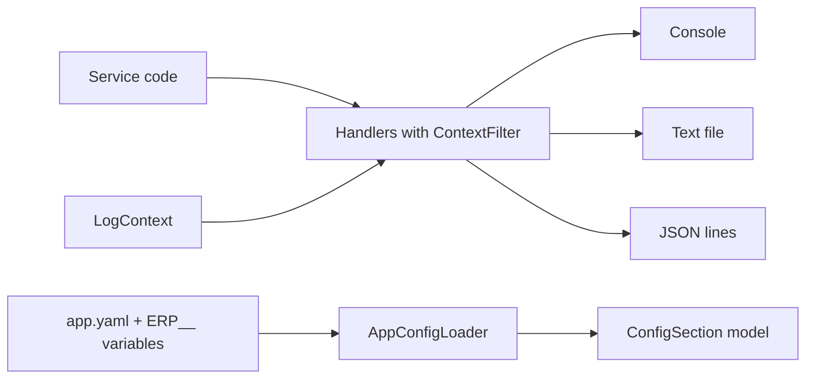

# T0.06: Logging and configuration libraries

**Status:** ✅ Done · **Ticket:** [TICKET.md](TICKET.md) · **Choices and trade-offs:** [IMPLEMENTATION.md](IMPLEMENTATION.md) · **Review:** [REVIEW.md](REVIEW.md)

## 🔭 What it does

- A service can set up its logging from one reference file: a coloured console, a coloured rotating text file and a JSON lines file, all carrying the service, the company and the request.
- The company and the request tags come from a per-task context, so a request's lines never carry another company's id.
- A service can read its `app.yaml` into a typed, frozen model, with every default written in the file, overridden by `ERP__SECTION__FIELD` environment variables.
- A field named `..._key` can only hold the name of a vault entry. It is masked in `repr` and never reaches a log line.

## ⚙️ How it works

1. **Setup reads the reference file:** `LoggingSetup.configure` reads the YAML, sets the service, moves the files, then applies it, in [`backend/shared/logging/src/erp_logging/setup/logging_setup.py:140`](../../../backend/shared/logging/src/erp_logging/setup/logging_setup.py#L140). The read, with its wrapped errors, is at [`logging_setup.py:56`](../../../backend/shared/logging/src/erp_logging/setup/logging_setup.py#L56).
2. **The service is injected:** the `context` filter of the file receives the service name, and `disable_existing_loggers` defaults to `False`, in [`logging_setup.py:83`](../../../backend/shared/logging/src/erp_logging/setup/logging_setup.py#L83).
3. **Files go to the service's logs folder:** every handler `filename` is rewritten into `logs_dir`, which is created, in [`logging_setup.py:104`](../../../backend/shared/logging/src/erp_logging/setup/logging_setup.py#L104).
4. **`dictConfig` is applied** and its refusals become `SELoggingConfigInvalidError`, in [`logging_setup.py:118`](../../../backend/shared/logging/src/erp_logging/setup/logging_setup.py#L118). The reference file it reads is [`backend/shared/logging/conf/logger.yaml`](../../../backend/shared/logging/conf/logger.yaml).
5. **The request binds its tags:** `LogContext.bind` sets two `ContextVar`s (company, request), declared at [`log_context.py:22-23`](../../../backend/shared/logging/src/erp_logging/context/log_context.py#L22-L23) and set at [`log_context.py:30`](../../../backend/shared/logging/src/erp_logging/context/log_context.py#L30). T0.09 will call it.
6. **Each record is tagged:** `ContextFilter.filter` writes `service`, `company` and `request` on the record, with `-` when unbound, in [`context_filter.py:54-65`](../../../backend/shared/logging/src/erp_logging/filters/context_filter.py#L54-L65). A blank service is refused at [`context_filter.py:29`](../../../backend/shared/logging/src/erp_logging/filters/context_filter.py#L29).
7. **The JSON line is whitelisted:** `JsonLinesFormatter.format` builds a dict of the `FIELDS` keys only, with a UTC millisecond time, and dumps it on one line, in [`json_lines_formatter.py:31-51`](../../../backend/shared/logging/src/erp_logging/formatters/json_lines_formatter.py#L31-L51).
8. **A service reads its configuration:** `AppConfigLoader.read` runs in this order, in [`app_config_loader.py:134`](../../../backend/shared/config/src/erp_config/loading/app_config_loader.py#L134): read the YAML ([`:60`](../../../backend/shared/config/src/erp_config/loading/app_config_loader.py#L60)), check that every default is written ([`:83`](../../../backend/shared/config/src/erp_config/loading/app_config_loader.py#L83)), apply the overrides, validate ([`:106`](../../../backend/shared/config/src/erp_config/loading/app_config_loader.py#L106)).
9. **Overrides:** `EnvironmentOverrides.apply` deep-copies the data and replaces the value at each `ERP__A__B` path, in [`environment_overrides.py:113`](../../../backend/shared/config/src/erp_config/loading/environment_overrides.py#L113). The path walk is at [`:79`](../../../backend/shared/config/src/erp_config/loading/environment_overrides.py#L79) and the YAML parse of the value at [`:48`](../../../backend/shared/config/src/erp_config/loading/environment_overrides.py#L48). An unknown path raises, and no message quotes a value.
10. **Sections guard their keys:** `ConfigSection` is frozen and forbids extras. Its before-validator refuses a `_key` value that is not a vault entry name, in [`config_section.py:38`](../../../backend/shared/config/src/erp_config/models/config_section.py#L38), and `__repr_args__` masks it as `***` at [`config_section.py:73`](../../../backend/shared/config/src/erp_config/models/config_section.py#L73).



## 🧱 Files and lines changed

<!-- changes -->
| File | Change | Lines in the new version | Added | Removed |
| --- | --- | --- | --- | --- |
| [`backend/shared/config/README.md`](../../../backend/shared/config/README.md) | Added | [1-35](../../../backend/shared/config/README.md#L1) | +35 | −0 |
| [`backend/shared/config/pyproject.toml`](../../../backend/shared/config/pyproject.toml) | Added | [1-14](../../../backend/shared/config/pyproject.toml#L1) | +14 | −0 |
| [`backend/shared/config/src/erp_config/__init__.py`](../../../backend/shared/config/src/erp_config/__init__.py) | Added | ➖ | +0 | −0 |
| [`backend/shared/config/src/erp_config/loading/__init__.py`](../../../backend/shared/config/src/erp_config/loading/__init__.py) | Added | ➖ | +0 | −0 |
| [`backend/shared/config/src/erp_config/loading/app_config_loader.py`](../../../backend/shared/config/src/erp_config/loading/app_config_loader.py) | Added | [1-156](../../../backend/shared/config/src/erp_config/loading/app_config_loader.py#L1) | +156 | −0 |
| [`backend/shared/config/src/erp_config/loading/environment_overrides.py`](../../../backend/shared/config/src/erp_config/loading/environment_overrides.py) | Added | [1-130](../../../backend/shared/config/src/erp_config/loading/environment_overrides.py#L1) | +130 | −0 |
| [`backend/shared/config/src/erp_config/models/__init__.py`](../../../backend/shared/config/src/erp_config/models/__init__.py) | Added | ➖ | +0 | −0 |
| [`backend/shared/config/src/erp_config/models/config_section.py`](../../../backend/shared/config/src/erp_config/models/config_section.py) | Added | [1-80](../../../backend/shared/config/src/erp_config/models/config_section.py#L1) | +80 | −0 |
| [`backend/shared/config/src/erp_config/models/exceptions/__init__.py`](../../../backend/shared/config/src/erp_config/models/exceptions/__init__.py) | Added | [1-18](../../../backend/shared/config/src/erp_config/models/exceptions/__init__.py#L1) | +18 | −0 |
| [`backend/shared/config/src/erp_config/models/exceptions/loading/__init__.py`](../../../backend/shared/config/src/erp_config/models/exceptions/loading/__init__.py) | Added | [1-13](../../../backend/shared/config/src/erp_config/models/exceptions/loading/__init__.py#L1) | +13 | −0 |
| [`backend/shared/config/src/erp_config/models/exceptions/loading/se_app_config_error.py`](../../../backend/shared/config/src/erp_config/models/exceptions/loading/se_app_config_error.py) | Added | [1-5](../../../backend/shared/config/src/erp_config/models/exceptions/loading/se_app_config_error.py#L1) | +5 | −0 |
| [`backend/shared/config/src/erp_config/models/exceptions/loading/se_app_config_invalid_error.py`](../../../backend/shared/config/src/erp_config/models/exceptions/loading/se_app_config_invalid_error.py) | Added | [1-8](../../../backend/shared/config/src/erp_config/models/exceptions/loading/se_app_config_invalid_error.py#L1) | +8 | −0 |
| [`backend/shared/config/src/erp_config/models/exceptions/loading/se_app_config_missing_default_error.py`](../../../backend/shared/config/src/erp_config/models/exceptions/loading/se_app_config_missing_default_error.py) | Added | [1-8](../../../backend/shared/config/src/erp_config/models/exceptions/loading/se_app_config_missing_default_error.py#L1) | +8 | −0 |
| [`backend/shared/config/src/erp_config/models/exceptions/loading/se_app_config_unknown_override_error.py`](../../../backend/shared/config/src/erp_config/models/exceptions/loading/se_app_config_unknown_override_error.py) | Added | [1-8](../../../backend/shared/config/src/erp_config/models/exceptions/loading/se_app_config_unknown_override_error.py#L1) | +8 | −0 |
| [`backend/shared/config/src/erp_config/models/exceptions/loading/se_app_config_unreadable_error.py`](../../../backend/shared/config/src/erp_config/models/exceptions/loading/se_app_config_unreadable_error.py) | Added | [1-8](../../../backend/shared/config/src/erp_config/models/exceptions/loading/se_app_config_unreadable_error.py#L1) | +8 | −0 |
| [`backend/shared/config/src/erp_config/models/exceptions/sections/__init__.py`](../../../backend/shared/config/src/erp_config/models/exceptions/sections/__init__.py) | Added | [1-4](../../../backend/shared/config/src/erp_config/models/exceptions/sections/__init__.py#L1) | +4 | −0 |
| [`backend/shared/config/src/erp_config/models/exceptions/sections/se_config_section_invalid_key.py`](../../../backend/shared/config/src/erp_config/models/exceptions/sections/se_config_section_invalid_key.py) | Added | [1-8](../../../backend/shared/config/src/erp_config/models/exceptions/sections/se_config_section_invalid_key.py#L1) | +8 | −0 |
| [`backend/shared/config/src/erp_config/models/exceptions/sections/se_invalid_config_section_exception.py`](../../../backend/shared/config/src/erp_config/models/exceptions/sections/se_invalid_config_section_exception.py) | Added | [1-5](../../../backend/shared/config/src/erp_config/models/exceptions/sections/se_invalid_config_section_exception.py#L1) | +5 | −0 |
| [`backend/shared/config/tests/loading/app_config_loader/conftest.py`](../../../backend/shared/config/tests/loading/app_config_loader/conftest.py) | Added | [1-41](../../../backend/shared/config/tests/loading/app_config_loader/conftest.py#L1) | +41 | −0 |
| [`backend/shared/config/tests/loading/app_config_loader/sample_app_config.py`](../../../backend/shared/config/tests/loading/app_config_loader/sample_app_config.py) | Added | [1-24](../../../backend/shared/config/tests/loading/app_config_loader/sample_app_config.py#L1) | +24 | −0 |
| [`backend/shared/config/tests/loading/app_config_loader/sample_mail_section.py`](../../../backend/shared/config/tests/loading/app_config_loader/sample_mail_section.py) | Added | [1-26](../../../backend/shared/config/tests/loading/app_config_loader/sample_mail_section.py#L1) | +26 | −0 |
| [`backend/shared/config/tests/loading/app_config_loader/sample_server_section.py`](../../../backend/shared/config/tests/loading/app_config_loader/sample_server_section.py) | Added | [1-21](../../../backend/shared/config/tests/loading/app_config_loader/sample_server_section.py#L1) | +21 | −0 |
| [`backend/shared/config/tests/loading/app_config_loader/test_app_config_loader.py`](../../../backend/shared/config/tests/loading/app_config_loader/test_app_config_loader.py) | Added | [1-102](../../../backend/shared/config/tests/loading/app_config_loader/test_app_config_loader.py#L1) | +102 | −0 |
| [`backend/shared/config/tests/loading/test_environment_overrides.py`](../../../backend/shared/config/tests/loading/test_environment_overrides.py) | Added | [1-64](../../../backend/shared/config/tests/loading/test_environment_overrides.py#L1) | +64 | −0 |
| [`backend/shared/config/tests/models/config_section/sample_mail_section.py`](../../../backend/shared/config/tests/models/config_section/sample_mail_section.py) | Added | [1-17](../../../backend/shared/config/tests/models/config_section/sample_mail_section.py#L1) | +17 | −0 |
| [`backend/shared/config/tests/models/config_section/test_config_section.py`](../../../backend/shared/config/tests/models/config_section/test_config_section.py) | Added | [1-57](../../../backend/shared/config/tests/models/config_section/test_config_section.py#L1) | +57 | −0 |
| [`backend/shared/logging/README.md`](../../../backend/shared/logging/README.md) | Added | [1-44](../../../backend/shared/logging/README.md#L1) | +44 | −0 |
| [`backend/shared/logging/conf/logger.yaml`](../../../backend/shared/logging/conf/logger.yaml) | Added | [1-72](../../../backend/shared/logging/conf/logger.yaml#L1) | +72 | −0 |
| [`backend/shared/logging/pyproject.toml`](../../../backend/shared/logging/pyproject.toml) | Added | [1-14](../../../backend/shared/logging/pyproject.toml#L1) | +14 | −0 |
| [`backend/shared/logging/src/erp_logging/__init__.py`](../../../backend/shared/logging/src/erp_logging/__init__.py) | Added | ➖ | +0 | −0 |
| [`backend/shared/logging/src/erp_logging/context/__init__.py`](../../../backend/shared/logging/src/erp_logging/context/__init__.py) | Added | ➖ | +0 | −0 |
| [`backend/shared/logging/src/erp_logging/context/log_context.py`](../../../backend/shared/logging/src/erp_logging/context/log_context.py) | Added | [1-62](../../../backend/shared/logging/src/erp_logging/context/log_context.py#L1) | +62 | −0 |
| [`backend/shared/logging/src/erp_logging/filters/__init__.py`](../../../backend/shared/logging/src/erp_logging/filters/__init__.py) | Added | ➖ | +0 | −0 |
| [`backend/shared/logging/src/erp_logging/filters/context_filter.py`](../../../backend/shared/logging/src/erp_logging/filters/context_filter.py) | Added | [1-66](../../../backend/shared/logging/src/erp_logging/filters/context_filter.py#L1) | +66 | −0 |
| [`backend/shared/logging/src/erp_logging/formatters/__init__.py`](../../../backend/shared/logging/src/erp_logging/formatters/__init__.py) | Added | ➖ | +0 | −0 |
| [`backend/shared/logging/src/erp_logging/formatters/json_lines_formatter.py`](../../../backend/shared/logging/src/erp_logging/formatters/json_lines_formatter.py) | Added | [1-51](../../../backend/shared/logging/src/erp_logging/formatters/json_lines_formatter.py#L1) | +51 | −0 |
| [`backend/shared/logging/src/erp_logging/models/__init__.py`](../../../backend/shared/logging/src/erp_logging/models/__init__.py) | Added | ➖ | +0 | −0 |
| [`backend/shared/logging/src/erp_logging/models/exceptions/__init__.py`](../../../backend/shared/logging/src/erp_logging/models/exceptions/__init__.py) | Added | [1-11](../../../backend/shared/logging/src/erp_logging/models/exceptions/__init__.py#L1) | +11 | −0 |
| [`backend/shared/logging/src/erp_logging/models/exceptions/se_logging_config_invalid_error.py`](../../../backend/shared/logging/src/erp_logging/models/exceptions/se_logging_config_invalid_error.py) | Added | [1-11](../../../backend/shared/logging/src/erp_logging/models/exceptions/se_logging_config_invalid_error.py#L1) | +11 | −0 |
| [`backend/shared/logging/src/erp_logging/models/exceptions/se_logging_config_unreadable_error.py`](../../../backend/shared/logging/src/erp_logging/models/exceptions/se_logging_config_unreadable_error.py) | Added | [1-7](../../../backend/shared/logging/src/erp_logging/models/exceptions/se_logging_config_unreadable_error.py#L1) | +7 | −0 |
| [`backend/shared/logging/src/erp_logging/models/exceptions/se_logging_setup_error.py`](../../../backend/shared/logging/src/erp_logging/models/exceptions/se_logging_setup_error.py) | Added | [1-5](../../../backend/shared/logging/src/erp_logging/models/exceptions/se_logging_setup_error.py#L1) | +5 | −0 |
| [`backend/shared/logging/src/erp_logging/setup/__init__.py`](../../../backend/shared/logging/src/erp_logging/setup/__init__.py) | Added | ➖ | +0 | −0 |
| [`backend/shared/logging/src/erp_logging/setup/logging_setup.py`](../../../backend/shared/logging/src/erp_logging/setup/logging_setup.py) | Added | [1-151](../../../backend/shared/logging/src/erp_logging/setup/logging_setup.py#L1) | +151 | −0 |
| [`backend/shared/logging/tests/context/conftest.py`](../../../backend/shared/logging/tests/context/conftest.py) | Added | [1-17](../../../backend/shared/logging/tests/context/conftest.py#L1) | +17 | −0 |
| [`backend/shared/logging/tests/context/test_log_context.py`](../../../backend/shared/logging/tests/context/test_log_context.py) | Added | [1-44](../../../backend/shared/logging/tests/context/test_log_context.py#L1) | +44 | −0 |
| [`backend/shared/logging/tests/filters/conftest.py`](../../../backend/shared/logging/tests/filters/conftest.py) | Added | [1-13](../../../backend/shared/logging/tests/filters/conftest.py#L1) | +13 | −0 |
| [`backend/shared/logging/tests/filters/test_context_filter.py`](../../../backend/shared/logging/tests/filters/test_context_filter.py) | Added | [1-41](../../../backend/shared/logging/tests/filters/test_context_filter.py#L1) | +41 | −0 |
| [`backend/shared/logging/tests/formatters/test_json_lines_formatter.py`](../../../backend/shared/logging/tests/formatters/test_json_lines_formatter.py) | Added | [1-91](../../../backend/shared/logging/tests/formatters/test_json_lines_formatter.py#L1) | +91 | −0 |
| [`backend/shared/logging/tests/setup/conftest.py`](../../../backend/shared/logging/tests/setup/conftest.py) | Added | [1-24](../../../backend/shared/logging/tests/setup/conftest.py#L1) | +24 | −0 |
| [`backend/shared/logging/tests/setup/test_logging_setup.py`](../../../backend/shared/logging/tests/setup/test_logging_setup.py) | Added | [1-124](../../../backend/shared/logging/tests/setup/test_logging_setup.py#L1) | +124 | −0 |
| [`docs/technical/architecture/backend.md`](../../../docs/technical/architecture/backend.md) | Modified | [12-18](../../../docs/technical/architecture/backend.md#L12) | +7 | −0 |
| [`docs/technical/operations/observability.md`](../../../docs/technical/operations/observability.md) | Modified | [3](../../../docs/technical/operations/observability.md#L3), [7-26](../../../docs/technical/operations/observability.md#L7) | +21 | −2 |
| [`pyproject.toml`](../../../pyproject.toml) | Modified | [8](../../../pyproject.toml#L8), [16](../../../pyproject.toml#L16), [18](../../../pyproject.toml#L18) | +3 | −1 |
| [`uv.lock`](../../../uv.lock) | Modified | [7](../../../uv.lock#L7), [9](../../../uv.lock#L9), [77-103](../../../uv.lock#L77), [109-123](../../../uv.lock#L109), [401](../../../uv.lock#L401), [403](../../../uv.lock#L403), [420-424](../../../uv.lock#L420) | +51 | −1 |
| **54 files** | | | **+1782** | **−4** |
<!-- /changes -->

- [`backend/shared/logging/src`](../../../backend/shared/logging/src/erp_logging/__init__.py): the `erp_logging` package: context, filter, formatter, setup and three exceptions (see the steps above).
- [`backend/shared/logging/conf/logger.yaml`](../../../backend/shared/logging/conf/logger.yaml): the reference file, with the context filter, the three tags, the JSON formatter and its handler.
- [`backend/shared/config/src`](../../../backend/shared/config/src/erp_config/__init__.py): the `erp_config` package: `ConfigSection`, `EnvironmentOverrides`, `AppConfigLoader` and seven exceptions in two sub-packages.
- [`backend/shared/logging/tests`](../../../backend/shared/logging/tests/setup/test_logging_setup.py) and [`backend/shared/config/tests`](../../../backend/shared/config/tests/loading/app_config_loader/test_app_config_loader.py): the tests, written first (TKT-4), with sample sections for the base class.
- [`backend/shared/logging/pyproject.toml`](../../../backend/shared/logging/pyproject.toml), [`backend/shared/config/pyproject.toml`](../../../backend/shared/config/pyproject.toml), [`pyproject.toml`](../../../pyproject.toml) lines [`8-15`](../../../pyproject.toml#L8-L15) and [`uv.lock`](../../../uv.lock): the two uv packages and their workspace wiring.
- [`backend/shared/logging/README.md`](../../../backend/shared/logging/README.md) and [`backend/shared/config/README.md`](../../../backend/shared/config/README.md): usage of each library.
- [`docs/technical/architecture/backend.md`](../../../docs/technical/architecture/backend.md) lines [`12-18`](../../../docs/technical/architecture/backend.md#L12-L18) and [`docs/technical/operations/observability.md`](../../../docs/technical/operations/observability.md) lines [`7-26`](../../../docs/technical/operations/observability.md#L7-L26): the design pages now describe the two libraries.

## 🧪 How to test it

```bash
uv run --package erp-logging pytest backend/shared/logging/tests -n 2
uv run --package erp-config pytest backend/shared/config/tests -n 2
uv run pytest tests/conventions -n 2
uv run ruff check backend plugins sdk tests
uv run mypy backend/models/src backend/shared/*/src backend/services/*/src plugins/*/src sdk/src
```

The first two run each library's tests, the third the convention rules, the last two lint and type checks.

## 🔗 Evidence

- [Logging tests](tests-evidences/pytest-backend-shared-logging.txt): 40 passed.
- [Config tests](tests-evidences/pytest-backend-shared-config.txt): 43 passed.
- [Lifecycle tests](tests-evidences/pytest-backend-shared-lifecycle.txt): 28 passed.
- [Models tests](tests-evidences/pytest-backend-models.txt): 215 passed.
- [Repository tests, conventions included](tests-evidences/pytest.txt): 1156 passed.
- [ruff check](tests-evidences/ruff-check.txt), [ruff format](tests-evidences/ruff-format.txt), [mypy](tests-evidences/mypy.txt): clean.
- [Ticket references](tests-evidences/ticket-refs.txt) and [plan view](tests-evidences/plan-view.txt): the plan and ticket checks.

## 📝 Assumptions accepted

- K01, K02, K04: tests failed at import before the packages existed, which is expected under tests-first (TKT-4).
- K01, K04, K05, K07: test helpers are instance methods or `ClassVar`s of the test class, and sample `ConfigSection` subclasses sit in `tests/`, because a base class is tested through subclasses.
- K03: milliseconds are truncated and the key order follows `FIELDS`. K13: tag values are coerced with `str()`.
- K04: the JSON output is checked on its values, since key names are left open by the ticket (`service`, `company`, `request` are the conservative ones).
- K06, K15: an unknown path is a missing field or section; the last path segment must already exist; an empty value becomes `None`; messages never quote a value.
- K07, K17: an override like `'6543'` reaches an int field through YAML parsing and pydantic lax mode; a nested section that is not a mapping is left to model validation.
- K08: the root [`pyproject.toml`](../../../pyproject.toml) wires `erp-config` and `erp-logging` as workspace sources, like `erp-lifecycle`.
- K09, K10: the exceptions subclass `Exception` directly, so pydantic does not wrap them.
- K11: the reference `logger.yaml` keeps the shape of the root one.
- K12: the `ContextVar` names are `erp_logging_company` and `erp_logging_request`; `bind` and `clear` take no tokens, so T0.09 must bind once per request task.
- K14: the `_key` check runs before field validation so that `42` and `True` raise `SEConfigSectionInvalidKey`.
- K16: an empty or unbound tag is written as `-`; the optional logger is the last constructor argument.
- K18: the exceptions live in `erp_logging.models.exceptions`; `disable_existing_loggers` defaults to `False`.
- K19: `observability.md` says only the logging library is built, and company and request are unset until T0.09.
- K20: the README examples are illustrative.
- TICKET.md: decisions are linked in place of use cases, folder names come from D572, the tags are `service`, `company`, `request`, and the `logger.yaml` shape is kept.

Rejected by the reviewer: K19's claim that a section was added to `configuration.md` (it is not in the diff), and K03's reading that a module-level helper is allowed.

## 🔜 Follow-ups

| File | What to change |
| --- | --- |
| [`docs/technical/architecture/backend.md`](../../../docs/technical/architecture/backend.md) and [`docs/technical/architecture/configuration.md`](../../../docs/technical/architecture/configuration.md) | K19's change to `configuration.md` is not in this diff, because T0.04 holds that file uncommitted. [`backend.md:15`](../../../docs/technical/architecture/backend.md#L15) links an anchor that does not exist. Link without the fragment for now. After T0.04 merges, add the `erp_config` section and mark `conf/app.yaml` as built (K19). |
| [`backend/shared/logging/tests/formatters/test_json_lines_formatter.py`](../../../backend/shared/logging/tests/formatters/test_json_lines_formatter.py) | Move the module-level `make_record` into the test class or a `helpers.py` (K03). |
| [`backend/shared/config/tests/loading/app_config_loader/sample_app_config.py`](../../../backend/shared/config/tests/loading/app_config_loader/sample_app_config.py), [`sample_mail_section.py`](../../../backend/shared/config/tests/loading/app_config_loader/sample_mail_section.py), [`sample_server_section.py`](../../../backend/shared/config/tests/loading/app_config_loader/sample_server_section.py), [`sample_mail_section.py`](../../../backend/shared/config/tests/models/config_section/sample_mail_section.py) | Fix the misplaced import group comments: remove them or put each import under its group (K05, K07). |
| [`backend/shared/config/src/erp_config/loading/environment_overrides.py`](../../../backend/shared/config/src/erp_config/loading/environment_overrides.py) and [its tests](../../../backend/shared/config/tests/loading/test_environment_overrides.py) | `yaml.safe_load` follows YAML 1.1: `no`, `on`, `off` become booleans, `0755` an octal int, and a numeric vault name an int that `ConfigSection` then refuses. Parse against the field type, or limit the parse, and add tests (K15, K06). |
| [`backend/shared/config/src/erp_config/models/config_section.py`](../../../backend/shared/config/src/erp_config/models/config_section.py) and [its tests](../../../backend/shared/config/tests/models/config_section/test_config_section.py) | A `_key` default declared on a subclass is never checked when the input leaves it out. Check defaults too and add a test (K14, K05). |
| [`backend/shared/config/src/erp_config/loading/app_config_loader.py`](../../../backend/shared/config/src/erp_config/loading/app_config_loader.py) and [its tests](../../../backend/shared/config/tests/loading/app_config_loader/test_app_config_loader.py) | `_check_defaults` recurses only into fields annotated directly as a `ConfigSection`. Extend it for `Optional`, list and dict sections, or document the limit (K17, K07). |
| [`docs/technical/operations/observability.md`](../../../docs/technical/operations/observability.md) | Redraw the diagram with `ContextFilter` on the handlers reading `LogContext`, and say `-` rather than "empty" (K19). |
| [`tests/conventions/convention_scanner.py`](../../../tests/conventions/convention_scanner.py) | The scanner sees only direct `BaseModel` subclasses, so test-only `ConfigSection` subclasses pass unseen. Decide whether they are allowed (conventions, outside this ticket). |
