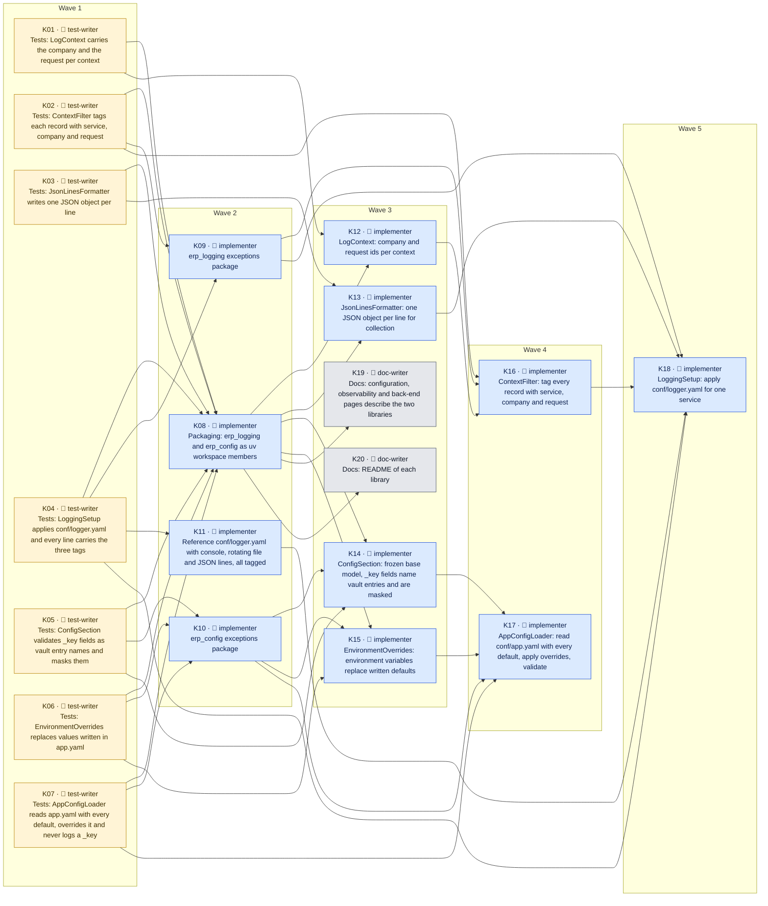

# T0.06: Logging and configuration library, plan

**Plan:** 🟢 Approved

**Push:** 🟢 Approved

<!-- ticket:specs -->
## 📚 Specifications

The specification and design pages of [TICKET.md](TICKET.md), copied by `python3 .claude/scripts/tickets/ticket_refs.py sync`.

- [Observability design](../../technical/operations/observability.md)
- [📜 D416](../../specs/06-decisions/technical/d416-observability-design.md)
- [Configuration](../../technical/architecture/configuration.md)
- [📜 D413](../../specs/06-decisions/technical/d413-configuration-layers.md)
- [📜 D240](../../specs/06-decisions/security-and-compliance/d240-credential-vault.md)
- [📜 D438](../../specs/06-decisions/technical/d438-repository-layout.md)
- [📜 D406 Back end](../../specs/06-decisions/technical/d406-back-end.md)
- [🏗️ Back end](../../technical/architecture/backend.md)
- [🏗️ Repository layout](../../technical/architecture/repository-layout.md)
- [🔭 Observability](../../specs/05-non-functional/observability.md#requirement)
- [🔭 Observability](../../specs/05-non-functional/observability.md)
<!-- /ticket:specs -->

## Summary

T0.06 builds two uv packages under `backend/shared/` (D438): `erp_logging` in `backend/shared/logging` and `erp_config` in `backend/shared/config`.

`erp_logging` provides `LogContext` (contextvars for the company and request ids), `ContextFilter` (tags every record with service, company and request), `JsonLinesFormatter` (JSON lines for collection), `LoggingSetup` (loads a `conf/logger.yaml` through `dictConfig`, injects the service, puts the files in `logs/`) and a reference `conf/logger.yaml` (coloured console, coloured rotating file, rotating JSON lines file) (D416).

`erp_config` provides `ConfigSection` (frozen base model whose `_key` fields may only name a vault entry and are masked in repr and str, D240), `EnvironmentOverrides` (`ERP__SECTION__FIELD` variables replace values written in `app.yaml`) and `AppConfigLoader` (reads `conf/app.yaml`, refuses a file that leaves out a default, applies the overrides, validates; never logs a value) (D413).

The plan has 20 tasks in 5 waves. Wave 1 holds 7 test-writer tasks, one per behaviour. Wave 2 holds the packaging task (both `pyproject.toml` files and `uv.lock` in one task, because the lock is shared), the exception packages of each library and the reference `logger.yaml`. Waves 3 to 5 hold one implementation task per class, following the import chain LogContext -> ContextFilter -> LoggingSetup and ConfigSection + EnvironmentOverrides -> AppConfigLoader. Two doc-writer tasks run beside the code in wave 3. The ticket touches no front end, so there is no Playwright task.

## Specifications

Linked by `ticket_refs.py sync` below.

## Assumptions

- `check_ticket.py` was not run: no shell tool was available, so links and anchors were checked by reading files only.
- The roadmap names no use case, business rule, entity, flow or requirement for this ticket, so decisions and design pages are linked.
- The ticket anchor is the sprint anchor `#s01`, since the roadmap row has no anchor of its own.
- Exact field names of the three log tags (service, company, request) are not specified; conservative names assumed.
- `docs/tickets/T0.06/tests-evidences/` holds a `.gitkeep` so the folder exists.
- The package names are `erp_logging` (`backend/shared/logging/src/erp_logging`) and `erp_config` (`backend/shared/config/src/erp_config`). They follow `erp_models` and the harness tests that already name `erp_logging` and `erp_lifecycle`. A bare `logging` package would shadow the standard library.
- The distribution names and build backend copy `backend/models/pyproject.toml` (`erp-logging` and `erp-config` if it uses `erp-models`). Both `pyproject.toml` files and `uv.lock` are in one task because the lock is shared.
- Neither library imports `erp_models`. The ticket needs none of T0.03's types: the company id is carried as an opaque string, and `ConfigSection` subclasses pydantic `BaseModel` directly because the name of T0.03's base model is not fixed yet.
- The SE exceptions subclass `Exception` directly, never `ValueError`, so that Pydantic does not wrap them. T0.04's SE bases are not a prerequisite of T0.06, and a later ticket may rebase them.
- Pydantic models and exceptions sit in each library's own `models/` package, as the convention test that refuses a Pydantic model outside `models/` requires. The other code sits in folders named by concern (context, filters, formatters, setup, loading), which carry no layer rule.
- Environment variables are named `<PREFIX>__<SECTION>__<FIELD>` with the prefix `ERP`. Path segments are lower-cased to find the key, and values are parsed as YAML scalars, with the raw string kept when YAML cannot parse it. An override may only replace a key already written in `app.yaml`, because every default is written out. The specifications name no convention.
- `AppConfigLoader` refuses an `app.yaml` that leaves out a field of the model (`SEAppConfigMissingDefaultError`). This is the strictest reading of "every default written out" (AGENT.md, Configuration page).
- A `_key` field is valid when it is `None`, or a name of at most 128 characters matching `^[A-Za-z0-9][A-Za-z0-9._/-]*$`. The vault's entry naming is not specified (P2 builds the vault), so this is a conservative format that rejects whitespace and other characters.
- Acceptance criterion 2 is met in three ways. `_key` values are replaced by `***` in repr and str of every `ConfigSection`. The loader and the override logs name variables and counts, never values. `JsonLinesFormatter` writes only its fixed fields, never record extras.
- The tags are named `service`, `company` and `request` in the record attributes and the JSON lines. An unset company or request is written as `-` in every output, JSON included. The JSON lines hold time (UTC, ISO 8601 with milliseconds and Z), level, logger, message, the three tags and exception when there is one.
- The JSON lines go to a rotating file, `logs/simpleerp.jsonl` (10 MiB, 5 backups), beside the coloured console and coloured `logs/simpleerp.log`. Collection reads them from there, and the collector itself (Loki) is out of scope.
- `LoggingSetup` takes the service as an argument and writes it into the `context` filter of the YAML. It puts every handler file in `logs_dir` (default `logs/`). A YAML without a `context` filter is refused, so that no line can leave untagged.
- The reference logger configuration lives in `backend/shared/logging/conf/logger.yaml` for services to copy. The root `conf/logger.yaml` is left unchanged.
- Test helper classes of the library tests are imported by their full path from the repository root (`backend.shared.config.tests...`), because `tests.` resolves to the repository-level tests folder.
- The loader's method is `read()`, not `load()`, so that it does not share a name with `YamlCatalog.load`, which means something else (AGENT.md, File shape).

<!-- plan:graph -->

> [!NOTE]
> Generated from the json block at the end of this page by `python3 .claude/scripts/tickets/plan.py render`.
> To change a task, edit the json block, then render again: never edit this view by hand.

## Waves

| Wave | Tasks | Agents running at once |
| --- | --- | --- |
| 1 | [K01](#k01), [K02](#k02), [K03](#k03), [K04](#k04), [K05](#k05), [K06](#k06), [K07](#k07) | 7 of 7 |
| 2 | [K08](#k08), [K09](#k09), [K10](#k10), [K11](#k11) | 4 of 4 |
| 3 | [K12](#k12), [K13](#k13), [K14](#k14), [K15](#k15), [K19](#k19), [K20](#k20) | 6 of 6 |
| 4 | [K16](#k16), [K17](#k17) | 2 of 2 |
| 5 | [K18](#k18) | 1 of 1 |

| Wave | Task | Agent | Depends on | Unblocks |
| --- | --- | --- | --- | --- |
| 1 | [K01](#k01) Tests: LogContext carries the company and the request per context | 🧪 test-writer | none | [K08](#k08), [K12](#k12) |
| 1 | [K02](#k02) Tests: ContextFilter tags each record with service, company and request | 🧪 test-writer | none | [K08](#k08), [K09](#k09), [K16](#k16) |
| 1 | [K03](#k03) Tests: JsonLinesFormatter writes one JSON object per line | 🧪 test-writer | none | [K08](#k08), [K13](#k13) |
| 1 | [K04](#k04) Tests: LoggingSetup applies conf/logger.yaml and every line carries the three tags | 🧪 test-writer | none | [K08](#k08), [K09](#k09), [K11](#k11), [K18](#k18) |
| 1 | [K05](#k05) Tests: ConfigSection validates _key fields as vault entry names and masks them | 🧪 test-writer | none | [K08](#k08), [K10](#k10), [K14](#k14) |
| 1 | [K06](#k06) Tests: EnvironmentOverrides replaces values written in app.yaml | 🧪 test-writer | none | [K08](#k08), [K10](#k10), [K15](#k15) |
| 1 | [K07](#k07) Tests: AppConfigLoader reads app.yaml with every default, overrides it and never logs a _key | 🧪 test-writer | none | [K08](#k08), [K10](#k10), [K17](#k17) |
| 2 | [K08](#k08) Packaging: erp_logging and erp_config as uv workspace members | 🐍 implementer | [K01](#k01), [K02](#k02), [K03](#k03), [K04](#k04), [K05](#k05), [K06](#k06), [K07](#k07) | [K12](#k12), [K13](#k13), [K14](#k14), [K15](#k15), [K19](#k19), [K20](#k20) |
| 2 | [K09](#k09) erp_logging exceptions package | 🐍 implementer | [K02](#k02), [K04](#k04) | [K16](#k16), [K18](#k18) |
| 2 | [K10](#k10) erp_config exceptions package | 🐍 implementer | [K05](#k05), [K06](#k06), [K07](#k07) | [K14](#k14), [K15](#k15), [K17](#k17) |
| 2 | [K11](#k11) Reference conf/logger.yaml with console, rotating file and JSON lines, all tagged | 🐍 implementer | [K04](#k04) | [K18](#k18) |
| 3 | [K12](#k12) LogContext: company and request ids per context | 🐍 implementer | [K01](#k01), [K08](#k08) | [K16](#k16) |
| 3 | [K13](#k13) JsonLinesFormatter: one JSON object per line for collection | 🐍 implementer | [K03](#k03), [K08](#k08) | [K18](#k18) |
| 3 | [K14](#k14) ConfigSection: frozen base model, _key fields name vault entries and are masked | 🐍 implementer | [K05](#k05), [K08](#k08), [K10](#k10) | [K17](#k17) |
| 3 | [K15](#k15) EnvironmentOverrides: environment variables replace written defaults | 🐍 implementer | [K06](#k06), [K08](#k08), [K10](#k10) | [K17](#k17) |
| 3 | [K19](#k19) Docs: configuration, observability and back-end pages describe the two libraries | 📝 doc-writer | [K08](#k08) | none |
| 3 | [K20](#k20) Docs: README of each library | 📝 doc-writer | [K08](#k08) | none |
| 4 | [K16](#k16) ContextFilter: tag every record with service, company and request | 🐍 implementer | [K02](#k02), [K09](#k09), [K12](#k12) | [K18](#k18) |
| 4 | [K17](#k17) AppConfigLoader: read conf/app.yaml with every default, apply overrides, validate | 🐍 implementer | [K07](#k07), [K10](#k10), [K14](#k14), [K15](#k15) | none |
| 5 | [K18](#k18) LoggingSetup: apply conf/logger.yaml for one service | 🐍 implementer | [K04](#k04), [K09](#k09), [K11](#k11), [K13](#k13), [K16](#k16) | none |

## Dependency graph



## Tasks

### <a id="k01"></a>K01: Tests: LogContext carries the company and the request per context

| Agent | Wave | Depends on | Unblocks |
| --- | --- | --- | --- |
| 🧪 test-writer | 1 | none | [K08](#k08), [K12](#k12) |

**Files** (only this task may change them in its wave):

- `backend/shared/logging/tests/context/test_log_context.py`
- `backend/shared/logging/tests/context/conftest.py`

**Done when:** `uv run ruff check backend/shared/logging/tests/context` and `uv run ruff format --check backend/shared/logging/tests/context` pass; `uv run pytest backend/shared/logging/tests/context -n 2` fails only with `ModuleNotFoundError` for `erp_logging`.

**Brief:**

Write the tests of `erp_logging.context.log_context.LogContext`, the per-context holder of the company id and request id that every log line carries (acceptance criterion 3 of docs/tickets/T0.06/TICKET.md; D416 docs/specs/06-decisions/technical/d416-observability-design.md; design page docs/technical/operations/observability.md: every signal tagged with the service, the company as an opaque id and the request; budget docs/specs/05-non-functional/observability.md). Library layout per D438 docs/specs/06-decisions/technical/d438-repository-layout.md and docs/technical/architecture/repository-layout.md.

API under test (fixed by the plan, so tests and code agree): `class LogContext` holds two `ClassVar` context variables, `COMPANY` and `REQUEST` (`ContextVar[Optional[str]]`, default `None`), and these classmethods: `bind(company: Optional[str], request: Optional[str]) -> None`, `clear() -> None` (both back to `None`), `company() -> Optional[str]`, `request() -> Optional[str]`. The company is an opaque id string, stored exactly as given.

Tests in one `TestLogContext` class, named as sentences: both values are None by default; a bound company and request are read back; clear resets both; two asyncio tasks run with `asyncio.gather` that bind different values each read back their own; a value bound inside a task created with `asyncio.create_task` does not leak to the caller. `conftest.py` holds an autouse fixture that calls `LogContext.clear()` before and after each test. Follow the test rules of AGENT.md (no mocks, no `__init__.py`, async tests need no marker). The tests must fail now only because `erp_logging` does not exist yet.

### <a id="k02"></a>K02: Tests: ContextFilter tags each record with service, company and request

| Agent | Wave | Depends on | Unblocks |
| --- | --- | --- | --- |
| 🧪 test-writer | 1 | none | [K08](#k08), [K09](#k09), [K16](#k16) |

**Files** (only this task may change them in its wave):

- `backend/shared/logging/tests/filters/test_context_filter.py`
- `backend/shared/logging/tests/filters/conftest.py`

**Done when:** `uv run ruff check backend/shared/logging/tests/filters` and `uv run ruff format --check backend/shared/logging/tests/filters` pass; `uv run pytest backend/shared/logging/tests/filters -n 2` fails only with `ModuleNotFoundError` for `erp_logging`.

**Brief:**

Write the tests of `erp_logging.filters.context_filter.ContextFilter`, the `logging.Filter` that tags every record with the service, the company as an opaque id and the request. These are acceptance criterion 3 of docs/tickets/T0.06/TICKET.md, D416 (docs/specs/06-decisions/technical/d416-observability-design.md), docs/technical/operations/observability.md and docs/specs/05-non-functional/observability.md. Layout per D438 (docs/specs/06-decisions/technical/d438-repository-layout.md).

API under test: `ContextFilter(logging.Filter)` has `UNSET: ClassVar[str] = "-"`, `__init__(self, service: str)` and `filter(self, record: LogRecord) -> bool`. `filter` sets `record.service` to the service, sets `record.company` and `record.request` from `erp_logging.context.log_context.LogContext.company()` / `.request()` (or `UNSET` when they are None), and returns True. A service that is empty after stripping is refused with `SELoggingConfigInvalidError`, imported from `erp_logging.models.exceptions`.

Tests in one `TestContextFilter` class. Build real `logging.LogRecord` objects, with no mocks. Cover these cases: the record carries the service given; the record carries the bound company and request after `LogContext.bind("c-1", "r-1")`; unbound values are written as "-"; the filter always returns True; a blank service is refused, parametrised over "" and "   ". `conftest.py` holds an autouse fixture that clears `LogContext` before and after each test. Follow the AGENT.md test rules. The tests must fail now only because `erp_logging` is missing.

### <a id="k03"></a>K03: Tests: JsonLinesFormatter writes one JSON object per line

| Agent | Wave | Depends on | Unblocks |
| --- | --- | --- | --- |
| 🧪 test-writer | 1 | none | [K08](#k08), [K13](#k13) |

**Files** (only this task may change them in its wave):

- `backend/shared/logging/tests/formatters/test_json_lines_formatter.py`

**Done when:** `uv run ruff check backend/shared/logging/tests/formatters` and `uv run ruff format --check backend/shared/logging/tests/formatters` pass; `uv run pytest backend/shared/logging/tests/formatters -n 2` fails only with `ModuleNotFoundError` for `erp_logging`.

**Brief:**

Write the tests of `erp_logging.formatters.json_lines_formatter.JsonLinesFormatter`, the `logging.Formatter` that writes the JSON lines collected by the logs stack. It applies D416 (docs/specs/06-decisions/technical/d416-observability-design.md), docs/technical/operations/observability.md and docs/specs/05-non-functional/observability.md: every signal is tagged with the service, the company as an opaque id and the request, and secrets are never written. It meets acceptance criteria 2 and 3 of docs/tickets/T0.06/TICKET.md. Layout per D438 (docs/specs/06-decisions/technical/d438-repository-layout.md).

API under test: `JsonLinesFormatter(logging.Formatter)` has `FIELDS: ClassVar[Tuple[str, ...]] = ("time", "level", "logger", "message", "service", "company", "request")` and `format(self, record: LogRecord) -> str`. The result is a single line, a JSON object holding exactly those keys, plus `exception` (the formatted traceback) only when the record has `exc_info`. `time` is the record's creation time in UTC, ISO 8601 with milliseconds and a trailing `Z`. `level` is the level name. `logger` is the logger name. `message` is `record.getMessage()`. `service`, `company` and `request` come from the record attributes set by ContextFilter, and are "-" when an attribute is missing. No other record attribute is written, so an extra such as `password_key` never appears.

Tests in one `TestJsonLinesFormatter` class, on real `LogRecord` objects. Cover these cases: the output parses as JSON with exactly `FIELDS`; the time is UTC with milliseconds and ends in Z; the message is formatted with its arguments; the tag attributes are written, and are "-" when absent; a message with a newline stays on one line; an extra attribute ending in `_key` is not written; an exception adds `exception`. Use parametrize for cases of one behaviour. The tests must fail now only because `erp_logging` is missing.

### <a id="k04"></a>K04: Tests: LoggingSetup applies conf/logger.yaml and every line carries the three tags

| Agent | Wave | Depends on | Unblocks |
| --- | --- | --- | --- |
| 🧪 test-writer | 1 | none | [K08](#k08), [K09](#k09), [K11](#k11), [K18](#k18) |

**Files** (only this task may change them in its wave):

- `backend/shared/logging/tests/setup/test_logging_setup.py`
- `backend/shared/logging/tests/setup/conftest.py`

**Done when:** `uv run ruff check backend/shared/logging/tests/setup` and `uv run ruff format --check backend/shared/logging/tests/setup` pass; `uv run pytest backend/shared/logging/tests/setup -n 2` fails only with `ModuleNotFoundError` for `erp_logging`.

**Brief:**

Write the tests of `erp_logging.setup.logging_setup.LoggingSetup` and of the reference `backend/shared/logging/conf/logger.yaml`. They cover acceptance criterion 3 of docs/tickets/T0.06/TICKET.md: given the logging set up from `conf/logger.yaml`, when a line is written, then it carries the service, the company as an opaque id and the request. They apply D416 (docs/specs/06-decisions/technical/d416-observability-design.md) and docs/technical/operations/observability.md. They also apply docs/technical/architecture/configuration.md: `conf/logger.yaml` has a coloured console and a coloured rotating file in `logs/`, and the root level is `DEBUG`. Budget: docs/specs/05-non-functional/observability.md. Layout per D438 (docs/specs/06-decisions/technical/d438-repository-layout.md).

API under test: `LoggingSetup(config_path: Path, service: str, logs_dir: Optional[Path] = None, logger: Optional[Logger] = None)` (logs_dir defaults to `Path("logs")`) and `configure() -> None`. `configure` does the following in order:
- It reads the YAML as UTF-8. A missing file, invalid YAML or a non-mapping raises `SELoggingConfigUnreadableError`.
- It requires a filter named `context` and sets its `service` key to the given service. A file without it raises `SELoggingConfigInvalidError`.
- It rewrites every handler `filename` to `logs_dir / <file name>` and creates `logs_dir`.
- It calls `logging.config.dictConfig`. Any `ValueError`, `TypeError`, `AttributeError` or `ImportError` from it raises `SELoggingConfigInvalidError`.

The exceptions are imported from `erp_logging.models.exceptions`.

The reference file, `Path(__file__).resolve().parents[2] / "conf" / "logger.yaml"`, keeps the shape of the root `conf/logger.yaml`. It declares the filter `context` (`erp_logging.filters.context_filter.ContextFilter`) and three handlers, each with `filters: [context]`:
- `console`: a colorlog StreamHandler to `ext://sys.stdout`;
- `file`: a colorlog RotatingFileHandler, `simpleerp.log`;
- `json`: a RotatingFileHandler with `erp_logging.formatters.json_lines_formatter.JsonLinesFormatter`, `simpleerp.jsonl`.
Both files use 10485760 bytes and 5 backups. The text formats include `%(service)s`, `%(company)s` and `%(request)s`. The root level is DEBUG.

Tests in one `TestLoggingSetup` class, using `tmp_path` as logs_dir and capsys for the console. With the reference file and service `platform`, after `LogContext.bind("c-123", "r-456")` and one info line, the console, the text file and every JSON line hold `platform`, `c-123` and `r-456`; parametrise over the three outputs. Also cover these cases:
- an unbound context writes "-";
- the given service replaces the one written in the file;
- the two file handlers are RotatingFileHandler with the sizes above, writing in logs_dir;
- the root level is DEBUG;
- the refusals: missing file, non-mapping, no context filter, unknown handler class.
For the refusal cases, write small YAML files in tmp_path. `conftest.py` holds an autouse fixture that saves the root logger's handlers, level and filters, then restores them, closes the handlers the test added and clears `LogContext`. The tests must fail now only because `erp_logging` is missing.

### <a id="k05"></a>K05: Tests: ConfigSection validates _key fields as vault entry names and masks them

| Agent | Wave | Depends on | Unblocks |
| --- | --- | --- | --- |
| 🧪 test-writer | 1 | none | [K08](#k08), [K10](#k10), [K14](#k14) |

**Files** (only this task may change them in its wave):

- `backend/shared/config/tests/models/config_section/test_config_section.py`
- `backend/shared/config/tests/models/config_section/sample_mail_section.py`

**Done when:** `uv run ruff check backend/shared/config/tests/models` and `uv run ruff format --check backend/shared/config/tests/models` pass; `uv run pytest backend/shared/config/tests/models -n 2` fails only with `ModuleNotFoundError` for `erp_config`.

**Brief:**

Write the tests of `erp_config.models.config_section.ConfigSection`, the base model of every configuration section. They apply D240 (docs/specs/06-decisions/security-and-compliance/d240-credential-vault.md) and docs/technical/architecture/configuration.md: secrets live only in the vault, a field ending in `_key` names a secret store entry, and secrets never appear in configuration or logs. They also apply D413 (docs/specs/06-decisions/technical/d413-configuration-layers.md) and cover acceptance criterion 2 of docs/tickets/T0.06/TICKET.md. Layout per D438 (docs/specs/06-decisions/technical/d438-repository-layout.md).

API under test: `ConfigSection(BaseModel)` with `model_config = ConfigDict(extra="forbid", validate_default=True, frozen=True)`.
- ClassVars: `KEY_SUFFIX = "_key"`, `KEY_PATTERN = r"^[A-Za-z0-9][A-Za-z0-9._/-]*$"` and `KEY_LENGTH_MAX = 128`.
- A `@model_validator(mode="after")` checks every field whose name ends in `_key`. Its value is `None`, or a string that matches `KEY_PATTERN` and is at most `KEY_LENGTH_MAX` long. Anything else raises `SEConfigSectionInvalidKey`, from `erp_config.models.exceptions`. The exceptions subclass `Exception`, so they are not wrapped in a `ValidationError`.
- `__repr_args__` yields `"***"` in place of every `_key` value, so `repr()` and `str()` never show it.

Write `sample_mail_section.py` with one class, `SampleMailSection(ConfigSection)`, with `sender: str = Field(default="erp@example.org", description=...)` and `password_key: Optional[str] = Field(default=None, description=...)`. Import it by its full path from the repository root: `from backend.shared.config.tests.models.config_section.sample_mail_section import SampleMailSection`. `tests.` names the repository-level folder.

Tests in one `TestConfigSection` class, with the model test set of AGENT.md:
- `test_defaults`, `test_full_valid_construction`, `test_none_becomes_the_default`, `test_rejects_unknown_keys` (a `pydantic.ValidationError`) and `test_round_trip`;
- bad `_key` values refused with `SEConfigSectionInvalidKey`, parametrised: "", "   ", "has space", "pass:word", 129 characters, 42, True;
- a valid name such as "mail/smtp-password" is accepted;
- assignment is refused because the model is frozen;
- `repr()` and `str()` show `***` and never "mail/smtp-password", while they still show `sender`.
The tests must fail now only because `erp_config` is missing.

### <a id="k06"></a>K06: Tests: EnvironmentOverrides replaces values written in app.yaml

| Agent | Wave | Depends on | Unblocks |
| --- | --- | --- | --- |
| 🧪 test-writer | 1 | none | [K08](#k08), [K10](#k10), [K15](#k15) |

**Files** (only this task may change them in its wave):

- `backend/shared/config/tests/loading/test_environment_overrides.py`

**Done when:** `uv run ruff check backend/shared/config/tests/loading/test_environment_overrides.py` and `uv run ruff format --check backend/shared/config/tests/loading/test_environment_overrides.py` pass; `uv run pytest backend/shared/config/tests/loading/test_environment_overrides.py -n 2` fails only with `ModuleNotFoundError` for `erp_config`.

**Brief:**

Write the tests of `erp_config.loading.environment_overrides.EnvironmentOverrides`. They cover acceptance criterion 1 of docs/tickets/T0.06/TICKET.md: given a default in `conf/app.yaml`, when the matching environment variable is set, then the loaded configuration holds the environment value. They apply D413 (docs/specs/06-decisions/technical/d413-configuration-layers.md) and docs/technical/architecture/configuration.md: every default is overridden per deployment by environment variables. They also apply D240 (docs/specs/06-decisions/security-and-compliance/d240-credential-vault.md): a value is never logged. Layout per D438 (docs/specs/06-decisions/technical/d438-repository-layout.md).

API under test: `EnvironmentOverrides(prefix: str, environ: Mapping[str, str], logger: Optional[Logger] = None)`, with `SEPARATOR: ClassVar[str] = "__"`.
- `variables() -> List[str]` returns, sorted, the names that start with `prefix.upper() + "__"`.
- `apply(data: Dict[str, JsonValue]) -> Dict[str, JsonValue]` returns a deep copy of the data. In the copy, each variable `<PREFIX>__<SECTION>__<FIELD>` replaces `data[section][field]`, with the segments lower-cased and nesting at any depth.
- Values are parsed with `yaml.safe_load`, so "6543" gives 6543 and "true" gives True. A value YAML cannot parse is kept as the raw string.
- A variable whose path is not already written in the data, or that goes through a non-mapping, raises `SEAppConfigUnknownOverrideError` (from `erp_config.models.exceptions`). The message names the variable, never its value.
- It logs the variable names only: DEBUG for each one and INFO for the count, never a value.

Tests in one `TestEnvironmentOverrides` class. Pass plain dicts as `environ`, never `os.environ` and never mocks. Cover these cases:
- `ERP__SERVER__PORT=6543` turns port 8000 into the int 6543;
- parsing, parametrised: int, bool, string;
- a nested path;
- variables of another prefix (`OTHER__SERVER__PORT`, `ERPX__SERVER__PORT`) are ignored;
- the input data is not mutated;
- `variables()` is sorted;
- unknown paths and a path through a scalar are refused;
- with caplog at DEBUG, an override value such as "s3cr3t-entry" never appears in the log text.
The tests must fail now only because `erp_config` is missing.

### <a id="k07"></a>K07: Tests: AppConfigLoader reads app.yaml with every default, overrides it and never logs a _key

| Agent | Wave | Depends on | Unblocks |
| --- | --- | --- | --- |
| 🧪 test-writer | 1 | none | [K08](#k08), [K10](#k10), [K17](#k17) |

**Files** (only this task may change them in its wave):

- `backend/shared/config/tests/loading/app_config_loader/test_app_config_loader.py`
- `backend/shared/config/tests/loading/app_config_loader/conftest.py`
- `backend/shared/config/tests/loading/app_config_loader/sample_app_config.py`
- `backend/shared/config/tests/loading/app_config_loader/sample_server_section.py`
- `backend/shared/config/tests/loading/app_config_loader/sample_mail_section.py`

**Done when:** `uv run ruff check backend/shared/config/tests/loading/app_config_loader` and `uv run ruff format --check backend/shared/config/tests/loading/app_config_loader` pass; `uv run pytest backend/shared/config/tests/loading/app_config_loader -n 2` fails only with `ModuleNotFoundError` for `erp_config`.

**Brief:**

Write the tests of `erp_config.loading.app_config_loader.AppConfigLoader`, end to end. They cover acceptance criteria 1 and 2 of docs/tickets/T0.06/TICKET.md: an environment variable overrides a default, and a `_key` value never appears in a log line and only names a vault entry. They apply D413 (docs/specs/06-decisions/technical/d413-configuration-layers.md), D240 (docs/specs/06-decisions/security-and-compliance/d240-credential-vault.md) and docs/technical/architecture/configuration.md: `conf/app.yaml` has every default written out, overridden by environment variables, and a `_key` field names a secret store entry. Layout per D438 (docs/specs/06-decisions/technical/d438-repository-layout.md).

API under test: `class AppConfigLoader[T: ConfigSection]` (PEP 695 generics, so no module-level TypeVar), built with `AppConfigLoader(model: Type[T], path: Path, overrides: EnvironmentOverrides, logger: Optional[Logger] = None)`. Its `read() -> T` does the following in order:
- It reads the YAML as UTF-8. A missing file, invalid YAML or a non-mapping raises `SEAppConfigUnreadableError`.
- It requires every field of the model to be written in the file, recursing into fields typed as a `ConfigSection`. A missing field raises `SEAppConfigMissingDefaultError`, naming its dotted path.
- It applies `overrides.apply(data)`, which raises `SEAppConfigUnknownOverrideError` for an unknown path.
- It validates with `model.model_validate`. A `pydantic.ValidationError` (an unknown key, a wrong type) raises `SEAppConfigInvalidError`. The section's own exceptions, such as `SEConfigSectionInvalidKey`, propagate unchanged.
- It logs the model name, the path and the number of overrides, and never a value.
All exceptions come from `erp_config.models.exceptions`.

Sample classes, one per file, each a `ConfigSection` subclass with `Field(description=...)`:
- `SampleServerSection`: `host: str = "localhost"` and `port: int = 8000`;
- `SampleMailSection`: `sender: str = "erp@example.org"` and `password_key: Optional[str] = "mail/smtp-password"`;
- `SampleAppConfig`: `server: SampleServerSection` and `mail: SampleMailSection`, each with its default instance.
Import them by their full path from the repository root, such as `from backend.shared.config.tests.loading.app_config_loader.sample_app_config import SampleAppConfig`. `conftest.py` holds the fixtures: one writes a complete `app.yaml` in tmp_path, the other builds the loader with `EnvironmentOverrides("ERP", environ)`.

Tests in one `TestAppConfigLoader` class:
- the file values are loaded;
- `ERP__SERVER__PORT=6543` gives port 6543 (criterion 1);
- with caplog at DEBUG, `read()` followed by `logging.getLogger("t").info("%s %r", config, config)` never shows "mail/smtp-password", nor the overridden "mail/other-entry" (criterion 2);
- an override of `password_key` with "not a name" raises `SEConfigSectionInvalidKey`;
- unreadable files, parametrised: missing, invalid YAML, a list;
- a missing default, at top level and nested;
- an unknown key in the file and a wrong type both raise `SEAppConfigInvalidError`;
- an unknown override raises `SEAppConfigUnknownOverrideError`.
The tests must fail now only because `erp_config` is missing.

### <a id="k08"></a>K08: Packaging: erp_logging and erp_config as uv workspace members

| Agent | Wave | Depends on | Unblocks |
| --- | --- | --- | --- |
| 🐍 implementer | 2 | [K01](#k01), [K02](#k02), [K03](#k03), [K04](#k04), [K05](#k05), [K06](#k06), [K07](#k07) | [K12](#k12), [K13](#k13), [K14](#k14), [K15](#k15), [K19](#k19), [K20](#k20) |

**Files** (only this task may change them in its wave):

- `backend/shared/logging/pyproject.toml`
- `backend/shared/logging/src/erp_logging/__init__.py`
- `backend/shared/config/pyproject.toml`
- `backend/shared/config/src/erp_config/__init__.py`
- `uv.lock`
- `pyproject.toml`

**Done when:** `uv lock --check` passes; `uv run python -c "import erp_logging, erp_config, colorlog"` exits 0; `uv run pytest tests/conventions -n 2` passes.

**Brief:**

Create the two libraries as their own uv packages under `backend/shared/` (acceptance criterion 4 of docs/tickets/T0.06/TICKET.md). This applies D438 (docs/specs/06-decisions/technical/d438-repository-layout.md), docs/technical/architecture/repository-layout.md and D406 (docs/specs/06-decisions/technical/d406-back-end.md: Python 3.13 with uv), and docs/technical/architecture/backend.md: a service kit with no business rules.

The two packages:
- `backend/shared/logging/pyproject.toml`, with the package `src/erp_logging/` and the dependencies `colorlog` and `pyyaml`;
- `backend/shared/config/pyproject.toml`, with the package `src/erp_config/` and the dependencies `pydantic` and `pyyaml`.
Each dependency is a `>=` floor at the version the lock resolves. The root `pyproject.toml` already lists `backend/shared/*` as workspace members.

Copy the shape of the packages that already exist: `backend/models/pyproject.toml`, and `backend/shared/lifecycle/pyproject.toml` if T0.05 is merged. Copy the distribution naming (`erp-logging`, `erp-config` if they use `erp-models`), the build backend and `requires-python`. Leave out the `readme` field: the READMEs arrive in a later wave, and a missing readme would break the build.

Change the root `pyproject.toml` only if the existing members are wired there, for example as dev-group dependencies with `[tool.uv.sources]` so that `uv run pytest backend/shared/<lib>/tests` from the root imports them. If so, add the two libraries in the same way.

Each `__init__.py` is empty apart from `from __future__ import annotations`, if AGENT.md requires it in a non-empty file (an empty file needs nothing). Then run `uv lock` and `uv sync`. Only this task changes `uv.lock`. AGENT.md applies.

### <a id="k09"></a>K09: erp_logging exceptions package

| Agent | Wave | Depends on | Unblocks |
| --- | --- | --- | --- |
| 🐍 implementer | 2 | [K02](#k02), [K04](#k04) | [K16](#k16), [K18](#k18) |

**Files** (only this task may change them in its wave):

- `backend/shared/logging/src/erp_logging/models/__init__.py`
- `backend/shared/logging/src/erp_logging/models/exceptions/__init__.py`
- `backend/shared/logging/src/erp_logging/models/exceptions/se_logging_setup_error.py`
- `backend/shared/logging/src/erp_logging/models/exceptions/se_logging_config_unreadable_error.py`
- `backend/shared/logging/src/erp_logging/models/exceptions/se_logging_config_invalid_error.py`

**Done when:** `uv run ruff check backend/shared/logging/src` and `uv run ruff format --check backend/shared/logging/src` pass; `uv run mypy backend/shared/logging/src` passes; `uv run pytest tests/conventions -n 2` passes.

**Brief:**

Create the exceptions of `erp_logging` in its `models` layer, following the Exceptions section of AGENT.md: one class per file, the file named after the class in snake case, a Google docstring, and `exceptions/__init__.py` re-exporting them through a sorted `__all__`.
- `SELoggingSetupError(Exception)`: "Base class for every error raised while setting up the logging."
- `SELoggingConfigUnreadableError(SELoggingSetupError)`: raised when the logger configuration file cannot be read, is not YAML or is not a mapping.
- `SELoggingConfigInvalidError(SELoggingSetupError)`: raised when the logger configuration is refused, for example a missing `context` filter, a blank service or a configuration that `dictConfig` refuses.
They subclass `Exception` directly: T0.04's SE bases are not a prerequisite of this ticket. `models/__init__.py` is empty. The models layer imports nothing outside itself.

The tests that use these exceptions are in `backend/shared/logging/tests/filters/` and `tests/setup/`. Specifications: D416 (docs/specs/06-decisions/technical/d416-observability-design.md), docs/technical/operations/observability.md and D438 (docs/specs/06-decisions/technical/d438-repository-layout.md).

### <a id="k10"></a>K10: erp_config exceptions package

| Agent | Wave | Depends on | Unblocks |
| --- | --- | --- | --- |
| 🐍 implementer | 2 | [K05](#k05), [K06](#k06), [K07](#k07) | [K14](#k14), [K15](#k15), [K17](#k17) |

**Files** (only this task may change them in its wave):

- `backend/shared/config/src/erp_config/models/__init__.py`
- `backend/shared/config/src/erp_config/models/exceptions/__init__.py`
- `backend/shared/config/src/erp_config/models/exceptions/sections/__init__.py`
- `backend/shared/config/src/erp_config/models/exceptions/sections/se_invalid_config_section_exception.py`
- `backend/shared/config/src/erp_config/models/exceptions/sections/se_config_section_invalid_key.py`
- `backend/shared/config/src/erp_config/models/exceptions/loading/__init__.py`
- `backend/shared/config/src/erp_config/models/exceptions/loading/se_app_config_error.py`
- `backend/shared/config/src/erp_config/models/exceptions/loading/se_app_config_unreadable_error.py`
- `backend/shared/config/src/erp_config/models/exceptions/loading/se_app_config_missing_default_error.py`
- `backend/shared/config/src/erp_config/models/exceptions/loading/se_app_config_unknown_override_error.py`
- `backend/shared/config/src/erp_config/models/exceptions/loading/se_app_config_invalid_error.py`

**Done when:** `uv run ruff check backend/shared/config/src` and `uv run ruff format --check backend/shared/config/src` pass; `uv run mypy backend/shared/config/src` passes; `uv run pytest tests/conventions -n 2` passes.

**Brief:**

Create the exceptions of `erp_config` in its `models` layer, following the Exceptions section of AGENT.md. Each class has its own file and Google docstring. The folder holds more than five files, so it is split into `sections/` and `loading/`. Each `__init__.py` re-exports everything under it through a sorted `__all__`, and `models/exceptions/__init__.py` re-exports all of them, so callers write `from erp_config.models.exceptions import ...`.

`sections/`:
- `SEInvalidConfigSectionException(Exception)`: "Exception raised when an invalid configuration section is provided."
- `SEConfigSectionInvalidKey(SEInvalidConfigSectionException)`: "Exception raised when an invalid ``_key`` field is provided." A `_key` field must name a vault entry.

`loading/`:
- `SEAppConfigError(Exception)`: the base for errors raised while reading the application configuration;
- `SEAppConfigUnreadableError`: the file is missing, is not YAML or is not a mapping;
- `SEAppConfigMissingDefaultError`: a field of the model is not written in the file;
- `SEAppConfigUnknownOverrideError`: an environment variable names a path the file does not hold;
- `SEAppConfigInvalidError`: validation refused the data.
The last four subclass `SEAppConfigError`.

They subclass `Exception` directly, never `ValueError`, so that Pydantic does not wrap them: the tests assert the specific type. `models/__init__.py` is empty.

The tests are in `backend/shared/config/tests/models/` and `tests/loading/`. Specifications: D413 (docs/specs/06-decisions/technical/d413-configuration-layers.md), D240 (docs/specs/06-decisions/security-and-compliance/d240-credential-vault.md), docs/technical/architecture/configuration.md and D438 (docs/specs/06-decisions/technical/d438-repository-layout.md).

### <a id="k11"></a>K11: Reference conf/logger.yaml with console, rotating file and JSON lines, all tagged

| Agent | Wave | Depends on | Unblocks |
| --- | --- | --- | --- |
| 🐍 implementer | 2 | [K04](#k04) | [K18](#k18) |

**Files** (only this task may change them in its wave):

- `backend/shared/logging/conf/logger.yaml`

**Done when:** `uv run python -c "import yaml; c = yaml.safe_load(open('backend/shared/logging/conf/logger.yaml', encoding='utf-8')); assert set(c['handlers']) == {'console', 'file', 'json'}; assert all(h['filters'] == ['context'] for h in c['handlers'].values()); assert c['root']['level'] == 'DEBUG'"` exits 0.

**Brief:**

Write `backend/shared/logging/conf/logger.yaml`, the reference logging configuration that each service's `conf/logger.yaml` copies. Keep the shape of the root `conf/logger.yaml`, which this task does not change: dictConfig version 1, `disable_existing_loggers: false`, colorlog console and file formatters with the same colours, the `asyncio` logger at WARNING, and the root at DEBUG.

Add the following:
- a filter `context` with `"()": erp_logging.filters.context_filter.ContextFilter` and `service: simpleerp`. LoggingSetup replaces the service at run time; the default is written out.
- `%(service)s - %(company)s - %(request)s` in the shared text format, after the logger name.
- a formatter `json` with `"()": erp_logging.formatters.json_lines_formatter.JsonLinesFormatter`.
- the handlers `console` (StreamHandler to `ext://sys.stdout`), `file` (RotatingFileHandler, `logs/simpleerp.log`) and `json` (RotatingFileHandler, `logs/simpleerp.jsonl`). Both file handlers use `maxBytes: 10485760`, `backupCount: 5` and `encoding: utf-8`. Every handler has `filters: [context]` and level DEBUG.
- the root handlers `[console, file, json]`.
Short YAML comments may say why, as in the root file: JSON lines for collection, and colour forced in the file.

This applies D416 (docs/specs/06-decisions/technical/d416-observability-design.md), docs/technical/operations/observability.md (every signal tagged with the service, the company as an opaque id and the request), docs/technical/architecture/configuration.md (a coloured console and a coloured rotating file in `logs/`, root level `DEBUG`) and docs/specs/05-non-functional/observability.md. The test that uses it is `backend/shared/logging/tests/setup/test_logging_setup.py`.

### <a id="k12"></a>K12: LogContext: company and request ids per context

| Agent | Wave | Depends on | Unblocks |
| --- | --- | --- | --- |
| 🐍 implementer | 3 | [K01](#k01), [K08](#k08) | [K16](#k16) |

**Files** (only this task may change them in its wave):

- `backend/shared/logging/src/erp_logging/context/__init__.py`
- `backend/shared/logging/src/erp_logging/context/log_context.py`

**Done when:** `uv run pytest backend/shared/logging/tests/context -n 2` passes; `uv run mypy backend/shared/logging/src` and `uv run ruff check backend/shared/logging` pass; `uv run pytest tests/conventions -n 2` passes.

**Brief:**

Implement `erp_logging.context.log_context.LogContext` as the tests of `backend/shared/logging/tests/context/` expect.
- Two `ClassVar` context variables, `COMPANY` and `REQUEST` (`ContextVar[Optional[str]]`, default `None`). There are no module-level variables (AGENT.md, File shape).
- The classmethods `bind(company: Optional[str], request: Optional[str]) -> None`, `clear() -> None`, `company() -> Optional[str]` and `request() -> Optional[str]`.
- The company is an opaque id string, stored as given.
- It does not log: it runs for every request, so AGENT.md keeps it silent.
The middleware of T0.09 will call `bind`; it is out of scope here. Write Google docstrings, with the reasoning in `Notes:` (async isolation through contextvars). The `context/__init__.py` is empty.

Specifications: D416 (docs/specs/06-decisions/technical/d416-observability-design.md), docs/technical/operations/observability.md (every signal tagged with the company as an opaque id and the request), docs/specs/05-non-functional/observability.md and D438 (docs/specs/06-decisions/technical/d438-repository-layout.md). Do not change the tests. If one is wrong, report it as blocked (TKT-19).

### <a id="k13"></a>K13: JsonLinesFormatter: one JSON object per line for collection

| Agent | Wave | Depends on | Unblocks |
| --- | --- | --- | --- |
| 🐍 implementer | 3 | [K03](#k03), [K08](#k08) | [K18](#k18) |

**Files** (only this task may change them in its wave):

- `backend/shared/logging/src/erp_logging/formatters/__init__.py`
- `backend/shared/logging/src/erp_logging/formatters/json_lines_formatter.py`

**Done when:** `uv run pytest backend/shared/logging/tests/formatters -n 2` passes; `uv run mypy backend/shared/logging/src` and `uv run ruff check backend/shared/logging` pass; `uv run pytest tests/conventions -n 2` passes.

**Brief:**

Implement `erp_logging.formatters.json_lines_formatter.JsonLinesFormatter(logging.Formatter)` as `backend/shared/logging/tests/formatters/test_json_lines_formatter.py` expects.
- `FIELDS: ClassVar[Tuple[str, ...]] = ("time", "level", "logger", "message", "service", "company", "request")` and `UNSET: ClassVar[str] = "-"`.
- `format(record)` returns `json.dumps(..., ensure_ascii=False)` of exactly these keys, so the output is always one line. `time` is the UTC ISO 8601 creation time with milliseconds and `Z`. The message is `record.getMessage()`. The tags come from `getattr(record, name, UNSET)`. `exception` is added, from `self.formatException`, only when there is `exc_info`.
- No other record attribute is written, so extras such as a `_key` never leak (D240, docs/specs/06-decisions/security-and-compliance/d240-credential-vault.md).
- It is silent: it runs for every event.
Write Google docstrings, and keep the reasoning in `Notes:`. The `formatters/__init__.py` is empty.

Specifications: D416 (docs/specs/06-decisions/technical/d416-observability-design.md), docs/technical/operations/observability.md, docs/specs/05-non-functional/observability.md and D438 (docs/specs/06-decisions/technical/d438-repository-layout.md). Do not change the tests. If one is wrong, report it as blocked (TKT-19).

### <a id="k14"></a>K14: ConfigSection: frozen base model, _key fields name vault entries and are masked

| Agent | Wave | Depends on | Unblocks |
| --- | --- | --- | --- |
| 🐍 implementer | 3 | [K05](#k05), [K08](#k08), [K10](#k10) | [K17](#k17) |

**Files** (only this task may change them in its wave):

- `backend/shared/config/src/erp_config/models/config_section.py`

**Done when:** `uv run pytest backend/shared/config/tests/models -n 2` passes; `uv run mypy backend/shared/config/src` and `uv run ruff check backend/shared/config` pass; `uv run pytest tests/conventions -n 2` passes.

**Brief:**

Implement `erp_config.models.config_section.ConfigSection(BaseModel)` as the tests of `backend/shared/config/tests/models/config_section/` expect.
- `model_config = ConfigDict(extra="forbid", validate_default=True, frozen=True)`.
- The ClassVars `KEY_SUFFIX = "_key"`, `KEY_PATTERN = r"^[A-Za-z0-9][A-Za-z0-9._/-]*$"` and `KEY_LENGTH_MAX = 128`, above the validators.
- A `@model_validator(mode="after")` named `validate_key_fields` checks every field whose name ends in `KEY_SUFFIX`. Its value is `None`, or a `str` that matches the pattern and is at most `KEY_LENGTH_MAX` long. Anything else (a bool, an int, a blank string, whitespace, other characters) raises `SEConfigSectionInvalidKey`, from `erp_config.models.exceptions`. The message names the field and does not quote the value. Write it with the exception-and-log-messages skill: "Invalid &lt;field>: ..." then "Must be ...".
- `__repr_args__` yields `"***"` in place of each `_key` value, so `repr` and `str` never show it.
- The models layer never logs and imports only itself.
Write Google docstrings that list every attribute, with the reasoning in `Notes:`. Bold the point that a `_key` holds only the name of a vault entry, never a secret.

Specifications: D240 (docs/specs/06-decisions/security-and-compliance/d240-credential-vault.md), docs/technical/architecture/configuration.md (a field ending in `_key` names a secret store entry, and secrets never appear in configuration or logs), D413 (docs/specs/06-decisions/technical/d413-configuration-layers.md) and D438 (docs/specs/06-decisions/technical/d438-repository-layout.md). Do not change the tests. If one is wrong, report it as blocked (TKT-19).

### <a id="k15"></a>K15: EnvironmentOverrides: environment variables replace written defaults

| Agent | Wave | Depends on | Unblocks |
| --- | --- | --- | --- |
| 🐍 implementer | 3 | [K06](#k06), [K08](#k08), [K10](#k10) | [K17](#k17) |

**Files** (only this task may change them in its wave):

- `backend/shared/config/src/erp_config/loading/__init__.py`
- `backend/shared/config/src/erp_config/loading/environment_overrides.py`

**Done when:** `uv run pytest backend/shared/config/tests/loading/test_environment_overrides.py -n 2` passes; `uv run mypy backend/shared/config/src` and `uv run ruff check backend/shared/config` pass; `uv run pytest tests/conventions -n 2` passes.

**Brief:**

Implement `erp_config.loading.environment_overrides.EnvironmentOverrides` as `backend/shared/config/tests/loading/test_environment_overrides.py` expects.
- The constructor is `__init__(self, prefix: str, environ: Mapping[str, str], logger: Optional[Logger] = None)`, with `SEPARATOR: ClassVar[str] = "__"`.
- `variables() -> List[str]` returns, sorted, the names that start with `prefix.upper() + "__"`.
- `apply(data: Dict[str, JsonValue]) -> Dict[str, JsonValue]` returns a deep copy of the data. In the copy, each `<PREFIX>__<A>__<B>...` variable replaces the existing value at the lower-cased path.
- Values are parsed with `yaml.safe_load`. On a `yaml.YAMLError` the raw string is kept, and a DEBUG line names the variable.
- A path that is absent, or that goes through a non-mapping, raises `SEAppConfigUnknownOverrideError` (from `erp_config.models.exceptions`), with an ERROR log just before and `from` the cause where there is one.
- Logging follows AGENT.md: DEBUG per applied variable name, INFO with the count, and **never a value**, because a value may be a `_key` and AGENT.md forbids logging typed values.
Write Google docstrings, with the banners of AGENT.md. The `loading/__init__.py` is empty.

Specifications: D413 (docs/specs/06-decisions/technical/d413-configuration-layers.md), docs/technical/architecture/configuration.md (every default overridden by environment variables), D240 (docs/specs/06-decisions/security-and-compliance/d240-credential-vault.md) and D438 (docs/specs/06-decisions/technical/d438-repository-layout.md). Do not change the tests. If one is wrong, report it as blocked (TKT-19).

### <a id="k19"></a>K19: Docs: configuration, observability and back-end pages describe the two libraries

| Agent | Wave | Depends on | Unblocks |
| --- | --- | --- | --- |
| 📝 doc-writer | 3 | [K08](#k08) | none |

**Files** (only this task may change them in its wave):

- `docs/technical/architecture/configuration.md`
- `docs/technical/operations/observability.md`
- `docs/technical/architecture/backend.md`

**Done when:** `grep -n 'erp_config' docs/technical/architecture/configuration.md`, `grep -n 'erp_logging' docs/technical/operations/observability.md` and `grep -n 'backend/shared/logging' docs/technical/architecture/backend.md` each find a line; every relative link added resolves to an existing file; no em dash is added.

**Brief:**

Update the design pages of `docs/technical/` to say what T0.06 builds. `docs/specs/` is read-only. Write plain British English with no em dashes, follow DOC-2 of `.claude/rules/ticket-documentation.md` and link the specifications by their IDs.

`docs/technical/architecture/configuration.md`:
- `conf/app.yaml` is no longer planned. It is read by `erp_config` (`backend/shared/config`): `AppConfigLoader` refuses a file that leaves out a default.
- `EnvironmentOverrides` replaces a written value with `ERP__<SECTION>__<FIELD>`, with the value parsed as YAML.
- `ConfigSection` accepts a `_key` field only as a vault entry name (letters, digits, `. _ / -`, at most 128 characters) and masks it in `repr`. D240 (docs/specs/06-decisions/security-and-compliance/d240-credential-vault.md) and D413 (docs/specs/06-decisions/technical/d413-configuration-layers.md).
- `conf/logger.yaml` is applied by `erp_logging.setup.logging_setup.LoggingSetup`, from the reference `backend/shared/logging/conf/logger.yaml`.

`docs/technical/operations/observability.md`: replace "Nothing built yet" under Today with the logging library. Each line carries `service`, `company` (an opaque id) and `request`, in the console, the rotating file and `logs/simpleerp.jsonl` (`JsonLinesFormatter`: time, level, logger, message and the three tags). The company and the request come from `LogContext`, which T0.09's middleware will bind. D416 (docs/specs/06-decisions/technical/d416-observability-design.md) and docs/specs/05-non-functional/observability.md.

`docs/technical/architecture/backend.md`: under Today, add that `backend/shared/logging` and `backend/shared/config` exist (D438, docs/specs/06-decisions/technical/d438-repository-layout.md, and D406, docs/specs/06-decisions/technical/d406-back-end.md).

Link each code path relative to the page. Keep the Target design sections as they are.

### <a id="k20"></a>K20: Docs: README of each library

| Agent | Wave | Depends on | Unblocks |
| --- | --- | --- | --- |
| 📝 doc-writer | 3 | [K08](#k08) | none |

**Files** (only this task may change them in its wave):

- `backend/shared/logging/README.md`
- `backend/shared/config/README.md`

**Done when:** Both README files exist, each links D438 and its own decisions with links that resolve, and holds the test command; no em dash.

**Brief:**

Write a short README for each library. Say what it holds, how a service uses it, and where its tests are. Write plain British English with no em dashes, and link the specifications by their IDs, as relative paths.

`backend/shared/logging/README.md`, for `erp_logging`:
- `LoggingSetup(config_path, service, logs_dir).configure()` applies a service's `conf/logger.yaml`, copied from `conf/logger.yaml` here. It writes a coloured console, a coloured rotating `logs/simpleerp.log` and the JSON lines of `logs/simpleerp.jsonl`.
- `ContextFilter` tags every line with `service`, `company` (an opaque id) and `request`, or "-" when unset.
- `LogContext.bind(company, request)` is called per request by T0.09's middleware.
- Read the files with `tail -f` or `less -R`.
- Specifications: D416 (docs/specs/06-decisions/technical/d416-observability-design.md), docs/technical/operations/observability.md and docs/specs/05-non-functional/observability.md.

`backend/shared/config/README.md`, for `erp_config`:
- Subclass `ConfigSection` for each section.
- `AppConfigLoader(Model, Path("conf/app.yaml"), EnvironmentOverrides("ERP", os.environ)).read()` reads the file. It refuses a file without every default, then applies `ERP__SECTION__FIELD` overrides.
- `_key` fields name vault entries only and are never logged.
- Specifications: D413 (docs/specs/06-decisions/technical/d413-configuration-layers.md), D240 (docs/specs/06-decisions/security-and-compliance/d240-credential-vault.md) and docs/technical/architecture/configuration.md.

Both READMEs cite D438 (docs/specs/06-decisions/technical/d438-repository-layout.md), give the test command (`uv run pytest backend/shared/<lib>/tests -n 2`) and say the library holds no business rules (D406, docs/specs/06-decisions/technical/d406-back-end.md).

### <a id="k16"></a>K16: ContextFilter: tag every record with service, company and request

| Agent | Wave | Depends on | Unblocks |
| --- | --- | --- | --- |
| 🐍 implementer | 4 | [K02](#k02), [K09](#k09), [K12](#k12) | [K18](#k18) |

**Files** (only this task may change them in its wave):

- `backend/shared/logging/src/erp_logging/filters/__init__.py`
- `backend/shared/logging/src/erp_logging/filters/context_filter.py`

**Done when:** `uv run pytest backend/shared/logging/tests/filters -n 2` passes; `uv run mypy backend/shared/logging/src` and `uv run ruff check backend/shared/logging` pass; `uv run pytest tests/conventions -n 2` passes.

**Brief:**

Implement `erp_logging.filters.context_filter.ContextFilter(logging.Filter)` as `backend/shared/logging/tests/filters/test_context_filter.py` expects.
- `UNSET: ClassVar[str] = "-"`.
- `__init__(self, service: str)` strips the service and stores it in `self.service`. A blank service raises `SELoggingConfigInvalidError` (from `erp_logging.models.exceptions`), with an ERROR log just before.
- `filter(record)` sets `record.service`, and sets `record.company` and `record.request` from `erp_logging.context.log_context.LogContext` (or `UNSET`), then returns True.
- `filter` is silent: it runs for every event.
The filter is attached to the handlers, not to the loggers, so that every propagated record is tagged; say so in `Notes:`. Write Google docstrings. The `filters/__init__.py` is empty.

Specifications: D416 (docs/specs/06-decisions/technical/d416-observability-design.md), docs/technical/operations/observability.md (every signal tagged with the service, the company as an opaque id and the request), docs/specs/05-non-functional/observability.md and D438 (docs/specs/06-decisions/technical/d438-repository-layout.md). Do not change the tests. If one is wrong, report it as blocked (TKT-19).

### <a id="k17"></a>K17: AppConfigLoader: read conf/app.yaml with every default, apply overrides, validate

| Agent | Wave | Depends on | Unblocks |
| --- | --- | --- | --- |
| 🐍 implementer | 4 | [K07](#k07), [K10](#k10), [K14](#k14), [K15](#k15) | none |

**Files** (only this task may change them in its wave):

- `backend/shared/config/src/erp_config/loading/app_config_loader.py`

**Done when:** `uv run pytest backend/shared/config/tests -n 2` passes; `uv run mypy backend/shared/config/src` and `uv run ruff check backend/shared/config` pass; `uv run pytest tests/conventions -n 2` passes.

**Brief:**

Implement `erp_config.loading.app_config_loader.AppConfigLoader` as the tests of `backend/shared/config/tests/loading/app_config_loader/` expect.
- It is declared as `class AppConfigLoader[T: ConfigSection]` (PEP 695, so no module-level TypeVar).
- The constructor is `__init__(self, model: Type[T], path: Path, overrides: EnvironmentOverrides, logger: Optional[Logger] = None)`.
- The method is `read() -> T`, not `load`, because `YamlCatalog.load` means something else (AGENT.md: classes that share a method name share a base class).

Steps, each in a private helper under the banners:
1. Read the YAML as UTF-8. On `OSError`, a YAML error or a non-mapping, raise `SEAppConfigUnreadableError` from the cause.
2. Check that every field of the model is written in the file, recursing into fields whose annotation is a `ConfigSection` subclass. Otherwise raise `SEAppConfigMissingDefaultError`, naming the dotted path.
3. Apply `self.overrides.apply(data)`.
4. Run `model.model_validate(data)`. A `pydantic.ValidationError` raises `SEAppConfigInvalidError` from it. `SEInvalidConfigSectionException` subclasses propagate unchanged, after an ERROR log that names only `type(error).__name__`.

Log INFO with the model name, the path and `len(self.overrides.variables())`. **Never log a value or the configuration itself.** The exceptions come from `erp_config.models.exceptions`. Write Google docstrings, with the reasoning in `Notes:` (every default written out, D413).

Specifications: D413 (docs/specs/06-decisions/technical/d413-configuration-layers.md), D240 (docs/specs/06-decisions/security-and-compliance/d240-credential-vault.md), docs/technical/architecture/configuration.md and D438 (docs/specs/06-decisions/technical/d438-repository-layout.md). Do not change the tests. If one is wrong, report it as blocked (TKT-19).

### <a id="k18"></a>K18: LoggingSetup: apply conf/logger.yaml for one service

| Agent | Wave | Depends on | Unblocks |
| --- | --- | --- | --- |
| 🐍 implementer | 5 | [K04](#k04), [K09](#k09), [K11](#k11), [K13](#k13), [K16](#k16) | none |

**Files** (only this task may change them in its wave):

- `backend/shared/logging/src/erp_logging/setup/__init__.py`
- `backend/shared/logging/src/erp_logging/setup/logging_setup.py`

**Done when:** `uv run pytest backend/shared/logging/tests -n 2` passes; `uv run mypy backend/shared/logging/src` and `uv run ruff check backend/shared/logging` pass; `uv run pytest tests/conventions -n 2` passes.

**Brief:**

Implement `erp_logging.setup.logging_setup.LoggingSetup` as `backend/shared/logging/tests/setup/test_logging_setup.py` expects.
- The constructor is `__init__(self, config_path: Path, service: str, logs_dir: Optional[Path] = None, logger: Optional[Logger] = None)`. `logs_dir` defaults to `Path("logs")`.
- The method is `configure() -> None`.

Private helpers, under the banners:
1. Read the YAML as UTF-8. On `OSError`, a YAML error or a non-mapping, raise `SELoggingConfigUnreadableError` from the cause.
2. Require `filters.context` and set its `service`. Otherwise raise `SELoggingConfigInvalidError`.
3. Rewrite each handler `filename` to `str(logs_dir / Path(filename).name)`, and create `logs_dir` with `parents=True, exist_ok=True`.
4. Run `logging.config.dictConfig`. On `ValueError`, `TypeError`, `AttributeError` or `ImportError`, raise `SELoggingConfigInvalidError` from the cause.

Log ERROR before each raise, and INFO once configured, with the service and the path.

It has no `run`, so it needs no lifecycle base (AGENT.md). Write Google docstrings, with the reasoning in `Notes:` (the service is injected so that one reference file serves every service). The `setup/__init__.py` is empty. The test uses the reference `backend/shared/logging/conf/logger.yaml` from K11.

Specifications: D416 (docs/specs/06-decisions/technical/d416-observability-design.md), docs/technical/operations/observability.md, docs/technical/architecture/configuration.md (a coloured console and a rotating file in `logs/`, root `DEBUG`), docs/specs/05-non-functional/observability.md and D438 (docs/specs/06-decisions/technical/d438-repository-layout.md). Do not change the tests. If one is wrong, report it as blocked (TKT-19).

<!-- /plan:graph -->

## Task graph

<details>
<summary>🤖 Task graph as read by <code>/ticket-run</code> (json)</summary>

```json
[
  {
    "id": "K01",
    "title": "Tests: LogContext carries the company and the request per context",
    "agent": "test-writer",
    "depends_on": [],
    "files": [
      "backend/shared/logging/tests/context/test_log_context.py",
      "backend/shared/logging/tests/context/conftest.py"
    ],
    "brief": "Write the tests of `erp_logging.context.log_context.LogContext`, the per-context holder of the company id and request id that every log line carries (acceptance criterion 3 of docs/tickets/T0.06/TICKET.md; D416 docs/specs/06-decisions/technical/d416-observability-design.md; design page docs/technical/operations/observability.md: every signal tagged with the service, the company as an opaque id and the request; budget docs/specs/05-non-functional/observability.md). Library layout per D438 docs/specs/06-decisions/technical/d438-repository-layout.md and docs/technical/architecture/repository-layout.md.\n\nAPI under test (fixed by the plan, so tests and code agree): `class LogContext` holds two `ClassVar` context variables, `COMPANY` and `REQUEST` (`ContextVar[Optional[str]]`, default `None`), and these classmethods: `bind(company: Optional[str], request: Optional[str]) -> None`, `clear() -> None` (both back to `None`), `company() -> Optional[str]`, `request() -> Optional[str]`. The company is an opaque id string, stored exactly as given.\n\nTests in one `TestLogContext` class, named as sentences: both values are None by default; a bound company and request are read back; clear resets both; two asyncio tasks run with `asyncio.gather` that bind different values each read back their own; a value bound inside a task created with `asyncio.create_task` does not leak to the caller. `conftest.py` holds an autouse fixture that calls `LogContext.clear()` before and after each test. Follow the test rules of AGENT.md (no mocks, no `__init__.py`, async tests need no marker). The tests must fail now only because `erp_logging` does not exist yet.",
    "done_when": "`uv run ruff check backend/shared/logging/tests/context` and `uv run ruff format --check backend/shared/logging/tests/context` pass; `uv run pytest backend/shared/logging/tests/context -n 2` fails only with `ModuleNotFoundError` for `erp_logging`.",
    "wave": 1
  },
  {
    "id": "K02",
    "title": "Tests: ContextFilter tags each record with service, company and request",
    "agent": "test-writer",
    "depends_on": [],
    "files": [
      "backend/shared/logging/tests/filters/test_context_filter.py",
      "backend/shared/logging/tests/filters/conftest.py"
    ],
    "brief": "Write the tests of `erp_logging.filters.context_filter.ContextFilter`, the `logging.Filter` that tags every record with the service, the company as an opaque id and the request. These are acceptance criterion 3 of docs/tickets/T0.06/TICKET.md, D416 (docs/specs/06-decisions/technical/d416-observability-design.md), docs/technical/operations/observability.md and docs/specs/05-non-functional/observability.md. Layout per D438 (docs/specs/06-decisions/technical/d438-repository-layout.md).\n\nAPI under test: `ContextFilter(logging.Filter)` has `UNSET: ClassVar[str] = \"-\"`, `__init__(self, service: str)` and `filter(self, record: LogRecord) -> bool`. `filter` sets `record.service` to the service, sets `record.company` and `record.request` from `erp_logging.context.log_context.LogContext.company()` / `.request()` (or `UNSET` when they are None), and returns True. A service that is empty after stripping is refused with `SELoggingConfigInvalidError`, imported from `erp_logging.models.exceptions`.\n\nTests in one `TestContextFilter` class. Build real `logging.LogRecord` objects, with no mocks. Cover these cases: the record carries the service given; the record carries the bound company and request after `LogContext.bind(\"c-1\", \"r-1\")`; unbound values are written as \"-\"; the filter always returns True; a blank service is refused, parametrised over \"\" and \"   \". `conftest.py` holds an autouse fixture that clears `LogContext` before and after each test. Follow the AGENT.md test rules. The tests must fail now only because `erp_logging` is missing.",
    "done_when": "`uv run ruff check backend/shared/logging/tests/filters` and `uv run ruff format --check backend/shared/logging/tests/filters` pass; `uv run pytest backend/shared/logging/tests/filters -n 2` fails only with `ModuleNotFoundError` for `erp_logging`.",
    "wave": 1
  },
  {
    "id": "K03",
    "title": "Tests: JsonLinesFormatter writes one JSON object per line",
    "agent": "test-writer",
    "depends_on": [],
    "files": [
      "backend/shared/logging/tests/formatters/test_json_lines_formatter.py"
    ],
    "brief": "Write the tests of `erp_logging.formatters.json_lines_formatter.JsonLinesFormatter`, the `logging.Formatter` that writes the JSON lines collected by the logs stack. It applies D416 (docs/specs/06-decisions/technical/d416-observability-design.md), docs/technical/operations/observability.md and docs/specs/05-non-functional/observability.md: every signal is tagged with the service, the company as an opaque id and the request, and secrets are never written. It meets acceptance criteria 2 and 3 of docs/tickets/T0.06/TICKET.md. Layout per D438 (docs/specs/06-decisions/technical/d438-repository-layout.md).\n\nAPI under test: `JsonLinesFormatter(logging.Formatter)` has `FIELDS: ClassVar[Tuple[str, ...]] = (\"time\", \"level\", \"logger\", \"message\", \"service\", \"company\", \"request\")` and `format(self, record: LogRecord) -> str`. The result is a single line, a JSON object holding exactly those keys, plus `exception` (the formatted traceback) only when the record has `exc_info`. `time` is the record's creation time in UTC, ISO 8601 with milliseconds and a trailing `Z`. `level` is the level name. `logger` is the logger name. `message` is `record.getMessage()`. `service`, `company` and `request` come from the record attributes set by ContextFilter, and are \"-\" when an attribute is missing. No other record attribute is written, so an extra such as `password_key` never appears.\n\nTests in one `TestJsonLinesFormatter` class, on real `LogRecord` objects. Cover these cases: the output parses as JSON with exactly `FIELDS`; the time is UTC with milliseconds and ends in Z; the message is formatted with its arguments; the tag attributes are written, and are \"-\" when absent; a message with a newline stays on one line; an extra attribute ending in `_key` is not written; an exception adds `exception`. Use parametrize for cases of one behaviour. The tests must fail now only because `erp_logging` is missing.",
    "done_when": "`uv run ruff check backend/shared/logging/tests/formatters` and `uv run ruff format --check backend/shared/logging/tests/formatters` pass; `uv run pytest backend/shared/logging/tests/formatters -n 2` fails only with `ModuleNotFoundError` for `erp_logging`.",
    "wave": 1
  },
  {
    "id": "K04",
    "title": "Tests: LoggingSetup applies conf/logger.yaml and every line carries the three tags",
    "agent": "test-writer",
    "depends_on": [],
    "files": [
      "backend/shared/logging/tests/setup/test_logging_setup.py",
      "backend/shared/logging/tests/setup/conftest.py"
    ],
    "brief": "Write the tests of `erp_logging.setup.logging_setup.LoggingSetup` and of the reference `backend/shared/logging/conf/logger.yaml`. They cover acceptance criterion 3 of docs/tickets/T0.06/TICKET.md: given the logging set up from `conf/logger.yaml`, when a line is written, then it carries the service, the company as an opaque id and the request. They apply D416 (docs/specs/06-decisions/technical/d416-observability-design.md) and docs/technical/operations/observability.md. They also apply docs/technical/architecture/configuration.md: `conf/logger.yaml` has a coloured console and a coloured rotating file in `logs/`, and the root level is `DEBUG`. Budget: docs/specs/05-non-functional/observability.md. Layout per D438 (docs/specs/06-decisions/technical/d438-repository-layout.md).\n\nAPI under test: `LoggingSetup(config_path: Path, service: str, logs_dir: Optional[Path] = None, logger: Optional[Logger] = None)` (logs_dir defaults to `Path(\"logs\")`) and `configure() -> None`. `configure` does the following in order:\n- It reads the YAML as UTF-8. A missing file, invalid YAML or a non-mapping raises `SELoggingConfigUnreadableError`.\n- It requires a filter named `context` and sets its `service` key to the given service. A file without it raises `SELoggingConfigInvalidError`.\n- It rewrites every handler `filename` to `logs_dir / <file name>` and creates `logs_dir`.\n- It calls `logging.config.dictConfig`. Any `ValueError`, `TypeError`, `AttributeError` or `ImportError` from it raises `SELoggingConfigInvalidError`.\n\nThe exceptions are imported from `erp_logging.models.exceptions`.\n\nThe reference file, `Path(__file__).resolve().parents[2] / \"conf\" / \"logger.yaml\"`, keeps the shape of the root `conf/logger.yaml`. It declares the filter `context` (`erp_logging.filters.context_filter.ContextFilter`) and three handlers, each with `filters: [context]`:\n- `console`: a colorlog StreamHandler to `ext://sys.stdout`;\n- `file`: a colorlog RotatingFileHandler, `simpleerp.log`;\n- `json`: a RotatingFileHandler with `erp_logging.formatters.json_lines_formatter.JsonLinesFormatter`, `simpleerp.jsonl`.\nBoth files use 10485760 bytes and 5 backups. The text formats include `%(service)s`, `%(company)s` and `%(request)s`. The root level is DEBUG.\n\nTests in one `TestLoggingSetup` class, using `tmp_path` as logs_dir and capsys for the console. With the reference file and service `platform`, after `LogContext.bind(\"c-123\", \"r-456\")` and one info line, the console, the text file and every JSON line hold `platform`, `c-123` and `r-456`; parametrise over the three outputs. Also cover these cases:\n- an unbound context writes \"-\";\n- the given service replaces the one written in the file;\n- the two file handlers are RotatingFileHandler with the sizes above, writing in logs_dir;\n- the root level is DEBUG;\n- the refusals: missing file, non-mapping, no context filter, unknown handler class.\nFor the refusal cases, write small YAML files in tmp_path. `conftest.py` holds an autouse fixture that saves the root logger's handlers, level and filters, then restores them, closes the handlers the test added and clears `LogContext`. The tests must fail now only because `erp_logging` is missing.",
    "done_when": "`uv run ruff check backend/shared/logging/tests/setup` and `uv run ruff format --check backend/shared/logging/tests/setup` pass; `uv run pytest backend/shared/logging/tests/setup -n 2` fails only with `ModuleNotFoundError` for `erp_logging`.",
    "wave": 1
  },
  {
    "id": "K05",
    "title": "Tests: ConfigSection validates _key fields as vault entry names and masks them",
    "agent": "test-writer",
    "depends_on": [],
    "files": [
      "backend/shared/config/tests/models/config_section/test_config_section.py",
      "backend/shared/config/tests/models/config_section/sample_mail_section.py"
    ],
    "brief": "Write the tests of `erp_config.models.config_section.ConfigSection`, the base model of every configuration section. They apply D240 (docs/specs/06-decisions/security-and-compliance/d240-credential-vault.md) and docs/technical/architecture/configuration.md: secrets live only in the vault, a field ending in `_key` names a secret store entry, and secrets never appear in configuration or logs. They also apply D413 (docs/specs/06-decisions/technical/d413-configuration-layers.md) and cover acceptance criterion 2 of docs/tickets/T0.06/TICKET.md. Layout per D438 (docs/specs/06-decisions/technical/d438-repository-layout.md).\n\nAPI under test: `ConfigSection(BaseModel)` with `model_config = ConfigDict(extra=\"forbid\", validate_default=True, frozen=True)`.\n- ClassVars: `KEY_SUFFIX = \"_key\"`, `KEY_PATTERN = r\"^[A-Za-z0-9][A-Za-z0-9._/-]*$\"` and `KEY_LENGTH_MAX = 128`.\n- A `@model_validator(mode=\"after\")` checks every field whose name ends in `_key`. Its value is `None`, or a string that matches `KEY_PATTERN` and is at most `KEY_LENGTH_MAX` long. Anything else raises `SEConfigSectionInvalidKey`, from `erp_config.models.exceptions`. The exceptions subclass `Exception`, so they are not wrapped in a `ValidationError`.\n- `__repr_args__` yields `\"***\"` in place of every `_key` value, so `repr()` and `str()` never show it.\n\nWrite `sample_mail_section.py` with one class, `SampleMailSection(ConfigSection)`, with `sender: str = Field(default=\"erp@example.org\", description=...)` and `password_key: Optional[str] = Field(default=None, description=...)`. Import it by its full path from the repository root: `from backend.shared.config.tests.models.config_section.sample_mail_section import SampleMailSection`. `tests.` names the repository-level folder.\n\nTests in one `TestConfigSection` class, with the model test set of AGENT.md:\n- `test_defaults`, `test_full_valid_construction`, `test_none_becomes_the_default`, `test_rejects_unknown_keys` (a `pydantic.ValidationError`) and `test_round_trip`;\n- bad `_key` values refused with `SEConfigSectionInvalidKey`, parametrised: \"\", \"   \", \"has space\", \"pass:word\", 129 characters, 42, True;\n- a valid name such as \"mail/smtp-password\" is accepted;\n- assignment is refused because the model is frozen;\n- `repr()` and `str()` show `***` and never \"mail/smtp-password\", while they still show `sender`.\nThe tests must fail now only because `erp_config` is missing.",
    "done_when": "`uv run ruff check backend/shared/config/tests/models` and `uv run ruff format --check backend/shared/config/tests/models` pass; `uv run pytest backend/shared/config/tests/models -n 2` fails only with `ModuleNotFoundError` for `erp_config`.",
    "wave": 1
  },
  {
    "id": "K06",
    "title": "Tests: EnvironmentOverrides replaces values written in app.yaml",
    "agent": "test-writer",
    "depends_on": [],
    "files": [
      "backend/shared/config/tests/loading/test_environment_overrides.py"
    ],
    "brief": "Write the tests of `erp_config.loading.environment_overrides.EnvironmentOverrides`. They cover acceptance criterion 1 of docs/tickets/T0.06/TICKET.md: given a default in `conf/app.yaml`, when the matching environment variable is set, then the loaded configuration holds the environment value. They apply D413 (docs/specs/06-decisions/technical/d413-configuration-layers.md) and docs/technical/architecture/configuration.md: every default is overridden per deployment by environment variables. They also apply D240 (docs/specs/06-decisions/security-and-compliance/d240-credential-vault.md): a value is never logged. Layout per D438 (docs/specs/06-decisions/technical/d438-repository-layout.md).\n\nAPI under test: `EnvironmentOverrides(prefix: str, environ: Mapping[str, str], logger: Optional[Logger] = None)`, with `SEPARATOR: ClassVar[str] = \"__\"`.\n- `variables() -> List[str]` returns, sorted, the names that start with `prefix.upper() + \"__\"`.\n- `apply(data: Dict[str, JsonValue]) -> Dict[str, JsonValue]` returns a deep copy of the data. In the copy, each variable `<PREFIX>__<SECTION>__<FIELD>` replaces `data[section][field]`, with the segments lower-cased and nesting at any depth.\n- Values are parsed with `yaml.safe_load`, so \"6543\" gives 6543 and \"true\" gives True. A value YAML cannot parse is kept as the raw string.\n- A variable whose path is not already written in the data, or that goes through a non-mapping, raises `SEAppConfigUnknownOverrideError` (from `erp_config.models.exceptions`). The message names the variable, never its value.\n- It logs the variable names only: DEBUG for each one and INFO for the count, never a value.\n\nTests in one `TestEnvironmentOverrides` class. Pass plain dicts as `environ`, never `os.environ` and never mocks. Cover these cases:\n- `ERP__SERVER__PORT=6543` turns port 8000 into the int 6543;\n- parsing, parametrised: int, bool, string;\n- a nested path;\n- variables of another prefix (`OTHER__SERVER__PORT`, `ERPX__SERVER__PORT`) are ignored;\n- the input data is not mutated;\n- `variables()` is sorted;\n- unknown paths and a path through a scalar are refused;\n- with caplog at DEBUG, an override value such as \"s3cr3t-entry\" never appears in the log text.\nThe tests must fail now only because `erp_config` is missing.",
    "done_when": "`uv run ruff check backend/shared/config/tests/loading/test_environment_overrides.py` and `uv run ruff format --check backend/shared/config/tests/loading/test_environment_overrides.py` pass; `uv run pytest backend/shared/config/tests/loading/test_environment_overrides.py -n 2` fails only with `ModuleNotFoundError` for `erp_config`.",
    "wave": 1
  },
  {
    "id": "K07",
    "title": "Tests: AppConfigLoader reads app.yaml with every default, overrides it and never logs a _key",
    "agent": "test-writer",
    "depends_on": [],
    "files": [
      "backend/shared/config/tests/loading/app_config_loader/test_app_config_loader.py",
      "backend/shared/config/tests/loading/app_config_loader/conftest.py",
      "backend/shared/config/tests/loading/app_config_loader/sample_app_config.py",
      "backend/shared/config/tests/loading/app_config_loader/sample_server_section.py",
      "backend/shared/config/tests/loading/app_config_loader/sample_mail_section.py"
    ],
    "brief": "Write the tests of `erp_config.loading.app_config_loader.AppConfigLoader`, end to end. They cover acceptance criteria 1 and 2 of docs/tickets/T0.06/TICKET.md: an environment variable overrides a default, and a `_key` value never appears in a log line and only names a vault entry. They apply D413 (docs/specs/06-decisions/technical/d413-configuration-layers.md), D240 (docs/specs/06-decisions/security-and-compliance/d240-credential-vault.md) and docs/technical/architecture/configuration.md: `conf/app.yaml` has every default written out, overridden by environment variables, and a `_key` field names a secret store entry. Layout per D438 (docs/specs/06-decisions/technical/d438-repository-layout.md).\n\nAPI under test: `class AppConfigLoader[T: ConfigSection]` (PEP 695 generics, so no module-level TypeVar), built with `AppConfigLoader(model: Type[T], path: Path, overrides: EnvironmentOverrides, logger: Optional[Logger] = None)`. Its `read() -> T` does the following in order:\n- It reads the YAML as UTF-8. A missing file, invalid YAML or a non-mapping raises `SEAppConfigUnreadableError`.\n- It requires every field of the model to be written in the file, recursing into fields typed as a `ConfigSection`. A missing field raises `SEAppConfigMissingDefaultError`, naming its dotted path.\n- It applies `overrides.apply(data)`, which raises `SEAppConfigUnknownOverrideError` for an unknown path.\n- It validates with `model.model_validate`. A `pydantic.ValidationError` (an unknown key, a wrong type) raises `SEAppConfigInvalidError`. The section's own exceptions, such as `SEConfigSectionInvalidKey`, propagate unchanged.\n- It logs the model name, the path and the number of overrides, and never a value.\nAll exceptions come from `erp_config.models.exceptions`.\n\nSample classes, one per file, each a `ConfigSection` subclass with `Field(description=...)`:\n- `SampleServerSection`: `host: str = \"localhost\"` and `port: int = 8000`;\n- `SampleMailSection`: `sender: str = \"erp@example.org\"` and `password_key: Optional[str] = \"mail/smtp-password\"`;\n- `SampleAppConfig`: `server: SampleServerSection` and `mail: SampleMailSection`, each with its default instance.\nImport them by their full path from the repository root, such as `from backend.shared.config.tests.loading.app_config_loader.sample_app_config import SampleAppConfig`. `conftest.py` holds the fixtures: one writes a complete `app.yaml` in tmp_path, the other builds the loader with `EnvironmentOverrides(\"ERP\", environ)`.\n\nTests in one `TestAppConfigLoader` class:\n- the file values are loaded;\n- `ERP__SERVER__PORT=6543` gives port 6543 (criterion 1);\n- with caplog at DEBUG, `read()` followed by `logging.getLogger(\"t\").info(\"%s %r\", config, config)` never shows \"mail/smtp-password\", nor the overridden \"mail/other-entry\" (criterion 2);\n- an override of `password_key` with \"not a name\" raises `SEConfigSectionInvalidKey`;\n- unreadable files, parametrised: missing, invalid YAML, a list;\n- a missing default, at top level and nested;\n- an unknown key in the file and a wrong type both raise `SEAppConfigInvalidError`;\n- an unknown override raises `SEAppConfigUnknownOverrideError`.\nThe tests must fail now only because `erp_config` is missing.",
    "done_when": "`uv run ruff check backend/shared/config/tests/loading/app_config_loader` and `uv run ruff format --check backend/shared/config/tests/loading/app_config_loader` pass; `uv run pytest backend/shared/config/tests/loading/app_config_loader -n 2` fails only with `ModuleNotFoundError` for `erp_config`.",
    "wave": 1
  },
  {
    "id": "K08",
    "title": "Packaging: erp_logging and erp_config as uv workspace members",
    "agent": "implementer",
    "depends_on": [
      "K01",
      "K02",
      "K03",
      "K04",
      "K05",
      "K06",
      "K07"
    ],
    "files": [
      "backend/shared/logging/pyproject.toml",
      "backend/shared/logging/src/erp_logging/__init__.py",
      "backend/shared/config/pyproject.toml",
      "backend/shared/config/src/erp_config/__init__.py",
      "uv.lock",
      "pyproject.toml"
    ],
    "brief": "Create the two libraries as their own uv packages under `backend/shared/` (acceptance criterion 4 of docs/tickets/T0.06/TICKET.md). This applies D438 (docs/specs/06-decisions/technical/d438-repository-layout.md), docs/technical/architecture/repository-layout.md and D406 (docs/specs/06-decisions/technical/d406-back-end.md: Python 3.13 with uv), and docs/technical/architecture/backend.md: a service kit with no business rules.\n\nThe two packages:\n- `backend/shared/logging/pyproject.toml`, with the package `src/erp_logging/` and the dependencies `colorlog` and `pyyaml`;\n- `backend/shared/config/pyproject.toml`, with the package `src/erp_config/` and the dependencies `pydantic` and `pyyaml`.\nEach dependency is a `>=` floor at the version the lock resolves. The root `pyproject.toml` already lists `backend/shared/*` as workspace members.\n\nCopy the shape of the packages that already exist: `backend/models/pyproject.toml`, and `backend/shared/lifecycle/pyproject.toml` if T0.05 is merged. Copy the distribution naming (`erp-logging`, `erp-config` if they use `erp-models`), the build backend and `requires-python`. Leave out the `readme` field: the READMEs arrive in a later wave, and a missing readme would break the build.\n\nChange the root `pyproject.toml` only if the existing members are wired there, for example as dev-group dependencies with `[tool.uv.sources]` so that `uv run pytest backend/shared/<lib>/tests` from the root imports them. If so, add the two libraries in the same way.\n\nEach `__init__.py` is empty apart from `from __future__ import annotations`, if AGENT.md requires it in a non-empty file (an empty file needs nothing). Then run `uv lock` and `uv sync`. Only this task changes `uv.lock`. AGENT.md applies.",
    "done_when": "`uv lock --check` passes; `uv run python -c \"import erp_logging, erp_config, colorlog\"` exits 0; `uv run pytest tests/conventions -n 2` passes.",
    "wave": 2
  },
  {
    "id": "K09",
    "title": "erp_logging exceptions package",
    "agent": "implementer",
    "depends_on": [
      "K02",
      "K04"
    ],
    "files": [
      "backend/shared/logging/src/erp_logging/models/__init__.py",
      "backend/shared/logging/src/erp_logging/models/exceptions/__init__.py",
      "backend/shared/logging/src/erp_logging/models/exceptions/se_logging_setup_error.py",
      "backend/shared/logging/src/erp_logging/models/exceptions/se_logging_config_unreadable_error.py",
      "backend/shared/logging/src/erp_logging/models/exceptions/se_logging_config_invalid_error.py"
    ],
    "brief": "Create the exceptions of `erp_logging` in its `models` layer, following the Exceptions section of AGENT.md: one class per file, the file named after the class in snake case, a Google docstring, and `exceptions/__init__.py` re-exporting them through a sorted `__all__`.\n- `SELoggingSetupError(Exception)`: \"Base class for every error raised while setting up the logging.\"\n- `SELoggingConfigUnreadableError(SELoggingSetupError)`: raised when the logger configuration file cannot be read, is not YAML or is not a mapping.\n- `SELoggingConfigInvalidError(SELoggingSetupError)`: raised when the logger configuration is refused, for example a missing `context` filter, a blank service or a configuration that `dictConfig` refuses.\nThey subclass `Exception` directly: T0.04's SE bases are not a prerequisite of this ticket. `models/__init__.py` is empty. The models layer imports nothing outside itself.\n\nThe tests that use these exceptions are in `backend/shared/logging/tests/filters/` and `tests/setup/`. Specifications: D416 (docs/specs/06-decisions/technical/d416-observability-design.md), docs/technical/operations/observability.md and D438 (docs/specs/06-decisions/technical/d438-repository-layout.md).",
    "done_when": "`uv run ruff check backend/shared/logging/src` and `uv run ruff format --check backend/shared/logging/src` pass; `uv run mypy backend/shared/logging/src` passes; `uv run pytest tests/conventions -n 2` passes.",
    "wave": 2
  },
  {
    "id": "K10",
    "title": "erp_config exceptions package",
    "agent": "implementer",
    "depends_on": [
      "K05",
      "K06",
      "K07"
    ],
    "files": [
      "backend/shared/config/src/erp_config/models/__init__.py",
      "backend/shared/config/src/erp_config/models/exceptions/__init__.py",
      "backend/shared/config/src/erp_config/models/exceptions/sections/__init__.py",
      "backend/shared/config/src/erp_config/models/exceptions/sections/se_invalid_config_section_exception.py",
      "backend/shared/config/src/erp_config/models/exceptions/sections/se_config_section_invalid_key.py",
      "backend/shared/config/src/erp_config/models/exceptions/loading/__init__.py",
      "backend/shared/config/src/erp_config/models/exceptions/loading/se_app_config_error.py",
      "backend/shared/config/src/erp_config/models/exceptions/loading/se_app_config_unreadable_error.py",
      "backend/shared/config/src/erp_config/models/exceptions/loading/se_app_config_missing_default_error.py",
      "backend/shared/config/src/erp_config/models/exceptions/loading/se_app_config_unknown_override_error.py",
      "backend/shared/config/src/erp_config/models/exceptions/loading/se_app_config_invalid_error.py"
    ],
    "brief": "Create the exceptions of `erp_config` in its `models` layer, following the Exceptions section of AGENT.md. Each class has its own file and Google docstring. The folder holds more than five files, so it is split into `sections/` and `loading/`. Each `__init__.py` re-exports everything under it through a sorted `__all__`, and `models/exceptions/__init__.py` re-exports all of them, so callers write `from erp_config.models.exceptions import ...`.\n\n`sections/`:\n- `SEInvalidConfigSectionException(Exception)`: \"Exception raised when an invalid configuration section is provided.\"\n- `SEConfigSectionInvalidKey(SEInvalidConfigSectionException)`: \"Exception raised when an invalid ``_key`` field is provided.\" A `_key` field must name a vault entry.\n\n`loading/`:\n- `SEAppConfigError(Exception)`: the base for errors raised while reading the application configuration;\n- `SEAppConfigUnreadableError`: the file is missing, is not YAML or is not a mapping;\n- `SEAppConfigMissingDefaultError`: a field of the model is not written in the file;\n- `SEAppConfigUnknownOverrideError`: an environment variable names a path the file does not hold;\n- `SEAppConfigInvalidError`: validation refused the data.\nThe last four subclass `SEAppConfigError`.\n\nThey subclass `Exception` directly, never `ValueError`, so that Pydantic does not wrap them: the tests assert the specific type. `models/__init__.py` is empty.\n\nThe tests are in `backend/shared/config/tests/models/` and `tests/loading/`. Specifications: D413 (docs/specs/06-decisions/technical/d413-configuration-layers.md), D240 (docs/specs/06-decisions/security-and-compliance/d240-credential-vault.md), docs/technical/architecture/configuration.md and D438 (docs/specs/06-decisions/technical/d438-repository-layout.md).",
    "done_when": "`uv run ruff check backend/shared/config/src` and `uv run ruff format --check backend/shared/config/src` pass; `uv run mypy backend/shared/config/src` passes; `uv run pytest tests/conventions -n 2` passes.",
    "wave": 2
  },
  {
    "id": "K11",
    "title": "Reference conf/logger.yaml with console, rotating file and JSON lines, all tagged",
    "agent": "implementer",
    "depends_on": [
      "K04"
    ],
    "files": [
      "backend/shared/logging/conf/logger.yaml"
    ],
    "brief": "Write `backend/shared/logging/conf/logger.yaml`, the reference logging configuration that each service's `conf/logger.yaml` copies. Keep the shape of the root `conf/logger.yaml`, which this task does not change: dictConfig version 1, `disable_existing_loggers: false`, colorlog console and file formatters with the same colours, the `asyncio` logger at WARNING, and the root at DEBUG.\n\nAdd the following:\n- a filter `context` with `\"()\": erp_logging.filters.context_filter.ContextFilter` and `service: simpleerp`. LoggingSetup replaces the service at run time; the default is written out.\n- `%(service)s - %(company)s - %(request)s` in the shared text format, after the logger name.\n- a formatter `json` with `\"()\": erp_logging.formatters.json_lines_formatter.JsonLinesFormatter`.\n- the handlers `console` (StreamHandler to `ext://sys.stdout`), `file` (RotatingFileHandler, `logs/simpleerp.log`) and `json` (RotatingFileHandler, `logs/simpleerp.jsonl`). Both file handlers use `maxBytes: 10485760`, `backupCount: 5` and `encoding: utf-8`. Every handler has `filters: [context]` and level DEBUG.\n- the root handlers `[console, file, json]`.\nShort YAML comments may say why, as in the root file: JSON lines for collection, and colour forced in the file.\n\nThis applies D416 (docs/specs/06-decisions/technical/d416-observability-design.md), docs/technical/operations/observability.md (every signal tagged with the service, the company as an opaque id and the request), docs/technical/architecture/configuration.md (a coloured console and a coloured rotating file in `logs/`, root level `DEBUG`) and docs/specs/05-non-functional/observability.md. The test that uses it is `backend/shared/logging/tests/setup/test_logging_setup.py`.",
    "done_when": "`uv run python -c \"import yaml; c = yaml.safe_load(open('backend/shared/logging/conf/logger.yaml', encoding='utf-8')); assert set(c['handlers']) == {'console', 'file', 'json'}; assert all(h['filters'] == ['context'] for h in c['handlers'].values()); assert c['root']['level'] == 'DEBUG'\"` exits 0.",
    "wave": 2
  },
  {
    "id": "K12",
    "title": "LogContext: company and request ids per context",
    "agent": "implementer",
    "depends_on": [
      "K01",
      "K08"
    ],
    "files": [
      "backend/shared/logging/src/erp_logging/context/__init__.py",
      "backend/shared/logging/src/erp_logging/context/log_context.py"
    ],
    "brief": "Implement `erp_logging.context.log_context.LogContext` as the tests of `backend/shared/logging/tests/context/` expect.\n- Two `ClassVar` context variables, `COMPANY` and `REQUEST` (`ContextVar[Optional[str]]`, default `None`). There are no module-level variables (AGENT.md, File shape).\n- The classmethods `bind(company: Optional[str], request: Optional[str]) -> None`, `clear() -> None`, `company() -> Optional[str]` and `request() -> Optional[str]`.\n- The company is an opaque id string, stored as given.\n- It does not log: it runs for every request, so AGENT.md keeps it silent.\nThe middleware of T0.09 will call `bind`; it is out of scope here. Write Google docstrings, with the reasoning in `Notes:` (async isolation through contextvars). The `context/__init__.py` is empty.\n\nSpecifications: D416 (docs/specs/06-decisions/technical/d416-observability-design.md), docs/technical/operations/observability.md (every signal tagged with the company as an opaque id and the request), docs/specs/05-non-functional/observability.md and D438 (docs/specs/06-decisions/technical/d438-repository-layout.md). Do not change the tests. If one is wrong, report it as blocked (TKT-19).",
    "done_when": "`uv run pytest backend/shared/logging/tests/context -n 2` passes; `uv run mypy backend/shared/logging/src` and `uv run ruff check backend/shared/logging` pass; `uv run pytest tests/conventions -n 2` passes.",
    "wave": 3
  },
  {
    "id": "K13",
    "title": "JsonLinesFormatter: one JSON object per line for collection",
    "agent": "implementer",
    "depends_on": [
      "K03",
      "K08"
    ],
    "files": [
      "backend/shared/logging/src/erp_logging/formatters/__init__.py",
      "backend/shared/logging/src/erp_logging/formatters/json_lines_formatter.py"
    ],
    "brief": "Implement `erp_logging.formatters.json_lines_formatter.JsonLinesFormatter(logging.Formatter)` as `backend/shared/logging/tests/formatters/test_json_lines_formatter.py` expects.\n- `FIELDS: ClassVar[Tuple[str, ...]] = (\"time\", \"level\", \"logger\", \"message\", \"service\", \"company\", \"request\")` and `UNSET: ClassVar[str] = \"-\"`.\n- `format(record)` returns `json.dumps(..., ensure_ascii=False)` of exactly these keys, so the output is always one line. `time` is the UTC ISO 8601 creation time with milliseconds and `Z`. The message is `record.getMessage()`. The tags come from `getattr(record, name, UNSET)`. `exception` is added, from `self.formatException`, only when there is `exc_info`.\n- No other record attribute is written, so extras such as a `_key` never leak (D240, docs/specs/06-decisions/security-and-compliance/d240-credential-vault.md).\n- It is silent: it runs for every event.\nWrite Google docstrings, and keep the reasoning in `Notes:`. The `formatters/__init__.py` is empty.\n\nSpecifications: D416 (docs/specs/06-decisions/technical/d416-observability-design.md), docs/technical/operations/observability.md, docs/specs/05-non-functional/observability.md and D438 (docs/specs/06-decisions/technical/d438-repository-layout.md). Do not change the tests. If one is wrong, report it as blocked (TKT-19).",
    "done_when": "`uv run pytest backend/shared/logging/tests/formatters -n 2` passes; `uv run mypy backend/shared/logging/src` and `uv run ruff check backend/shared/logging` pass; `uv run pytest tests/conventions -n 2` passes.",
    "wave": 3
  },
  {
    "id": "K14",
    "title": "ConfigSection: frozen base model, _key fields name vault entries and are masked",
    "agent": "implementer",
    "depends_on": [
      "K05",
      "K08",
      "K10"
    ],
    "files": [
      "backend/shared/config/src/erp_config/models/config_section.py"
    ],
    "brief": "Implement `erp_config.models.config_section.ConfigSection(BaseModel)` as the tests of `backend/shared/config/tests/models/config_section/` expect.\n- `model_config = ConfigDict(extra=\"forbid\", validate_default=True, frozen=True)`.\n- The ClassVars `KEY_SUFFIX = \"_key\"`, `KEY_PATTERN = r\"^[A-Za-z0-9][A-Za-z0-9._/-]*$\"` and `KEY_LENGTH_MAX = 128`, above the validators.\n- A `@model_validator(mode=\"after\")` named `validate_key_fields` checks every field whose name ends in `KEY_SUFFIX`. Its value is `None`, or a `str` that matches the pattern and is at most `KEY_LENGTH_MAX` long. Anything else (a bool, an int, a blank string, whitespace, other characters) raises `SEConfigSectionInvalidKey`, from `erp_config.models.exceptions`. The message names the field and does not quote the value. Write it with the exception-and-log-messages skill: \"Invalid <field>: ...\" then \"Must be ...\".\n- `__repr_args__` yields `\"***\"` in place of each `_key` value, so `repr` and `str` never show it.\n- The models layer never logs and imports only itself.\nWrite Google docstrings that list every attribute, with the reasoning in `Notes:`. Bold the point that a `_key` holds only the name of a vault entry, never a secret.\n\nSpecifications: D240 (docs/specs/06-decisions/security-and-compliance/d240-credential-vault.md), docs/technical/architecture/configuration.md (a field ending in `_key` names a secret store entry, and secrets never appear in configuration or logs), D413 (docs/specs/06-decisions/technical/d413-configuration-layers.md) and D438 (docs/specs/06-decisions/technical/d438-repository-layout.md). Do not change the tests. If one is wrong, report it as blocked (TKT-19).",
    "done_when": "`uv run pytest backend/shared/config/tests/models -n 2` passes; `uv run mypy backend/shared/config/src` and `uv run ruff check backend/shared/config` pass; `uv run pytest tests/conventions -n 2` passes.",
    "wave": 3
  },
  {
    "id": "K15",
    "title": "EnvironmentOverrides: environment variables replace written defaults",
    "agent": "implementer",
    "depends_on": [
      "K06",
      "K08",
      "K10"
    ],
    "files": [
      "backend/shared/config/src/erp_config/loading/__init__.py",
      "backend/shared/config/src/erp_config/loading/environment_overrides.py"
    ],
    "brief": "Implement `erp_config.loading.environment_overrides.EnvironmentOverrides` as `backend/shared/config/tests/loading/test_environment_overrides.py` expects.\n- The constructor is `__init__(self, prefix: str, environ: Mapping[str, str], logger: Optional[Logger] = None)`, with `SEPARATOR: ClassVar[str] = \"__\"`.\n- `variables() -> List[str]` returns, sorted, the names that start with `prefix.upper() + \"__\"`.\n- `apply(data: Dict[str, JsonValue]) -> Dict[str, JsonValue]` returns a deep copy of the data. In the copy, each `<PREFIX>__<A>__<B>...` variable replaces the existing value at the lower-cased path.\n- Values are parsed with `yaml.safe_load`. On a `yaml.YAMLError` the raw string is kept, and a DEBUG line names the variable.\n- A path that is absent, or that goes through a non-mapping, raises `SEAppConfigUnknownOverrideError` (from `erp_config.models.exceptions`), with an ERROR log just before and `from` the cause where there is one.\n- Logging follows AGENT.md: DEBUG per applied variable name, INFO with the count, and **never a value**, because a value may be a `_key` and AGENT.md forbids logging typed values.\nWrite Google docstrings, with the banners of AGENT.md. The `loading/__init__.py` is empty.\n\nSpecifications: D413 (docs/specs/06-decisions/technical/d413-configuration-layers.md), docs/technical/architecture/configuration.md (every default overridden by environment variables), D240 (docs/specs/06-decisions/security-and-compliance/d240-credential-vault.md) and D438 (docs/specs/06-decisions/technical/d438-repository-layout.md). Do not change the tests. If one is wrong, report it as blocked (TKT-19).",
    "done_when": "`uv run pytest backend/shared/config/tests/loading/test_environment_overrides.py -n 2` passes; `uv run mypy backend/shared/config/src` and `uv run ruff check backend/shared/config` pass; `uv run pytest tests/conventions -n 2` passes.",
    "wave": 3
  },
  {
    "id": "K19",
    "title": "Docs: configuration, observability and back-end pages describe the two libraries",
    "agent": "doc-writer",
    "depends_on": [
      "K08"
    ],
    "files": [
      "docs/technical/architecture/configuration.md",
      "docs/technical/operations/observability.md",
      "docs/technical/architecture/backend.md"
    ],
    "brief": "Update the design pages of `docs/technical/` to say what T0.06 builds. `docs/specs/` is read-only. Write plain British English with no em dashes, follow DOC-2 of `.claude/rules/ticket-documentation.md` and link the specifications by their IDs.\n\n`docs/technical/architecture/configuration.md`:\n- `conf/app.yaml` is no longer planned. It is read by `erp_config` (`backend/shared/config`): `AppConfigLoader` refuses a file that leaves out a default.\n- `EnvironmentOverrides` replaces a written value with `ERP__<SECTION>__<FIELD>`, with the value parsed as YAML.\n- `ConfigSection` accepts a `_key` field only as a vault entry name (letters, digits, `. _ / -`, at most 128 characters) and masks it in `repr`. D240 (docs/specs/06-decisions/security-and-compliance/d240-credential-vault.md) and D413 (docs/specs/06-decisions/technical/d413-configuration-layers.md).\n- `conf/logger.yaml` is applied by `erp_logging.setup.logging_setup.LoggingSetup`, from the reference `backend/shared/logging/conf/logger.yaml`.\n\n`docs/technical/operations/observability.md`: replace \"Nothing built yet\" under Today with the logging library. Each line carries `service`, `company` (an opaque id) and `request`, in the console, the rotating file and `logs/simpleerp.jsonl` (`JsonLinesFormatter`: time, level, logger, message and the three tags). The company and the request come from `LogContext`, which T0.09's middleware will bind. D416 (docs/specs/06-decisions/technical/d416-observability-design.md) and docs/specs/05-non-functional/observability.md.\n\n`docs/technical/architecture/backend.md`: under Today, add that `backend/shared/logging` and `backend/shared/config` exist (D438, docs/specs/06-decisions/technical/d438-repository-layout.md, and D406, docs/specs/06-decisions/technical/d406-back-end.md).\n\nLink each code path relative to the page. Keep the Target design sections as they are.",
    "done_when": "`grep -n 'erp_config' docs/technical/architecture/configuration.md`, `grep -n 'erp_logging' docs/technical/operations/observability.md` and `grep -n 'backend/shared/logging' docs/technical/architecture/backend.md` each find a line; every relative link added resolves to an existing file; no em dash is added.",
    "wave": 3
  },
  {
    "id": "K20",
    "title": "Docs: README of each library",
    "agent": "doc-writer",
    "depends_on": [
      "K08"
    ],
    "files": [
      "backend/shared/logging/README.md",
      "backend/shared/config/README.md"
    ],
    "brief": "Write a short README for each library. Say what it holds, how a service uses it, and where its tests are. Write plain British English with no em dashes, and link the specifications by their IDs, as relative paths.\n\n`backend/shared/logging/README.md`, for `erp_logging`:\n- `LoggingSetup(config_path, service, logs_dir).configure()` applies a service's `conf/logger.yaml`, copied from `conf/logger.yaml` here. It writes a coloured console, a coloured rotating `logs/simpleerp.log` and the JSON lines of `logs/simpleerp.jsonl`.\n- `ContextFilter` tags every line with `service`, `company` (an opaque id) and `request`, or \"-\" when unset.\n- `LogContext.bind(company, request)` is called per request by T0.09's middleware.\n- Read the files with `tail -f` or `less -R`.\n- Specifications: D416 (docs/specs/06-decisions/technical/d416-observability-design.md), docs/technical/operations/observability.md and docs/specs/05-non-functional/observability.md.\n\n`backend/shared/config/README.md`, for `erp_config`:\n- Subclass `ConfigSection` for each section.\n- `AppConfigLoader(Model, Path(\"conf/app.yaml\"), EnvironmentOverrides(\"ERP\", os.environ)).read()` reads the file. It refuses a file without every default, then applies `ERP__SECTION__FIELD` overrides.\n- `_key` fields name vault entries only and are never logged.\n- Specifications: D413 (docs/specs/06-decisions/technical/d413-configuration-layers.md), D240 (docs/specs/06-decisions/security-and-compliance/d240-credential-vault.md) and docs/technical/architecture/configuration.md.\n\nBoth READMEs cite D438 (docs/specs/06-decisions/technical/d438-repository-layout.md), give the test command (`uv run pytest backend/shared/<lib>/tests -n 2`) and say the library holds no business rules (D406, docs/specs/06-decisions/technical/d406-back-end.md).",
    "done_when": "Both README files exist, each links D438 and its own decisions with links that resolve, and holds the test command; no em dash.",
    "wave": 3
  },
  {
    "id": "K16",
    "title": "ContextFilter: tag every record with service, company and request",
    "agent": "implementer",
    "depends_on": [
      "K02",
      "K09",
      "K12"
    ],
    "files": [
      "backend/shared/logging/src/erp_logging/filters/__init__.py",
      "backend/shared/logging/src/erp_logging/filters/context_filter.py"
    ],
    "brief": "Implement `erp_logging.filters.context_filter.ContextFilter(logging.Filter)` as `backend/shared/logging/tests/filters/test_context_filter.py` expects.\n- `UNSET: ClassVar[str] = \"-\"`.\n- `__init__(self, service: str)` strips the service and stores it in `self.service`. A blank service raises `SELoggingConfigInvalidError` (from `erp_logging.models.exceptions`), with an ERROR log just before.\n- `filter(record)` sets `record.service`, and sets `record.company` and `record.request` from `erp_logging.context.log_context.LogContext` (or `UNSET`), then returns True.\n- `filter` is silent: it runs for every event.\nThe filter is attached to the handlers, not to the loggers, so that every propagated record is tagged; say so in `Notes:`. Write Google docstrings. The `filters/__init__.py` is empty.\n\nSpecifications: D416 (docs/specs/06-decisions/technical/d416-observability-design.md), docs/technical/operations/observability.md (every signal tagged with the service, the company as an opaque id and the request), docs/specs/05-non-functional/observability.md and D438 (docs/specs/06-decisions/technical/d438-repository-layout.md). Do not change the tests. If one is wrong, report it as blocked (TKT-19).",
    "done_when": "`uv run pytest backend/shared/logging/tests/filters -n 2` passes; `uv run mypy backend/shared/logging/src` and `uv run ruff check backend/shared/logging` pass; `uv run pytest tests/conventions -n 2` passes.",
    "wave": 4
  },
  {
    "id": "K17",
    "title": "AppConfigLoader: read conf/app.yaml with every default, apply overrides, validate",
    "agent": "implementer",
    "depends_on": [
      "K07",
      "K10",
      "K14",
      "K15"
    ],
    "files": [
      "backend/shared/config/src/erp_config/loading/app_config_loader.py"
    ],
    "brief": "Implement `erp_config.loading.app_config_loader.AppConfigLoader` as the tests of `backend/shared/config/tests/loading/app_config_loader/` expect.\n- It is declared as `class AppConfigLoader[T: ConfigSection]` (PEP 695, so no module-level TypeVar).\n- The constructor is `__init__(self, model: Type[T], path: Path, overrides: EnvironmentOverrides, logger: Optional[Logger] = None)`.\n- The method is `read() -> T`, not `load`, because `YamlCatalog.load` means something else (AGENT.md: classes that share a method name share a base class).\n\nSteps, each in a private helper under the banners:\n1. Read the YAML as UTF-8. On `OSError`, a YAML error or a non-mapping, raise `SEAppConfigUnreadableError` from the cause.\n2. Check that every field of the model is written in the file, recursing into fields whose annotation is a `ConfigSection` subclass. Otherwise raise `SEAppConfigMissingDefaultError`, naming the dotted path.\n3. Apply `self.overrides.apply(data)`.\n4. Run `model.model_validate(data)`. A `pydantic.ValidationError` raises `SEAppConfigInvalidError` from it. `SEInvalidConfigSectionException` subclasses propagate unchanged, after an ERROR log that names only `type(error).__name__`.\n\nLog INFO with the model name, the path and `len(self.overrides.variables())`. **Never log a value or the configuration itself.** The exceptions come from `erp_config.models.exceptions`. Write Google docstrings, with the reasoning in `Notes:` (every default written out, D413).\n\nSpecifications: D413 (docs/specs/06-decisions/technical/d413-configuration-layers.md), D240 (docs/specs/06-decisions/security-and-compliance/d240-credential-vault.md), docs/technical/architecture/configuration.md and D438 (docs/specs/06-decisions/technical/d438-repository-layout.md). Do not change the tests. If one is wrong, report it as blocked (TKT-19).",
    "done_when": "`uv run pytest backend/shared/config/tests -n 2` passes; `uv run mypy backend/shared/config/src` and `uv run ruff check backend/shared/config` pass; `uv run pytest tests/conventions -n 2` passes.",
    "wave": 4
  },
  {
    "id": "K18",
    "title": "LoggingSetup: apply conf/logger.yaml for one service",
    "agent": "implementer",
    "depends_on": [
      "K04",
      "K09",
      "K11",
      "K13",
      "K16"
    ],
    "files": [
      "backend/shared/logging/src/erp_logging/setup/__init__.py",
      "backend/shared/logging/src/erp_logging/setup/logging_setup.py"
    ],
    "brief": "Implement `erp_logging.setup.logging_setup.LoggingSetup` as `backend/shared/logging/tests/setup/test_logging_setup.py` expects.\n- The constructor is `__init__(self, config_path: Path, service: str, logs_dir: Optional[Path] = None, logger: Optional[Logger] = None)`. `logs_dir` defaults to `Path(\"logs\")`.\n- The method is `configure() -> None`.\n\nPrivate helpers, under the banners:\n1. Read the YAML as UTF-8. On `OSError`, a YAML error or a non-mapping, raise `SELoggingConfigUnreadableError` from the cause.\n2. Require `filters.context` and set its `service`. Otherwise raise `SELoggingConfigInvalidError`.\n3. Rewrite each handler `filename` to `str(logs_dir / Path(filename).name)`, and create `logs_dir` with `parents=True, exist_ok=True`.\n4. Run `logging.config.dictConfig`. On `ValueError`, `TypeError`, `AttributeError` or `ImportError`, raise `SELoggingConfigInvalidError` from the cause.\n\nLog ERROR before each raise, and INFO once configured, with the service and the path.\n\nIt has no `run`, so it needs no lifecycle base (AGENT.md). Write Google docstrings, with the reasoning in `Notes:` (the service is injected so that one reference file serves every service). The `setup/__init__.py` is empty. The test uses the reference `backend/shared/logging/conf/logger.yaml` from K11.\n\nSpecifications: D416 (docs/specs/06-decisions/technical/d416-observability-design.md), docs/technical/operations/observability.md, docs/technical/architecture/configuration.md (a coloured console and a rotating file in `logs/`, root `DEBUG`), docs/specs/05-non-functional/observability.md and D438 (docs/specs/06-decisions/technical/d438-repository-layout.md). Do not change the tests. If one is wrong, report it as blocked (TKT-19).",
    "done_when": "`uv run pytest backend/shared/logging/tests -n 2` passes; `uv run mypy backend/shared/logging/src` and `uv run ruff check backend/shared/logging` pass; `uv run pytest tests/conventions -n 2` passes.",
    "wave": 5
  }
]
```

</details>
