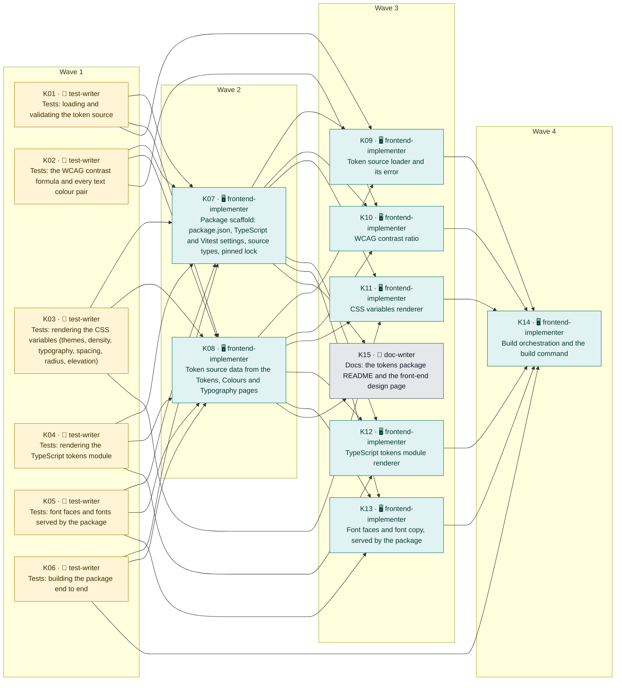

# T0.07: Design tokens package, plan

**Plan:** 🟢 Approved

**Push:** 🟢 Approved

<!-- ticket:specs -->
## 📚 Specifications

The specification and design pages of [TICKET.md](TICKET.md), copied by `python3 .claude/scripts/tickets/ticket_refs.py sync`.

- [📜 D41 Indigo primary colour](../../specs/06-decisions/ux/d41-indigo-primary.md)
- [📜 D43 Light and dark modes](../../specs/06-decisions/ux/d43-light-and-dark.md)
- [📜 D42 Density per role](../../specs/06-decisions/ux/d42-density-per-role.md)
- [📜 D44 Typefaces](../../specs/06-decisions/ux/d44-typefaces.md)
- [📜 D46 Accessibility standard](../../specs/06-decisions/ux/d46-accessibility-standard.md)
- [📜 D438 Repository layout](../../specs/06-decisions/technical/d438-repository-layout.md)
- [📜 D407 Front end](../../specs/06-decisions/technical/d407-front-end.md)
- [🏗️ Front end](../../technical/architecture/frontend.md)
- [🏗️ Repository layout](../../technical/architecture/repository-layout.md)
- [🏗️ Supply chain and licences](../../technical/security/supply-chain-and-licences.md)
- [🏗️ Tests and traceability](../../technical/delivery/tests-and-traceability.md)
- [♿ Accessibility](../../specs/05-non-functional/accessibility.md#requirement)
<!-- /ticket:specs -->

## Summary

T0.07 builds `frontend/packages/tokens`. A plain JSON token source (`src/source/tokens.json`) is turned into one `dist/tokens.css` and one `dist/tokens.ts`. The CSS holds the font faces and the colour (light, dark, and dark by device setting), spacing, density (comfortable, compact, phones always comfortable), typography, radius and elevation variables. The TypeScript module holds a `tokens` constant. The seven woff2 font files are copied from the pinned @fontsource packages into `dist/fonts/`, so no font comes from a third party. Wave 1 has six Vitest test-writer tasks: source loader, contrast, CSS renderer, TypeScript renderer, fonts, and an end-to-end build test that covers acceptance criteria 1, 3 and 4. Wave 2 has two tasks: the package scaffold with the source types and pinned lock, and the token data from the Tokens, Colours and Typography pages. Wave 3 has six tasks: the loader, the contrast formula, the three renderers and fonts, and the docs. Wave 4 builds the orchestration and the command line, and runs every check. No screen is touched, so no Playwright task is needed (TKT-21).

## Assumptions

- Fonts are packaged inside frontend/packages/tokens (the roadmap says served by the package itself); the folder name is Claude's name confirmed by the owner (D572).
- T0.01 (ticket graph prerequisite) is taken to provide the pnpm workspace this package joins.
- The token source format and generator tool are unspecified; the most conservative choice is a plain data file read by a small build script.
- The Accessibility budget page has no measures yet (To be specified); only its WCAG 2.2 AA requirement and the contrast ratios of the Colours page are used.
- No screen is built: the ticket touches frontend/ but builds only tokens and fonts, so TICKET.md says so (TKT-21).
- I did not run check_ticket.py myself; the workflow runs it. Anchors used are #s01, #epics and #requirement, taken from the page headings.
- I added tests-evidences/.gitkeep so the empty folder exists in git.
- T0.01 (the only prerequisite in the ticket graph) is taken to provide the root `package.json`, `pnpm-workspace.yaml` with a glob that includes `frontend/packages/*`, and `pnpm-lock.yaml`. K07 changes `pnpm-workspace.yaml` only if that glob is missing.
- T0.02's shared eslint and TypeScript settings in `frontend/packages/config` are not a prerequisite of T0.07, so the package gets its own strict `tsconfig.json` and no `lint` script yet. CI's typescript.yml skips a missing script (`--if-present`). Moving to the shared settings is a follow-up once T0.02 lands.
- The token source format is not specified. The most conservative choice, already recorded in TICKET.md, is a plain JSON data file (`src/source/tokens.json`) read by a small TypeScript build script run with `tsx`. No token tool such as Style Dictionary is added.
- The fonts come from the pinned, OFL-1.1 @fontsource packages (`@fontsource/inter`, `@fontsource/plus-jakarta-sans`, `@fontsource/jetbrains-mono`). They are copied at build time into `dist/fonts/` with their licences, so the package serves them and the browser never calls a third party (D44). The binary woff2 files of the mock-ups are not vendored, because they are stored in Git LFS under `docs/specs/`.
- The font files are the seven the mock-ups load, all in the latin subset: Inter 400, 500 and 600, Plus Jakarta Sans 600, 700 and 800, and JetBrains Mono 400. The Typography scale names no Inter 600 and the specifications name no subset.
- The build output `dist/` is generated and ignored by git, not committed. The TypeScript module is shipped as a `.ts` file (`dist/tokens.ts`) for the Vite-based workspace consumers.
- The npm package name `@simpleerp/tokens` is not stated by the specifications. The folder name `tokens` is the one the phase page gives (D572).
- The CSS variable names follow the token names of the Tokens page with a `--` prefix (`--color-primary`, `--row-height`, `--font-h1`, `--elevation-1`). Names the page leaves open are chosen as `--space-<px>` for the 4 px grid, `--radius-card`, `--radius-field`, `--radius-panel` and `--radius-badge`, `--font-family-heading`, `--font-family-body` and `--font-family-code`, and `--color-surface-raised-1` and `-2` for the raised surfaces.
- The raised surfaces take the dark values of the Tokens page's elevation table (#1E2029 and #282A36). In light they take #FFFFFF, the value the mock-ups use, which the Tokens page does not give.
- The theme is switched with `data-theme="light"` or `"dark"`, as the mock-ups do. Without the attribute, `prefers-color-scheme` applies, which follows the device as D43 requires. Density is switched with `data-density="compact"`, where the mock-ups use a class, and phones (up to 767 px, from the Layout grid breakpoints) always keep comfortable values (Tokens, D42).
- The pairs and minimums of the contrast test are read from the Colours page. On `surface`, each text token must reach the level of the page's "Passes" column: AA 4.5, AAA 7, or 3 for `border-strong` in light. White on primary must reach 4.5. On `surface-alt`, where text also sits, every text token must reach the D46 AA minimum of 4.5, and `border-strong` 3. Light accent is excluded because the page says it is never text. The exact ratios the page prints are not asserted, only the minimums.
- The relative luminance uses the 0.04045 linearisation threshold of the current WCAG 2.x text. The 0.03928 of older versions gives the same ratios to two decimals for these colours.
- No screen is built (TICKET.md: "No screen"), so the plan holds no Playwright task. TKT-21 asks for one only when screens are listed.

<!-- plan:graph -->

> [!NOTE]
> Generated from the json block at the end of this page by `python3 .claude/scripts/tickets/plan.py render`.
> To change a task, edit the json block, then render again: never edit this view by hand.

## Waves

| Wave | Tasks | Agents running at once |
| --- | --- | --- |
| 1 | [K01](#k01), [K02](#k02), [K03](#k03), [K04](#k04), [K05](#k05), [K06](#k06) | 6 of 6 |
| 2 | [K07](#k07), [K08](#k08) | 2 of 2 |
| 3 | [K09](#k09), [K10](#k10), [K11](#k11), [K12](#k12), [K13](#k13), [K15](#k15) | 6 of 6 |
| 4 | [K14](#k14) | 1 of 1 |

| Wave | Task | Agent | Depends on | Unblocks |
| --- | --- | --- | --- | --- |
| 1 | [K01](#k01) Tests: loading and validating the token source | 🧪 test-writer | none | [K07](#k07), [K08](#k08), [K09](#k09) |
| 1 | [K02](#k02) Tests: the WCAG contrast formula and every text colour pair | 🧪 test-writer | none | [K07](#k07), [K08](#k08), [K10](#k10) |
| 1 | [K03](#k03) Tests: rendering the CSS variables (themes, density, typography, spacing, radius, elevation) | 🧪 test-writer | none | [K07](#k07), [K08](#k08), [K11](#k11) |
| 1 | [K04](#k04) Tests: rendering the TypeScript tokens module | 🧪 test-writer | none | [K07](#k07), [K08](#k08), [K12](#k12) |
| 1 | [K05](#k05) Tests: font faces and fonts served by the package | 🧪 test-writer | none | [K07](#k07), [K08](#k08), [K13](#k13) |
| 1 | [K06](#k06) Tests: building the package end to end | 🧪 test-writer | none | [K07](#k07), [K08](#k08), [K14](#k14) |
| 2 | [K07](#k07) Package scaffold: package.json, TypeScript and Vitest settings, source types, pinned lock | 🖥️ frontend-implementer | [K01](#k01), [K02](#k02), [K03](#k03), [K04](#k04), [K05](#k05), [K06](#k06) | [K09](#k09), [K10](#k10), [K11](#k11), [K12](#k12), [K13](#k13), [K15](#k15) |
| 2 | [K08](#k08) Token source data from the Tokens, Colours and Typography pages | 🖥️ frontend-implementer | [K01](#k01), [K02](#k02), [K03](#k03), [K04](#k04), [K05](#k05), [K06](#k06) | [K09](#k09), [K10](#k10), [K11](#k11), [K12](#k12), [K13](#k13), [K15](#k15) |
| 3 | [K09](#k09) Token source loader and its error | 🖥️ frontend-implementer | [K01](#k01), [K07](#k07), [K08](#k08) | [K14](#k14) |
| 3 | [K10](#k10) WCAG contrast ratio | 🖥️ frontend-implementer | [K02](#k02), [K07](#k07), [K08](#k08) | [K14](#k14) |
| 3 | [K11](#k11) CSS variables renderer | 🖥️ frontend-implementer | [K03](#k03), [K07](#k07), [K08](#k08) | [K14](#k14) |
| 3 | [K12](#k12) TypeScript tokens module renderer | 🖥️ frontend-implementer | [K04](#k04), [K07](#k07), [K08](#k08) | [K14](#k14) |
| 3 | [K13](#k13) Font faces and font copy, served by the package | 🖥️ frontend-implementer | [K05](#k05), [K07](#k07), [K08](#k08) | [K14](#k14) |
| 3 | [K15](#k15) Docs: the tokens package README and the front-end design page | 📝 doc-writer | [K07](#k07), [K08](#k08) | none |
| 4 | [K14](#k14) Build orchestration and the build command | 🖥️ frontend-implementer | [K06](#k06), [K09](#k09), [K10](#k10), [K11](#k11), [K12](#k12), [K13](#k13) | none |

## Dependency graph



## Tasks

### <a id="k01"></a>K01: Tests: loading and validating the token source

| Agent | Wave | Depends on | Unblocks |
| --- | --- | --- | --- |
| 🧪 test-writer | 1 | none | [K07](#k07), [K08](#k08), [K09](#k09) |

**Files** (only this task may change them in its wave):

- `frontend/packages/tokens/tests/source/load-source.test.ts`

**Done when:** `frontend/packages/tokens/tests/source/load-source.test.ts` exists with the cases above, importing `loadSource` from `../../src/source/load-source` and `TokenSourceError` from `../../src/source/token-source-error`. It fails only because those modules are missing (checked once the scaffold K07 lands: `pnpm --filter ./frontend/packages/tokens exec vitest run tests/source/load-source.test.ts` fails on the missing import, not on a syntax error).

**Brief:**

Write the Vitest tests of the token source loader, before it exists. Ticket: docs/tickets/T0.07/TICKET.md. Specification pages applied: Tokens docs/specs/04-ux/design-system/tokens.md (4 px grid, density table, typography and elevation tokens); D43 docs/specs/06-decisions/ux/d43-light-and-dark.md ("every colour has a light and a dark value"); D42 docs/specs/06-decisions/ux/d42-density-per-role.md (density is a token set, comfortable and compact); D407 docs/specs/06-decisions/technical/d407-front-end.md and docs/technical/architecture/frontend.md (TypeScript); docs/technical/delivery/tests-and-traceability.md (tests first, named as sentences, real things over mocks).

Contract the tests target (it does not exist yet):
- `src/source/load-source.ts` exports `loadSource(path: string): TokenSource`. It reads a JSON file and returns it typed. It throws `TokenSourceError` (from `src/source/token-source-error.ts`, a subclass of `Error` with a readonly `field: string` holding the dotted path of the bad field, such as `colors.primary.dark`, and a message starting `Invalid <field>:`).
- `TokenSource` (from `src/source/token-source.ts`): `{ colors: Record<string, {light: string; dark: string}>; spacing: number[]; density: Record<string, {comfortable: number; compact: number}>; typography: { families: Record<"heading"|"body"|"code", string>; styles: Record<string, {family: "heading"|"body"|"code"; sizePx: number; lineHeightPx: number; weight: number}> }; radius: Record<string, string>; elevation: Record<string, {light: string; dark: string}>; fonts: Array<{family: string; weight: number; file: string; package: string}> }`.
- Rules the loader enforces: the top-level keys are exactly colors, spacing, density, typography, radius, elevation and fonts, and an unknown or missing key is refused. Each colour has a non-empty `light` and `dark` value, each `#RRGGBB` (D43). Spacing is a non-empty array of positive integers, each a multiple of 4 (the 4 px grid of Tokens). Each density entry has positive integer `comfortable` and `compact` values. Each style's `family` is one of the three family keys, `sizePx` and `lineHeightPx` are positive integers, and `weight` is a multiple of 100 from 100 to 900. Each radius matches `^[0-9]+px$`. Each elevation has non-empty `light` and `dark` strings. Each font entry has a non-empty family and package, a weight as above, and a `file` ending in `.woff2`. A file that is not valid JSON or cannot be read is refused with `field` set to `""`. The loader never checks contrast, so a valid but low-contrast colour is accepted.

Tests to write, in one `describe("loadSource")`, named as sentences. Write fixture files in a temp folder (`fs.mkdtempSync(os.tmpdir())`), with no mocks:
- The real source `src/source/tokens.json` loads, with 7 spacing steps and 4 density entries (resolve the path from `import.meta.url`).
- A minimal valid fixture loads and is returned unchanged.
- `it.each` refusals, each asserting `TokenSourceError` and its exact `field`: a colour without `dark` (`colors.primary.dark`), a colour `#4B4FC` (bad hex), spacing `6`, spacing `0`, density compact `-1`, a style family `display-font`, weight `450`, radius `8`, a font file `inter.ttf`, an unknown top-level key `shadows`, a missing `fonts` key, and invalid JSON.
- A colour `#FFFF00` on a `#FFFFFF` surface is accepted (contrast is not the loader's concern).
Import only from `vitest`, `node:*` and `../../src/source/...`. Use extensionless relative imports (moduleResolution Bundler).

### <a id="k02"></a>K02: Tests: the WCAG contrast formula and every text colour pair

| Agent | Wave | Depends on | Unblocks |
| --- | --- | --- | --- |
| 🧪 test-writer | 1 | none | [K07](#k07), [K08](#k08), [K10](#k10) |

**Files** (only this task may change them in its wave):

- `frontend/packages/tokens/tests/contrast/contrast-ratio.test.ts`
- `frontend/packages/tokens/tests/contrast/palette-contrast.test.ts`

**Done when:** Both files exist with the cases above. Once K07, K08 and K10 land, `pnpm --filter ./frontend/packages/tokens exec vitest run tests/contrast` passes. Before that, the files fail only on the missing `src/contrast/contrast-ratio` module.

**Brief:**

Write the Vitest tests of acceptance criterion 2 of docs/tickets/T0.07/TICKET.md, before the code exists. Pages applied: Colours docs/specs/04-ux/visual-identity/colours.md (the light and dark tables, their "Passes" column and the Contrast section); D46 docs/specs/06-decisions/ux/d46-accessibility-standard.md (WCAG 2.2 AA: 4.5:1 text, 3:1 large text and UI parts); D43 docs/specs/06-decisions/ux/d43-light-and-dark.md (both themes meet the contrast rules); D41 docs/specs/06-decisions/ux/d41-indigo-primary.md; the Accessibility budget docs/specs/05-non-functional/accessibility.md#requirement; Tokens docs/specs/04-ux/design-system/tokens.md.

Contract: `src/contrast/contrast-ratio.ts` exports `relativeLuminance(hex: string): number` and `contrastRatio(foreground: string, background: string): number`. They implement the WCAG 2.x formula: sRGB channels over 255, linearised with the 0.04045 threshold, L = 0.2126 R + 0.7152 G + 0.0722 B, and the ratio is (Lmax + 0.05) / (Lmin + 0.05). Both throw an `Error` on anything but `#RRGGBB`, case-insensitive. The token source `src/source/tokens.json` has the shape `{ colors: Record<key, {light, dark}>, ... }`, with the keys primary, accent, success, error, warning, text, text-muted, surface, surface-alt, border, border-strong (plus surface-raised-1 and surface-raised-2).

1. `contrast-ratio.test.ts`, `describe("contrastRatio")`: black on white is 21 and white on white is 1 (`toBeCloseTo(_, 2)`). The ratio is symmetric. `relativeLuminance("#FFFFFF")` is 1 and `#000000` is 0. `#4B4FC9` on `#FFFFFF` is above 6.4 and below 6.5 (the 6.44:1 of Colours). Lower-case hex gives the same ratio. `it.each` invalid inputs (`#FFF`, `4B4FC9`, `#GGGGGG`, empty string) throw.
2. `palette-contrast.test.ts`, `describe("text colour pairs")`: read `../../src/source/tokens.json` with `readFileSync` and `JSON.parse`, not through `loadSource`. Using `it.each`, write one row per pair with a readable name, and assert that the ratio is at least the minimum. The pairs and minimums come from the Colours page:
   - Light, on `colors.surface.light`: primary, success, error, warning and text-muted at 4.5 (AA text); text at 7 (AAA); border-strong at 3 (WCAG 1.4.11, UI). Accent is decoration only in light and is not a text pair.
   - White text `#FFFFFF` on `colors.primary.light` at 4.5.
   - Dark, on `colors.surface.dark`: primary, accent, success, error, warning, text and text-muted at 7 (AAA, as the page lists); border-strong at 4.5.
   - On `colors.surface-alt` (sidebar and table stripes, where text sits), in each theme: every text token of that theme above at 4.5 (light accent excluded), and border-strong at 3.
   Do not assert the exact ratios the page prints, only these minimums. Each test name shows the theme, foreground token, background token and minimum.
Import only from `vitest`, `node:*` and `../../src/contrast/contrast-ratio`.

### <a id="k03"></a>K03: Tests: rendering the CSS variables (themes, density, typography, spacing, radius, elevation)

| Agent | Wave | Depends on | Unblocks |
| --- | --- | --- | --- |
| 🧪 test-writer | 1 | none | [K07](#k07), [K08](#k08), [K11](#k11) |

**Files** (only this task may change them in its wave):

- `frontend/packages/tokens/tests/generate/render-css.test.ts`

**Done when:** The file exists with the cases above. Once K07, K08 and K11 land, `pnpm --filter ./frontend/packages/tokens exec vitest run tests/generate/render-css.test.ts` passes. Before that, it fails only on the missing `src/generate/render-css` module.

**Brief:**

Write the Vitest tests of the CSS renderer, before it exists, for acceptance criterion 4 of docs/tickets/T0.07/TICKET.md. Pages applied: Tokens docs/specs/04-ux/design-system/tokens.md (colour table, spacing, density table, typography tokens, radius and elevation, dark elevation as lighter surfaces); Typography docs/specs/04-ux/visual-identity/typography.md (scale); D41 docs/specs/06-decisions/ux/d41-indigo-primary.md; D42 docs/specs/06-decisions/ux/d42-density-per-role.md (comfortable and compact token sets, phones always comfortable); D43 docs/specs/06-decisions/ux/d43-light-and-dark.md (light and dark following the device, with a manual switch); the Layout grid breakpoints docs/specs/04-ux/design-system/layout-grid.md (phone up to 767 px).

Contract: `src/generate/render-css.ts` exports `renderCss(source: TokenSource): string` (types from `src/source/token-source.ts`, see the K01 contract: colors, spacing, density, typography.families and styles, radius, elevation, fonts). It writes these rule blocks, in this order, one declaration per line `--name: value;`:
1. `:root` with `--space-<n>: <n>px` per spacing step; `--radius-<key>: <value>`; `--font-family-<heading|body|code>: <family stack>`; and `--font-<style key>: <weight> <sizePx>px/<lineHeightPx>px <family stack of the style's family>` (for example `--font-display: 800 40px/48px "Plus Jakarta Sans", sans-serif;`).
2. `:root, [data-theme="light"]` with `--color-<key>: <light>` for every colour, and `--elevation-<key>: <light>`.
3. `[data-theme="dark"]` with the dark values of the same names.
4. `@media (prefers-color-scheme: dark)` holding `:root:not([data-theme="light"])` with the same dark declarations.
5. `:root, [data-density="comfortable"]` with `--<density key>: <comfortable>px`.
6. `@media (min-width: 768px)` holding `[data-density="compact"]` with `--<density key>: <compact>px`. Phones, up to 767 px, keep comfortable.
Values are written as they are in the source, never changed.

Tests, `describe("renderCss")`. Read `../../src/source/tokens.json` with `readFileSync` and `JSON.parse`, cast to `TokenSource`, and do not use `loadSource`. Write a small block-extraction helper in the test file that finds a selector's body, tolerant of whitespace. Then check:
- Every colour key appears in the light block with its light value, and in the dark block and the prefers-color-scheme block with its dark value. Use `it.each` over the 11 colour tokens of the Tokens page with their exact values (for example `color-primary` `#4B4FC9` and `#A3A6FF`, `color-border-strong` `#7A7F92` and `#7C8096`), plus `color-surface-raised-1` and `-2`.
- `--elevation-1` and `--elevation-2` carry the Tokens page shadows in light and `none` in dark.
- The spacing steps 4, 8, 12, 16, 24, 32 and 48 appear as `--space-4: 4px` through `--space-48: 48px`.
- The density blocks hold row-height 48 and 32, cell-padding 12 and 6, field-height 44 and 32, and body-size 16 and 14. The compact block sits inside `@media (min-width: 768px)`.
- The 9 typography tokens font-display, font-h1, font-h2, font-h3, font-body, font-body-compact, font-label, font-caption and font-code carry the scale of Typography (for example `--font-h3: 600 20px/28px "Plus Jakarta Sans", sans-serif`, `--font-code: 400 14px/20px "JetBrains Mono", monospace`).
- The radius tokens are card 8px, field 8px, panel 12px and badge 9999px.
- Changing `colors.primary.light` to `#123456` in an in-memory copy changes the output to `--color-primary: #123456`.
- The output holds no `url(` and no `http`.
Import only from `vitest`, `node:*`, `../../src/generate/render-css` and `../../src/source/token-source`.

### <a id="k04"></a>K04: Tests: rendering the TypeScript tokens module

| Agent | Wave | Depends on | Unblocks |
| --- | --- | --- | --- |
| 🧪 test-writer | 1 | none | [K07](#k07), [K08](#k08), [K12](#k12) |

**Files** (only this task may change them in its wave):

- `frontend/packages/tokens/tests/generate/render-typescript.test.ts`

**Done when:** The file exists with the cases above. Once K07, K08 and K12 land, `pnpm --filter ./frontend/packages/tokens exec vitest run tests/generate/render-typescript.test.ts` passes. Before that, it fails only on the missing `src/generate/render-typescript` module.

**Brief:**

Write the Vitest tests of the TypeScript module renderer, before it exists, for acceptance criteria 1 and 4 of docs/tickets/T0.07/TICKET.md (the tokens as a TypeScript module, in light and dark). Pages applied: Tokens docs/specs/04-ux/design-system/tokens.md; D43 docs/specs/06-decisions/ux/d43-light-and-dark.md; D42 docs/specs/06-decisions/ux/d42-density-per-role.md; D407 docs/specs/06-decisions/technical/d407-front-end.md and docs/technical/architecture/frontend.md (TypeScript, components built on the tokens).

Contract: `src/generate/render-typescript.ts` exports `renderTypeScript(source: TokenSource): string` (types from `src/source/token-source.ts`, see the K01 contract). It returns the text of a module that:
- starts with the comment line `// Generated from src/source/tokens.json by src/build/main.ts. Do not edit.`;
- exports `export const tokens = { ... } as const;` and `export type Tokens = typeof tokens;`.
`tokens` has this shape: `color: { light: {<colour key>: hex}, dark: {...} }`, `space: number[]` (px), `density: { comfortable: {<density key>: number}, compact: {...} }`, `font: { families: {heading, body, code}, styles: {<style key>: {family, sizePx, lineHeightPx, weight}} }`, `radius: {<key>: string}`, and `elevation: { light: {<key>: string}, dark: {...} }`. Every value is copied unchanged from the source.

Tests, `describe("renderTypeScript")`. Read `../../src/source/tokens.json` with `readFileSync` and `JSON.parse`, cast to `TokenSource`, and do not use `loadSource`.
- The output starts with the generated-file comment.
- Written to a temp `tokens.ts`, it type-checks with no diagnostics under `typescript`'s `ts.createProgram([file], { strict: true, noEmit: true, target: ts.ScriptTarget.ES2022, module: ts.ModuleKind.ESNext })`.
- Transpiled with `ts.transpileModule`, written to a temp `.mjs` file and imported with `await import(pathToFileURL(file).href)`, `tokens.color.light.primary` is `#4B4FC9` and `tokens.color.dark.primary` is `#A3A6FF`. Check every colour key in both themes with `it.each`, and `tokens.density.compact["row-height"]` 32, `tokens.density.comfortable["body-size"]` 16, `tokens.font.styles.display` `{ family: "heading", sizePx: 40, lineHeightPx: 48, weight: 800 }`, `tokens.space` `[4, 8, 12, 16, 24, 32, 48]`, `tokens.radius.panel` `12px`, and `tokens.elevation.dark["1"]` `none`.
- A copy of the source with `colors.primary.light` set to `#123456` gives `tokens.color.light.primary === "#123456"`.
- The `tokens` object holds no `fonts` key.
Import only from `vitest`, `node:*`, `typescript`, `../../src/generate/render-typescript` and `../../src/source/token-source`.

### <a id="k05"></a>K05: Tests: font faces and fonts served by the package

| Agent | Wave | Depends on | Unblocks |
| --- | --- | --- | --- |
| 🧪 test-writer | 1 | none | [K07](#k07), [K08](#k08), [K13](#k13) |

**Files** (only this task may change them in its wave):

- `frontend/packages/tokens/tests/generate/render-font-faces.test.ts`
- `frontend/packages/tokens/tests/generate/copy-fonts.test.ts`

**Done when:** Both files exist with the cases above. Once K07, K08 and K13 land, `pnpm --filter ./frontend/packages/tokens exec vitest run tests/generate/render-font-faces.test.ts tests/generate/copy-fonts.test.ts` passes. Before that, they fail only on the missing `src/generate` modules.

**Brief:**

Write the Vitest tests of the font faces and the font copy, before they exist, for acceptance criterion 3 of docs/tickets/T0.07/TICKET.md. Pages applied: D44 docs/specs/06-decisions/ux/d44-typefaces.md (Plus Jakarta Sans, Inter and JetBrains Mono "all served by SimpleERP itself (no call to Google Fonts)"; the font files ship in the images); Typography docs/specs/04-ux/visual-identity/typography.md (the weights of the scale); docs/technical/security/supply-chain-and-licences.md (pinned dependencies, licences compatible with AGPL-3.0).

Contract:
- `src/generate/render-font-faces.ts` exports `renderFontFaces(source: TokenSource, fontsUrl = "./fonts"): string`. It writes one `@font-face` block per `source.fonts` entry, with `font-family: "<family>";`, `font-style: normal;`, `font-weight: <weight>;`, `font-display: swap;` and `src: url("<fontsUrl>/<file>") format("woff2");`.
- `src/generate/copy-fonts.ts` exports `copyFonts(source: TokenSource, outDir: string): string[]`. It copies each entry's file from the installed package (`<package root>/files/<file>`, where the package root is found with `createRequire(import.meta.url).resolve("<package>/package.json")`) into `<outDir>/fonts/<file>`. It also copies each distinct package's `LICENSE` into `<outDir>/fonts/LICENSE-<package name without scope>` (for example `LICENSE-inter`), and returns the written paths.
- It throws `FontFileMissingError` (from `src/generate/font-file-missing-error.ts`, a subclass of `Error` with readonly `file: string`) when a file or a licence is missing.
- The source's `fonts` are the seven files the mock-ups use (docs/specs/04-ux/mockups/assets/fonts): `inter-latin-400-normal.woff2`, `inter-latin-500-normal.woff2` and `inter-latin-600-normal.woff2` (`@fontsource/inter`); `plus-jakarta-sans-latin-600-normal.woff2`, `-700-` and `-800-` (`@fontsource/plus-jakarta-sans`); and `jetbrains-mono-latin-400-normal.woff2` (`@fontsource/jetbrains-mono`).

Tests. Read `../../src/source/tokens.json` with `readFileSync` and `JSON.parse`, cast to `TokenSource`, and do not use `loadSource`.
1. `render-font-faces.test.ts`, `describe("renderFontFaces")`: there are 7 `@font-face` blocks. The families "Plus Jakarta Sans", "Inter" and "JetBrains Mono" each appear, with the weights 600, 700 and 800, then 400, 500 and 600, then 400. Every `url(...)` is relative and starts with `./fonts/`. No `http:`, `https:`, `//` URL or `@import` appears anywhere (no third party, D44). A custom `fontsUrl` of `/assets/fonts` is used in every url.
2. `copy-fonts.test.ts`, `describe("copyFonts")`: into a temp folder, it writes the 7 woff2 files and 3 licence files. Each woff2 is non-empty and starts with the bytes `wOF2`. Each licence mentions `SIL Open Font License` (case-insensitive). The returned paths are exactly the files written. A source whose entry names `inter-latin-999-normal.woff2` throws `FontFileMissingError` with that `file`. Running it twice into the same folder succeeds.
Import only from `vitest`, `node:*`, `../../src/generate/...` and `../../src/source/token-source`.

### <a id="k06"></a>K06: Tests: building the package end to end

| Agent | Wave | Depends on | Unblocks |
| --- | --- | --- | --- |
| 🧪 test-writer | 1 | none | [K07](#k07), [K08](#k08), [K14](#k14) |

**Files** (only this task may change them in its wave):

- `frontend/packages/tokens/tests/build/build-tokens.test.ts`
- `.gitignore`

**Done when:** The file exists with the cases above. Once K14 lands, `pnpm --filter ./frontend/packages/tokens exec vitest run tests/build/build-tokens.test.ts` passes. Before that, it fails only on the missing `src/build/build-tokens` module.

**Brief:**

Write the Vitest tests of the whole build, before it exists. They cover acceptance criteria 1, 3 and 4 of docs/tickets/T0.07/TICKET.md. Pages applied: Tokens docs/specs/04-ux/design-system/tokens.md; Colours docs/specs/04-ux/visual-identity/colours.md; Typography docs/specs/04-ux/visual-identity/typography.md; D41 docs/specs/06-decisions/ux/d41-indigo-primary.md; D42 docs/specs/06-decisions/ux/d42-density-per-role.md; D43 docs/specs/06-decisions/ux/d43-light-and-dark.md; D44 docs/specs/06-decisions/ux/d44-typefaces.md; D438 docs/specs/06-decisions/technical/d438-repository-layout.md (the package at `frontend/packages/tokens`); docs/technical/delivery/tests-and-traceability.md.

Contract: `src/build/build-tokens.ts` exports `buildTokens(options: { sourcePath: string; outDir: string }): { files: string[] }`. It loads the source with `loadSource`, then writes:
- `<outDir>/tokens.css`: the `@font-face` rules (font urls `./fonts/<file>`) followed by the CSS variables. The selectors are `:root` (spacing `--space-<n>`, radius `--radius-<key>`, `--font-family-*`, `--font-<style>`), `:root, [data-theme="light"]`, `[data-theme="dark"]`, `@media (prefers-color-scheme: dark) { :root:not([data-theme="light"]) }`, `:root, [data-density="comfortable"]` and `@media (min-width: 768px) { [data-density="compact"] }`.
- `<outDir>/tokens.ts`: `export const tokens = {...} as const`, with `color.light`/`color.dark`, `space`, `density.comfortable`/`compact`, `font.families`/`styles`, `radius`, and `elevation.light`/`dark`.
- `<outDir>/fonts/`: the 7 woff2 files and the `LICENSE-<name>` files.
It replaces `<outDir>/fonts` on each run, and returns every written path. It throws `TokenSourceError` (`src/source/token-source-error.ts`) on an invalid source.

Tests, `describe("buildTokens")`, each building into a fresh temp folder (`fs.mkdtempSync`):
- Spec conformance (criterion 4): built from the real source (`../../src/source/tokens.json`, resolved from `import.meta.url`), `tokens.css` holds, with `it.each`:
  - the 11 colour tokens of the Tokens page with their exact light and dark values in the light and dark blocks;
  - the 4 density tokens comfortable 48, 12, 44 and 16 px and compact 32, 6, 32 and 14 px;
  - the 9 typography tokens of the Typography scale;
  - the radius values 8, 8, 12 and 9999 px;
  - elevation 1 and 2 with the Tokens page shadows in light and `none` in dark;
  - the 7 spacing steps.
  `tokens.ts`, transpiled with `typescript`'s `transpileModule` into a temp `.mjs` and imported, carries the same colour, density and typography values.
- Changing a value (criterion 1): copy the source to a temp file, set `colors.primary.light` to `#123456` and `density.row-height.compact` to 28, and build. `tokens.css` has `--color-primary: #123456` and `--row-height: 28px`, and the imported `tokens.ts` has `color.light.primary === "#123456"` and `density.compact["row-height"] === 28`. The original value no longer appears for primary light.
- Fonts served by the package (criterion 3): `fonts/` holds the 7 woff2 files, each starting with `wOF2`, and 3 licences. Every `url(...)` of `tokens.css` is relative and resolves to an existing file under the out folder. Neither `tokens.css` nor `tokens.ts` holds `http:`, `https:`, `//fonts.`, `googleapis` or a remote `@import`. Each family named in `--font-family-heading`, `--font-family-body` and `--font-family-code` has at least one `@font-face`.
- An invalid source (a colour without `dark`) throws `TokenSourceError` and writes no `tokens.css`.
- Building twice into the same folder gives the same `tokens.css` and `tokens.ts`.
Import only from `vitest`, `node:*`, `typescript`, `../../src/build/build-tokens` and `../../src/source/token-source-error`.

Plan change of 2026-11-27 (owner's P0 approval): the root `.gitignore` rule `build/` ("Python-generated files") ignores every folder named `build`, so `tests/build/` and `src/build/` of this package could not be handed off. Replace that one line by rules limited to the Python packages: `/build/`, `backend/**/build/`, `plugins/**/build/` and `sdk/build/`, and leave every other line unchanged. Check with `git check-ignore -v frontend/packages/tokens/tests/build/build-tokens.test.ts` (must print nothing) and `git check-ignore -q backend/models/build/x` (must still match).

### <a id="k07"></a>K07: Package scaffold: package.json, TypeScript and Vitest settings, source types, pinned lock

| Agent | Wave | Depends on | Unblocks |
| --- | --- | --- | --- |
| 🖥️ frontend-implementer | 2 | [K01](#k01), [K02](#k02), [K03](#k03), [K04](#k04), [K05](#k05), [K06](#k06) | [K09](#k09), [K10](#k10), [K11](#k11), [K12](#k12), [K13](#k13), [K15](#k15) |

**Files** (only this task may change them in its wave):

- `frontend/packages/tokens/package.json`
- `frontend/packages/tokens/tsconfig.json`
- `frontend/packages/tokens/vitest.config.ts`
- `frontend/packages/tokens/.gitignore`
- `frontend/packages/tokens/src/source/token-source.ts`
- `pnpm-lock.yaml`
- `pnpm-workspace.yaml`

**Done when:** At the repository root, `pnpm install --frozen-lockfile` passes. `pnpm --filter ./frontend/packages/tokens exec tsc --version` and `pnpm --filter ./frontend/packages/tokens exec vitest --version` print versions. `node -e "require.resolve('@fontsource/inter/files/inter-latin-400-normal.woff2',{paths:['frontend/packages/tokens']})"` succeeds, as it does for `@fontsource/plus-jakarta-sans/files/plus-jakarta-sans-latin-800-normal.woff2` and `@fontsource/jetbrains-mono/files/jetbrains-mono-latin-400-normal.woff2`. `pnpm --filter ./frontend/packages/tokens exec tsc --noEmit src/source/token-source.ts --strict` passes.

**Brief:**

Create the package `frontend/packages/tokens` in the pnpm workspace that T0.01 provides, and the source types every other task uses. Pages applied: D438 docs/specs/06-decisions/technical/d438-repository-layout.md and docs/technical/architecture/repository-layout.md (`frontend/packages/<pkg>` in the pnpm workspace); D407 docs/specs/06-decisions/technical/d407-front-end.md and docs/technical/architecture/frontend.md (TypeScript, Vite tooling); docs/technical/security/supply-chain-and-licences.md and D415 docs/specs/06-decisions/technical/d415-supply-chain-controls.md (every dependency pinned in the lock, licences compatible with AGPL-3.0); D44 docs/specs/06-decisions/ux/d44-typefaces.md (fonts served by the package); ticket docs/tickets/T0.07/TICKET.md.

- `package.json`: name `@simpleerp/tokens`, `private: true`, `type: module`, `license: AGPL-3.0-only`. `exports`: `".": "./dist/tokens.ts"`, `"./tokens.css": "./dist/tokens.css"`, `"./fonts/*": "./dist/fonts/*"`. Scripts: `build` = `tsx src/build/main.ts`, `typecheck` = `tsc --noEmit`, `test` = `vitest run`. No `lint` script: the shared eslint settings come with T0.02 in `frontend/packages/config`. devDependencies at exact versions (no `^` or `~`): `typescript`, `vitest`, `tsx`, `@types/node`, `@fontsource/inter`, `@fontsource/plus-jakarta-sans` and `@fontsource/jetbrains-mono`. The @fontsource packages are OFL-1.1, and the tools are MIT or Apache-2.0, all compatible with AGPL-3.0. Use versions that install under Node 22. Add `engines.node` `>=22`.
- `tsconfig.json`: `strict`, `noEmit`, `target` and `lib` ES2022, `module` ESNext, `moduleResolution` Bundler, `resolveJsonModule`, `types: ["node"]`, `skipLibCheck`, and `include` `src`, `tests` and `vitest.config.ts`. It does not extend `frontend/packages/config`, which T0.02 builds.
- `vitest.config.ts`: `include: ["tests/**/*.test.ts"]`, `environment: "node"`.
- `.gitignore`: `dist/` and `node_modules/`.
- `src/source/token-source.ts`, types only (no runtime code), each with a TSDoc comment: `ThemeName = "light" | "dark"`, `FontRole = "heading" | "body" | "code"`, `ThemedValue {light: string; dark: string}`, `DensityValue {comfortable: number; compact: number}`, `TypeStyle {family: FontRole; sizePx: number; lineHeightPx: number; weight: number}`, `FontFile {family: string; weight: number; file: string; package: string}`, and `TokenSource {colors: Record<string, ThemedValue>; spacing: number[]; density: Record<string, DensityValue>; typography: {families: Record<FontRole, string>; styles: Record<string, TypeStyle>}; radius: Record<string, string>; elevation: Record<string, ThemedValue>; fonts: FontFile[]}`. Every test of K01 to K06 relies on this exact shape.
- Run `pnpm install` at the root to update `pnpm-lock.yaml`. Change `pnpm-workspace.yaml` only if its globs do not already include `frontend/packages/*`, and then only to add that glob.
Write no other source and no test. Report the versions chosen as decisions.

### <a id="k08"></a>K08: Token source data from the Tokens, Colours and Typography pages

| Agent | Wave | Depends on | Unblocks |
| --- | --- | --- | --- |
| 🖥️ frontend-implementer | 2 | [K01](#k01), [K02](#k02), [K03](#k03), [K04](#k04), [K05](#k05), [K06](#k06) | [K09](#k09), [K10](#k10), [K11](#k11), [K12](#k12), [K13](#k13), [K15](#k15) |

**Files** (only this task may change them in its wave):

- `frontend/packages/tokens/src/source/tokens.json`

**Done when:** `node -e "const s=JSON.parse(require('fs').readFileSync('frontend/packages/tokens/src/source/tokens.json','utf8'));if(Object.keys(s).join()!=='colors,spacing,density,typography,radius,elevation,fonts'||Object.keys(s.colors).length!==13||s.fonts.length!==7||Object.keys(s.typography.styles).length!==9)process.exit(1)"` exits 0, and every value matches the pages listed in the brief.

**Brief:**

Write the single token source the build reads, `frontend/packages/tokens/src/source/tokens.json`, with exactly the values of the specifications. Pages applied: Tokens docs/specs/04-ux/design-system/tokens.md; Colours docs/specs/04-ux/visual-identity/colours.md; Typography docs/specs/04-ux/visual-identity/typography.md; D41 docs/specs/06-decisions/ux/d41-indigo-primary.md (primary #4B4FC9, accent #F2B134, success #2E7D32, error #C62828); D42 docs/specs/06-decisions/ux/d42-density-per-role.md; D43 docs/specs/06-decisions/ux/d43-light-and-dark.md (every colour has a light and a dark value); D44 docs/specs/06-decisions/ux/d44-typefaces.md; ticket docs/tickets/T0.07/TICKET.md.

The shape is `TokenSource` (K07, `src/source/token-source.ts`). Use exactly these top-level keys, in this order:
- `colors`: `{light, dark}` for primary (#4B4FC9 / #A3A6FF), accent (#F2B134 / #F2B134), success (#2E7D32 / #7BC67E), error (#C62828 / #FF8A80), warning (#8A5A00 / #F2C46D), text (#1C1F24 / #ECEDF3), text-muted (#5B6170 / #A6AABA), surface (#FFFFFF / #14151C), surface-alt (#F5F5FB / #1E2029), border (#D9DAE6 / #343747) and border-strong (#7A7F92 / #7C8096). Add the raised surfaces of the Tokens page's elevation table: surface-raised-1 (#FFFFFF / #1E2029) and surface-raised-2 (#FFFFFF / #282A36). Their light value #FFFFFF is the mock-ups' value (docs/specs/04-ux/mockups/src, `--raised-1`/`--raised-2`). Write the hex in upper case, as the pages do.
- `spacing`: [4, 8, 12, 16, 24, 32, 48].
- `density`: row-height {comfortable 48, compact 32}, cell-padding {12, 6}, field-height {44, 32}, body-size {16, 14}.
- `typography.families`: heading `"Plus Jakarta Sans", sans-serif`, body `"Inter", sans-serif`, code `"JetBrains Mono", monospace`. `typography.styles` from the Typography scale: display {heading, 40, 48, 800}, h1 {heading, 32, 40, 700}, h2 {heading, 24, 32, 700}, h3 {heading, 20, 28, 600}, body {body, 16, 24, 400}, body-compact {body, 14, 20, 400}, label {body, 14, 20, 500}, caption {body, 12, 16, 400} and code {code, 14, 20, 400}, as `{family, sizePx, lineHeightPx, weight}`.
- `radius`: card 8px, field 8px, panel 12px, badge 9999px.
- `elevation`: "1" light `0 1px 2px rgba(28,31,36,.06), 0 2px 6px rgba(28,31,36,.08)`, dark `none`; "2" light `0 8px 24px rgba(28,31,36,.14), 0 24px 56px rgba(28,31,36,.16)`, dark `none` (in dark, elevation is shown by lighter surfaces).
- `fonts`: 7 entries `{family, weight, file, package}`: Inter 400, 500 and 600 (`inter-latin-<w>-normal.woff2`, `@fontsource/inter`); Plus Jakarta Sans 600, 700 and 800 (`plus-jakarta-sans-latin-<w>-normal.woff2`, `@fontsource/plus-jakarta-sans`); and JetBrains Mono 400 (`jetbrains-mono-latin-400-normal.woff2`, `@fontsource/jetbrains-mono`). These are the files the mock-ups load.
No other file. Its full checks run once the loader (K09), the contrast formula (K10) and the build (K14) land: the palette contrast test K02 and the build test K06 read it.

### <a id="k09"></a>K09: Token source loader and its error

| Agent | Wave | Depends on | Unblocks |
| --- | --- | --- | --- |
| 🖥️ frontend-implementer | 3 | [K01](#k01), [K07](#k07), [K08](#k08) | [K14](#k14) |

**Files** (only this task may change them in its wave):

- `frontend/packages/tokens/src/source/load-source.ts`
- `frontend/packages/tokens/src/source/token-source-error.ts`

**Done when:** `pnpm --filter ./frontend/packages/tokens exec vitest run tests/source/load-source.test.ts` passes.

**Brief:**

Implement the loader that reads and validates the token source, to make the tests of K01 (`frontend/packages/tokens/tests/source/load-source.test.ts`) pass. Pages applied: Tokens docs/specs/04-ux/design-system/tokens.md (4 px grid, density, typography, radius, elevation); D43 docs/specs/06-decisions/ux/d43-light-and-dark.md (every colour has a light and a dark value); D42 docs/specs/06-decisions/ux/d42-density-per-role.md; D407 docs/specs/06-decisions/technical/d407-front-end.md (TypeScript); ticket docs/tickets/T0.07/TICKET.md.

- `src/source/token-source-error.ts`: `export class TokenSourceError extends Error`, with `readonly field: string` (the dotted path of the bad field, or `""` for an unreadable or invalid JSON file), and `name = "TokenSourceError"`. Messages read `Invalid <field>: <value as JSON>. Must be <rule>.`, in plain British English. Never put a file's whole content in a message.
- `src/source/load-source.ts`: `export function loadSource(path: string): TokenSource` (type from `src/source/token-source.ts`). It reads with `readFileSync(path, "utf-8")` and `JSON.parse`, then validates:
  - the top-level keys are exactly colors, spacing, density, typography, radius, elevation and fonts;
  - every colour has `light` and `dark` matching `^#[0-9A-Fa-f]{6}$`;
  - spacing is a non-empty array of positive integers that are multiples of 4;
  - each density entry has positive integer `comfortable` and `compact`;
  - `typography.families` has heading, body and code as non-empty strings;
  - each style has a known `family`, positive integer `sizePx` and `lineHeightPx`, and a `weight` that is a multiple of 100 in 100 to 900;
  - each radius matches `^[0-9]+px$`;
  - each elevation has non-empty `light` and `dark` strings;
  - each font has a non-empty `family` and `package`, a valid `weight`, and a `file` ending `.woff2`.
  It does not check contrast. Keep each section's validation in its own small function with a TSDoc comment. Reject booleans where numbers are expected.
Change only these two files, and use extensionless relative imports.

### <a id="k10"></a>K10: WCAG contrast ratio

| Agent | Wave | Depends on | Unblocks |
| --- | --- | --- | --- |
| 🖥️ frontend-implementer | 3 | [K02](#k02), [K07](#k07), [K08](#k08) | [K14](#k14) |

**Files** (only this task may change them in its wave):

- `frontend/packages/tokens/src/contrast/contrast-ratio.ts`

**Done when:** `pnpm --filter ./frontend/packages/tokens exec vitest run tests/contrast` passes.

**Brief:**

Implement the WCAG 2.x contrast ratio, to make the tests of K02 pass: `frontend/packages/tokens/tests/contrast/contrast-ratio.test.ts`, and `palette-contrast.test.ts`, which checks every text colour pair of `src/source/tokens.json` in light and dark (acceptance criterion 2 of docs/tickets/T0.07/TICKET.md). Pages applied: Colours docs/specs/04-ux/visual-identity/colours.md ("Contrast ratios below are computed with the WCAG 2.x formula", and the Contrast section); D46 docs/specs/06-decisions/ux/d46-accessibility-standard.md (WCAG 2.2 AA); D43 docs/specs/06-decisions/ux/d43-light-and-dark.md; the Accessibility budget docs/specs/05-non-functional/accessibility.md#requirement.

`src/contrast/contrast-ratio.ts` exports:
- `relativeLuminance(hex: string): number`. It accepts `#RRGGBB` in either case and throws an `Error` naming the bad value otherwise. It takes the channels over 255, linearises c with `c <= 0.04045 ? c / 12.92 : ((c + 0.055) / 1.055) ** 2.4`, and returns `0.2126 R + 0.7152 G + 0.0722 B`.
- `contrastRatio(foreground: string, background: string): number`, which returns `(Lmax + 0.05) / (Lmin + 0.05)`.
Each has a TSDoc comment. Do not change the token values or the tests. If a pair of the real source fails its minimum, report it as blocked, quoting the computed ratio, because the values come from the specifications.

### <a id="k11"></a>K11: CSS variables renderer

| Agent | Wave | Depends on | Unblocks |
| --- | --- | --- | --- |
| 🖥️ frontend-implementer | 3 | [K03](#k03), [K07](#k07), [K08](#k08) | [K14](#k14) |

**Files** (only this task may change them in its wave):

- `frontend/packages/tokens/src/generate/render-css.ts`

**Done when:** `pnpm --filter ./frontend/packages/tokens exec vitest run tests/generate/render-css.test.ts` passes.

**Brief:**

Implement `renderCss`, to make the tests of K03 (`frontend/packages/tokens/tests/generate/render-css.test.ts`) pass. Pages applied: Tokens docs/specs/04-ux/design-system/tokens.md; Typography docs/specs/04-ux/visual-identity/typography.md; D41 docs/specs/06-decisions/ux/d41-indigo-primary.md; D42 docs/specs/06-decisions/ux/d42-density-per-role.md (comfortable and compact sets, phones always comfortable); D43 docs/specs/06-decisions/ux/d43-light-and-dark.md (follows the device's setting, with a manual switch); the Layout grid breakpoints docs/specs/04-ux/design-system/layout-grid.md (phone up to 767 px); ticket docs/tickets/T0.07/TICKET.md (criterion 4).

`src/generate/render-css.ts` exports `renderCss(source: TokenSource): string`, which returns these blocks in this order, one declaration per line `  --name: value;` and a blank line between blocks:
1. `:root` with `--space-<n>: <n>px` per spacing step, `--radius-<key>: <value>`, `--font-family-<role>: <stack>`, and `--font-<style>: <weight> <sizePx>px/<lineHeightPx>px <stack of its family>`.
2. `:root, [data-theme="light"]` with `--color-<key>: <light>` and `--elevation-<key>: <light>`.
3. `[data-theme="dark"]` with the dark values.
4. `@media (prefers-color-scheme: dark) {` around `:root:not([data-theme="light"])` with the dark values.
5. `:root, [data-density="comfortable"]` with `--<key>: <comfortable>px`.
6. `@media (min-width: 768px) {` around `[data-density="compact"]` with `--<key>: <compact>px`.
Values are copied unchanged. The theme declarations are written once by a helper used for blocks 2 to 4. Every function has a TSDoc comment that explains, in its notes, why the attribute selectors and the media queries are used (D43, D42). The source type is `TokenSource` from `src/source/token-source.ts`. Do not import the loader.

### <a id="k12"></a>K12: TypeScript tokens module renderer

| Agent | Wave | Depends on | Unblocks |
| --- | --- | --- | --- |
| 🖥️ frontend-implementer | 3 | [K04](#k04), [K07](#k07), [K08](#k08) | [K14](#k14) |

**Files** (only this task may change them in its wave):

- `frontend/packages/tokens/src/generate/render-typescript.ts`

**Done when:** `pnpm --filter ./frontend/packages/tokens exec vitest run tests/generate/render-typescript.test.ts` passes.

**Brief:**

Implement `renderTypeScript`, to make the tests of K04 (`frontend/packages/tokens/tests/generate/render-typescript.test.ts`) pass. Pages applied: Tokens docs/specs/04-ux/design-system/tokens.md; D42 docs/specs/06-decisions/ux/d42-density-per-role.md; D43 docs/specs/06-decisions/ux/d43-light-and-dark.md; D407 docs/specs/06-decisions/technical/d407-front-end.md and docs/technical/architecture/frontend.md (components built on the tokens, in TypeScript); ticket docs/tickets/T0.07/TICKET.md (criteria 1 and 4).

`src/generate/render-typescript.ts` exports `renderTypeScript(source: TokenSource): string`, which returns:
- the first line `// Generated from src/source/tokens.json by src/build/main.ts. Do not edit.`;
- `export const tokens = {...} as const;`, with `color: {light: {<key>: hex}, dark: {...}}`, `space: [...]`, `density: {comfortable: {<key>: n}, compact: {...}}`, `font: {families: {...}, styles: {<key>: {family, sizePx, lineHeightPx, weight}}}`, `radius: {...}` and `elevation: {light: {...}, dark: {...}}`;
- `export type Tokens = typeof tokens;`.
The theme and density maps are built from the source's per-token `{light, dark}` and `{comfortable, compact}` values. Serialise with `JSON.stringify(value, null, 2)`, so that keys such as `text-muted` stay quoted and the module type-checks under `strict`. Fonts are left out of `tokens`. Every function has a TSDoc comment. The type is `TokenSource` from `src/source/token-source.ts`. Do not import the loader.

### <a id="k13"></a>K13: Font faces and font copy, served by the package

| Agent | Wave | Depends on | Unblocks |
| --- | --- | --- | --- |
| 🖥️ frontend-implementer | 3 | [K05](#k05), [K07](#k07), [K08](#k08) | [K14](#k14) |

**Files** (only this task may change them in its wave):

- `frontend/packages/tokens/src/generate/render-font-faces.ts`
- `frontend/packages/tokens/src/generate/copy-fonts.ts`
- `frontend/packages/tokens/src/generate/font-file-missing-error.ts`

**Done when:** `pnpm --filter ./frontend/packages/tokens exec vitest run tests/generate/render-font-faces.test.ts tests/generate/copy-fonts.test.ts` passes.

**Brief:**

Implement the font faces and the font copy, to make the tests of K05 pass (`frontend/packages/tokens/tests/generate/render-font-faces.test.ts` and `copy-fonts.test.ts`, acceptance criterion 3 of docs/tickets/T0.07/TICKET.md). Pages applied: D44 docs/specs/06-decisions/ux/d44-typefaces.md (the three typefaces "all served by SimpleERP itself (no call to Google Fonts)"; the font files ship in the images); Typography docs/specs/04-ux/visual-identity/typography.md; docs/technical/security/supply-chain-and-licences.md (OFL-1.1 fonts, compatible with AGPL-3.0, and their licence travels with them).

- `src/generate/font-file-missing-error.ts`: `export class FontFileMissingError extends Error` with `readonly file: string` and `name = "FontFileMissingError"`. Its message is `Font file not found: <file>. Install the package <package> with pnpm install.`
- `src/generate/render-font-faces.ts`: `renderFontFaces(source: TokenSource, fontsUrl = "./fonts"): string`. It writes one block per `source.fonts` entry: `@font-face {` with `font-family: "<family>";`, `font-style: normal;`, `font-weight: <weight>;`, `font-display: swap;` and `src: url("<fontsUrl>/<file>") format("woff2");`, then `}`. Never an absolute or remote URL.
- `src/generate/copy-fonts.ts`: `copyFonts(source: TokenSource, outDir: string): string[]`. It finds each package root with `dirname(createRequire(import.meta.url).resolve("<package>/package.json"))`, and copies `<root>/files/<file>` to `<outDir>/fonts/<file>`, creating the folder with `recursive: true`. It copies each distinct package's `LICENSE` to `<outDir>/fonts/LICENSE-<package name without scope>`, and returns the written paths in order. It throws `FontFileMissingError` when a source file is missing, and it overwrites on a second run.
Every function has a TSDoc comment, and the notes say why the fonts are copied from pinned packages rather than linked (D44). Use extensionless relative imports. The type is `TokenSource` from `src/source/token-source.ts`.

### <a id="k15"></a>K15: Docs: the tokens package README and the front-end design page

| Agent | Wave | Depends on | Unblocks |
| --- | --- | --- | --- |
| 📝 doc-writer | 3 | [K07](#k07), [K08](#k08) | none |

**Files** (only this task may change them in its wave):

- `frontend/packages/tokens/README.md`
- `docs/technical/architecture/frontend.md`

**Done when:** `frontend/packages/tokens/README.md` exists with every point above. Every relative link in it and in `docs/technical/architecture/frontend.md` resolves to an existing file. `grep -c 'frontend/packages/tokens' docs/technical/architecture/frontend.md` prints at least 1, and `grep -n '—' frontend/packages/tokens/README.md` prints nothing.

**Brief:**

Document the tokens package. Ticket: docs/tickets/T0.07/TICKET.md. Pages applied: Tokens docs/specs/04-ux/design-system/tokens.md; Colours docs/specs/04-ux/visual-identity/colours.md; Typography docs/specs/04-ux/visual-identity/typography.md; D41 docs/specs/06-decisions/ux/d41-indigo-primary.md; D42 docs/specs/06-decisions/ux/d42-density-per-role.md; D43 docs/specs/06-decisions/ux/d43-light-and-dark.md; D44 docs/specs/06-decisions/ux/d44-typefaces.md; D46 docs/specs/06-decisions/ux/d46-accessibility-standard.md; D407 docs/specs/06-decisions/technical/d407-front-end.md; D438 docs/specs/06-decisions/technical/d438-repository-layout.md; the design page docs/technical/architecture/frontend.md. Follow DOC-2 of `.claude/rules/ticket-documentation.md`: plain British English, no em dashes, specification pages linked by their IDs. `docs/specs/` is read-only.

1. `frontend/packages/tokens/README.md` (new):
   - What the package holds: the colour, spacing, density, typography, radius and elevation tokens of Tokens, light and dark, and the three typefaces served by the package (D44).
   - Where the values live: `src/source/tokens.json`, the only file to edit.
   - How to build and test: `pnpm --filter ./frontend/packages/tokens run build`, `run test` and `run typecheck`.
   - What the build writes: `dist/tokens.css` (font faces and CSS variables), `dist/tokens.ts` (the `tokens` constant) and `dist/fonts/` (woff2 files and their OFL licences).
   - How a front end uses it: import `@simpleerp/tokens/tokens.css` and `import { tokens } from "@simpleerp/tokens"`.
   - Theme: `data-theme="light"` or `"dark"` on the root, and without it the device setting through `prefers-color-scheme` (D43).
   - Density: `data-density="compact"`, with phones under 768 px always comfortable (D42).
   - The CSS variable names: `--color-*`, `--space-*`, `--row-height`, `--cell-padding`, `--field-height`, `--body-size`, `--font-family-*`, `--font-*`, `--radius-*` and `--elevation-*`.
   - Contrast: every text colour pair is checked by a test against the Colours page (D46).
   - A short Mermaid flowchart: tokens.json, then loadSource, then renderCss, renderTypeScript and the fonts, then dist.
2. `docs/technical/architecture/frontend.md`: update only the "Today" section, saying that the design tokens package `frontend/packages/tokens` is built (T0.07) and linking its README. Keep "Target design" unchanged, and update the "Last reviewed" line to today's date.
The names and commands come from the plan of T0.07 (tasks K07 and K08). Check them against the files K07 and K08 wrote in your worktree.

### <a id="k14"></a>K14: Build orchestration and the build command

| Agent | Wave | Depends on | Unblocks |
| --- | --- | --- | --- |
| 🖥️ frontend-implementer | 4 | [K06](#k06), [K09](#k09), [K10](#k10), [K11](#k11), [K12](#k12), [K13](#k13) | none |

**Files** (only this task may change them in its wave):

- `frontend/packages/tokens/src/build/build-tokens.ts`
- `frontend/packages/tokens/src/build/main.ts`

**Done when:** In `frontend/packages/tokens`, `pnpm --filter ./frontend/packages/tokens run test` passes (every test file of the package). `pnpm --filter ./frontend/packages/tokens run typecheck` passes. `pnpm --filter ./frontend/packages/tokens run build` exits 0 and writes `dist/tokens.css`, `dist/tokens.ts` and the 7 woff2 files with their 3 licences in `dist/fonts/`.

**Brief:**

Join the loader and the renderers into the package build, to make the tests of K06 (`frontend/packages/tokens/tests/build/build-tokens.test.ts`, acceptance criteria 1, 3 and 4 of docs/tickets/T0.07/TICKET.md) and every other test of the package pass. Pages applied: Tokens docs/specs/04-ux/design-system/tokens.md; Colours docs/specs/04-ux/visual-identity/colours.md; Typography docs/specs/04-ux/visual-identity/typography.md; D41 docs/specs/06-decisions/ux/d41-indigo-primary.md; D42 docs/specs/06-decisions/ux/d42-density-per-role.md; D43 docs/specs/06-decisions/ux/d43-light-and-dark.md; D44 docs/specs/06-decisions/ux/d44-typefaces.md; D46 docs/specs/06-decisions/ux/d46-accessibility-standard.md; D407 docs/specs/06-decisions/technical/d407-front-end.md; D438 docs/specs/06-decisions/technical/d438-repository-layout.md.

- `src/build/build-tokens.ts`: `buildTokens(options: { sourcePath: string; outDir: string }): { files: string[] }`. It calls `loadSource(sourcePath)` from `src/source/load-source.ts`, before writing anything, so an invalid source leaves no `tokens.css`. Then it creates `outDir` and removes `<outDir>/fonts` only (never the rest of `outDir`). It writes `<outDir>/tokens.css` as `renderFontFaces(source, "./fonts")`, a blank line, then `renderCss(source)`, and `<outDir>/tokens.ts` as `renderTypeScript(source)`. Finally it calls `copyFonts(source, outDir)`, and returns every written path. Output is deterministic, so two builds give identical files.
- `src/build/main.ts`: the command run by `pnpm run build`, as `tsx src/build/main.ts`. It resolves the package root from `import.meta.url`, builds `src/source/tokens.json` into `dist/`, and prints one line per written file. On `TokenSourceError` or `FontFileMissingError` it prints the message to stderr and sets `process.exitCode = 1`.
Every function has a TSDoc comment. Use extensionless relative imports. Change only these two files. If another task's file is wrong, report it as blocked (TKT-19).

<!-- /plan:graph -->

## Task graph

<details>
<summary>🤖 Task graph as read by <code>/ticket-run</code> (json)</summary>

```json
[
  {
    "id": "K01",
    "title": "Tests: loading and validating the token source",
    "agent": "test-writer",
    "depends_on": [],
    "files": [
      "frontend/packages/tokens/tests/source/load-source.test.ts"
    ],
    "brief": "Write the Vitest tests of the token source loader, before it exists. Ticket: docs/tickets/T0.07/TICKET.md. Specification pages applied: Tokens docs/specs/04-ux/design-system/tokens.md (4 px grid, density table, typography and elevation tokens); D43 docs/specs/06-decisions/ux/d43-light-and-dark.md (\"every colour has a light and a dark value\"); D42 docs/specs/06-decisions/ux/d42-density-per-role.md (density is a token set, comfortable and compact); D407 docs/specs/06-decisions/technical/d407-front-end.md and docs/technical/architecture/frontend.md (TypeScript); docs/technical/delivery/tests-and-traceability.md (tests first, named as sentences, real things over mocks).\n\nContract the tests target (it does not exist yet):\n- `src/source/load-source.ts` exports `loadSource(path: string): TokenSource`. It reads a JSON file and returns it typed. It throws `TokenSourceError` (from `src/source/token-source-error.ts`, a subclass of `Error` with a readonly `field: string` holding the dotted path of the bad field, such as `colors.primary.dark`, and a message starting `Invalid <field>:`).\n- `TokenSource` (from `src/source/token-source.ts`): `{ colors: Record<string, {light: string; dark: string}>; spacing: number[]; density: Record<string, {comfortable: number; compact: number}>; typography: { families: Record<\"heading\"|\"body\"|\"code\", string>; styles: Record<string, {family: \"heading\"|\"body\"|\"code\"; sizePx: number; lineHeightPx: number; weight: number}> }; radius: Record<string, string>; elevation: Record<string, {light: string; dark: string}>; fonts: Array<{family: string; weight: number; file: string; package: string}> }`.\n- Rules the loader enforces: the top-level keys are exactly colors, spacing, density, typography, radius, elevation and fonts, and an unknown or missing key is refused. Each colour has a non-empty `light` and `dark` value, each `#RRGGBB` (D43). Spacing is a non-empty array of positive integers, each a multiple of 4 (the 4 px grid of Tokens). Each density entry has positive integer `comfortable` and `compact` values. Each style's `family` is one of the three family keys, `sizePx` and `lineHeightPx` are positive integers, and `weight` is a multiple of 100 from 100 to 900. Each radius matches `^[0-9]+px$`. Each elevation has non-empty `light` and `dark` strings. Each font entry has a non-empty family and package, a weight as above, and a `file` ending in `.woff2`. A file that is not valid JSON or cannot be read is refused with `field` set to `\"\"`. The loader never checks contrast, so a valid but low-contrast colour is accepted.\n\nTests to write, in one `describe(\"loadSource\")`, named as sentences. Write fixture files in a temp folder (`fs.mkdtempSync(os.tmpdir())`), with no mocks:\n- The real source `src/source/tokens.json` loads, with 7 spacing steps and 4 density entries (resolve the path from `import.meta.url`).\n- A minimal valid fixture loads and is returned unchanged.\n- `it.each` refusals, each asserting `TokenSourceError` and its exact `field`: a colour without `dark` (`colors.primary.dark`), a colour `#4B4FC` (bad hex), spacing `6`, spacing `0`, density compact `-1`, a style family `display-font`, weight `450`, radius `8`, a font file `inter.ttf`, an unknown top-level key `shadows`, a missing `fonts` key, and invalid JSON.\n- A colour `#FFFF00` on a `#FFFFFF` surface is accepted (contrast is not the loader's concern).\nImport only from `vitest`, `node:*` and `../../src/source/...`. Use extensionless relative imports (moduleResolution Bundler).",
    "done_when": "`frontend/packages/tokens/tests/source/load-source.test.ts` exists with the cases above, importing `loadSource` from `../../src/source/load-source` and `TokenSourceError` from `../../src/source/token-source-error`. It fails only because those modules are missing (checked once the scaffold K07 lands: `pnpm --filter ./frontend/packages/tokens exec vitest run tests/source/load-source.test.ts` fails on the missing import, not on a syntax error).",
    "wave": 1
  },
  {
    "id": "K02",
    "title": "Tests: the WCAG contrast formula and every text colour pair",
    "agent": "test-writer",
    "depends_on": [],
    "files": [
      "frontend/packages/tokens/tests/contrast/contrast-ratio.test.ts",
      "frontend/packages/tokens/tests/contrast/palette-contrast.test.ts"
    ],
    "brief": "Write the Vitest tests of acceptance criterion 2 of docs/tickets/T0.07/TICKET.md, before the code exists. Pages applied: Colours docs/specs/04-ux/visual-identity/colours.md (the light and dark tables, their \"Passes\" column and the Contrast section); D46 docs/specs/06-decisions/ux/d46-accessibility-standard.md (WCAG 2.2 AA: 4.5:1 text, 3:1 large text and UI parts); D43 docs/specs/06-decisions/ux/d43-light-and-dark.md (both themes meet the contrast rules); D41 docs/specs/06-decisions/ux/d41-indigo-primary.md; the Accessibility budget docs/specs/05-non-functional/accessibility.md#requirement; Tokens docs/specs/04-ux/design-system/tokens.md.\n\nContract: `src/contrast/contrast-ratio.ts` exports `relativeLuminance(hex: string): number` and `contrastRatio(foreground: string, background: string): number`. They implement the WCAG 2.x formula: sRGB channels over 255, linearised with the 0.04045 threshold, L = 0.2126 R + 0.7152 G + 0.0722 B, and the ratio is (Lmax + 0.05) / (Lmin + 0.05). Both throw an `Error` on anything but `#RRGGBB`, case-insensitive. The token source `src/source/tokens.json` has the shape `{ colors: Record<key, {light, dark}>, ... }`, with the keys primary, accent, success, error, warning, text, text-muted, surface, surface-alt, border, border-strong (plus surface-raised-1 and surface-raised-2).\n\n1. `contrast-ratio.test.ts`, `describe(\"contrastRatio\")`: black on white is 21 and white on white is 1 (`toBeCloseTo(_, 2)`). The ratio is symmetric. `relativeLuminance(\"#FFFFFF\")` is 1 and `#000000` is 0. `#4B4FC9` on `#FFFFFF` is above 6.4 and below 6.5 (the 6.44:1 of Colours). Lower-case hex gives the same ratio. `it.each` invalid inputs (`#FFF`, `4B4FC9`, `#GGGGGG`, empty string) throw.\n2. `palette-contrast.test.ts`, `describe(\"text colour pairs\")`: read `../../src/source/tokens.json` with `readFileSync` and `JSON.parse`, not through `loadSource`. Using `it.each`, write one row per pair with a readable name, and assert that the ratio is at least the minimum. The pairs and minimums come from the Colours page:\n   - Light, on `colors.surface.light`: primary, success, error, warning and text-muted at 4.5 (AA text); text at 7 (AAA); border-strong at 3 (WCAG 1.4.11, UI). Accent is decoration only in light and is not a text pair.\n   - White text `#FFFFFF` on `colors.primary.light` at 4.5.\n   - Dark, on `colors.surface.dark`: primary, accent, success, error, warning, text and text-muted at 7 (AAA, as the page lists); border-strong at 4.5.\n   - On `colors.surface-alt` (sidebar and table stripes, where text sits), in each theme: every text token of that theme above at 4.5 (light accent excluded), and border-strong at 3.\n   Do not assert the exact ratios the page prints, only these minimums. Each test name shows the theme, foreground token, background token and minimum.\nImport only from `vitest`, `node:*` and `../../src/contrast/contrast-ratio`.",
    "done_when": "Both files exist with the cases above. Once K07, K08 and K10 land, `pnpm --filter ./frontend/packages/tokens exec vitest run tests/contrast` passes. Before that, the files fail only on the missing `src/contrast/contrast-ratio` module.",
    "wave": 1
  },
  {
    "id": "K03",
    "title": "Tests: rendering the CSS variables (themes, density, typography, spacing, radius, elevation)",
    "agent": "test-writer",
    "depends_on": [],
    "files": [
      "frontend/packages/tokens/tests/generate/render-css.test.ts"
    ],
    "brief": "Write the Vitest tests of the CSS renderer, before it exists, for acceptance criterion 4 of docs/tickets/T0.07/TICKET.md. Pages applied: Tokens docs/specs/04-ux/design-system/tokens.md (colour table, spacing, density table, typography tokens, radius and elevation, dark elevation as lighter surfaces); Typography docs/specs/04-ux/visual-identity/typography.md (scale); D41 docs/specs/06-decisions/ux/d41-indigo-primary.md; D42 docs/specs/06-decisions/ux/d42-density-per-role.md (comfortable and compact token sets, phones always comfortable); D43 docs/specs/06-decisions/ux/d43-light-and-dark.md (light and dark following the device, with a manual switch); the Layout grid breakpoints docs/specs/04-ux/design-system/layout-grid.md (phone up to 767 px).\n\nContract: `src/generate/render-css.ts` exports `renderCss(source: TokenSource): string` (types from `src/source/token-source.ts`, see the K01 contract: colors, spacing, density, typography.families and styles, radius, elevation, fonts). It writes these rule blocks, in this order, one declaration per line `--name: value;`:\n1. `:root` with `--space-<n>: <n>px` per spacing step; `--radius-<key>: <value>`; `--font-family-<heading|body|code>: <family stack>`; and `--font-<style key>: <weight> <sizePx>px/<lineHeightPx>px <family stack of the style's family>` (for example `--font-display: 800 40px/48px \"Plus Jakarta Sans\", sans-serif;`).\n2. `:root, [data-theme=\"light\"]` with `--color-<key>: <light>` for every colour, and `--elevation-<key>: <light>`.\n3. `[data-theme=\"dark\"]` with the dark values of the same names.\n4. `@media (prefers-color-scheme: dark)` holding `:root:not([data-theme=\"light\"])` with the same dark declarations.\n5. `:root, [data-density=\"comfortable\"]` with `--<density key>: <comfortable>px`.\n6. `@media (min-width: 768px)` holding `[data-density=\"compact\"]` with `--<density key>: <compact>px`. Phones, up to 767 px, keep comfortable.\nValues are written as they are in the source, never changed.\n\nTests, `describe(\"renderCss\")`. Read `../../src/source/tokens.json` with `readFileSync` and `JSON.parse`, cast to `TokenSource`, and do not use `loadSource`. Write a small block-extraction helper in the test file that finds a selector's body, tolerant of whitespace. Then check:\n- Every colour key appears in the light block with its light value, and in the dark block and the prefers-color-scheme block with its dark value. Use `it.each` over the 11 colour tokens of the Tokens page with their exact values (for example `color-primary` `#4B4FC9` and `#A3A6FF`, `color-border-strong` `#7A7F92` and `#7C8096`), plus `color-surface-raised-1` and `-2`.\n- `--elevation-1` and `--elevation-2` carry the Tokens page shadows in light and `none` in dark.\n- The spacing steps 4, 8, 12, 16, 24, 32 and 48 appear as `--space-4: 4px` through `--space-48: 48px`.\n- The density blocks hold row-height 48 and 32, cell-padding 12 and 6, field-height 44 and 32, and body-size 16 and 14. The compact block sits inside `@media (min-width: 768px)`.\n- The 9 typography tokens font-display, font-h1, font-h2, font-h3, font-body, font-body-compact, font-label, font-caption and font-code carry the scale of Typography (for example `--font-h3: 600 20px/28px \"Plus Jakarta Sans\", sans-serif`, `--font-code: 400 14px/20px \"JetBrains Mono\", monospace`).\n- The radius tokens are card 8px, field 8px, panel 12px and badge 9999px.\n- Changing `colors.primary.light` to `#123456` in an in-memory copy changes the output to `--color-primary: #123456`.\n- The output holds no `url(` and no `http`.\nImport only from `vitest`, `node:*`, `../../src/generate/render-css` and `../../src/source/token-source`.",
    "done_when": "The file exists with the cases above. Once K07, K08 and K11 land, `pnpm --filter ./frontend/packages/tokens exec vitest run tests/generate/render-css.test.ts` passes. Before that, it fails only on the missing `src/generate/render-css` module.",
    "wave": 1
  },
  {
    "id": "K04",
    "title": "Tests: rendering the TypeScript tokens module",
    "agent": "test-writer",
    "depends_on": [],
    "files": [
      "frontend/packages/tokens/tests/generate/render-typescript.test.ts"
    ],
    "brief": "Write the Vitest tests of the TypeScript module renderer, before it exists, for acceptance criteria 1 and 4 of docs/tickets/T0.07/TICKET.md (the tokens as a TypeScript module, in light and dark). Pages applied: Tokens docs/specs/04-ux/design-system/tokens.md; D43 docs/specs/06-decisions/ux/d43-light-and-dark.md; D42 docs/specs/06-decisions/ux/d42-density-per-role.md; D407 docs/specs/06-decisions/technical/d407-front-end.md and docs/technical/architecture/frontend.md (TypeScript, components built on the tokens).\n\nContract: `src/generate/render-typescript.ts` exports `renderTypeScript(source: TokenSource): string` (types from `src/source/token-source.ts`, see the K01 contract). It returns the text of a module that:\n- starts with the comment line `// Generated from src/source/tokens.json by src/build/main.ts. Do not edit.`;\n- exports `export const tokens = { ... } as const;` and `export type Tokens = typeof tokens;`.\n`tokens` has this shape: `color: { light: {<colour key>: hex}, dark: {...} }`, `space: number[]` (px), `density: { comfortable: {<density key>: number}, compact: {...} }`, `font: { families: {heading, body, code}, styles: {<style key>: {family, sizePx, lineHeightPx, weight}} }`, `radius: {<key>: string}`, and `elevation: { light: {<key>: string}, dark: {...} }`. Every value is copied unchanged from the source.\n\nTests, `describe(\"renderTypeScript\")`. Read `../../src/source/tokens.json` with `readFileSync` and `JSON.parse`, cast to `TokenSource`, and do not use `loadSource`.\n- The output starts with the generated-file comment.\n- Written to a temp `tokens.ts`, it type-checks with no diagnostics under `typescript`'s `ts.createProgram([file], { strict: true, noEmit: true, target: ts.ScriptTarget.ES2022, module: ts.ModuleKind.ESNext })`.\n- Transpiled with `ts.transpileModule`, written to a temp `.mjs` file and imported with `await import(pathToFileURL(file).href)`, `tokens.color.light.primary` is `#4B4FC9` and `tokens.color.dark.primary` is `#A3A6FF`. Check every colour key in both themes with `it.each`, and `tokens.density.compact[\"row-height\"]` 32, `tokens.density.comfortable[\"body-size\"]` 16, `tokens.font.styles.display` `{ family: \"heading\", sizePx: 40, lineHeightPx: 48, weight: 800 }`, `tokens.space` `[4, 8, 12, 16, 24, 32, 48]`, `tokens.radius.panel` `12px`, and `tokens.elevation.dark[\"1\"]` `none`.\n- A copy of the source with `colors.primary.light` set to `#123456` gives `tokens.color.light.primary === \"#123456\"`.\n- The `tokens` object holds no `fonts` key.\nImport only from `vitest`, `node:*`, `typescript`, `../../src/generate/render-typescript` and `../../src/source/token-source`.",
    "done_when": "The file exists with the cases above. Once K07, K08 and K12 land, `pnpm --filter ./frontend/packages/tokens exec vitest run tests/generate/render-typescript.test.ts` passes. Before that, it fails only on the missing `src/generate/render-typescript` module.",
    "wave": 1
  },
  {
    "id": "K05",
    "title": "Tests: font faces and fonts served by the package",
    "agent": "test-writer",
    "depends_on": [],
    "files": [
      "frontend/packages/tokens/tests/generate/render-font-faces.test.ts",
      "frontend/packages/tokens/tests/generate/copy-fonts.test.ts"
    ],
    "brief": "Write the Vitest tests of the font faces and the font copy, before they exist, for acceptance criterion 3 of docs/tickets/T0.07/TICKET.md. Pages applied: D44 docs/specs/06-decisions/ux/d44-typefaces.md (Plus Jakarta Sans, Inter and JetBrains Mono \"all served by SimpleERP itself (no call to Google Fonts)\"; the font files ship in the images); Typography docs/specs/04-ux/visual-identity/typography.md (the weights of the scale); docs/technical/security/supply-chain-and-licences.md (pinned dependencies, licences compatible with AGPL-3.0).\n\nContract:\n- `src/generate/render-font-faces.ts` exports `renderFontFaces(source: TokenSource, fontsUrl = \"./fonts\"): string`. It writes one `@font-face` block per `source.fonts` entry, with `font-family: \"<family>\";`, `font-style: normal;`, `font-weight: <weight>;`, `font-display: swap;` and `src: url(\"<fontsUrl>/<file>\") format(\"woff2\");`.\n- `src/generate/copy-fonts.ts` exports `copyFonts(source: TokenSource, outDir: string): string[]`. It copies each entry's file from the installed package (`<package root>/files/<file>`, where the package root is found with `createRequire(import.meta.url).resolve(\"<package>/package.json\")`) into `<outDir>/fonts/<file>`. It also copies each distinct package's `LICENSE` into `<outDir>/fonts/LICENSE-<package name without scope>` (for example `LICENSE-inter`), and returns the written paths.\n- It throws `FontFileMissingError` (from `src/generate/font-file-missing-error.ts`, a subclass of `Error` with readonly `file: string`) when a file or a licence is missing.\n- The source's `fonts` are the seven files the mock-ups use (docs/specs/04-ux/mockups/assets/fonts): `inter-latin-400-normal.woff2`, `inter-latin-500-normal.woff2` and `inter-latin-600-normal.woff2` (`@fontsource/inter`); `plus-jakarta-sans-latin-600-normal.woff2`, `-700-` and `-800-` (`@fontsource/plus-jakarta-sans`); and `jetbrains-mono-latin-400-normal.woff2` (`@fontsource/jetbrains-mono`).\n\nTests. Read `../../src/source/tokens.json` with `readFileSync` and `JSON.parse`, cast to `TokenSource`, and do not use `loadSource`.\n1. `render-font-faces.test.ts`, `describe(\"renderFontFaces\")`: there are 7 `@font-face` blocks. The families \"Plus Jakarta Sans\", \"Inter\" and \"JetBrains Mono\" each appear, with the weights 600, 700 and 800, then 400, 500 and 600, then 400. Every `url(...)` is relative and starts with `./fonts/`. No `http:`, `https:`, `//` URL or `@import` appears anywhere (no third party, D44). A custom `fontsUrl` of `/assets/fonts` is used in every url.\n2. `copy-fonts.test.ts`, `describe(\"copyFonts\")`: into a temp folder, it writes the 7 woff2 files and 3 licence files. Each woff2 is non-empty and starts with the bytes `wOF2`. Each licence mentions `SIL Open Font License` (case-insensitive). The returned paths are exactly the files written. A source whose entry names `inter-latin-999-normal.woff2` throws `FontFileMissingError` with that `file`. Running it twice into the same folder succeeds.\nImport only from `vitest`, `node:*`, `../../src/generate/...` and `../../src/source/token-source`.",
    "done_when": "Both files exist with the cases above. Once K07, K08 and K13 land, `pnpm --filter ./frontend/packages/tokens exec vitest run tests/generate/render-font-faces.test.ts tests/generate/copy-fonts.test.ts` passes. Before that, they fail only on the missing `src/generate` modules.",
    "wave": 1
  },
  {
    "id": "K06",
    "title": "Tests: building the package end to end",
    "agent": "test-writer",
    "depends_on": [],
    "files": [
      "frontend/packages/tokens/tests/build/build-tokens.test.ts",
      ".gitignore"
    ],
    "brief": "Write the Vitest tests of the whole build, before it exists. They cover acceptance criteria 1, 3 and 4 of docs/tickets/T0.07/TICKET.md. Pages applied: Tokens docs/specs/04-ux/design-system/tokens.md; Colours docs/specs/04-ux/visual-identity/colours.md; Typography docs/specs/04-ux/visual-identity/typography.md; D41 docs/specs/06-decisions/ux/d41-indigo-primary.md; D42 docs/specs/06-decisions/ux/d42-density-per-role.md; D43 docs/specs/06-decisions/ux/d43-light-and-dark.md; D44 docs/specs/06-decisions/ux/d44-typefaces.md; D438 docs/specs/06-decisions/technical/d438-repository-layout.md (the package at `frontend/packages/tokens`); docs/technical/delivery/tests-and-traceability.md.\n\nContract: `src/build/build-tokens.ts` exports `buildTokens(options: { sourcePath: string; outDir: string }): { files: string[] }`. It loads the source with `loadSource`, then writes:\n- `<outDir>/tokens.css`: the `@font-face` rules (font urls `./fonts/<file>`) followed by the CSS variables. The selectors are `:root` (spacing `--space-<n>`, radius `--radius-<key>`, `--font-family-*`, `--font-<style>`), `:root, [data-theme=\"light\"]`, `[data-theme=\"dark\"]`, `@media (prefers-color-scheme: dark) { :root:not([data-theme=\"light\"]) }`, `:root, [data-density=\"comfortable\"]` and `@media (min-width: 768px) { [data-density=\"compact\"] }`.\n- `<outDir>/tokens.ts`: `export const tokens = {...} as const`, with `color.light`/`color.dark`, `space`, `density.comfortable`/`compact`, `font.families`/`styles`, `radius`, and `elevation.light`/`dark`.\n- `<outDir>/fonts/`: the 7 woff2 files and the `LICENSE-<name>` files.\nIt replaces `<outDir>/fonts` on each run, and returns every written path. It throws `TokenSourceError` (`src/source/token-source-error.ts`) on an invalid source.\n\nTests, `describe(\"buildTokens\")`, each building into a fresh temp folder (`fs.mkdtempSync`):\n- Spec conformance (criterion 4): built from the real source (`../../src/source/tokens.json`, resolved from `import.meta.url`), `tokens.css` holds, with `it.each`:\n  - the 11 colour tokens of the Tokens page with their exact light and dark values in the light and dark blocks;\n  - the 4 density tokens comfortable 48, 12, 44 and 16 px and compact 32, 6, 32 and 14 px;\n  - the 9 typography tokens of the Typography scale;\n  - the radius values 8, 8, 12 and 9999 px;\n  - elevation 1 and 2 with the Tokens page shadows in light and `none` in dark;\n  - the 7 spacing steps.\n  `tokens.ts`, transpiled with `typescript`'s `transpileModule` into a temp `.mjs` and imported, carries the same colour, density and typography values.\n- Changing a value (criterion 1): copy the source to a temp file, set `colors.primary.light` to `#123456` and `density.row-height.compact` to 28, and build. `tokens.css` has `--color-primary: #123456` and `--row-height: 28px`, and the imported `tokens.ts` has `color.light.primary === \"#123456\"` and `density.compact[\"row-height\"] === 28`. The original value no longer appears for primary light.\n- Fonts served by the package (criterion 3): `fonts/` holds the 7 woff2 files, each starting with `wOF2`, and 3 licences. Every `url(...)` of `tokens.css` is relative and resolves to an existing file under the out folder. Neither `tokens.css` nor `tokens.ts` holds `http:`, `https:`, `//fonts.`, `googleapis` or a remote `@import`. Each family named in `--font-family-heading`, `--font-family-body` and `--font-family-code` has at least one `@font-face`.\n- An invalid source (a colour without `dark`) throws `TokenSourceError` and writes no `tokens.css`.\n- Building twice into the same folder gives the same `tokens.css` and `tokens.ts`.\nImport only from `vitest`, `node:*`, `typescript`, `../../src/build/build-tokens` and `../../src/source/token-source-error`.\n\nPlan change of 2026-11-27 (owner's P0 approval): the root `.gitignore` rule `build/` (\"Python-generated files\") ignores every folder named `build`, so `tests/build/` and `src/build/` of this package could not be handed off. Replace that one line by rules limited to the Python packages: `/build/`, `backend/**/build/`, `plugins/**/build/` and `sdk/build/`, and leave every other line unchanged. Check with `git check-ignore -v frontend/packages/tokens/tests/build/build-tokens.test.ts` (must print nothing) and `git check-ignore -q backend/models/build/x` (must still match).",
    "done_when": "The file exists with the cases above. Once K14 lands, `pnpm --filter ./frontend/packages/tokens exec vitest run tests/build/build-tokens.test.ts` passes. Before that, it fails only on the missing `src/build/build-tokens` module.",
    "wave": 1
  },
  {
    "id": "K07",
    "title": "Package scaffold: package.json, TypeScript and Vitest settings, source types, pinned lock",
    "agent": "frontend-implementer",
    "depends_on": [
      "K01",
      "K02",
      "K03",
      "K04",
      "K05",
      "K06"
    ],
    "files": [
      "frontend/packages/tokens/package.json",
      "frontend/packages/tokens/tsconfig.json",
      "frontend/packages/tokens/vitest.config.ts",
      "frontend/packages/tokens/.gitignore",
      "frontend/packages/tokens/src/source/token-source.ts",
      "pnpm-lock.yaml",
      "pnpm-workspace.yaml"
    ],
    "brief": "Create the package `frontend/packages/tokens` in the pnpm workspace that T0.01 provides, and the source types every other task uses. Pages applied: D438 docs/specs/06-decisions/technical/d438-repository-layout.md and docs/technical/architecture/repository-layout.md (`frontend/packages/<pkg>` in the pnpm workspace); D407 docs/specs/06-decisions/technical/d407-front-end.md and docs/technical/architecture/frontend.md (TypeScript, Vite tooling); docs/technical/security/supply-chain-and-licences.md and D415 docs/specs/06-decisions/technical/d415-supply-chain-controls.md (every dependency pinned in the lock, licences compatible with AGPL-3.0); D44 docs/specs/06-decisions/ux/d44-typefaces.md (fonts served by the package); ticket docs/tickets/T0.07/TICKET.md.\n\n- `package.json`: name `@simpleerp/tokens`, `private: true`, `type: module`, `license: AGPL-3.0-only`. `exports`: `\".\": \"./dist/tokens.ts\"`, `\"./tokens.css\": \"./dist/tokens.css\"`, `\"./fonts/*\": \"./dist/fonts/*\"`. Scripts: `build` = `tsx src/build/main.ts`, `typecheck` = `tsc --noEmit`, `test` = `vitest run`. No `lint` script: the shared eslint settings come with T0.02 in `frontend/packages/config`. devDependencies at exact versions (no `^` or `~`): `typescript`, `vitest`, `tsx`, `@types/node`, `@fontsource/inter`, `@fontsource/plus-jakarta-sans` and `@fontsource/jetbrains-mono`. The @fontsource packages are OFL-1.1, and the tools are MIT or Apache-2.0, all compatible with AGPL-3.0. Use versions that install under Node 22. Add `engines.node` `>=22`.\n- `tsconfig.json`: `strict`, `noEmit`, `target` and `lib` ES2022, `module` ESNext, `moduleResolution` Bundler, `resolveJsonModule`, `types: [\"node\"]`, `skipLibCheck`, and `include` `src`, `tests` and `vitest.config.ts`. It does not extend `frontend/packages/config`, which T0.02 builds.\n- `vitest.config.ts`: `include: [\"tests/**/*.test.ts\"]`, `environment: \"node\"`.\n- `.gitignore`: `dist/` and `node_modules/`.\n- `src/source/token-source.ts`, types only (no runtime code), each with a TSDoc comment: `ThemeName = \"light\" | \"dark\"`, `FontRole = \"heading\" | \"body\" | \"code\"`, `ThemedValue {light: string; dark: string}`, `DensityValue {comfortable: number; compact: number}`, `TypeStyle {family: FontRole; sizePx: number; lineHeightPx: number; weight: number}`, `FontFile {family: string; weight: number; file: string; package: string}`, and `TokenSource {colors: Record<string, ThemedValue>; spacing: number[]; density: Record<string, DensityValue>; typography: {families: Record<FontRole, string>; styles: Record<string, TypeStyle>}; radius: Record<string, string>; elevation: Record<string, ThemedValue>; fonts: FontFile[]}`. Every test of K01 to K06 relies on this exact shape.\n- Run `pnpm install` at the root to update `pnpm-lock.yaml`. Change `pnpm-workspace.yaml` only if its globs do not already include `frontend/packages/*`, and then only to add that glob.\nWrite no other source and no test. Report the versions chosen as decisions.",
    "done_when": "At the repository root, `pnpm install --frozen-lockfile` passes. `pnpm --filter ./frontend/packages/tokens exec tsc --version` and `pnpm --filter ./frontend/packages/tokens exec vitest --version` print versions. `node -e \"require.resolve('@fontsource/inter/files/inter-latin-400-normal.woff2',{paths:['frontend/packages/tokens']})\"` succeeds, as it does for `@fontsource/plus-jakarta-sans/files/plus-jakarta-sans-latin-800-normal.woff2` and `@fontsource/jetbrains-mono/files/jetbrains-mono-latin-400-normal.woff2`. `pnpm --filter ./frontend/packages/tokens exec tsc --noEmit src/source/token-source.ts --strict` passes.",
    "wave": 2
  },
  {
    "id": "K08",
    "title": "Token source data from the Tokens, Colours and Typography pages",
    "agent": "frontend-implementer",
    "depends_on": [
      "K01",
      "K02",
      "K03",
      "K04",
      "K05",
      "K06"
    ],
    "files": [
      "frontend/packages/tokens/src/source/tokens.json"
    ],
    "brief": "Write the single token source the build reads, `frontend/packages/tokens/src/source/tokens.json`, with exactly the values of the specifications. Pages applied: Tokens docs/specs/04-ux/design-system/tokens.md; Colours docs/specs/04-ux/visual-identity/colours.md; Typography docs/specs/04-ux/visual-identity/typography.md; D41 docs/specs/06-decisions/ux/d41-indigo-primary.md (primary #4B4FC9, accent #F2B134, success #2E7D32, error #C62828); D42 docs/specs/06-decisions/ux/d42-density-per-role.md; D43 docs/specs/06-decisions/ux/d43-light-and-dark.md (every colour has a light and a dark value); D44 docs/specs/06-decisions/ux/d44-typefaces.md; ticket docs/tickets/T0.07/TICKET.md.\n\nThe shape is `TokenSource` (K07, `src/source/token-source.ts`). Use exactly these top-level keys, in this order:\n- `colors`: `{light, dark}` for primary (#4B4FC9 / #A3A6FF), accent (#F2B134 / #F2B134), success (#2E7D32 / #7BC67E), error (#C62828 / #FF8A80), warning (#8A5A00 / #F2C46D), text (#1C1F24 / #ECEDF3), text-muted (#5B6170 / #A6AABA), surface (#FFFFFF / #14151C), surface-alt (#F5F5FB / #1E2029), border (#D9DAE6 / #343747) and border-strong (#7A7F92 / #7C8096). Add the raised surfaces of the Tokens page's elevation table: surface-raised-1 (#FFFFFF / #1E2029) and surface-raised-2 (#FFFFFF / #282A36). Their light value #FFFFFF is the mock-ups' value (docs/specs/04-ux/mockups/src, `--raised-1`/`--raised-2`). Write the hex in upper case, as the pages do.\n- `spacing`: [4, 8, 12, 16, 24, 32, 48].\n- `density`: row-height {comfortable 48, compact 32}, cell-padding {12, 6}, field-height {44, 32}, body-size {16, 14}.\n- `typography.families`: heading `\"Plus Jakarta Sans\", sans-serif`, body `\"Inter\", sans-serif`, code `\"JetBrains Mono\", monospace`. `typography.styles` from the Typography scale: display {heading, 40, 48, 800}, h1 {heading, 32, 40, 700}, h2 {heading, 24, 32, 700}, h3 {heading, 20, 28, 600}, body {body, 16, 24, 400}, body-compact {body, 14, 20, 400}, label {body, 14, 20, 500}, caption {body, 12, 16, 400} and code {code, 14, 20, 400}, as `{family, sizePx, lineHeightPx, weight}`.\n- `radius`: card 8px, field 8px, panel 12px, badge 9999px.\n- `elevation`: \"1\" light `0 1px 2px rgba(28,31,36,.06), 0 2px 6px rgba(28,31,36,.08)`, dark `none`; \"2\" light `0 8px 24px rgba(28,31,36,.14), 0 24px 56px rgba(28,31,36,.16)`, dark `none` (in dark, elevation is shown by lighter surfaces).\n- `fonts`: 7 entries `{family, weight, file, package}`: Inter 400, 500 and 600 (`inter-latin-<w>-normal.woff2`, `@fontsource/inter`); Plus Jakarta Sans 600, 700 and 800 (`plus-jakarta-sans-latin-<w>-normal.woff2`, `@fontsource/plus-jakarta-sans`); and JetBrains Mono 400 (`jetbrains-mono-latin-400-normal.woff2`, `@fontsource/jetbrains-mono`). These are the files the mock-ups load.\nNo other file. Its full checks run once the loader (K09), the contrast formula (K10) and the build (K14) land: the palette contrast test K02 and the build test K06 read it.",
    "done_when": "`node -e \"const s=JSON.parse(require('fs').readFileSync('frontend/packages/tokens/src/source/tokens.json','utf8'));if(Object.keys(s).join()!=='colors,spacing,density,typography,radius,elevation,fonts'||Object.keys(s.colors).length!==13||s.fonts.length!==7||Object.keys(s.typography.styles).length!==9)process.exit(1)\"` exits 0, and every value matches the pages listed in the brief.",
    "wave": 2
  },
  {
    "id": "K09",
    "title": "Token source loader and its error",
    "agent": "frontend-implementer",
    "depends_on": [
      "K01",
      "K07",
      "K08"
    ],
    "files": [
      "frontend/packages/tokens/src/source/load-source.ts",
      "frontend/packages/tokens/src/source/token-source-error.ts"
    ],
    "brief": "Implement the loader that reads and validates the token source, to make the tests of K01 (`frontend/packages/tokens/tests/source/load-source.test.ts`) pass. Pages applied: Tokens docs/specs/04-ux/design-system/tokens.md (4 px grid, density, typography, radius, elevation); D43 docs/specs/06-decisions/ux/d43-light-and-dark.md (every colour has a light and a dark value); D42 docs/specs/06-decisions/ux/d42-density-per-role.md; D407 docs/specs/06-decisions/technical/d407-front-end.md (TypeScript); ticket docs/tickets/T0.07/TICKET.md.\n\n- `src/source/token-source-error.ts`: `export class TokenSourceError extends Error`, with `readonly field: string` (the dotted path of the bad field, or `\"\"` for an unreadable or invalid JSON file), and `name = \"TokenSourceError\"`. Messages read `Invalid <field>: <value as JSON>. Must be <rule>.`, in plain British English. Never put a file's whole content in a message.\n- `src/source/load-source.ts`: `export function loadSource(path: string): TokenSource` (type from `src/source/token-source.ts`). It reads with `readFileSync(path, \"utf-8\")` and `JSON.parse`, then validates:\n  - the top-level keys are exactly colors, spacing, density, typography, radius, elevation and fonts;\n  - every colour has `light` and `dark` matching `^#[0-9A-Fa-f]{6}$`;\n  - spacing is a non-empty array of positive integers that are multiples of 4;\n  - each density entry has positive integer `comfortable` and `compact`;\n  - `typography.families` has heading, body and code as non-empty strings;\n  - each style has a known `family`, positive integer `sizePx` and `lineHeightPx`, and a `weight` that is a multiple of 100 in 100 to 900;\n  - each radius matches `^[0-9]+px$`;\n  - each elevation has non-empty `light` and `dark` strings;\n  - each font has a non-empty `family` and `package`, a valid `weight`, and a `file` ending `.woff2`.\n  It does not check contrast. Keep each section's validation in its own small function with a TSDoc comment. Reject booleans where numbers are expected.\nChange only these two files, and use extensionless relative imports.",
    "done_when": "`pnpm --filter ./frontend/packages/tokens exec vitest run tests/source/load-source.test.ts` passes.",
    "wave": 3
  },
  {
    "id": "K10",
    "title": "WCAG contrast ratio",
    "agent": "frontend-implementer",
    "depends_on": [
      "K02",
      "K07",
      "K08"
    ],
    "files": [
      "frontend/packages/tokens/src/contrast/contrast-ratio.ts"
    ],
    "brief": "Implement the WCAG 2.x contrast ratio, to make the tests of K02 pass: `frontend/packages/tokens/tests/contrast/contrast-ratio.test.ts`, and `palette-contrast.test.ts`, which checks every text colour pair of `src/source/tokens.json` in light and dark (acceptance criterion 2 of docs/tickets/T0.07/TICKET.md). Pages applied: Colours docs/specs/04-ux/visual-identity/colours.md (\"Contrast ratios below are computed with the WCAG 2.x formula\", and the Contrast section); D46 docs/specs/06-decisions/ux/d46-accessibility-standard.md (WCAG 2.2 AA); D43 docs/specs/06-decisions/ux/d43-light-and-dark.md; the Accessibility budget docs/specs/05-non-functional/accessibility.md#requirement.\n\n`src/contrast/contrast-ratio.ts` exports:\n- `relativeLuminance(hex: string): number`. It accepts `#RRGGBB` in either case and throws an `Error` naming the bad value otherwise. It takes the channels over 255, linearises c with `c <= 0.04045 ? c / 12.92 : ((c + 0.055) / 1.055) ** 2.4`, and returns `0.2126 R + 0.7152 G + 0.0722 B`.\n- `contrastRatio(foreground: string, background: string): number`, which returns `(Lmax + 0.05) / (Lmin + 0.05)`.\nEach has a TSDoc comment. Do not change the token values or the tests. If a pair of the real source fails its minimum, report it as blocked, quoting the computed ratio, because the values come from the specifications.",
    "done_when": "`pnpm --filter ./frontend/packages/tokens exec vitest run tests/contrast` passes.",
    "wave": 3
  },
  {
    "id": "K11",
    "title": "CSS variables renderer",
    "agent": "frontend-implementer",
    "depends_on": [
      "K03",
      "K07",
      "K08"
    ],
    "files": [
      "frontend/packages/tokens/src/generate/render-css.ts"
    ],
    "brief": "Implement `renderCss`, to make the tests of K03 (`frontend/packages/tokens/tests/generate/render-css.test.ts`) pass. Pages applied: Tokens docs/specs/04-ux/design-system/tokens.md; Typography docs/specs/04-ux/visual-identity/typography.md; D41 docs/specs/06-decisions/ux/d41-indigo-primary.md; D42 docs/specs/06-decisions/ux/d42-density-per-role.md (comfortable and compact sets, phones always comfortable); D43 docs/specs/06-decisions/ux/d43-light-and-dark.md (follows the device's setting, with a manual switch); the Layout grid breakpoints docs/specs/04-ux/design-system/layout-grid.md (phone up to 767 px); ticket docs/tickets/T0.07/TICKET.md (criterion 4).\n\n`src/generate/render-css.ts` exports `renderCss(source: TokenSource): string`, which returns these blocks in this order, one declaration per line `  --name: value;` and a blank line between blocks:\n1. `:root` with `--space-<n>: <n>px` per spacing step, `--radius-<key>: <value>`, `--font-family-<role>: <stack>`, and `--font-<style>: <weight> <sizePx>px/<lineHeightPx>px <stack of its family>`.\n2. `:root, [data-theme=\"light\"]` with `--color-<key>: <light>` and `--elevation-<key>: <light>`.\n3. `[data-theme=\"dark\"]` with the dark values.\n4. `@media (prefers-color-scheme: dark) {` around `:root:not([data-theme=\"light\"])` with the dark values.\n5. `:root, [data-density=\"comfortable\"]` with `--<key>: <comfortable>px`.\n6. `@media (min-width: 768px) {` around `[data-density=\"compact\"]` with `--<key>: <compact>px`.\nValues are copied unchanged. The theme declarations are written once by a helper used for blocks 2 to 4. Every function has a TSDoc comment that explains, in its notes, why the attribute selectors and the media queries are used (D43, D42). The source type is `TokenSource` from `src/source/token-source.ts`. Do not import the loader.",
    "done_when": "`pnpm --filter ./frontend/packages/tokens exec vitest run tests/generate/render-css.test.ts` passes.",
    "wave": 3
  },
  {
    "id": "K12",
    "title": "TypeScript tokens module renderer",
    "agent": "frontend-implementer",
    "depends_on": [
      "K04",
      "K07",
      "K08"
    ],
    "files": [
      "frontend/packages/tokens/src/generate/render-typescript.ts"
    ],
    "brief": "Implement `renderTypeScript`, to make the tests of K04 (`frontend/packages/tokens/tests/generate/render-typescript.test.ts`) pass. Pages applied: Tokens docs/specs/04-ux/design-system/tokens.md; D42 docs/specs/06-decisions/ux/d42-density-per-role.md; D43 docs/specs/06-decisions/ux/d43-light-and-dark.md; D407 docs/specs/06-decisions/technical/d407-front-end.md and docs/technical/architecture/frontend.md (components built on the tokens, in TypeScript); ticket docs/tickets/T0.07/TICKET.md (criteria 1 and 4).\n\n`src/generate/render-typescript.ts` exports `renderTypeScript(source: TokenSource): string`, which returns:\n- the first line `// Generated from src/source/tokens.json by src/build/main.ts. Do not edit.`;\n- `export const tokens = {...} as const;`, with `color: {light: {<key>: hex}, dark: {...}}`, `space: [...]`, `density: {comfortable: {<key>: n}, compact: {...}}`, `font: {families: {...}, styles: {<key>: {family, sizePx, lineHeightPx, weight}}}`, `radius: {...}` and `elevation: {light: {...}, dark: {...}}`;\n- `export type Tokens = typeof tokens;`.\nThe theme and density maps are built from the source's per-token `{light, dark}` and `{comfortable, compact}` values. Serialise with `JSON.stringify(value, null, 2)`, so that keys such as `text-muted` stay quoted and the module type-checks under `strict`. Fonts are left out of `tokens`. Every function has a TSDoc comment. The type is `TokenSource` from `src/source/token-source.ts`. Do not import the loader.",
    "done_when": "`pnpm --filter ./frontend/packages/tokens exec vitest run tests/generate/render-typescript.test.ts` passes.",
    "wave": 3
  },
  {
    "id": "K13",
    "title": "Font faces and font copy, served by the package",
    "agent": "frontend-implementer",
    "depends_on": [
      "K05",
      "K07",
      "K08"
    ],
    "files": [
      "frontend/packages/tokens/src/generate/render-font-faces.ts",
      "frontend/packages/tokens/src/generate/copy-fonts.ts",
      "frontend/packages/tokens/src/generate/font-file-missing-error.ts"
    ],
    "brief": "Implement the font faces and the font copy, to make the tests of K05 pass (`frontend/packages/tokens/tests/generate/render-font-faces.test.ts` and `copy-fonts.test.ts`, acceptance criterion 3 of docs/tickets/T0.07/TICKET.md). Pages applied: D44 docs/specs/06-decisions/ux/d44-typefaces.md (the three typefaces \"all served by SimpleERP itself (no call to Google Fonts)\"; the font files ship in the images); Typography docs/specs/04-ux/visual-identity/typography.md; docs/technical/security/supply-chain-and-licences.md (OFL-1.1 fonts, compatible with AGPL-3.0, and their licence travels with them).\n\n- `src/generate/font-file-missing-error.ts`: `export class FontFileMissingError extends Error` with `readonly file: string` and `name = \"FontFileMissingError\"`. Its message is `Font file not found: <file>. Install the package <package> with pnpm install.`\n- `src/generate/render-font-faces.ts`: `renderFontFaces(source: TokenSource, fontsUrl = \"./fonts\"): string`. It writes one block per `source.fonts` entry: `@font-face {` with `font-family: \"<family>\";`, `font-style: normal;`, `font-weight: <weight>;`, `font-display: swap;` and `src: url(\"<fontsUrl>/<file>\") format(\"woff2\");`, then `}`. Never an absolute or remote URL.\n- `src/generate/copy-fonts.ts`: `copyFonts(source: TokenSource, outDir: string): string[]`. It finds each package root with `dirname(createRequire(import.meta.url).resolve(\"<package>/package.json\"))`, and copies `<root>/files/<file>` to `<outDir>/fonts/<file>`, creating the folder with `recursive: true`. It copies each distinct package's `LICENSE` to `<outDir>/fonts/LICENSE-<package name without scope>`, and returns the written paths in order. It throws `FontFileMissingError` when a source file is missing, and it overwrites on a second run.\nEvery function has a TSDoc comment, and the notes say why the fonts are copied from pinned packages rather than linked (D44). Use extensionless relative imports. The type is `TokenSource` from `src/source/token-source.ts`.",
    "done_when": "`pnpm --filter ./frontend/packages/tokens exec vitest run tests/generate/render-font-faces.test.ts tests/generate/copy-fonts.test.ts` passes.",
    "wave": 3
  },
  {
    "id": "K15",
    "title": "Docs: the tokens package README and the front-end design page",
    "agent": "doc-writer",
    "depends_on": [
      "K07",
      "K08"
    ],
    "files": [
      "frontend/packages/tokens/README.md",
      "docs/technical/architecture/frontend.md"
    ],
    "brief": "Document the tokens package. Ticket: docs/tickets/T0.07/TICKET.md. Pages applied: Tokens docs/specs/04-ux/design-system/tokens.md; Colours docs/specs/04-ux/visual-identity/colours.md; Typography docs/specs/04-ux/visual-identity/typography.md; D41 docs/specs/06-decisions/ux/d41-indigo-primary.md; D42 docs/specs/06-decisions/ux/d42-density-per-role.md; D43 docs/specs/06-decisions/ux/d43-light-and-dark.md; D44 docs/specs/06-decisions/ux/d44-typefaces.md; D46 docs/specs/06-decisions/ux/d46-accessibility-standard.md; D407 docs/specs/06-decisions/technical/d407-front-end.md; D438 docs/specs/06-decisions/technical/d438-repository-layout.md; the design page docs/technical/architecture/frontend.md. Follow DOC-2 of `.claude/rules/ticket-documentation.md`: plain British English, no em dashes, specification pages linked by their IDs. `docs/specs/` is read-only.\n\n1. `frontend/packages/tokens/README.md` (new):\n   - What the package holds: the colour, spacing, density, typography, radius and elevation tokens of Tokens, light and dark, and the three typefaces served by the package (D44).\n   - Where the values live: `src/source/tokens.json`, the only file to edit.\n   - How to build and test: `pnpm --filter ./frontend/packages/tokens run build`, `run test` and `run typecheck`.\n   - What the build writes: `dist/tokens.css` (font faces and CSS variables), `dist/tokens.ts` (the `tokens` constant) and `dist/fonts/` (woff2 files and their OFL licences).\n   - How a front end uses it: import `@simpleerp/tokens/tokens.css` and `import { tokens } from \"@simpleerp/tokens\"`.\n   - Theme: `data-theme=\"light\"` or `\"dark\"` on the root, and without it the device setting through `prefers-color-scheme` (D43).\n   - Density: `data-density=\"compact\"`, with phones under 768 px always comfortable (D42).\n   - The CSS variable names: `--color-*`, `--space-*`, `--row-height`, `--cell-padding`, `--field-height`, `--body-size`, `--font-family-*`, `--font-*`, `--radius-*` and `--elevation-*`.\n   - Contrast: every text colour pair is checked by a test against the Colours page (D46).\n   - A short Mermaid flowchart: tokens.json, then loadSource, then renderCss, renderTypeScript and the fonts, then dist.\n2. `docs/technical/architecture/frontend.md`: update only the \"Today\" section, saying that the design tokens package `frontend/packages/tokens` is built (T0.07) and linking its README. Keep \"Target design\" unchanged, and update the \"Last reviewed\" line to today's date.\nThe names and commands come from the plan of T0.07 (tasks K07 and K08). Check them against the files K07 and K08 wrote in your worktree.",
    "done_when": "`frontend/packages/tokens/README.md` exists with every point above. Every relative link in it and in `docs/technical/architecture/frontend.md` resolves to an existing file. `grep -c 'frontend/packages/tokens' docs/technical/architecture/frontend.md` prints at least 1, and `grep -n '—' frontend/packages/tokens/README.md` prints nothing.",
    "wave": 3
  },
  {
    "id": "K14",
    "title": "Build orchestration and the build command",
    "agent": "frontend-implementer",
    "depends_on": [
      "K06",
      "K09",
      "K10",
      "K11",
      "K12",
      "K13"
    ],
    "files": [
      "frontend/packages/tokens/src/build/build-tokens.ts",
      "frontend/packages/tokens/src/build/main.ts"
    ],
    "brief": "Join the loader and the renderers into the package build, to make the tests of K06 (`frontend/packages/tokens/tests/build/build-tokens.test.ts`, acceptance criteria 1, 3 and 4 of docs/tickets/T0.07/TICKET.md) and every other test of the package pass. Pages applied: Tokens docs/specs/04-ux/design-system/tokens.md; Colours docs/specs/04-ux/visual-identity/colours.md; Typography docs/specs/04-ux/visual-identity/typography.md; D41 docs/specs/06-decisions/ux/d41-indigo-primary.md; D42 docs/specs/06-decisions/ux/d42-density-per-role.md; D43 docs/specs/06-decisions/ux/d43-light-and-dark.md; D44 docs/specs/06-decisions/ux/d44-typefaces.md; D46 docs/specs/06-decisions/ux/d46-accessibility-standard.md; D407 docs/specs/06-decisions/technical/d407-front-end.md; D438 docs/specs/06-decisions/technical/d438-repository-layout.md.\n\n- `src/build/build-tokens.ts`: `buildTokens(options: { sourcePath: string; outDir: string }): { files: string[] }`. It calls `loadSource(sourcePath)` from `src/source/load-source.ts`, before writing anything, so an invalid source leaves no `tokens.css`. Then it creates `outDir` and removes `<outDir>/fonts` only (never the rest of `outDir`). It writes `<outDir>/tokens.css` as `renderFontFaces(source, \"./fonts\")`, a blank line, then `renderCss(source)`, and `<outDir>/tokens.ts` as `renderTypeScript(source)`. Finally it calls `copyFonts(source, outDir)`, and returns every written path. Output is deterministic, so two builds give identical files.\n- `src/build/main.ts`: the command run by `pnpm run build`, as `tsx src/build/main.ts`. It resolves the package root from `import.meta.url`, builds `src/source/tokens.json` into `dist/`, and prints one line per written file. On `TokenSourceError` or `FontFileMissingError` it prints the message to stderr and sets `process.exitCode = 1`.\nEvery function has a TSDoc comment. Use extensionless relative imports. Change only these two files. If another task's file is wrong, report it as blocked (TKT-19).",
    "done_when": "In `frontend/packages/tokens`, `pnpm --filter ./frontend/packages/tokens run test` passes (every test file of the package). `pnpm --filter ./frontend/packages/tokens run typecheck` passes. `pnpm --filter ./frontend/packages/tokens run build` exits 0 and writes `dist/tokens.css`, `dist/tokens.ts` and the 7 woff2 files with their 3 licences in `dist/fonts/`.",
    "wave": 4
  }
]
```

</details>
