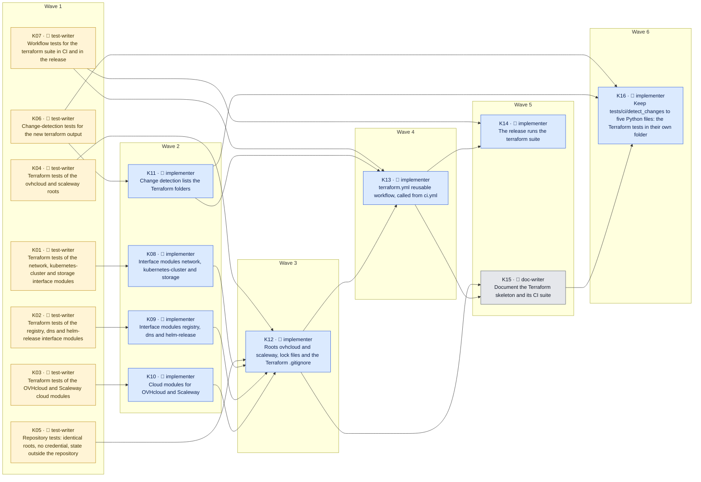

**Plan:** 🟢 Approved

**Push:** 🟢 Approved

<!-- ticket:specs -->
## 📚 Specifications

The specification and design pages of [TICKET.md](TICKET.md), copied by `python3 .claude/scripts/tickets/ticket_refs.py sync`.

- [Infrastructure deployment](../../technical/infrastructure/infrastructure.md)
- [Repository layout](../../technical/architecture/repository-layout.md)
- [📌 REQ-T09-08: A Terraform project for OVHcloud and Scaleway](../../specs/03-technical/t09-install-backups-and-updates/requirements/req-t09-08-terraform-ovhcloud-scaleway.md)
- [📜 D421: Infrastructure: fully CNCF compatible](../../specs/06-decisions/technical/d421-infrastructure-cncf.md)
- [📜 D438: Repository layout](../../specs/06-decisions/technical/d438-repository-layout.md)
<!-- /ticket:specs -->

# T0.08: Terraform module skeletons, plan

## Summary

T0.08 delivers the Terraform skeleton of REQ-T09-08 and D421 under `infra/terraform`. It has six cloud-neutral interface modules: network, kubernetes-cluster, storage, registry, dns and helm-release. Each takes the same `cloud` and `name` inputs and holds no resource yet. Two cloud (provider) modules, `modules/clouds/ovhcloud` and `modules/clouds/scaleway`, each pin their provider and configure no credential. The roots `ovhcloud/` and `scaleway/` are byte-identical except for the source line of `module "cloud"`. No backend block is declared, local state is git-ignored, and the roots' lock files are committed. CI gets a new reusable `terraform.yml`, which runs `fmt -check`, `init -backend=false`, `validate` and `terraform test` with JUnit reports. `ci.yml` and `release.yml` call it, and `detect_changes.py` gains a sixth `terraform` output. Acceptance criteria 3 and 4 are enforced by Python repository tests in `tests/infra/terraform/`. The graph has 15 tasks in 5 waves. Wave 1 has 7 test-writer tasks: module tests in two halves, cloud-module tests, root tests, the roots and secrets tests, the detector tests and the workflow tests. Wave 2 has 4 implementer tasks: the two module halves, the cloud modules and the detector. Wave 3 builds the roots and the `.gitignore`. Wave 4 builds `terraform.yml` and `ci.yml`, which take the pinned Terraform version from the roots. Wave 5 runs `release.yml` and the documentation side by side.

## Assumptions

- The roadmap row names no tool version and no CI job layout; the CI step is added to the existing pipeline and Terraform and provider versions are pinned (D415).
- The roadmap row does not name where state is kept; the skeleton declares no state backend inside the repository and leaves the choice to the operator.
- The roadmap has no per-ticket anchor, so the ticket link points to the sprint section `#s01` and the epic link to `#epics`.
- "Differ only in their provider module" is read as: each root selects its cloud's provider module and nothing else.
- `check_ticket.py` could not be run (no shell tool was available), so the ticket is not yet validated by the script.
- The specifications name the six modules but not their inputs and outputs. The plan fixes a minimal interface. Every interface module takes `cloud` (object name and region, name being ovhcloud or scaleway) and `name` (an RFC 1123 label). network adds `cidr`, kubernetes-cluster adds `network`, dns adds `domain` and helm-release adds `cluster`. Each returns one output object. The interface modules hold no resource, provider or data source in this skeleton. P2 (T9) adds the cloud resources and may extend the interface.
- "Behind one interface" and "differ only in their provider module" are read this way. The interface modules are cloud-neutral. The only cloud-specific code is a provider module per cloud, `infra/terraform/modules/clouds/<cloud>/`, which pins its provider and outputs the `cloud` object. The roots' root-level `*.tf` files are byte-identical except the `source` of module "cloud". The roots' generated `.terraform.lock.hcl` and their `tests/` files necessarily name their cloud, so the comparison of criterion 3 leaves them out.
- No provider block is written anywhere. Each provider reads its credentials from its own environment variables at apply time, so no file can hold a credential (criterion 4).
- This follows the TICKET's assumption: no backend block is declared and the operator chooses the backend. `infra/terraform/.gitignore` keeps local state, `*.tfvars` and override files out of git. This is how "state kept outside the repository" is met in the skeleton.
- Versions are pinned as D415 asks, and none is invented. The roots and CI pin one exact Terraform version, the latest stable release at implementation time and at least 1.11, which `mock_provider` and `terraform test -junit-xml` need. The interface and cloud modules declare `>= 1.11`. The providers are pinned to exact versions resolved from the registry, and the roots commit their lock files for four platforms. The `hashicorp/setup-terraform` action is pinned to a commit SHA resolved from GitHub. A worker that cannot reach the registry or GitHub reports the task blocked rather than guessing.
- The roadmap does not lay out the CI job. The plan adds a reusable `.github/workflows/terraform.yml`, called from `ci.yml`, and from `release.yml` because TKT-26 says a release runs every suite of CI with its test reports. `detect_changes.py` gains a sixth output, `terraform`, listing every Terraform folder (roots and modules). A change under `infra/terraform/` selects all of them and the repository tests. In CI, validate and test run on every module as well as on both roots.
- Acceptance criteria 3 and 4 are about files, so pytest repository tests in a new folder, `tests/infra/terraform/`, check them. AGENT.md lists only `tests/harness/`, `tests/ci/` and `tests/conventions/` today, and the reviewer may prefer another place. They run in CI's existing repository job, because Terraform changes now set `repository=true`.
- The ticket graph gives T0.08 the area `infra/terraform`, but the CI step also touches `.github/`, `tests/ci/`, `tests/infra/` and `docs/technical/`. The start rule's area lock may hold the ticket while another ticket changes those areas.
- T0.01, the prerequisite, is assumed to create `infra/terraform/README.md`. K15 updates it, or creates it if it is absent.
- Dependabot entries for the Terraform providers in `.github/dependabot.yml` are left out of scope, as a follow-up: the ticket only asks for pinned versions.

<!-- plan:graph -->

> [!NOTE]
> Generated from the json block at the end of this page by `python3 .claude/scripts/tickets/plan.py render`.
> To change a task, edit the json block, then render again: never edit this view by hand.

## Waves

| Wave | Tasks | Agents running at once |
| --- | --- | --- |
| 1 | [K01](#k01), [K02](#k02), [K03](#k03), [K04](#k04), [K05](#k05), [K06](#k06), [K07](#k07) | 7 of 7 |
| 2 | [K08](#k08), [K09](#k09), [K10](#k10), [K11](#k11) | 4 of 4 |
| 3 | [K12](#k12) | 1 of 1 |
| 4 | [K13](#k13) | 1 of 1 |
| 5 | [K14](#k14), [K15](#k15) | 2 of 2 |
| 6 | [K16](#k16) | 1 of 1 |

| Wave | Task | Agent | Depends on | Unblocks |
| --- | --- | --- | --- | --- |
| 1 | [K01](#k01) Terraform tests of the network, kubernetes-cluster and storage interface modules | 🧪 test-writer | none | [K08](#k08) |
| 1 | [K02](#k02) Terraform tests of the registry, dns and helm-release interface modules | 🧪 test-writer | none | [K09](#k09) |
| 1 | [K03](#k03) Terraform tests of the OVHcloud and Scaleway cloud modules | 🧪 test-writer | none | [K10](#k10) |
| 1 | [K04](#k04) Terraform tests of the ovhcloud and scaleway roots | 🧪 test-writer | none | [K12](#k12) |
| 1 | [K05](#k05) Repository tests: identical roots, no credential, state outside the repository | 🧪 test-writer | none | [K12](#k12) |
| 1 | [K06](#k06) Change-detection tests for the new terraform output | 🧪 test-writer | none | [K11](#k11), [K16](#k16) |
| 1 | [K07](#k07) Workflow tests for the terraform suite in CI and in the release | 🧪 test-writer | none | [K13](#k13), [K14](#k14) |
| 2 | [K08](#k08) Interface modules network, kubernetes-cluster and storage | 🐍 implementer | [K01](#k01) | [K12](#k12) |
| 2 | [K09](#k09) Interface modules registry, dns and helm-release | 🐍 implementer | [K02](#k02) | [K12](#k12) |
| 2 | [K10](#k10) Cloud modules for OVHcloud and Scaleway | 🐍 implementer | [K03](#k03) | [K12](#k12) |
| 2 | [K11](#k11) Change detection lists the Terraform folders | 🐍 implementer | [K06](#k06) | [K13](#k13), [K16](#k16) |
| 3 | [K12](#k12) Roots ovhcloud and scaleway, lock files and the Terraform .gitignore | 🐍 implementer | [K04](#k04), [K05](#k05), [K08](#k08), [K09](#k09), [K10](#k10) | [K13](#k13), [K15](#k15) |
| 4 | [K13](#k13) terraform.yml reusable workflow, called from ci.yml | 🐍 implementer | [K07](#k07), [K11](#k11), [K12](#k12) | [K14](#k14), [K15](#k15) |
| 5 | [K14](#k14) The release runs the terraform suite | 🐍 implementer | [K07](#k07), [K13](#k13) | none |
| 5 | [K15](#k15) Document the Terraform skeleton and its CI suite | 📝 doc-writer | [K12](#k12), [K13](#k13) | [K16](#k16) |
| 6 | [K16](#k16) Keep tests/ci/detect_changes to five Python files: the Terraform tests in their own folder | 🐍 implementer | [K06](#k06), [K11](#k11), [K15](#k15) | none |

## Dependency graph



## Tasks

### <a id="k01"></a>K01: Terraform tests of the network, kubernetes-cluster and storage interface modules

| Agent | Wave | Depends on | Unblocks |
| --- | --- | --- | --- |
| 🧪 test-writer | 1 | none | [K08](#k08) |

**Files** (only this task may change them in its wave):

- `infra/terraform/modules/network/tests/network.tftest.hcl`
- `infra/terraform/modules/kubernetes-cluster/tests/kubernetes-cluster.tftest.hcl`
- `infra/terraform/modules/storage/tests/storage.tftest.hcl`

**Done when:** The three `.tftest.hcl` files exist and `terraform fmt -check <file>` passes on each of them.

**Brief:**

Write the native Terraform tests (`terraform test`, `.tftest.hcl`) of three interface modules of the T0.08 skeleton, before the modules exist (TKT-4). Ticket: docs/tickets/T0.08/TICKET.md. Specs applied: [REQ-T09-08](docs/specs/03-technical/t09-install-backups-and-updates/requirements/req-t09-08-terraform-ovhcloud-scaleway.md) (network, managed Kubernetes, storage... behind one interface, P0 builds the skeleton), [D421](docs/specs/06-decisions/technical/d421-infrastructure-cncf.md) (portable, no cloud required), [D438](docs/specs/06-decisions/technical/d438-repository-layout.md) and [Repository layout](docs/technical/architecture/repository-layout.md) (`infra/terraform/modules/`), [Infrastructure deployment](docs/technical/infrastructure/infrastructure.md) ("Terraform modules per cloud behind one interface").

Interface under test (fixed by the plan). Each module `infra/terraform/modules/<m>/` holds no resource, no provider and no data source. It takes `cloud` (type `object({ name = string, region = string })`, no default; validated: `name` is "ovhcloud" or "scaleway", and `region` is not blank) and `name` (string, no default, validated against `^[a-z]([a-z0-9-]{0,61}[a-z0-9])?$`).
- network: also `cidr` (string, no default, validated with `can(cidrnetmask(var.cidr))`). Output `network` = `{ cloud = var.cloud.name, region = var.cloud.region, name = var.name, cidr = var.cidr }`.
- kubernetes-cluster: also `network` (type `object({ cloud = string, region = string, name = string, cidr = string })`). Output `cluster` = `{ cloud = var.cloud.name, region = var.cloud.region, name = var.name, network = var.network.name }`.
- storage: output `storage` = `{ cloud = var.cloud.name, region = var.cloud.region, name = var.name }`.

For each module, write one file in its `tests/` folder:
- A file-level `variables` block with valid neutral test values, for example cloud `{ name = "ovhcloud", region = "test-region" }` and name `"simple-erp"`.
- A `run` with `command = plan` that asserts every field of the module's output, each with a clear `error_message`.
- A second valid `run` with cloud name "scaleway", which proves the interface is the same for both clouds.
- One `run` per validation, with `command = plan` and `expect_failures = [var.<x>]`: an unknown cloud name ("aws"), a blank region, a name with capitals, a name starting with a digit, and for network a `cidr` that is not a CIDR.

Name the runs as sentences in snake case, such as `run "an_unknown_cloud_is_refused"`. Use only `terraform test` features of Terraform 1.11 or later. The tests fail until K08 writes the modules: that is expected. Do not create any other file.

### <a id="k02"></a>K02: Terraform tests of the registry, dns and helm-release interface modules

| Agent | Wave | Depends on | Unblocks |
| --- | --- | --- | --- |
| 🧪 test-writer | 1 | none | [K09](#k09) |

**Files** (only this task may change them in its wave):

- `infra/terraform/modules/registry/tests/registry.tftest.hcl`
- `infra/terraform/modules/dns/tests/dns.tftest.hcl`
- `infra/terraform/modules/helm-release/tests/helm-release.tftest.hcl`

**Done when:** The three `.tftest.hcl` files exist and `terraform fmt -check <file>` passes on each of them.

**Brief:**

Write the native Terraform tests (`terraform test`, `.tftest.hcl`) of three interface modules of the T0.08 skeleton, before the modules exist (TKT-4). Ticket: docs/tickets/T0.08/TICKET.md. Specs applied: [REQ-T09-08](docs/specs/03-technical/t09-install-backups-and-updates/requirements/req-t09-08-terraform-ovhcloud-scaleway.md) (registry, DNS and the Helm release behind one interface, P0 builds the skeleton), [D421](docs/specs/06-decisions/technical/d421-infrastructure-cncf.md), [D438](docs/specs/06-decisions/technical/d438-repository-layout.md) and [Repository layout](docs/technical/architecture/repository-layout.md), [Infrastructure deployment](docs/technical/infrastructure/infrastructure.md) ("Terraform modules per cloud behind one interface").

Interface under test (fixed by the plan). Each module `infra/terraform/modules/<m>/` holds no resource, no provider and no data source. It takes `cloud` (type `object({ name = string, region = string })`, no default; validated: `name` is "ovhcloud" or "scaleway", and `region` is not blank) and `name` (string, no default, validated against `^[a-z]([a-z0-9-]{0,61}[a-z0-9])?$`).
- registry: output `registry` = `{ cloud = var.cloud.name, region = var.cloud.region, name = var.name }`.
- dns: also `domain` (string, no default, validated against `^([a-z0-9]([a-z0-9-]{0,61}[a-z0-9])?\.)+[a-z]{2,63}$`). Output `dns` = `{ cloud = var.cloud.name, name = var.name, domain = var.domain }`.
- helm-release: also `cluster` (type `object({ cloud = string, region = string, name = string, network = string })`). Output `release` = `{ cloud = var.cloud.name, name = var.name, cluster = var.cluster.name }`.

For each module, write one file in its `tests/` folder:
- A file-level `variables` block with valid neutral test values, for example cloud `{ name = "ovhcloud", region = "test-region" }`, name `"simple-erp"` and domain `"erp.example.org"`.
- A `run` with `command = plan` that asserts every field of the output.
- A second valid `run` with cloud name "scaleway".
- One `run` per validation, with `command = plan` and `expect_failures = [var.<x>]`: an unknown cloud name, a blank region, a name with capitals, a name starting with a digit, and for dns a domain with no dot and a domain with capitals.

Name the runs as sentences in snake case. Use only features of Terraform 1.11 or later. The tests fail until K09 writes the modules: that is expected. Do not create any other file.

### <a id="k03"></a>K03: Terraform tests of the OVHcloud and Scaleway cloud modules

| Agent | Wave | Depends on | Unblocks |
| --- | --- | --- | --- |
| 🧪 test-writer | 1 | none | [K10](#k10) |

**Files** (only this task may change them in its wave):

- `infra/terraform/modules/clouds/ovhcloud/tests/ovhcloud.tftest.hcl`
- `infra/terraform/modules/clouds/scaleway/tests/scaleway.tftest.hcl`

**Done when:** Both `.tftest.hcl` files exist and `terraform fmt -check <file>` passes on each of them.

**Brief:**

Write the native Terraform tests of the two cloud (provider) modules of the T0.08 skeleton, before the modules exist (TKT-4). Ticket: docs/tickets/T0.08/TICKET.md. Specs applied: [REQ-T09-08](docs/specs/03-technical/t09-install-backups-and-updates/requirements/req-t09-08-terraform-ovhcloud-scaleway.md) (OVHcloud and Scaleway), [D421](docs/specs/06-decisions/technical/d421-infrastructure-cncf.md) (a cloud's services are optional, never required), [Infrastructure deployment](docs/technical/infrastructure/infrastructure.md) ("Terraform modules per cloud behind one interface"), [D438](docs/specs/06-decisions/technical/d438-repository-layout.md).

Interface under test (fixed by the plan). `infra/terraform/modules/clouds/ovhcloud/` and `infra/terraform/modules/clouds/scaleway/` are the only cloud-specific modules, the "provider module" of each root.
- Each pins one provider (`ovh/ovh` and `scaleway/scaleway`) and holds no provider block and no credential: the provider reads its credentials from its own environment variables at apply time.
- Each takes `region` (string, no default, validated: not blank).
- Each has one output, `cloud` = `{ name = "ovhcloud" | "scaleway", region = var.region }`. This is the object every interface module takes as its `cloud` input.

For each module, write one file in its `tests/` folder:
- `mock_provider "ovh" {}` (resp. `mock_provider "scaleway" {}`), so that no credential and no network call is needed.
- A valid `run` with `command = plan` that asserts `output.cloud.name` is the module's cloud and `output.cloud.region` is the given region.
- A `run` with a blank region and `expect_failures = [var.region]`.

Name the runs as sentences in snake case. Use features of Terraform 1.11 or later. The tests fail until K10 writes the modules: that is expected. Do not create any other file.

### <a id="k04"></a>K04: Terraform tests of the ovhcloud and scaleway roots

| Agent | Wave | Depends on | Unblocks |
| --- | --- | --- | --- |
| 🧪 test-writer | 1 | none | [K12](#k12) |

**Files** (only this task may change them in its wave):

- `infra/terraform/ovhcloud/tests/ovhcloud.tftest.hcl`
- `infra/terraform/scaleway/tests/scaleway.tftest.hcl`

**Done when:** Both `.tftest.hcl` files exist and `terraform fmt -check <file>` passes on each of them.

**Brief:**

Write the native Terraform tests of the two roots of the T0.08 skeleton, before the roots exist (TKT-4). Ticket: docs/tickets/T0.08/TICKET.md, acceptance criteria 1 to 3. Specs applied: [REQ-T09-08](docs/specs/03-technical/t09-install-backups-and-updates/requirements/req-t09-08-terraform-ovhcloud-scaleway.md), [D421](docs/specs/06-decisions/technical/d421-infrastructure-cncf.md), [D438](docs/specs/06-decisions/technical/d438-repository-layout.md) and [Repository layout](docs/technical/architecture/repository-layout.md) (`terraform/` holds `modules/`, `ovhcloud/` and `scaleway/`), [Infrastructure deployment](docs/technical/infrastructure/infrastructure.md).

Interface under test (fixed by the plan).
- Roots `infra/terraform/ovhcloud/` and `infra/terraform/scaleway/` take `name`, `region`, `domain` and `network_cidr` (strings, no default).
- They call module "cloud" (`../modules/clouds/<cloud>`, the only difference between them), then "network", "kubernetes_cluster", "storage", "registry", "dns" and "helm_release". Each of these is given `cloud = module.cloud.cloud` and `name = var.name`; network takes `cidr = var.network_cidr`, kubernetes_cluster takes `network = module.network.network`, dns takes `domain = var.domain` and helm_release takes `cluster = module.kubernetes_cluster.cluster`.
- They expose the outputs `cloud`, `network`, `cluster`, `storage`, `registry`, `dns` and `release`. The module outputs are: `network` `{cloud, region, name, cidr}`, `cluster` `{cloud, region, name, network}`, `storage` and `registry` `{cloud, region, name}`, `dns` `{cloud, name, domain}`, `release` `{cloud, name, cluster}`, and `cloud` `{name, region}`.

For each root, write one file in its `tests/` folder:
- `mock_provider "ovh" {}` (resp. `"scaleway"`) and a `variables` block with neutral test values (name "simple-erp", region "test-region", domain "erp.example.org", network_cidr "10.0.0.0/16").
- One `run` with `command = plan` that asserts the wiring: `output.cloud.name` is the root's cloud, every interface output's `cloud` equals `output.cloud.name` and its `region` (where it has one) equals `var.region`, `output.cluster.network == output.network.name`, `output.release.cluster == output.cluster.name`, `output.dns.domain == var.domain`, and `output.network.cidr == var.network_cidr`.

The two files may differ only in the cloud name. The tests fail until K12 writes the roots. Do not create any other file.

### <a id="k05"></a>K05: Repository tests: identical roots, no credential, state outside the repository

| Agent | Wave | Depends on | Unblocks |
| --- | --- | --- | --- |
| 🧪 test-writer | 1 | none | [K12](#k12) |

**Files** (only this task may change them in its wave):

- `tests/infra/terraform/helpers.py`
- `tests/infra/terraform/test_terraform_roots.py`
- `tests/infra/terraform/test_terraform_state_and_credentials.py`

**Done when:** `uv run ruff check tests/infra` and `uv run ruff format --check tests/infra` pass, and `uv run pytest tests/infra/terraform -n 2 --collect-only` collects both test classes.

**Brief:**

Write pytest repository tests that enforce acceptance criteria 3 and 4 of docs/tickets/T0.08/TICKET.md, before the code exists (TKT-4). Specs applied: [REQ-T09-08](docs/specs/03-technical/t09-install-backups-and-updates/requirements/req-t09-08-terraform-ovhcloud-scaleway.md) (no credential in a file, state outside the repository), [D421](docs/specs/06-decisions/technical/d421-infrastructure-cncf.md) (the roots differ only in their provider module, behind one interface), [D438](docs/specs/06-decisions/technical/d438-repository-layout.md) and [Repository layout](docs/technical/architecture/repository-layout.md), [Infrastructure deployment](docs/technical/infrastructure/infrastructure.md). Follow AGENT.md "Tests", "File shape" and "Typing": one `Test<Subject>` class per file, test names as sentences, `ClassVar` constants, no `Any`, no `unittest.mock`, no `__init__.py`, and parametrize cases of the same behaviour.

`helpers.py` holds the shared functions and constants:
- `ROOT` (the repository root, `Path(__file__).resolve().parents[3]`), `TERRAFORM = ROOT / "infra" / "terraform"`, `CLOUDS = ["ovhcloud", "scaleway"]` and `INTERFACE = ["network", "kubernetes-cluster", "storage", "registry", "dns", "helm-release"]`.
- A function listing the files that would be committed under `infra/terraform`: `git -C ROOT ls-files --cached --others --exclude-standard infra/terraform`, so that it works in a worker worktree with uncommitted files and in CI's shallow checkout (TKT-24).
- A function returning the `source = "..."` values of a root's `main.tf`, read with a regex.

`test_terraform_roots.py`, `TestTerraformRoots` (criterion 3):
- both roots exist and hold the same set of root-level `*.tf` file names (not `tests/`, not `.terraform.lock.hcl`);
- every pair of root-level `*.tf` files is byte-identical once the line `source = "../modules/clouds/ovhcloud"` / `"../modules/clouds/scaleway"` is normalised, and exactly one line differs between the two roots in total;
- each root's `main.tf` calls `../modules/clouds/<its own cloud>` exactly once and each `../modules/<m>` of INTERFACE exactly once, and nothing else;
- every called module folder exists and holds `versions.tf`, `variables.tf`, `main.tf` and `outputs.tf`;
- each root has its `.terraform.lock.hcl`, so that the provider versions are locked (D415, as the TICKET assumption asks).

`test_terraform_state_and_credentials.py`, `TestTerraformStateAndCredentials` (criterion 4):
- no file that would be committed under `infra/terraform` ends in `.tfstate`, contains `.tfstate.`, ends in `.tfvars` or `.tfvars.json`, or lies under a `.terraform/` folder;
- no `.tf` file holds a `backend` block (the TICKET assumption: no state backend in the repository, the operator chooses it);
- `git check-ignore` ignores `infra/terraform/ovhcloud/terraform.tfstate`, `infra/terraform/scaleway/terraform.tfstate.backup`, `infra/terraform/ovhcloud/.terraform/providers/x`, `infra/terraform/scaleway/secrets.tfvars` and `infra/terraform/modules/clouds/ovhcloud/.terraform.lock.hcl`, but does not ignore `infra/terraform/ovhcloud/.terraform.lock.hcl` (the rules live in `infra/terraform/.gitignore`, written by K12);
- no `.tf`, `.tfvars` or `.hcl` file assigns a literal string to a credential attribute: use a case-insensitive regex on `access_key`, `secret_key`, `application_key`, `application_secret`, `consumer_key`, `client_secret`, `password`, `token` and `api_key` followed by `= "`;
- no `variable` block with `sensitive = true` has a `default`.

The tests fail until K12 writes the roots and the `.gitignore`: that is expected.

### <a id="k06"></a>K06: Change-detection tests for the new terraform output

| Agent | Wave | Depends on | Unblocks |
| --- | --- | --- | --- |
| 🧪 test-writer | 1 | none | [K11](#k11), [K16](#k16) |

**Files** (only this task may change them in its wave):

- `tests/ci/detect_changes/helpers.py`
- `tests/ci/detect_changes/test_detect_changes.py`
- `tests/ci/detect_changes/test_shared_changes.py`
- `tests/ci/detect_changes/test_terraform.py`

**Done when:** `uv run ruff check tests/ci/detect_changes` and `uv run ruff format --check tests/ci/detect_changes` pass, and `uv run pytest tests/ci/detect_changes -n 2` fails only on the terraform expectations.

**Brief:**

Extend the tests of `.github/scripts/detect_changes.py`, so that CI runs `terraform fmt -check` and `terraform validate` on the Terraform folders a change touches (docs/tickets/T0.08/TICKET.md, "What it delivers" item 4 and acceptance criteria 1 and 2). Specs applied: [REQ-T09-08](docs/specs/03-technical/t09-install-backups-and-updates/requirements/req-t09-08-terraform-ovhcloud-scaleway.md) ("validated in CI", P0 row), [D438](docs/specs/06-decisions/technical/d438-repository-layout.md) (`infra/terraform` is part of the layout) and [Repository layout](docs/technical/architecture/repository-layout.md). Follow AGENT.md "Tests" and the style of the existing files.

The detector contract the tests fix:
- It prints a sixth line `terraform=<compact JSON list>` after the five existing lines, in that order.
- The list holds every folder under `infra/terraform/`, at any depth, that holds a `*.tf` file directly. It skips hidden folders such as `.terraform/` and `tests/` folders, and it is sorted.
- Any changed path under `infra/terraform/` selects every Terraform folder, because the modules are shared by both roots, and sets `repository=true`, so that the repository tests of `tests/infra/terraform/` run. It selects no service, package, front end or image.
- `.github/workflows/terraform.yml` is a shared path: it selects everything.
- `--all` and every other shared path select every Terraform folder.
- A path outside `infra/terraform/`, such as a service file, selects no Terraform folder.
- A repository with no `infra/terraform/` gives `terraform=[]`.

Changes:
- `helpers.py`: add `TERRAFORM_KEY = "terraform"` at the end of `KEYS`. Add to `REPO_FILES` the files `infra/terraform/modules/network/main.tf`, `infra/terraform/modules/clouds/ovhcloud/main.tf`, `infra/terraform/ovhcloud/main.tf` and `infra/terraform/scaleway/main.tf`, plus decoys that must not be listed: `infra/terraform/ovhcloud/tests/ovhcloud.tftest.hcl`, `infra/terraform/ovhcloud/.terraform/modules/x/main.tf` and `infra/terraform/README.md`. Add an `ALL_TERRAFORM` list, and make `nothing()` and `everything()` include the new key.
- `test_detect_changes.py`: the first test asserts six lines in the contract order, and its name says six.
- `test_shared_changes.py`: add `.github/workflows/terraform.yml` to the shared paths, and keep the last test passing with `terraform=[]`.
- `test_terraform.py`, class `TestTerraformChanges`: the cases above, one test each, parametrized where they are cases of one behaviour.

The new tests fail until K11 changes the detector: that is expected.

### <a id="k07"></a>K07: Workflow tests for the terraform suite in CI and in the release

| Agent | Wave | Depends on | Unblocks |
| --- | --- | --- | --- |
| 🧪 test-writer | 1 | none | [K13](#k13), [K14](#k14) |

**Files** (only this task may change them in its wave):

- `tests/ci/workflows/test_ci_workflow.py`
- `tests/ci/workflows/test_workflow_security.py`
- `tests/ci/workflows/checks/test_terraform_workflow.py`
- `tests/ci/release/test_release_workflow.py`

**Done when:** `uv run ruff check tests/ci/workflows tests/ci/release` and `uv run ruff format --check tests/ci/workflows tests/ci/release` pass, and `uv run pytest tests/ci/workflows tests/ci/release --collect-only -q` collects the new tests.

**Brief:**

Write the tests that fix the CI contract of the Terraform checks: `terraform fmt -check` and `terraform validate` on both roots in CI (docs/tickets/T0.08/TICKET.md, item 4 and acceptance criteria 1 and 2). Specs applied: [REQ-T09-08](docs/specs/03-technical/t09-install-backups-and-updates/requirements/req-t09-08-terraform-ovhcloud-scaleway.md) ("validated in CI"), [D438](docs/specs/06-decisions/technical/d438-repository-layout.md), and the rules TKT-26 (a release runs every suite of CI and keeps every test report) and AGENT.md "CI/CD". Reuse `tests/ci/workflows/helpers.py` (`jobs`, `steps`, `runs`, `step_using`, `with_of`, `triggers`, `workflow`, `ROOT`), and follow AGENT.md "Tests".

The contract:
- `test_workflow_security.py`: `EXPECTED` gains `terraform.yml`, keeping the list sorted (after `stage.yml`). The existing pinning and permission tests then cover the new workflow.
- `test_ci_workflow.py`: `OUTPUT_KEYS` gains `terraform`, and `JOBS` and `CHECK_JOBS` gain `terraform`, so that images waits for it and result gates on it. The language-job parametrize gains `("terraform", "terraform.yml", ["needs.changes.outputs.terraform"])`. A new test asserts that the terraform job's `with` is exactly `{"folders": "${{ needs.changes.outputs.terraform }}"}`.
- `checks/test_terraform_workflow.py`, class `TestTerraformWorkflow`, on `.github/workflows/terraform.yml`:
  - its only trigger is `workflow_call`, with one input `folders` (type string, required);
  - it has one job `check` whose `if` is `inputs.folders != '[]'`, with a matrix `folder: ${{ fromJSON(inputs.folders) }}`, `fail-fast: false` and an env `FOLDER: ${{ matrix.folder }}`, and whose `run` scripts never interpolate `${{ inputs.` or `${{ matrix.`;
  - it uses `actions/checkout` with `persist-credentials: false`, and `hashicorp/setup-terraform` with `terraform_wrapper: false` and a `terraform_version` that is an exact `X.Y.Z` version equal to the `required_version` (`= X.Y.Z` or `X.Y.Z`) of `infra/terraform/ovhcloud/versions.tf` and of `infra/terraform/scaleway/versions.tf`;
  - its scripts run `terraform fmt -check`, `init -backend=false -input=false`, `terraform` `validate`, and `test` with `-junit-xml=` when the folder has a `tests/` folder;
  - one upload-artifact step with `if: always()` names its artifact `test-report-terraform-...`.
- `tests/ci/release/test_release_workflow.py`: `SUITES` gains `terraform`, and `REPORTS` gains `("terraform.yml", "check", "test-report-terraform-")`. A new test asserts that the release terraform job passes `folders: ${{ needs.changes.outputs.terraform }}`, and that the release changes job outputs `terraform`. A test asserts that `-junit-xml=` is in `runs("terraform.yml", "check")`.

The tests fail until K13 and K14 change the workflows: that is expected.

### <a id="k08"></a>K08: Interface modules network, kubernetes-cluster and storage

| Agent | Wave | Depends on | Unblocks |
| --- | --- | --- | --- |
| 🐍 implementer | 2 | [K01](#k01) | [K12](#k12) |

**Files** (only this task may change them in its wave):

- `infra/terraform/modules/network/versions.tf`
- `infra/terraform/modules/network/variables.tf`
- `infra/terraform/modules/network/main.tf`
- `infra/terraform/modules/network/outputs.tf`
- `infra/terraform/modules/kubernetes-cluster/versions.tf`
- `infra/terraform/modules/kubernetes-cluster/variables.tf`
- `infra/terraform/modules/kubernetes-cluster/main.tf`
- `infra/terraform/modules/kubernetes-cluster/outputs.tf`
- `infra/terraform/modules/storage/versions.tf`
- `infra/terraform/modules/storage/variables.tf`
- `infra/terraform/modules/storage/main.tf`
- `infra/terraform/modules/storage/outputs.tf`

**Done when:** For each of the three modules, `terraform -chdir=infra/terraform/modules/<m> init -backend=false -input=false`, `terraform -chdir=infra/terraform/modules/<m> validate` and `terraform -chdir=infra/terraform/modules/<m> test` pass, and `terraform fmt -check -recursive infra/terraform/modules` passes on these folders.

**Brief:**

Write three cloud-neutral interface modules of the T0.08 Terraform skeleton, so that the tests of K01 pass. Ticket: docs/tickets/T0.08/TICKET.md. Specs applied: [REQ-T09-08](docs/specs/03-technical/t09-install-backups-and-updates/requirements/req-t09-08-terraform-ovhcloud-scaleway.md) (network, managed Kubernetes and storage; P0 builds the skeleton, P2/T9 closes it), [D421](docs/specs/06-decisions/technical/d421-infrastructure-cncf.md) (portable, a cloud's managed services never required), [Infrastructure deployment](docs/technical/infrastructure/infrastructure.md) ("Terraform modules per cloud behind one interface"), [D438](docs/specs/06-decisions/technical/d438-repository-layout.md) and [Repository layout](docs/technical/architecture/repository-layout.md).

Each module `infra/terraform/modules/<m>/` has four files:
- `versions.tf`: `terraform { required_version = ">= 1.11" }`, with no `required_providers`.
- `variables.tf`: every variable with a `type`, a `description` in British English and its `validation` blocks, each with a clear `error_message`.
- `main.tf`: one `locals` block that builds the output object. It has no resource, no provider block and no data source: the cloud resources come in P2/T9.
- `outputs.tf`: the one output, with a `description`.

The interface:
- Common inputs: `cloud` (type `object({ name = string, region = string })`, no default; validated: `contains(["ovhcloud", "scaleway"], var.cloud.name)` and `trimspace(var.cloud.region) != ""`) and `name` (string, no default, validated with `can(regex("^[a-z]([a-z0-9-]{0,61}[a-z0-9])?$", var.name))`).
- network: also `cidr` (string, no default, validated with `can(cidrnetmask(var.cidr))`). Output `network` = `{ cloud = var.cloud.name, region = var.cloud.region, name = var.name, cidr = var.cidr }`.
- kubernetes-cluster: also `network` (type `object({ cloud = string, region = string, name = string, cidr = string })`). Output `cluster` = `{ cloud = var.cloud.name, region = var.cloud.region, name = var.name, network = var.network.name }`.
- storage: output `storage` = `{ cloud = var.cloud.name, region = var.cloud.region, name = var.name }`.

Put no credential and no state file anywhere. Do not touch the `tests/` files. If a K01 test is wrong, report it as `blocked_by` (TKT-19) rather than working around it.

### <a id="k09"></a>K09: Interface modules registry, dns and helm-release

| Agent | Wave | Depends on | Unblocks |
| --- | --- | --- | --- |
| 🐍 implementer | 2 | [K02](#k02) | [K12](#k12) |

**Files** (only this task may change them in its wave):

- `infra/terraform/modules/registry/versions.tf`
- `infra/terraform/modules/registry/variables.tf`
- `infra/terraform/modules/registry/main.tf`
- `infra/terraform/modules/registry/outputs.tf`
- `infra/terraform/modules/dns/versions.tf`
- `infra/terraform/modules/dns/variables.tf`
- `infra/terraform/modules/dns/main.tf`
- `infra/terraform/modules/dns/outputs.tf`
- `infra/terraform/modules/helm-release/versions.tf`
- `infra/terraform/modules/helm-release/variables.tf`
- `infra/terraform/modules/helm-release/main.tf`
- `infra/terraform/modules/helm-release/outputs.tf`

**Done when:** For each of the three modules, `terraform -chdir=infra/terraform/modules/<m> init -backend=false -input=false`, `terraform -chdir=infra/terraform/modules/<m> validate` and `terraform -chdir=infra/terraform/modules/<m> test` pass, and `terraform fmt -check` passes on every file of these folders.

**Brief:**

Write three cloud-neutral interface modules of the T0.08 Terraform skeleton, so that the tests of K02 pass. Ticket: docs/tickets/T0.08/TICKET.md. Specs applied: [REQ-T09-08](docs/specs/03-technical/t09-install-backups-and-updates/requirements/req-t09-08-terraform-ovhcloud-scaleway.md) (registry, DNS and the Helm release; P0 builds the skeleton, P2/T9 closes it), [D421](docs/specs/06-decisions/technical/d421-infrastructure-cncf.md), [Infrastructure deployment](docs/technical/infrastructure/infrastructure.md) ("Terraform modules per cloud behind one interface"), [D438](docs/specs/06-decisions/technical/d438-repository-layout.md) and [Repository layout](docs/technical/architecture/repository-layout.md).

Each module `infra/terraform/modules/<m>/` has four files:
- `versions.tf`: `terraform { required_version = ">= 1.11" }`, with no `required_providers`.
- `variables.tf`: every variable with a `type`, a `description` in British English and its `validation` blocks, each with a clear `error_message`.
- `main.tf`: one `locals` block that builds the output. It has no resource, no provider block and no data source: the Helm release resource and the cloud resources come in P2/T9.
- `outputs.tf`: the one output, with a `description`.

The interface:
- Common inputs: `cloud` (type `object({ name = string, region = string })`, no default; validated: `contains(["ovhcloud", "scaleway"], var.cloud.name)` and `trimspace(var.cloud.region) != ""`) and `name` (string, no default, validated with `can(regex("^[a-z]([a-z0-9-]{0,61}[a-z0-9])?$", var.name))`).
- registry: output `registry` = `{ cloud = var.cloud.name, region = var.cloud.region, name = var.name }`.
- dns: also `domain` (string, no default, validated with `can(regex("^([a-z0-9]([a-z0-9-]{0,61}[a-z0-9])?\\.)+[a-z]{2,63}$", var.domain))`). Output `dns` = `{ cloud = var.cloud.name, name = var.name, domain = var.domain }`.
- helm-release: also `cluster` (type `object({ cloud = string, region = string, name = string, network = string })`). Output `release` = `{ cloud = var.cloud.name, name = var.name, cluster = var.cluster.name }`.

Put no credential anywhere. Do not touch the `tests/` files. If a K02 test is wrong, report it as `blocked_by` (TKT-19).

### <a id="k10"></a>K10: Cloud modules for OVHcloud and Scaleway

| Agent | Wave | Depends on | Unblocks |
| --- | --- | --- | --- |
| 🐍 implementer | 2 | [K03](#k03) | [K12](#k12) |

**Files** (only this task may change them in its wave):

- `infra/terraform/modules/clouds/ovhcloud/versions.tf`
- `infra/terraform/modules/clouds/ovhcloud/variables.tf`
- `infra/terraform/modules/clouds/ovhcloud/main.tf`
- `infra/terraform/modules/clouds/ovhcloud/outputs.tf`
- `infra/terraform/modules/clouds/scaleway/versions.tf`
- `infra/terraform/modules/clouds/scaleway/variables.tf`
- `infra/terraform/modules/clouds/scaleway/main.tf`
- `infra/terraform/modules/clouds/scaleway/outputs.tf`

**Done when:** For both modules, `terraform -chdir=infra/terraform/modules/clouds/<cloud> init -backend=false -input=false`, `terraform -chdir=infra/terraform/modules/clouds/<cloud> validate` and `terraform -chdir=infra/terraform/modules/clouds/<cloud> test` pass, and `terraform fmt -check` passes on every file of these folders.

**Brief:**

Write the two cloud (provider) modules of the T0.08 Terraform skeleton, so that the tests of K03 pass. Ticket: docs/tickets/T0.08/TICKET.md ("differ only in their provider module", "no credential in any file"). Specs applied: [REQ-T09-08](docs/specs/03-technical/t09-install-backups-and-updates/requirements/req-t09-08-terraform-ovhcloud-scaleway.md) (OVHcloud and Scaleway), [D421](docs/specs/06-decisions/technical/d421-infrastructure-cncf.md) (European managed Kubernetes, the cloud's services optional by configuration), [Infrastructure deployment](docs/technical/infrastructure/infrastructure.md) ("Terraform modules per cloud behind one interface"), [D438](docs/specs/06-decisions/technical/d438-repository-layout.md); dependencies pinned as [D415](docs/specs/06-decisions/technical/d415-supply-chain-controls.md) asks (TICKET assumption).

Each module `infra/terraform/modules/clouds/<cloud>/` has four files:
- `versions.tf`: `terraform { required_version = ">= 1.11" required_providers { ... } }`. The ovhcloud module pins `ovh = { source = "ovh/ovh", version = "<exact X.Y.Z>" }` and the scaleway module pins `scaleway = { source = "scaleway/scaleway", version = "<exact X.Y.Z>" }`. Take each exact version from the Terraform registry, as the latest stable release `terraform init` resolves today, then pin it. Never invent a version: if the registry cannot be reached, report the task blocked.
- `variables.tf`: `region` (string, no default, a British English description, validated with `trimspace(var.region) != ""`).
- `main.tf`: `locals { cloud = { name = "ovhcloud" | "scaleway", region = var.region } }`. It has no provider block and no credential: the provider reads its credentials from its own environment variables at apply time. Say so in a comment at the top of the file.
- `outputs.tf`: output `cloud` (`local.cloud`) with a description saying it is the object every interface module takes as `cloud`.

Do not commit a `.terraform.lock.hcl` in these modules: K12's `.gitignore` ignores module lock files, and only the roots lock their providers. Do not touch the `tests/` files. If a K03 test is wrong, report it as `blocked_by` (TKT-19).

### <a id="k11"></a>K11: Change detection lists the Terraform folders

| Agent | Wave | Depends on | Unblocks |
| --- | --- | --- | --- |
| 🐍 implementer | 2 | [K06](#k06) | [K13](#k13), [K16](#k16) |

**Files** (only this task may change them in its wave):

- `.github/scripts/detect_changes.py`
- `tests/ci/detect_changes/test_repository_layout.py`

**Done when:** `uv run pytest tests/ci/detect_changes -n 2` passes, and `uv run ruff check .github/scripts` and `uv run ruff format --check .github/scripts/detect_changes.py` pass.

**Brief:**

Change `.github/scripts/detect_changes.py` so that CI knows which Terraform folders to check, and make the tests of K06 pass (`tests/ci/detect_changes/`). Ticket: docs/tickets/T0.08/TICKET.md, item 4 ("`terraform fmt -check` and `terraform validate` on both roots in CI"). Specs applied: [REQ-T09-08](docs/specs/03-technical/t09-install-backups-and-updates/requirements/req-t09-08-terraform-ovhcloud-scaleway.md), [D438](docs/specs/06-decisions/technical/d438-repository-layout.md) and [Repository layout](docs/technical/architecture/repository-layout.md) (`infra/terraform`). Keep the script's existing style: it is a CI script with module-level functions, like its neighbours.

The contract:
- Print a sixth line `terraform=<compact JSON list>` after `images`, and update the module docstring: six lines, the new key, and the new shared file.
- The list holds every folder under `infra/terraform/` at any depth that holds a `*.tf` file directly. Skip hidden folders such as `.terraform/`, folders starting with `_`, and `tests/` folders, and sort the list.
- Any changed path under `infra/terraform/` selects every Terraform folder, because the modules are shared, and sets `repository` to true, so that `tests/infra/terraform/` runs.
- Add `.github/workflows/terraform.yml` to `SHARED_FILES`.
- A shared path or `--all` selects every Terraform folder.
- A repository with no `infra/terraform/` gives `[]`.

Do not change any other output. If a K06 test is wrong, report it as `blocked_by` (TKT-19).

Plan change of 2026-11-27 (owner's P0 approval): you also own `tests/ci/detect_changes/test_repository_layout.py`, written by T0.01 (merged), which blocked this task. Change only what makes it contradict this ticket or depend on other tickets' folders, keep every other case: (1) remove `infra/terraform/README.md` from the cases of `test_a_readme_of_a_folder_without_a_project_selects_nothing`, because this ticket makes any change under `infra/terraform/` select the Terraform folders and the repository tests (add no Terraform case there, `test_terraform.py` covers it); (2) in `test_a_change_to_the_shared_front_end_packages_selects_every_front_end`, expect every front-end folder that holds a `package.json` (the apps and `frontend/packages/*`, `frontend/portals/*`, found in the repository the test runs on), not the fixed list backoffice and mobile, since other tickets add front-end packages; (3) where a whole output map is compared with `nothing()`, make the comparison hold when the detector gains an output that the case is not about (this ticket adds `terraform`, later tickets add more). Then run `uv run pytest tests/ci/detect_changes` and report it passing.

### <a id="k12"></a>K12: Roots ovhcloud and scaleway, lock files and the Terraform .gitignore

| Agent | Wave | Depends on | Unblocks |
| --- | --- | --- | --- |
| 🐍 implementer | 3 | [K04](#k04), [K05](#k05), [K08](#k08), [K09](#k09), [K10](#k10) | [K13](#k13), [K15](#k15) |

**Files** (only this task may change them in its wave):

- `infra/terraform/.gitignore`
- `infra/terraform/ovhcloud/versions.tf`
- `infra/terraform/ovhcloud/variables.tf`
- `infra/terraform/ovhcloud/main.tf`
- `infra/terraform/ovhcloud/outputs.tf`
- `infra/terraform/ovhcloud/.terraform.lock.hcl`
- `infra/terraform/scaleway/versions.tf`
- `infra/terraform/scaleway/variables.tf`
- `infra/terraform/scaleway/main.tf`
- `infra/terraform/scaleway/outputs.tf`
- `infra/terraform/scaleway/.terraform.lock.hcl`
- `tests/infra/terraform/test_terraform_roots.py`

**Done when:** For both roots, `terraform -chdir=infra/terraform/<cloud> init -backend=false -input=false`, `terraform -chdir=infra/terraform/<cloud> validate` and `terraform -chdir=infra/terraform/<cloud> test` pass. `terraform fmt -check -recursive infra/terraform` passes, and `uv run pytest tests/infra/terraform -n 2` passes.

**Brief:**

Write the two Terraform roots of T0.08 and the `.gitignore` that keeps state and secrets out of git, so that the tests of K04 (`infra/terraform/<cloud>/tests/`) and K05 (`tests/infra/terraform/`) pass. Ticket: docs/tickets/T0.08/TICKET.md, acceptance criteria 1 to 4. Specs applied: [REQ-T09-08](docs/specs/03-technical/t09-install-backups-and-updates/requirements/req-t09-08-terraform-ovhcloud-scaleway.md), [D421](docs/specs/06-decisions/technical/d421-infrastructure-cncf.md) (behind one interface), [D438](docs/specs/06-decisions/technical/d438-repository-layout.md) and [Repository layout](docs/technical/architecture/repository-layout.md) (`modules/`, `ovhcloud/` and `scaleway/`), [Infrastructure deployment](docs/technical/infrastructure/infrastructure.md); pinned versions as [D415](docs/specs/06-decisions/technical/d415-supply-chain-controls.md) asks (TICKET assumption).

Each root `infra/terraform/<cloud>/` has these files:
- `versions.tf`: `terraform { required_version = "<exact X.Y.Z>" }`. Use the latest stable Terraform release (1.11 or later), as the `terraform version` you run reports. Never invent it: K13 copies this exact version into CI. Declare no backend block: the state is not kept in the repository, and the operator chooses its backend (TICKET assumption). Explain this in a comment.
- `variables.tf`: `name`, `region`, `domain` and `network_cidr`, all `string`, with no default and British English descriptions.
- `main.tf`, with each interface module given `cloud = module.cloud.cloud` and `name = var.name`:
  - module "cloud", `source = "../modules/clouds/<cloud>"`, with `region = var.region`;
  - module "network" (`../modules/network`), with `cidr = var.network_cidr`;
  - module "kubernetes_cluster" (`../modules/kubernetes-cluster`), with `network = module.network.network`;
  - module "storage" (`../modules/storage`) and module "registry" (`../modules/registry`);
  - module "dns" (`../modules/dns`), with `domain = var.domain`;
  - module "helm_release" (`../modules/helm-release`), with `cluster = module.kubernetes_cluster.cluster`.
- `outputs.tf`: `cloud`, `network`, `cluster`, `storage`, `registry`, `dns` and `release`, from the modules' outputs.
- `.terraform.lock.hcl`: generated by `terraform init -backend=false -input=false`, then `terraform providers lock -platform=linux_amd64 -platform=linux_arm64 -platform=darwin_amd64 -platform=darwin_arm64`, and committed.

**The root-level `*.tf` files of the two roots must be byte-identical except the one `source` line of module "cloud"**, comments included: write no cloud name anywhere else.

`infra/terraform/.gitignore` ignores:
- `.terraform/`, `*.tfstate`, `*.tfstate.*`, `*.tfvars`, `*.tfvars.json`, `*_override.tf`, `*_override.tf.json`, `crash.log`, `crash.*.log`, `.terraformrc` and `terraform.rc`;
- `modules/**/.terraform.lock.hcl` (modules lock nothing, the roots do).

It keeps the roots' `.terraform.lock.hcl` tracked. Put no credential in any file. If a K04 or K05 test is wrong, report it as `blocked_by` (TKT-19).

Plan change of 2026-11-27 19:26 (owner's P0 approval): `terraform test` resolves a `mock_provider` through the root's `required_providers` only (a test file cannot set a source, and without it Terraform looks for hashicorp/ovh). So each root's `versions.tf` declares its own cloud's provider: `ovh = { source = "ovh/ovh", version = <the pin of modules/clouds/ovhcloud> }` in ovhcloud, `scaleway = { source = "scaleway/scaleway", version = <the pin of modules/clouds/scaleway> }` in scaleway. This is part of the root selecting its provider module (TICKET.md: the roots differ only in their provider module). You also own `tests/infra/terraform/test_terraform_roots.py` (K05, integrated): keep every check, and change the comparison so that the two roots still differ only in the `source` of module "cloud" in `main.tf` and in that one provider entry of `required_providers` in `versions.tf`; every other line of every root file stays identical. Then `terraform init -backend=false`, `terraform validate`, `terraform test` in both roots and `uv run pytest tests/infra/terraform -n 2` pass.

### <a id="k13"></a>K13: terraform.yml reusable workflow, called from ci.yml

| Agent | Wave | Depends on | Unblocks |
| --- | --- | --- | --- |
| 🐍 implementer | 4 | [K07](#k07), [K11](#k11), [K12](#k12) | [K14](#k14), [K15](#k15) |

**Files** (only this task may change them in its wave):

- `.github/workflows/terraform.yml`
- `.github/workflows/ci.yml`

**Done when:** `uv run pytest tests/ci/workflows -n 2` passes, and `python3 .github/scripts/detect_changes.py --all` prints a `terraform=` line listing both roots.

**Brief:**

Add the Terraform suite to CI: `terraform fmt -check` and `terraform validate` on both roots, and on every module, in CI. Make the tests of K07 for `ci.yml`, the workflow security and `terraform.yml` pass (`tests/ci/workflows/`). Ticket: docs/tickets/T0.08/TICKET.md, item 4 and acceptance criteria 1 and 2. Specs applied: [REQ-T09-08](docs/specs/03-technical/t09-install-backups-and-updates/requirements/req-t09-08-terraform-ovhcloud-scaleway.md) ("validated in CI"), [D438](docs/specs/06-decisions/technical/d438-repository-layout.md); AGENT.md "CI/CD"; TKT-26 (every suite keeps its `test-report-*` artifact); pinned actions (DEP-4 in `test_workflow_security.py`) and [D415](docs/specs/06-decisions/technical/d415-supply-chain-controls.md). Keep the style of `typescript.yml`: a header comment saying what the workflow does, and `permissions: contents: read`.

`.github/workflows/terraform.yml`:
- Its only trigger is `workflow_call`, with input `folders`: a compact JSON array of the Terraform folders, from `detect_changes.py`; type string, required.
- It has one job `check`: `if: inputs.folders != '[]'`, `runs-on: ubuntu-latest`, `timeout-minutes: 15`, a matrix `folder: ${{ fromJSON(inputs.folders) }}` with `fail-fast: false`, and `env: FOLDER: ${{ matrix.folder }}`.
- Steps:
  - `actions/checkout`, pinned to the same SHA as the other workflows, with `persist-credentials: false`;
  - `hashicorp/setup-terraform`, pinned to the full 40-character commit SHA of its latest release tag, with a `# vX.Y.Z` comment. Resolve the SHA with `git ls-remote https://github.com/hashicorp/setup-terraform` and never invent it; if it cannot be resolved, report the task blocked. Give it `terraform_version` equal to the exact `required_version` of `infra/terraform/ovhcloud/versions.tf`, and `terraform_wrapper: false`;
  - Format check: `terraform fmt -check -recursive "$FOLDER"`;
  - Init: `terraform -chdir="$FOLDER" init -backend=false -input=false`;
  - Validate: `terraform -chdir="$FOLDER" validate`;
  - Test, with `id: test` and bash with `set -o pipefail`: it writes `name=${FOLDER//\//-}` to `$GITHUB_OUTPUT`, creates `reports/`, and runs `terraform -chdir="$FOLDER" test -junit-xml="$GITHUB_WORKSPACE/reports/$name.xml"` only when `$FOLDER/tests` exists;
  - `actions/upload-artifact`, pinned as in the other workflows, with `if: always()`, name `test-report-terraform-${{ steps.test.outputs.name }}`, path `reports/` and `if-no-files-found: ignore`.
- No script interpolates `${{ inputs.` or `${{ matrix.`.

`.github/workflows/ci.yml`:
- The changes job outputs `terraform: ${{ steps.detect.outputs.terraform }}`.
- A new job `terraform` with `needs: changes`, `if: needs.changes.outputs.terraform != '[]'`, `uses: ./.github/workflows/terraform.yml` and `with: folders: ${{ needs.changes.outputs.terraform }}`.
- `images.needs` and `result.needs` include `terraform`.
- Update the header comment.

If a K07 test is wrong, report it as `blocked_by` (TKT-19).

### <a id="k14"></a>K14: The release runs the terraform suite

| Agent | Wave | Depends on | Unblocks |
| --- | --- | --- | --- |
| 🐍 implementer | 5 | [K07](#k07), [K13](#k13) | none |

**Files** (only this task may change them in its wave):

- `.github/workflows/release.yml`

**Done when:** `uv run pytest tests/ci/release -n 2` and `uv run pytest tests/ci/workflows -n 2` pass.

**Brief:**

Make the release run the new Terraform suite with everything selected, as TKT-26 requires ("every suite of CI" runs before a release is written, with its test reports). Make the release tests of K07 pass (`tests/ci/release/test_release_workflow.py`). Ticket: docs/tickets/T0.08/TICKET.md, item 4 ("in CI"). Specs applied: [REQ-T09-08](docs/specs/03-technical/t09-install-backups-and-updates/requirements/req-t09-08-terraform-ovhcloud-scaleway.md) and [D438](docs/specs/06-decisions/technical/d438-repository-layout.md).

In `.github/workflows/release.yml`:
- The `changes` job outputs `terraform: ${{ steps.detect.outputs.terraform }}`.
- Add a job `terraform`: `needs: changes`, `if: needs.changes.outputs.terraform != '[]'`, `uses: ./.github/workflows/terraform.yml`, `with: folders: ${{ needs.changes.outputs.terraform }}`.
- Add `terraform` to `prepare.needs`. The existing `!contains(needs.*.result, 'failure')` gate then covers it.
- Update any comment that lists the suites.

The JUnit reports that `terraform.yml` uploads as `test-report-terraform-*` are already collected by the `test-report-*` download and read by `release_notes.py` (`.xml`): do not change `release_notes.py`. If a K07 test is wrong, report it as `blocked_by` (TKT-19).

### <a id="k15"></a>K15: Document the Terraform skeleton and its CI suite

| Agent | Wave | Depends on | Unblocks |
| --- | --- | --- | --- |
| 📝 doc-writer | 5 | [K12](#k12), [K13](#k13) | [K16](#k16) |

**Files** (only this task may change them in its wave):

- `infra/terraform/README.md`
- `docs/technical/infrastructure/infrastructure.md`
- `docs/technical/delivery/ci-cd-and-stages.md`

**Done when:** The three files describe the delivered layout and CI suite, every relative link in them resolves, and `grep -n 'terraform.yml' docs/technical/delivery/ci-cd-and-stages.md` finds the new row.

**Brief:**

Document what T0.08 built, in plain British English with no em dashes, reading the delivered files under `infra/terraform/` and `.github/workflows/terraform.yml`. Ticket: docs/tickets/T0.08/TICKET.md. Pages applied: [REQ-T09-08](docs/specs/03-technical/t09-install-backups-and-updates/requirements/req-t09-08-terraform-ovhcloud-scaleway.md) (P0 skeleton, the working deployment closed in P2/T9), [D421](docs/specs/06-decisions/technical/d421-infrastructure-cncf.md), [D438](docs/specs/06-decisions/technical/d438-repository-layout.md), [Infrastructure deployment](docs/technical/infrastructure/infrastructure.md) and [Repository layout](docs/technical/architecture/repository-layout.md). Do not change anything under `docs/specs/`.

Files:
- `infra/terraform/README.md`: update it, or create it if T0.01 left none.
  - The layout: `modules/` with the six interface modules (network, kubernetes-cluster, storage, registry, dns, helm-release), each with its inputs and its output, and `modules/clouds/<cloud>/`, the provider modules.
  - The two roots, and the fact that they differ only in the source of module "cloud".
  - Credentials: none in any file; each provider reads them from its own environment variables at apply time. Name the variable families only, never a value.
  - State: no backend is declared, the `.gitignore` keeps local state and `*.tfvars` out of git, and the operator chooses the backend.
  - Pinned versions and the committed lock files of the roots.
  - How to check locally: `terraform fmt -check -recursive infra/terraform`, and `terraform -chdir=infra/terraform/<cloud> init -backend=false -input=false`, `validate` and `test`.
  - Say clearly that the modules hold no resource yet and that P2 (T9) makes the deployment work.
- `docs/technical/infrastructure/infrastructure.md`: rewrite the "Today" section to say that the Terraform skeleton exists (link `infra/terraform/README.md`) and what is still target design. Update "Last reviewed" to the date of the change, with T0.08.
- `docs/technical/delivery/ci-cd-and-stages.md`: in the workflow table, add `terraform.yml` (called by CI and by the release: fmt check, init without backend, validate and `terraform test` per Terraform folder, with JUnit reports as `test-report-terraform-*`). Mention it in the `ci.yml` row, and add that a change under `infra/terraform/` selects every Terraform folder and the repository tests.

### <a id="k16"></a>K16: Keep tests/ci/detect_changes to five Python files: the Terraform tests in their own folder

| Agent | Wave | Depends on | Unblocks |
| --- | --- | --- | --- |
| 🐍 implementer | 6 | [K06](#k06), [K11](#k11), [K15](#k15) | none |

**Files** (only this task may change them in its wave):

- `tests/ci/detect_changes/test_terraform.py`
- `tests/ci/detect_changes/terraform/test_terraform.py`

**Done when:** `uv run pytest tests/ci/detect_changes -n 2` passes with the same number of tests as before, and `uv run pytest tests/conventions -n 2` passes.

**Brief:**

Plan change of 2026-11-27 19:35 (owner's P0 approval). `tests/ci/detect_changes/` holds 6 Python files (helpers.py, test_detect_changes.py, test_images.py, test_repository_layout.py, test_shared_changes.py, test_terraform.py), and `tests/conventions/test_structure.py::TestStructure::test_no_folder_holds_more_than_five_python_files` refuses more than five (AGENT.md, File shape: dispatch by entity type into sub-folders). Move `tests/ci/detect_changes/test_terraform.py` unchanged into `tests/ci/detect_changes/terraform/test_terraform.py` (delete the old file), keep every test, and change only its imports so that they still resolve (full paths such as `from tests.ci.detect_changes.helpers import ...`; no `__init__.py`, tests need none). Change no other file.

<!-- /plan:graph -->

## Task graph

<details>
<summary>🤖 Task graph as read by <code>/ticket-run</code> (json)</summary>

```json
[
  {
    "id": "K01",
    "title": "Terraform tests of the network, kubernetes-cluster and storage interface modules",
    "agent": "test-writer",
    "depends_on": [],
    "files": [
      "infra/terraform/modules/network/tests/network.tftest.hcl",
      "infra/terraform/modules/kubernetes-cluster/tests/kubernetes-cluster.tftest.hcl",
      "infra/terraform/modules/storage/tests/storage.tftest.hcl"
    ],
    "brief": "Write the native Terraform tests (`terraform test`, `.tftest.hcl`) of three interface modules of the T0.08 skeleton, before the modules exist (TKT-4). Ticket: docs/tickets/T0.08/TICKET.md. Specs applied: [REQ-T09-08](docs/specs/03-technical/t09-install-backups-and-updates/requirements/req-t09-08-terraform-ovhcloud-scaleway.md) (network, managed Kubernetes, storage... behind one interface, P0 builds the skeleton), [D421](docs/specs/06-decisions/technical/d421-infrastructure-cncf.md) (portable, no cloud required), [D438](docs/specs/06-decisions/technical/d438-repository-layout.md) and [Repository layout](docs/technical/architecture/repository-layout.md) (`infra/terraform/modules/`), [Infrastructure deployment](docs/technical/infrastructure/infrastructure.md) (\"Terraform modules per cloud behind one interface\").\n\nInterface under test (fixed by the plan). Each module `infra/terraform/modules/<m>/` holds no resource, no provider and no data source. It takes `cloud` (type `object({ name = string, region = string })`, no default; validated: `name` is \"ovhcloud\" or \"scaleway\", and `region` is not blank) and `name` (string, no default, validated against `^[a-z]([a-z0-9-]{0,61}[a-z0-9])?$`).\n- network: also `cidr` (string, no default, validated with `can(cidrnetmask(var.cidr))`). Output `network` = `{ cloud = var.cloud.name, region = var.cloud.region, name = var.name, cidr = var.cidr }`.\n- kubernetes-cluster: also `network` (type `object({ cloud = string, region = string, name = string, cidr = string })`). Output `cluster` = `{ cloud = var.cloud.name, region = var.cloud.region, name = var.name, network = var.network.name }`.\n- storage: output `storage` = `{ cloud = var.cloud.name, region = var.cloud.region, name = var.name }`.\n\nFor each module, write one file in its `tests/` folder:\n- A file-level `variables` block with valid neutral test values, for example cloud `{ name = \"ovhcloud\", region = \"test-region\" }` and name `\"simple-erp\"`.\n- A `run` with `command = plan` that asserts every field of the module's output, each with a clear `error_message`.\n- A second valid `run` with cloud name \"scaleway\", which proves the interface is the same for both clouds.\n- One `run` per validation, with `command = plan` and `expect_failures = [var.<x>]`: an unknown cloud name (\"aws\"), a blank region, a name with capitals, a name starting with a digit, and for network a `cidr` that is not a CIDR.\n\nName the runs as sentences in snake case, such as `run \"an_unknown_cloud_is_refused\"`. Use only `terraform test` features of Terraform 1.11 or later. The tests fail until K08 writes the modules: that is expected. Do not create any other file.",
    "done_when": "The three `.tftest.hcl` files exist and `terraform fmt -check <file>` passes on each of them.",
    "wave": 1
  },
  {
    "id": "K02",
    "title": "Terraform tests of the registry, dns and helm-release interface modules",
    "agent": "test-writer",
    "depends_on": [],
    "files": [
      "infra/terraform/modules/registry/tests/registry.tftest.hcl",
      "infra/terraform/modules/dns/tests/dns.tftest.hcl",
      "infra/terraform/modules/helm-release/tests/helm-release.tftest.hcl"
    ],
    "brief": "Write the native Terraform tests (`terraform test`, `.tftest.hcl`) of three interface modules of the T0.08 skeleton, before the modules exist (TKT-4). Ticket: docs/tickets/T0.08/TICKET.md. Specs applied: [REQ-T09-08](docs/specs/03-technical/t09-install-backups-and-updates/requirements/req-t09-08-terraform-ovhcloud-scaleway.md) (registry, DNS and the Helm release behind one interface, P0 builds the skeleton), [D421](docs/specs/06-decisions/technical/d421-infrastructure-cncf.md), [D438](docs/specs/06-decisions/technical/d438-repository-layout.md) and [Repository layout](docs/technical/architecture/repository-layout.md), [Infrastructure deployment](docs/technical/infrastructure/infrastructure.md) (\"Terraform modules per cloud behind one interface\").\n\nInterface under test (fixed by the plan). Each module `infra/terraform/modules/<m>/` holds no resource, no provider and no data source. It takes `cloud` (type `object({ name = string, region = string })`, no default; validated: `name` is \"ovhcloud\" or \"scaleway\", and `region` is not blank) and `name` (string, no default, validated against `^[a-z]([a-z0-9-]{0,61}[a-z0-9])?$`).\n- registry: output `registry` = `{ cloud = var.cloud.name, region = var.cloud.region, name = var.name }`.\n- dns: also `domain` (string, no default, validated against `^([a-z0-9]([a-z0-9-]{0,61}[a-z0-9])?\\.)+[a-z]{2,63}$`). Output `dns` = `{ cloud = var.cloud.name, name = var.name, domain = var.domain }`.\n- helm-release: also `cluster` (type `object({ cloud = string, region = string, name = string, network = string })`). Output `release` = `{ cloud = var.cloud.name, name = var.name, cluster = var.cluster.name }`.\n\nFor each module, write one file in its `tests/` folder:\n- A file-level `variables` block with valid neutral test values, for example cloud `{ name = \"ovhcloud\", region = \"test-region\" }`, name `\"simple-erp\"` and domain `\"erp.example.org\"`.\n- A `run` with `command = plan` that asserts every field of the output.\n- A second valid `run` with cloud name \"scaleway\".\n- One `run` per validation, with `command = plan` and `expect_failures = [var.<x>]`: an unknown cloud name, a blank region, a name with capitals, a name starting with a digit, and for dns a domain with no dot and a domain with capitals.\n\nName the runs as sentences in snake case. Use only features of Terraform 1.11 or later. The tests fail until K09 writes the modules: that is expected. Do not create any other file.",
    "done_when": "The three `.tftest.hcl` files exist and `terraform fmt -check <file>` passes on each of them.",
    "wave": 1
  },
  {
    "id": "K03",
    "title": "Terraform tests of the OVHcloud and Scaleway cloud modules",
    "agent": "test-writer",
    "depends_on": [],
    "files": [
      "infra/terraform/modules/clouds/ovhcloud/tests/ovhcloud.tftest.hcl",
      "infra/terraform/modules/clouds/scaleway/tests/scaleway.tftest.hcl"
    ],
    "brief": "Write the native Terraform tests of the two cloud (provider) modules of the T0.08 skeleton, before the modules exist (TKT-4). Ticket: docs/tickets/T0.08/TICKET.md. Specs applied: [REQ-T09-08](docs/specs/03-technical/t09-install-backups-and-updates/requirements/req-t09-08-terraform-ovhcloud-scaleway.md) (OVHcloud and Scaleway), [D421](docs/specs/06-decisions/technical/d421-infrastructure-cncf.md) (a cloud's services are optional, never required), [Infrastructure deployment](docs/technical/infrastructure/infrastructure.md) (\"Terraform modules per cloud behind one interface\"), [D438](docs/specs/06-decisions/technical/d438-repository-layout.md).\n\nInterface under test (fixed by the plan). `infra/terraform/modules/clouds/ovhcloud/` and `infra/terraform/modules/clouds/scaleway/` are the only cloud-specific modules, the \"provider module\" of each root.\n- Each pins one provider (`ovh/ovh` and `scaleway/scaleway`) and holds no provider block and no credential: the provider reads its credentials from its own environment variables at apply time.\n- Each takes `region` (string, no default, validated: not blank).\n- Each has one output, `cloud` = `{ name = \"ovhcloud\" | \"scaleway\", region = var.region }`. This is the object every interface module takes as its `cloud` input.\n\nFor each module, write one file in its `tests/` folder:\n- `mock_provider \"ovh\" {}` (resp. `mock_provider \"scaleway\" {}`), so that no credential and no network call is needed.\n- A valid `run` with `command = plan` that asserts `output.cloud.name` is the module's cloud and `output.cloud.region` is the given region.\n- A `run` with a blank region and `expect_failures = [var.region]`.\n\nName the runs as sentences in snake case. Use features of Terraform 1.11 or later. The tests fail until K10 writes the modules: that is expected. Do not create any other file.",
    "done_when": "Both `.tftest.hcl` files exist and `terraform fmt -check <file>` passes on each of them.",
    "wave": 1
  },
  {
    "id": "K04",
    "title": "Terraform tests of the ovhcloud and scaleway roots",
    "agent": "test-writer",
    "depends_on": [],
    "files": [
      "infra/terraform/ovhcloud/tests/ovhcloud.tftest.hcl",
      "infra/terraform/scaleway/tests/scaleway.tftest.hcl"
    ],
    "brief": "Write the native Terraform tests of the two roots of the T0.08 skeleton, before the roots exist (TKT-4). Ticket: docs/tickets/T0.08/TICKET.md, acceptance criteria 1 to 3. Specs applied: [REQ-T09-08](docs/specs/03-technical/t09-install-backups-and-updates/requirements/req-t09-08-terraform-ovhcloud-scaleway.md), [D421](docs/specs/06-decisions/technical/d421-infrastructure-cncf.md), [D438](docs/specs/06-decisions/technical/d438-repository-layout.md) and [Repository layout](docs/technical/architecture/repository-layout.md) (`terraform/` holds `modules/`, `ovhcloud/` and `scaleway/`), [Infrastructure deployment](docs/technical/infrastructure/infrastructure.md).\n\nInterface under test (fixed by the plan).\n- Roots `infra/terraform/ovhcloud/` and `infra/terraform/scaleway/` take `name`, `region`, `domain` and `network_cidr` (strings, no default).\n- They call module \"cloud\" (`../modules/clouds/<cloud>`, the only difference between them), then \"network\", \"kubernetes_cluster\", \"storage\", \"registry\", \"dns\" and \"helm_release\". Each of these is given `cloud = module.cloud.cloud` and `name = var.name`; network takes `cidr = var.network_cidr`, kubernetes_cluster takes `network = module.network.network`, dns takes `domain = var.domain` and helm_release takes `cluster = module.kubernetes_cluster.cluster`.\n- They expose the outputs `cloud`, `network`, `cluster`, `storage`, `registry`, `dns` and `release`. The module outputs are: `network` `{cloud, region, name, cidr}`, `cluster` `{cloud, region, name, network}`, `storage` and `registry` `{cloud, region, name}`, `dns` `{cloud, name, domain}`, `release` `{cloud, name, cluster}`, and `cloud` `{name, region}`.\n\nFor each root, write one file in its `tests/` folder:\n- `mock_provider \"ovh\" {}` (resp. `\"scaleway\"`) and a `variables` block with neutral test values (name \"simple-erp\", region \"test-region\", domain \"erp.example.org\", network_cidr \"10.0.0.0/16\").\n- One `run` with `command = plan` that asserts the wiring: `output.cloud.name` is the root's cloud, every interface output's `cloud` equals `output.cloud.name` and its `region` (where it has one) equals `var.region`, `output.cluster.network == output.network.name`, `output.release.cluster == output.cluster.name`, `output.dns.domain == var.domain`, and `output.network.cidr == var.network_cidr`.\n\nThe two files may differ only in the cloud name. The tests fail until K12 writes the roots. Do not create any other file.",
    "done_when": "Both `.tftest.hcl` files exist and `terraform fmt -check <file>` passes on each of them.",
    "wave": 1
  },
  {
    "id": "K05",
    "title": "Repository tests: identical roots, no credential, state outside the repository",
    "agent": "test-writer",
    "depends_on": [],
    "files": [
      "tests/infra/terraform/helpers.py",
      "tests/infra/terraform/test_terraform_roots.py",
      "tests/infra/terraform/test_terraform_state_and_credentials.py"
    ],
    "brief": "Write pytest repository tests that enforce acceptance criteria 3 and 4 of docs/tickets/T0.08/TICKET.md, before the code exists (TKT-4). Specs applied: [REQ-T09-08](docs/specs/03-technical/t09-install-backups-and-updates/requirements/req-t09-08-terraform-ovhcloud-scaleway.md) (no credential in a file, state outside the repository), [D421](docs/specs/06-decisions/technical/d421-infrastructure-cncf.md) (the roots differ only in their provider module, behind one interface), [D438](docs/specs/06-decisions/technical/d438-repository-layout.md) and [Repository layout](docs/technical/architecture/repository-layout.md), [Infrastructure deployment](docs/technical/infrastructure/infrastructure.md). Follow AGENT.md \"Tests\", \"File shape\" and \"Typing\": one `Test<Subject>` class per file, test names as sentences, `ClassVar` constants, no `Any`, no `unittest.mock`, no `__init__.py`, and parametrize cases of the same behaviour.\n\n`helpers.py` holds the shared functions and constants:\n- `ROOT` (the repository root, `Path(__file__).resolve().parents[3]`), `TERRAFORM = ROOT / \"infra\" / \"terraform\"`, `CLOUDS = [\"ovhcloud\", \"scaleway\"]` and `INTERFACE = [\"network\", \"kubernetes-cluster\", \"storage\", \"registry\", \"dns\", \"helm-release\"]`.\n- A function listing the files that would be committed under `infra/terraform`: `git -C ROOT ls-files --cached --others --exclude-standard infra/terraform`, so that it works in a worker worktree with uncommitted files and in CI's shallow checkout (TKT-24).\n- A function returning the `source = \"...\"` values of a root's `main.tf`, read with a regex.\n\n`test_terraform_roots.py`, `TestTerraformRoots` (criterion 3):\n- both roots exist and hold the same set of root-level `*.tf` file names (not `tests/`, not `.terraform.lock.hcl`);\n- every pair of root-level `*.tf` files is byte-identical once the line `source = \"../modules/clouds/ovhcloud\"` / `\"../modules/clouds/scaleway\"` is normalised, and exactly one line differs between the two roots in total;\n- each root's `main.tf` calls `../modules/clouds/<its own cloud>` exactly once and each `../modules/<m>` of INTERFACE exactly once, and nothing else;\n- every called module folder exists and holds `versions.tf`, `variables.tf`, `main.tf` and `outputs.tf`;\n- each root has its `.terraform.lock.hcl`, so that the provider versions are locked (D415, as the TICKET assumption asks).\n\n`test_terraform_state_and_credentials.py`, `TestTerraformStateAndCredentials` (criterion 4):\n- no file that would be committed under `infra/terraform` ends in `.tfstate`, contains `.tfstate.`, ends in `.tfvars` or `.tfvars.json`, or lies under a `.terraform/` folder;\n- no `.tf` file holds a `backend` block (the TICKET assumption: no state backend in the repository, the operator chooses it);\n- `git check-ignore` ignores `infra/terraform/ovhcloud/terraform.tfstate`, `infra/terraform/scaleway/terraform.tfstate.backup`, `infra/terraform/ovhcloud/.terraform/providers/x`, `infra/terraform/scaleway/secrets.tfvars` and `infra/terraform/modules/clouds/ovhcloud/.terraform.lock.hcl`, but does not ignore `infra/terraform/ovhcloud/.terraform.lock.hcl` (the rules live in `infra/terraform/.gitignore`, written by K12);\n- no `.tf`, `.tfvars` or `.hcl` file assigns a literal string to a credential attribute: use a case-insensitive regex on `access_key`, `secret_key`, `application_key`, `application_secret`, `consumer_key`, `client_secret`, `password`, `token` and `api_key` followed by `= \"`;\n- no `variable` block with `sensitive = true` has a `default`.\n\nThe tests fail until K12 writes the roots and the `.gitignore`: that is expected.",
    "done_when": "`uv run ruff check tests/infra` and `uv run ruff format --check tests/infra` pass, and `uv run pytest tests/infra/terraform -n 2 --collect-only` collects both test classes.",
    "wave": 1
  },
  {
    "id": "K06",
    "title": "Change-detection tests for the new terraform output",
    "agent": "test-writer",
    "depends_on": [],
    "files": [
      "tests/ci/detect_changes/helpers.py",
      "tests/ci/detect_changes/test_detect_changes.py",
      "tests/ci/detect_changes/test_shared_changes.py",
      "tests/ci/detect_changes/test_terraform.py"
    ],
    "brief": "Extend the tests of `.github/scripts/detect_changes.py`, so that CI runs `terraform fmt -check` and `terraform validate` on the Terraform folders a change touches (docs/tickets/T0.08/TICKET.md, \"What it delivers\" item 4 and acceptance criteria 1 and 2). Specs applied: [REQ-T09-08](docs/specs/03-technical/t09-install-backups-and-updates/requirements/req-t09-08-terraform-ovhcloud-scaleway.md) (\"validated in CI\", P0 row), [D438](docs/specs/06-decisions/technical/d438-repository-layout.md) (`infra/terraform` is part of the layout) and [Repository layout](docs/technical/architecture/repository-layout.md). Follow AGENT.md \"Tests\" and the style of the existing files.\n\nThe detector contract the tests fix:\n- It prints a sixth line `terraform=<compact JSON list>` after the five existing lines, in that order.\n- The list holds every folder under `infra/terraform/`, at any depth, that holds a `*.tf` file directly. It skips hidden folders such as `.terraform/` and `tests/` folders, and it is sorted.\n- Any changed path under `infra/terraform/` selects every Terraform folder, because the modules are shared by both roots, and sets `repository=true`, so that the repository tests of `tests/infra/terraform/` run. It selects no service, package, front end or image.\n- `.github/workflows/terraform.yml` is a shared path: it selects everything.\n- `--all` and every other shared path select every Terraform folder.\n- A path outside `infra/terraform/`, such as a service file, selects no Terraform folder.\n- A repository with no `infra/terraform/` gives `terraform=[]`.\n\nChanges:\n- `helpers.py`: add `TERRAFORM_KEY = \"terraform\"` at the end of `KEYS`. Add to `REPO_FILES` the files `infra/terraform/modules/network/main.tf`, `infra/terraform/modules/clouds/ovhcloud/main.tf`, `infra/terraform/ovhcloud/main.tf` and `infra/terraform/scaleway/main.tf`, plus decoys that must not be listed: `infra/terraform/ovhcloud/tests/ovhcloud.tftest.hcl`, `infra/terraform/ovhcloud/.terraform/modules/x/main.tf` and `infra/terraform/README.md`. Add an `ALL_TERRAFORM` list, and make `nothing()` and `everything()` include the new key.\n- `test_detect_changes.py`: the first test asserts six lines in the contract order, and its name says six.\n- `test_shared_changes.py`: add `.github/workflows/terraform.yml` to the shared paths, and keep the last test passing with `terraform=[]`.\n- `test_terraform.py`, class `TestTerraformChanges`: the cases above, one test each, parametrized where they are cases of one behaviour.\n\nThe new tests fail until K11 changes the detector: that is expected.",
    "done_when": "`uv run ruff check tests/ci/detect_changes` and `uv run ruff format --check tests/ci/detect_changes` pass, and `uv run pytest tests/ci/detect_changes -n 2` fails only on the terraform expectations.",
    "wave": 1
  },
  {
    "id": "K07",
    "title": "Workflow tests for the terraform suite in CI and in the release",
    "agent": "test-writer",
    "depends_on": [],
    "files": [
      "tests/ci/workflows/test_ci_workflow.py",
      "tests/ci/workflows/test_workflow_security.py",
      "tests/ci/workflows/checks/test_terraform_workflow.py",
      "tests/ci/release/test_release_workflow.py"
    ],
    "brief": "Write the tests that fix the CI contract of the Terraform checks: `terraform fmt -check` and `terraform validate` on both roots in CI (docs/tickets/T0.08/TICKET.md, item 4 and acceptance criteria 1 and 2). Specs applied: [REQ-T09-08](docs/specs/03-technical/t09-install-backups-and-updates/requirements/req-t09-08-terraform-ovhcloud-scaleway.md) (\"validated in CI\"), [D438](docs/specs/06-decisions/technical/d438-repository-layout.md), and the rules TKT-26 (a release runs every suite of CI and keeps every test report) and AGENT.md \"CI/CD\". Reuse `tests/ci/workflows/helpers.py` (`jobs`, `steps`, `runs`, `step_using`, `with_of`, `triggers`, `workflow`, `ROOT`), and follow AGENT.md \"Tests\".\n\nThe contract:\n- `test_workflow_security.py`: `EXPECTED` gains `terraform.yml`, keeping the list sorted (after `stage.yml`). The existing pinning and permission tests then cover the new workflow.\n- `test_ci_workflow.py`: `OUTPUT_KEYS` gains `terraform`, and `JOBS` and `CHECK_JOBS` gain `terraform`, so that images waits for it and result gates on it. The language-job parametrize gains `(\"terraform\", \"terraform.yml\", [\"needs.changes.outputs.terraform\"])`. A new test asserts that the terraform job's `with` is exactly `{\"folders\": \"${{ needs.changes.outputs.terraform }}\"}`.\n- `checks/test_terraform_workflow.py`, class `TestTerraformWorkflow`, on `.github/workflows/terraform.yml`:\n  - its only trigger is `workflow_call`, with one input `folders` (type string, required);\n  - it has one job `check` whose `if` is `inputs.folders != '[]'`, with a matrix `folder: ${{ fromJSON(inputs.folders) }}`, `fail-fast: false` and an env `FOLDER: ${{ matrix.folder }}`, and whose `run` scripts never interpolate `${{ inputs.` or `${{ matrix.`;\n  - it uses `actions/checkout` with `persist-credentials: false`, and `hashicorp/setup-terraform` with `terraform_wrapper: false` and a `terraform_version` that is an exact `X.Y.Z` version equal to the `required_version` (`= X.Y.Z` or `X.Y.Z`) of `infra/terraform/ovhcloud/versions.tf` and of `infra/terraform/scaleway/versions.tf`;\n  - its scripts run `terraform fmt -check`, `init -backend=false -input=false`, `terraform` `validate`, and `test` with `-junit-xml=` when the folder has a `tests/` folder;\n  - one upload-artifact step with `if: always()` names its artifact `test-report-terraform-...`.\n- `tests/ci/release/test_release_workflow.py`: `SUITES` gains `terraform`, and `REPORTS` gains `(\"terraform.yml\", \"check\", \"test-report-terraform-\")`. A new test asserts that the release terraform job passes `folders: ${{ needs.changes.outputs.terraform }}`, and that the release changes job outputs `terraform`. A test asserts that `-junit-xml=` is in `runs(\"terraform.yml\", \"check\")`.\n\nThe tests fail until K13 and K14 change the workflows: that is expected.",
    "done_when": "`uv run ruff check tests/ci/workflows tests/ci/release` and `uv run ruff format --check tests/ci/workflows tests/ci/release` pass, and `uv run pytest tests/ci/workflows tests/ci/release --collect-only -q` collects the new tests.",
    "wave": 1
  },
  {
    "id": "K08",
    "title": "Interface modules network, kubernetes-cluster and storage",
    "agent": "implementer",
    "depends_on": [
      "K01"
    ],
    "files": [
      "infra/terraform/modules/network/versions.tf",
      "infra/terraform/modules/network/variables.tf",
      "infra/terraform/modules/network/main.tf",
      "infra/terraform/modules/network/outputs.tf",
      "infra/terraform/modules/kubernetes-cluster/versions.tf",
      "infra/terraform/modules/kubernetes-cluster/variables.tf",
      "infra/terraform/modules/kubernetes-cluster/main.tf",
      "infra/terraform/modules/kubernetes-cluster/outputs.tf",
      "infra/terraform/modules/storage/versions.tf",
      "infra/terraform/modules/storage/variables.tf",
      "infra/terraform/modules/storage/main.tf",
      "infra/terraform/modules/storage/outputs.tf"
    ],
    "brief": "Write three cloud-neutral interface modules of the T0.08 Terraform skeleton, so that the tests of K01 pass. Ticket: docs/tickets/T0.08/TICKET.md. Specs applied: [REQ-T09-08](docs/specs/03-technical/t09-install-backups-and-updates/requirements/req-t09-08-terraform-ovhcloud-scaleway.md) (network, managed Kubernetes and storage; P0 builds the skeleton, P2/T9 closes it), [D421](docs/specs/06-decisions/technical/d421-infrastructure-cncf.md) (portable, a cloud's managed services never required), [Infrastructure deployment](docs/technical/infrastructure/infrastructure.md) (\"Terraform modules per cloud behind one interface\"), [D438](docs/specs/06-decisions/technical/d438-repository-layout.md) and [Repository layout](docs/technical/architecture/repository-layout.md).\n\nEach module `infra/terraform/modules/<m>/` has four files:\n- `versions.tf`: `terraform { required_version = \">= 1.11\" }`, with no `required_providers`.\n- `variables.tf`: every variable with a `type`, a `description` in British English and its `validation` blocks, each with a clear `error_message`.\n- `main.tf`: one `locals` block that builds the output object. It has no resource, no provider block and no data source: the cloud resources come in P2/T9.\n- `outputs.tf`: the one output, with a `description`.\n\nThe interface:\n- Common inputs: `cloud` (type `object({ name = string, region = string })`, no default; validated: `contains([\"ovhcloud\", \"scaleway\"], var.cloud.name)` and `trimspace(var.cloud.region) != \"\"`) and `name` (string, no default, validated with `can(regex(\"^[a-z]([a-z0-9-]{0,61}[a-z0-9])?$\", var.name))`).\n- network: also `cidr` (string, no default, validated with `can(cidrnetmask(var.cidr))`). Output `network` = `{ cloud = var.cloud.name, region = var.cloud.region, name = var.name, cidr = var.cidr }`.\n- kubernetes-cluster: also `network` (type `object({ cloud = string, region = string, name = string, cidr = string })`). Output `cluster` = `{ cloud = var.cloud.name, region = var.cloud.region, name = var.name, network = var.network.name }`.\n- storage: output `storage` = `{ cloud = var.cloud.name, region = var.cloud.region, name = var.name }`.\n\nPut no credential and no state file anywhere. Do not touch the `tests/` files. If a K01 test is wrong, report it as `blocked_by` (TKT-19) rather than working around it.",
    "done_when": "For each of the three modules, `terraform -chdir=infra/terraform/modules/<m> init -backend=false -input=false`, `terraform -chdir=infra/terraform/modules/<m> validate` and `terraform -chdir=infra/terraform/modules/<m> test` pass, and `terraform fmt -check -recursive infra/terraform/modules` passes on these folders.",
    "wave": 2
  },
  {
    "id": "K09",
    "title": "Interface modules registry, dns and helm-release",
    "agent": "implementer",
    "depends_on": [
      "K02"
    ],
    "files": [
      "infra/terraform/modules/registry/versions.tf",
      "infra/terraform/modules/registry/variables.tf",
      "infra/terraform/modules/registry/main.tf",
      "infra/terraform/modules/registry/outputs.tf",
      "infra/terraform/modules/dns/versions.tf",
      "infra/terraform/modules/dns/variables.tf",
      "infra/terraform/modules/dns/main.tf",
      "infra/terraform/modules/dns/outputs.tf",
      "infra/terraform/modules/helm-release/versions.tf",
      "infra/terraform/modules/helm-release/variables.tf",
      "infra/terraform/modules/helm-release/main.tf",
      "infra/terraform/modules/helm-release/outputs.tf"
    ],
    "brief": "Write three cloud-neutral interface modules of the T0.08 Terraform skeleton, so that the tests of K02 pass. Ticket: docs/tickets/T0.08/TICKET.md. Specs applied: [REQ-T09-08](docs/specs/03-technical/t09-install-backups-and-updates/requirements/req-t09-08-terraform-ovhcloud-scaleway.md) (registry, DNS and the Helm release; P0 builds the skeleton, P2/T9 closes it), [D421](docs/specs/06-decisions/technical/d421-infrastructure-cncf.md), [Infrastructure deployment](docs/technical/infrastructure/infrastructure.md) (\"Terraform modules per cloud behind one interface\"), [D438](docs/specs/06-decisions/technical/d438-repository-layout.md) and [Repository layout](docs/technical/architecture/repository-layout.md).\n\nEach module `infra/terraform/modules/<m>/` has four files:\n- `versions.tf`: `terraform { required_version = \">= 1.11\" }`, with no `required_providers`.\n- `variables.tf`: every variable with a `type`, a `description` in British English and its `validation` blocks, each with a clear `error_message`.\n- `main.tf`: one `locals` block that builds the output. It has no resource, no provider block and no data source: the Helm release resource and the cloud resources come in P2/T9.\n- `outputs.tf`: the one output, with a `description`.\n\nThe interface:\n- Common inputs: `cloud` (type `object({ name = string, region = string })`, no default; validated: `contains([\"ovhcloud\", \"scaleway\"], var.cloud.name)` and `trimspace(var.cloud.region) != \"\"`) and `name` (string, no default, validated with `can(regex(\"^[a-z]([a-z0-9-]{0,61}[a-z0-9])?$\", var.name))`).\n- registry: output `registry` = `{ cloud = var.cloud.name, region = var.cloud.region, name = var.name }`.\n- dns: also `domain` (string, no default, validated with `can(regex(\"^([a-z0-9]([a-z0-9-]{0,61}[a-z0-9])?\\\\.)+[a-z]{2,63}$\", var.domain))`). Output `dns` = `{ cloud = var.cloud.name, name = var.name, domain = var.domain }`.\n- helm-release: also `cluster` (type `object({ cloud = string, region = string, name = string, network = string })`). Output `release` = `{ cloud = var.cloud.name, name = var.name, cluster = var.cluster.name }`.\n\nPut no credential anywhere. Do not touch the `tests/` files. If a K02 test is wrong, report it as `blocked_by` (TKT-19).",
    "done_when": "For each of the three modules, `terraform -chdir=infra/terraform/modules/<m> init -backend=false -input=false`, `terraform -chdir=infra/terraform/modules/<m> validate` and `terraform -chdir=infra/terraform/modules/<m> test` pass, and `terraform fmt -check` passes on every file of these folders.",
    "wave": 2
  },
  {
    "id": "K10",
    "title": "Cloud modules for OVHcloud and Scaleway",
    "agent": "implementer",
    "depends_on": [
      "K03"
    ],
    "files": [
      "infra/terraform/modules/clouds/ovhcloud/versions.tf",
      "infra/terraform/modules/clouds/ovhcloud/variables.tf",
      "infra/terraform/modules/clouds/ovhcloud/main.tf",
      "infra/terraform/modules/clouds/ovhcloud/outputs.tf",
      "infra/terraform/modules/clouds/scaleway/versions.tf",
      "infra/terraform/modules/clouds/scaleway/variables.tf",
      "infra/terraform/modules/clouds/scaleway/main.tf",
      "infra/terraform/modules/clouds/scaleway/outputs.tf"
    ],
    "brief": "Write the two cloud (provider) modules of the T0.08 Terraform skeleton, so that the tests of K03 pass. Ticket: docs/tickets/T0.08/TICKET.md (\"differ only in their provider module\", \"no credential in any file\"). Specs applied: [REQ-T09-08](docs/specs/03-technical/t09-install-backups-and-updates/requirements/req-t09-08-terraform-ovhcloud-scaleway.md) (OVHcloud and Scaleway), [D421](docs/specs/06-decisions/technical/d421-infrastructure-cncf.md) (European managed Kubernetes, the cloud's services optional by configuration), [Infrastructure deployment](docs/technical/infrastructure/infrastructure.md) (\"Terraform modules per cloud behind one interface\"), [D438](docs/specs/06-decisions/technical/d438-repository-layout.md); dependencies pinned as [D415](docs/specs/06-decisions/technical/d415-supply-chain-controls.md) asks (TICKET assumption).\n\nEach module `infra/terraform/modules/clouds/<cloud>/` has four files:\n- `versions.tf`: `terraform { required_version = \">= 1.11\" required_providers { ... } }`. The ovhcloud module pins `ovh = { source = \"ovh/ovh\", version = \"<exact X.Y.Z>\" }` and the scaleway module pins `scaleway = { source = \"scaleway/scaleway\", version = \"<exact X.Y.Z>\" }`. Take each exact version from the Terraform registry, as the latest stable release `terraform init` resolves today, then pin it. Never invent a version: if the registry cannot be reached, report the task blocked.\n- `variables.tf`: `region` (string, no default, a British English description, validated with `trimspace(var.region) != \"\"`).\n- `main.tf`: `locals { cloud = { name = \"ovhcloud\" | \"scaleway\", region = var.region } }`. It has no provider block and no credential: the provider reads its credentials from its own environment variables at apply time. Say so in a comment at the top of the file.\n- `outputs.tf`: output `cloud` (`local.cloud`) with a description saying it is the object every interface module takes as `cloud`.\n\nDo not commit a `.terraform.lock.hcl` in these modules: K12's `.gitignore` ignores module lock files, and only the roots lock their providers. Do not touch the `tests/` files. If a K03 test is wrong, report it as `blocked_by` (TKT-19).",
    "done_when": "For both modules, `terraform -chdir=infra/terraform/modules/clouds/<cloud> init -backend=false -input=false`, `terraform -chdir=infra/terraform/modules/clouds/<cloud> validate` and `terraform -chdir=infra/terraform/modules/clouds/<cloud> test` pass, and `terraform fmt -check` passes on every file of these folders.",
    "wave": 2
  },
  {
    "id": "K11",
    "title": "Change detection lists the Terraform folders",
    "agent": "implementer",
    "depends_on": [
      "K06"
    ],
    "files": [
      ".github/scripts/detect_changes.py",
      "tests/ci/detect_changes/test_repository_layout.py"
    ],
    "brief": "Change `.github/scripts/detect_changes.py` so that CI knows which Terraform folders to check, and make the tests of K06 pass (`tests/ci/detect_changes/`). Ticket: docs/tickets/T0.08/TICKET.md, item 4 (\"`terraform fmt -check` and `terraform validate` on both roots in CI\"). Specs applied: [REQ-T09-08](docs/specs/03-technical/t09-install-backups-and-updates/requirements/req-t09-08-terraform-ovhcloud-scaleway.md), [D438](docs/specs/06-decisions/technical/d438-repository-layout.md) and [Repository layout](docs/technical/architecture/repository-layout.md) (`infra/terraform`). Keep the script's existing style: it is a CI script with module-level functions, like its neighbours.\n\nThe contract:\n- Print a sixth line `terraform=<compact JSON list>` after `images`, and update the module docstring: six lines, the new key, and the new shared file.\n- The list holds every folder under `infra/terraform/` at any depth that holds a `*.tf` file directly. Skip hidden folders such as `.terraform/`, folders starting with `_`, and `tests/` folders, and sort the list.\n- Any changed path under `infra/terraform/` selects every Terraform folder, because the modules are shared, and sets `repository` to true, so that `tests/infra/terraform/` runs.\n- Add `.github/workflows/terraform.yml` to `SHARED_FILES`.\n- A shared path or `--all` selects every Terraform folder.\n- A repository with no `infra/terraform/` gives `[]`.\n\nDo not change any other output. If a K06 test is wrong, report it as `blocked_by` (TKT-19).\n\nPlan change of 2026-11-27 (owner's P0 approval): you also own `tests/ci/detect_changes/test_repository_layout.py`, written by T0.01 (merged), which blocked this task. Change only what makes it contradict this ticket or depend on other tickets' folders, keep every other case: (1) remove `infra/terraform/README.md` from the cases of `test_a_readme_of_a_folder_without_a_project_selects_nothing`, because this ticket makes any change under `infra/terraform/` select the Terraform folders and the repository tests (add no Terraform case there, `test_terraform.py` covers it); (2) in `test_a_change_to_the_shared_front_end_packages_selects_every_front_end`, expect every front-end folder that holds a `package.json` (the apps and `frontend/packages/*`, `frontend/portals/*`, found in the repository the test runs on), not the fixed list backoffice and mobile, since other tickets add front-end packages; (3) where a whole output map is compared with `nothing()`, make the comparison hold when the detector gains an output that the case is not about (this ticket adds `terraform`, later tickets add more). Then run `uv run pytest tests/ci/detect_changes` and report it passing.",
    "done_when": "`uv run pytest tests/ci/detect_changes -n 2` passes, and `uv run ruff check .github/scripts` and `uv run ruff format --check .github/scripts/detect_changes.py` pass.",
    "wave": 2
  },
  {
    "id": "K12",
    "title": "Roots ovhcloud and scaleway, lock files and the Terraform .gitignore",
    "agent": "implementer",
    "depends_on": [
      "K04",
      "K05",
      "K08",
      "K09",
      "K10"
    ],
    "files": [
      "infra/terraform/.gitignore",
      "infra/terraform/ovhcloud/versions.tf",
      "infra/terraform/ovhcloud/variables.tf",
      "infra/terraform/ovhcloud/main.tf",
      "infra/terraform/ovhcloud/outputs.tf",
      "infra/terraform/ovhcloud/.terraform.lock.hcl",
      "infra/terraform/scaleway/versions.tf",
      "infra/terraform/scaleway/variables.tf",
      "infra/terraform/scaleway/main.tf",
      "infra/terraform/scaleway/outputs.tf",
      "infra/terraform/scaleway/.terraform.lock.hcl",
      "tests/infra/terraform/test_terraform_roots.py"
    ],
    "brief": "Write the two Terraform roots of T0.08 and the `.gitignore` that keeps state and secrets out of git, so that the tests of K04 (`infra/terraform/<cloud>/tests/`) and K05 (`tests/infra/terraform/`) pass. Ticket: docs/tickets/T0.08/TICKET.md, acceptance criteria 1 to 4. Specs applied: [REQ-T09-08](docs/specs/03-technical/t09-install-backups-and-updates/requirements/req-t09-08-terraform-ovhcloud-scaleway.md), [D421](docs/specs/06-decisions/technical/d421-infrastructure-cncf.md) (behind one interface), [D438](docs/specs/06-decisions/technical/d438-repository-layout.md) and [Repository layout](docs/technical/architecture/repository-layout.md) (`modules/`, `ovhcloud/` and `scaleway/`), [Infrastructure deployment](docs/technical/infrastructure/infrastructure.md); pinned versions as [D415](docs/specs/06-decisions/technical/d415-supply-chain-controls.md) asks (TICKET assumption).\n\nEach root `infra/terraform/<cloud>/` has these files:\n- `versions.tf`: `terraform { required_version = \"<exact X.Y.Z>\" }`. Use the latest stable Terraform release (1.11 or later), as the `terraform version` you run reports. Never invent it: K13 copies this exact version into CI. Declare no backend block: the state is not kept in the repository, and the operator chooses its backend (TICKET assumption). Explain this in a comment.\n- `variables.tf`: `name`, `region`, `domain` and `network_cidr`, all `string`, with no default and British English descriptions.\n- `main.tf`, with each interface module given `cloud = module.cloud.cloud` and `name = var.name`:\n  - module \"cloud\", `source = \"../modules/clouds/<cloud>\"`, with `region = var.region`;\n  - module \"network\" (`../modules/network`), with `cidr = var.network_cidr`;\n  - module \"kubernetes_cluster\" (`../modules/kubernetes-cluster`), with `network = module.network.network`;\n  - module \"storage\" (`../modules/storage`) and module \"registry\" (`../modules/registry`);\n  - module \"dns\" (`../modules/dns`), with `domain = var.domain`;\n  - module \"helm_release\" (`../modules/helm-release`), with `cluster = module.kubernetes_cluster.cluster`.\n- `outputs.tf`: `cloud`, `network`, `cluster`, `storage`, `registry`, `dns` and `release`, from the modules' outputs.\n- `.terraform.lock.hcl`: generated by `terraform init -backend=false -input=false`, then `terraform providers lock -platform=linux_amd64 -platform=linux_arm64 -platform=darwin_amd64 -platform=darwin_arm64`, and committed.\n\n**The root-level `*.tf` files of the two roots must be byte-identical except the one `source` line of module \"cloud\"**, comments included: write no cloud name anywhere else.\n\n`infra/terraform/.gitignore` ignores:\n- `.terraform/`, `*.tfstate`, `*.tfstate.*`, `*.tfvars`, `*.tfvars.json`, `*_override.tf`, `*_override.tf.json`, `crash.log`, `crash.*.log`, `.terraformrc` and `terraform.rc`;\n- `modules/**/.terraform.lock.hcl` (modules lock nothing, the roots do).\n\nIt keeps the roots' `.terraform.lock.hcl` tracked. Put no credential in any file. If a K04 or K05 test is wrong, report it as `blocked_by` (TKT-19).\n\nPlan change of 2026-11-27 19:26 (owner's P0 approval): `terraform test` resolves a `mock_provider` through the root's `required_providers` only (a test file cannot set a source, and without it Terraform looks for hashicorp/ovh). So each root's `versions.tf` declares its own cloud's provider: `ovh = { source = \"ovh/ovh\", version = <the pin of modules/clouds/ovhcloud> }` in ovhcloud, `scaleway = { source = \"scaleway/scaleway\", version = <the pin of modules/clouds/scaleway> }` in scaleway. This is part of the root selecting its provider module (TICKET.md: the roots differ only in their provider module). You also own `tests/infra/terraform/test_terraform_roots.py` (K05, integrated): keep every check, and change the comparison so that the two roots still differ only in the `source` of module \"cloud\" in `main.tf` and in that one provider entry of `required_providers` in `versions.tf`; every other line of every root file stays identical. Then `terraform init -backend=false`, `terraform validate`, `terraform test` in both roots and `uv run pytest tests/infra/terraform -n 2` pass.",
    "done_when": "For both roots, `terraform -chdir=infra/terraform/<cloud> init -backend=false -input=false`, `terraform -chdir=infra/terraform/<cloud> validate` and `terraform -chdir=infra/terraform/<cloud> test` pass. `terraform fmt -check -recursive infra/terraform` passes, and `uv run pytest tests/infra/terraform -n 2` passes.",
    "wave": 3
  },
  {
    "id": "K13",
    "title": "terraform.yml reusable workflow, called from ci.yml",
    "agent": "implementer",
    "depends_on": [
      "K07",
      "K11",
      "K12"
    ],
    "files": [
      ".github/workflows/terraform.yml",
      ".github/workflows/ci.yml"
    ],
    "brief": "Add the Terraform suite to CI: `terraform fmt -check` and `terraform validate` on both roots, and on every module, in CI. Make the tests of K07 for `ci.yml`, the workflow security and `terraform.yml` pass (`tests/ci/workflows/`). Ticket: docs/tickets/T0.08/TICKET.md, item 4 and acceptance criteria 1 and 2. Specs applied: [REQ-T09-08](docs/specs/03-technical/t09-install-backups-and-updates/requirements/req-t09-08-terraform-ovhcloud-scaleway.md) (\"validated in CI\"), [D438](docs/specs/06-decisions/technical/d438-repository-layout.md); AGENT.md \"CI/CD\"; TKT-26 (every suite keeps its `test-report-*` artifact); pinned actions (DEP-4 in `test_workflow_security.py`) and [D415](docs/specs/06-decisions/technical/d415-supply-chain-controls.md). Keep the style of `typescript.yml`: a header comment saying what the workflow does, and `permissions: contents: read`.\n\n`.github/workflows/terraform.yml`:\n- Its only trigger is `workflow_call`, with input `folders`: a compact JSON array of the Terraform folders, from `detect_changes.py`; type string, required.\n- It has one job `check`: `if: inputs.folders != '[]'`, `runs-on: ubuntu-latest`, `timeout-minutes: 15`, a matrix `folder: ${{ fromJSON(inputs.folders) }}` with `fail-fast: false`, and `env: FOLDER: ${{ matrix.folder }}`.\n- Steps:\n  - `actions/checkout`, pinned to the same SHA as the other workflows, with `persist-credentials: false`;\n  - `hashicorp/setup-terraform`, pinned to the full 40-character commit SHA of its latest release tag, with a `# vX.Y.Z` comment. Resolve the SHA with `git ls-remote https://github.com/hashicorp/setup-terraform` and never invent it; if it cannot be resolved, report the task blocked. Give it `terraform_version` equal to the exact `required_version` of `infra/terraform/ovhcloud/versions.tf`, and `terraform_wrapper: false`;\n  - Format check: `terraform fmt -check -recursive \"$FOLDER\"`;\n  - Init: `terraform -chdir=\"$FOLDER\" init -backend=false -input=false`;\n  - Validate: `terraform -chdir=\"$FOLDER\" validate`;\n  - Test, with `id: test` and bash with `set -o pipefail`: it writes `name=${FOLDER//\\//-}` to `$GITHUB_OUTPUT`, creates `reports/`, and runs `terraform -chdir=\"$FOLDER\" test -junit-xml=\"$GITHUB_WORKSPACE/reports/$name.xml\"` only when `$FOLDER/tests` exists;\n  - `actions/upload-artifact`, pinned as in the other workflows, with `if: always()`, name `test-report-terraform-${{ steps.test.outputs.name }}`, path `reports/` and `if-no-files-found: ignore`.\n- No script interpolates `${{ inputs.` or `${{ matrix.`.\n\n`.github/workflows/ci.yml`:\n- The changes job outputs `terraform: ${{ steps.detect.outputs.terraform }}`.\n- A new job `terraform` with `needs: changes`, `if: needs.changes.outputs.terraform != '[]'`, `uses: ./.github/workflows/terraform.yml` and `with: folders: ${{ needs.changes.outputs.terraform }}`.\n- `images.needs` and `result.needs` include `terraform`.\n- Update the header comment.\n\nIf a K07 test is wrong, report it as `blocked_by` (TKT-19).",
    "done_when": "`uv run pytest tests/ci/workflows -n 2` passes, and `python3 .github/scripts/detect_changes.py --all` prints a `terraform=` line listing both roots.",
    "wave": 4
  },
  {
    "id": "K14",
    "title": "The release runs the terraform suite",
    "agent": "implementer",
    "depends_on": [
      "K07",
      "K13"
    ],
    "files": [
      ".github/workflows/release.yml"
    ],
    "brief": "Make the release run the new Terraform suite with everything selected, as TKT-26 requires (\"every suite of CI\" runs before a release is written, with its test reports). Make the release tests of K07 pass (`tests/ci/release/test_release_workflow.py`). Ticket: docs/tickets/T0.08/TICKET.md, item 4 (\"in CI\"). Specs applied: [REQ-T09-08](docs/specs/03-technical/t09-install-backups-and-updates/requirements/req-t09-08-terraform-ovhcloud-scaleway.md) and [D438](docs/specs/06-decisions/technical/d438-repository-layout.md).\n\nIn `.github/workflows/release.yml`:\n- The `changes` job outputs `terraform: ${{ steps.detect.outputs.terraform }}`.\n- Add a job `terraform`: `needs: changes`, `if: needs.changes.outputs.terraform != '[]'`, `uses: ./.github/workflows/terraform.yml`, `with: folders: ${{ needs.changes.outputs.terraform }}`.\n- Add `terraform` to `prepare.needs`. The existing `!contains(needs.*.result, 'failure')` gate then covers it.\n- Update any comment that lists the suites.\n\nThe JUnit reports that `terraform.yml` uploads as `test-report-terraform-*` are already collected by the `test-report-*` download and read by `release_notes.py` (`.xml`): do not change `release_notes.py`. If a K07 test is wrong, report it as `blocked_by` (TKT-19).",
    "done_when": "`uv run pytest tests/ci/release -n 2` and `uv run pytest tests/ci/workflows -n 2` pass.",
    "wave": 5
  },
  {
    "id": "K15",
    "title": "Document the Terraform skeleton and its CI suite",
    "agent": "doc-writer",
    "depends_on": [
      "K12",
      "K13"
    ],
    "files": [
      "infra/terraform/README.md",
      "docs/technical/infrastructure/infrastructure.md",
      "docs/technical/delivery/ci-cd-and-stages.md"
    ],
    "brief": "Document what T0.08 built, in plain British English with no em dashes, reading the delivered files under `infra/terraform/` and `.github/workflows/terraform.yml`. Ticket: docs/tickets/T0.08/TICKET.md. Pages applied: [REQ-T09-08](docs/specs/03-technical/t09-install-backups-and-updates/requirements/req-t09-08-terraform-ovhcloud-scaleway.md) (P0 skeleton, the working deployment closed in P2/T9), [D421](docs/specs/06-decisions/technical/d421-infrastructure-cncf.md), [D438](docs/specs/06-decisions/technical/d438-repository-layout.md), [Infrastructure deployment](docs/technical/infrastructure/infrastructure.md) and [Repository layout](docs/technical/architecture/repository-layout.md). Do not change anything under `docs/specs/`.\n\nFiles:\n- `infra/terraform/README.md`: update it, or create it if T0.01 left none.\n  - The layout: `modules/` with the six interface modules (network, kubernetes-cluster, storage, registry, dns, helm-release), each with its inputs and its output, and `modules/clouds/<cloud>/`, the provider modules.\n  - The two roots, and the fact that they differ only in the source of module \"cloud\".\n  - Credentials: none in any file; each provider reads them from its own environment variables at apply time. Name the variable families only, never a value.\n  - State: no backend is declared, the `.gitignore` keeps local state and `*.tfvars` out of git, and the operator chooses the backend.\n  - Pinned versions and the committed lock files of the roots.\n  - How to check locally: `terraform fmt -check -recursive infra/terraform`, and `terraform -chdir=infra/terraform/<cloud> init -backend=false -input=false`, `validate` and `test`.\n  - Say clearly that the modules hold no resource yet and that P2 (T9) makes the deployment work.\n- `docs/technical/infrastructure/infrastructure.md`: rewrite the \"Today\" section to say that the Terraform skeleton exists (link `infra/terraform/README.md`) and what is still target design. Update \"Last reviewed\" to the date of the change, with T0.08.\n- `docs/technical/delivery/ci-cd-and-stages.md`: in the workflow table, add `terraform.yml` (called by CI and by the release: fmt check, init without backend, validate and `terraform test` per Terraform folder, with JUnit reports as `test-report-terraform-*`). Mention it in the `ci.yml` row, and add that a change under `infra/terraform/` selects every Terraform folder and the repository tests.",
    "done_when": "The three files describe the delivered layout and CI suite, every relative link in them resolves, and `grep -n 'terraform.yml' docs/technical/delivery/ci-cd-and-stages.md` finds the new row.",
    "wave": 5
  },
  {
    "id": "K16",
    "title": "Keep tests/ci/detect_changes to five Python files: the Terraform tests in their own folder",
    "agent": "implementer",
    "depends_on": [
      "K06",
      "K11",
      "K15"
    ],
    "files": [
      "tests/ci/detect_changes/test_terraform.py",
      "tests/ci/detect_changes/terraform/test_terraform.py"
    ],
    "brief": "Plan change of 2026-11-27 19:35 (owner's P0 approval). `tests/ci/detect_changes/` holds 6 Python files (helpers.py, test_detect_changes.py, test_images.py, test_repository_layout.py, test_shared_changes.py, test_terraform.py), and `tests/conventions/test_structure.py::TestStructure::test_no_folder_holds_more_than_five_python_files` refuses more than five (AGENT.md, File shape: dispatch by entity type into sub-folders). Move `tests/ci/detect_changes/test_terraform.py` unchanged into `tests/ci/detect_changes/terraform/test_terraform.py` (delete the old file), keep every test, and change only its imports so that they still resolve (full paths such as `from tests.ci.detect_changes.helpers import ...`; no `__init__.py`, tests need none). Change no other file.",
    "done_when": "`uv run pytest tests/ci/detect_changes -n 2` passes with the same number of tests as before, and `uv run pytest tests/conventions -n 2` passes.",
    "wave": 6
  }
]
```

</details>
