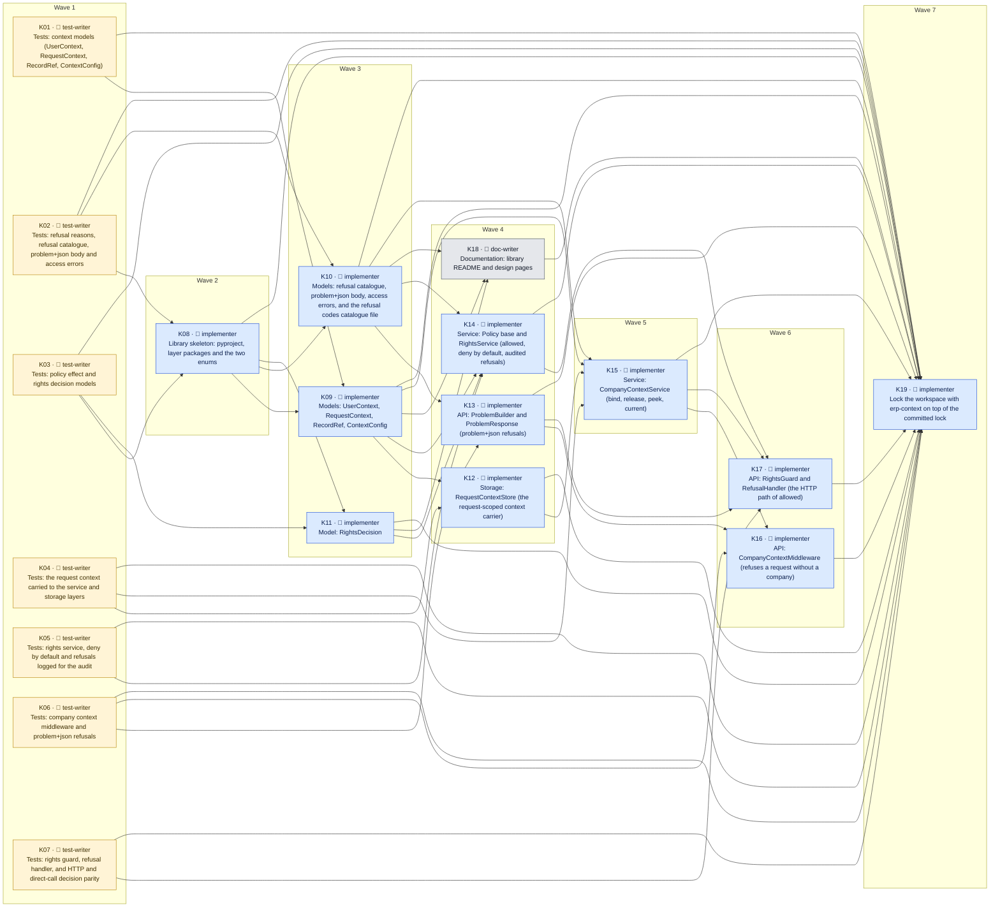

**Plan:** 🟢 Approved

**Push:** 🟢 Approved

<!-- ticket:specs -->
## 📚 Specifications

The specification and design pages of [TICKET.md](TICKET.md), copied by `python3 .claude/scripts/tickets/ticket_refs.py sync`.

- [REQ-T01-02](../../specs/03-technical/t01-companies-and-data-isolation/requirements/req-t01-02-company-context-everywhere.md)
- [I-T02-02](../../specs/03-technical/t02-identity-and-access/interfaces/i-t02-02-policy-decision-library.md)
- [REQ-T02-02](../../specs/03-technical/t02-identity-and-access/requirements/req-t02-02-policies-one-library.md)
- [REQ-T05-03](../../specs/03-technical/t05-api-and-webhooks/requirements/req-t05-03-problem-json.md)
- [REQ-T02-06](../../specs/03-technical/t02-identity-and-access/requirements/req-t02-06-refusals-audited.md)
- [📜 D405](../../specs/06-decisions/technical/d405-architecture-and-scalability.md)
- [📜 D406](../../specs/06-decisions/technical/d406-back-end.md)
- [📜 D414](../../specs/06-decisions/technical/d414-security-design.md)
- [📜 D410](../../specs/06-decisions/technical/d410-api-style-and-auth.md)
- [📜 D122](../../specs/06-decisions/ux/d122-error-message-standard.md)
- [📜 D438](../../specs/06-decisions/technical/d438-repository-layout.md)
- [🏗️ Back end](../../technical/architecture/backend.md)
- [🧱 Data isolation](../../specs/05-non-functional/data-isolation.md)
<!-- /ticket:specs -->

# T0.09: Company context and rights middleware: plan

## Summary

T0.09 builds the shared library `backend/shared/context` (distribution `erp-context`, package `erp_context`). It holds the company-context middleware and the rights interface `allowed(user, action, record)`, which denies by default. Refusals come back as problem+json with a D122 code and are logged for the audit, with who, what and why. The library follows the layers of AGENT.md: `models` (context models, refusal catalogue, problem body, rights decision), `storage` (the request context store, a ContextVar), `service` (company context service, rights service with pluggable policies) and `api` (ASGI middleware, problem builder and response, refusal handler, rights guard).

The plan has 18 tasks in 6 waves:

- Wave 1: seven test-writer tasks, one per behaviour.
- Wave 2: the package skeleton (pyproject, uv.lock, layer packages and the two enums).
- Wave 3: three models tasks.
- Wave 4: storage, the api problem builder, the rights service, and the documentation.
- Wave 5: the company context service.
- Wave 6: the middleware, and the rights guard with the refusal handler.

Every brief states the same public names and signatures, so the tests of wave 1 and the code of later waves agree. No front end is touched: TICKET.md says "No screen", so the plan has no Playwright task.

Shared contract (package `erp_context`):

- `models.refusals.enums.RefusalReason`: NO_COMPANY, NO_USER, NO_POLICY, POLICY_DENIED, OTHER_COMPANY.
- `models.rights.enums.PolicyEffect`: ALLOW, DENY, ABSTAIN.
- Context models: `UserContext(user_id, company_id)`, `RequestContext(user, request_id)`, `RecordRef(record_type, company_id, record_id=None)`, `ContextConfig(company_header, user_header, request_header, public_paths)`.
- Refusal models: `RefusalCode`, `RefusalCatalog(YamlCatalog).code_for(reason)`, and `Problem(type, title, status, detail, code, action, reference, instance)`.
- Refusal exceptions: `SEAccessError(reason)`, with subclasses `SEAccessNoCompanyError`, `SEAccessNoUserError` and `SEAccessDeniedError`.
- `RightsDecision(allowed, reason)`.
- `storage.context.RequestContextStore`: `set`, `get`, `reset`.
- `service.context.CompanyContextService`: `bind`, `release`, `peek`, `current`.
- `service.rights.Policy.vote`, and `RightsService(policies, catalog)` with `decide`, `allowed` and `enforce`.
- `api.problems`: `ProblemBuilder.build`, `ProblemResponse.of`, `RefusalHandler.__call__`.
- `api.middleware.CompanyContextMiddleware`.
- `api.rights.RightsGuard.check`.

## Assumptions

- The roadmap row has no own anchor: the ticket links #s02 and the epic links #epics.
- Logged for the audit is read as a log line with the code, since the audit writer comes with T0.10 and later tickets.
- Out of scope (conservative): row-level security and gateway, audit writer, alert on repeated refusals, the first service using the middleware (T0.14).
- Data isolation NFR has measures still "To be specified", so no budget is touched.
- I could not run check_ticket.py (no shell tool available), so links and sections were checked by hand only.
- tests-evidences/ holds a .gitkeep placeholder.
- The library's distribution name is `erp-context` and its import package is `erp_context`, named after `erp_models`. The specifications name only the folder `backend/shared/context`.
- The gateway has already verified the token, and the company, the user and the request id arrive as request headers. Their names are configurable in `ContextConfig` and default to `X-Company-Id`, `X-User-Id` and `X-Request-Id`. Token verification (I-T02-01, Keycloak) belongs to the gateway and to later tickets.
- A missing user is refused like a missing company, and a company id that the opaque company id type of T0.03 refuses is treated as missing. This is the conservative reading of deny by default.
- The policy language (Cedar or OPA, which docs/technical/security/security.md names only as examples) is not chosen yet. The library therefore exposes a pluggable `Policy.vote` and ships no allowing policy, so everything is denied by default. A deny vote beats an allow vote.
- A record whose company differs from the user's company is always refused (`OTHER_COMPANY`). This applies REQ-T01-02's "company context checked in each service" to the rights decision.
- The refusal codes and their HTTP statuses are data in the library's own `conf/catalogs/refusal_codes.yaml`, in the shape of T0.04's error code entries, rather than in the central catalogue of `backend/models`. This respects the area lock of TKT-16; moving them to the central catalogue is a follow-up. The codes are CONTEXT-COMPANY-01, CONTEXT-USER-01, RIGHTS-DENIED-01, RIGHTS-DENIED-02 and RIGHTS-COMPANY-01, and the statuses are 400, 401, 403, 403 and 403.
- The problem+json body follows RFC 9457: `type` is `about:blank`, `title` is the title key, `detail` is the why key, the extension members are `code`, `action` and `reference`, and `instance` is the request id. The translated texts come with the translation catalogues of P2.
- "Logged for the audit" means a WARNING log line holding the code, the reason (why), the user and company ids (who), and the action, record type and record id, or the method and path (what). The audit trail writer comes with T0.10 and later tickets, as TICKET.md says.
- `ContextConfig.public_paths` is empty by default. T0.14 lists its health endpoint there.
- A missing request id is replaced by a generated uuid4. ASGI scopes other than `http` and `lifespan` are refused, because no websocket is specified yet.
- The library carries its own `[tool.pytest.ini_options]`, so that its tests' `tests.` imports resolve to `backend/shared/context/tests/`, unless T0.05 or T0.06 set another pattern first.
- K08 changes the shared `uv.lock`. If another running ticket changed it too, the integrator resolves the conflict by running `uv lock` again.
- Tagging log lines with the company and request of this context (T0.06's logging tags) is not wired in this ticket. It is a follow-up for T0.14 or a later ticket.
- The library has no runnable class, so it needs no factory of T0.05.
- A task's `files` entry that ends in `exceptions/` means every file under that folder. AGENT.md's rule of five files per folder forces each exception package into sub-folders whose exact names the implementer chooses.

<!-- plan:graph -->

> [!NOTE]
> Generated from the json block at the end of this page by `python3 .claude/scripts/tickets/plan.py render`.
> To change a task, edit the json block, then render again: never edit this view by hand.

## Waves

| Wave | Tasks | Agents running at once |
| --- | --- | --- |
| 1 | [K01](#k01), [K02](#k02), [K03](#k03), [K04](#k04), [K05](#k05), [K06](#k06), [K07](#k07) | 7 of 7 |
| 2 | [K08](#k08) | 1 of 1 |
| 3 | [K09](#k09), [K10](#k10), [K11](#k11) | 3 of 3 |
| 4 | [K12](#k12), [K13](#k13), [K14](#k14), [K18](#k18) | 4 of 4 |
| 5 | [K15](#k15) | 1 of 1 |
| 6 | [K16](#k16), [K17](#k17) | 2 of 2 |
| 7 | [K19](#k19) | 1 of 1 |

| Wave | Task | Agent | Depends on | Unblocks |
| --- | --- | --- | --- | --- |
| 1 | [K01](#k01) Tests: context models (UserContext, RequestContext, RecordRef, ContextConfig) | 🧪 test-writer | none | [K09](#k09), [K19](#k19) |
| 1 | [K02](#k02) Tests: refusal reasons, refusal catalogue, problem+json body and access errors | 🧪 test-writer | none | [K08](#k08), [K10](#k10), [K19](#k19) |
| 1 | [K03](#k03) Tests: policy effect and rights decision models | 🧪 test-writer | none | [K08](#k08), [K11](#k11), [K19](#k19) |
| 1 | [K04](#k04) Tests: the request context carried to the service and storage layers | 🧪 test-writer | none | [K12](#k12), [K15](#k15), [K19](#k19) |
| 1 | [K05](#k05) Tests: rights service, deny by default and refusals logged for the audit | 🧪 test-writer | none | [K14](#k14), [K19](#k19) |
| 1 | [K06](#k06) Tests: company context middleware and problem+json refusals | 🧪 test-writer | none | [K13](#k13), [K16](#k16), [K19](#k19) |
| 1 | [K07](#k07) Tests: rights guard, refusal handler, and HTTP and direct-call decision parity | 🧪 test-writer | none | [K17](#k17), [K19](#k19) |
| 2 | [K08](#k08) Library skeleton: pyproject, layer packages and the two enums | 🐍 implementer | [K02](#k02), [K03](#k03) | [K09](#k09), [K10](#k10), [K11](#k11), [K19](#k19) |
| 3 | [K09](#k09) Models: UserContext, RequestContext, RecordRef, ContextConfig | 🐍 implementer | [K01](#k01), [K08](#k08) | [K12](#k12), [K14](#k14), [K18](#k18), [K15](#k15), [K19](#k19) |
| 3 | [K10](#k10) Models: refusal catalogue, problem+json body, access errors, and the refusal codes catalogue file | 🐍 implementer | [K02](#k02), [K08](#k08) | [K13](#k13), [K14](#k14), [K18](#k18), [K15](#k15), [K19](#k19) |
| 3 | [K11](#k11) Model: RightsDecision | 🐍 implementer | [K03](#k03), [K08](#k08) | [K14](#k14), [K18](#k18), [K19](#k19) |
| 4 | [K12](#k12) Storage: RequestContextStore (the request-scoped context carrier) | 🐍 implementer | [K04](#k04), [K09](#k09) | [K15](#k15), [K19](#k19) |
| 4 | [K13](#k13) API: ProblemBuilder and ProblemResponse (problem+json refusals) | 🐍 implementer | [K06](#k06), [K10](#k10) | [K16](#k16), [K17](#k17), [K19](#k19) |
| 4 | [K14](#k14) Service: Policy base and RightsService (allowed, deny by default, audited refusals) | 🐍 implementer | [K05](#k05), [K09](#k09), [K10](#k10), [K11](#k11) | [K17](#k17), [K19](#k19) |
| 4 | [K18](#k18) Documentation: library README and design pages | 📝 doc-writer | [K09](#k09), [K10](#k10), [K11](#k11) | [K19](#k19) |
| 5 | [K15](#k15) Service: CompanyContextService (bind, release, peek, current) | 🐍 implementer | [K04](#k04), [K09](#k09), [K10](#k10), [K12](#k12) | [K16](#k16), [K17](#k17), [K19](#k19) |
| 6 | [K16](#k16) API: CompanyContextMiddleware (refuses a request without a company) | 🐍 implementer | [K06](#k06), [K13](#k13), [K15](#k15) | [K19](#k19) |
| 6 | [K17](#k17) API: RightsGuard and RefusalHandler (the HTTP path of allowed) | 🐍 implementer | [K07](#k07), [K13](#k13), [K14](#k14), [K15](#k15) | [K19](#k19) |
| 7 | [K19](#k19) Lock the workspace with erp-context on top of the committed lock | 🐍 implementer | [K01](#k01), [K02](#k02), [K03](#k03), [K04](#k04), [K05](#k05), [K06](#k06), [K07](#k07), [K08](#k08), [K09](#k09), [K10](#k10), [K11](#k11), [K12](#k12), [K13](#k13), [K14](#k14), [K18](#k18), [K15](#k15), [K16](#k16), [K17](#k17) | none |

## Dependency graph



## Tasks

### <a id="k01"></a>K01: Tests: context models (UserContext, RequestContext, RecordRef, ContextConfig)

| Agent | Wave | Depends on | Unblocks |
| --- | --- | --- | --- |
| 🧪 test-writer | 1 | none | [K09](#k09), [K19](#k19) |

**Files** (only this task may change them in its wave):

- `backend/shared/context/tests/models/context/test_user_context.py`
- `backend/shared/context/tests/models/context/test_request_context.py`
- `backend/shared/context/tests/models/context/test_record_ref.py`
- `backend/shared/context/tests/models/context/test_context_config.py`

**Done when:** `uv run ruff check backend/shared/context/tests/models/context` and `uv run ruff format --check backend/shared/context/tests/models/context` exit 0. The four files exist, with the six model tests per model. They fail with an import error until K09 lands.

**Brief:**

Write the tests of the four context models of the new library `backend/shared/context` (distribution `erp-context`, package `erp_context`), written before the code exists (TKT-4). They describe the company and the user that each request carries to the service and storage layers ([REQ-T01-02](docs/specs/03-technical/t01-companies-and-data-isolation/requirements/req-t01-02-company-context-everywhere.md)). The library layout follows [D438](docs/specs/06-decisions/technical/d438-repository-layout.md) and [Back end](docs/technical/architecture/backend.md).

Contract (import paths are exact):
- `erp_context.models.context.user_context.UserContext`, frozen, extra forbidden. Fields: `user_id: str`, an opaque id, stripped, empty refused. `company_id`: the opaque company id type of `erp_models` delivered by T0.03 (read `backend/models/src/erp_models/` for its name). It is required.
- `erp_context.models.context.request_context.RequestContext`, frozen. Fields: `user: UserContext` and `request_id: str`, stripped, empty refused.
- `erp_context.models.context.record_ref.RecordRef`, frozen. Fields: `record_type: str`, stripped, non-empty. `company_id`: the same company id type, required. `record_id: Optional[str] = None`, stripped, and an empty string is refused.
- `erp_context.models.context.context_config.ContextConfig`, a configuration section with `validate_default=True`. Fields and defaults: `company_header="X-Company-Id"`, `user_header="X-User-Id"`, `request_header="X-Request-Id"` and `public_paths: List[str] = []`. Each path must start with `/`.
- Each field raises its own exception, imported from `erp_context.models.context.exceptions` (naming of AGENT.md, "Exceptions": `SE<Model>Invalid<Field>`, for example `SEUserContextInvalidUserId`). A `bool` or a non-string is refused.

Write the six model tests of AGENT.md ("Tests") for each model, one `Test<Model>` class per file: `test_defaults`, `test_full_valid_construction`, `test_none_becomes_the_default` (parametrised over the fields that have a default), `test_rejects_bad_values` (parametrised, asserting the specific exception), `test_rejects_unknown_keys` and `test_round_trip`. For a model with no default, `test_defaults` checks that the required fields are required.

Apply AGENT.md "Tests": no `__init__.py`, test names written as sentences, no mocks. Do not write the source code.

### <a id="k02"></a>K02: Tests: refusal reasons, refusal catalogue, problem+json body and access errors

| Agent | Wave | Depends on | Unblocks |
| --- | --- | --- | --- |
| 🧪 test-writer | 1 | none | [K08](#k08), [K10](#k10), [K19](#k19) |

**Files** (only this task may change them in its wave):

- `backend/shared/context/tests/models/refusals/test_refusal_code.py`
- `backend/shared/context/tests/models/refusals/test_refusal_catalog.py`
- `backend/shared/context/tests/models/refusals/test_problem.py`
- `backend/shared/context/tests/models/refusals/exceptions/test_access_errors.py`
- `backend/shared/context/tests/models/refusals/enums/test_refusal_reason.py`

**Done when:** `uv run ruff check backend/shared/context/tests/models/refusals` and `uv run ruff format --check backend/shared/context/tests/models/refusals` exit 0. The five files exist.

**Brief:**

Write the tests of the refusal models of `backend/shared/context` (package `erp_context`) before the code exists (TKT-4). They cover the problem+json refusals with their code ([REQ-T05-03](docs/specs/03-technical/t05-api-and-webhooks/requirements/req-t05-03-problem-json.md) criteria 1 and 2, [D410](docs/specs/06-decisions/technical/d410-api-style-and-auth.md)) and the codes of the error pattern ([D122](docs/specs/06-decisions/ux/d122-error-message-standard.md), docs/specs/04-ux/design-system/patterns/error-messages.md). The library sits in the [D438](docs/specs/06-decisions/technical/d438-repository-layout.md) layout.

Contract:
- `erp_context.models.refusals.enums.RefusalReason`: a `StrEnum` with `@unique`. Members: `NO_COMPANY="no-company"`, `NO_USER="no-user"`, `NO_POLICY="no-policy"`, `POLICY_DENIED="policy-denied"`, `OTHER_COMPANY="other-company"`.
- `erp_context.models.refusals.refusal_code.RefusalCode`, frozen. Fields:
  - `reason: RefusalReason`.
  - `code: str`, a D122 support code matching `^[A-Z]+(-[A-Z]+)*-[0-9]{2}$`, such as `SITE-CLOSE-01`.
  - `status: int`, in [400, 599], with `bool` refused.
  - `title_key`, `why_key`, `action_key`: message keys matching `^[a-z0-9_.]+$`.
  - `reference: str`, the support reference, which follows the same pattern as `code`.
- `erp_context.models.refusals.refusal_catalog.RefusalCatalog`: subclasses `YamlCatalog` of `erp_models` (T0.03), with `entries: List[RefusalCode]`.
  - A model validator refuses a catalogue that misses a reason, holds a reason twice or repeats a code.
  - `code_for(reason) -> RefusalCode`.
  - `load(path)` raises the catalogue's UNREADABLE exception on a missing or broken file.
- `erp_context.models.refusals.problem.Problem`, frozen: the RFC 9457 problem+json body.
  - `type: str = "about:blank"`.
  - `title` (the title key), `status`, `detail` (the why key), `code`, `action` (the action key) and `reference`.
  - `instance: Optional[str] = None`, the request id.
- `erp_context.models.refusals.exceptions`: `SEAccessError`, the layer base, built with `(reason: RefusalReason, message: str)`, which keeps `reason` as an attribute. Its subclasses are `SEAccessNoCompanyError`, `SEAccessNoUserError` and `SEAccessDeniedError`. They also re-export each field exception (`SERefusalCodeInvalidCode`, `SEProblemInvalidStatus`, ...).

Tests:
- The six model tests of AGENT.md for `RefusalCode`, `RefusalCatalog` and `Problem`.
- `RefusalReason` members are unique, and each value round-trips.
- The shipped catalogue `backend/shared/context/conf/catalogs/refusal_codes.yaml` loads. Find it from `Path(__file__)`. Every `RefusalReason` resolves through `code_for` to exactly one code. `NO_COMPANY` and `NO_USER` have a 4xx status. `NO_POLICY`, `POLICY_DENIED` and `OTHER_COMPANY` have status 403.
- No message key or code of the catalogue holds a secret. Each is a key or a code by its pattern, never free text ([REQ-T05-03](docs/specs/03-technical/t05-api-and-webhooks/requirements/req-t05-03-problem-json.md) criterion 2).
- The access errors subclass `SEAccessError` and keep their reason.

Apply AGENT.md "Tests". Write no source code.

### <a id="k03"></a>K03: Tests: policy effect and rights decision models

| Agent | Wave | Depends on | Unblocks |
| --- | --- | --- | --- |
| 🧪 test-writer | 1 | none | [K08](#k08), [K11](#k11), [K19](#k19) |

**Files** (only this task may change them in its wave):

- `backend/shared/context/tests/models/rights/test_rights_decision.py`
- `backend/shared/context/tests/models/rights/enums/test_policy_effect.py`

**Done when:** `uv run ruff check backend/shared/context/tests/models/rights` and `uv run ruff format --check backend/shared/context/tests/models/rights` exit 0.

**Brief:**

Write the tests of the rights models of `backend/shared/context` (package `erp_context`) before the code exists (TKT-4). These models carry the decision of `allowed(user, action, record)` ([I-T02-02](docs/specs/03-technical/t02-identity-and-access/interfaces/i-t02-02-policy-decision-library.md), [REQ-T02-02](docs/specs/03-technical/t02-identity-and-access/requirements/req-t02-02-policies-one-library.md), [D414](docs/specs/06-decisions/technical/d414-security-design.md)).

Contract:
- `erp_context.models.rights.enums.PolicyEffect`: a `StrEnum` with `@unique`. Members: `ALLOW="allow"`, `DENY="deny"`, `ABSTAIN="abstain"`.
- `erp_context.models.rights.rights_decision.RightsDecision`, frozen. Fields: `allowed: bool`, which refuses a non-bool, and `reason: Optional[RefusalReason] = None`, with `RefusalReason` imported from `erp_context.models.refusals.enums`.
  - A model validator refuses `allowed=True` with a reason, and `allowed=False` without one.
  - Its exceptions come from `erp_context.models.rights.exceptions`: `SERightsDecisionInvalidAllowed`, `SERightsDecisionInvalidReason`, and `SERightsDecisionInconsistent` for the cross-field rule.

Tests:
- The six model tests of AGENT.md for `RightsDecision`, plus the two inconsistent cases.
- `PolicyEffect` members are unique and round-trip from their values.

Apply AGENT.md "Tests". Write no source code.

### <a id="k04"></a>K04: Tests: the request context carried to the service and storage layers

| Agent | Wave | Depends on | Unblocks |
| --- | --- | --- | --- |
| 🧪 test-writer | 1 | none | [K12](#k12), [K15](#k15), [K19](#k19) |

**Files** (only this task may change them in its wave):

- `backend/shared/context/tests/storage/context/test_request_context_store.py`
- `backend/shared/context/tests/service/context/test_company_context_service.py`
- `backend/shared/context/tests/service/context/conftest.py`

**Done when:** `uv run ruff check backend/shared/context/tests/storage backend/shared/context/tests/service/context` and `uv run ruff format --check` on the same folders exit 0.

**Brief:**

Write the tests that prove the company and the user of a request are carried to the service and storage layers, before the code exists ([REQ-T01-02](docs/specs/03-technical/t01-companies-and-data-isolation/requirements/req-t01-02-company-context-everywhere.md) criterion 1, [D405](docs/specs/06-decisions/technical/d405-architecture-and-scalability.md)). The library is `backend/shared/context` (package `erp_context`, [D438](docs/specs/06-decisions/technical/d438-repository-layout.md)).

Contract:
- `erp_context.storage.context.request_context_store.RequestContextStore()`. It holds a `ClassVar` `ContextVar[Optional[RequestContext]]` named `CURRENT`. Methods: `set(context: RequestContext) -> contextvars.Token`, `get() -> Optional[RequestContext]` and `reset(token) -> None`.
- `erp_context.service.context.company_context_service.CompanyContextService(store: RequestContextStore, logger: Optional[Logger] = None)`. Methods:
  - `bind(context) -> Token`.
  - `release(token) -> None`.
  - `peek() -> Optional[RequestContext]`.
  - `current() -> RequestContext`. When no context is bound, it raises `SEAccessNoCompanyError` (from `erp_context.models.refusals.exceptions`), whose `reason` is `RefusalReason.NO_COMPANY`.
- Models: `RequestContext(user=UserContext(user_id, company_id), request_id)`, from `erp_context.models.context.*`. The company id type comes from `erp_models` (T0.03).

Tests:
- A bound context is read back through `RequestContextStore.get()` and through `CompanyContextService.peek()` and `current()`.
- After `release`, nothing is bound.
- `current()` without a context raises `SEAccessNoCompanyError` and logs a WARNING or an ERROR line (use pytest's `caplog`).
- Two asyncio tasks that bind different companies each see their own company (`asyncio.gather`).
- A context bound in a task does not leak to the caller after it ends.

Put shared fixtures in `conftest.py`. Apply AGENT.md "Tests", with no mocks. Write no source code.

### <a id="k05"></a>K05: Tests: rights service, deny by default and refusals logged for the audit

| Agent | Wave | Depends on | Unblocks |
| --- | --- | --- | --- |
| 🧪 test-writer | 1 | none | [K14](#k14), [K19](#k19) |

**Files** (only this task may change them in its wave):

- `backend/shared/context/tests/service/rights/test_rights_service.py`
- `backend/shared/context/tests/service/rights/test_policy.py`
- `backend/shared/context/tests/service/rights/allow_action_policy.py`
- `backend/shared/context/tests/service/rights/deny_action_policy.py`
- `backend/shared/context/tests/service/rights/conftest.py`

**Done when:** `uv run ruff check backend/shared/context/tests/service/rights` and `uv run ruff format --check backend/shared/context/tests/service/rights` exit 0.

**Brief:**

Write the tests of the policy decision library before the code exists. They cover `allowed(user, action, record)` evaluated by one library ([I-T02-02](docs/specs/03-technical/t02-identity-and-access/interfaces/i-t02-02-policy-decision-library.md), [REQ-T02-02](docs/specs/03-technical/t02-identity-and-access/requirements/req-t02-02-policies-one-library.md), [D414](docs/specs/06-decisions/technical/d414-security-design.md)), deny by default (TICKET.md criterion 3), and every refusal logged with its code, who, what and why ([REQ-T02-06](docs/specs/03-technical/t02-identity-and-access/requirements/req-t02-06-refusals-audited.md) criterion 1). The library is `backend/shared/context` (package `erp_context`).

Contract:
- `erp_context.service.rights.policy.Policy`: an abstract base class with `vote(user: UserContext, action: str, record: RecordRef) -> PolicyEffect`.
- `erp_context.service.rights.rights_service.RightsService(policies: List[Policy], catalog: RefusalCatalog, logger: Optional[Logger] = None)`. Methods:
  - `decide(user, action, record) -> RightsDecision`.
  - `allowed(user, action, record) -> bool`.
  - `enforce(user, action, record) -> None`, which raises `SEAccessDeniedError` carrying the decision's reason.
- The rules, in order:
  1. A record whose `company_id` differs from the user's is refused with `OTHER_COMPANY`.
  2. Any `DENY` vote refuses with `POLICY_DENIED`.
  3. Any `ALLOW` vote allows.
  4. Otherwise the call is refused with `NO_POLICY`. This is the deny-by-default rule, including with no policy at all.
- Every refusal logs a WARNING line holding:
  - the catalogue code of its reason (`catalog.code_for(reason).code`);
  - the reason;
  - the user id and the company id;
  - the action, the record type and the record id.
- Models come from `erp_context.models.context.*`, `erp_context.models.rights.*` and `erp_context.models.refusals.*`. The catalogue is `RefusalCatalog.load(<backend/shared/context/conf/catalogs/refusal_codes.yaml>)`, with the path found from `Path(__file__)`.

Helper classes, one per file as AGENT.md asks: `AllowActionPolicy(action)` allows one action and abstains otherwise. `DenyActionPolicy(action)` denies one action and abstains otherwise.

Tests:
- With no policy, every action is denied (parametrised).
- An allowing policy allows only its action.
- A deny beats an allow.
- A record of another company is refused even when allowed.
- `allowed` equals `decide(...).allowed`.
- `enforce` raises `SEAccessDeniedError` with the right reason, and returns `None` when allowed.
- Each refusal is in `caplog` at WARNING, with the code, the user id, the action, the record type and the reason.
- No log line holds a record's content: pass a record id and check that only ids appear.
- `test_policy.py` checks that `Policy` cannot be instantiated without `vote`.

Apply AGENT.md "Tests", with no mocks. Write no source code.

### <a id="k06"></a>K06: Tests: company context middleware and problem+json refusals

| Agent | Wave | Depends on | Unblocks |
| --- | --- | --- | --- |
| 🧪 test-writer | 1 | none | [K13](#k13), [K16](#k16), [K19](#k19) |

**Files** (only this task may change them in its wave):

- `backend/shared/context/tests/api/middleware/test_company_context_middleware.py`
- `backend/shared/context/tests/api/middleware/helpers.py`
- `backend/shared/context/tests/api/middleware/conftest.py`
- `backend/shared/context/tests/api/problems/test_problem_builder.py`
- `backend/shared/context/tests/api/problems/test_problem_response.py`

**Done when:** `uv run ruff check backend/shared/context/tests/api/middleware backend/shared/context/tests/api/problems` and `uv run ruff format --check` on the same folders exit 0.

**Brief:**

Write the HTTP tests of the middleware and of the problem+json refusals before the code exists. They cover:
- a request without a company is refused (TICKET.md criterion 1, [REQ-T01-02](docs/specs/03-technical/t01-companies-and-data-isolation/requirements/req-t01-02-company-context-everywhere.md) criterion 1);
- the refusal is a problem+json body with its code and no secret ([REQ-T05-03](docs/specs/03-technical/t05-api-and-webhooks/requirements/req-t05-03-problem-json.md) criteria 1 and 2, [D410](docs/specs/06-decisions/technical/d410-api-style-and-auth.md), [D122](docs/specs/06-decisions/ux/d122-error-message-standard.md));
- it is logged with its code, who, what and why ([REQ-T02-06](docs/specs/03-technical/t02-identity-and-access/requirements/req-t02-06-refusals-audited.md) criterion 1).

The app framework is FastAPI ([D406](docs/specs/06-decisions/technical/d406-back-end.md)). Use a real FastAPI app with `fastapi.testclient.TestClient`, and no mocks.

Contract:
- `erp_context.api.problems.problem_builder.ProblemBuilder(catalog: RefusalCatalog, logger=None)`. `build(error: SEAccessError, request_id: Optional[str]) -> Problem` fills `title`, `detail`, `code`, `action`, `reference` and `status` from `catalog.code_for(error.reason)`, and `instance` from the request id.
- `erp_context.api.problems.problem_response.ProblemResponse`: a Starlette `JSONResponse` with `media_type = "application/problem+json"`. `ProblemResponse.of(problem) -> ProblemResponse` uses `problem.status` as its status and `problem.model_dump(exclude_none=True)` as its body.
- `erp_context.api.middleware.company_context_middleware.CompanyContextMiddleware`: a pure ASGI middleware, registered with `app.add_middleware(CompanyContextMiddleware, config=ContextConfig(...), context=CompanyContextService(RequestContextStore()), builder=ProblemBuilder(catalog), logger=...)`.
  - It reads `config.company_header`, `config.user_header` and `config.request_header`.
  - A missing or invalid company refuses with `NO_COMPANY`, and a missing user with `NO_USER`. The answer is a `ProblemResponse` with the catalogue status, and the app is never called.
  - A missing request id is replaced by a generated one.
  - A path in `config.public_paths` passes without a context.
  - Otherwise it binds the `RequestContext` for the call and releases it after.
  - `lifespan` passes through unchanged.
  - Each refusal is logged at WARNING with the code, the reason, the method and the path, and the user id when known.

In `helpers.py`, add functions that build the app. It needs a route that returns the bound context read through `CompanyContextService.peek()` and through `RequestContextStore().get()`, to prove the storage layer sees it, and a public route. Load the catalogue from `backend/shared/context/conf/catalogs/refusal_codes.yaml`, with the path found from `Path(__file__)`.

Tests:
- No company header gives the `NO_COMPANY` status, the `application/problem+json` content type and the catalogue code in the body.
- An invalid company gives the same.
- No user gives `NO_USER`.
- Both headers give 200, and the route sees the same company and user in the service and the storage layers.
- After the response, nothing is bound.
- `instance` equals the request id header.
- A public path passes.
- The body and the logs never contain an `Authorization` header value or the raw invalid company value.
- The refusal log line holds the code, the method and the path.
- The `ProblemBuilder` and `ProblemResponse` unit tests check each field and the media type.

Apply AGENT.md "Tests". Write no source code.

### <a id="k07"></a>K07: Tests: rights guard, refusal handler, and HTTP and direct-call decision parity

| Agent | Wave | Depends on | Unblocks |
| --- | --- | --- | --- |
| 🧪 test-writer | 1 | none | [K17](#k17), [K19](#k19) |

**Files** (only this task may change them in its wave):

- `backend/shared/context/tests/api/rights/test_rights_guard.py`
- `backend/shared/context/tests/api/rights/test_decision_parity.py`
- `backend/shared/context/tests/api/rights/allow_action_policy.py`
- `backend/shared/context/tests/api/rights/helpers.py`
- `backend/shared/context/tests/api/rights/conftest.py`
- `backend/shared/context/tests/api/problems/test_refusal_handler.py`

**Done when:** `uv run ruff check backend/shared/context/tests/api/rights backend/shared/context/tests/api/problems/test_refusal_handler.py` and `uv run ruff format --check` on the same paths exit 0.

**Brief:**

Write the tests that prove the same user, action and record get the same decision from HTTP and from a direct call (TICKET.md criterion 2, [REQ-T02-02](docs/specs/03-technical/t02-identity-and-access/requirements/req-t02-02-policies-one-library.md) criterion 1, [I-T02-02](docs/specs/03-technical/t02-identity-and-access/interfaces/i-t02-02-policy-decision-library.md)). An HTTP refusal is problem+json with its code ([REQ-T05-03](docs/specs/03-technical/t05-api-and-webhooks/requirements/req-t05-03-problem-json.md)) and is logged for the audit ([REQ-T02-06](docs/specs/03-technical/t02-identity-and-access/requirements/req-t02-06-refusals-audited.md)). Use a real FastAPI app ([D406](docs/specs/06-decisions/technical/d406-back-end.md)) with `TestClient`, and no mocks.

Contract:
- `erp_context.api.rights.rights_guard.RightsGuard(rights: RightsService, context: CompanyContextService, logger=None)`. `check(action: str, record: RecordRef) -> None` reads `context.current().user` and calls `rights.enforce(user, action, record)`, so it raises `SEAccessDeniedError` on a refusal.
- `erp_context.api.problems.refusal_handler.RefusalHandler(builder: ProblemBuilder, context: CompanyContextService, logger=None)`. `async __call__(request, error: SEAccessError) -> ProblemResponse` is registered with `app.add_exception_handler(SEAccessError, handler)`. It uses the bound request id as `instance`.
- Also used: `CompanyContextMiddleware`, `ProblemBuilder`, `ProblemResponse`, `RightsService(policies, catalog)`, `Policy.vote`, `RequestContextStore`, and the models `UserContext`, `RecordRef` and `RefusalCatalog`. The signatures are those of the K04, K05 and K06 briefs. The headers are those of `ContextConfig` defaults: `X-Company-Id`, `X-User-Id`, `X-Request-Id`.

In `helpers.py`, build an app with the middleware, the handler, and a route `GET /records/{record_type}/{record_id}` with query parameters `action` and `company` (the record's company). The route calls `RightsGuard.check` and returns 200.

`AllowActionPolicy` is a helper class in its own file. It allows one action.

Tests:
- `test_decision_parity.py` is parametrised over four cases: allowed by the policy; no policy (deny by default); a record of another company; an unknown action. For each case it asserts that the HTTP answer (200, or 403 problem+json) equals `RightsService.allowed(...)` called directly with the same user, action and record on the same service instance. When refused, the body's `code` equals `catalog.code_for(decision.reason).code`.
- `test_rights_guard.py` checks that `check` passes when allowed, raises `SEAccessDeniedError` when refused, and raises `SEAccessNoCompanyError` with no bound context.
- `test_refusal_handler.py` checks that the handler answers with the catalogue status, the `application/problem+json` type, the code and the request id as `instance`, and that the body holds no header value of the request.

Apply AGENT.md "Tests". Write no source code.

### <a id="k08"></a>K08: Library skeleton: pyproject, layer packages and the two enums

| Agent | Wave | Depends on | Unblocks |
| --- | --- | --- | --- |
| 🐍 implementer | 2 | [K02](#k02), [K03](#k03) | [K09](#k09), [K10](#k10), [K11](#k11), [K19](#k19) |

**Files** (only this task may change them in its wave):

- `backend/shared/context/pyproject.toml`
- `backend/shared/context/src/erp_context/__init__.py`
- `backend/shared/context/src/erp_context/py.typed`
- `backend/shared/context/src/erp_context/models/__init__.py`
- `backend/shared/context/src/erp_context/storage/__init__.py`
- `backend/shared/context/src/erp_context/service/__init__.py`
- `backend/shared/context/src/erp_context/api/__init__.py`
- `backend/shared/context/src/erp_context/models/refusals/__init__.py`
- `backend/shared/context/src/erp_context/models/refusals/enums/__init__.py`
- `backend/shared/context/src/erp_context/models/refusals/enums/refusal_reason.py`
- `backend/shared/context/src/erp_context/models/rights/__init__.py`
- `backend/shared/context/src/erp_context/models/rights/enums/__init__.py`
- `backend/shared/context/src/erp_context/models/rights/enums/policy_effect.py`
- `uv.lock`

**Done when:** `uv lock` and `uv sync` succeed. `uv run --package erp-context python -c "import erp_context, fastapi, httpx"` exits 0. `uv run --package erp-context pytest backend/shared/context/tests/models/refusals/enums backend/shared/context/tests/models/rights/enums -n 2` passes. `uv run ruff check backend/shared/context/src` and `uv run pytest tests/conventions -n 2` pass.

**Brief:**

Create the uv package of the library `backend/shared/context`. It is a library of the service kit with no business rules ([D438](docs/specs/06-decisions/technical/d438-repository-layout.md), [D406](docs/specs/06-decisions/technical/d406-back-end.md), [Back end](docs/technical/architecture/backend.md)).

`pyproject.toml`:
- Distribution `erp-context`, Python `>=3.13,<3.14`, with a build backend that ships `src/erp_context`. Follow the shape that T0.05 and T0.06 used for `backend/shared/lifecycle` and `backend/shared/logging`, if they exist.
- Dependencies: `erp-models` as a workspace source, `fastapi` and `pydantic`. Add `httpx` to the package's `dev` dependency group, for `fastapi.testclient`.
- A `[tool.pytest.ini_options]` copied from the root `pyproject.toml` (`pythonpath = ["."]`, `asyncio_mode = "auto"`, `asyncio_default_fixture_loop_scope = "function"`, `addopts = "--strict-markers --timeout=300"`). The rootdir is then the library, so test imports of `tests.` resolve to `backend/shared/context/tests/`. If T0.05 or T0.06 solved this another way, follow them and say so.

The root `pyproject.toml` already globs `backend/shared/*`: do not change it. Run `uv lock` to update `uv.lock`.

Create the empty layer packages `erp_context/{models,storage,service,api}/__init__.py`, plus `models/refusals/__init__.py`, `models/rights/__init__.py` and `py.typed`. These are AGENT.md's layers inside the package; never add a top-level `models` package.

Create the two enums every model uses, each a `StrEnum` with `@unique`, its members listed under `Attributes:`, re-exported by its `enums/__init__.py` through a sorted `__all__`:
- `RefusalReason` in `models/refusals/enums/refusal_reason.py`: `NO_COMPANY="no-company"`, `NO_USER="no-user"`, `NO_POLICY="no-policy"`, `POLICY_DENIED="policy-denied"`, `OTHER_COMPANY="other-company"`. These are the "why" of a refusal ([REQ-T02-06](docs/specs/03-technical/t02-identity-and-access/requirements/req-t02-06-refusals-audited.md)).
- `PolicyEffect` in `models/rights/enums/policy_effect.py`: `ALLOW`, `DENY`, `ABSTAIN` ([I-T02-02](docs/specs/03-technical/t02-identity-and-access/interfaces/i-t02-02-policy-decision-library.md)).

Follow AGENT.md: `from __future__ import annotations`, docstrings and British English.

### <a id="k09"></a>K09: Models: UserContext, RequestContext, RecordRef, ContextConfig

| Agent | Wave | Depends on | Unblocks |
| --- | --- | --- | --- |
| 🐍 implementer | 3 | [K01](#k01), [K08](#k08) | [K12](#k12), [K14](#k14), [K18](#k18), [K15](#k15), [K19](#k19) |

**Files** (only this task may change them in its wave):

- `backend/shared/context/src/erp_context/models/context/__init__.py`
- `backend/shared/context/src/erp_context/models/context/user_context.py`
- `backend/shared/context/src/erp_context/models/context/request_context.py`
- `backend/shared/context/src/erp_context/models/context/record_ref.py`
- `backend/shared/context/src/erp_context/models/context/context_config.py`
- `backend/shared/context/src/erp_context/models/context/exceptions/`

**Done when:** `uv run --package erp-context pytest backend/shared/context/tests/models/context -n 2` passes. `uv run ruff check backend/shared/context/src/erp_context/models/context`, `uv run mypy backend/shared/context/src` and `uv run pytest tests/conventions -n 2` pass.

**Brief:**

Implement the four context models that the tests of K01 describe (`backend/shared/context/tests/models/context/`). They are the company and the user each request carries to the service and storage layers ([REQ-T01-02](docs/specs/03-technical/t01-companies-and-data-isolation/requirements/req-t01-02-company-context-everywhere.md), [D405](docs/specs/06-decisions/technical/d405-architecture-and-scalability.md)), in the `models` layer of `erp_context` ([D438](docs/specs/06-decisions/technical/d438-repository-layout.md)).

The models:
- `UserContext(user_id: str, company_id)`, frozen. `company_id` uses the opaque company id type of `erp_models` (T0.03).
- `RequestContext(user: UserContext, request_id: str)`, frozen.
- `RecordRef(record_type: str, company_id, record_id: Optional[str] = None)`, frozen.
- `ContextConfig`, a configuration section with `validate_default=True`. Defaults: `company_header="X-Company-Id"`, `user_header="X-User-Id"`, `request_header="X-Request-Id"`, `public_paths: List[str] = []`. Each path starts with `/`.

Build them on the base model of `erp_models` where T0.03 provides one, and follow AGENT.md "Pydantic models":
- every field has `Field(description=...)` and a `validate_<field>` validator with `mode="before"`;
- `None` becomes the default;
- `bool` is refused;
- strings are stripped, and empty ones refused;
- `extra="forbid"`.

Each field exception has its own file under `models/context/exceptions/`. Dispatch them into sub-folders per model, so that no folder holds more than five files. Name them `SE<Model>Invalid<Field>`, subclass the model exception base of `erp_models` (T0.04) through one `SEInvalid<Model>Exception` per model, and re-export them all from `models/context/exceptions/__init__.py` through a sorted `__all__`. Messages follow AGENT.md "Messages": `Invalid <field>: {value!r}.` then `Must be ...`. Models never log.

The `exceptions/` entry in files means every file under that folder.

### <a id="k10"></a>K10: Models: refusal catalogue, problem+json body, access errors, and the refusal codes catalogue file

| Agent | Wave | Depends on | Unblocks |
| --- | --- | --- | --- |
| 🐍 implementer | 3 | [K02](#k02), [K08](#k08) | [K13](#k13), [K14](#k14), [K18](#k18), [K15](#k15), [K19](#k19) |

**Files** (only this task may change them in its wave):

- `backend/shared/context/src/erp_context/models/refusals/refusal_code.py`
- `backend/shared/context/src/erp_context/models/refusals/refusal_catalog.py`
- `backend/shared/context/src/erp_context/models/refusals/problem.py`
- `backend/shared/context/src/erp_context/models/refusals/exceptions/`
- `backend/shared/context/conf/catalogs/refusal_codes.yaml`

**Done when:** `uv run --package erp-context pytest backend/shared/context/tests/models/refusals -n 2` passes. `uv run ruff check backend/shared/context/src/erp_context/models/refusals`, `uv run mypy backend/shared/context/src` and `uv run pytest tests/conventions -n 2` pass.

**Brief:**

Implement the refusal models that the tests of K02 describe (`backend/shared/context/tests/models/refusals/`): problem+json bodies with the codes of the error pattern and no secret ([REQ-T05-03](docs/specs/03-technical/t05-api-and-webhooks/requirements/req-t05-03-problem-json.md) criteria 1 and 2, [D410](docs/specs/06-decisions/technical/d410-api-style-and-auth.md), [D122](docs/specs/06-decisions/ux/d122-error-message-standard.md), docs/specs/04-ux/design-system/patterns/error-messages.md).

The models:
- `RefusalCode`, frozen: `reason: RefusalReason`, `code`, `status` (in [400, 599]), `title_key`, `why_key`, `action_key` and `reference`. Mirror the entry shape of T0.04's error code catalogue in `erp_models`.
- `RefusalCatalog(YamlCatalog)`, built on T0.03's `YamlCatalog`: `entries: List[RefusalCode]`.
  - A `model_validator(mode="after")` requires exactly one entry per `RefusalReason` and unique codes.
  - `code_for(reason) -> RefusalCode`.
  - `load(path)` raises its `UNREADABLE` exception.
- `Problem`, frozen: the RFC 9457 body. `type="about:blank"`, `title`, `status`, `detail`, `code`, `action`, `reference`, and `instance: Optional[str] = None`.

The layer exceptions go in `models/refusals/exceptions/`: `SEAccessError(reason, message)`, which keeps `reason`, and its subclasses `SEAccessNoCompanyError`, `SEAccessNoUserError` and `SEAccessDeniedError`. `SEAccessError` subclasses the layer base of `erp_models` (T0.04). Every model field exception goes there too, in sub-folders by model with five files at most each, and everything is re-exported from `models/refusals/exceptions/__init__.py` through a sorted `__all__`.

Write `backend/shared/context/conf/catalogs/refusal_codes.yaml`, one entry per reason:

| Reason | Code | Status |
| --- | --- | --- |
| `no-company` | `CONTEXT-COMPANY-01` | 400 |
| `no-user` | `CONTEXT-USER-01` | 401 |
| `no-policy` | `RIGHTS-DENIED-01` | 403 |
| `policy-denied` | `RIGHTS-DENIED-02` | 403 |
| `other-company` | `RIGHTS-COMPANY-01` | 403 |

Each entry has keys such as `errors.context.no_company.title`, `.why` and `.action`, following the key scheme of T0.04's catalogue if it has one, and `reference` equal to its code. Keys only, no text and no secret.

Follow AGENT.md "Pydantic models", "Exceptions" and "Data and enums". Models never log. The `exceptions/` entry in files means every file under that folder.

### <a id="k11"></a>K11: Model: RightsDecision

| Agent | Wave | Depends on | Unblocks |
| --- | --- | --- | --- |
| 🐍 implementer | 3 | [K03](#k03), [K08](#k08) | [K14](#k14), [K18](#k18), [K19](#k19) |

**Files** (only this task may change them in its wave):

- `backend/shared/context/src/erp_context/models/rights/rights_decision.py`
- `backend/shared/context/src/erp_context/models/rights/exceptions/`

**Done when:** `uv run --package erp-context pytest backend/shared/context/tests/models/rights -n 2` passes. `uv run ruff check backend/shared/context/src/erp_context/models/rights`, `uv run mypy backend/shared/context/src` and `uv run pytest tests/conventions -n 2` pass.

**Brief:**

Implement `RightsDecision`, which K03's tests describe (`backend/shared/context/tests/models/rights/test_rights_decision.py`). It is the answer of `allowed(user, action, record)` ([I-T02-02](docs/specs/03-technical/t02-identity-and-access/interfaces/i-t02-02-policy-decision-library.md), [REQ-T02-02](docs/specs/03-technical/t02-identity-and-access/requirements/req-t02-02-policies-one-library.md), [D414](docs/specs/06-decisions/technical/d414-security-design.md)).

It lives in `erp_context/models/rights/rights_decision.py` and is frozen with `extra="forbid"`. Fields: `allowed: bool`, which refuses a non-bool, and `reason: Optional[RefusalReason] = None`, with `RefusalReason` from `erp_context.models.refusals.enums`. A `model_validator(mode="after")` raises `SERightsDecisionInconsistent` when `allowed` is true with a reason, or false without one.

The field exceptions `SERightsDecisionInvalidAllowed`, `SERightsDecisionInvalidReason` and `SERightsDecisionInconsistent`, and the model base `SEInvalidRightsDecisionException` (subclassing T0.04's model base), each have their own file under `models/rights/exceptions/`. They are re-exported through a sorted `__all__`.

Follow AGENT.md "Pydantic models" and "Exceptions". The `exceptions/` entry in files means every file under that folder.

### <a id="k12"></a>K12: Storage: RequestContextStore (the request-scoped context carrier)

| Agent | Wave | Depends on | Unblocks |
| --- | --- | --- | --- |
| 🐍 implementer | 4 | [K04](#k04), [K09](#k09) | [K15](#k15), [K19](#k19) |

**Files** (only this task may change them in its wave):

- `backend/shared/context/src/erp_context/storage/context/__init__.py`
- `backend/shared/context/src/erp_context/storage/context/request_context_store.py`

**Done when:** `uv run --package erp-context pytest backend/shared/context/tests/storage -n 2` passes. `uv run ruff check backend/shared/context/src/erp_context/storage`, `uv run mypy backend/shared/context/src` and `uv run pytest tests/conventions -n 2` pass.

**Brief:**

Implement `RequestContextStore` in `erp_context/storage/context/request_context_store.py`, as K04's tests describe (`backend/shared/context/tests/storage/context/test_request_context_store.py`). It is where the storage layer of every service reads the company of the current request, so that the company context reaches storage ([REQ-T01-02](docs/specs/03-technical/t01-companies-and-data-isolation/requirements/req-t01-02-company-context-everywhere.md), [D405](docs/specs/06-decisions/technical/d405-architecture-and-scalability.md)). It sits in the `storage` layer of [D438](docs/specs/06-decisions/technical/d438-repository-layout.md) and imports only `models`.

The ContextVar is a `ClassVar` named `CURRENT`, of type `ContextVar[Optional[RequestContext]]` with default `None`, declared above the constructor. Nothing sits at module level. The methods are instance methods, never `@staticmethod`: `set(context) -> Token`, `get() -> Optional[RequestContext]` and `reset(token) -> None`.

It is a one-line holder, so it stays silent: the service layer logs. Give it Google docstrings and the AGENT.md banners, and explain in `Notes:` why a ContextVar keeps concurrent requests apart.

### <a id="k13"></a>K13: API: ProblemBuilder and ProblemResponse (problem+json refusals)

| Agent | Wave | Depends on | Unblocks |
| --- | --- | --- | --- |
| 🐍 implementer | 4 | [K06](#k06), [K10](#k10) | [K16](#k16), [K17](#k17), [K19](#k19) |

**Files** (only this task may change them in its wave):

- `backend/shared/context/src/erp_context/api/problems/__init__.py`
- `backend/shared/context/src/erp_context/api/problems/problem_builder.py`
- `backend/shared/context/src/erp_context/api/problems/problem_response.py`

**Done when:** `uv run --package erp-context pytest backend/shared/context/tests/api/problems/test_problem_builder.py backend/shared/context/tests/api/problems/test_problem_response.py -n 2` passes. `uv run ruff check backend/shared/context/src/erp_context/api/problems`, `uv run mypy backend/shared/context/src` and `uv run pytest tests/conventions -n 2` pass.

**Brief:**

Implement the building of problem+json refusals in `erp_context/api/problems/`, as K06's tests describe (`backend/shared/context/tests/api/problems/test_problem_builder.py` and `test_problem_response.py`). A refused call gets a problem+json body with its code and no secret ([REQ-T05-03](docs/specs/03-technical/t05-api-and-webhooks/requirements/req-t05-03-problem-json.md) criteria 1 and 2, [D410](docs/specs/06-decisions/technical/d410-api-style-and-auth.md), [D122](docs/specs/06-decisions/ux/d122-error-message-standard.md)).

The classes:
- `ProblemBuilder(catalog: RefusalCatalog, logger: Optional[Logger] = None)`. `build(error: SEAccessError, request_id: Optional[str]) -> Problem` takes every field from `catalog.code_for(error.reason)`, and `instance=request_id`. It never copies the error's message or any request value into the body. It logs the code at DEBUG.
- `ProblemResponse(JSONResponse)`: `media_type = "application/problem+json"`. `@classmethod of(problem) -> ProblemResponse` uses `status_code=problem.status` and `content=problem.model_dump(exclude_none=True)`. It is a data holder and stays silent.

The `api` layer imports `models` only here. Follow AGENT.md: Google docstrings, the banners, the logger as the last constructor argument, and lazy log arguments.

### <a id="k14"></a>K14: Service: Policy base and RightsService (allowed, deny by default, audited refusals)

| Agent | Wave | Depends on | Unblocks |
| --- | --- | --- | --- |
| 🐍 implementer | 4 | [K05](#k05), [K09](#k09), [K10](#k10), [K11](#k11) | [K17](#k17), [K19](#k19) |

**Files** (only this task may change them in its wave):

- `backend/shared/context/src/erp_context/service/rights/__init__.py`
- `backend/shared/context/src/erp_context/service/rights/policy.py`
- `backend/shared/context/src/erp_context/service/rights/rights_service.py`

**Done when:** `uv run --package erp-context pytest backend/shared/context/tests/service/rights -n 2` passes. `uv run ruff check backend/shared/context/src/erp_context/service`, `uv run mypy backend/shared/context/src` and `uv run pytest tests/conventions -n 2` pass.

**Brief:**

Implement the policy decision library in `erp_context/service/rights/`, as K05's tests describe (`backend/shared/context/tests/service/rights/`). It provides `allowed(user, action, record)`, evaluated by one library in every service ([I-T02-02](docs/specs/03-technical/t02-identity-and-access/interfaces/i-t02-02-policy-decision-library.md), [REQ-T02-02](docs/specs/03-technical/t02-identity-and-access/requirements/req-t02-02-policies-one-library.md), [D414](docs/specs/06-decisions/technical/d414-security-design.md)). It denies by default, and every refusal is logged with who, what and why ([REQ-T02-06](docs/specs/03-technical/t02-identity-and-access/requirements/req-t02-06-refusals-audited.md) criterion 1). The library holds no business rules ([D406](docs/specs/06-decisions/technical/d406-back-end.md)): it evaluates the policies that services give it, and ships none.

`Policy` is an ABC with the abstract method `vote(user: UserContext, action: str, record: RecordRef) -> PolicyEffect`.

`RightsService(policies: List[Policy], catalog: RefusalCatalog, logger: Optional[Logger] = None)` has these methods:
- `decide(user, action, record) -> RightsDecision`, with these rules in order:
  1. A record whose company differs from the user's gets `OTHER_COMPANY`.
  2. Any `DENY` vote gets `POLICY_DENIED`.
  3. Any `ALLOW` vote allows.
  4. Otherwise `NO_POLICY`.
  Use `match` on `PolicyEffect`.
- `allowed(...) -> bool`, which returns `decide(...).allowed`.
- `enforce(...) -> None`, which logs at ERROR and raises `SEAccessDeniedError(reason, message)` when refused.

`decide` logs every refusal at WARNING, one line with lazy arguments: the code (`catalog.code_for(reason).code`), the reason, the user id, the company id, the action, the record type and the record id. It logs allowed decisions at DEBUG. It never logs record content or anything typed by a user beyond those ids. Explain in `Notes:` why deny wins and why the default is a refusal.

Follow AGENT.md: the logger last, Google docstrings, banners, and one class per file.

### <a id="k18"></a>K18: Documentation: library README and design pages

| Agent | Wave | Depends on | Unblocks |
| --- | --- | --- | --- |
| 📝 doc-writer | 4 | [K09](#k09), [K10](#k10), [K11](#k11) | [K19](#k19) |

**Files** (only this task may change them in its wave):

- `backend/shared/context/README.md`
- `docs/technical/architecture/backend.md`
- `docs/technical/security/security.md`
- `docs/technical/interfaces/api.md`

**Done when:** The four files are updated. Every relative link in `backend/shared/context/README.md` and in the three design pages resolves to an existing file. No em dash is used.

**Brief:**

Document the company context and rights library `backend/shared/context` (package `erp_context`), in plain British English with no em dashes. The specifications under `docs/specs/` are read-only.

1. `backend/shared/context/README.md` says what the library holds and how a service uses it:
   - add `CompanyContextMiddleware` with a `ContextConfig` (headers `X-Company-Id`, `X-User-Id`, `X-Request-Id` and `public_paths`);
   - register `RefusalHandler` for `SEAccessError`;
   - give `RightsService` its policies, and call `RightsGuard.check(action, record)` in routes or `RightsService.allowed(user, action, record)` directly;
   - read the context in storage through `RequestContextStore`;
   - show the table of refusal codes of `conf/catalogs/refusal_codes.yaml` (reason, code, status);
   - state that the library ships no allowing policy, so everything is denied by default;
   - give the test command `uv run --package erp-context pytest backend/shared/context/tests -n 2`.
   Link [REQ-T01-02](docs/specs/03-technical/t01-companies-and-data-isolation/requirements/req-t01-02-company-context-everywhere.md), [REQ-T02-02](docs/specs/03-technical/t02-identity-and-access/requirements/req-t02-02-policies-one-library.md), [REQ-T02-06](docs/specs/03-technical/t02-identity-and-access/requirements/req-t02-06-refusals-audited.md), [REQ-T05-03](docs/specs/03-technical/t05-api-and-webhooks/requirements/req-t05-03-problem-json.md), [I-T02-02](docs/specs/03-technical/t02-identity-and-access/interfaces/i-t02-02-policy-decision-library.md), [D414](docs/specs/06-decisions/technical/d414-security-design.md), [D410](docs/specs/06-decisions/technical/d410-api-style-and-auth.md), [D122](docs/specs/06-decisions/ux/d122-error-message-standard.md) and [D438](docs/specs/06-decisions/technical/d438-repository-layout.md), as paths relative to the README.
2. `docs/technical/architecture/backend.md` ([Back end](docs/technical/architecture/backend.md), [D406](docs/specs/06-decisions/technical/d406-back-end.md)): in "Today", add that the company-context and rights library exists in `backend/shared/context`, with its layers.
3. `docs/technical/security/security.md`: under Rights, add a "Today" line: the interface `allowed(user, action, record)`, deny by default, deny wins, a record of another company refused, and every refusal logged with code, who, what and why. The audit trail writer comes later (T0.10).
4. `docs/technical/interfaces/api.md`: under HTTP, state that every request carries the company and the user headers checked by the middleware, and that refusals are `application/problem+json` with their code and the request id as `instance` ([D410](docs/specs/06-decisions/technical/d410-api-style-and-auth.md)).

The class names and signatures are those of the plan's contract. Check them against the code of `backend/shared/context/src/erp_context/` where it exists.

### <a id="k15"></a>K15: Service: CompanyContextService (bind, release, peek, current)

| Agent | Wave | Depends on | Unblocks |
| --- | --- | --- | --- |
| 🐍 implementer | 5 | [K04](#k04), [K09](#k09), [K10](#k10), [K12](#k12) | [K16](#k16), [K17](#k17), [K19](#k19) |

**Files** (only this task may change them in its wave):

- `backend/shared/context/src/erp_context/service/context/__init__.py`
- `backend/shared/context/src/erp_context/service/context/company_context_service.py`

**Done when:** `uv run --package erp-context pytest backend/shared/context/tests/service/context -n 2` passes. `uv run ruff check backend/shared/context/src/erp_context/service`, `uv run mypy backend/shared/context/src` and `uv run pytest tests/conventions -n 2` pass.

**Brief:**

Implement `CompanyContextService` in `erp_context/service/context/company_context_service.py`, as K04's tests describe (`backend/shared/context/tests/service/context/test_company_context_service.py`). It is how the api layer binds the company and the user of a request, and how the service layer reads them, so that the context is checked in each service ([REQ-T01-02](docs/specs/03-technical/t01-companies-and-data-isolation/requirements/req-t01-02-company-context-everywhere.md), [D405](docs/specs/06-decisions/technical/d405-architecture-and-scalability.md)).

`CompanyContextService(store: RequestContextStore, logger: Optional[Logger] = None)` has these methods:
- `bind(context: RequestContext) -> Token`: logs at DEBUG the company id and the request id, never the user's token.
- `release(token) -> None`: DEBUG.
- `peek() -> Optional[RequestContext]`: silent.
- `current() -> RequestContext`: raises `SEAccessNoCompanyError(RefusalReason.NO_COMPANY, message)` after an ERROR log when nothing is bound.

The `service` layer imports `storage` and `models` only ([D438](docs/specs/06-decisions/technical/d438-repository-layout.md)). Follow AGENT.md: Google docstrings, the banners, the logger last, and messages written with the exception-and-log-messages skill.

### <a id="k16"></a>K16: API: CompanyContextMiddleware (refuses a request without a company)

| Agent | Wave | Depends on | Unblocks |
| --- | --- | --- | --- |
| 🐍 implementer | 6 | [K06](#k06), [K13](#k13), [K15](#k15) | [K19](#k19) |

**Files** (only this task may change them in its wave):

- `backend/shared/context/src/erp_context/api/middleware/__init__.py`
- `backend/shared/context/src/erp_context/api/middleware/company_context_middleware.py`

**Done when:** `uv run --package erp-context pytest backend/shared/context/tests/api/middleware -n 2` passes. `uv run ruff check backend/shared/context/src/erp_context/api`, `uv run mypy backend/shared/context/src` and `uv run pytest tests/conventions -n 2` pass.

**Brief:**

Implement `CompanyContextMiddleware` in `erp_context/api/middleware/company_context_middleware.py`, as K06's tests describe (`backend/shared/context/tests/api/middleware/`). It reads the company and the user of each request, and refuses a request without a company (TICKET.md criterion 1, [REQ-T01-02](docs/specs/03-technical/t01-companies-and-data-isolation/requirements/req-t01-02-company-context-everywhere.md) criterion 1). The refusal is problem+json with its code and no secret ([REQ-T05-03](docs/specs/03-technical/t05-api-and-webhooks/requirements/req-t05-03-problem-json.md), [D410](docs/specs/06-decisions/technical/d410-api-style-and-auth.md)), and it is logged for the audit ([REQ-T02-06](docs/specs/03-technical/t02-identity-and-access/requirements/req-t02-06-refusals-audited.md)). The framework is FastAPI and Starlette ([D406](docs/specs/06-decisions/technical/d406-back-end.md)).

It is a pure ASGI class, `CompanyContextMiddleware(app, config: ContextConfig, context: CompanyContextService, builder: ProblemBuilder, logger: Optional[Logger] = None)`, with `async __call__(scope, receive, send)`. Use a pure ASGI class, not `BaseHTTPMiddleware`, so that the ContextVar is the one the route runs in.
- `lifespan` passes through unchanged.
- Any scope other than `http` and `lifespan` is refused. A `websocket` is closed with code 1008, and logged.
- An `http` request on a path of `config.public_paths` passes through.
- Otherwise the middleware reads `config.company_header` and `config.user_header`, and `config.request_header`, or generates a `uuid4` hex request id when it is missing.
- A missing company, or one the company id type refuses, raises internally and answers `ProblemResponse.of(builder.build(SEAccessNoCompanyError(...), request_id))`. A missing user does the same with `SEAccessNoUserError`. The app is never called.
- Each refusal is logged at WARNING with the code, the reason, the method, the path and the user id when known. It never logs a header value other than these ids, and never the raw invalid company value: log only that it was invalid.
- When accepted, it binds the `RequestContext` through `context.bind`, calls the app, and releases it in `finally`.

The `api` layer imports `service` and `models` only, never `storage` ([D438](docs/specs/06-decisions/technical/d438-repository-layout.md)), and holds no business rules. Follow AGENT.md: catch only the specific `SE` exceptions, Google docstrings, the banners, and the logger last.

### <a id="k17"></a>K17: API: RightsGuard and RefusalHandler (the HTTP path of allowed)

| Agent | Wave | Depends on | Unblocks |
| --- | --- | --- | --- |
| 🐍 implementer | 6 | [K07](#k07), [K13](#k13), [K14](#k14), [K15](#k15) | [K19](#k19) |

**Files** (only this task may change them in its wave):

- `backend/shared/context/src/erp_context/api/rights/__init__.py`
- `backend/shared/context/src/erp_context/api/rights/rights_guard.py`
- `backend/shared/context/src/erp_context/api/problems/refusal_handler.py`

**Done when:** `uv run --package erp-context pytest backend/shared/context/tests/api -n 2` passes, which includes the parity test. `uv run --package erp-context pytest backend/shared/context/tests -n 2`, `uv run ruff check backend/shared/context`, `uv run mypy backend/shared/context/src` and `uv run pytest tests/conventions -n 2` pass.

**Brief:**

Implement the HTTP path of the rights decision, as K07's tests describe (`backend/shared/context/tests/api/rights/` and `backend/shared/context/tests/api/problems/test_refusal_handler.py`). The same user, action and record must give the same decision from HTTP and from a direct call (TICKET.md criterion 2, [REQ-T02-02](docs/specs/03-technical/t02-identity-and-access/requirements/req-t02-02-policies-one-library.md) criterion 1, [I-T02-02](docs/specs/03-technical/t02-identity-and-access/interfaces/i-t02-02-policy-decision-library.md)). A refusal is answered as problem+json ([REQ-T05-03](docs/specs/03-technical/t05-api-and-webhooks/requirements/req-t05-03-problem-json.md), [D410](docs/specs/06-decisions/technical/d410-api-style-and-auth.md)).

The classes:
- `RightsGuard(rights: RightsService, context: CompanyContextService, logger: Optional[Logger] = None)`, in `api/rights/rights_guard.py`. `check(action: str, record: RecordRef) -> None` gets the user from `context.current().user` and delegates to `rights.enforce(user, action, record)`. It holds no rule of its own, so both paths share one decision. It logs at DEBUG.
- `RefusalHandler(builder: ProblemBuilder, context: CompanyContextService, logger: Optional[Logger] = None)`, in `api/problems/refusal_handler.py`. `async __call__(request, error: SEAccessError) -> ProblemResponse` is registered with `app.add_exception_handler(SEAccessError, handler)`. It builds the problem with the request id of `context.peek()` and logs the code at INFO. The refusal itself was already logged by `RightsService`.

The `api` layer imports `service` and `models` only ([D438](docs/specs/06-decisions/technical/d438-repository-layout.md)). Follow AGENT.md: docstrings, banners, the logger last, and async methods after the sync ones.

### <a id="k19"></a>K19: Lock the workspace with erp-context on top of the committed lock

| Agent | Wave | Depends on | Unblocks |
| --- | --- | --- | --- |
| 🐍 implementer | 7 | [K01](#k01), [K02](#k02), [K03](#k03), [K04](#k04), [K05](#k05), [K06](#k06), [K07](#k07), [K08](#k08), [K09](#k09), [K10](#k10), [K11](#k11), [K12](#k12), [K13](#k13), [K14](#k14), [K18](#k18), [K15](#k15), [K16](#k16), [K17](#k17) | none |

**Files** (only this task may change them in its wave):

- `uv.lock`

**Done when:** `uv lock --check` passes in the worktree; `git diff HEAD -- uv.lock` adds only erp-context and the packages it depends on, and removes nothing; `uv sync --locked --all-packages` and `uv run --all-packages pytest backend/shared/context/tests -q` pass.

**Brief:**

Regenerate uv.lock so that it is the lock of the shared branch's commit (HEAD of feature/tickets) plus the workspace member backend/shared/context (erp-context) and its dependencies only. Run `uv lock` in your own worktree, which holds only this ticket's files, never in the main checkout: another running ticket's library there would be locked too. Do not edit uv.lock by hand. CI runs `uv sync --locked --all-packages` on the commit of this ticket alone (.github/workflows/python.yml), so the lock must hold no member that this ticket does not commit.

<!-- /plan:graph -->

## Task graph

<details>
<summary>🤖 Task graph as read by <code>/ticket-run</code> (json)</summary>

```json
[
  {
    "id": "K01",
    "title": "Tests: context models (UserContext, RequestContext, RecordRef, ContextConfig)",
    "agent": "test-writer",
    "depends_on": [],
    "files": [
      "backend/shared/context/tests/models/context/test_user_context.py",
      "backend/shared/context/tests/models/context/test_request_context.py",
      "backend/shared/context/tests/models/context/test_record_ref.py",
      "backend/shared/context/tests/models/context/test_context_config.py"
    ],
    "brief": "Write the tests of the four context models of the new library `backend/shared/context` (distribution `erp-context`, package `erp_context`), written before the code exists (TKT-4). They describe the company and the user that each request carries to the service and storage layers ([REQ-T01-02](docs/specs/03-technical/t01-companies-and-data-isolation/requirements/req-t01-02-company-context-everywhere.md)). The library layout follows [D438](docs/specs/06-decisions/technical/d438-repository-layout.md) and [Back end](docs/technical/architecture/backend.md).\n\nContract (import paths are exact):\n- `erp_context.models.context.user_context.UserContext`, frozen, extra forbidden. Fields: `user_id: str`, an opaque id, stripped, empty refused. `company_id`: the opaque company id type of `erp_models` delivered by T0.03 (read `backend/models/src/erp_models/` for its name). It is required.\n- `erp_context.models.context.request_context.RequestContext`, frozen. Fields: `user: UserContext` and `request_id: str`, stripped, empty refused.\n- `erp_context.models.context.record_ref.RecordRef`, frozen. Fields: `record_type: str`, stripped, non-empty. `company_id`: the same company id type, required. `record_id: Optional[str] = None`, stripped, and an empty string is refused.\n- `erp_context.models.context.context_config.ContextConfig`, a configuration section with `validate_default=True`. Fields and defaults: `company_header=\"X-Company-Id\"`, `user_header=\"X-User-Id\"`, `request_header=\"X-Request-Id\"` and `public_paths: List[str] = []`. Each path must start with `/`.\n- Each field raises its own exception, imported from `erp_context.models.context.exceptions` (naming of AGENT.md, \"Exceptions\": `SE<Model>Invalid<Field>`, for example `SEUserContextInvalidUserId`). A `bool` or a non-string is refused.\n\nWrite the six model tests of AGENT.md (\"Tests\") for each model, one `Test<Model>` class per file: `test_defaults`, `test_full_valid_construction`, `test_none_becomes_the_default` (parametrised over the fields that have a default), `test_rejects_bad_values` (parametrised, asserting the specific exception), `test_rejects_unknown_keys` and `test_round_trip`. For a model with no default, `test_defaults` checks that the required fields are required.\n\nApply AGENT.md \"Tests\": no `__init__.py`, test names written as sentences, no mocks. Do not write the source code.",
    "done_when": "`uv run ruff check backend/shared/context/tests/models/context` and `uv run ruff format --check backend/shared/context/tests/models/context` exit 0. The four files exist, with the six model tests per model. They fail with an import error until K09 lands.",
    "wave": 1
  },
  {
    "id": "K02",
    "title": "Tests: refusal reasons, refusal catalogue, problem+json body and access errors",
    "agent": "test-writer",
    "depends_on": [],
    "files": [
      "backend/shared/context/tests/models/refusals/test_refusal_code.py",
      "backend/shared/context/tests/models/refusals/test_refusal_catalog.py",
      "backend/shared/context/tests/models/refusals/test_problem.py",
      "backend/shared/context/tests/models/refusals/exceptions/test_access_errors.py",
      "backend/shared/context/tests/models/refusals/enums/test_refusal_reason.py"
    ],
    "brief": "Write the tests of the refusal models of `backend/shared/context` (package `erp_context`) before the code exists (TKT-4). They cover the problem+json refusals with their code ([REQ-T05-03](docs/specs/03-technical/t05-api-and-webhooks/requirements/req-t05-03-problem-json.md) criteria 1 and 2, [D410](docs/specs/06-decisions/technical/d410-api-style-and-auth.md)) and the codes of the error pattern ([D122](docs/specs/06-decisions/ux/d122-error-message-standard.md), docs/specs/04-ux/design-system/patterns/error-messages.md). The library sits in the [D438](docs/specs/06-decisions/technical/d438-repository-layout.md) layout.\n\nContract:\n- `erp_context.models.refusals.enums.RefusalReason`: a `StrEnum` with `@unique`. Members: `NO_COMPANY=\"no-company\"`, `NO_USER=\"no-user\"`, `NO_POLICY=\"no-policy\"`, `POLICY_DENIED=\"policy-denied\"`, `OTHER_COMPANY=\"other-company\"`.\n- `erp_context.models.refusals.refusal_code.RefusalCode`, frozen. Fields:\n  - `reason: RefusalReason`.\n  - `code: str`, a D122 support code matching `^[A-Z]+(-[A-Z]+)*-[0-9]{2}$`, such as `SITE-CLOSE-01`.\n  - `status: int`, in [400, 599], with `bool` refused.\n  - `title_key`, `why_key`, `action_key`: message keys matching `^[a-z0-9_.]+$`.\n  - `reference: str`, the support reference, which follows the same pattern as `code`.\n- `erp_context.models.refusals.refusal_catalog.RefusalCatalog`: subclasses `YamlCatalog` of `erp_models` (T0.03), with `entries: List[RefusalCode]`.\n  - A model validator refuses a catalogue that misses a reason, holds a reason twice or repeats a code.\n  - `code_for(reason) -> RefusalCode`.\n  - `load(path)` raises the catalogue's UNREADABLE exception on a missing or broken file.\n- `erp_context.models.refusals.problem.Problem`, frozen: the RFC 9457 problem+json body.\n  - `type: str = \"about:blank\"`.\n  - `title` (the title key), `status`, `detail` (the why key), `code`, `action` (the action key) and `reference`.\n  - `instance: Optional[str] = None`, the request id.\n- `erp_context.models.refusals.exceptions`: `SEAccessError`, the layer base, built with `(reason: RefusalReason, message: str)`, which keeps `reason` as an attribute. Its subclasses are `SEAccessNoCompanyError`, `SEAccessNoUserError` and `SEAccessDeniedError`. They also re-export each field exception (`SERefusalCodeInvalidCode`, `SEProblemInvalidStatus`, ...).\n\nTests:\n- The six model tests of AGENT.md for `RefusalCode`, `RefusalCatalog` and `Problem`.\n- `RefusalReason` members are unique, and each value round-trips.\n- The shipped catalogue `backend/shared/context/conf/catalogs/refusal_codes.yaml` loads. Find it from `Path(__file__)`. Every `RefusalReason` resolves through `code_for` to exactly one code. `NO_COMPANY` and `NO_USER` have a 4xx status. `NO_POLICY`, `POLICY_DENIED` and `OTHER_COMPANY` have status 403.\n- No message key or code of the catalogue holds a secret. Each is a key or a code by its pattern, never free text ([REQ-T05-03](docs/specs/03-technical/t05-api-and-webhooks/requirements/req-t05-03-problem-json.md) criterion 2).\n- The access errors subclass `SEAccessError` and keep their reason.\n\nApply AGENT.md \"Tests\". Write no source code.",
    "done_when": "`uv run ruff check backend/shared/context/tests/models/refusals` and `uv run ruff format --check backend/shared/context/tests/models/refusals` exit 0. The five files exist.",
    "wave": 1
  },
  {
    "id": "K03",
    "title": "Tests: policy effect and rights decision models",
    "agent": "test-writer",
    "depends_on": [],
    "files": [
      "backend/shared/context/tests/models/rights/test_rights_decision.py",
      "backend/shared/context/tests/models/rights/enums/test_policy_effect.py"
    ],
    "brief": "Write the tests of the rights models of `backend/shared/context` (package `erp_context`) before the code exists (TKT-4). These models carry the decision of `allowed(user, action, record)` ([I-T02-02](docs/specs/03-technical/t02-identity-and-access/interfaces/i-t02-02-policy-decision-library.md), [REQ-T02-02](docs/specs/03-technical/t02-identity-and-access/requirements/req-t02-02-policies-one-library.md), [D414](docs/specs/06-decisions/technical/d414-security-design.md)).\n\nContract:\n- `erp_context.models.rights.enums.PolicyEffect`: a `StrEnum` with `@unique`. Members: `ALLOW=\"allow\"`, `DENY=\"deny\"`, `ABSTAIN=\"abstain\"`.\n- `erp_context.models.rights.rights_decision.RightsDecision`, frozen. Fields: `allowed: bool`, which refuses a non-bool, and `reason: Optional[RefusalReason] = None`, with `RefusalReason` imported from `erp_context.models.refusals.enums`.\n  - A model validator refuses `allowed=True` with a reason, and `allowed=False` without one.\n  - Its exceptions come from `erp_context.models.rights.exceptions`: `SERightsDecisionInvalidAllowed`, `SERightsDecisionInvalidReason`, and `SERightsDecisionInconsistent` for the cross-field rule.\n\nTests:\n- The six model tests of AGENT.md for `RightsDecision`, plus the two inconsistent cases.\n- `PolicyEffect` members are unique and round-trip from their values.\n\nApply AGENT.md \"Tests\". Write no source code.",
    "done_when": "`uv run ruff check backend/shared/context/tests/models/rights` and `uv run ruff format --check backend/shared/context/tests/models/rights` exit 0.",
    "wave": 1
  },
  {
    "id": "K04",
    "title": "Tests: the request context carried to the service and storage layers",
    "agent": "test-writer",
    "depends_on": [],
    "files": [
      "backend/shared/context/tests/storage/context/test_request_context_store.py",
      "backend/shared/context/tests/service/context/test_company_context_service.py",
      "backend/shared/context/tests/service/context/conftest.py"
    ],
    "brief": "Write the tests that prove the company and the user of a request are carried to the service and storage layers, before the code exists ([REQ-T01-02](docs/specs/03-technical/t01-companies-and-data-isolation/requirements/req-t01-02-company-context-everywhere.md) criterion 1, [D405](docs/specs/06-decisions/technical/d405-architecture-and-scalability.md)). The library is `backend/shared/context` (package `erp_context`, [D438](docs/specs/06-decisions/technical/d438-repository-layout.md)).\n\nContract:\n- `erp_context.storage.context.request_context_store.RequestContextStore()`. It holds a `ClassVar` `ContextVar[Optional[RequestContext]]` named `CURRENT`. Methods: `set(context: RequestContext) -> contextvars.Token`, `get() -> Optional[RequestContext]` and `reset(token) -> None`.\n- `erp_context.service.context.company_context_service.CompanyContextService(store: RequestContextStore, logger: Optional[Logger] = None)`. Methods:\n  - `bind(context) -> Token`.\n  - `release(token) -> None`.\n  - `peek() -> Optional[RequestContext]`.\n  - `current() -> RequestContext`. When no context is bound, it raises `SEAccessNoCompanyError` (from `erp_context.models.refusals.exceptions`), whose `reason` is `RefusalReason.NO_COMPANY`.\n- Models: `RequestContext(user=UserContext(user_id, company_id), request_id)`, from `erp_context.models.context.*`. The company id type comes from `erp_models` (T0.03).\n\nTests:\n- A bound context is read back through `RequestContextStore.get()` and through `CompanyContextService.peek()` and `current()`.\n- After `release`, nothing is bound.\n- `current()` without a context raises `SEAccessNoCompanyError` and logs a WARNING or an ERROR line (use pytest's `caplog`).\n- Two asyncio tasks that bind different companies each see their own company (`asyncio.gather`).\n- A context bound in a task does not leak to the caller after it ends.\n\nPut shared fixtures in `conftest.py`. Apply AGENT.md \"Tests\", with no mocks. Write no source code.",
    "done_when": "`uv run ruff check backend/shared/context/tests/storage backend/shared/context/tests/service/context` and `uv run ruff format --check` on the same folders exit 0.",
    "wave": 1
  },
  {
    "id": "K05",
    "title": "Tests: rights service, deny by default and refusals logged for the audit",
    "agent": "test-writer",
    "depends_on": [],
    "files": [
      "backend/shared/context/tests/service/rights/test_rights_service.py",
      "backend/shared/context/tests/service/rights/test_policy.py",
      "backend/shared/context/tests/service/rights/allow_action_policy.py",
      "backend/shared/context/tests/service/rights/deny_action_policy.py",
      "backend/shared/context/tests/service/rights/conftest.py"
    ],
    "brief": "Write the tests of the policy decision library before the code exists. They cover `allowed(user, action, record)` evaluated by one library ([I-T02-02](docs/specs/03-technical/t02-identity-and-access/interfaces/i-t02-02-policy-decision-library.md), [REQ-T02-02](docs/specs/03-technical/t02-identity-and-access/requirements/req-t02-02-policies-one-library.md), [D414](docs/specs/06-decisions/technical/d414-security-design.md)), deny by default (TICKET.md criterion 3), and every refusal logged with its code, who, what and why ([REQ-T02-06](docs/specs/03-technical/t02-identity-and-access/requirements/req-t02-06-refusals-audited.md) criterion 1). The library is `backend/shared/context` (package `erp_context`).\n\nContract:\n- `erp_context.service.rights.policy.Policy`: an abstract base class with `vote(user: UserContext, action: str, record: RecordRef) -> PolicyEffect`.\n- `erp_context.service.rights.rights_service.RightsService(policies: List[Policy], catalog: RefusalCatalog, logger: Optional[Logger] = None)`. Methods:\n  - `decide(user, action, record) -> RightsDecision`.\n  - `allowed(user, action, record) -> bool`.\n  - `enforce(user, action, record) -> None`, which raises `SEAccessDeniedError` carrying the decision's reason.\n- The rules, in order:\n  1. A record whose `company_id` differs from the user's is refused with `OTHER_COMPANY`.\n  2. Any `DENY` vote refuses with `POLICY_DENIED`.\n  3. Any `ALLOW` vote allows.\n  4. Otherwise the call is refused with `NO_POLICY`. This is the deny-by-default rule, including with no policy at all.\n- Every refusal logs a WARNING line holding:\n  - the catalogue code of its reason (`catalog.code_for(reason).code`);\n  - the reason;\n  - the user id and the company id;\n  - the action, the record type and the record id.\n- Models come from `erp_context.models.context.*`, `erp_context.models.rights.*` and `erp_context.models.refusals.*`. The catalogue is `RefusalCatalog.load(<backend/shared/context/conf/catalogs/refusal_codes.yaml>)`, with the path found from `Path(__file__)`.\n\nHelper classes, one per file as AGENT.md asks: `AllowActionPolicy(action)` allows one action and abstains otherwise. `DenyActionPolicy(action)` denies one action and abstains otherwise.\n\nTests:\n- With no policy, every action is denied (parametrised).\n- An allowing policy allows only its action.\n- A deny beats an allow.\n- A record of another company is refused even when allowed.\n- `allowed` equals `decide(...).allowed`.\n- `enforce` raises `SEAccessDeniedError` with the right reason, and returns `None` when allowed.\n- Each refusal is in `caplog` at WARNING, with the code, the user id, the action, the record type and the reason.\n- No log line holds a record's content: pass a record id and check that only ids appear.\n- `test_policy.py` checks that `Policy` cannot be instantiated without `vote`.\n\nApply AGENT.md \"Tests\", with no mocks. Write no source code.",
    "done_when": "`uv run ruff check backend/shared/context/tests/service/rights` and `uv run ruff format --check backend/shared/context/tests/service/rights` exit 0.",
    "wave": 1
  },
  {
    "id": "K06",
    "title": "Tests: company context middleware and problem+json refusals",
    "agent": "test-writer",
    "depends_on": [],
    "files": [
      "backend/shared/context/tests/api/middleware/test_company_context_middleware.py",
      "backend/shared/context/tests/api/middleware/helpers.py",
      "backend/shared/context/tests/api/middleware/conftest.py",
      "backend/shared/context/tests/api/problems/test_problem_builder.py",
      "backend/shared/context/tests/api/problems/test_problem_response.py"
    ],
    "brief": "Write the HTTP tests of the middleware and of the problem+json refusals before the code exists. They cover:\n- a request without a company is refused (TICKET.md criterion 1, [REQ-T01-02](docs/specs/03-technical/t01-companies-and-data-isolation/requirements/req-t01-02-company-context-everywhere.md) criterion 1);\n- the refusal is a problem+json body with its code and no secret ([REQ-T05-03](docs/specs/03-technical/t05-api-and-webhooks/requirements/req-t05-03-problem-json.md) criteria 1 and 2, [D410](docs/specs/06-decisions/technical/d410-api-style-and-auth.md), [D122](docs/specs/06-decisions/ux/d122-error-message-standard.md));\n- it is logged with its code, who, what and why ([REQ-T02-06](docs/specs/03-technical/t02-identity-and-access/requirements/req-t02-06-refusals-audited.md) criterion 1).\n\nThe app framework is FastAPI ([D406](docs/specs/06-decisions/technical/d406-back-end.md)). Use a real FastAPI app with `fastapi.testclient.TestClient`, and no mocks.\n\nContract:\n- `erp_context.api.problems.problem_builder.ProblemBuilder(catalog: RefusalCatalog, logger=None)`. `build(error: SEAccessError, request_id: Optional[str]) -> Problem` fills `title`, `detail`, `code`, `action`, `reference` and `status` from `catalog.code_for(error.reason)`, and `instance` from the request id.\n- `erp_context.api.problems.problem_response.ProblemResponse`: a Starlette `JSONResponse` with `media_type = \"application/problem+json\"`. `ProblemResponse.of(problem) -> ProblemResponse` uses `problem.status` as its status and `problem.model_dump(exclude_none=True)` as its body.\n- `erp_context.api.middleware.company_context_middleware.CompanyContextMiddleware`: a pure ASGI middleware, registered with `app.add_middleware(CompanyContextMiddleware, config=ContextConfig(...), context=CompanyContextService(RequestContextStore()), builder=ProblemBuilder(catalog), logger=...)`.\n  - It reads `config.company_header`, `config.user_header` and `config.request_header`.\n  - A missing or invalid company refuses with `NO_COMPANY`, and a missing user with `NO_USER`. The answer is a `ProblemResponse` with the catalogue status, and the app is never called.\n  - A missing request id is replaced by a generated one.\n  - A path in `config.public_paths` passes without a context.\n  - Otherwise it binds the `RequestContext` for the call and releases it after.\n  - `lifespan` passes through unchanged.\n  - Each refusal is logged at WARNING with the code, the reason, the method and the path, and the user id when known.\n\nIn `helpers.py`, add functions that build the app. It needs a route that returns the bound context read through `CompanyContextService.peek()` and through `RequestContextStore().get()`, to prove the storage layer sees it, and a public route. Load the catalogue from `backend/shared/context/conf/catalogs/refusal_codes.yaml`, with the path found from `Path(__file__)`.\n\nTests:\n- No company header gives the `NO_COMPANY` status, the `application/problem+json` content type and the catalogue code in the body.\n- An invalid company gives the same.\n- No user gives `NO_USER`.\n- Both headers give 200, and the route sees the same company and user in the service and the storage layers.\n- After the response, nothing is bound.\n- `instance` equals the request id header.\n- A public path passes.\n- The body and the logs never contain an `Authorization` header value or the raw invalid company value.\n- The refusal log line holds the code, the method and the path.\n- The `ProblemBuilder` and `ProblemResponse` unit tests check each field and the media type.\n\nApply AGENT.md \"Tests\". Write no source code.",
    "done_when": "`uv run ruff check backend/shared/context/tests/api/middleware backend/shared/context/tests/api/problems` and `uv run ruff format --check` on the same folders exit 0.",
    "wave": 1
  },
  {
    "id": "K07",
    "title": "Tests: rights guard, refusal handler, and HTTP and direct-call decision parity",
    "agent": "test-writer",
    "depends_on": [],
    "files": [
      "backend/shared/context/tests/api/rights/test_rights_guard.py",
      "backend/shared/context/tests/api/rights/test_decision_parity.py",
      "backend/shared/context/tests/api/rights/allow_action_policy.py",
      "backend/shared/context/tests/api/rights/helpers.py",
      "backend/shared/context/tests/api/rights/conftest.py",
      "backend/shared/context/tests/api/problems/test_refusal_handler.py"
    ],
    "brief": "Write the tests that prove the same user, action and record get the same decision from HTTP and from a direct call (TICKET.md criterion 2, [REQ-T02-02](docs/specs/03-technical/t02-identity-and-access/requirements/req-t02-02-policies-one-library.md) criterion 1, [I-T02-02](docs/specs/03-technical/t02-identity-and-access/interfaces/i-t02-02-policy-decision-library.md)). An HTTP refusal is problem+json with its code ([REQ-T05-03](docs/specs/03-technical/t05-api-and-webhooks/requirements/req-t05-03-problem-json.md)) and is logged for the audit ([REQ-T02-06](docs/specs/03-technical/t02-identity-and-access/requirements/req-t02-06-refusals-audited.md)). Use a real FastAPI app ([D406](docs/specs/06-decisions/technical/d406-back-end.md)) with `TestClient`, and no mocks.\n\nContract:\n- `erp_context.api.rights.rights_guard.RightsGuard(rights: RightsService, context: CompanyContextService, logger=None)`. `check(action: str, record: RecordRef) -> None` reads `context.current().user` and calls `rights.enforce(user, action, record)`, so it raises `SEAccessDeniedError` on a refusal.\n- `erp_context.api.problems.refusal_handler.RefusalHandler(builder: ProblemBuilder, context: CompanyContextService, logger=None)`. `async __call__(request, error: SEAccessError) -> ProblemResponse` is registered with `app.add_exception_handler(SEAccessError, handler)`. It uses the bound request id as `instance`.\n- Also used: `CompanyContextMiddleware`, `ProblemBuilder`, `ProblemResponse`, `RightsService(policies, catalog)`, `Policy.vote`, `RequestContextStore`, and the models `UserContext`, `RecordRef` and `RefusalCatalog`. The signatures are those of the K04, K05 and K06 briefs. The headers are those of `ContextConfig` defaults: `X-Company-Id`, `X-User-Id`, `X-Request-Id`.\n\nIn `helpers.py`, build an app with the middleware, the handler, and a route `GET /records/{record_type}/{record_id}` with query parameters `action` and `company` (the record's company). The route calls `RightsGuard.check` and returns 200.\n\n`AllowActionPolicy` is a helper class in its own file. It allows one action.\n\nTests:\n- `test_decision_parity.py` is parametrised over four cases: allowed by the policy; no policy (deny by default); a record of another company; an unknown action. For each case it asserts that the HTTP answer (200, or 403 problem+json) equals `RightsService.allowed(...)` called directly with the same user, action and record on the same service instance. When refused, the body's `code` equals `catalog.code_for(decision.reason).code`.\n- `test_rights_guard.py` checks that `check` passes when allowed, raises `SEAccessDeniedError` when refused, and raises `SEAccessNoCompanyError` with no bound context.\n- `test_refusal_handler.py` checks that the handler answers with the catalogue status, the `application/problem+json` type, the code and the request id as `instance`, and that the body holds no header value of the request.\n\nApply AGENT.md \"Tests\". Write no source code.",
    "done_when": "`uv run ruff check backend/shared/context/tests/api/rights backend/shared/context/tests/api/problems/test_refusal_handler.py` and `uv run ruff format --check` on the same paths exit 0.",
    "wave": 1
  },
  {
    "id": "K08",
    "title": "Library skeleton: pyproject, layer packages and the two enums",
    "agent": "implementer",
    "depends_on": [
      "K02",
      "K03"
    ],
    "files": [
      "backend/shared/context/pyproject.toml",
      "backend/shared/context/src/erp_context/__init__.py",
      "backend/shared/context/src/erp_context/py.typed",
      "backend/shared/context/src/erp_context/models/__init__.py",
      "backend/shared/context/src/erp_context/storage/__init__.py",
      "backend/shared/context/src/erp_context/service/__init__.py",
      "backend/shared/context/src/erp_context/api/__init__.py",
      "backend/shared/context/src/erp_context/models/refusals/__init__.py",
      "backend/shared/context/src/erp_context/models/refusals/enums/__init__.py",
      "backend/shared/context/src/erp_context/models/refusals/enums/refusal_reason.py",
      "backend/shared/context/src/erp_context/models/rights/__init__.py",
      "backend/shared/context/src/erp_context/models/rights/enums/__init__.py",
      "backend/shared/context/src/erp_context/models/rights/enums/policy_effect.py",
      "uv.lock"
    ],
    "brief": "Create the uv package of the library `backend/shared/context`. It is a library of the service kit with no business rules ([D438](docs/specs/06-decisions/technical/d438-repository-layout.md), [D406](docs/specs/06-decisions/technical/d406-back-end.md), [Back end](docs/technical/architecture/backend.md)).\n\n`pyproject.toml`:\n- Distribution `erp-context`, Python `>=3.13,<3.14`, with a build backend that ships `src/erp_context`. Follow the shape that T0.05 and T0.06 used for `backend/shared/lifecycle` and `backend/shared/logging`, if they exist.\n- Dependencies: `erp-models` as a workspace source, `fastapi` and `pydantic`. Add `httpx` to the package's `dev` dependency group, for `fastapi.testclient`.\n- A `[tool.pytest.ini_options]` copied from the root `pyproject.toml` (`pythonpath = [\".\"]`, `asyncio_mode = \"auto\"`, `asyncio_default_fixture_loop_scope = \"function\"`, `addopts = \"--strict-markers --timeout=300\"`). The rootdir is then the library, so test imports of `tests.` resolve to `backend/shared/context/tests/`. If T0.05 or T0.06 solved this another way, follow them and say so.\n\nThe root `pyproject.toml` already globs `backend/shared/*`: do not change it. Run `uv lock` to update `uv.lock`.\n\nCreate the empty layer packages `erp_context/{models,storage,service,api}/__init__.py`, plus `models/refusals/__init__.py`, `models/rights/__init__.py` and `py.typed`. These are AGENT.md's layers inside the package; never add a top-level `models` package.\n\nCreate the two enums every model uses, each a `StrEnum` with `@unique`, its members listed under `Attributes:`, re-exported by its `enums/__init__.py` through a sorted `__all__`:\n- `RefusalReason` in `models/refusals/enums/refusal_reason.py`: `NO_COMPANY=\"no-company\"`, `NO_USER=\"no-user\"`, `NO_POLICY=\"no-policy\"`, `POLICY_DENIED=\"policy-denied\"`, `OTHER_COMPANY=\"other-company\"`. These are the \"why\" of a refusal ([REQ-T02-06](docs/specs/03-technical/t02-identity-and-access/requirements/req-t02-06-refusals-audited.md)).\n- `PolicyEffect` in `models/rights/enums/policy_effect.py`: `ALLOW`, `DENY`, `ABSTAIN` ([I-T02-02](docs/specs/03-technical/t02-identity-and-access/interfaces/i-t02-02-policy-decision-library.md)).\n\nFollow AGENT.md: `from __future__ import annotations`, docstrings and British English.",
    "done_when": "`uv lock` and `uv sync` succeed. `uv run --package erp-context python -c \"import erp_context, fastapi, httpx\"` exits 0. `uv run --package erp-context pytest backend/shared/context/tests/models/refusals/enums backend/shared/context/tests/models/rights/enums -n 2` passes. `uv run ruff check backend/shared/context/src` and `uv run pytest tests/conventions -n 2` pass.",
    "wave": 2
  },
  {
    "id": "K09",
    "title": "Models: UserContext, RequestContext, RecordRef, ContextConfig",
    "agent": "implementer",
    "depends_on": [
      "K01",
      "K08"
    ],
    "files": [
      "backend/shared/context/src/erp_context/models/context/__init__.py",
      "backend/shared/context/src/erp_context/models/context/user_context.py",
      "backend/shared/context/src/erp_context/models/context/request_context.py",
      "backend/shared/context/src/erp_context/models/context/record_ref.py",
      "backend/shared/context/src/erp_context/models/context/context_config.py",
      "backend/shared/context/src/erp_context/models/context/exceptions/"
    ],
    "brief": "Implement the four context models that the tests of K01 describe (`backend/shared/context/tests/models/context/`). They are the company and the user each request carries to the service and storage layers ([REQ-T01-02](docs/specs/03-technical/t01-companies-and-data-isolation/requirements/req-t01-02-company-context-everywhere.md), [D405](docs/specs/06-decisions/technical/d405-architecture-and-scalability.md)), in the `models` layer of `erp_context` ([D438](docs/specs/06-decisions/technical/d438-repository-layout.md)).\n\nThe models:\n- `UserContext(user_id: str, company_id)`, frozen. `company_id` uses the opaque company id type of `erp_models` (T0.03).\n- `RequestContext(user: UserContext, request_id: str)`, frozen.\n- `RecordRef(record_type: str, company_id, record_id: Optional[str] = None)`, frozen.\n- `ContextConfig`, a configuration section with `validate_default=True`. Defaults: `company_header=\"X-Company-Id\"`, `user_header=\"X-User-Id\"`, `request_header=\"X-Request-Id\"`, `public_paths: List[str] = []`. Each path starts with `/`.\n\nBuild them on the base model of `erp_models` where T0.03 provides one, and follow AGENT.md \"Pydantic models\":\n- every field has `Field(description=...)` and a `validate_<field>` validator with `mode=\"before\"`;\n- `None` becomes the default;\n- `bool` is refused;\n- strings are stripped, and empty ones refused;\n- `extra=\"forbid\"`.\n\nEach field exception has its own file under `models/context/exceptions/`. Dispatch them into sub-folders per model, so that no folder holds more than five files. Name them `SE<Model>Invalid<Field>`, subclass the model exception base of `erp_models` (T0.04) through one `SEInvalid<Model>Exception` per model, and re-export them all from `models/context/exceptions/__init__.py` through a sorted `__all__`. Messages follow AGENT.md \"Messages\": `Invalid <field>: {value!r}.` then `Must be ...`. Models never log.\n\nThe `exceptions/` entry in files means every file under that folder.",
    "done_when": "`uv run --package erp-context pytest backend/shared/context/tests/models/context -n 2` passes. `uv run ruff check backend/shared/context/src/erp_context/models/context`, `uv run mypy backend/shared/context/src` and `uv run pytest tests/conventions -n 2` pass.",
    "wave": 3
  },
  {
    "id": "K10",
    "title": "Models: refusal catalogue, problem+json body, access errors, and the refusal codes catalogue file",
    "agent": "implementer",
    "depends_on": [
      "K02",
      "K08"
    ],
    "files": [
      "backend/shared/context/src/erp_context/models/refusals/refusal_code.py",
      "backend/shared/context/src/erp_context/models/refusals/refusal_catalog.py",
      "backend/shared/context/src/erp_context/models/refusals/problem.py",
      "backend/shared/context/src/erp_context/models/refusals/exceptions/",
      "backend/shared/context/conf/catalogs/refusal_codes.yaml"
    ],
    "brief": "Implement the refusal models that the tests of K02 describe (`backend/shared/context/tests/models/refusals/`): problem+json bodies with the codes of the error pattern and no secret ([REQ-T05-03](docs/specs/03-technical/t05-api-and-webhooks/requirements/req-t05-03-problem-json.md) criteria 1 and 2, [D410](docs/specs/06-decisions/technical/d410-api-style-and-auth.md), [D122](docs/specs/06-decisions/ux/d122-error-message-standard.md), docs/specs/04-ux/design-system/patterns/error-messages.md).\n\nThe models:\n- `RefusalCode`, frozen: `reason: RefusalReason`, `code`, `status` (in [400, 599]), `title_key`, `why_key`, `action_key` and `reference`. Mirror the entry shape of T0.04's error code catalogue in `erp_models`.\n- `RefusalCatalog(YamlCatalog)`, built on T0.03's `YamlCatalog`: `entries: List[RefusalCode]`.\n  - A `model_validator(mode=\"after\")` requires exactly one entry per `RefusalReason` and unique codes.\n  - `code_for(reason) -> RefusalCode`.\n  - `load(path)` raises its `UNREADABLE` exception.\n- `Problem`, frozen: the RFC 9457 body. `type=\"about:blank\"`, `title`, `status`, `detail`, `code`, `action`, `reference`, and `instance: Optional[str] = None`.\n\nThe layer exceptions go in `models/refusals/exceptions/`: `SEAccessError(reason, message)`, which keeps `reason`, and its subclasses `SEAccessNoCompanyError`, `SEAccessNoUserError` and `SEAccessDeniedError`. `SEAccessError` subclasses the layer base of `erp_models` (T0.04). Every model field exception goes there too, in sub-folders by model with five files at most each, and everything is re-exported from `models/refusals/exceptions/__init__.py` through a sorted `__all__`.\n\nWrite `backend/shared/context/conf/catalogs/refusal_codes.yaml`, one entry per reason:\n\n| Reason | Code | Status |\n| --- | --- | --- |\n| `no-company` | `CONTEXT-COMPANY-01` | 400 |\n| `no-user` | `CONTEXT-USER-01` | 401 |\n| `no-policy` | `RIGHTS-DENIED-01` | 403 |\n| `policy-denied` | `RIGHTS-DENIED-02` | 403 |\n| `other-company` | `RIGHTS-COMPANY-01` | 403 |\n\nEach entry has keys such as `errors.context.no_company.title`, `.why` and `.action`, following the key scheme of T0.04's catalogue if it has one, and `reference` equal to its code. Keys only, no text and no secret.\n\nFollow AGENT.md \"Pydantic models\", \"Exceptions\" and \"Data and enums\". Models never log. The `exceptions/` entry in files means every file under that folder.",
    "done_when": "`uv run --package erp-context pytest backend/shared/context/tests/models/refusals -n 2` passes. `uv run ruff check backend/shared/context/src/erp_context/models/refusals`, `uv run mypy backend/shared/context/src` and `uv run pytest tests/conventions -n 2` pass.",
    "wave": 3
  },
  {
    "id": "K11",
    "title": "Model: RightsDecision",
    "agent": "implementer",
    "depends_on": [
      "K03",
      "K08"
    ],
    "files": [
      "backend/shared/context/src/erp_context/models/rights/rights_decision.py",
      "backend/shared/context/src/erp_context/models/rights/exceptions/"
    ],
    "brief": "Implement `RightsDecision`, which K03's tests describe (`backend/shared/context/tests/models/rights/test_rights_decision.py`). It is the answer of `allowed(user, action, record)` ([I-T02-02](docs/specs/03-technical/t02-identity-and-access/interfaces/i-t02-02-policy-decision-library.md), [REQ-T02-02](docs/specs/03-technical/t02-identity-and-access/requirements/req-t02-02-policies-one-library.md), [D414](docs/specs/06-decisions/technical/d414-security-design.md)).\n\nIt lives in `erp_context/models/rights/rights_decision.py` and is frozen with `extra=\"forbid\"`. Fields: `allowed: bool`, which refuses a non-bool, and `reason: Optional[RefusalReason] = None`, with `RefusalReason` from `erp_context.models.refusals.enums`. A `model_validator(mode=\"after\")` raises `SERightsDecisionInconsistent` when `allowed` is true with a reason, or false without one.\n\nThe field exceptions `SERightsDecisionInvalidAllowed`, `SERightsDecisionInvalidReason` and `SERightsDecisionInconsistent`, and the model base `SEInvalidRightsDecisionException` (subclassing T0.04's model base), each have their own file under `models/rights/exceptions/`. They are re-exported through a sorted `__all__`.\n\nFollow AGENT.md \"Pydantic models\" and \"Exceptions\". The `exceptions/` entry in files means every file under that folder.",
    "done_when": "`uv run --package erp-context pytest backend/shared/context/tests/models/rights -n 2` passes. `uv run ruff check backend/shared/context/src/erp_context/models/rights`, `uv run mypy backend/shared/context/src` and `uv run pytest tests/conventions -n 2` pass.",
    "wave": 3
  },
  {
    "id": "K12",
    "title": "Storage: RequestContextStore (the request-scoped context carrier)",
    "agent": "implementer",
    "depends_on": [
      "K04",
      "K09"
    ],
    "files": [
      "backend/shared/context/src/erp_context/storage/context/__init__.py",
      "backend/shared/context/src/erp_context/storage/context/request_context_store.py"
    ],
    "brief": "Implement `RequestContextStore` in `erp_context/storage/context/request_context_store.py`, as K04's tests describe (`backend/shared/context/tests/storage/context/test_request_context_store.py`). It is where the storage layer of every service reads the company of the current request, so that the company context reaches storage ([REQ-T01-02](docs/specs/03-technical/t01-companies-and-data-isolation/requirements/req-t01-02-company-context-everywhere.md), [D405](docs/specs/06-decisions/technical/d405-architecture-and-scalability.md)). It sits in the `storage` layer of [D438](docs/specs/06-decisions/technical/d438-repository-layout.md) and imports only `models`.\n\nThe ContextVar is a `ClassVar` named `CURRENT`, of type `ContextVar[Optional[RequestContext]]` with default `None`, declared above the constructor. Nothing sits at module level. The methods are instance methods, never `@staticmethod`: `set(context) -> Token`, `get() -> Optional[RequestContext]` and `reset(token) -> None`.\n\nIt is a one-line holder, so it stays silent: the service layer logs. Give it Google docstrings and the AGENT.md banners, and explain in `Notes:` why a ContextVar keeps concurrent requests apart.",
    "done_when": "`uv run --package erp-context pytest backend/shared/context/tests/storage -n 2` passes. `uv run ruff check backend/shared/context/src/erp_context/storage`, `uv run mypy backend/shared/context/src` and `uv run pytest tests/conventions -n 2` pass.",
    "wave": 4
  },
  {
    "id": "K13",
    "title": "API: ProblemBuilder and ProblemResponse (problem+json refusals)",
    "agent": "implementer",
    "depends_on": [
      "K06",
      "K10"
    ],
    "files": [
      "backend/shared/context/src/erp_context/api/problems/__init__.py",
      "backend/shared/context/src/erp_context/api/problems/problem_builder.py",
      "backend/shared/context/src/erp_context/api/problems/problem_response.py"
    ],
    "brief": "Implement the building of problem+json refusals in `erp_context/api/problems/`, as K06's tests describe (`backend/shared/context/tests/api/problems/test_problem_builder.py` and `test_problem_response.py`). A refused call gets a problem+json body with its code and no secret ([REQ-T05-03](docs/specs/03-technical/t05-api-and-webhooks/requirements/req-t05-03-problem-json.md) criteria 1 and 2, [D410](docs/specs/06-decisions/technical/d410-api-style-and-auth.md), [D122](docs/specs/06-decisions/ux/d122-error-message-standard.md)).\n\nThe classes:\n- `ProblemBuilder(catalog: RefusalCatalog, logger: Optional[Logger] = None)`. `build(error: SEAccessError, request_id: Optional[str]) -> Problem` takes every field from `catalog.code_for(error.reason)`, and `instance=request_id`. It never copies the error's message or any request value into the body. It logs the code at DEBUG.\n- `ProblemResponse(JSONResponse)`: `media_type = \"application/problem+json\"`. `@classmethod of(problem) -> ProblemResponse` uses `status_code=problem.status` and `content=problem.model_dump(exclude_none=True)`. It is a data holder and stays silent.\n\nThe `api` layer imports `models` only here. Follow AGENT.md: Google docstrings, the banners, the logger as the last constructor argument, and lazy log arguments.",
    "done_when": "`uv run --package erp-context pytest backend/shared/context/tests/api/problems/test_problem_builder.py backend/shared/context/tests/api/problems/test_problem_response.py -n 2` passes. `uv run ruff check backend/shared/context/src/erp_context/api/problems`, `uv run mypy backend/shared/context/src` and `uv run pytest tests/conventions -n 2` pass.",
    "wave": 4
  },
  {
    "id": "K14",
    "title": "Service: Policy base and RightsService (allowed, deny by default, audited refusals)",
    "agent": "implementer",
    "depends_on": [
      "K05",
      "K09",
      "K10",
      "K11"
    ],
    "files": [
      "backend/shared/context/src/erp_context/service/rights/__init__.py",
      "backend/shared/context/src/erp_context/service/rights/policy.py",
      "backend/shared/context/src/erp_context/service/rights/rights_service.py"
    ],
    "brief": "Implement the policy decision library in `erp_context/service/rights/`, as K05's tests describe (`backend/shared/context/tests/service/rights/`). It provides `allowed(user, action, record)`, evaluated by one library in every service ([I-T02-02](docs/specs/03-technical/t02-identity-and-access/interfaces/i-t02-02-policy-decision-library.md), [REQ-T02-02](docs/specs/03-technical/t02-identity-and-access/requirements/req-t02-02-policies-one-library.md), [D414](docs/specs/06-decisions/technical/d414-security-design.md)). It denies by default, and every refusal is logged with who, what and why ([REQ-T02-06](docs/specs/03-technical/t02-identity-and-access/requirements/req-t02-06-refusals-audited.md) criterion 1). The library holds no business rules ([D406](docs/specs/06-decisions/technical/d406-back-end.md)): it evaluates the policies that services give it, and ships none.\n\n`Policy` is an ABC with the abstract method `vote(user: UserContext, action: str, record: RecordRef) -> PolicyEffect`.\n\n`RightsService(policies: List[Policy], catalog: RefusalCatalog, logger: Optional[Logger] = None)` has these methods:\n- `decide(user, action, record) -> RightsDecision`, with these rules in order:\n  1. A record whose company differs from the user's gets `OTHER_COMPANY`.\n  2. Any `DENY` vote gets `POLICY_DENIED`.\n  3. Any `ALLOW` vote allows.\n  4. Otherwise `NO_POLICY`.\n  Use `match` on `PolicyEffect`.\n- `allowed(...) -> bool`, which returns `decide(...).allowed`.\n- `enforce(...) -> None`, which logs at ERROR and raises `SEAccessDeniedError(reason, message)` when refused.\n\n`decide` logs every refusal at WARNING, one line with lazy arguments: the code (`catalog.code_for(reason).code`), the reason, the user id, the company id, the action, the record type and the record id. It logs allowed decisions at DEBUG. It never logs record content or anything typed by a user beyond those ids. Explain in `Notes:` why deny wins and why the default is a refusal.\n\nFollow AGENT.md: the logger last, Google docstrings, banners, and one class per file.",
    "done_when": "`uv run --package erp-context pytest backend/shared/context/tests/service/rights -n 2` passes. `uv run ruff check backend/shared/context/src/erp_context/service`, `uv run mypy backend/shared/context/src` and `uv run pytest tests/conventions -n 2` pass.",
    "wave": 4
  },
  {
    "id": "K18",
    "title": "Documentation: library README and design pages",
    "agent": "doc-writer",
    "depends_on": [
      "K09",
      "K10",
      "K11"
    ],
    "files": [
      "backend/shared/context/README.md",
      "docs/technical/architecture/backend.md",
      "docs/technical/security/security.md",
      "docs/technical/interfaces/api.md"
    ],
    "brief": "Document the company context and rights library `backend/shared/context` (package `erp_context`), in plain British English with no em dashes. The specifications under `docs/specs/` are read-only.\n\n1. `backend/shared/context/README.md` says what the library holds and how a service uses it:\n   - add `CompanyContextMiddleware` with a `ContextConfig` (headers `X-Company-Id`, `X-User-Id`, `X-Request-Id` and `public_paths`);\n   - register `RefusalHandler` for `SEAccessError`;\n   - give `RightsService` its policies, and call `RightsGuard.check(action, record)` in routes or `RightsService.allowed(user, action, record)` directly;\n   - read the context in storage through `RequestContextStore`;\n   - show the table of refusal codes of `conf/catalogs/refusal_codes.yaml` (reason, code, status);\n   - state that the library ships no allowing policy, so everything is denied by default;\n   - give the test command `uv run --package erp-context pytest backend/shared/context/tests -n 2`.\n   Link [REQ-T01-02](docs/specs/03-technical/t01-companies-and-data-isolation/requirements/req-t01-02-company-context-everywhere.md), [REQ-T02-02](docs/specs/03-technical/t02-identity-and-access/requirements/req-t02-02-policies-one-library.md), [REQ-T02-06](docs/specs/03-technical/t02-identity-and-access/requirements/req-t02-06-refusals-audited.md), [REQ-T05-03](docs/specs/03-technical/t05-api-and-webhooks/requirements/req-t05-03-problem-json.md), [I-T02-02](docs/specs/03-technical/t02-identity-and-access/interfaces/i-t02-02-policy-decision-library.md), [D414](docs/specs/06-decisions/technical/d414-security-design.md), [D410](docs/specs/06-decisions/technical/d410-api-style-and-auth.md), [D122](docs/specs/06-decisions/ux/d122-error-message-standard.md) and [D438](docs/specs/06-decisions/technical/d438-repository-layout.md), as paths relative to the README.\n2. `docs/technical/architecture/backend.md` ([Back end](docs/technical/architecture/backend.md), [D406](docs/specs/06-decisions/technical/d406-back-end.md)): in \"Today\", add that the company-context and rights library exists in `backend/shared/context`, with its layers.\n3. `docs/technical/security/security.md`: under Rights, add a \"Today\" line: the interface `allowed(user, action, record)`, deny by default, deny wins, a record of another company refused, and every refusal logged with code, who, what and why. The audit trail writer comes later (T0.10).\n4. `docs/technical/interfaces/api.md`: under HTTP, state that every request carries the company and the user headers checked by the middleware, and that refusals are `application/problem+json` with their code and the request id as `instance` ([D410](docs/specs/06-decisions/technical/d410-api-style-and-auth.md)).\n\nThe class names and signatures are those of the plan's contract. Check them against the code of `backend/shared/context/src/erp_context/` where it exists.",
    "done_when": "The four files are updated. Every relative link in `backend/shared/context/README.md` and in the three design pages resolves to an existing file. No em dash is used.",
    "wave": 4
  },
  {
    "id": "K15",
    "title": "Service: CompanyContextService (bind, release, peek, current)",
    "agent": "implementer",
    "depends_on": [
      "K04",
      "K09",
      "K10",
      "K12"
    ],
    "files": [
      "backend/shared/context/src/erp_context/service/context/__init__.py",
      "backend/shared/context/src/erp_context/service/context/company_context_service.py"
    ],
    "brief": "Implement `CompanyContextService` in `erp_context/service/context/company_context_service.py`, as K04's tests describe (`backend/shared/context/tests/service/context/test_company_context_service.py`). It is how the api layer binds the company and the user of a request, and how the service layer reads them, so that the context is checked in each service ([REQ-T01-02](docs/specs/03-technical/t01-companies-and-data-isolation/requirements/req-t01-02-company-context-everywhere.md), [D405](docs/specs/06-decisions/technical/d405-architecture-and-scalability.md)).\n\n`CompanyContextService(store: RequestContextStore, logger: Optional[Logger] = None)` has these methods:\n- `bind(context: RequestContext) -> Token`: logs at DEBUG the company id and the request id, never the user's token.\n- `release(token) -> None`: DEBUG.\n- `peek() -> Optional[RequestContext]`: silent.\n- `current() -> RequestContext`: raises `SEAccessNoCompanyError(RefusalReason.NO_COMPANY, message)` after an ERROR log when nothing is bound.\n\nThe `service` layer imports `storage` and `models` only ([D438](docs/specs/06-decisions/technical/d438-repository-layout.md)). Follow AGENT.md: Google docstrings, the banners, the logger last, and messages written with the exception-and-log-messages skill.",
    "done_when": "`uv run --package erp-context pytest backend/shared/context/tests/service/context -n 2` passes. `uv run ruff check backend/shared/context/src/erp_context/service`, `uv run mypy backend/shared/context/src` and `uv run pytest tests/conventions -n 2` pass.",
    "wave": 5
  },
  {
    "id": "K16",
    "title": "API: CompanyContextMiddleware (refuses a request without a company)",
    "agent": "implementer",
    "depends_on": [
      "K06",
      "K13",
      "K15"
    ],
    "files": [
      "backend/shared/context/src/erp_context/api/middleware/__init__.py",
      "backend/shared/context/src/erp_context/api/middleware/company_context_middleware.py"
    ],
    "brief": "Implement `CompanyContextMiddleware` in `erp_context/api/middleware/company_context_middleware.py`, as K06's tests describe (`backend/shared/context/tests/api/middleware/`). It reads the company and the user of each request, and refuses a request without a company (TICKET.md criterion 1, [REQ-T01-02](docs/specs/03-technical/t01-companies-and-data-isolation/requirements/req-t01-02-company-context-everywhere.md) criterion 1). The refusal is problem+json with its code and no secret ([REQ-T05-03](docs/specs/03-technical/t05-api-and-webhooks/requirements/req-t05-03-problem-json.md), [D410](docs/specs/06-decisions/technical/d410-api-style-and-auth.md)), and it is logged for the audit ([REQ-T02-06](docs/specs/03-technical/t02-identity-and-access/requirements/req-t02-06-refusals-audited.md)). The framework is FastAPI and Starlette ([D406](docs/specs/06-decisions/technical/d406-back-end.md)).\n\nIt is a pure ASGI class, `CompanyContextMiddleware(app, config: ContextConfig, context: CompanyContextService, builder: ProblemBuilder, logger: Optional[Logger] = None)`, with `async __call__(scope, receive, send)`. Use a pure ASGI class, not `BaseHTTPMiddleware`, so that the ContextVar is the one the route runs in.\n- `lifespan` passes through unchanged.\n- Any scope other than `http` and `lifespan` is refused. A `websocket` is closed with code 1008, and logged.\n- An `http` request on a path of `config.public_paths` passes through.\n- Otherwise the middleware reads `config.company_header` and `config.user_header`, and `config.request_header`, or generates a `uuid4` hex request id when it is missing.\n- A missing company, or one the company id type refuses, raises internally and answers `ProblemResponse.of(builder.build(SEAccessNoCompanyError(...), request_id))`. A missing user does the same with `SEAccessNoUserError`. The app is never called.\n- Each refusal is logged at WARNING with the code, the reason, the method, the path and the user id when known. It never logs a header value other than these ids, and never the raw invalid company value: log only that it was invalid.\n- When accepted, it binds the `RequestContext` through `context.bind`, calls the app, and releases it in `finally`.\n\nThe `api` layer imports `service` and `models` only, never `storage` ([D438](docs/specs/06-decisions/technical/d438-repository-layout.md)), and holds no business rules. Follow AGENT.md: catch only the specific `SE` exceptions, Google docstrings, the banners, and the logger last.",
    "done_when": "`uv run --package erp-context pytest backend/shared/context/tests/api/middleware -n 2` passes. `uv run ruff check backend/shared/context/src/erp_context/api`, `uv run mypy backend/shared/context/src` and `uv run pytest tests/conventions -n 2` pass.",
    "wave": 6
  },
  {
    "id": "K17",
    "title": "API: RightsGuard and RefusalHandler (the HTTP path of allowed)",
    "agent": "implementer",
    "depends_on": [
      "K07",
      "K13",
      "K14",
      "K15"
    ],
    "files": [
      "backend/shared/context/src/erp_context/api/rights/__init__.py",
      "backend/shared/context/src/erp_context/api/rights/rights_guard.py",
      "backend/shared/context/src/erp_context/api/problems/refusal_handler.py"
    ],
    "brief": "Implement the HTTP path of the rights decision, as K07's tests describe (`backend/shared/context/tests/api/rights/` and `backend/shared/context/tests/api/problems/test_refusal_handler.py`). The same user, action and record must give the same decision from HTTP and from a direct call (TICKET.md criterion 2, [REQ-T02-02](docs/specs/03-technical/t02-identity-and-access/requirements/req-t02-02-policies-one-library.md) criterion 1, [I-T02-02](docs/specs/03-technical/t02-identity-and-access/interfaces/i-t02-02-policy-decision-library.md)). A refusal is answered as problem+json ([REQ-T05-03](docs/specs/03-technical/t05-api-and-webhooks/requirements/req-t05-03-problem-json.md), [D410](docs/specs/06-decisions/technical/d410-api-style-and-auth.md)).\n\nThe classes:\n- `RightsGuard(rights: RightsService, context: CompanyContextService, logger: Optional[Logger] = None)`, in `api/rights/rights_guard.py`. `check(action: str, record: RecordRef) -> None` gets the user from `context.current().user` and delegates to `rights.enforce(user, action, record)`. It holds no rule of its own, so both paths share one decision. It logs at DEBUG.\n- `RefusalHandler(builder: ProblemBuilder, context: CompanyContextService, logger: Optional[Logger] = None)`, in `api/problems/refusal_handler.py`. `async __call__(request, error: SEAccessError) -> ProblemResponse` is registered with `app.add_exception_handler(SEAccessError, handler)`. It builds the problem with the request id of `context.peek()` and logs the code at INFO. The refusal itself was already logged by `RightsService`.\n\nThe `api` layer imports `service` and `models` only ([D438](docs/specs/06-decisions/technical/d438-repository-layout.md)). Follow AGENT.md: docstrings, banners, the logger last, and async methods after the sync ones.",
    "done_when": "`uv run --package erp-context pytest backend/shared/context/tests/api -n 2` passes, which includes the parity test. `uv run --package erp-context pytest backend/shared/context/tests -n 2`, `uv run ruff check backend/shared/context`, `uv run mypy backend/shared/context/src` and `uv run pytest tests/conventions -n 2` pass.",
    "wave": 6
  },
  {
    "id": "K19",
    "title": "Lock the workspace with erp-context on top of the committed lock",
    "agent": "implementer",
    "depends_on": [
      "K01",
      "K02",
      "K03",
      "K04",
      "K05",
      "K06",
      "K07",
      "K08",
      "K09",
      "K10",
      "K11",
      "K12",
      "K13",
      "K14",
      "K18",
      "K15",
      "K16",
      "K17"
    ],
    "files": [
      "uv.lock"
    ],
    "brief": "Regenerate uv.lock so that it is the lock of the shared branch's commit (HEAD of feature/tickets) plus the workspace member backend/shared/context (erp-context) and its dependencies only. Run `uv lock` in your own worktree, which holds only this ticket's files, never in the main checkout: another running ticket's library there would be locked too. Do not edit uv.lock by hand. CI runs `uv sync --locked --all-packages` on the commit of this ticket alone (.github/workflows/python.yml), so the lock must hold no member that this ticket does not commit.",
    "done_when": "`uv lock --check` passes in the worktree; `git diff HEAD -- uv.lock` adds only erp-context and the packages it depends on, and removes nothing; `uv sync --locked --all-packages` and `uv run --all-packages pytest backend/shared/context/tests -q` pass.",
    "wave": 7
  }
]
```

</details>
