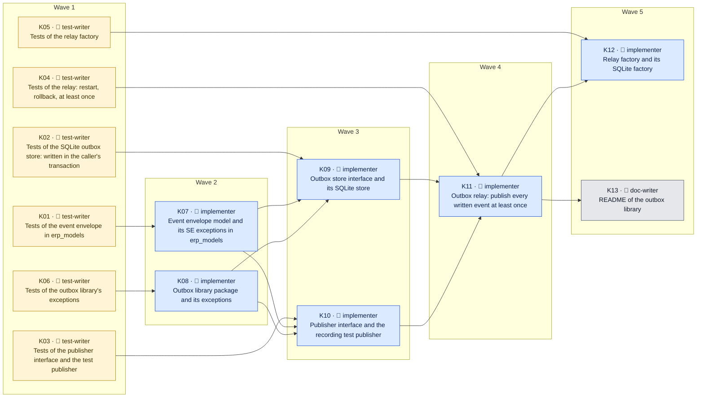

**Plan:** 🟢 Approved

**Push:** 🟢 Approved

<!-- ticket:specs -->
## 📚 Specifications

The specification and design pages of [TICKET.md](TICKET.md), copied by `python3 .claude/scripts/tickets/ticket_refs.py sync`.

- [Architecture](../../technical/architecture/architecture.md)
- [Repository layout](../../technical/architecture/repository-layout.md)
- [I-T03-01](../../specs/03-technical/t03-audit-trail/interfaces/i-t03-01-audit-writer.md)
- [📜 D405 Architecture and scalability](../../specs/06-decisions/technical/d405-architecture-and-scalability.md)
- [📜 D406 Back end](../../specs/06-decisions/technical/d406-back-end.md)
- [Back end](../../technical/architecture/backend.md)
- [📜 D438 Repository layout](../../specs/06-decisions/technical/d438-repository-layout.md)
- [📜 D426 Testing strategy](../../specs/06-decisions/technical/d426-testing-strategy.md)
- [🏗️ Tests and traceability](../../technical/delivery/tests-and-traceability.md)
<!-- /ticket:specs -->

# T0.10: Event outbox library, plan

## Summary

T0.10 Event outbox library, planned as 13 tasks in 5 waves. Wave 1 has six test-writer tasks that run in parallel: the EventEnvelope model tests in erp_models, the outbox exceptions, the SQLite outbox store (the rollback criterion), the publisher interface and the test publisher, the relay (restart, rollback, at-least-once, refused publish, stop between publish and mark), and the relay factory. Wave 2 builds the EventEnvelope and its SE exceptions in backend/models/src/erp_models/events/, and the uv package backend/shared/outbox (pyproject, uv.lock, erp_outbox package, models/exceptions). Wave 3 builds the generic OutboxStore with SqliteOutboxStore (written in the caller's transaction, never committed by the store) and, beside it, the Publisher interface with RecordingPublisher. Wave 4 builds the OutboxRelay, a Runnable that runs one publishing pass. Wave 5 builds the RelayFactory and SqliteRelayFactory, and the doc-writer writes the library README. The ticket has no screen, so no Playwright task is needed (TICKET.md: "No screen: a back-end library with no front end").

## Assumptions

- I could not run check_ticket.py: my tools had no shell. TICKET.md has not been checked, and the anchors and ID link texts are unverified.
- The roadmap does not say which storage holds the outbox table. The library takes the caller's storage transaction behind an interface, and the plan decides the test storage.
- The roadmap states no retry, ordering or event size rule, so only "at least once" is built.
- The roadmap row has no per-ticket anchor, so the ticket link points to #s02 and the epic link to #epics.
- No budget is named by the roadmap row or the specifications, so the ticket touches none and builds no screen.
- The folder name backend/shared/outbox comes from the roadmap row and D572.
- I added tests-evidences/.gitkeep so the empty folder exists.
- Test storage: the reference store behind the generic OutboxStore interface is SQLite, using the standard library's sqlite3 on a real file in tmp_path. It needs no new third-party dependency and no PostgreSQL server (T0.13 is not a prerequisite of T0.10). A PostgreSQL store comes with the first service that gets its own database.
- The API is synchronous. The store takes a DB-API connection, and the relay is a Runnable rather than an AsyncRunnable. An async variant is added when a service's storage needs one.
- The relay's run() makes one publishing pass and returns, as a job does. Looping, scheduling and back-off belong to the service that runs it, which is out of scope. The roadmap states no retry or ordering rule.
- A refused publish (SEOutboxPublishError) stops the pass at that event and leaves it and the later ones pending for the next run. A failure to mark an event as published after its publish propagates, and the event is published again on the next run. Duplicates are therefore possible, which at least once allows, and consumers deduplicate by event_id (not built here).
- The envelope has only the fields event_id, event_type, company_id, occurred_at and payload. The specifications fix none (I-T03-01: "Field-level schemas are generated from the code"), so no source, version or schema field is added. It reuses the id, UTC time and opaque company id types that T0.03 delivers.
- The Publisher interface and RecordingPublisher sit in the storage layer of erp_outbox, as an outbound adapter beside the store. RecordingPublisher ships in src/ so that T0.11 (usage events) and the services' tests can use it as the stand-in for the bus.
- The package is named erp_outbox and the distribution erp-outbox, after the erp_logging naming used in tests/ci/detect_changes. The names of the prerequisite APIs (the lifecycle factory base and its build method, the SE bases of erp_models, the id, time and company types) are read from the merged code of T0.03 to T0.06, which does not exist on develop yet.
- The envelope's exceptions go in erp_models/events/exceptions/, with the five field exceptions in a fields/ sub-package, to keep to the rule of five files per folder. If T0.04 laid out erp_models exceptions in another pattern, the implementer follows it and reports it.
- The envelope lives in backend/models, as TICKET.md asks, although the ticket graph gives T0.10 only the area backend/shared/outbox. The start rule's area lock may therefore need to cover backend/models while T0.10 runs.
- mark_published of an unknown event id raises SEOutboxStoreError rather than doing nothing, as the more conservative option.
- The documentation change is limited to the library's README. The "Today" sections of docs/technical/architecture/backend.md and architecture.md are left unchanged, because the other S02 tickets running in parallel may also change them.

<!-- plan:graph -->

> [!NOTE]
> Generated from the json block at the end of this page by `python3 .claude/scripts/tickets/plan.py render`.
> To change a task, edit the json block, then render again: never edit this view by hand.

## Waves

| Wave | Tasks | Agents running at once |
| --- | --- | --- |
| 1 | [K01](#k01), [K02](#k02), [K03](#k03), [K04](#k04), [K05](#k05), [K06](#k06) | 6 of 6 |
| 2 | [K07](#k07), [K08](#k08) | 2 of 2 |
| 3 | [K09](#k09), [K10](#k10) | 2 of 2 |
| 4 | [K11](#k11) | 1 of 1 |
| 5 | [K12](#k12), [K13](#k13) | 2 of 2 |

| Wave | Task | Agent | Depends on | Unblocks |
| --- | --- | --- | --- | --- |
| 1 | [K01](#k01) Tests of the event envelope in erp_models | 🧪 test-writer | none | [K07](#k07) |
| 1 | [K02](#k02) Tests of the SQLite outbox store: written in the caller's transaction | 🧪 test-writer | none | [K09](#k09) |
| 1 | [K03](#k03) Tests of the publisher interface and the test publisher | 🧪 test-writer | none | [K10](#k10) |
| 1 | [K04](#k04) Tests of the relay: restart, rollback, at least once | 🧪 test-writer | none | [K11](#k11) |
| 1 | [K05](#k05) Tests of the relay factory | 🧪 test-writer | none | [K12](#k12) |
| 1 | [K06](#k06) Tests of the outbox library's exceptions | 🧪 test-writer | none | [K08](#k08) |
| 2 | [K07](#k07) Event envelope model and its SE exceptions in erp_models | 🐍 implementer | [K01](#k01) | [K09](#k09), [K10](#k10) |
| 2 | [K08](#k08) Outbox library package and its exceptions | 🐍 implementer | [K06](#k06) | [K09](#k09), [K10](#k10) |
| 3 | [K09](#k09) Outbox store interface and its SQLite store | 🐍 implementer | [K02](#k02), [K07](#k07), [K08](#k08) | [K11](#k11) |
| 3 | [K10](#k10) Publisher interface and the recording test publisher | 🐍 implementer | [K03](#k03), [K07](#k07), [K08](#k08) | [K11](#k11) |
| 4 | [K11](#k11) Outbox relay: publish every written event at least once | 🐍 implementer | [K04](#k04), [K09](#k09), [K10](#k10) | [K12](#k12), [K13](#k13) |
| 5 | [K12](#k12) Relay factory and its SQLite factory | 🐍 implementer | [K05](#k05), [K11](#k11) | none |
| 5 | [K13](#k13) README of the outbox library | 📝 doc-writer | [K11](#k11) | none |

## Dependency graph



## Tasks

### <a id="k01"></a>K01: Tests of the event envelope in erp_models

| Agent | Wave | Depends on | Unblocks |
| --- | --- | --- | --- |
| 🧪 test-writer | 1 | none | [K07](#k07) |

**Files** (only this task may change them in its wave):

- `backend/models/tests/events/test_event_envelope.py`

**Done when:** `uv run ruff check backend/models/tests/events` and `uv run ruff format --check backend/models/tests/events/test_event_envelope.py` pass; `uv run pytest tests/conventions -n 2` passes; `uv run --package erp-models pytest backend/models/tests/events -n 2` fails only because `erp_models.events` does not exist yet.

**Brief:**

Write the tests of the event envelope, the public contract of an event, in the shared models `erp_models`. The relay publishes it and the audit writer will append it through the outbox. Specifications: D405 (docs/specs/06-decisions/technical/d405-architecture-and-scalability.md, 'an event bus with an outbox for what happened'), D438 (docs/specs/06-decisions/technical/d438-repository-layout.md, the shared Pydantic models live in backend/models), I-T03-01 (docs/specs/03-technical/t03-audit-trail/interfaces/i-t03-01-audit-writer.md, 'Every service appends entries through its event outbox'), D426 (docs/specs/06-decisions/technical/d426-testing-strategy.md), and the design pages docs/technical/architecture/repository-layout.md and docs/technical/delivery/tests-and-traceability.md. Rules: AGENT.md 'Tests' and 'Pydantic models' (every model gets the six model tests), TKT-4 (tests first). Read the merged tests of backend/models (T0.03, T0.04) first and write these tests the same way: imports, how a field exception is asserted, the unknown-key test.

The contract under test: `from erp_models.events.event_envelope import EventEnvelope`, with its exceptions imported from `erp_models.events.exceptions`. EventEnvelope subclasses the base model of erp_models (T0.03), with extra fields forbidden, and is frozen. Its fields:
- `event_id` uses the id type of erp_models, and its default is a new id. Two envelopes built without one get different ids. A bad value raises `SEEventEnvelopeInvalidEventId`.
- `event_type` is a required str, stripped, for example 'audit.entry.appended'. An empty or blank value, or a non-string, raises `SEEventEnvelopeInvalidEventType`.
- `company_id` is required and uses the opaque company id type of erp_models (E-T01-01, delivered by T0.03). A bad value raises `SEEventEnvelopeInvalidCompanyId`.
- `occurred_at` uses the UTC time type of erp_models, and its default is now in UTC. A value that type refuses raises `SEEventEnvelopeInvalidOccurredAt`.
- `payload` is a `Dict[str, JsonValue]` with an empty dict as its default. A non-mapping raises `SEEventEnvelopeInvalidPayload`.
Every field exception subclasses `SEInvalidEventEnvelopeException`.

Write one class, `TestEventEnvelope`, with `test_defaults`, `test_full_valid_construction`, `test_none_becomes_the_default` (parametrised over event_id, occurred_at and payload), `test_rejects_bad_values` (parametrised name, value and specific exception, including a bool where it matters and a blank event_type), `test_rejects_unknown_keys` and `test_round_trip` (`model_dump_json` then `model_validate_json` gives an equal envelope). Add: assigning a field of a built envelope is refused (frozen), two default ids differ, and every field exception is an `SEInvalidEventEnvelopeException`. Use synthetic values only. Do not use unittest.mock. Name the tests as sentences. The file holds one class, with no `__init__.py`.

### <a id="k02"></a>K02: Tests of the SQLite outbox store: written in the caller's transaction

| Agent | Wave | Depends on | Unblocks |
| --- | --- | --- | --- |
| 🧪 test-writer | 1 | none | [K09](#k09) |

**Files** (only this task may change them in its wave):

- `backend/shared/outbox/tests/storage/sqlite/test_sqlite_outbox_store.py`
- `backend/shared/outbox/tests/storage/sqlite/helpers.py`
- `backend/shared/outbox/tests/storage/sqlite/conftest.py`

**Done when:** `uv run ruff check backend/shared/outbox/tests/storage/sqlite` and `uv run ruff format --check` on the three files pass; `uv run pytest tests/conventions -n 2` passes; the tests fail only because `erp_outbox` does not exist yet.

**Brief:**

Write the tests of the outbox store, which writes an event in the same transaction as the change. Specifications: D405 (docs/specs/06-decisions/technical/d405-architecture-and-scalability.md) and Architecture, 'Messaging' (docs/technical/architecture/architecture.md: 'fed through an outbox in each service so that no event is lost'), D438 (docs/specs/06-decisions/technical/d438-repository-layout.md), D426 (docs/specs/06-decisions/technical/d426-testing-strategy.md) and docs/technical/delivery/tests-and-traceability.md (real stand-ins, no mocks, synthetic data). These tests cover acceptance criterion 2 of docs/tickets/T0.10/TICKET.md: a rolled-back change publishes nothing. Rules: AGENT.md 'Tests' and 'Rules a test enforces'.

The contract under test:
- `erp_outbox.storage.outbox_store.OutboxStore` is an abstract base, generic over the connection type.
- `erp_outbox.storage.sqlite.sqlite_outbox_store.SqliteOutboxStore(database_path: Path, logger: Optional[Logger] = None)` subclasses `OutboxStore[sqlite3.Connection]`. Its methods:
  - `connect() -> sqlite3.Connection` opens the database file with `autocommit=False`. A path it cannot open, such as a missing directory, raises `SEOutboxStoreError`.
  - `create_table(connection) -> None` creates the outbox table if it is absent, and commits. Calling it twice is harmless.
  - `add(connection, envelope: EventEnvelope) -> None` inserts the event inside the caller's open transaction and never commits or rolls back. A second event with the same `event_id` raises `SEOutboxStoreError`.
  - `pending(connection) -> List[EventEnvelope]` returns the events not yet published, in write order, each equal to the envelope written.
  - `mark_published(connection, event_id) -> None` marks the event as published and commits. An unknown id raises `SEOutboxStoreError`.
Exceptions come from `erp_outbox.models.exceptions`, and the envelope from `erp_models.events.event_envelope` (fields `event_id`, `event_type`, `company_id`, `occurred_at`, `payload`; only `event_type` and `company_id` are required).

The caller's change is a synthetic table, for example `customers(id, name)`. helpers.py creates it and builds synthetic envelopes with the company id type of erp_models. conftest.py holds the fixtures: a database file in `tmp_path`, the store, and a caller connection opened with `sqlite3.connect(path, autocommit=False)`.

Write one class, `TestSqliteOutboxStore`, with these cases:
- a change and its event committed together leave the event pending;
- a change and its event rolled back leave neither the row nor a pending event;
- the write order is kept;
- a published event is no longer pending;
- a pending event survives closing every connection and opening a new store on the same file;
- create_table runs twice;
- a duplicate id is refused;
- an unknown id cannot be marked;
- an unreachable path is refused.
Assert the specific exceptions. Use a real SQLite file and no unittest.mock. Name the tests as sentences. Import helpers by their full path, as the merged tests of backend/shared do.

### <a id="k03"></a>K03: Tests of the publisher interface and the test publisher

| Agent | Wave | Depends on | Unblocks |
| --- | --- | --- | --- |
| 🧪 test-writer | 1 | none | [K10](#k10) |

**Files** (only this task may change them in its wave):

- `backend/shared/outbox/tests/storage/publishers/test_recording_publisher.py`

**Done when:** `uv run ruff check backend/shared/outbox/tests/storage/publishers` and `uv run ruff format --check backend/shared/outbox/tests/storage/publishers/test_recording_publisher.py` pass; `uv run pytest tests/conventions -n 2` passes; the tests fail only because `erp_outbox` does not exist yet.

**Brief:**

Write the tests of the publisher interface the relay publishes through, and of the test publisher that stands in for the event bus, which is chosen in P2. Specifications: D405 (docs/specs/06-decisions/technical/d405-architecture-and-scalability.md, the event bus fed through an outbox), Architecture, 'Messaging' (docs/technical/architecture/architecture.md), D426 (docs/specs/06-decisions/technical/d426-testing-strategy.md) and docs/technical/delivery/tests-and-traceability.md (real stand-ins, no mocks). Rules: AGENT.md 'Tests'.

The contract under test:
- `erp_outbox.storage.publishers.publisher.Publisher` is abstract. It has one method, `publish(envelope: EventEnvelope) -> None`, which raises `SEOutboxPublishError` (from `erp_outbox.models.exceptions`) when the bus refuses the event.
- `erp_outbox.storage.publishers.recording_publisher.RecordingPublisher(logger: Optional[Logger] = None)` subclasses it. Its attribute `published: List[EventEnvelope]` starts empty, and each `publish` call appends the envelope in call order.
The envelope is `erp_models.events.event_envelope.EventEnvelope`, with `event_type` (str) and `company_id` (the opaque company id type of erp_models) required.

Write one class, `TestRecordingPublisher`, with these cases:
- the publisher starts with nothing published;
- envelopes are recorded in call order;
- the same envelope published twice is recorded twice, as at-least-once delivery allows;
- a RecordingPublisher is a Publisher;
- Publisher itself cannot be instantiated (TypeError).
Use synthetic data, no unittest.mock, and name the tests as sentences.

### <a id="k04"></a>K04: Tests of the relay: restart, rollback, at least once

| Agent | Wave | Depends on | Unblocks |
| --- | --- | --- | --- |
| 🧪 test-writer | 1 | none | [K11](#k11) |

**Files** (only this task may change them in its wave):

- `backend/shared/outbox/tests/service/relay/test_outbox_relay.py`
- `backend/shared/outbox/tests/service/relay/helpers.py`
- `backend/shared/outbox/tests/service/relay/conftest.py`
- `backend/shared/outbox/tests/service/relay/write_then_stop.py`
- `backend/shared/outbox/tests/service/relay/refusing_publisher.py`
- `backend/shared/outbox/tests/service/relay/unmarkable_store.py`

**Done when:** `uv run ruff check backend/shared/outbox/tests/service/relay` and `uv run ruff format --check` on its files pass; `uv run pytest tests/conventions -n 2` passes; the tests fail only because `erp_outbox` does not exist yet.

**Brief:**

Write the tests of the relay, which publishes each written event at least once. They prove acceptance criteria 1, 2 and 3 of docs/tickets/T0.10/TICKET.md. Specifications: D405 (docs/specs/06-decisions/technical/d405-architecture-and-scalability.md) and Architecture, 'Messaging' (docs/technical/architecture/architecture.md: 'so that no event is lost'), D406 (docs/specs/06-decisions/technical/d406-back-end.md, the service kit), D426 (docs/specs/06-decisions/technical/d426-testing-strategy.md) and docs/technical/delivery/tests-and-traceability.md (real stand-ins, no mock library). Rules: AGENT.md 'Tests', 'Lifecycle and factories' and 'File shape' (each helper class in its own file).

The contract under test is `erp_outbox.service.relay.outbox_relay.OutboxRelay(store: OutboxStore, publisher: Publisher, logger: Optional[Logger] = None)`, a subclass of the `Runnable` of the merged lifecycle library (T0.05). Read that library first for `execute()` and its error behaviour.
- `initialize()` opens the relay's own connection with `store.connect()` and calls `store.create_table`.
- `run()` makes one pass. It reads `store.pending`, publishes each event through `publisher.publish` in write order, and calls `store.mark_published` only after the publish returns. It sets the attribute `published_count` to the number of events published in the pass.
- When the publisher raises `SEOutboxPublishError`, the relay logs a WARNING, stops the pass without raising, and leaves that event and the later ones pending.
- When `mark_published` raises `SEOutboxStoreError`, the error propagates.
- `close()` closes the connection, and is safe after a failed or partial `initialize` and when called twice.
The store is `erp_outbox.storage.sqlite.sqlite_outbox_store.SqliteOutboxStore(database_path, logger=None)`, with the methods connect, create_table, add (in the caller's open transaction, never committed by the store), pending and mark_published. The publisher is `erp_outbox.storage.publishers.recording_publisher.RecordingPublisher` (its `published` list). The exceptions come from `erp_outbox.models.exceptions`, and the envelope is `erp_models.events.event_envelope.EventEnvelope` (only `event_type` and `company_id` are required).

Write these files:
- refusing_publisher.py: `RefusingPublisher(Publisher)` refuses its first N calls with `SEOutboxPublishError`, then records like a RecordingPublisher.
- unmarkable_store.py: `UnmarkableStore(SqliteOutboxStore)`, whose `mark_published` raises `SEOutboxStoreError`. It stands for a stop between the publish and its mark.
- write_then_stop.py: a script run as a child process with `sys.executable`. It loads its helpers by path. It writes a synthetic change row and its event in one transaction, commits, then ends with `os._exit(0)` before any relay runs.
- helpers.py and conftest.py: the shared builders and fixtures.
Write one class, `TestOutboxRelay`, with these cases:
- (AC3) every written event is published once through the publisher, in write order, published_count equals their number, and none is left pending;
- a second execute publishes nothing new;
- (AC1) an event written by the child process that stopped before publishing is published by a new relay after the restart;
- (AC2) a rolled-back change publishes nothing;
- a refused publish leaves the event pending, logs a WARNING (caplog), and the next run publishes it;
- a stop between publish and mark makes the run raise `SEOutboxStoreError`, and a later relay on a normal store publishes the event again, so the publisher saw it twice: at least once;
- an unreachable database makes execute raise `SEOutboxStoreError` and still closes safely.
The relay is built directly in the tests. The no-constructor rule applies to src/ only. Use real SQLite files in tmp_path, no unittest.mock, synthetic data, and sentence names. That is at most five Python files in the folder, not counting conftest.py.

### <a id="k05"></a>K05: Tests of the relay factory

| Agent | Wave | Depends on | Unblocks |
| --- | --- | --- | --- |
| 🧪 test-writer | 1 | none | [K12](#k12) |

**Files** (only this task may change them in its wave):

- `backend/shared/outbox/tests/service/factories/sqlite/test_sqlite_relay_factory.py`

**Done when:** `uv run ruff check backend/shared/outbox/tests/service/factories` and `uv run ruff format --check backend/shared/outbox/tests/service/factories/sqlite/test_sqlite_relay_factory.py` pass; `uv run pytest tests/conventions -n 2` passes; the tests fail only because `erp_outbox` does not exist yet.

**Brief:**

Write the tests of the factory that builds the relay. AGENT.md, 'Lifecycle and factories': runnables are created by an abstract factory in their layer's factories/ package, with concrete ones in its sub-folders. Specifications: D406 (docs/specs/06-decisions/technical/d406-back-end.md, the service kit) and docs/technical/architecture/backend.md, D405 (docs/specs/06-decisions/technical/d405-architecture-and-scalability.md), D426 (docs/specs/06-decisions/technical/d426-testing-strategy.md) and docs/technical/delivery/tests-and-traceability.md. Rules: AGENT.md 'Tests'. Read the merged lifecycle library (T0.05) first: its abstract factory base and the name of its build method. The method is `create` below; use the base's name if it has another and report it.

The contract under test:
- `erp_outbox.service.factories.relay_factory.RelayFactory` is an abstract subclass of the lifecycle factory base, whose `create()` returns an `erp_outbox.service.relay.outbox_relay.OutboxRelay`.
- `erp_outbox.service.factories.sqlite.sqlite_relay_factory.SqliteRelayFactory(database_path: Path, publisher: Publisher, logger: Optional[Logger] = None)` builds a `SqliteOutboxStore` on that file and the relay around it.
The publisher is `erp_outbox.storage.publishers.recording_publisher.RecordingPublisher` (its `published` list). The events are written with `SqliteOutboxStore(path).add(connection, envelope)` in a caller connection opened with `sqlite3.connect(path, autocommit=False)` and then committed. The envelope is `erp_models.events.event_envelope.EventEnvelope`, with `event_type` and `company_id` required.

Write one class, `TestSqliteRelayFactory`, with these cases:
- create returns an OutboxRelay;
- the relay it creates, when executed, publishes the events pending in that database;
- two create calls return two distinct relays;
- RelayFactory cannot be instantiated (TypeError).
Use real SQLite files in tmp_path, synthetic data, no unittest.mock, and sentence names.

### <a id="k06"></a>K06: Tests of the outbox library's exceptions

| Agent | Wave | Depends on | Unblocks |
| --- | --- | --- | --- |
| 🧪 test-writer | 1 | none | [K08](#k08) |

**Files** (only this task may change them in its wave):

- `backend/shared/outbox/tests/models/exceptions/test_outbox_exceptions.py`

**Done when:** `uv run ruff check backend/shared/outbox/tests/models` and `uv run ruff format --check backend/shared/outbox/tests/models/exceptions/test_outbox_exceptions.py` pass; `uv run pytest tests/conventions -n 2` passes; the tests fail only because `erp_outbox` does not exist yet.

**Brief:**

Write the tests of the exceptions of the outbox library. Specifications: D438 (docs/specs/06-decisions/technical/d438-repository-layout.md, a library in backend/shared/&lt;lib> that imports erp_models and no service), D406 (docs/specs/06-decisions/technical/d406-back-end.md) and docs/technical/architecture/backend.md (a service kit with no business rules), D426 (docs/specs/06-decisions/technical/d426-testing-strategy.md). Rules: AGENT.md 'Exceptions' (layer base `SE<Domain>Error`, layer errors `SE<Domain><Problem>Error`, one per file, re-exported by the package's `__init__.py` through a sorted `__all__`) and 'Tests'. Read the merged SE exception bases of erp_models (T0.04) first.

The contract under test is `erp_outbox.models.exceptions`, which exports:
- `SEOutboxError`, the base of every error raised while storing or publishing an outbox event. It subclasses the matching layer base of erp_models if T0.04 provides one, and Exception otherwise. Assert what the merged code allows;
- `SEOutboxStoreError(SEOutboxError)`, raised when the outbox table cannot be read or written;
- `SEOutboxPublishError(SEOutboxError)`, raised when the publisher refuses an event.

Write one class, `TestOutboxExceptions`, with these cases:
- each error is importable from the package;
- both errors are SEOutboxError (parametrised);
- an error keeps its message;
- raising one `from` a cause keeps `__cause__`;
- the package's `__all__` is sorted and lists exactly the three names.
Name the tests as sentences, and do not use unittest.mock.

### <a id="k07"></a>K07: Event envelope model and its SE exceptions in erp_models

| Agent | Wave | Depends on | Unblocks |
| --- | --- | --- | --- |
| 🐍 implementer | 2 | [K01](#k01) | [K09](#k09), [K10](#k10) |

**Files** (only this task may change them in its wave):

- `backend/models/src/erp_models/events/__init__.py`
- `backend/models/src/erp_models/events/event_envelope.py`
- `backend/models/src/erp_models/events/exceptions/__init__.py`
- `backend/models/src/erp_models/events/exceptions/se_invalid_event_envelope_exception.py`
- `backend/models/src/erp_models/events/exceptions/fields/__init__.py`
- `backend/models/src/erp_models/events/exceptions/fields/se_event_envelope_invalid_event_id.py`
- `backend/models/src/erp_models/events/exceptions/fields/se_event_envelope_invalid_event_type.py`
- `backend/models/src/erp_models/events/exceptions/fields/se_event_envelope_invalid_company_id.py`
- `backend/models/src/erp_models/events/exceptions/fields/se_event_envelope_invalid_occurred_at.py`
- `backend/models/src/erp_models/events/exceptions/fields/se_event_envelope_invalid_payload.py`

**Done when:** `uv run --package erp-models pytest backend/models/tests/events -n 2` passes; `uv run ruff check backend/models` and `uv run mypy backend/models/src` pass; `uv run pytest tests/conventions -n 2` passes.

**Brief:**

Build `EventEnvelope`, the public contract of an event, in the shared models `erp_models` (backend/models), so that the tests of K01 (backend/models/tests/events/test_event_envelope.py) pass without changing them. Specifications: D405 (docs/specs/06-decisions/technical/d405-architecture-and-scalability.md, the event bus with an outbox for what happened), D438 (docs/specs/06-decisions/technical/d438-repository-layout.md) and docs/technical/architecture/repository-layout.md (backend/models holds every public contract, events included, defined once), I-T03-01 (docs/specs/03-technical/t03-audit-trail/interfaces/i-t03-01-audit-writer.md, the later user: 'Field-level schemas are generated from the code'). Rules: AGENT.md 'Pydantic models' (every field has `Field(description=...)` and a `validate_<field>` validator with `mode="before"` that raises its own exception; `None` becomes the default; strings stripped and empty ones refused; bool refused where it matters; `extra="forbid"`; `frozen=True`), 'Exceptions' (model base `SEInvalidEventEnvelopeException`, field exceptions `SEEventEnvelopeInvalid<Field>`, one per file, `exceptions/__init__.py` re-exporting all of them, the fields/ sub-package included, through a sorted `__all__`), 'Messages' (use the exception-and-log-messages skill: `Invalid <field>: {value!r}.` then `Must be ...`), 'File shape' (one class per file, at most five Python files per folder: hence the fields/ sub-folder), 'Typing' and 'Docstrings'. models never logs.

The model subclasses the base model of erp_models (T0.03) and reuses its types: the id type for `event_id` (default a new id), the opaque company id type for `company_id` (required), the UTC time type for `occurred_at` (default now in UTC). Its other fields are `event_type: str` (required) and `payload: Dict[str, JsonValue]` (default an empty dict). Its exceptions subclass the SE model bases of T0.04, following the pattern of the merged erp_models exceptions. Add no other field: the specifications fix none. Report as an assumption any field the tests need beyond these.

### <a id="k08"></a>K08: Outbox library package and its exceptions

| Agent | Wave | Depends on | Unblocks |
| --- | --- | --- | --- |
| 🐍 implementer | 2 | [K06](#k06) | [K09](#k09), [K10](#k10) |

**Files** (only this task may change them in its wave):

- `backend/shared/outbox/pyproject.toml`
- `backend/shared/outbox/README.md`
- `backend/shared/outbox/src/erp_outbox/__init__.py`
- `backend/shared/outbox/src/erp_outbox/py.typed`
- `backend/shared/outbox/src/erp_outbox/models/__init__.py`
- `backend/shared/outbox/src/erp_outbox/models/exceptions/__init__.py`
- `backend/shared/outbox/src/erp_outbox/models/exceptions/se_outbox_error.py`
- `backend/shared/outbox/src/erp_outbox/models/exceptions/se_outbox_store_error.py`
- `backend/shared/outbox/src/erp_outbox/models/exceptions/se_outbox_publish_error.py`
- `backend/shared/outbox/src/erp_outbox/storage/__init__.py`
- `backend/shared/outbox/src/erp_outbox/service/__init__.py`
- `uv.lock`

**Done when:** `uv sync --locked` passes; `uv run --package erp-outbox pytest backend/shared/outbox/tests/models -n 2` passes; `uv run ruff check backend/shared/outbox` and `uv run mypy backend/shared/outbox/src` pass; `uv run pytest tests/conventions -n 2` passes.

**Brief:**

Create the outbox library as its own uv package in `backend/shared/outbox`, with its exceptions, so that the tests of K06 (backend/shared/outbox/tests/models/exceptions/test_outbox_exceptions.py) pass without changing them. Specifications: D438 (docs/specs/06-decisions/technical/d438-repository-layout.md) and docs/technical/architecture/repository-layout.md (a library under backend/shared/, imported by the services, no business rules), D406 (docs/specs/06-decisions/technical/d406-back-end.md) and docs/technical/architecture/backend.md (the event outbox is part of the service kit), D405 (docs/specs/06-decisions/technical/d405-architecture-and-scalability.md). The phase page names the folder `backend/shared/outbox` (D572).

Copy the shape of the merged shared libraries (backend/shared/lifecycle of T0.05, backend/shared/logging and config of T0.06): the pyproject.toml layout, the build backend, the distribution name (`erp-outbox`, unless those libraries follow another pattern), the workspace sources, and whether a `py.typed` exists. Create py.typed only if they have one. The workspace root already globs `backend/shared/*`, so do not edit the root pyproject.toml.

Dependencies: the workspace packages of erp_models and the lifecycle library, and nothing else. Add no third-party package: the store uses the standard library's sqlite3. Run `uv lock` to update uv.lock.

README.md is a two-line placeholder that says what the library holds. The pyproject may reference it, and the doc-writer completes it later (K13).

Create the package `erp_outbox` with the layer packages `models/`, `storage/` and `service/`, each with an empty `__init__.py`. The later tasks add the files under storage/ and service/.

Create `models/exceptions/` with three exceptions:
- `SEOutboxError`: 'Base class for every error raised while storing or publishing an outbox event.' It subclasses the matching layer base of erp_models (T0.04) if there is one, and Exception otherwise.
- `SEOutboxStoreError(SEOutboxError)`: 'Raised when the outbox table cannot be read or written.'
- `SEOutboxPublishError(SEOutboxError)`: 'Raised when the publisher refuses an event.'
Re-export them through a sorted `__all__`. Rules: AGENT.md 'Exceptions', 'Imports', 'Docstrings', 'File shape'. The library imports erp_models and the lifecycle library, never a service (acceptance criterion 4).

### <a id="k09"></a>K09: Outbox store interface and its SQLite store

| Agent | Wave | Depends on | Unblocks |
| --- | --- | --- | --- |
| 🐍 implementer | 3 | [K02](#k02), [K07](#k07), [K08](#k08) | [K11](#k11) |

**Files** (only this task may change them in its wave):

- `backend/shared/outbox/src/erp_outbox/storage/outbox_store.py`
- `backend/shared/outbox/src/erp_outbox/storage/sqlite/__init__.py`
- `backend/shared/outbox/src/erp_outbox/storage/sqlite/sqlite_outbox_store.py`

**Done when:** `uv run --package erp-outbox pytest backend/shared/outbox/tests/storage/sqlite -n 2` passes; `uv run ruff check backend/shared/outbox` and `uv run mypy backend/shared/outbox/src` pass; `uv run pytest tests/conventions -n 2` passes.

**Brief:**

Build the store that writes an event in the same transaction as the change, so that the tests of K02 (backend/shared/outbox/tests/storage/sqlite/) pass without changing them. Specifications: D405 (docs/specs/06-decisions/technical/d405-architecture-and-scalability.md) and Architecture, 'Messaging' (docs/technical/architecture/architecture.md: 'fed through an outbox in each service so that no event is lost'), D438 (docs/specs/06-decisions/technical/d438-repository-layout.md), D406 (docs/specs/06-decisions/technical/d406-back-end.md). Acceptance criterion 2 of docs/tickets/T0.10/TICKET.md: a rolled-back change publishes nothing. Rules: AGENT.md 'File shape' (one class per file, ClassVar constants above the constructor, banners, sync methods before async ones), 'Typing' (typing generics, no Any), 'Logging' (logger as the last constructor argument, lazy arguments, ERROR just before raising, never log a payload value), 'Exceptions' (`raise SEOutboxStoreError(...) from error`, catching `sqlite3.Error` specifically), 'Messages' (the exception-and-log-messages skill), 'Docstrings'.

`storage/outbox_store.py`: `OutboxStore`, an abstract base generic over the connection type (`Generic[ConnectionT]`), with these abstract methods:
- `connect() -> ConnectionT`;
- `create_table(connection) -> None`;
- `add(connection, envelope: EventEnvelope) -> None`: inside the caller's open transaction, and never commits or rolls back;
- `pending(connection) -> List[EventEnvelope]`: unpublished events, in write order;
- `mark_published(connection, event_id) -> None`: marks the event and commits.
Its Notes explain that the change and its event share the caller's transaction, so that a rollback drops both and a commit keeps both.

`storage/sqlite/sqlite_outbox_store.py`: `SqliteOutboxStore(database_path: Path, logger: Optional[Logger] = None)` subclasses `OutboxStore[sqlite3.Connection]`.
- `connect` uses `sqlite3.connect(path, autocommit=False)`.
- The table and its SQL statements are ClassVar constants. The table has a sequence key that gives the write order, a unique event id, the envelope as JSON (`model_dump_json` and `model_validate_json`), and a nullable published time in UTC.
- A duplicate id, an unknown id in `mark_published`, and any `sqlite3.Error` raise `SEOutboxStoreError`, from `erp_outbox.models.exceptions`.
The envelope is `erp_models.events.event_envelope.EventEnvelope`. Report as decisions the table shape and the serialisation, with their alternatives.

### <a id="k10"></a>K10: Publisher interface and the recording test publisher

| Agent | Wave | Depends on | Unblocks |
| --- | --- | --- | --- |
| 🐍 implementer | 3 | [K03](#k03), [K07](#k07), [K08](#k08) | [K11](#k11) |

**Files** (only this task may change them in its wave):

- `backend/shared/outbox/src/erp_outbox/storage/publishers/__init__.py`
- `backend/shared/outbox/src/erp_outbox/storage/publishers/publisher.py`
- `backend/shared/outbox/src/erp_outbox/storage/publishers/recording_publisher.py`

**Done when:** `uv run --package erp-outbox pytest backend/shared/outbox/tests/storage/publishers -n 2` passes; `uv run ruff check backend/shared/outbox` and `uv run mypy backend/shared/outbox/src` pass; `uv run pytest tests/conventions -n 2` passes.

**Brief:**

Build the publisher interface the relay publishes through, and the test publisher that stands in for the event bus, which is chosen in P2. The tests of K03 (backend/shared/outbox/tests/storage/publishers/test_recording_publisher.py) must pass without being changed. Specifications: D405 (docs/specs/06-decisions/technical/d405-architecture-and-scalability.md) and Architecture, 'Messaging' (docs/technical/architecture/architecture.md: an event bus, self-hosted, for example NATS or Kafka), D426 (docs/specs/06-decisions/technical/d426-testing-strategy.md) and docs/technical/delivery/tests-and-traceability.md (real stand-ins rather than mocks), D438 (docs/specs/06-decisions/technical/d438-repository-layout.md). Rules: AGENT.md 'File shape', 'Classes that share a method name share a base class' (`publish`), 'Logging', 'Docstrings', 'Typing'.

`publisher.py`: `Publisher`, an abstract base with `publish(envelope: EventEnvelope) -> None`. It is documented to raise `SEOutboxPublishError`, from `erp_outbox.models.exceptions`, when the bus refuses the event, and to return only once the bus has taken it.

`recording_publisher.py`: `RecordingPublisher(logger: Optional[Logger] = None)`, with the attribute `published: List[EventEnvelope]`, which appends each envelope in call order and logs it at DEBUG (its event id and type, never its payload). Its Notes say that it stands in for the bus in tests, and that T0.11 and the services' tests will use it.

The publishers sit in the library's storage layer as an outbound adapter beside the store, and the relay in service/ calls both. Report this as a decision against the alternative of service/. The envelope is `erp_models.events.event_envelope.EventEnvelope`.

### <a id="k11"></a>K11: Outbox relay: publish every written event at least once

| Agent | Wave | Depends on | Unblocks |
| --- | --- | --- | --- |
| 🐍 implementer | 4 | [K04](#k04), [K09](#k09), [K10](#k10) | [K12](#k12), [K13](#k13) |

**Files** (only this task may change them in its wave):

- `backend/shared/outbox/src/erp_outbox/service/relay/__init__.py`
- `backend/shared/outbox/src/erp_outbox/service/relay/outbox_relay.py`

**Done when:** `uv run --package erp-outbox pytest backend/shared/outbox/tests/service/relay -n 2` passes; `uv run ruff check backend/shared/outbox` and `uv run mypy backend/shared/outbox/src` pass; `uv run pytest tests/conventions -n 2` passes.

**Brief:**

Build the relay that publishes each written event at least once behind the publisher interface. The tests of K04 (backend/shared/outbox/tests/service/relay/) must pass without being changed. They cover acceptance criteria 1 (an event survives a restart), 2 (a rollback publishes nothing) and 3 (every written event is published at least once) of docs/tickets/T0.10/TICKET.md. Specifications: D405 (docs/specs/06-decisions/technical/d405-architecture-and-scalability.md) and Architecture, 'Messaging' (docs/technical/architecture/architecture.md: 'so that no event is lost'), D406 (docs/specs/06-decisions/technical/d406-back-end.md) and docs/technical/architecture/backend.md (the service kit, the lifecycle base classes), I-T03-01 (docs/specs/03-technical/t03-audit-trail/interfaces/i-t03-01-audit-writer.md, the later user). Rules: AGENT.md 'Lifecycle and factories' (subclass `Runnable` of the merged lifecycle library of T0.05; exactly `initialize`, `run`, `close`, all without arguments; inputs go to the constructor and results are read from attributes), 'Logging' (INFO for what was published, DEBUG per step, WARNING for a refused publish, ERROR before raising, never a payload value), 'Exceptions', 'Messages' (the exception-and-log-messages skill), 'File shape', 'Docstrings' (the at-least-once reasoning goes in Notes, in bold).

`OutboxRelay(store: OutboxStore, publisher: Publisher, logger: Optional[Logger] = None)` has the attributes store, publisher, connection (Optional, None until initialised), published_count (int) and logger.
- `initialize()` opens the connection with `store.connect()` and calls `store.create_table(connection)`.
- `run()` makes one pass. For each event of `store.pending(connection)`, in write order, it calls `publisher.publish(envelope)`, then `store.mark_published(connection, envelope.event_id)`, only after the publish returns, and counts it in `published_count`.
- On `SEOutboxPublishError` it logs a WARNING, stops the pass without raising, and leaves that event and the later ones pending.
- An `SEOutboxStoreError` is logged at ERROR and propagates.
- `close()` closes the connection if it is open, sets it back to None, and is safe after a failed or partial initialize and when called twice.
The relay does not loop, retry or wait: a service schedules its passes (out of scope). Import the store from `erp_outbox.storage.outbox_store`, the publisher from `erp_outbox.storage.publishers.publisher`, and the exceptions from `erp_outbox.models.exceptions`. The service layer imports only storage and models.

### <a id="k12"></a>K12: Relay factory and its SQLite factory

| Agent | Wave | Depends on | Unblocks |
| --- | --- | --- | --- |
| 🐍 implementer | 5 | [K05](#k05), [K11](#k11) | none |

**Files** (only this task may change them in its wave):

- `backend/shared/outbox/src/erp_outbox/service/factories/__init__.py`
- `backend/shared/outbox/src/erp_outbox/service/factories/relay_factory.py`
- `backend/shared/outbox/src/erp_outbox/service/factories/sqlite/__init__.py`
- `backend/shared/outbox/src/erp_outbox/service/factories/sqlite/sqlite_relay_factory.py`

**Done when:** `uv run --package erp-outbox pytest backend/shared/outbox/tests -n 2` passes (the whole library); `uv run ruff check backend/shared/outbox` and `uv run mypy backend/shared/outbox/src` pass; `uv run pytest tests/conventions -n 2` passes.

**Brief:**

Build the factories that create the relay. AGENT.md, 'Lifecycle and factories': runnables are created by an abstract factory in their layer's factories/ package, with concrete ones in its sub-folders, and no runnable's constructor is called in src/ outside a factory. The tests of K05 (backend/shared/outbox/tests/service/factories/sqlite/test_sqlite_relay_factory.py) must pass without being changed. Specifications: D406 (docs/specs/06-decisions/technical/d406-back-end.md) and docs/technical/architecture/backend.md (the lifecycle base classes and factories of the service kit), D405 (docs/specs/06-decisions/technical/d405-architecture-and-scalability.md), D438 (docs/specs/06-decisions/technical/d438-repository-layout.md). Rules: AGENT.md 'Lifecycle and factories', 'Logging', 'File shape', 'Docstrings', 'Typing'.

`relay_factory.py`: `RelayFactory`, an abstract subclass of the abstract factory base of the merged lifecycle library (T0.05), whose build method (`create`, or the name the base gives it) returns an `OutboxRelay`, imported from `erp_outbox.service.relay.outbox_relay`.

`sqlite/sqlite_relay_factory.py`: `SqliteRelayFactory(database_path: Path, publisher: Publisher, logger: Optional[Logger] = None)`. Each call builds a new `SqliteOutboxStore(database_path, logger)` and a new `OutboxRelay(store, publisher, logger)`, and logs the creation at DEBUG.

The service layer imports storage and models only. Report the name of the build method as an assumption if the base gives none.

### <a id="k13"></a>K13: README of the outbox library

| Agent | Wave | Depends on | Unblocks |
| --- | --- | --- | --- |
| 📝 doc-writer | 5 | [K11](#k11) | none |

**Files** (only this task may change them in its wave):

- `backend/shared/outbox/README.md`

**Done when:** backend/shared/outbox/README.md has the sections listed, every relative link in it resolves to an existing file, and it names only classes that exist in backend/shared/outbox/src/erp_outbox/.

**Brief:**

Replace the placeholder `backend/shared/outbox/README.md`, which K08 wrote, with the library's README in plain British English, with no em dashes. Specifications to cite by their IDs, with links relative to the README: D405 (docs/specs/06-decisions/technical/d405-architecture-and-scalability.md, 'an event bus with an outbox for what happened'), D406 (docs/specs/06-decisions/technical/d406-back-end.md), D438 (docs/specs/06-decisions/technical/d438-repository-layout.md), D426 (docs/specs/06-decisions/technical/d426-testing-strategy.md), I-T03-01 (docs/specs/03-technical/t03-audit-trail/interfaces/i-t03-01-audit-writer.md, the audit writer that will use it), and the design pages docs/technical/architecture/architecture.md ('Messaging') and docs/technical/architecture/backend.md.

Read the merged code of backend/shared/outbox/src/erp_outbox/ and describe what is there. The sections:
- What it holds: the outbox of each service, so that no event is lost, with no business rules.
- How a caller writes an event: `SqliteOutboxStore.add(connection, envelope)` inside the transaction of its change, where the caller commits or rolls back both. The envelope is `erp_models.events.event_envelope.EventEnvelope` and its fields.
- How the relay publishes: `OutboxRelay`, a `Runnable` built by `SqliteRelayFactory`; one pass per run; at least once, so an event may be published twice and consumers rely on `event_id`; a refused publish stays pending for the next run.
- The `Publisher` interface, and `RecordingPublisher` as the stand-in for the event bus, which is chosen in P2.
- The exceptions.
- How to run its tests: `uv run --package erp-outbox pytest backend/shared/outbox/tests -n 2`.
- What is not here: the event bus, a PostgreSQL store, scheduling of the passes, and retry or ordering rules.
State only what the code and those pages say.

<!-- /plan:graph -->

## Task graph

<details>
<summary>🤖 Task graph as read by <code>/ticket-run</code> (json)</summary>

```json
[
  {
    "id": "K01",
    "title": "Tests of the event envelope in erp_models",
    "agent": "test-writer",
    "depends_on": [],
    "files": [
      "backend/models/tests/events/test_event_envelope.py"
    ],
    "brief": "Write the tests of the event envelope, the public contract of an event, in the shared models `erp_models`. The relay publishes it and the audit writer will append it through the outbox. Specifications: D405 (docs/specs/06-decisions/technical/d405-architecture-and-scalability.md, 'an event bus with an outbox for what happened'), D438 (docs/specs/06-decisions/technical/d438-repository-layout.md, the shared Pydantic models live in backend/models), I-T03-01 (docs/specs/03-technical/t03-audit-trail/interfaces/i-t03-01-audit-writer.md, 'Every service appends entries through its event outbox'), D426 (docs/specs/06-decisions/technical/d426-testing-strategy.md), and the design pages docs/technical/architecture/repository-layout.md and docs/technical/delivery/tests-and-traceability.md. Rules: AGENT.md 'Tests' and 'Pydantic models' (every model gets the six model tests), TKT-4 (tests first). Read the merged tests of backend/models (T0.03, T0.04) first and write these tests the same way: imports, how a field exception is asserted, the unknown-key test.\n\nThe contract under test: `from erp_models.events.event_envelope import EventEnvelope`, with its exceptions imported from `erp_models.events.exceptions`. EventEnvelope subclasses the base model of erp_models (T0.03), with extra fields forbidden, and is frozen. Its fields:\n- `event_id` uses the id type of erp_models, and its default is a new id. Two envelopes built without one get different ids. A bad value raises `SEEventEnvelopeInvalidEventId`.\n- `event_type` is a required str, stripped, for example 'audit.entry.appended'. An empty or blank value, or a non-string, raises `SEEventEnvelopeInvalidEventType`.\n- `company_id` is required and uses the opaque company id type of erp_models (E-T01-01, delivered by T0.03). A bad value raises `SEEventEnvelopeInvalidCompanyId`.\n- `occurred_at` uses the UTC time type of erp_models, and its default is now in UTC. A value that type refuses raises `SEEventEnvelopeInvalidOccurredAt`.\n- `payload` is a `Dict[str, JsonValue]` with an empty dict as its default. A non-mapping raises `SEEventEnvelopeInvalidPayload`.\nEvery field exception subclasses `SEInvalidEventEnvelopeException`.\n\nWrite one class, `TestEventEnvelope`, with `test_defaults`, `test_full_valid_construction`, `test_none_becomes_the_default` (parametrised over event_id, occurred_at and payload), `test_rejects_bad_values` (parametrised name, value and specific exception, including a bool where it matters and a blank event_type), `test_rejects_unknown_keys` and `test_round_trip` (`model_dump_json` then `model_validate_json` gives an equal envelope). Add: assigning a field of a built envelope is refused (frozen), two default ids differ, and every field exception is an `SEInvalidEventEnvelopeException`. Use synthetic values only. Do not use unittest.mock. Name the tests as sentences. The file holds one class, with no `__init__.py`.",
    "done_when": "`uv run ruff check backend/models/tests/events` and `uv run ruff format --check backend/models/tests/events/test_event_envelope.py` pass; `uv run pytest tests/conventions -n 2` passes; `uv run --package erp-models pytest backend/models/tests/events -n 2` fails only because `erp_models.events` does not exist yet.",
    "wave": 1
  },
  {
    "id": "K02",
    "title": "Tests of the SQLite outbox store: written in the caller's transaction",
    "agent": "test-writer",
    "depends_on": [],
    "files": [
      "backend/shared/outbox/tests/storage/sqlite/test_sqlite_outbox_store.py",
      "backend/shared/outbox/tests/storage/sqlite/helpers.py",
      "backend/shared/outbox/tests/storage/sqlite/conftest.py"
    ],
    "brief": "Write the tests of the outbox store, which writes an event in the same transaction as the change. Specifications: D405 (docs/specs/06-decisions/technical/d405-architecture-and-scalability.md) and Architecture, 'Messaging' (docs/technical/architecture/architecture.md: 'fed through an outbox in each service so that no event is lost'), D438 (docs/specs/06-decisions/technical/d438-repository-layout.md), D426 (docs/specs/06-decisions/technical/d426-testing-strategy.md) and docs/technical/delivery/tests-and-traceability.md (real stand-ins, no mocks, synthetic data). These tests cover acceptance criterion 2 of docs/tickets/T0.10/TICKET.md: a rolled-back change publishes nothing. Rules: AGENT.md 'Tests' and 'Rules a test enforces'.\n\nThe contract under test:\n- `erp_outbox.storage.outbox_store.OutboxStore` is an abstract base, generic over the connection type.\n- `erp_outbox.storage.sqlite.sqlite_outbox_store.SqliteOutboxStore(database_path: Path, logger: Optional[Logger] = None)` subclasses `OutboxStore[sqlite3.Connection]`. Its methods:\n  - `connect() -> sqlite3.Connection` opens the database file with `autocommit=False`. A path it cannot open, such as a missing directory, raises `SEOutboxStoreError`.\n  - `create_table(connection) -> None` creates the outbox table if it is absent, and commits. Calling it twice is harmless.\n  - `add(connection, envelope: EventEnvelope) -> None` inserts the event inside the caller's open transaction and never commits or rolls back. A second event with the same `event_id` raises `SEOutboxStoreError`.\n  - `pending(connection) -> List[EventEnvelope]` returns the events not yet published, in write order, each equal to the envelope written.\n  - `mark_published(connection, event_id) -> None` marks the event as published and commits. An unknown id raises `SEOutboxStoreError`.\nExceptions come from `erp_outbox.models.exceptions`, and the envelope from `erp_models.events.event_envelope` (fields `event_id`, `event_type`, `company_id`, `occurred_at`, `payload`; only `event_type` and `company_id` are required).\n\nThe caller's change is a synthetic table, for example `customers(id, name)`. helpers.py creates it and builds synthetic envelopes with the company id type of erp_models. conftest.py holds the fixtures: a database file in `tmp_path`, the store, and a caller connection opened with `sqlite3.connect(path, autocommit=False)`.\n\nWrite one class, `TestSqliteOutboxStore`, with these cases:\n- a change and its event committed together leave the event pending;\n- a change and its event rolled back leave neither the row nor a pending event;\n- the write order is kept;\n- a published event is no longer pending;\n- a pending event survives closing every connection and opening a new store on the same file;\n- create_table runs twice;\n- a duplicate id is refused;\n- an unknown id cannot be marked;\n- an unreachable path is refused.\nAssert the specific exceptions. Use a real SQLite file and no unittest.mock. Name the tests as sentences. Import helpers by their full path, as the merged tests of backend/shared do.",
    "done_when": "`uv run ruff check backend/shared/outbox/tests/storage/sqlite` and `uv run ruff format --check` on the three files pass; `uv run pytest tests/conventions -n 2` passes; the tests fail only because `erp_outbox` does not exist yet.",
    "wave": 1
  },
  {
    "id": "K03",
    "title": "Tests of the publisher interface and the test publisher",
    "agent": "test-writer",
    "depends_on": [],
    "files": [
      "backend/shared/outbox/tests/storage/publishers/test_recording_publisher.py"
    ],
    "brief": "Write the tests of the publisher interface the relay publishes through, and of the test publisher that stands in for the event bus, which is chosen in P2. Specifications: D405 (docs/specs/06-decisions/technical/d405-architecture-and-scalability.md, the event bus fed through an outbox), Architecture, 'Messaging' (docs/technical/architecture/architecture.md), D426 (docs/specs/06-decisions/technical/d426-testing-strategy.md) and docs/technical/delivery/tests-and-traceability.md (real stand-ins, no mocks). Rules: AGENT.md 'Tests'.\n\nThe contract under test:\n- `erp_outbox.storage.publishers.publisher.Publisher` is abstract. It has one method, `publish(envelope: EventEnvelope) -> None`, which raises `SEOutboxPublishError` (from `erp_outbox.models.exceptions`) when the bus refuses the event.\n- `erp_outbox.storage.publishers.recording_publisher.RecordingPublisher(logger: Optional[Logger] = None)` subclasses it. Its attribute `published: List[EventEnvelope]` starts empty, and each `publish` call appends the envelope in call order.\nThe envelope is `erp_models.events.event_envelope.EventEnvelope`, with `event_type` (str) and `company_id` (the opaque company id type of erp_models) required.\n\nWrite one class, `TestRecordingPublisher`, with these cases:\n- the publisher starts with nothing published;\n- envelopes are recorded in call order;\n- the same envelope published twice is recorded twice, as at-least-once delivery allows;\n- a RecordingPublisher is a Publisher;\n- Publisher itself cannot be instantiated (TypeError).\nUse synthetic data, no unittest.mock, and name the tests as sentences.",
    "done_when": "`uv run ruff check backend/shared/outbox/tests/storage/publishers` and `uv run ruff format --check backend/shared/outbox/tests/storage/publishers/test_recording_publisher.py` pass; `uv run pytest tests/conventions -n 2` passes; the tests fail only because `erp_outbox` does not exist yet.",
    "wave": 1
  },
  {
    "id": "K04",
    "title": "Tests of the relay: restart, rollback, at least once",
    "agent": "test-writer",
    "depends_on": [],
    "files": [
      "backend/shared/outbox/tests/service/relay/test_outbox_relay.py",
      "backend/shared/outbox/tests/service/relay/helpers.py",
      "backend/shared/outbox/tests/service/relay/conftest.py",
      "backend/shared/outbox/tests/service/relay/write_then_stop.py",
      "backend/shared/outbox/tests/service/relay/refusing_publisher.py",
      "backend/shared/outbox/tests/service/relay/unmarkable_store.py"
    ],
    "brief": "Write the tests of the relay, which publishes each written event at least once. They prove acceptance criteria 1, 2 and 3 of docs/tickets/T0.10/TICKET.md. Specifications: D405 (docs/specs/06-decisions/technical/d405-architecture-and-scalability.md) and Architecture, 'Messaging' (docs/technical/architecture/architecture.md: 'so that no event is lost'), D406 (docs/specs/06-decisions/technical/d406-back-end.md, the service kit), D426 (docs/specs/06-decisions/technical/d426-testing-strategy.md) and docs/technical/delivery/tests-and-traceability.md (real stand-ins, no mock library). Rules: AGENT.md 'Tests', 'Lifecycle and factories' and 'File shape' (each helper class in its own file).\n\nThe contract under test is `erp_outbox.service.relay.outbox_relay.OutboxRelay(store: OutboxStore, publisher: Publisher, logger: Optional[Logger] = None)`, a subclass of the `Runnable` of the merged lifecycle library (T0.05). Read that library first for `execute()` and its error behaviour.\n- `initialize()` opens the relay's own connection with `store.connect()` and calls `store.create_table`.\n- `run()` makes one pass. It reads `store.pending`, publishes each event through `publisher.publish` in write order, and calls `store.mark_published` only after the publish returns. It sets the attribute `published_count` to the number of events published in the pass.\n- When the publisher raises `SEOutboxPublishError`, the relay logs a WARNING, stops the pass without raising, and leaves that event and the later ones pending.\n- When `mark_published` raises `SEOutboxStoreError`, the error propagates.\n- `close()` closes the connection, and is safe after a failed or partial `initialize` and when called twice.\nThe store is `erp_outbox.storage.sqlite.sqlite_outbox_store.SqliteOutboxStore(database_path, logger=None)`, with the methods connect, create_table, add (in the caller's open transaction, never committed by the store), pending and mark_published. The publisher is `erp_outbox.storage.publishers.recording_publisher.RecordingPublisher` (its `published` list). The exceptions come from `erp_outbox.models.exceptions`, and the envelope is `erp_models.events.event_envelope.EventEnvelope` (only `event_type` and `company_id` are required).\n\nWrite these files:\n- refusing_publisher.py: `RefusingPublisher(Publisher)` refuses its first N calls with `SEOutboxPublishError`, then records like a RecordingPublisher.\n- unmarkable_store.py: `UnmarkableStore(SqliteOutboxStore)`, whose `mark_published` raises `SEOutboxStoreError`. It stands for a stop between the publish and its mark.\n- write_then_stop.py: a script run as a child process with `sys.executable`. It loads its helpers by path. It writes a synthetic change row and its event in one transaction, commits, then ends with `os._exit(0)` before any relay runs.\n- helpers.py and conftest.py: the shared builders and fixtures.\nWrite one class, `TestOutboxRelay`, with these cases:\n- (AC3) every written event is published once through the publisher, in write order, published_count equals their number, and none is left pending;\n- a second execute publishes nothing new;\n- (AC1) an event written by the child process that stopped before publishing is published by a new relay after the restart;\n- (AC2) a rolled-back change publishes nothing;\n- a refused publish leaves the event pending, logs a WARNING (caplog), and the next run publishes it;\n- a stop between publish and mark makes the run raise `SEOutboxStoreError`, and a later relay on a normal store publishes the event again, so the publisher saw it twice: at least once;\n- an unreachable database makes execute raise `SEOutboxStoreError` and still closes safely.\nThe relay is built directly in the tests. The no-constructor rule applies to src/ only. Use real SQLite files in tmp_path, no unittest.mock, synthetic data, and sentence names. That is at most five Python files in the folder, not counting conftest.py.",
    "done_when": "`uv run ruff check backend/shared/outbox/tests/service/relay` and `uv run ruff format --check` on its files pass; `uv run pytest tests/conventions -n 2` passes; the tests fail only because `erp_outbox` does not exist yet.",
    "wave": 1
  },
  {
    "id": "K05",
    "title": "Tests of the relay factory",
    "agent": "test-writer",
    "depends_on": [],
    "files": [
      "backend/shared/outbox/tests/service/factories/sqlite/test_sqlite_relay_factory.py"
    ],
    "brief": "Write the tests of the factory that builds the relay. AGENT.md, 'Lifecycle and factories': runnables are created by an abstract factory in their layer's factories/ package, with concrete ones in its sub-folders. Specifications: D406 (docs/specs/06-decisions/technical/d406-back-end.md, the service kit) and docs/technical/architecture/backend.md, D405 (docs/specs/06-decisions/technical/d405-architecture-and-scalability.md), D426 (docs/specs/06-decisions/technical/d426-testing-strategy.md) and docs/technical/delivery/tests-and-traceability.md. Rules: AGENT.md 'Tests'. Read the merged lifecycle library (T0.05) first: its abstract factory base and the name of its build method. The method is `create` below; use the base's name if it has another and report it.\n\nThe contract under test:\n- `erp_outbox.service.factories.relay_factory.RelayFactory` is an abstract subclass of the lifecycle factory base, whose `create()` returns an `erp_outbox.service.relay.outbox_relay.OutboxRelay`.\n- `erp_outbox.service.factories.sqlite.sqlite_relay_factory.SqliteRelayFactory(database_path: Path, publisher: Publisher, logger: Optional[Logger] = None)` builds a `SqliteOutboxStore` on that file and the relay around it.\nThe publisher is `erp_outbox.storage.publishers.recording_publisher.RecordingPublisher` (its `published` list). The events are written with `SqliteOutboxStore(path).add(connection, envelope)` in a caller connection opened with `sqlite3.connect(path, autocommit=False)` and then committed. The envelope is `erp_models.events.event_envelope.EventEnvelope`, with `event_type` and `company_id` required.\n\nWrite one class, `TestSqliteRelayFactory`, with these cases:\n- create returns an OutboxRelay;\n- the relay it creates, when executed, publishes the events pending in that database;\n- two create calls return two distinct relays;\n- RelayFactory cannot be instantiated (TypeError).\nUse real SQLite files in tmp_path, synthetic data, no unittest.mock, and sentence names.",
    "done_when": "`uv run ruff check backend/shared/outbox/tests/service/factories` and `uv run ruff format --check backend/shared/outbox/tests/service/factories/sqlite/test_sqlite_relay_factory.py` pass; `uv run pytest tests/conventions -n 2` passes; the tests fail only because `erp_outbox` does not exist yet.",
    "wave": 1
  },
  {
    "id": "K06",
    "title": "Tests of the outbox library's exceptions",
    "agent": "test-writer",
    "depends_on": [],
    "files": [
      "backend/shared/outbox/tests/models/exceptions/test_outbox_exceptions.py"
    ],
    "brief": "Write the tests of the exceptions of the outbox library. Specifications: D438 (docs/specs/06-decisions/technical/d438-repository-layout.md, a library in backend/shared/<lib> that imports erp_models and no service), D406 (docs/specs/06-decisions/technical/d406-back-end.md) and docs/technical/architecture/backend.md (a service kit with no business rules), D426 (docs/specs/06-decisions/technical/d426-testing-strategy.md). Rules: AGENT.md 'Exceptions' (layer base `SE<Domain>Error`, layer errors `SE<Domain><Problem>Error`, one per file, re-exported by the package's `__init__.py` through a sorted `__all__`) and 'Tests'. Read the merged SE exception bases of erp_models (T0.04) first.\n\nThe contract under test is `erp_outbox.models.exceptions`, which exports:\n- `SEOutboxError`, the base of every error raised while storing or publishing an outbox event. It subclasses the matching layer base of erp_models if T0.04 provides one, and Exception otherwise. Assert what the merged code allows;\n- `SEOutboxStoreError(SEOutboxError)`, raised when the outbox table cannot be read or written;\n- `SEOutboxPublishError(SEOutboxError)`, raised when the publisher refuses an event.\n\nWrite one class, `TestOutboxExceptions`, with these cases:\n- each error is importable from the package;\n- both errors are SEOutboxError (parametrised);\n- an error keeps its message;\n- raising one `from` a cause keeps `__cause__`;\n- the package's `__all__` is sorted and lists exactly the three names.\nName the tests as sentences, and do not use unittest.mock.",
    "done_when": "`uv run ruff check backend/shared/outbox/tests/models` and `uv run ruff format --check backend/shared/outbox/tests/models/exceptions/test_outbox_exceptions.py` pass; `uv run pytest tests/conventions -n 2` passes; the tests fail only because `erp_outbox` does not exist yet.",
    "wave": 1
  },
  {
    "id": "K07",
    "title": "Event envelope model and its SE exceptions in erp_models",
    "agent": "implementer",
    "depends_on": [
      "K01"
    ],
    "files": [
      "backend/models/src/erp_models/events/__init__.py",
      "backend/models/src/erp_models/events/event_envelope.py",
      "backend/models/src/erp_models/events/exceptions/__init__.py",
      "backend/models/src/erp_models/events/exceptions/se_invalid_event_envelope_exception.py",
      "backend/models/src/erp_models/events/exceptions/fields/__init__.py",
      "backend/models/src/erp_models/events/exceptions/fields/se_event_envelope_invalid_event_id.py",
      "backend/models/src/erp_models/events/exceptions/fields/se_event_envelope_invalid_event_type.py",
      "backend/models/src/erp_models/events/exceptions/fields/se_event_envelope_invalid_company_id.py",
      "backend/models/src/erp_models/events/exceptions/fields/se_event_envelope_invalid_occurred_at.py",
      "backend/models/src/erp_models/events/exceptions/fields/se_event_envelope_invalid_payload.py"
    ],
    "brief": "Build `EventEnvelope`, the public contract of an event, in the shared models `erp_models` (backend/models), so that the tests of K01 (backend/models/tests/events/test_event_envelope.py) pass without changing them. Specifications: D405 (docs/specs/06-decisions/technical/d405-architecture-and-scalability.md, the event bus with an outbox for what happened), D438 (docs/specs/06-decisions/technical/d438-repository-layout.md) and docs/technical/architecture/repository-layout.md (backend/models holds every public contract, events included, defined once), I-T03-01 (docs/specs/03-technical/t03-audit-trail/interfaces/i-t03-01-audit-writer.md, the later user: 'Field-level schemas are generated from the code'). Rules: AGENT.md 'Pydantic models' (every field has `Field(description=...)` and a `validate_<field>` validator with `mode=\"before\"` that raises its own exception; `None` becomes the default; strings stripped and empty ones refused; bool refused where it matters; `extra=\"forbid\"`; `frozen=True`), 'Exceptions' (model base `SEInvalidEventEnvelopeException`, field exceptions `SEEventEnvelopeInvalid<Field>`, one per file, `exceptions/__init__.py` re-exporting all of them, the fields/ sub-package included, through a sorted `__all__`), 'Messages' (use the exception-and-log-messages skill: `Invalid <field>: {value!r}.` then `Must be ...`), 'File shape' (one class per file, at most five Python files per folder: hence the fields/ sub-folder), 'Typing' and 'Docstrings'. models never logs.\n\nThe model subclasses the base model of erp_models (T0.03) and reuses its types: the id type for `event_id` (default a new id), the opaque company id type for `company_id` (required), the UTC time type for `occurred_at` (default now in UTC). Its other fields are `event_type: str` (required) and `payload: Dict[str, JsonValue]` (default an empty dict). Its exceptions subclass the SE model bases of T0.04, following the pattern of the merged erp_models exceptions. Add no other field: the specifications fix none. Report as an assumption any field the tests need beyond these.",
    "done_when": "`uv run --package erp-models pytest backend/models/tests/events -n 2` passes; `uv run ruff check backend/models` and `uv run mypy backend/models/src` pass; `uv run pytest tests/conventions -n 2` passes.",
    "wave": 2
  },
  {
    "id": "K08",
    "title": "Outbox library package and its exceptions",
    "agent": "implementer",
    "depends_on": [
      "K06"
    ],
    "files": [
      "backend/shared/outbox/pyproject.toml",
      "backend/shared/outbox/README.md",
      "backend/shared/outbox/src/erp_outbox/__init__.py",
      "backend/shared/outbox/src/erp_outbox/py.typed",
      "backend/shared/outbox/src/erp_outbox/models/__init__.py",
      "backend/shared/outbox/src/erp_outbox/models/exceptions/__init__.py",
      "backend/shared/outbox/src/erp_outbox/models/exceptions/se_outbox_error.py",
      "backend/shared/outbox/src/erp_outbox/models/exceptions/se_outbox_store_error.py",
      "backend/shared/outbox/src/erp_outbox/models/exceptions/se_outbox_publish_error.py",
      "backend/shared/outbox/src/erp_outbox/storage/__init__.py",
      "backend/shared/outbox/src/erp_outbox/service/__init__.py",
      "uv.lock"
    ],
    "brief": "Create the outbox library as its own uv package in `backend/shared/outbox`, with its exceptions, so that the tests of K06 (backend/shared/outbox/tests/models/exceptions/test_outbox_exceptions.py) pass without changing them. Specifications: D438 (docs/specs/06-decisions/technical/d438-repository-layout.md) and docs/technical/architecture/repository-layout.md (a library under backend/shared/, imported by the services, no business rules), D406 (docs/specs/06-decisions/technical/d406-back-end.md) and docs/technical/architecture/backend.md (the event outbox is part of the service kit), D405 (docs/specs/06-decisions/technical/d405-architecture-and-scalability.md). The phase page names the folder `backend/shared/outbox` (D572).\n\nCopy the shape of the merged shared libraries (backend/shared/lifecycle of T0.05, backend/shared/logging and config of T0.06): the pyproject.toml layout, the build backend, the distribution name (`erp-outbox`, unless those libraries follow another pattern), the workspace sources, and whether a `py.typed` exists. Create py.typed only if they have one. The workspace root already globs `backend/shared/*`, so do not edit the root pyproject.toml.\n\nDependencies: the workspace packages of erp_models and the lifecycle library, and nothing else. Add no third-party package: the store uses the standard library's sqlite3. Run `uv lock` to update uv.lock.\n\nREADME.md is a two-line placeholder that says what the library holds. The pyproject may reference it, and the doc-writer completes it later (K13).\n\nCreate the package `erp_outbox` with the layer packages `models/`, `storage/` and `service/`, each with an empty `__init__.py`. The later tasks add the files under storage/ and service/.\n\nCreate `models/exceptions/` with three exceptions:\n- `SEOutboxError`: 'Base class for every error raised while storing or publishing an outbox event.' It subclasses the matching layer base of erp_models (T0.04) if there is one, and Exception otherwise.\n- `SEOutboxStoreError(SEOutboxError)`: 'Raised when the outbox table cannot be read or written.'\n- `SEOutboxPublishError(SEOutboxError)`: 'Raised when the publisher refuses an event.'\nRe-export them through a sorted `__all__`. Rules: AGENT.md 'Exceptions', 'Imports', 'Docstrings', 'File shape'. The library imports erp_models and the lifecycle library, never a service (acceptance criterion 4).",
    "done_when": "`uv sync --locked` passes; `uv run --package erp-outbox pytest backend/shared/outbox/tests/models -n 2` passes; `uv run ruff check backend/shared/outbox` and `uv run mypy backend/shared/outbox/src` pass; `uv run pytest tests/conventions -n 2` passes.",
    "wave": 2
  },
  {
    "id": "K09",
    "title": "Outbox store interface and its SQLite store",
    "agent": "implementer",
    "depends_on": [
      "K02",
      "K07",
      "K08"
    ],
    "files": [
      "backend/shared/outbox/src/erp_outbox/storage/outbox_store.py",
      "backend/shared/outbox/src/erp_outbox/storage/sqlite/__init__.py",
      "backend/shared/outbox/src/erp_outbox/storage/sqlite/sqlite_outbox_store.py"
    ],
    "brief": "Build the store that writes an event in the same transaction as the change, so that the tests of K02 (backend/shared/outbox/tests/storage/sqlite/) pass without changing them. Specifications: D405 (docs/specs/06-decisions/technical/d405-architecture-and-scalability.md) and Architecture, 'Messaging' (docs/technical/architecture/architecture.md: 'fed through an outbox in each service so that no event is lost'), D438 (docs/specs/06-decisions/technical/d438-repository-layout.md), D406 (docs/specs/06-decisions/technical/d406-back-end.md). Acceptance criterion 2 of docs/tickets/T0.10/TICKET.md: a rolled-back change publishes nothing. Rules: AGENT.md 'File shape' (one class per file, ClassVar constants above the constructor, banners, sync methods before async ones), 'Typing' (typing generics, no Any), 'Logging' (logger as the last constructor argument, lazy arguments, ERROR just before raising, never log a payload value), 'Exceptions' (`raise SEOutboxStoreError(...) from error`, catching `sqlite3.Error` specifically), 'Messages' (the exception-and-log-messages skill), 'Docstrings'.\n\n`storage/outbox_store.py`: `OutboxStore`, an abstract base generic over the connection type (`Generic[ConnectionT]`), with these abstract methods:\n- `connect() -> ConnectionT`;\n- `create_table(connection) -> None`;\n- `add(connection, envelope: EventEnvelope) -> None`: inside the caller's open transaction, and never commits or rolls back;\n- `pending(connection) -> List[EventEnvelope]`: unpublished events, in write order;\n- `mark_published(connection, event_id) -> None`: marks the event and commits.\nIts Notes explain that the change and its event share the caller's transaction, so that a rollback drops both and a commit keeps both.\n\n`storage/sqlite/sqlite_outbox_store.py`: `SqliteOutboxStore(database_path: Path, logger: Optional[Logger] = None)` subclasses `OutboxStore[sqlite3.Connection]`.\n- `connect` uses `sqlite3.connect(path, autocommit=False)`.\n- The table and its SQL statements are ClassVar constants. The table has a sequence key that gives the write order, a unique event id, the envelope as JSON (`model_dump_json` and `model_validate_json`), and a nullable published time in UTC.\n- A duplicate id, an unknown id in `mark_published`, and any `sqlite3.Error` raise `SEOutboxStoreError`, from `erp_outbox.models.exceptions`.\nThe envelope is `erp_models.events.event_envelope.EventEnvelope`. Report as decisions the table shape and the serialisation, with their alternatives.",
    "done_when": "`uv run --package erp-outbox pytest backend/shared/outbox/tests/storage/sqlite -n 2` passes; `uv run ruff check backend/shared/outbox` and `uv run mypy backend/shared/outbox/src` pass; `uv run pytest tests/conventions -n 2` passes.",
    "wave": 3
  },
  {
    "id": "K10",
    "title": "Publisher interface and the recording test publisher",
    "agent": "implementer",
    "depends_on": [
      "K03",
      "K07",
      "K08"
    ],
    "files": [
      "backend/shared/outbox/src/erp_outbox/storage/publishers/__init__.py",
      "backend/shared/outbox/src/erp_outbox/storage/publishers/publisher.py",
      "backend/shared/outbox/src/erp_outbox/storage/publishers/recording_publisher.py"
    ],
    "brief": "Build the publisher interface the relay publishes through, and the test publisher that stands in for the event bus, which is chosen in P2. The tests of K03 (backend/shared/outbox/tests/storage/publishers/test_recording_publisher.py) must pass without being changed. Specifications: D405 (docs/specs/06-decisions/technical/d405-architecture-and-scalability.md) and Architecture, 'Messaging' (docs/technical/architecture/architecture.md: an event bus, self-hosted, for example NATS or Kafka), D426 (docs/specs/06-decisions/technical/d426-testing-strategy.md) and docs/technical/delivery/tests-and-traceability.md (real stand-ins rather than mocks), D438 (docs/specs/06-decisions/technical/d438-repository-layout.md). Rules: AGENT.md 'File shape', 'Classes that share a method name share a base class' (`publish`), 'Logging', 'Docstrings', 'Typing'.\n\n`publisher.py`: `Publisher`, an abstract base with `publish(envelope: EventEnvelope) -> None`. It is documented to raise `SEOutboxPublishError`, from `erp_outbox.models.exceptions`, when the bus refuses the event, and to return only once the bus has taken it.\n\n`recording_publisher.py`: `RecordingPublisher(logger: Optional[Logger] = None)`, with the attribute `published: List[EventEnvelope]`, which appends each envelope in call order and logs it at DEBUG (its event id and type, never its payload). Its Notes say that it stands in for the bus in tests, and that T0.11 and the services' tests will use it.\n\nThe publishers sit in the library's storage layer as an outbound adapter beside the store, and the relay in service/ calls both. Report this as a decision against the alternative of service/. The envelope is `erp_models.events.event_envelope.EventEnvelope`.",
    "done_when": "`uv run --package erp-outbox pytest backend/shared/outbox/tests/storage/publishers -n 2` passes; `uv run ruff check backend/shared/outbox` and `uv run mypy backend/shared/outbox/src` pass; `uv run pytest tests/conventions -n 2` passes.",
    "wave": 3
  },
  {
    "id": "K11",
    "title": "Outbox relay: publish every written event at least once",
    "agent": "implementer",
    "depends_on": [
      "K04",
      "K09",
      "K10"
    ],
    "files": [
      "backend/shared/outbox/src/erp_outbox/service/relay/__init__.py",
      "backend/shared/outbox/src/erp_outbox/service/relay/outbox_relay.py"
    ],
    "brief": "Build the relay that publishes each written event at least once behind the publisher interface. The tests of K04 (backend/shared/outbox/tests/service/relay/) must pass without being changed. They cover acceptance criteria 1 (an event survives a restart), 2 (a rollback publishes nothing) and 3 (every written event is published at least once) of docs/tickets/T0.10/TICKET.md. Specifications: D405 (docs/specs/06-decisions/technical/d405-architecture-and-scalability.md) and Architecture, 'Messaging' (docs/technical/architecture/architecture.md: 'so that no event is lost'), D406 (docs/specs/06-decisions/technical/d406-back-end.md) and docs/technical/architecture/backend.md (the service kit, the lifecycle base classes), I-T03-01 (docs/specs/03-technical/t03-audit-trail/interfaces/i-t03-01-audit-writer.md, the later user). Rules: AGENT.md 'Lifecycle and factories' (subclass `Runnable` of the merged lifecycle library of T0.05; exactly `initialize`, `run`, `close`, all without arguments; inputs go to the constructor and results are read from attributes), 'Logging' (INFO for what was published, DEBUG per step, WARNING for a refused publish, ERROR before raising, never a payload value), 'Exceptions', 'Messages' (the exception-and-log-messages skill), 'File shape', 'Docstrings' (the at-least-once reasoning goes in Notes, in bold).\n\n`OutboxRelay(store: OutboxStore, publisher: Publisher, logger: Optional[Logger] = None)` has the attributes store, publisher, connection (Optional, None until initialised), published_count (int) and logger.\n- `initialize()` opens the connection with `store.connect()` and calls `store.create_table(connection)`.\n- `run()` makes one pass. For each event of `store.pending(connection)`, in write order, it calls `publisher.publish(envelope)`, then `store.mark_published(connection, envelope.event_id)`, only after the publish returns, and counts it in `published_count`.\n- On `SEOutboxPublishError` it logs a WARNING, stops the pass without raising, and leaves that event and the later ones pending.\n- An `SEOutboxStoreError` is logged at ERROR and propagates.\n- `close()` closes the connection if it is open, sets it back to None, and is safe after a failed or partial initialize and when called twice.\nThe relay does not loop, retry or wait: a service schedules its passes (out of scope). Import the store from `erp_outbox.storage.outbox_store`, the publisher from `erp_outbox.storage.publishers.publisher`, and the exceptions from `erp_outbox.models.exceptions`. The service layer imports only storage and models.",
    "done_when": "`uv run --package erp-outbox pytest backend/shared/outbox/tests/service/relay -n 2` passes; `uv run ruff check backend/shared/outbox` and `uv run mypy backend/shared/outbox/src` pass; `uv run pytest tests/conventions -n 2` passes.",
    "wave": 4
  },
  {
    "id": "K12",
    "title": "Relay factory and its SQLite factory",
    "agent": "implementer",
    "depends_on": [
      "K05",
      "K11"
    ],
    "files": [
      "backend/shared/outbox/src/erp_outbox/service/factories/__init__.py",
      "backend/shared/outbox/src/erp_outbox/service/factories/relay_factory.py",
      "backend/shared/outbox/src/erp_outbox/service/factories/sqlite/__init__.py",
      "backend/shared/outbox/src/erp_outbox/service/factories/sqlite/sqlite_relay_factory.py"
    ],
    "brief": "Build the factories that create the relay. AGENT.md, 'Lifecycle and factories': runnables are created by an abstract factory in their layer's factories/ package, with concrete ones in its sub-folders, and no runnable's constructor is called in src/ outside a factory. The tests of K05 (backend/shared/outbox/tests/service/factories/sqlite/test_sqlite_relay_factory.py) must pass without being changed. Specifications: D406 (docs/specs/06-decisions/technical/d406-back-end.md) and docs/technical/architecture/backend.md (the lifecycle base classes and factories of the service kit), D405 (docs/specs/06-decisions/technical/d405-architecture-and-scalability.md), D438 (docs/specs/06-decisions/technical/d438-repository-layout.md). Rules: AGENT.md 'Lifecycle and factories', 'Logging', 'File shape', 'Docstrings', 'Typing'.\n\n`relay_factory.py`: `RelayFactory`, an abstract subclass of the abstract factory base of the merged lifecycle library (T0.05), whose build method (`create`, or the name the base gives it) returns an `OutboxRelay`, imported from `erp_outbox.service.relay.outbox_relay`.\n\n`sqlite/sqlite_relay_factory.py`: `SqliteRelayFactory(database_path: Path, publisher: Publisher, logger: Optional[Logger] = None)`. Each call builds a new `SqliteOutboxStore(database_path, logger)` and a new `OutboxRelay(store, publisher, logger)`, and logs the creation at DEBUG.\n\nThe service layer imports storage and models only. Report the name of the build method as an assumption if the base gives none.",
    "done_when": "`uv run --package erp-outbox pytest backend/shared/outbox/tests -n 2` passes (the whole library); `uv run ruff check backend/shared/outbox` and `uv run mypy backend/shared/outbox/src` pass; `uv run pytest tests/conventions -n 2` passes.",
    "wave": 5
  },
  {
    "id": "K13",
    "title": "README of the outbox library",
    "agent": "doc-writer",
    "depends_on": [
      "K11"
    ],
    "files": [
      "backend/shared/outbox/README.md"
    ],
    "brief": "Replace the placeholder `backend/shared/outbox/README.md`, which K08 wrote, with the library's README in plain British English, with no em dashes. Specifications to cite by their IDs, with links relative to the README: D405 (docs/specs/06-decisions/technical/d405-architecture-and-scalability.md, 'an event bus with an outbox for what happened'), D406 (docs/specs/06-decisions/technical/d406-back-end.md), D438 (docs/specs/06-decisions/technical/d438-repository-layout.md), D426 (docs/specs/06-decisions/technical/d426-testing-strategy.md), I-T03-01 (docs/specs/03-technical/t03-audit-trail/interfaces/i-t03-01-audit-writer.md, the audit writer that will use it), and the design pages docs/technical/architecture/architecture.md ('Messaging') and docs/technical/architecture/backend.md.\n\nRead the merged code of backend/shared/outbox/src/erp_outbox/ and describe what is there. The sections:\n- What it holds: the outbox of each service, so that no event is lost, with no business rules.\n- How a caller writes an event: `SqliteOutboxStore.add(connection, envelope)` inside the transaction of its change, where the caller commits or rolls back both. The envelope is `erp_models.events.event_envelope.EventEnvelope` and its fields.\n- How the relay publishes: `OutboxRelay`, a `Runnable` built by `SqliteRelayFactory`; one pass per run; at least once, so an event may be published twice and consumers rely on `event_id`; a refused publish stays pending for the next run.\n- The `Publisher` interface, and `RecordingPublisher` as the stand-in for the event bus, which is chosen in P2.\n- The exceptions.\n- How to run its tests: `uv run --package erp-outbox pytest backend/shared/outbox/tests -n 2`.\n- What is not here: the event bus, a PostgreSQL store, scheduling of the passes, and retry or ordering rules.\nState only what the code and those pages say.",
    "done_when": "backend/shared/outbox/README.md has the sections listed, every relative link in it resolves to an existing file, and it names only classes that exist in backend/shared/outbox/src/erp_outbox/.",
    "wave": 5
  }
]
```

</details>
