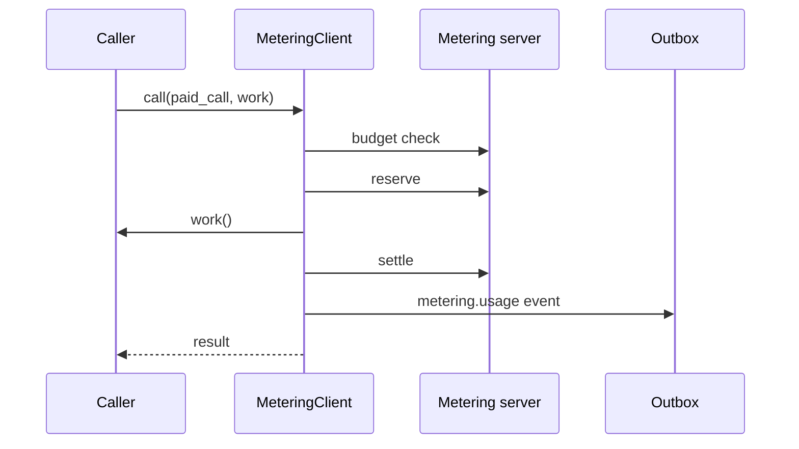

# T0.11: Metering client

**Status:** ✅ Done · **Ticket:** [TICKET.md](TICKET.md) · **Choices and trade-offs:** [IMPLEMENTATION.md](IMPLEMENTATION.md) · **Review:** [REVIEW.md](REVIEW.md)

## 🔭 What it does

- A new shared library, `erp_metering`, gives every service one entry point for a paid call: `MeteringClient.call(paid_call, work)`.
- Each call goes through a budget check, a reservation, the work, a settlement and one `metering.usage` event written through the outbox of T0.10.
- A call without a legal duty is stopped before its work when the budget is spent, the reservation is refused or the server cannot be reached.
- A call with a legal duty is never stopped (BR-F22-06, D398): it goes on, flagged over budget when the budget is spent.

## ⚙️ How it works

1. **The caller describes the call:** a `PaidCall` holds the company, module, feature, connector, user, estimated cost and the `legal_duty` flag, in [`../../../backend/shared/metering/src/erp_metering/models/calls/paid_call.py:28`](../../../backend/shared/metering/src/erp_metering/models/calls/paid_call.py#L28), with the flag at [line 47](../../../backend/shared/metering/src/erp_metering/models/calls/paid_call.py#L47).
2. **The caller hands the work to the client:** `call` is the single public entry point, in [`../../../backend/shared/metering/src/erp_metering/service/metering/metering_client.py:148`](../../../backend/shared/metering/src/erp_metering/service/metering/metering_client.py#L148). The work returns its result and its real cost.
3. **Admission:** `_admit` runs first, in [`../../../backend/shared/metering/src/erp_metering/service/metering/metering_client.py:82`](../../../backend/shared/metering/src/erp_metering/service/metering/metering_client.py#L82). It asks the server for a budget check ([`../../../backend/shared/metering/src/erp_metering/service/metering/metering_client.py:98`](../../../backend/shared/metering/src/erp_metering/service/metering/metering_client.py#L98)), then reserves the estimated cost ([`../../../backend/shared/metering/src/erp_metering/service/metering/metering_client.py:102`](../../../backend/shared/metering/src/erp_metering/service/metering/metering_client.py#L102)).
4. **Stop or flag:** a spent budget calls `_stop_or_flag` ([`../../../backend/shared/metering/src/erp_metering/service/metering/metering_client.py:61`](../../../backend/shared/metering/src/erp_metering/service/metering/metering_client.py#L61)). With a legal duty it logs a WARNING and goes on, flagged over budget ([`../../../backend/shared/metering/src/erp_metering/service/metering/metering_client.py:71-75`](../../../backend/shared/metering/src/erp_metering/service/metering/metering_client.py#L71-L75)). Without one it raises `SEMeteringBudgetExhaustedError` before the work ([`../../../backend/shared/metering/src/erp_metering/service/metering/metering_client.py:76-80`](../../../backend/shared/metering/src/erp_metering/service/metering/metering_client.py#L76-L80)). A refused reservation (409) takes the same path ([`../../../backend/shared/metering/src/erp_metering/service/metering/metering_client.py:103-105`](../../../backend/shared/metering/src/erp_metering/service/metering/metering_client.py#L103-L105)).
5. **Unreachable server:** a normal call re-raises the error and fails closed. A legal-duty call goes on without a reservation ([`../../../backend/shared/metering/src/erp_metering/service/metering/metering_client.py:106-112`](../../../backend/shared/metering/src/erp_metering/service/metering/metering_client.py#L106-L112)).
6. **The work runs:** [`../../../backend/shared/metering/src/erp_metering/service/metering/metering_client.py:165`](../../../backend/shared/metering/src/erp_metering/service/metering/metering_client.py#L165). If it raises an `Exception`, the reservation is released, a WARNING is logged and the exception is re-raised unchanged ([`../../../backend/shared/metering/src/erp_metering/service/metering/metering_client.py:166-169`](../../../backend/shared/metering/src/erp_metering/service/metering/metering_client.py#L166-L169)). Nothing is settled and no event is written.
7. **Settlement:** [`_settle`](../../../backend/shared/metering/src/erp_metering/service/metering/metering_client.py#L129) sends the real cost. A failed settlement only logs a WARNING, so the result is kept ([`../../../backend/shared/metering/src/erp_metering/service/metering/metering_client.py:141-142`](../../../backend/shared/metering/src/erp_metering/service/metering/metering_client.py#L141-L142)).
8. **The usage event:** a `UsageEvent` is built ([`../../../backend/shared/metering/src/erp_metering/service/metering/metering_client.py:171-179`](../../../backend/shared/metering/src/erp_metering/service/metering/metering_client.py#L171-L179)) and written by [`UsageEventWriter.write`](../../../backend/shared/metering/src/erp_metering/storage/events/usage_event_writer.py#L68). It wraps the event in an `EventEnvelope` of type `metering.usage` ([line 77](../../../backend/shared/metering/src/erp_metering/storage/events/usage_event_writer.py#L77), type at [`usage_event.py:40`](../../../backend/shared/metering/src/erp_metering/models/events/usage_event.py#L40)), then stores it in its own transaction ([line 44](../../../backend/shared/metering/src/erp_metering/storage/events/usage_event_writer.py#L44)). A failure raises `SEMeteringUsageEventNotWrittenError` ([line 87](../../../backend/shared/metering/src/erp_metering/storage/events/usage_event_writer.py#L87)).
9. **Talking to the server:** [`MeteringServerRepository`](../../../backend/shared/metering/src/erp_metering/storage/servers/metering_server_repository.py#L22) sends the four requests through the caller's `httpx.AsyncClient` ([`_send`](../../../backend/shared/metering/src/erp_metering/storage/servers/metering_server_repository.py#L69)): `POST /v1/budget-checks` ([line 102](../../../backend/shared/metering/src/erp_metering/storage/servers/metering_server_repository.py#L102)), `POST /v1/reservations` ([line 122](../../../backend/shared/metering/src/erp_metering/storage/servers/metering_server_repository.py#L122)), the settlement ([line 151](../../../backend/shared/metering/src/erp_metering/storage/servers/metering_server_repository.py#L151)) and `DELETE` to release ([line 172](../../../backend/shared/metering/src/erp_metering/storage/servers/metering_server_repository.py#L172)). Transport errors, unexpected statuses and invalid answers all become `SEMeteringServerUnavailableError` ([line 56](../../../backend/shared/metering/src/erp_metering/storage/servers/metering_server_repository.py#L56)); logs carry ids and exception types only.



## 🧱 Files and lines changed

<!-- changes -->
| File | Change | Lines in the new version | Added | Removed |
| --- | --- | --- | --- | --- |
| [`backend/shared/metering/README.md`](../../../backend/shared/metering/README.md) | Added | [1-88](../../../backend/shared/metering/README.md#L1) | +88 | −0 |
| [`backend/shared/metering/pyproject.toml`](../../../backend/shared/metering/pyproject.toml) | Added | [1-18](../../../backend/shared/metering/pyproject.toml#L1) | +18 | −0 |
| [`backend/shared/metering/src/erp_metering/__init__.py`](../../../backend/shared/metering/src/erp_metering/__init__.py) | Added | ➖ | +0 | −0 |
| [`backend/shared/metering/src/erp_metering/models/__init__.py`](../../../backend/shared/metering/src/erp_metering/models/__init__.py) | Added | ➖ | +0 | −0 |
| [`backend/shared/metering/src/erp_metering/models/calls/__init__.py`](../../../backend/shared/metering/src/erp_metering/models/calls/__init__.py) | Added | ➖ | +0 | −0 |
| [`backend/shared/metering/src/erp_metering/models/calls/budget_check.py`](../../../backend/shared/metering/src/erp_metering/models/calls/budget_check.py) | Added | [1-44](../../../backend/shared/metering/src/erp_metering/models/calls/budget_check.py#L1) | +44 | −0 |
| [`backend/shared/metering/src/erp_metering/models/calls/exceptions/__init__.py`](../../../backend/shared/metering/src/erp_metering/models/calls/exceptions/__init__.py) | Added | [1-41](../../../backend/shared/metering/src/erp_metering/models/calls/exceptions/__init__.py#L1) | +41 | −0 |
| [`backend/shared/metering/src/erp_metering/models/calls/exceptions/budget_check/__init__.py`](../../../backend/shared/metering/src/erp_metering/models/calls/exceptions/budget_check/__init__.py) | Added | [1-11](../../../backend/shared/metering/src/erp_metering/models/calls/exceptions/budget_check/__init__.py#L1) | +11 | −0 |
| [`backend/shared/metering/src/erp_metering/models/calls/exceptions/budget_check/se_budget_check_invalid_within_budget.py`](../../../backend/shared/metering/src/erp_metering/models/calls/exceptions/budget_check/se_budget_check_invalid_within_budget.py) | Added | [1-10](../../../backend/shared/metering/src/erp_metering/models/calls/exceptions/budget_check/se_budget_check_invalid_within_budget.py#L1) | +10 | −0 |
| [`backend/shared/metering/src/erp_metering/models/calls/exceptions/budget_check/se_invalid_budget_check_exception.py`](../../../backend/shared/metering/src/erp_metering/models/calls/exceptions/budget_check/se_invalid_budget_check_exception.py) | Added | [1-13](../../../backend/shared/metering/src/erp_metering/models/calls/exceptions/budget_check/se_invalid_budget_check_exception.py#L1) | +13 | −0 |
| [`backend/shared/metering/src/erp_metering/models/calls/exceptions/paid_call/__init__.py`](../../../backend/shared/metering/src/erp_metering/models/calls/exceptions/paid_call/__init__.py) | Added | [1-23](../../../backend/shared/metering/src/erp_metering/models/calls/exceptions/paid_call/__init__.py#L1) | +23 | −0 |
| [`backend/shared/metering/src/erp_metering/models/calls/exceptions/paid_call/scope/__init__.py`](../../../backend/shared/metering/src/erp_metering/models/calls/exceptions/paid_call/scope/__init__.py) | Added | [1-17](../../../backend/shared/metering/src/erp_metering/models/calls/exceptions/paid_call/scope/__init__.py#L1) | +17 | −0 |
| [`backend/shared/metering/src/erp_metering/models/calls/exceptions/paid_call/scope/se_paid_call_invalid_company_id.py`](../../../backend/shared/metering/src/erp_metering/models/calls/exceptions/paid_call/scope/se_paid_call_invalid_company_id.py) | Added | [1-8](../../../backend/shared/metering/src/erp_metering/models/calls/exceptions/paid_call/scope/se_paid_call_invalid_company_id.py#L1) | +8 | −0 |
| [`backend/shared/metering/src/erp_metering/models/calls/exceptions/paid_call/scope/se_paid_call_invalid_connector.py`](../../../backend/shared/metering/src/erp_metering/models/calls/exceptions/paid_call/scope/se_paid_call_invalid_connector.py) | Added | [1-8](../../../backend/shared/metering/src/erp_metering/models/calls/exceptions/paid_call/scope/se_paid_call_invalid_connector.py#L1) | +8 | −0 |
| [`backend/shared/metering/src/erp_metering/models/calls/exceptions/paid_call/scope/se_paid_call_invalid_feature.py`](../../../backend/shared/metering/src/erp_metering/models/calls/exceptions/paid_call/scope/se_paid_call_invalid_feature.py) | Added | [1-8](../../../backend/shared/metering/src/erp_metering/models/calls/exceptions/paid_call/scope/se_paid_call_invalid_feature.py#L1) | +8 | −0 |
| [`backend/shared/metering/src/erp_metering/models/calls/exceptions/paid_call/scope/se_paid_call_invalid_module.py`](../../../backend/shared/metering/src/erp_metering/models/calls/exceptions/paid_call/scope/se_paid_call_invalid_module.py) | Added | [1-8](../../../backend/shared/metering/src/erp_metering/models/calls/exceptions/paid_call/scope/se_paid_call_invalid_module.py#L1) | +8 | −0 |
| [`backend/shared/metering/src/erp_metering/models/calls/exceptions/paid_call/scope/se_paid_call_invalid_user_id.py`](../../../backend/shared/metering/src/erp_metering/models/calls/exceptions/paid_call/scope/se_paid_call_invalid_user_id.py) | Added | [1-8](../../../backend/shared/metering/src/erp_metering/models/calls/exceptions/paid_call/scope/se_paid_call_invalid_user_id.py#L1) | +8 | −0 |
| [`backend/shared/metering/src/erp_metering/models/calls/exceptions/paid_call/se_invalid_paid_call_exception.py`](../../../backend/shared/metering/src/erp_metering/models/calls/exceptions/paid_call/se_invalid_paid_call_exception.py) | Added | [1-13](../../../backend/shared/metering/src/erp_metering/models/calls/exceptions/paid_call/se_invalid_paid_call_exception.py#L1) | +13 | −0 |
| [`backend/shared/metering/src/erp_metering/models/calls/exceptions/paid_call/se_paid_call_invalid_estimated_cost.py`](../../../backend/shared/metering/src/erp_metering/models/calls/exceptions/paid_call/se_paid_call_invalid_estimated_cost.py) | Added | [1-8](../../../backend/shared/metering/src/erp_metering/models/calls/exceptions/paid_call/se_paid_call_invalid_estimated_cost.py#L1) | +8 | −0 |
| [`backend/shared/metering/src/erp_metering/models/calls/exceptions/paid_call/se_paid_call_invalid_legal_duty.py`](../../../backend/shared/metering/src/erp_metering/models/calls/exceptions/paid_call/se_paid_call_invalid_legal_duty.py) | Added | [1-8](../../../backend/shared/metering/src/erp_metering/models/calls/exceptions/paid_call/se_paid_call_invalid_legal_duty.py#L1) | +8 | −0 |
| [`backend/shared/metering/src/erp_metering/models/calls/exceptions/reservation/__init__.py`](../../../backend/shared/metering/src/erp_metering/models/calls/exceptions/reservation/__init__.py) | Added | [1-11](../../../backend/shared/metering/src/erp_metering/models/calls/exceptions/reservation/__init__.py#L1) | +11 | −0 |
| [`backend/shared/metering/src/erp_metering/models/calls/exceptions/reservation/se_invalid_reservation_exception.py`](../../../backend/shared/metering/src/erp_metering/models/calls/exceptions/reservation/se_invalid_reservation_exception.py) | Added | [1-13](../../../backend/shared/metering/src/erp_metering/models/calls/exceptions/reservation/se_invalid_reservation_exception.py#L1) | +13 | −0 |
| [`backend/shared/metering/src/erp_metering/models/calls/exceptions/reservation/se_reservation_invalid_reservation_id.py`](../../../backend/shared/metering/src/erp_metering/models/calls/exceptions/reservation/se_reservation_invalid_reservation_id.py) | Added | [1-10](../../../backend/shared/metering/src/erp_metering/models/calls/exceptions/reservation/se_reservation_invalid_reservation_id.py#L1) | +10 | −0 |
| [`backend/shared/metering/src/erp_metering/models/calls/exceptions/settlement/__init__.py`](../../../backend/shared/metering/src/erp_metering/models/calls/exceptions/settlement/__init__.py) | Added | [1-13](../../../backend/shared/metering/src/erp_metering/models/calls/exceptions/settlement/__init__.py#L1) | +13 | −0 |
| [`backend/shared/metering/src/erp_metering/models/calls/exceptions/settlement/se_invalid_settlement_exception.py`](../../../backend/shared/metering/src/erp_metering/models/calls/exceptions/settlement/se_invalid_settlement_exception.py) | Added | [1-13](../../../backend/shared/metering/src/erp_metering/models/calls/exceptions/settlement/se_invalid_settlement_exception.py#L1) | +13 | −0 |
| [`backend/shared/metering/src/erp_metering/models/calls/exceptions/settlement/se_settlement_invalid_actual_cost.py`](../../../backend/shared/metering/src/erp_metering/models/calls/exceptions/settlement/se_settlement_invalid_actual_cost.py) | Added | [1-8](../../../backend/shared/metering/src/erp_metering/models/calls/exceptions/settlement/se_settlement_invalid_actual_cost.py#L1) | +8 | −0 |
| [`backend/shared/metering/src/erp_metering/models/calls/exceptions/settlement/se_settlement_invalid_reservation_id.py`](../../../backend/shared/metering/src/erp_metering/models/calls/exceptions/settlement/se_settlement_invalid_reservation_id.py) | Added | [1-8](../../../backend/shared/metering/src/erp_metering/models/calls/exceptions/settlement/se_settlement_invalid_reservation_id.py#L1) | +8 | −0 |
| [`backend/shared/metering/src/erp_metering/models/calls/paid_call.py`](../../../backend/shared/metering/src/erp_metering/models/calls/paid_call.py) | Added | [1-216](../../../backend/shared/metering/src/erp_metering/models/calls/paid_call.py#L1) | +216 | −0 |
| [`backend/shared/metering/src/erp_metering/models/calls/reservation.py`](../../../backend/shared/metering/src/erp_metering/models/calls/reservation.py) | Added | [1-39](../../../backend/shared/metering/src/erp_metering/models/calls/reservation.py#L1) | +39 | −0 |
| [`backend/shared/metering/src/erp_metering/models/calls/settlement.py`](../../../backend/shared/metering/src/erp_metering/models/calls/settlement.py) | Added | [1-85](../../../backend/shared/metering/src/erp_metering/models/calls/settlement.py#L1) | +85 | −0 |
| [`backend/shared/metering/src/erp_metering/models/events/__init__.py`](../../../backend/shared/metering/src/erp_metering/models/events/__init__.py) | Added | ➖ | +0 | −0 |
| [`backend/shared/metering/src/erp_metering/models/events/exceptions/__init__.py`](../../../backend/shared/metering/src/erp_metering/models/events/exceptions/__init__.py) | Added | [1-17](../../../backend/shared/metering/src/erp_metering/models/events/exceptions/__init__.py#L1) | +17 | −0 |
| [`backend/shared/metering/src/erp_metering/models/events/exceptions/usage_event/__init__.py`](../../../backend/shared/metering/src/erp_metering/models/events/exceptions/usage_event/__init__.py) | Added | [1-19](../../../backend/shared/metering/src/erp_metering/models/events/exceptions/usage_event/__init__.py#L1) | +19 | −0 |
| [`backend/shared/metering/src/erp_metering/models/events/exceptions/usage_event/fields/__init__.py`](../../../backend/shared/metering/src/erp_metering/models/events/exceptions/usage_event/fields/__init__.py) | Added | [1-23](../../../backend/shared/metering/src/erp_metering/models/events/exceptions/usage_event/fields/__init__.py#L1) | +23 | −0 |
| [`backend/shared/metering/src/erp_metering/models/events/exceptions/usage_event/fields/se_usage_event_invalid_actual_cost.py`](../../../backend/shared/metering/src/erp_metering/models/events/exceptions/usage_event/fields/se_usage_event_invalid_actual_cost.py) | Added | [1-10](../../../backend/shared/metering/src/erp_metering/models/events/exceptions/usage_event/fields/se_usage_event_invalid_actual_cost.py#L1) | +10 | −0 |
| [`backend/shared/metering/src/erp_metering/models/events/exceptions/usage_event/fields/se_usage_event_invalid_call.py`](../../../backend/shared/metering/src/erp_metering/models/events/exceptions/usage_event/fields/se_usage_event_invalid_call.py) | Added | [1-10](../../../backend/shared/metering/src/erp_metering/models/events/exceptions/usage_event/fields/se_usage_event_invalid_call.py#L1) | +10 | −0 |
| [`backend/shared/metering/src/erp_metering/models/events/exceptions/usage_event/fields/se_usage_event_invalid_over_budget.py`](../../../backend/shared/metering/src/erp_metering/models/events/exceptions/usage_event/fields/se_usage_event_invalid_over_budget.py) | Added | [1-10](../../../backend/shared/metering/src/erp_metering/models/events/exceptions/usage_event/fields/se_usage_event_invalid_over_budget.py#L1) | +10 | −0 |
| [`backend/shared/metering/src/erp_metering/models/events/exceptions/usage_event/fields/se_usage_event_invalid_reservation_id.py`](../../../backend/shared/metering/src/erp_metering/models/events/exceptions/usage_event/fields/se_usage_event_invalid_reservation_id.py) | Added | [1-10](../../../backend/shared/metering/src/erp_metering/models/events/exceptions/usage_event/fields/se_usage_event_invalid_reservation_id.py#L1) | +10 | −0 |
| [`backend/shared/metering/src/erp_metering/models/events/exceptions/usage_event/fields/se_usage_event_invalid_settled_at.py`](../../../backend/shared/metering/src/erp_metering/models/events/exceptions/usage_event/fields/se_usage_event_invalid_settled_at.py) | Added | [1-10](../../../backend/shared/metering/src/erp_metering/models/events/exceptions/usage_event/fields/se_usage_event_invalid_settled_at.py#L1) | +10 | −0 |
| [`backend/shared/metering/src/erp_metering/models/events/exceptions/usage_event/se_invalid_usage_event_exception.py`](../../../backend/shared/metering/src/erp_metering/models/events/exceptions/usage_event/se_invalid_usage_event_exception.py) | Added | [1-13](../../../backend/shared/metering/src/erp_metering/models/events/exceptions/usage_event/se_invalid_usage_event_exception.py#L1) | +13 | −0 |
| [`backend/shared/metering/src/erp_metering/models/events/usage_event.py`](../../../backend/shared/metering/src/erp_metering/models/events/usage_event.py) | Added | [1-181](../../../backend/shared/metering/src/erp_metering/models/events/usage_event.py#L1) | +181 | −0 |
| [`backend/shared/metering/src/erp_metering/models/metering/__init__.py`](../../../backend/shared/metering/src/erp_metering/models/metering/__init__.py) | Added | ➖ | +0 | −0 |
| [`backend/shared/metering/src/erp_metering/models/metering/exceptions/__init__.py`](../../../backend/shared/metering/src/erp_metering/models/metering/exceptions/__init__.py) | Added | [1-21](../../../backend/shared/metering/src/erp_metering/models/metering/exceptions/__init__.py#L1) | +21 | −0 |
| [`backend/shared/metering/src/erp_metering/models/metering/exceptions/se_metering_budget_exhausted_error.py`](../../../backend/shared/metering/src/erp_metering/models/metering/exceptions/se_metering_budget_exhausted_error.py) | Added | [1-7](../../../backend/shared/metering/src/erp_metering/models/metering/exceptions/se_metering_budget_exhausted_error.py#L1) | +7 | −0 |
| [`backend/shared/metering/src/erp_metering/models/metering/exceptions/se_metering_error.py`](../../../backend/shared/metering/src/erp_metering/models/metering/exceptions/se_metering_error.py) | Added | [1-7](../../../backend/shared/metering/src/erp_metering/models/metering/exceptions/se_metering_error.py#L1) | +7 | −0 |
| [`backend/shared/metering/src/erp_metering/models/metering/exceptions/se_metering_reservation_refused_error.py`](../../../backend/shared/metering/src/erp_metering/models/metering/exceptions/se_metering_reservation_refused_error.py) | Added | [1-7](../../../backend/shared/metering/src/erp_metering/models/metering/exceptions/se_metering_reservation_refused_error.py#L1) | +7 | −0 |
| [`backend/shared/metering/src/erp_metering/models/metering/exceptions/se_metering_server_unavailable_error.py`](../../../backend/shared/metering/src/erp_metering/models/metering/exceptions/se_metering_server_unavailable_error.py) | Added | [1-7](../../../backend/shared/metering/src/erp_metering/models/metering/exceptions/se_metering_server_unavailable_error.py#L1) | +7 | −0 |
| [`backend/shared/metering/src/erp_metering/models/metering/exceptions/se_metering_usage_event_not_written_error.py`](../../../backend/shared/metering/src/erp_metering/models/metering/exceptions/se_metering_usage_event_not_written_error.py) | Added | [1-7](../../../backend/shared/metering/src/erp_metering/models/metering/exceptions/se_metering_usage_event_not_written_error.py#L1) | +7 | −0 |
| [`backend/shared/metering/src/erp_metering/py.typed`](../../../backend/shared/metering/src/erp_metering/py.typed) | Added | ➖ | +0 | −0 |
| [`backend/shared/metering/src/erp_metering/service/__init__.py`](../../../backend/shared/metering/src/erp_metering/service/__init__.py) | Added | ➖ | +0 | −0 |
| [`backend/shared/metering/src/erp_metering/service/metering/__init__.py`](../../../backend/shared/metering/src/erp_metering/service/metering/__init__.py) | Added | ➖ | +0 | −0 |
| [`backend/shared/metering/src/erp_metering/service/metering/metering_client.py`](../../../backend/shared/metering/src/erp_metering/service/metering/metering_client.py) | Added | [1-181](../../../backend/shared/metering/src/erp_metering/service/metering/metering_client.py#L1) | +181 | −0 |
| [`backend/shared/metering/src/erp_metering/storage/__init__.py`](../../../backend/shared/metering/src/erp_metering/storage/__init__.py) | Added | ➖ | +0 | −0 |
| [`backend/shared/metering/src/erp_metering/storage/events/__init__.py`](../../../backend/shared/metering/src/erp_metering/storage/events/__init__.py) | Added | ➖ | +0 | −0 |
| [`backend/shared/metering/src/erp_metering/storage/events/usage_event_writer.py`](../../../backend/shared/metering/src/erp_metering/storage/events/usage_event_writer.py) | Added | [1-90](../../../backend/shared/metering/src/erp_metering/storage/events/usage_event_writer.py#L1) | +90 | −0 |
| [`backend/shared/metering/src/erp_metering/storage/servers/__init__.py`](../../../backend/shared/metering/src/erp_metering/storage/servers/__init__.py) | Added | ➖ | +0 | −0 |
| [`backend/shared/metering/src/erp_metering/storage/servers/metering_server_repository.py`](../../../backend/shared/metering/src/erp_metering/storage/servers/metering_server_repository.py) | Added | [1-182](../../../backend/shared/metering/src/erp_metering/storage/servers/metering_server_repository.py#L1) | +182 | −0 |
| [`backend/shared/metering/tests/conftest.py`](../../../backend/shared/metering/tests/conftest.py) | Added | [1-61](../../../backend/shared/metering/tests/conftest.py#L1) | +61 | −0 |
| [`backend/shared/metering/tests/models/calls/test_budget_check.py`](../../../backend/shared/metering/tests/models/calls/test_budget_check.py) | Added | [1-40](../../../backend/shared/metering/tests/models/calls/test_budget_check.py#L1) | +40 | −0 |
| [`backend/shared/metering/tests/models/calls/test_paid_call.py`](../../../backend/shared/metering/tests/models/calls/test_paid_call.py) | Added | [1-110](../../../backend/shared/metering/tests/models/calls/test_paid_call.py#L1) | +110 | −0 |
| [`backend/shared/metering/tests/models/calls/test_reservation.py`](../../../backend/shared/metering/tests/models/calls/test_reservation.py) | Added | [1-41](../../../backend/shared/metering/tests/models/calls/test_reservation.py#L1) | +41 | −0 |
| [`backend/shared/metering/tests/models/calls/test_settlement.py`](../../../backend/shared/metering/tests/models/calls/test_settlement.py) | Added | [1-65](../../../backend/shared/metering/tests/models/calls/test_settlement.py#L1) | +65 | −0 |
| [`backend/shared/metering/tests/models/events/test_usage_event.py`](../../../backend/shared/metering/tests/models/events/test_usage_event.py) | Added | [1-148](../../../backend/shared/metering/tests/models/events/test_usage_event.py#L1) | +148 | −0 |
| [`backend/shared/metering/tests/service/metering/metering_client/test_failed_call.py`](../../../backend/shared/metering/tests/service/metering/metering_client/test_failed_call.py) | Added | [1-143](../../../backend/shared/metering/tests/service/metering/metering_client/test_failed_call.py#L1) | +143 | −0 |
| [`backend/shared/metering/tests/service/metering/metering_client/test_settled_call.py`](../../../backend/shared/metering/tests/service/metering/metering_client/test_settled_call.py) | Added | [1-97](../../../backend/shared/metering/tests/service/metering/metering_client/test_settled_call.py#L1) | +97 | −0 |
| [`backend/shared/metering/tests/service/metering/metering_client/test_stop_at_budget.py`](../../../backend/shared/metering/tests/service/metering/metering_client/test_stop_at_budget.py) | Added | [1-119](../../../backend/shared/metering/tests/service/metering/metering_client/test_stop_at_budget.py#L1) | +119 | −0 |
| [`backend/shared/metering/tests/service/metering/metering_client/test_unavailable_server.py`](../../../backend/shared/metering/tests/service/metering/metering_client/test_unavailable_server.py) | Added | [1-107](../../../backend/shared/metering/tests/service/metering/metering_client/test_unavailable_server.py#L1) | +107 | −0 |
| [`backend/shared/metering/tests/stand_in/stand_in_metering_handler.py`](../../../backend/shared/metering/tests/stand_in/stand_in_metering_handler.py) | Added | [1-111](../../../backend/shared/metering/tests/stand_in/stand_in_metering_handler.py#L1) | +111 | −0 |
| [`backend/shared/metering/tests/stand_in/stand_in_metering_server.py`](../../../backend/shared/metering/tests/stand_in/stand_in_metering_server.py) | Added | [1-49](../../../backend/shared/metering/tests/stand_in/stand_in_metering_server.py#L1) | +49 | −0 |
| [`backend/shared/metering/tests/storage/events/test_usage_event_writer.py`](../../../backend/shared/metering/tests/storage/events/test_usage_event_writer.py) | Added | [1-65](../../../backend/shared/metering/tests/storage/events/test_usage_event_writer.py#L1) | +65 | −0 |
| [`backend/shared/metering/tests/storage/servers/test_metering_server_repository.py`](../../../backend/shared/metering/tests/storage/servers/test_metering_server_repository.py) | Added | [1-160](../../../backend/shared/metering/tests/storage/servers/test_metering_server_repository.py#L1) | +160 | −0 |
| [`uv.lock`](../../../uv.lock) | Modified | [12](../../../uv.lock#L12), [228-246](../../../uv.lock#L228) | +20 | −0 |
| **72 files** | | | **+2898** | **−0** |
<!-- /changes -->

- [`../../../backend/shared/metering/pyproject.toml`](../../../backend/shared/metering/pyproject.toml), [`uv.lock`](../../../uv.lock): the new workspace member `erp-metering`, depending on `erp-models`, `erp-outbox`, `httpx` and `pydantic`; the lock gains it.
- [`../../../backend/shared/metering/README.md`](../../../backend/shared/metering/README.md): how a service uses the library.
- [`../../../backend/shared/metering/src/erp_metering/models/calls/`](../../../backend/shared/metering/src/erp_metering/models/calls/paid_call.py): `PaidCall`, `BudgetCheck`, `Reservation` and `Settlement`, frozen models with a validator per field, and their exceptions under `exceptions/`.
- [`../../../backend/shared/metering/src/erp_metering/models/events/usage_event.py`](../../../backend/shared/metering/src/erp_metering/models/events/usage_event.py): the `metering.usage` payload and its exceptions.
- [`../../../backend/shared/metering/src/erp_metering/models/metering/exceptions/`](../../../backend/shared/metering/src/erp_metering/models/metering/exceptions/se_metering_error.py): the five `SEMetering*` errors a caller sees.
- [`../../../backend/shared/metering/src/erp_metering/service/metering/metering_client.py`](../../../backend/shared/metering/src/erp_metering/service/metering/metering_client.py), lines [`61-142`](../../../backend/shared/metering/src/erp_metering/service/metering/metering_client.py#L61-L142) and [`148-181`](../../../backend/shared/metering/src/erp_metering/service/metering/metering_client.py#L148-L181): the admission, release and settlement helpers and the public flow.
- [`../../../backend/shared/metering/src/erp_metering/storage/events/usage_event_writer.py`](../../../backend/shared/metering/src/erp_metering/storage/events/usage_event_writer.py): the outbox write, one transaction per event.
- [`../../../backend/shared/metering/src/erp_metering/storage/servers/metering_server_repository.py`](../../../backend/shared/metering/src/erp_metering/storage/servers/metering_server_repository.py): the httpx repository and its failure mapping.
- [`../../../backend/shared/metering/tests/`](../../../backend/shared/metering/tests/conftest.py): model tests, the writer and repository tests, the four client test classes for the three acceptance criteria and the failure paths, and a stand-in metering server on the standard library, [`stand_in_metering_server.py`](../../../backend/shared/metering/tests/stand_in/stand_in_metering_server.py) and [`stand_in_metering_handler.py`](../../../backend/shared/metering/tests/stand_in/stand_in_metering_handler.py).

## 🧪 How to test it

```bash
uv run --package erp-metering pytest backend/shared/metering/tests -n 2
uv run ruff check backend/shared/metering
uv run mypy backend/shared/metering/src
```

The first command runs every criterion: `test_stop_at_budget.py` (criteria 1 and 3), `test_settled_call.py` (criterion 2).

## 🔗 Evidence

- [Metering tests](tests-evidences/pytest-backend-shared-metering.txt): the library's tests pass.
- [Full pytest run](tests-evidences/pytest.txt): 1328 passed.
- [ruff check](tests-evidences/ruff-check.txt), [ruff format](tests-evidences/ruff-format.txt), [mypy](tests-evidences/mypy.txt): clean.
- [Other packages](tests-evidences/pytest-backend-models.txt): [outbox](tests-evidences/pytest-backend-shared-outbox.txt), [lifecycle](tests-evidences/pytest-backend-shared-lifecycle.txt), [logging](tests-evidences/pytest-backend-shared-logging.txt), [config](tests-evidences/pytest-backend-shared-config.txt), [context](tests-evidences/pytest-backend-shared-context.txt), [country rules](tests-evidences/pytest-backend-shared-country-rules.txt), [testing](tests-evidences/pytest-backend-shared-testing.txt), [platform](tests-evidences/pytest-backend-services-platform.txt): unchanged and passing.
- [Ticket references](tests-evidences/ticket-refs.txt) and [plan view](tests-evidences/plan-view.txt): consistent.

## 📝 Assumptions accepted

- BR-F22-06 and D398 are linked because the roadmap names no use case or screen; they settle the stop and the legal-duty bypass.
- The list of legal duties comes from the country pack and is not read here, only the flag is carried.
- A reservation is made before each call, because exactness under parallel calls is open in TC-21; it is the conservative option TC-21 lists.
- The ticket and its epic link to the sprint and epics anchors, as the roadmap anchors its rows.
- A legal-duty call goes on without a reservation when the metering server is unreachable, because BR-F22-06 says a stop never cuts a legal duty, and the call still writes a usage event.

## 🔜 Follow-ups

| File | What to change |
| --- | --- |
| [`../../../backend/shared/metering/src/erp_metering/service/metering/metering_client.py`](../../../backend/shared/metering/src/erp_metering/service/metering/metering_client.py), [`test_failed_call.py`](../../../backend/shared/metering/tests/service/metering/metering_client/test_failed_call.py) | The reservation is released only on `except Exception`. A cancelled task (`asyncio.CancelledError`) leaves it held. Release it on cancellation too, re-raise, and test it. Owner K16 (test K08). |
| [`usage_event_writer.py`](../../../backend/shared/metering/src/erp_metering/storage/events/usage_event_writer.py) | `write` is async but does its sqlite work synchronously, so it blocks the event loop. Use a thread, or join the caller's transaction as D405's outbox pattern intends. The parameter type also ties the library to SQLite. Owner K15. |
| [`metering_client.py`](../../../backend/shared/metering/src/erp_metering/service/metering/metering_client.py), [`README.md`](../../../backend/shared/metering/README.md) | When the event cannot be written after a successful work, `call()` raises and the result is lost, so a retry pays twice. Decide to return the result with an ERROR log, or keep the raise and document the hazard. Owners K16, K12. |
| [`settlement.py`](../../../backend/shared/metering/src/erp_metering/models/calls/settlement.py) | The Notes say a failed call is settled at zero cost, but the client releases it with `DELETE`. Fix the Notes. Owner K10. |
| [`paid_call.py`](../../../backend/shared/metering/src/erp_metering/models/calls/paid_call.py), [`budget_check.py`](../../../backend/shared/metering/src/erp_metering/models/calls/budget_check.py), [`reservation.py`](../../../backend/shared/metering/src/erp_metering/models/calls/reservation.py), [`settlement.py`](../../../backend/shared/metering/src/erp_metering/models/calls/settlement.py), [`usage_event.py`](../../../backend/shared/metering/src/erp_metering/models/events/usage_event.py), [`usage_event_writer.py`](../../../backend/shared/metering/src/erp_metering/storage/events/usage_event_writer.py), [`metering_server_repository.py`](../../../backend/shared/metering/src/erp_metering/storage/servers/metering_server_repository.py) | The import group comments are mislabelled: relabel to standard library, third-party, first-party as ruff's isort orders them. Owners K10, K13, K14, K15. |
| [`conftest.py`](../../../backend/shared/metering/tests/conftest.py) | The `outbox_events` fixture returns a nested tuple-indexing lambda. Replace it with a helper. Owner K04. |
| [`stand_in_metering_server.py`](../../../backend/shared/metering/tests/stand_in/stand_in_metering_server.py), [`stand_in_metering_handler.py`](../../../backend/shared/metering/tests/stand_in/stand_in_metering_handler.py) | Move the stand-in onto the T0.13 stand-in kit once it exists. Owner K04. |
| [`paid_call.py`](../../../backend/shared/metering/src/erp_metering/models/calls/paid_call.py) | Any caller can set `legal_duty=True`. A later ticket should check the flag against the country pack's list of legal duties. Owner K10. |
