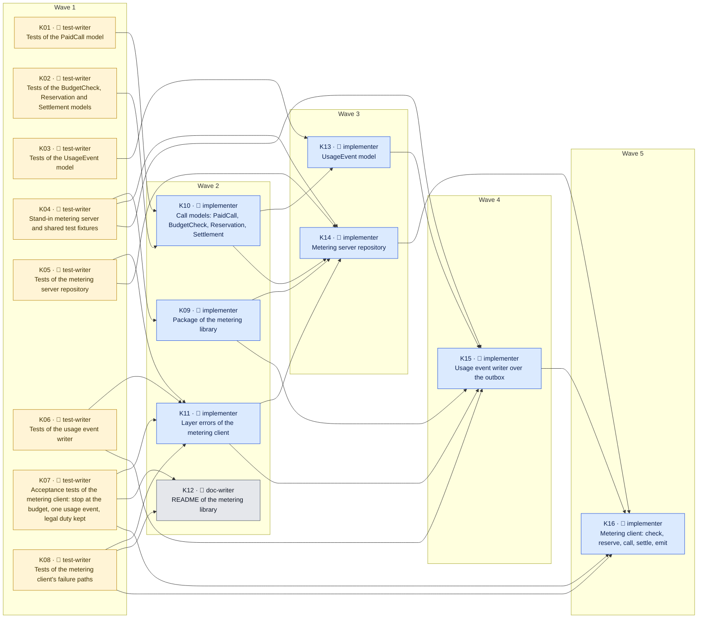

# T0.11: Metering client, plan

**Plan:** 🟢 Approved

**Push:** 🟢 Approved


<!-- ticket:specs -->
## 📚 Specifications

The specification and design pages of [TICKET.md](TICKET.md), copied by `python3 .claude/scripts/tickets/ticket_refs.py sync`.

- [Architecture, Metering (TC-21)](../../technical/architecture/architecture.md)
- [BR-F22-06](../../specs/02-functional/f22-unified-cost-management/business-rules/br-f22-06-stop-at-budget-legal-duties-kept.md)
- [📜 D398: Budgets warn, then stop](../../specs/06-decisions/f22-unified-cost-management/d398-budgets-warn-then-stop.md)
- [📜 D405: Architecture and scalability](../../specs/06-decisions/technical/d405-architecture-and-scalability.md)
- [🧗 TC-21: Metering every paid call, and stopping on a budget](../../specs/03-technical/challenges/tc-21-metering-every-paid-call.md)
- [🏗️ Back end](../../technical/architecture/backend.md)
<!-- /ticket:specs -->

## Summary

T0.11 builds the metering client library `backend/shared/metering` (package `erp_metering`). Every paid call goes through `MeteringClient.call(paid_call, work)` in this order: budget check, reservation, the call, settlement, then one usage event written through the T0.10 outbox. A call carrying the legal-duty flag passes an exhausted budget, as BR-F22-06 and D398 require. Layers: models (the call models PaidCall, BudgetCheck, Reservation and Settlement, the UsageEvent model, and the SEMetering* layer errors), storage (MeteringServerRepository over httpx, and UsageEventWriter over the outbox), and service (MeteringClient). Wave 1 holds eight test-writer tasks, built around a stand-in metering server pinned in K04: model tests, the stand-in server and shared fixtures, repository and writer tests, the three acceptance criteria, and the failure paths. Wave 2: packaging, call models, layer errors and the library README. Wave 3: UsageEvent and the repository. Wave 4: the writer. Wave 5: the client. There is no front end, so there is no Playwright task.

## Assumptions

- The roadmap names no use case or screen for T0.11: BR-F22-06 and D398 are linked because they settle the stop and the legal-duty bypass.
- The list of legal duties comes from the country pack (BR-F22-06); this ticket only carries the flag.
- TC-21 leaves open whether the budget check must be exact under parallel calls; reservation before the call is taken as the conservative option.
- The roadmap has no per-ticket anchors, so the ticket links to the S02 sprint anchor and the epic to the epics anchor.
- No budget of docs/specs/05-non-functional/ is given to the ticket by the roadmap or specifications.
- check_ticket.py was not run by me (no shell tool); the workflow runs it.
- No backend code exists yet. The plan assumes that T0.03 (erp_models base model, company id, Money, UTC time), T0.04 (SE bases), T0.05 and T0.10 (outbox writer, test storage, event envelope) are merged before T0.11 runs, and the briefs tell the workers to read their actual names rather than guess them.
- Package naming: distribution `erp-metering`, import package `erp_metering` under `backend/shared/metering/src/`, following the `erp_<lib>` pattern of the convention scanner's fixtures.
- The library keeps the AGENT.md layers inside its package (`models/`, `storage/`, `service/`): Pydantic models must sit in a `models` layer, the HTTP calls to the metering server and the outbox writes are storage, and the stop-at-budget sequence is the service.
- The usage event payload `UsageEvent` stays in the library's own `models/` rather than in `erp_models`. The ticket's area is `backend/shared/metering` only, and the metering service that will consume it does not exist yet. Moving it into `erp_models` is a follow-up for the ticket that builds that consumer.
- The specifications define no metering-server protocol, so the client defines its own routes: POST /v1/budget-checks, POST /v1/reservations (409 when refused), POST /v1/reservations/{id}/settlement and DELETE /v1/reservations/{id}. The stand-in server answers them.
- The stand-in metering server is built in the library's tests on the standard library `http.server`, because the stand-in kit of T0.13 is out of scope and not a prerequisite of T0.11.
- The legal-duty bypass is decided in the client (BR-F22-06, Architecture: 'a legal-duty flag bypasses the stop'). The server only answers whether the call is within budget, and refuses a reservation over budget unless the call carries the legal-duty flag.
- TC-21 leaves open whether the check must be exact under parallel calls. The conservative reading is a budget check followed by a reservation that the server can still refuse (409), and a refused reservation is handled like an exhausted budget.
- Following TC-21 ('A stop must never cut an e-invoice or a payroll declaration'), a legal-duty call goes on with a WARNING when the metering server cannot be reached, and its usage event carries `reservation_id` None. A normal call is refused, which fails closed.
- Once the paid call has been made, a failed settlement only logs a WARNING and the usage event is still written, so the cost is not lost. A failed call releases its reservation, writes no event and re-raises its own exception unchanged. A failed outbox write raises `SEMeteringUsageEventNotWrittenError`.
- Costs use the Money type of erp_models. A paid call's work returns its result and its actual cost as a tuple, and `MeteringClient.call` uses a PEP 695 method type parameter, because AGENT.md forbids a module-level TypeVar.
- Event type name `metering.usage` and the field names of PaidCall, BudgetCheck, Reservation, Settlement and UsageEvent are chosen by the plan, since no specification names them. The budget scope fields follow D398: company, module, feature, connector, user.
- BudgetCheck defaults to `within_budget=False`: a missing answer counts as not within the budget. This is the conservative default and the valid empty value TEST-2 asks of a stand-in.
- The caller owns the `httpx.AsyncClient` (its base URL and timeout), so the library adds no configuration section and invents no default URL or timeout.
- Packaging task K09 updates the shared root `uv.lock` with `uv lock`, which is needed for the new workspace member, even though `uv.lock` sits outside the ticket's area.
- The list of legal duties (country pack, BR-F22-06) is not read here. The library only carries the `legal_duty` flag.

<!-- plan:graph -->

> [!NOTE]
> Generated from the json block at the end of this page by `python3 .claude/scripts/tickets/plan.py render`.
> To change a task, edit the json block, then render again: never edit this view by hand.

## Waves

| Wave | Tasks | Agents running at once |
| --- | --- | --- |
| 1 | [K01](#k01), [K02](#k02), [K03](#k03), [K04](#k04), [K05](#k05), [K06](#k06), [K07](#k07), [K08](#k08) | 8 of 8 |
| 2 | [K09](#k09), [K10](#k10), [K11](#k11), [K12](#k12) | 4 of 4 |
| 3 | [K13](#k13), [K14](#k14) | 2 of 2 |
| 4 | [K15](#k15) | 1 of 1 |
| 5 | [K16](#k16) | 1 of 1 |

| Wave | Task | Agent | Depends on | Unblocks |
| --- | --- | --- | --- | --- |
| 1 | [K01](#k01) Tests of the PaidCall model | 🧪 test-writer | none | [K10](#k10) |
| 1 | [K02](#k02) Tests of the BudgetCheck, Reservation and Settlement models | 🧪 test-writer | none | [K10](#k10) |
| 1 | [K03](#k03) Tests of the UsageEvent model | 🧪 test-writer | none | [K13](#k13) |
| 1 | [K04](#k04) Stand-in metering server and shared test fixtures | 🧪 test-writer | none | [K09](#k09), [K14](#k14), [K15](#k15) |
| 1 | [K05](#k05) Tests of the metering server repository | 🧪 test-writer | none | [K11](#k11), [K14](#k14) |
| 1 | [K06](#k06) Tests of the usage event writer | 🧪 test-writer | none | [K11](#k11), [K15](#k15) |
| 1 | [K07](#k07) Acceptance tests of the metering client: stop at the budget, one usage event, legal duty kept | 🧪 test-writer | none | [K11](#k11), [K12](#k12), [K16](#k16) |
| 1 | [K08](#k08) Tests of the metering client's failure paths | 🧪 test-writer | none | [K11](#k11), [K12](#k12), [K16](#k16) |
| 2 | [K09](#k09) Package of the metering library | 🐍 implementer | [K04](#k04) | [K14](#k14), [K15](#k15) |
| 2 | [K10](#k10) Call models: PaidCall, BudgetCheck, Reservation, Settlement | 🐍 implementer | [K01](#k01), [K02](#k02) | [K13](#k13), [K14](#k14) |
| 2 | [K11](#k11) Layer errors of the metering client | 🐍 implementer | [K05](#k05), [K06](#k06), [K07](#k07), [K08](#k08) | [K14](#k14), [K15](#k15) |
| 2 | [K12](#k12) README of the metering library | 📝 doc-writer | [K07](#k07), [K08](#k08) | none |
| 3 | [K13](#k13) UsageEvent model | 🐍 implementer | [K03](#k03), [K10](#k10) | [K15](#k15) |
| 3 | [K14](#k14) Metering server repository | 🐍 implementer | [K04](#k04), [K05](#k05), [K09](#k09), [K10](#k10), [K11](#k11) | [K16](#k16) |
| 4 | [K15](#k15) Usage event writer over the outbox | 🐍 implementer | [K04](#k04), [K06](#k06), [K09](#k09), [K11](#k11), [K13](#k13) | [K16](#k16) |
| 5 | [K16](#k16) Metering client: check, reserve, call, settle, emit | 🐍 implementer | [K07](#k07), [K08](#k08), [K14](#k14), [K15](#k15) | none |

## Dependency graph



## Tasks

### <a id="k01"></a>K01: Tests of the PaidCall model

| Agent | Wave | Depends on | Unblocks |
| --- | --- | --- | --- |
| 🧪 test-writer | 1 | none | [K10](#k10) |

**Files** (only this task may change them in its wave):

- `backend/shared/metering/tests/models/calls/test_paid_call.py`

**Done when:** `uv run ruff check backend/shared/metering/tests/models/calls/test_paid_call.py` and `uv run ruff format --check backend/shared/metering/tests/models/calls/test_paid_call.py` pass, and `uv run pytest tests/conventions -n 2` passes.

**Brief:**

Write the model tests of `PaidCall`, the request every paid call carries through the metering client of `backend/shared/metering` (package `erp_metering`). Specifications: BR-F22-06 (docs/specs/02-functional/f22-unified-cost-management/business-rules/br-f22-06-stop-at-budget-legal-duties-kept.md), D398 (docs/specs/06-decisions/f22-unified-cost-management/d398-budgets-warn-then-stop.md: budgets per company, module, feature, connector and user), TC-21 (docs/specs/03-technical/challenges/tc-21-metering-every-paid-call.md), Architecture, Metering (docs/technical/architecture/architecture.md), D438 (docs/specs/06-decisions/technical/d438-repository-layout.md). Rules: AGENT.md 'Tests', 'Pydantic models' and 'File shape'.

The model, pinned for the implementer (K10): `from erp_metering.models.calls.paid_call import PaidCall`, frozen, `extra="forbid"`. Fields: `company_id` is the opaque company id type of `erp_models` (read backend/models/src/erp_models/ for its name, from T0.03), required. `module: str`, required. `feature: str`, required. `connector: Optional[str] = None`. `user_id: Optional[str] = None`. `estimated_cost` is the Money type of `erp_models` (exact decimal and currency), required. `legal_duty: bool = False`. Strings are stripped and an empty string is refused. `legal_duty` refuses anything but a bool. `estimated_cost` refuses anything that is not a Money or a valid Money mapping, and refuses a negative amount. Exceptions, imported from `erp_metering.models.calls.exceptions`: `SEInvalidPaidCallException` is the base, and `SEPaidCallInvalidCompanyId`, `SEPaidCallInvalidModule`, `SEPaidCallInvalidFeature`, `SEPaidCallInvalidConnector`, `SEPaidCallInvalidUserId`, `SEPaidCallInvalidEstimatedCost` and `SEPaidCallInvalidLegalDuty` are its field exceptions.

Write one class `TestPaidCall` with the six model tests of AGENT.md: `test_defaults` (connector and user None, legal_duty False), `test_full_valid_construction`, `test_none_becomes_the_default` (parametrised over connector, user_id and legal_duty), `test_rejects_bad_values` (parametrised: empty or blank strings, a bool for a string, a string for legal_duty, a negative cost, a float cost; each with its own exception), `test_rejects_unknown_keys`, and `test_round_trip` (JSON dump then validate gives an equal model). Use synthetic data only, such as module `sales` and cost 10.00 EUR. Use no mocks and no `__init__.py`. The code does not exist yet, so the tests fail on import until K10 lands.

### <a id="k02"></a>K02: Tests of the BudgetCheck, Reservation and Settlement models

| Agent | Wave | Depends on | Unblocks |
| --- | --- | --- | --- |
| 🧪 test-writer | 1 | none | [K10](#k10) |

**Files** (only this task may change them in its wave):

- `backend/shared/metering/tests/models/calls/test_budget_check.py`
- `backend/shared/metering/tests/models/calls/test_reservation.py`
- `backend/shared/metering/tests/models/calls/test_settlement.py`

**Done when:** `uv run ruff check backend/shared/metering/tests/models/calls` and `uv run ruff format --check` on the three files pass, and `uv run pytest tests/conventions -n 2` passes.

**Brief:**

Write the model tests of the three answers the metering server gives the metering client of `backend/shared/metering` (package `erp_metering`): the budget check, the reservation and the settlement of the sequence in Architecture, Metering (TC-21) (docs/technical/architecture/architecture.md: 'budget check, reservation, call, settlement, usage event'). Specifications: TC-21 (docs/specs/03-technical/challenges/tc-21-metering-every-paid-call.md: 'Budget counters reserved before a call and settled after it'), D398 (docs/specs/06-decisions/f22-unified-cost-management/d398-budgets-warn-then-stop.md), D438 (docs/specs/06-decisions/technical/d438-repository-layout.md). Rules: AGENT.md 'Tests' and 'Pydantic models'.

The models, pinned for K10. All are frozen with `extra="forbid"`, and the exceptions are imported from `erp_metering.models.calls.exceptions`.
- `erp_metering.models.calls.budget_check.BudgetCheck`: `within_budget: bool = False`. A missing answer counts as not within the budget, the conservative default, and it is the valid empty value of TEST-2. Exceptions: `SEInvalidBudgetCheckException`, `SEBudgetCheckInvalidWithinBudget` (anything but a bool).
- `erp_metering.models.calls.reservation.Reservation`: `reservation_id: str`, required, stripped, non-empty. Exceptions: `SEInvalidReservationException`, `SEReservationInvalidReservationId`.
- `erp_metering.models.calls.settlement.Settlement`: `reservation_id: str`, required, stripped, non-empty. `actual_cost` is the Money of `erp_models` (T0.03), required, never negative. Exceptions: `SEInvalidSettlementException`, `SESettlementInvalidReservationId`, `SESettlementInvalidActualCost`.

Write one file and one `Test<Model>` class per model, each with the six model tests of AGENT.md: defaults, full valid construction, None becomes the default (where a field has a default), bad values parametrised with their exact exception, unknown keys refused, and a JSON round trip. Use synthetic data only, no mocks and no `__init__.py`.

### <a id="k03"></a>K03: Tests of the UsageEvent model

| Agent | Wave | Depends on | Unblocks |
| --- | --- | --- | --- |
| 🧪 test-writer | 1 | none | [K13](#k13) |

**Files** (only this task may change them in its wave):

- `backend/shared/metering/tests/models/events/test_usage_event.py`

**Done when:** `uv run ruff check backend/shared/metering/tests/models/events/test_usage_event.py` and `uv run ruff format --check` on it pass, and `uv run pytest tests/conventions -n 2` passes.

**Brief:**

Write the model tests of `UsageEvent`. It is the payload of the usage event that the metering client writes through the outbox (T0.10) for each settled call. Specifications: TC-21 (docs/specs/03-technical/challenges/tc-21-metering-every-paid-call.md: 'Usage events into the reporting store'), Architecture, Metering and Messaging (docs/technical/architecture/architecture.md), D405 (docs/specs/06-decisions/technical/d405-architecture-and-scalability.md: the outbox), BR-F22-06 (docs/specs/02-functional/f22-unified-cost-management/business-rules/br-f22-06-stop-at-budget-legal-duties-kept.md: legal-duty calls 'go on and are reported', so the overrun is carried), D398 (docs/specs/06-decisions/f22-unified-cost-management/d398-budgets-warn-then-stop.md). Rules: AGENT.md 'Tests' and 'Pydantic models'.

The model, pinned for K13: `erp_metering.models.events.usage_event.UsageEvent`, frozen, `extra="forbid"`, with a ClassVar `EVENT_TYPE = "metering.usage"`. Fields:
- `call: PaidCall`, required. This is the request, from `erp_metering.models.calls.paid_call` (K10: company_id, module, feature, connector, user_id, estimated_cost as the Money of erp_models, legal_duty).
- `reservation_id: Optional[str] = None`. None means the metering server could not be reached for a legal-duty call. When set, it is stripped and non-empty.
- `actual_cost`: the Money of erp_models, required, never negative.
- `over_budget: bool = False`. True when a legal-duty call passed an exhausted budget.
- `settled_at`: the UTC time type of erp_models (T0.03), required. A naive datetime is refused.

Exceptions, imported from `erp_metering.models.events.exceptions`: `SEInvalidUsageEventException`, `SEUsageEventInvalidCall`, `SEUsageEventInvalidReservationId`, `SEUsageEventInvalidActualCost`, `SEUsageEventInvalidOverBudget`, `SEUsageEventInvalidSettledAt`.

Write one class `TestUsageEvent` with the six model tests of AGENT.md, plus a test that `UsageEvent.EVENT_TYPE == "metering.usage"`. Use synthetic data only, no mocks and no `__init__.py`.

### <a id="k04"></a>K04: Stand-in metering server and shared test fixtures

| Agent | Wave | Depends on | Unblocks |
| --- | --- | --- | --- |
| 🧪 test-writer | 1 | none | [K09](#k09), [K14](#k14), [K15](#k15) |

**Files** (only this task may change them in its wave):

- `backend/shared/metering/tests/conftest.py`
- `backend/shared/metering/tests/stand_in/stand_in_metering_server.py`
- `backend/shared/metering/tests/stand_in/stand_in_metering_handler.py`

**Done when:** `uv run ruff check backend/shared/metering/tests/conftest.py backend/shared/metering/tests/stand_in` and `uv run ruff format --check` on the three files pass, and `uv run pytest tests/conventions -n 2` passes.

**Brief:**

Write the stand-in metering server that the acceptance criteria of T0.11 run against ('Against a stand-in metering server', roadmap row of T0.11 in docs/specs/00-vision/roadmap/phases/01-p0-foundations.md#s02), and the fixtures that tasks K05 to K08 use by name. The stand-in server kit of T0.13 is out of scope and not a prerequisite, so build this one on the standard library (`http.server.ThreadingHTTPServer` in a daemon thread), with no mock library. Specifications: TC-21 (docs/specs/03-technical/challenges/tc-21-metering-every-paid-call.md: reservation before the call and settlement after it), Architecture, Metering (docs/technical/architecture/architecture.md), BR-F22-06 (docs/specs/02-functional/f22-unified-cost-management/business-rules/br-f22-06-stop-at-budget-legal-duties-kept.md), D398 (docs/specs/06-decisions/f22-unified-cost-management/d398-budgets-warn-then-stop.md), D405 (docs/specs/06-decisions/technical/d405-architecture-and-scalability.md). Rules: AGENT.md 'Tests' (a helper class has its own file, one class per file) and 'Typing'.

**Pin this API exactly, because other tasks code against it.**

`tests/stand_in/stand_in_metering_server.py` holds `StandInMeteringServer(remaining: Decimal = Decimal("0"))`, with these attributes:
- `remaining: Decimal`, the amount left in the budget, which tests may set;
- `available: bool = True`; when False, every route answers 503;
- `requests: List[Tuple[str, str]]`, the (method, path) of each request in order;
- `reservations: Dict[str, PaidCall]`, the open reservations;
- `settlements: List[Settlement]`;
- `released: List[str]`;
- `url: str`, a property giving `http://127.0.0.1:<port>`.

Its methods are `serve() -> None` (binds 127.0.0.1 on port 0 and serves in a thread) and `close() -> None`. No `start`, `stop` or `run`.

`tests/stand_in/stand_in_metering_handler.py` holds the request handler class. It parses bodies with the library's own models and answers with their JSON:
- `POST /v1/budget-checks`: the body is a `PaidCall`. Answers 200 with a `BudgetCheck`, where `within_budget` is `estimated_cost` amount &lt;= `remaining`.
- `POST /v1/reservations`: the body is a `PaidCall`. Answers 409 when the amount is above `remaining` and `legal_duty` is False. Otherwise it answers 201 with a `Reservation`, with a `uuid4().hex` id, takes the amount off `remaining` (it may go below zero for a legal duty) and records the reservation.
- `POST /v1/reservations/{id}/settlement`: the body is a `Settlement`. Answers 200 with the same `Settlement`, records it, removes the reservation and adds back the estimated amount minus the actual one. An unknown id answers 404.
- `DELETE /v1/reservations/{id}`: answers 204, appends the id to `released` and adds back the estimated amount. An unknown id answers 404.

The models are `erp_metering.models.calls.paid_call.PaidCall`, `.budget_check.BudgetCheck`, `.reservation.Reservation` and `.settlement.Settlement` (K10). The Money is erp_models' type: read backend/models/src/erp_models/ for its amount field.

`tests/conftest.py` holds these fixtures:
- `metering_server`: a served `StandInMeteringServer()`, closed afterwards.
- `metering_http`: an async fixture giving an `httpx.AsyncClient(base_url=metering_server.url)`, closed afterwards.
- `outbox_writer`: the event writer of the T0.10 outbox library (read backend/shared/outbox/src/ and its tests) on the test storage its own tests use. It is the object `UsageEventWriter` (K15) takes as its first constructor argument.
- `outbox_events`: a `Callable[[], List[<the T0.10 event envelope of erp_models]]` returning the events written so far.
- `paid_call_factory`: a `Callable[..., PaidCall]` taking the keyword arguments `amount: Decimal = Decimal("10.00")` and `legal_duty: bool = False`. It builds a synthetic call: a synthetic company id, module `sales`, feature `quotes`, currency EUR.

Take the import style of shared-library tests from backend/shared/outbox/tests (T0.10). Use no `__init__.py`.

### <a id="k05"></a>K05: Tests of the metering server repository

| Agent | Wave | Depends on | Unblocks |
| --- | --- | --- | --- |
| 🧪 test-writer | 1 | none | [K11](#k11), [K14](#k14) |

**Files** (only this task may change them in its wave):

- `backend/shared/metering/tests/storage/servers/test_metering_server_repository.py`

**Done when:** `uv run ruff check backend/shared/metering/tests/storage/servers/test_metering_server_repository.py` and `uv run ruff format --check` on it pass, and `uv run pytest tests/conventions -n 2` passes.

**Brief:**

Write the tests of `MeteringServerRepository`. It is the storage-layer class of `backend/shared/metering` that talks HTTP to the metering server for the budget check, the reservation, the settlement and the release of TC-21. Specifications: TC-21 (docs/specs/03-technical/challenges/tc-21-metering-every-paid-call.md), Architecture, Metering (docs/technical/architecture/architecture.md), BR-F22-06 (docs/specs/02-functional/f22-unified-cost-management/business-rules/br-f22-06-stop-at-budget-legal-duties-kept.md), D398 (docs/specs/06-decisions/f22-unified-cost-management/d398-budgets-warn-then-stop.md). Rules: AGENT.md 'Tests' (real things, no mocks; parametrise cases of one behaviour; assert the exact exception).

The class, pinned for K14: `erp_metering.storage.servers.metering_server_repository.MeteringServerRepository(http: httpx.AsyncClient, logger: Optional[Logger] = None)`, with these async methods:
- `check_budget(paid_call) -> BudgetCheck` (POST /v1/budget-checks);
- `reserve(paid_call) -> Reservation` (POST /v1/reservations; a 409 raises `SEMeteringReservationRefusedError`);
- `settle(settlement) -> Settlement` (POST /v1/reservations/{id}/settlement);
- `release(reservation_id: str) -> None` (DELETE /v1/reservations/{id}).

A transport error, a timeout, a 5xx, any other unexpected status (404 included) or an answer that does not validate raises `SEMeteringServerUnavailableError`. The errors come from `erp_metering.models.metering.exceptions` (K11).

Use the fixtures of K04 (`tests/conftest.py`), pinned as follows. `metering_server` is a served `StandInMeteringServer` with the attributes `remaining: Decimal`, `available: bool`, `requests`, `reservations`, `settlements` and `released`. `metering_http` is an `httpx.AsyncClient` bound to it. `paid_call_factory(amount=..., legal_duty=...)` builds a `PaidCall`.

Write one class `TestMeteringServerRepository` covering these cases:
- the budget check is within budget when remaining >= amount, and not within it when the budget is spent;
- reserve returns an id that the stand-in records;
- reserve over budget without legal duty raises `SEMeteringReservationRefusedError`, and with legal duty it succeeds;
- settle records the settlement;
- settle and release of an unknown id raise `SEMeteringServerUnavailableError`;
- release appends the id to `released`;
- `available = False` makes every method raise `SEMeteringServerUnavailableError` (parametrised);
- a closed server (connection refused) does the same;
- the WARNING or ERROR record of a failure is logged (caplog).

Use no `__init__.py`.

### <a id="k06"></a>K06: Tests of the usage event writer

| Agent | Wave | Depends on | Unblocks |
| --- | --- | --- | --- |
| 🧪 test-writer | 1 | none | [K11](#k11), [K15](#k15) |

**Files** (only this task may change them in its wave):

- `backend/shared/metering/tests/storage/events/test_usage_event_writer.py`

**Done when:** `uv run ruff check backend/shared/metering/tests/storage/events/test_usage_event_writer.py` and `uv run ruff format --check` on it pass, and `uv run pytest tests/conventions -n 2` passes.

**Brief:**

Write the tests of `UsageEventWriter`, the storage-layer class that writes one usage event through the outbox of T0.10 for each settled call (TICKET.md: 'A usage event written through the outbox of T0.10 for each settled call'). Specifications: D405 (docs/specs/06-decisions/technical/d405-architecture-and-scalability.md: an event bus fed through an outbox so that no event is lost), Architecture, Metering and Messaging (docs/technical/architecture/architecture.md), TC-21 (docs/specs/03-technical/challenges/tc-21-metering-every-paid-call.md), D398 (docs/specs/06-decisions/f22-unified-cost-management/d398-budgets-warn-then-stop.md). Rules: AGENT.md 'Tests'.

The class, pinned for K15: `erp_metering.storage.events.usage_event_writer.UsageEventWriter(outbox: <the T0.10 outbox writer>, logger: Optional[Logger] = None)`. Its method is `async write(event: UsageEvent) -> None`. It wraps the `UsageEvent` (K13: `erp_metering.models.events.usage_event`, with fields call, reservation_id, actual_cost, over_budget, settled_at and ClassVar `EVENT_TYPE = "metering.usage"`) in the event envelope of erp_models from T0.10, with `UsageEvent.EVENT_TYPE` as its type and the event's JSON as its payload, and writes it through the outbox. A failure of the outbox raises `SEMeteringUsageEventNotWrittenError` (from `erp_metering.models.metering.exceptions`, K11), with the cause kept.

Use the fixtures of K04: `outbox_writer` (the T0.10 writer on its test storage), `outbox_events()` (the envelopes written so far) and `paid_call_factory(amount=..., legal_duty=...)`. Read backend/shared/outbox/ (T0.10) for the envelope's field names.

Write one class `TestUsageEventWriter` covering these cases:
- one write gives exactly one envelope, with the type `metering.usage`;
- its payload validates back into an equal `UsageEvent`;
- two writes give two envelopes.

If T0.10's test storage can be made to fail without a mock (for example a closed storage), add a test that the failure raises `SEMeteringUsageEventNotWrittenError`. If it cannot, record that as an assumption in your result. Use no `__init__.py`.

### <a id="k07"></a>K07: Acceptance tests of the metering client: stop at the budget, one usage event, legal duty kept

| Agent | Wave | Depends on | Unblocks |
| --- | --- | --- | --- |
| 🧪 test-writer | 1 | none | [K11](#k11), [K12](#k12), [K16](#k16) |

**Files** (only this task may change them in its wave):

- `backend/shared/metering/tests/service/metering/metering_client/test_stop_at_budget.py`
- `backend/shared/metering/tests/service/metering/metering_client/test_settled_call.py`

**Done when:** `uv run ruff check backend/shared/metering/tests/service/metering/metering_client` and `uv run ruff format --check` on both files pass, and `uv run pytest tests/conventions -n 2` passes.

**Brief:**

Write the tests of the three acceptance criteria of T0.11 (docs/tickets/T0.11/TICKET.md) against the stand-in metering server. Specifications:
- BR-F22-06 (docs/specs/02-functional/f22-unified-cost-management/business-rules/br-f22-06-stop-at-budget-legal-duties-kept.md): at 100 % new paid calls stop, except the calls a legal duty needs, which go on and are reported.
- D398 (docs/specs/06-decisions/f22-unified-cost-management/d398-budgets-warn-then-stop.md).
- TC-21 (docs/specs/03-technical/challenges/tc-21-metering-every-paid-call.md).
- Architecture, Metering (docs/technical/architecture/architecture.md): budget check, reservation, call, settlement, usage event, and a legal-duty flag that bypasses the stop.
- D405 (docs/specs/06-decisions/technical/d405-architecture-and-scalability.md).

Rules: AGENT.md 'Tests'. The source file has several test classes, so its tests live in the folder `metering_client/`.

The client, pinned for K16: `erp_metering.service.metering.metering_client.MeteringClient(server: MeteringServerRepository, events: UsageEventWriter, logger: Optional[Logger] = None)`. Its method is `async call[T](self, paid_call: PaidCall, work: Callable[[], Awaitable[Tuple[T, Money]]]) -> T`, where `work` returns the call's result and its actual cost. The collaborators are built in the tests from the K04 fixtures: `MeteringServerRepository(metering_http)` and `UsageEventWriter(outbox_writer)`. The fixtures are `metering_server` (StandInMeteringServer with `remaining: Decimal`, `available`, `requests: List[Tuple[str, str]]`, `reservations`, `settlements` and `released`), `metering_http`, `outbox_writer`, `outbox_events()` and `paid_call_factory(amount=..., legal_duty=...)`.

`test_stop_at_budget.py` holds the class `TestStopAtBudget`:
- **AC1:** remaining 0 and a call of 10.00 without legal duty raise `SEMeteringBudgetExhaustedError` (from `erp_metering.models.metering.exceptions`). The work is never awaited (it appends to a list you check). The stand-in received the budget check only: no reservation and no settlement. No usage event is written.
- **AC3:** remaining 0 and the same call with `legal_duty=True` award the work, return its result and write exactly one usage event with `over_budget` True. A WARNING says that the budget was exhausted and the legal duty kept (caplog).

`test_settled_call.py` holds the class `TestSettledCall`:
- **AC2:** remaining 100 and a call of 10.00 return the work's result. The stand-in received, in order, POST /v1/budget-checks, POST /v1/reservations and POST /v1/reservations/&lt;id>/settlement. The settlement carries the actual cost the work returned. `outbox_events()` holds exactly one envelope, of type `metering.usage`, whose payload carries that reservation id, the actual cost and `over_budget` False.

Use the work coroutines as instance methods of the test classes or of a helper class in its own file. No nested functions, no mocks and no `__init__.py`.

### <a id="k08"></a>K08: Tests of the metering client's failure paths

| Agent | Wave | Depends on | Unblocks |
| --- | --- | --- | --- |
| 🧪 test-writer | 1 | none | [K11](#k11), [K12](#k12), [K16](#k16) |

**Files** (only this task may change them in its wave):

- `backend/shared/metering/tests/service/metering/metering_client/test_failed_call.py`
- `backend/shared/metering/tests/service/metering/metering_client/test_unavailable_server.py`

**Done when:** `uv run ruff check backend/shared/metering/tests/service/metering/metering_client` and `uv run ruff format --check` on both files pass, and `uv run pytest tests/conventions -n 2` passes.

**Brief:**

Write the tests of what the metering client does when the paid call or the metering server fails. TC-21 (docs/specs/03-technical/challenges/tc-21-metering-every-paid-call.md) says 'A stop must never cut an e-invoice or a payroll declaration'. BR-F22-06 (docs/specs/02-functional/f22-unified-cost-management/business-rules/br-f22-06-stop-at-budget-legal-duties-kept.md) says legal-duty calls go on and are reported. D398 (docs/specs/06-decisions/f22-unified-cost-management/d398-budgets-warn-then-stop.md) says a run is stopped cleanly, never half-written. The sequence is that of Architecture, Metering (docs/technical/architecture/architecture.md). Rules: AGENT.md 'Tests'.

The client, pinned for K16: `erp_metering.service.metering.metering_client.MeteringClient(server: MeteringServerRepository, events: UsageEventWriter, logger: Optional[Logger] = None)`, with the method `async call[T](paid_call: PaidCall, work: Callable[[], Awaitable[Tuple[T, Money]]]) -> T`. Build it from the K04 fixtures: `MeteringServerRepository(metering_http)` and `UsageEventWriter(outbox_writer)`. The fixtures are `metering_server` (StandInMeteringServer with `remaining: Decimal`, `available: bool`, `requests`, `reservations`, `settlements` and `released`), `metering_http`, `outbox_writer`, `outbox_events()` and `paid_call_factory(amount=..., legal_duty=...)`. The errors come from `erp_metering.models.metering.exceptions`.

`test_failed_call.py` holds the class `TestFailedCall`:
- When the work raises an exception of its own, the same exception is re-raised unchanged, the reservation is released (its id is in `metering_server.released`), there is no settlement and no usage event, and a WARNING is logged.
- When the settlement fails (the work sets `metering_server.available = False` before it returns), the result is still returned, a WARNING is logged, and exactly one usage event is written with the reservation id.

`test_unavailable_server.py` holds the class `TestUnavailableServer`, with `available = False` from the start:
- A call without legal duty raises `SEMeteringServerUnavailableError` and its work is never awaited.
- A call with `legal_duty=True` awaits the work, returns its result and writes exactly one usage event with `reservation_id` None, and a WARNING is logged.

No nested functions, no mocks and no `__init__.py`.

### <a id="k09"></a>K09: Package of the metering library

| Agent | Wave | Depends on | Unblocks |
| --- | --- | --- | --- |
| 🐍 implementer | 2 | [K04](#k04) | [K14](#k14), [K15](#k15) |

**Files** (only this task may change them in its wave):

- `backend/shared/metering/pyproject.toml`
- `uv.lock`
- `backend/shared/metering/src/erp_metering/__init__.py`
- `backend/shared/metering/src/erp_metering/py.typed`
- `backend/shared/metering/src/erp_metering/models/__init__.py`
- `backend/shared/metering/src/erp_metering/models/calls/__init__.py`
- `backend/shared/metering/src/erp_metering/models/events/__init__.py`
- `backend/shared/metering/src/erp_metering/models/metering/__init__.py`
- `backend/shared/metering/src/erp_metering/storage/__init__.py`
- `backend/shared/metering/src/erp_metering/storage/servers/__init__.py`
- `backend/shared/metering/src/erp_metering/storage/events/__init__.py`
- `backend/shared/metering/src/erp_metering/service/__init__.py`
- `backend/shared/metering/src/erp_metering/service/metering/__init__.py`

**Done when:** `uv lock --check` passes, `uv sync` installs `erp-metering`, `uv run python -c "import erp_metering"` succeeds, and `uv run pytest tests/conventions -n 2` passes.

**Brief:**

Create the uv package of the metering client library in `backend/shared/metering`, as D438 (docs/specs/06-decisions/technical/d438-repository-layout.md) and Back end (docs/technical/architecture/backend.md) describe it: one library of the service kit, with no business rules beyond what the roadmap gives it. The library is the one TC-21 (docs/specs/03-technical/challenges/tc-21-metering-every-paid-call.md) and Architecture, Metering (docs/technical/architecture/architecture.md) call for. Rules: AGENT.md 'Mono-repo', 'Layout' and 'Imports'.

Write `pyproject.toml` with the distribution `erp-metering` and the package `erp_metering` under `src/`. Copy the build backend, layout and `[tool.uv.sources]` workspace pattern of `backend/shared/outbox/pyproject.toml` (T0.10). Requires Python 3.13. Dependencies: `pydantic`, `httpx`, and the workspace packages `erp_models` (backend/models) and the outbox library of T0.10 (use its exact distribution name). The root `pyproject.toml` already globs `backend/shared/*`, so do not change it.

Create the empty `__init__.py` files listed, and `py.typed`. A non-empty `__init__.py` would start with `from __future__ import annotations`. Do not write the `exceptions/` packages, which belong to K10, K11 and K13.

Run `uv lock` to update `uv.lock` with the new member, and change nothing else in it by hand. The tests of K04 import `httpx`, so it must be a dependency.

### <a id="k10"></a>K10: Call models: PaidCall, BudgetCheck, Reservation, Settlement

| Agent | Wave | Depends on | Unblocks |
| --- | --- | --- | --- |
| 🐍 implementer | 2 | [K01](#k01), [K02](#k02) | [K13](#k13), [K14](#k14) |

**Files** (only this task may change them in its wave):

- `backend/shared/metering/src/erp_metering/models/calls/paid_call.py`
- `backend/shared/metering/src/erp_metering/models/calls/budget_check.py`
- `backend/shared/metering/src/erp_metering/models/calls/reservation.py`
- `backend/shared/metering/src/erp_metering/models/calls/settlement.py`
- `backend/shared/metering/src/erp_metering/models/calls/exceptions/`

**Done when:** `uv run --package erp-metering pytest backend/shared/metering/tests/models/calls -n 2` passes, `uv run mypy backend/shared/metering/src` and `uv run ruff check backend/shared/metering` pass, and `uv run pytest tests/conventions -n 2` passes.

**Brief:**

Implement the four call models of the metering client so that the tests of K01 (`backend/shared/metering/tests/models/calls/test_paid_call.py`) and K02 (`test_budget_check.py`, `test_reservation.py`, `test_settlement.py` in the same folder) pass. Read those tests first: they pin the names, fields, defaults and exceptions. Specifications:
- BR-F22-06 (docs/specs/02-functional/f22-unified-cost-management/business-rules/br-f22-06-stop-at-budget-legal-duties-kept.md): the `legal_duty` flag.
- D398 (docs/specs/06-decisions/f22-unified-cost-management/d398-budgets-warn-then-stop.md): the budget scope of company, module, feature, connector and user.
- TC-21 (docs/specs/03-technical/challenges/tc-21-metering-every-paid-call.md): reservation and settlement.
- Architecture, Metering (docs/technical/architecture/architecture.md).
- D438 (docs/specs/06-decisions/technical/d438-repository-layout.md).

Rules: AGENT.md 'Pydantic models', 'Exceptions', 'File shape', 'Naming', 'Docstrings' and 'Messages' (use the `exception-and-log-messages` skill).

The models:
- `PaidCall`: frozen; company_id, module, feature, connector=None, user_id=None, estimated_cost, legal_duty=False.
- `BudgetCheck`: within_budget=False.
- `Reservation`: reservation_id.
- `Settlement`: reservation_id, actual_cost.

All use `extra="forbid"`. Use the base model, the company id type, the Money type and the `SEInvalid<Model>Exception` base of `erp_models` (read backend/models/src/erp_models/, from T0.03 and T0.04). Every field has `Field(description=...)` and a `validate_<field>` `mode="before"` validator raising its own exception. `None` becomes the default, a bool is refused where it is not expected, strings are stripped and an empty one is refused, and a negative cost is refused.

The exceptions are one file each in `models/calls/exceptions/`. The `__init__.py` re-exports every exception through a sorted `__all__`. Dispatch the files into sub-folders by model so that no folder holds more than five Python files. Models never log.

### <a id="k11"></a>K11: Layer errors of the metering client

| Agent | Wave | Depends on | Unblocks |
| --- | --- | --- | --- |
| 🐍 implementer | 2 | [K05](#k05), [K06](#k06), [K07](#k07), [K08](#k08) | [K14](#k14), [K15](#k15) |

**Files** (only this task may change them in its wave):

- `backend/shared/metering/src/erp_metering/models/metering/exceptions/__init__.py`
- `backend/shared/metering/src/erp_metering/models/metering/exceptions/se_metering_error.py`
- `backend/shared/metering/src/erp_metering/models/metering/exceptions/se_metering_budget_exhausted_error.py`
- `backend/shared/metering/src/erp_metering/models/metering/exceptions/se_metering_server_unavailable_error.py`
- `backend/shared/metering/src/erp_metering/models/metering/exceptions/se_metering_reservation_refused_error.py`
- `backend/shared/metering/src/erp_metering/models/metering/exceptions/se_metering_usage_event_not_written_error.py`

**Done when:** `uv run python -c "from erp_metering.models.metering.exceptions import SEMeteringError, SEMeteringBudgetExhaustedError, SEMeteringServerUnavailableError, SEMeteringReservationRefusedError, SEMeteringUsageEventNotWrittenError"` succeeds once K09 is integrated, `uv run mypy backend/shared/metering/src` and `uv run ruff check backend/shared/metering` pass, and `uv run pytest tests/conventions -n 2` passes.

**Brief:**

Write the layer errors of the metering client, which the tests of K05, K06, K07 and K08 (under `backend/shared/metering/tests/storage/` and `tests/service/`) import from `erp_metering.models.metering.exceptions`. Specifications:
- BR-F22-06 (docs/specs/02-functional/f22-unified-cost-management/business-rules/br-f22-06-stop-at-budget-legal-duties-kept.md) and D398 (docs/specs/06-decisions/f22-unified-cost-management/d398-budgets-warn-then-stop.md): new paid calls stop at 100 %.
- TC-21 (docs/specs/03-technical/challenges/tc-21-metering-every-paid-call.md).
- D405 (docs/specs/06-decisions/technical/d405-architecture-and-scalability.md): the outbox.

Rules: AGENT.md 'Exceptions' (the table of names and docstrings) and 'File shape'.

The errors:
- `SEMeteringError`: the layer base, a subclass of the `SE<Domain>Error` layer base of erp_models (T0.04; read backend/models/src/erp_models/). Docstring: 'Base class for every error raised while metering a paid call.'
- `SEMeteringBudgetExhaustedError`: raised when a paid call without a legal duty meets an exhausted budget, before the call is made.
- `SEMeteringServerUnavailableError`: raised when the metering server cannot be reached or gives an answer the client cannot use.
- `SEMeteringReservationRefusedError`: raised when the metering server refuses a reservation.
- `SEMeteringUsageEventNotWrittenError`: raised when a usage event cannot be written through the outbox.

All except the base subclass `SEMeteringError`. Use one file each, named in snake case. `__init__.py` re-exports them through a sorted `__all__`.

### <a id="k12"></a>K12: README of the metering library

| Agent | Wave | Depends on | Unblocks |
| --- | --- | --- | --- |
| 📝 doc-writer | 2 | [K07](#k07), [K08](#k08) | none |

**Files** (only this task may change them in its wave):

- `backend/shared/metering/README.md`

**Done when:** `backend/shared/metering/README.md` exists, covers the sequence, the legal-duty flag, the failure paths, the routes and the test command, links the specification pages named above by relative path, and every link resolves.

**Brief:**

Write or update `backend/shared/metering/README.md` in plain British English, with no em dashes. Cover:
- what the library is: the client every paid call goes through, as Architecture, Metering (docs/technical/architecture/architecture.md) and TC-21 (docs/specs/03-technical/challenges/tc-21-metering-every-paid-call.md) describe it;
- the sequence of `MeteringClient.call(paid_call, work)`: budget check, reservation, the call, settlement, then one usage event of type `metering.usage` through the outbox of T0.10 (D405, docs/specs/06-decisions/technical/d405-architecture-and-scalability.md);
- the legal-duty flag `PaidCall.legal_duty`, which passes an exhausted budget and is reported with a WARNING and `over_budget` on the event (BR-F22-06, docs/specs/02-functional/f22-unified-cost-management/business-rules/br-f22-06-stop-at-budget-legal-duties-kept.md; D398, docs/specs/06-decisions/f22-unified-cost-management/d398-budgets-warn-then-stop.md). The list of legal duties comes from the country pack and is not read here;
- what happens on failure: a failed call releases its reservation and writes no event; an unreachable server refuses a normal call and lets a legal-duty call go on; a failed settlement still writes the event;
- the HTTP routes the client expects from the metering server (POST /v1/budget-checks, POST /v1/reservations with 409 when refused, POST /v1/reservations/{id}/settlement, DELETE /v1/reservations/{id});
- how to run its tests: `uv run --package erp-metering pytest backend/shared/metering/tests -n 2`, against the stand-in metering server in `tests/stand_in/`.

Take the facts from the tests of K07 and K08 (`backend/shared/metering/tests/service/metering/metering_client/`) and from TICKET.md (docs/tickets/T0.11/TICKET.md). State nothing they do not.

### <a id="k13"></a>K13: UsageEvent model

| Agent | Wave | Depends on | Unblocks |
| --- | --- | --- | --- |
| 🐍 implementer | 3 | [K03](#k03), [K10](#k10) | [K15](#k15) |

**Files** (only this task may change them in its wave):

- `backend/shared/metering/src/erp_metering/models/events/usage_event.py`
- `backend/shared/metering/src/erp_metering/models/events/exceptions/`

**Done when:** `uv run --package erp-metering pytest backend/shared/metering/tests/models -n 2` passes, `uv run mypy backend/shared/metering/src` and `uv run ruff check backend/shared/metering` pass, and `uv run pytest tests/conventions -n 2` passes.

**Brief:**

Implement `UsageEvent` so that the tests of K03 (`backend/shared/metering/tests/models/events/test_usage_event.py`) pass. Read them first. It is the payload of the usage event written through the outbox for each settled call. Specifications:
- TC-21 (docs/specs/03-technical/challenges/tc-21-metering-every-paid-call.md).
- Architecture, Metering and Messaging (docs/technical/architecture/architecture.md).
- D405 (docs/specs/06-decisions/technical/d405-architecture-and-scalability.md).
- BR-F22-06 (docs/specs/02-functional/f22-unified-cost-management/business-rules/br-f22-06-stop-at-budget-legal-duties-kept.md): the overrun of a legal-duty call is reported.
- D398 (docs/specs/06-decisions/f22-unified-cost-management/d398-budgets-warn-then-stop.md).

Rules: AGENT.md 'Pydantic models', 'Exceptions', 'File shape' and 'Docstrings'.

`erp_metering.models.events.usage_event.UsageEvent` is frozen with `extra="forbid"` and has the ClassVar `EVENT_TYPE = "metering.usage"`. Its fields are `call: PaidCall` (from K10), `reservation_id: Optional[str] = None`, `actual_cost` (the Money of erp_models, never negative), `over_budget: bool = False` and `settled_at` (the UTC time of erp_models; a naive datetime is refused). Each field has its description, its `validate_<field>` `mode="before"` validator and its exception: `SEInvalidUsageEventException` as the base (on erp_models' model base), plus `SEUsageEventInvalidCall`, `SEUsageEventInvalidReservationId`, `SEUsageEventInvalidActualCost`, `SEUsageEventInvalidOverBudget` and `SEUsageEventInvalidSettledAt`. Put them one per file in `models/events/exceptions/`, re-exported by its `__init__.py` with a sorted `__all__`, and in sub-folders if a folder would pass five Python files. Models never log.

### <a id="k14"></a>K14: Metering server repository

| Agent | Wave | Depends on | Unblocks |
| --- | --- | --- | --- |
| 🐍 implementer | 3 | [K04](#k04), [K05](#k05), [K09](#k09), [K10](#k10), [K11](#k11) | [K16](#k16) |

**Files** (only this task may change them in its wave):

- `backend/shared/metering/src/erp_metering/storage/servers/metering_server_repository.py`

**Done when:** `uv run --package erp-metering pytest backend/shared/metering/tests/storage/servers -n 2` passes, `uv run mypy backend/shared/metering/src` and `uv run ruff check backend/shared/metering` pass, and `uv run pytest tests/conventions -n 2` passes.

**Brief:**

Implement `MeteringServerRepository` so that the tests of K05 (`backend/shared/metering/tests/storage/servers/test_metering_server_repository.py`) pass against the stand-in server of K04 (`tests/stand_in/`, `tests/conftest.py`). Read them first. Specifications:
- TC-21 (docs/specs/03-technical/challenges/tc-21-metering-every-paid-call.md): budget counters reserved before a call and settled after it.
- Architecture, Metering (docs/technical/architecture/architecture.md).
- BR-F22-06 (docs/specs/02-functional/f22-unified-cost-management/business-rules/br-f22-06-stop-at-budget-legal-duties-kept.md).
- D398 (docs/specs/06-decisions/f22-unified-cost-management/d398-budgets-warn-then-stop.md).

Rules: AGENT.md 'Layout' (storage reads and writes data and nothing else, and imports only `models` and erp_models), 'Logging' (logger as the last constructor argument, lazy arguments, every method logs, ERROR just before raising), 'Exceptions' (keep the cause with `from error`), 'Messages' (the `exception-and-log-messages` skill), 'Docstrings' and 'File shape'.

The class: `MeteringServerRepository(http: httpx.AsyncClient, logger: Optional[Logger] = None)`, with these async methods:
- `check_budget(paid_call: PaidCall) -> BudgetCheck`: POST /v1/budget-checks;
- `reserve(paid_call: PaidCall) -> Reservation`: POST /v1/reservations; a 409 raises `SEMeteringReservationRefusedError`;
- `settle(settlement: Settlement) -> Settlement`: POST /v1/reservations/{id}/settlement;
- `release(reservation_id: str) -> None`: DELETE /v1/reservations/{id}.

Bodies are the models' JSON, and answers are validated with the models. `httpx.HTTPError`, an unexpected status or an answer that fails validation raises `SEMeteringServerUnavailableError` (errors from `erp_metering.models.metering.exceptions`). The caller owns the `AsyncClient` and closes it. Never log a cost-bearing body in full, only ids and outcomes.

### <a id="k15"></a>K15: Usage event writer over the outbox

| Agent | Wave | Depends on | Unblocks |
| --- | --- | --- | --- |
| 🐍 implementer | 4 | [K04](#k04), [K06](#k06), [K09](#k09), [K11](#k11), [K13](#k13) | [K16](#k16) |

**Files** (only this task may change them in its wave):

- `backend/shared/metering/src/erp_metering/storage/events/usage_event_writer.py`

**Done when:** `uv run --package erp-metering pytest backend/shared/metering/tests/storage/events -n 2` passes, `uv run mypy backend/shared/metering/src` and `uv run ruff check backend/shared/metering` pass, and `uv run pytest tests/conventions -n 2` passes.

**Brief:**

Implement `UsageEventWriter` so that the tests of K06 (`backend/shared/metering/tests/storage/events/test_usage_event_writer.py`) pass with the `outbox_writer` and `outbox_events` fixtures of K04 (`backend/shared/metering/tests/conftest.py`). Read them first, and read the outbox library of T0.10 (`backend/shared/outbox/src/`) and its envelope in erp_models. Specifications:
- D405 (docs/specs/06-decisions/technical/d405-architecture-and-scalability.md): events go through an outbox so that none is lost.
- Architecture, Metering and Messaging (docs/technical/architecture/architecture.md).
- TC-21 (docs/specs/03-technical/challenges/tc-21-metering-every-paid-call.md).
- D398 (docs/specs/06-decisions/f22-unified-cost-management/d398-budgets-warn-then-stop.md).

Rules: AGENT.md 'Layout' (storage), 'Logging', 'Exceptions', 'Messages', 'Docstrings' and 'File shape'.

The class: `UsageEventWriter(outbox: <the T0.10 outbox writer type>, logger: Optional[Logger] = None)`, with the method `async write(event: UsageEvent) -> None`. It builds the T0.10 envelope with type `UsageEvent.EVENT_TYPE` and the event's JSON payload, and writes it through the outbox. It logs INFO once written. On the outbox's own failure exceptions (catch the specific types T0.10 raises, not `Exception`), it logs ERROR and raises `SEMeteringUsageEventNotWrittenError` from the error. If T0.10's writer needs a transaction, open it through the outbox's own API and record that as an assumption.

### <a id="k16"></a>K16: Metering client: check, reserve, call, settle, emit

| Agent | Wave | Depends on | Unblocks |
| --- | --- | --- | --- |
| 🐍 implementer | 5 | [K07](#k07), [K08](#k08), [K14](#k14), [K15](#k15) | none |

**Files** (only this task may change them in its wave):

- `backend/shared/metering/src/erp_metering/service/metering/metering_client.py`

**Done when:** `uv run --package erp-metering pytest backend/shared/metering/tests -n 2` passes (every test of the library, acceptance criteria 1 to 3 included), `uv run mypy backend/shared/metering/src`, `uv run ruff check backend/shared/metering` and `uv run ruff format --check backend/shared/metering` pass, and `uv run pytest tests/conventions -n 2` passes.

**Brief:**

Implement `MeteringClient`, the client every paid call goes through, so that the tests of K07 and K08 (`backend/shared/metering/tests/service/metering/metering_client/`) pass against the stand-in server. Read them first. Specifications:
- Architecture, Metering (docs/technical/architecture/architecture.md): 'budget check, reservation, call, settlement, usage event; a legal-duty flag bypasses the stop'.
- TC-21 (docs/specs/03-technical/challenges/tc-21-metering-every-paid-call.md).
- BR-F22-06 (docs/specs/02-functional/f22-unified-cost-management/business-rules/br-f22-06-stop-at-budget-legal-duties-kept.md).
- D398 (docs/specs/06-decisions/f22-unified-cost-management/d398-budgets-warn-then-stop.md).
- D405 (docs/specs/06-decisions/technical/d405-architecture-and-scalability.md).

Rules: AGENT.md 'Layout' (service imports storage and models, never above), 'Logging' (every method logs, WARNING for a recovered degradation, ERROR just before raising), 'Typing' (a PEP 695 method type parameter `call[T]`, since there is no module-level TypeVar), 'Messages', 'Docstrings' (the reasoning in `Notes:`, with the legal-duty bypass in bold) and 'File shape'.

The class: `MeteringClient(server: MeteringServerRepository, events: UsageEventWriter, logger: Optional[Logger] = None)`, with the method `async call[T](self, paid_call: PaidCall, work: Callable[[], Awaitable[Tuple[T, Money]]]) -> T`. The flow:
1. `server.check_budget`. When the answer is not within budget: without legal duty, log ERROR and raise `SEMeteringBudgetExhaustedError` before the work. With legal duty, log WARNING and mark `over_budget`.
2. `server.reserve`. `SEMeteringReservationRefusedError` is handled like an exhausted budget.
3. When step 1 or 2 raises `SEMeteringServerUnavailableError`: without legal duty, re-raise it and do not await the work. With legal duty, log WARNING and go on without a reservation (`reservation_id` None) and without a settlement.
4. Await `work()`. If it raises, release the reservation (a failed release only logs WARNING), log WARNING and re-raise the original exception unchanged, with no event.
5. `server.settle(Settlement(reservation_id, actual_cost))`. On `SEMeteringServerUnavailableError`, log WARNING and go on.
6. Write exactly one `UsageEvent(call, reservation_id, actual_cost, over_budget, settled_at=now in UTC)` through `events.write`. `SEMeteringUsageEventNotWrittenError` propagates.
7. Log INFO and return the result.

The client is not a runnable, so it needs no factory.

<!-- /plan:graph -->

## Task graph

<details>
<summary>🤖 Task graph as read by <code>/ticket-run</code> (json)</summary>

```json
[
  {
    "id": "K01",
    "title": "Tests of the PaidCall model",
    "agent": "test-writer",
    "depends_on": [],
    "files": [
      "backend/shared/metering/tests/models/calls/test_paid_call.py"
    ],
    "brief": "Write the model tests of `PaidCall`, the request every paid call carries through the metering client of `backend/shared/metering` (package `erp_metering`). Specifications: BR-F22-06 (docs/specs/02-functional/f22-unified-cost-management/business-rules/br-f22-06-stop-at-budget-legal-duties-kept.md), D398 (docs/specs/06-decisions/f22-unified-cost-management/d398-budgets-warn-then-stop.md: budgets per company, module, feature, connector and user), TC-21 (docs/specs/03-technical/challenges/tc-21-metering-every-paid-call.md), Architecture, Metering (docs/technical/architecture/architecture.md), D438 (docs/specs/06-decisions/technical/d438-repository-layout.md). Rules: AGENT.md 'Tests', 'Pydantic models' and 'File shape'.\n\nThe model, pinned for the implementer (K10): `from erp_metering.models.calls.paid_call import PaidCall`, frozen, `extra=\"forbid\"`. Fields: `company_id` is the opaque company id type of `erp_models` (read backend/models/src/erp_models/ for its name, from T0.03), required. `module: str`, required. `feature: str`, required. `connector: Optional[str] = None`. `user_id: Optional[str] = None`. `estimated_cost` is the Money type of `erp_models` (exact decimal and currency), required. `legal_duty: bool = False`. Strings are stripped and an empty string is refused. `legal_duty` refuses anything but a bool. `estimated_cost` refuses anything that is not a Money or a valid Money mapping, and refuses a negative amount. Exceptions, imported from `erp_metering.models.calls.exceptions`: `SEInvalidPaidCallException` is the base, and `SEPaidCallInvalidCompanyId`, `SEPaidCallInvalidModule`, `SEPaidCallInvalidFeature`, `SEPaidCallInvalidConnector`, `SEPaidCallInvalidUserId`, `SEPaidCallInvalidEstimatedCost` and `SEPaidCallInvalidLegalDuty` are its field exceptions.\n\nWrite one class `TestPaidCall` with the six model tests of AGENT.md: `test_defaults` (connector and user None, legal_duty False), `test_full_valid_construction`, `test_none_becomes_the_default` (parametrised over connector, user_id and legal_duty), `test_rejects_bad_values` (parametrised: empty or blank strings, a bool for a string, a string for legal_duty, a negative cost, a float cost; each with its own exception), `test_rejects_unknown_keys`, and `test_round_trip` (JSON dump then validate gives an equal model). Use synthetic data only, such as module `sales` and cost 10.00 EUR. Use no mocks and no `__init__.py`. The code does not exist yet, so the tests fail on import until K10 lands.",
    "done_when": "`uv run ruff check backend/shared/metering/tests/models/calls/test_paid_call.py` and `uv run ruff format --check backend/shared/metering/tests/models/calls/test_paid_call.py` pass, and `uv run pytest tests/conventions -n 2` passes.",
    "wave": 1
  },
  {
    "id": "K02",
    "title": "Tests of the BudgetCheck, Reservation and Settlement models",
    "agent": "test-writer",
    "depends_on": [],
    "files": [
      "backend/shared/metering/tests/models/calls/test_budget_check.py",
      "backend/shared/metering/tests/models/calls/test_reservation.py",
      "backend/shared/metering/tests/models/calls/test_settlement.py"
    ],
    "brief": "Write the model tests of the three answers the metering server gives the metering client of `backend/shared/metering` (package `erp_metering`): the budget check, the reservation and the settlement of the sequence in Architecture, Metering (TC-21) (docs/technical/architecture/architecture.md: 'budget check, reservation, call, settlement, usage event'). Specifications: TC-21 (docs/specs/03-technical/challenges/tc-21-metering-every-paid-call.md: 'Budget counters reserved before a call and settled after it'), D398 (docs/specs/06-decisions/f22-unified-cost-management/d398-budgets-warn-then-stop.md), D438 (docs/specs/06-decisions/technical/d438-repository-layout.md). Rules: AGENT.md 'Tests' and 'Pydantic models'.\n\nThe models, pinned for K10. All are frozen with `extra=\"forbid\"`, and the exceptions are imported from `erp_metering.models.calls.exceptions`.\n- `erp_metering.models.calls.budget_check.BudgetCheck`: `within_budget: bool = False`. A missing answer counts as not within the budget, the conservative default, and it is the valid empty value of TEST-2. Exceptions: `SEInvalidBudgetCheckException`, `SEBudgetCheckInvalidWithinBudget` (anything but a bool).\n- `erp_metering.models.calls.reservation.Reservation`: `reservation_id: str`, required, stripped, non-empty. Exceptions: `SEInvalidReservationException`, `SEReservationInvalidReservationId`.\n- `erp_metering.models.calls.settlement.Settlement`: `reservation_id: str`, required, stripped, non-empty. `actual_cost` is the Money of `erp_models` (T0.03), required, never negative. Exceptions: `SEInvalidSettlementException`, `SESettlementInvalidReservationId`, `SESettlementInvalidActualCost`.\n\nWrite one file and one `Test<Model>` class per model, each with the six model tests of AGENT.md: defaults, full valid construction, None becomes the default (where a field has a default), bad values parametrised with their exact exception, unknown keys refused, and a JSON round trip. Use synthetic data only, no mocks and no `__init__.py`.",
    "done_when": "`uv run ruff check backend/shared/metering/tests/models/calls` and `uv run ruff format --check` on the three files pass, and `uv run pytest tests/conventions -n 2` passes.",
    "wave": 1
  },
  {
    "id": "K03",
    "title": "Tests of the UsageEvent model",
    "agent": "test-writer",
    "depends_on": [],
    "files": [
      "backend/shared/metering/tests/models/events/test_usage_event.py"
    ],
    "brief": "Write the model tests of `UsageEvent`. It is the payload of the usage event that the metering client writes through the outbox (T0.10) for each settled call. Specifications: TC-21 (docs/specs/03-technical/challenges/tc-21-metering-every-paid-call.md: 'Usage events into the reporting store'), Architecture, Metering and Messaging (docs/technical/architecture/architecture.md), D405 (docs/specs/06-decisions/technical/d405-architecture-and-scalability.md: the outbox), BR-F22-06 (docs/specs/02-functional/f22-unified-cost-management/business-rules/br-f22-06-stop-at-budget-legal-duties-kept.md: legal-duty calls 'go on and are reported', so the overrun is carried), D398 (docs/specs/06-decisions/f22-unified-cost-management/d398-budgets-warn-then-stop.md). Rules: AGENT.md 'Tests' and 'Pydantic models'.\n\nThe model, pinned for K13: `erp_metering.models.events.usage_event.UsageEvent`, frozen, `extra=\"forbid\"`, with a ClassVar `EVENT_TYPE = \"metering.usage\"`. Fields:\n- `call: PaidCall`, required. This is the request, from `erp_metering.models.calls.paid_call` (K10: company_id, module, feature, connector, user_id, estimated_cost as the Money of erp_models, legal_duty).\n- `reservation_id: Optional[str] = None`. None means the metering server could not be reached for a legal-duty call. When set, it is stripped and non-empty.\n- `actual_cost`: the Money of erp_models, required, never negative.\n- `over_budget: bool = False`. True when a legal-duty call passed an exhausted budget.\n- `settled_at`: the UTC time type of erp_models (T0.03), required. A naive datetime is refused.\n\nExceptions, imported from `erp_metering.models.events.exceptions`: `SEInvalidUsageEventException`, `SEUsageEventInvalidCall`, `SEUsageEventInvalidReservationId`, `SEUsageEventInvalidActualCost`, `SEUsageEventInvalidOverBudget`, `SEUsageEventInvalidSettledAt`.\n\nWrite one class `TestUsageEvent` with the six model tests of AGENT.md, plus a test that `UsageEvent.EVENT_TYPE == \"metering.usage\"`. Use synthetic data only, no mocks and no `__init__.py`.",
    "done_when": "`uv run ruff check backend/shared/metering/tests/models/events/test_usage_event.py` and `uv run ruff format --check` on it pass, and `uv run pytest tests/conventions -n 2` passes.",
    "wave": 1
  },
  {
    "id": "K04",
    "title": "Stand-in metering server and shared test fixtures",
    "agent": "test-writer",
    "depends_on": [],
    "files": [
      "backend/shared/metering/tests/conftest.py",
      "backend/shared/metering/tests/stand_in/stand_in_metering_server.py",
      "backend/shared/metering/tests/stand_in/stand_in_metering_handler.py"
    ],
    "brief": "Write the stand-in metering server that the acceptance criteria of T0.11 run against ('Against a stand-in metering server', roadmap row of T0.11 in docs/specs/00-vision/roadmap/phases/01-p0-foundations.md#s02), and the fixtures that tasks K05 to K08 use by name. The stand-in server kit of T0.13 is out of scope and not a prerequisite, so build this one on the standard library (`http.server.ThreadingHTTPServer` in a daemon thread), with no mock library. Specifications: TC-21 (docs/specs/03-technical/challenges/tc-21-metering-every-paid-call.md: reservation before the call and settlement after it), Architecture, Metering (docs/technical/architecture/architecture.md), BR-F22-06 (docs/specs/02-functional/f22-unified-cost-management/business-rules/br-f22-06-stop-at-budget-legal-duties-kept.md), D398 (docs/specs/06-decisions/f22-unified-cost-management/d398-budgets-warn-then-stop.md), D405 (docs/specs/06-decisions/technical/d405-architecture-and-scalability.md). Rules: AGENT.md 'Tests' (a helper class has its own file, one class per file) and 'Typing'.\n\n**Pin this API exactly, because other tasks code against it.**\n\n`tests/stand_in/stand_in_metering_server.py` holds `StandInMeteringServer(remaining: Decimal = Decimal(\"0\"))`, with these attributes:\n- `remaining: Decimal`, the amount left in the budget, which tests may set;\n- `available: bool = True`; when False, every route answers 503;\n- `requests: List[Tuple[str, str]]`, the (method, path) of each request in order;\n- `reservations: Dict[str, PaidCall]`, the open reservations;\n- `settlements: List[Settlement]`;\n- `released: List[str]`;\n- `url: str`, a property giving `http://127.0.0.1:<port>`.\n\nIts methods are `serve() -> None` (binds 127.0.0.1 on port 0 and serves in a thread) and `close() -> None`. No `start`, `stop` or `run`.\n\n`tests/stand_in/stand_in_metering_handler.py` holds the request handler class. It parses bodies with the library's own models and answers with their JSON:\n- `POST /v1/budget-checks`: the body is a `PaidCall`. Answers 200 with a `BudgetCheck`, where `within_budget` is `estimated_cost` amount <= `remaining`.\n- `POST /v1/reservations`: the body is a `PaidCall`. Answers 409 when the amount is above `remaining` and `legal_duty` is False. Otherwise it answers 201 with a `Reservation`, with a `uuid4().hex` id, takes the amount off `remaining` (it may go below zero for a legal duty) and records the reservation.\n- `POST /v1/reservations/{id}/settlement`: the body is a `Settlement`. Answers 200 with the same `Settlement`, records it, removes the reservation and adds back the estimated amount minus the actual one. An unknown id answers 404.\n- `DELETE /v1/reservations/{id}`: answers 204, appends the id to `released` and adds back the estimated amount. An unknown id answers 404.\n\nThe models are `erp_metering.models.calls.paid_call.PaidCall`, `.budget_check.BudgetCheck`, `.reservation.Reservation` and `.settlement.Settlement` (K10). The Money is erp_models' type: read backend/models/src/erp_models/ for its amount field.\n\n`tests/conftest.py` holds these fixtures:\n- `metering_server`: a served `StandInMeteringServer()`, closed afterwards.\n- `metering_http`: an async fixture giving an `httpx.AsyncClient(base_url=metering_server.url)`, closed afterwards.\n- `outbox_writer`: the event writer of the T0.10 outbox library (read backend/shared/outbox/src/ and its tests) on the test storage its own tests use. It is the object `UsageEventWriter` (K15) takes as its first constructor argument.\n- `outbox_events`: a `Callable[[], List[<the T0.10 event envelope of erp_models]]` returning the events written so far.\n- `paid_call_factory`: a `Callable[..., PaidCall]` taking the keyword arguments `amount: Decimal = Decimal(\"10.00\")` and `legal_duty: bool = False`. It builds a synthetic call: a synthetic company id, module `sales`, feature `quotes`, currency EUR.\n\nTake the import style of shared-library tests from backend/shared/outbox/tests (T0.10). Use no `__init__.py`.",
    "done_when": "`uv run ruff check backend/shared/metering/tests/conftest.py backend/shared/metering/tests/stand_in` and `uv run ruff format --check` on the three files pass, and `uv run pytest tests/conventions -n 2` passes.",
    "wave": 1
  },
  {
    "id": "K05",
    "title": "Tests of the metering server repository",
    "agent": "test-writer",
    "depends_on": [],
    "files": [
      "backend/shared/metering/tests/storage/servers/test_metering_server_repository.py"
    ],
    "brief": "Write the tests of `MeteringServerRepository`. It is the storage-layer class of `backend/shared/metering` that talks HTTP to the metering server for the budget check, the reservation, the settlement and the release of TC-21. Specifications: TC-21 (docs/specs/03-technical/challenges/tc-21-metering-every-paid-call.md), Architecture, Metering (docs/technical/architecture/architecture.md), BR-F22-06 (docs/specs/02-functional/f22-unified-cost-management/business-rules/br-f22-06-stop-at-budget-legal-duties-kept.md), D398 (docs/specs/06-decisions/f22-unified-cost-management/d398-budgets-warn-then-stop.md). Rules: AGENT.md 'Tests' (real things, no mocks; parametrise cases of one behaviour; assert the exact exception).\n\nThe class, pinned for K14: `erp_metering.storage.servers.metering_server_repository.MeteringServerRepository(http: httpx.AsyncClient, logger: Optional[Logger] = None)`, with these async methods:\n- `check_budget(paid_call) -> BudgetCheck` (POST /v1/budget-checks);\n- `reserve(paid_call) -> Reservation` (POST /v1/reservations; a 409 raises `SEMeteringReservationRefusedError`);\n- `settle(settlement) -> Settlement` (POST /v1/reservations/{id}/settlement);\n- `release(reservation_id: str) -> None` (DELETE /v1/reservations/{id}).\n\nA transport error, a timeout, a 5xx, any other unexpected status (404 included) or an answer that does not validate raises `SEMeteringServerUnavailableError`. The errors come from `erp_metering.models.metering.exceptions` (K11).\n\nUse the fixtures of K04 (`tests/conftest.py`), pinned as follows. `metering_server` is a served `StandInMeteringServer` with the attributes `remaining: Decimal`, `available: bool`, `requests`, `reservations`, `settlements` and `released`. `metering_http` is an `httpx.AsyncClient` bound to it. `paid_call_factory(amount=..., legal_duty=...)` builds a `PaidCall`.\n\nWrite one class `TestMeteringServerRepository` covering these cases:\n- the budget check is within budget when remaining >= amount, and not within it when the budget is spent;\n- reserve returns an id that the stand-in records;\n- reserve over budget without legal duty raises `SEMeteringReservationRefusedError`, and with legal duty it succeeds;\n- settle records the settlement;\n- settle and release of an unknown id raise `SEMeteringServerUnavailableError`;\n- release appends the id to `released`;\n- `available = False` makes every method raise `SEMeteringServerUnavailableError` (parametrised);\n- a closed server (connection refused) does the same;\n- the WARNING or ERROR record of a failure is logged (caplog).\n\nUse no `__init__.py`.",
    "done_when": "`uv run ruff check backend/shared/metering/tests/storage/servers/test_metering_server_repository.py` and `uv run ruff format --check` on it pass, and `uv run pytest tests/conventions -n 2` passes.",
    "wave": 1
  },
  {
    "id": "K06",
    "title": "Tests of the usage event writer",
    "agent": "test-writer",
    "depends_on": [],
    "files": [
      "backend/shared/metering/tests/storage/events/test_usage_event_writer.py"
    ],
    "brief": "Write the tests of `UsageEventWriter`, the storage-layer class that writes one usage event through the outbox of T0.10 for each settled call (TICKET.md: 'A usage event written through the outbox of T0.10 for each settled call'). Specifications: D405 (docs/specs/06-decisions/technical/d405-architecture-and-scalability.md: an event bus fed through an outbox so that no event is lost), Architecture, Metering and Messaging (docs/technical/architecture/architecture.md), TC-21 (docs/specs/03-technical/challenges/tc-21-metering-every-paid-call.md), D398 (docs/specs/06-decisions/f22-unified-cost-management/d398-budgets-warn-then-stop.md). Rules: AGENT.md 'Tests'.\n\nThe class, pinned for K15: `erp_metering.storage.events.usage_event_writer.UsageEventWriter(outbox: <the T0.10 outbox writer>, logger: Optional[Logger] = None)`. Its method is `async write(event: UsageEvent) -> None`. It wraps the `UsageEvent` (K13: `erp_metering.models.events.usage_event`, with fields call, reservation_id, actual_cost, over_budget, settled_at and ClassVar `EVENT_TYPE = \"metering.usage\"`) in the event envelope of erp_models from T0.10, with `UsageEvent.EVENT_TYPE` as its type and the event's JSON as its payload, and writes it through the outbox. A failure of the outbox raises `SEMeteringUsageEventNotWrittenError` (from `erp_metering.models.metering.exceptions`, K11), with the cause kept.\n\nUse the fixtures of K04: `outbox_writer` (the T0.10 writer on its test storage), `outbox_events()` (the envelopes written so far) and `paid_call_factory(amount=..., legal_duty=...)`. Read backend/shared/outbox/ (T0.10) for the envelope's field names.\n\nWrite one class `TestUsageEventWriter` covering these cases:\n- one write gives exactly one envelope, with the type `metering.usage`;\n- its payload validates back into an equal `UsageEvent`;\n- two writes give two envelopes.\n\nIf T0.10's test storage can be made to fail without a mock (for example a closed storage), add a test that the failure raises `SEMeteringUsageEventNotWrittenError`. If it cannot, record that as an assumption in your result. Use no `__init__.py`.",
    "done_when": "`uv run ruff check backend/shared/metering/tests/storage/events/test_usage_event_writer.py` and `uv run ruff format --check` on it pass, and `uv run pytest tests/conventions -n 2` passes.",
    "wave": 1
  },
  {
    "id": "K07",
    "title": "Acceptance tests of the metering client: stop at the budget, one usage event, legal duty kept",
    "agent": "test-writer",
    "depends_on": [],
    "files": [
      "backend/shared/metering/tests/service/metering/metering_client/test_stop_at_budget.py",
      "backend/shared/metering/tests/service/metering/metering_client/test_settled_call.py"
    ],
    "brief": "Write the tests of the three acceptance criteria of T0.11 (docs/tickets/T0.11/TICKET.md) against the stand-in metering server. Specifications:\n- BR-F22-06 (docs/specs/02-functional/f22-unified-cost-management/business-rules/br-f22-06-stop-at-budget-legal-duties-kept.md): at 100 % new paid calls stop, except the calls a legal duty needs, which go on and are reported.\n- D398 (docs/specs/06-decisions/f22-unified-cost-management/d398-budgets-warn-then-stop.md).\n- TC-21 (docs/specs/03-technical/challenges/tc-21-metering-every-paid-call.md).\n- Architecture, Metering (docs/technical/architecture/architecture.md): budget check, reservation, call, settlement, usage event, and a legal-duty flag that bypasses the stop.\n- D405 (docs/specs/06-decisions/technical/d405-architecture-and-scalability.md).\n\nRules: AGENT.md 'Tests'. The source file has several test classes, so its tests live in the folder `metering_client/`.\n\nThe client, pinned for K16: `erp_metering.service.metering.metering_client.MeteringClient(server: MeteringServerRepository, events: UsageEventWriter, logger: Optional[Logger] = None)`. Its method is `async call[T](self, paid_call: PaidCall, work: Callable[[], Awaitable[Tuple[T, Money]]]) -> T`, where `work` returns the call's result and its actual cost. The collaborators are built in the tests from the K04 fixtures: `MeteringServerRepository(metering_http)` and `UsageEventWriter(outbox_writer)`. The fixtures are `metering_server` (StandInMeteringServer with `remaining: Decimal`, `available`, `requests: List[Tuple[str, str]]`, `reservations`, `settlements` and `released`), `metering_http`, `outbox_writer`, `outbox_events()` and `paid_call_factory(amount=..., legal_duty=...)`.\n\n`test_stop_at_budget.py` holds the class `TestStopAtBudget`:\n- **AC1:** remaining 0 and a call of 10.00 without legal duty raise `SEMeteringBudgetExhaustedError` (from `erp_metering.models.metering.exceptions`). The work is never awaited (it appends to a list you check). The stand-in received the budget check only: no reservation and no settlement. No usage event is written.\n- **AC3:** remaining 0 and the same call with `legal_duty=True` award the work, return its result and write exactly one usage event with `over_budget` True. A WARNING says that the budget was exhausted and the legal duty kept (caplog).\n\n`test_settled_call.py` holds the class `TestSettledCall`:\n- **AC2:** remaining 100 and a call of 10.00 return the work's result. The stand-in received, in order, POST /v1/budget-checks, POST /v1/reservations and POST /v1/reservations/<id>/settlement. The settlement carries the actual cost the work returned. `outbox_events()` holds exactly one envelope, of type `metering.usage`, whose payload carries that reservation id, the actual cost and `over_budget` False.\n\nUse the work coroutines as instance methods of the test classes or of a helper class in its own file. No nested functions, no mocks and no `__init__.py`.",
    "done_when": "`uv run ruff check backend/shared/metering/tests/service/metering/metering_client` and `uv run ruff format --check` on both files pass, and `uv run pytest tests/conventions -n 2` passes.",
    "wave": 1
  },
  {
    "id": "K08",
    "title": "Tests of the metering client's failure paths",
    "agent": "test-writer",
    "depends_on": [],
    "files": [
      "backend/shared/metering/tests/service/metering/metering_client/test_failed_call.py",
      "backend/shared/metering/tests/service/metering/metering_client/test_unavailable_server.py"
    ],
    "brief": "Write the tests of what the metering client does when the paid call or the metering server fails. TC-21 (docs/specs/03-technical/challenges/tc-21-metering-every-paid-call.md) says 'A stop must never cut an e-invoice or a payroll declaration'. BR-F22-06 (docs/specs/02-functional/f22-unified-cost-management/business-rules/br-f22-06-stop-at-budget-legal-duties-kept.md) says legal-duty calls go on and are reported. D398 (docs/specs/06-decisions/f22-unified-cost-management/d398-budgets-warn-then-stop.md) says a run is stopped cleanly, never half-written. The sequence is that of Architecture, Metering (docs/technical/architecture/architecture.md). Rules: AGENT.md 'Tests'.\n\nThe client, pinned for K16: `erp_metering.service.metering.metering_client.MeteringClient(server: MeteringServerRepository, events: UsageEventWriter, logger: Optional[Logger] = None)`, with the method `async call[T](paid_call: PaidCall, work: Callable[[], Awaitable[Tuple[T, Money]]]) -> T`. Build it from the K04 fixtures: `MeteringServerRepository(metering_http)` and `UsageEventWriter(outbox_writer)`. The fixtures are `metering_server` (StandInMeteringServer with `remaining: Decimal`, `available: bool`, `requests`, `reservations`, `settlements` and `released`), `metering_http`, `outbox_writer`, `outbox_events()` and `paid_call_factory(amount=..., legal_duty=...)`. The errors come from `erp_metering.models.metering.exceptions`.\n\n`test_failed_call.py` holds the class `TestFailedCall`:\n- When the work raises an exception of its own, the same exception is re-raised unchanged, the reservation is released (its id is in `metering_server.released`), there is no settlement and no usage event, and a WARNING is logged.\n- When the settlement fails (the work sets `metering_server.available = False` before it returns), the result is still returned, a WARNING is logged, and exactly one usage event is written with the reservation id.\n\n`test_unavailable_server.py` holds the class `TestUnavailableServer`, with `available = False` from the start:\n- A call without legal duty raises `SEMeteringServerUnavailableError` and its work is never awaited.\n- A call with `legal_duty=True` awaits the work, returns its result and writes exactly one usage event with `reservation_id` None, and a WARNING is logged.\n\nNo nested functions, no mocks and no `__init__.py`.",
    "done_when": "`uv run ruff check backend/shared/metering/tests/service/metering/metering_client` and `uv run ruff format --check` on both files pass, and `uv run pytest tests/conventions -n 2` passes.",
    "wave": 1
  },
  {
    "id": "K09",
    "title": "Package of the metering library",
    "agent": "implementer",
    "depends_on": [
      "K04"
    ],
    "files": [
      "backend/shared/metering/pyproject.toml",
      "uv.lock",
      "backend/shared/metering/src/erp_metering/__init__.py",
      "backend/shared/metering/src/erp_metering/py.typed",
      "backend/shared/metering/src/erp_metering/models/__init__.py",
      "backend/shared/metering/src/erp_metering/models/calls/__init__.py",
      "backend/shared/metering/src/erp_metering/models/events/__init__.py",
      "backend/shared/metering/src/erp_metering/models/metering/__init__.py",
      "backend/shared/metering/src/erp_metering/storage/__init__.py",
      "backend/shared/metering/src/erp_metering/storage/servers/__init__.py",
      "backend/shared/metering/src/erp_metering/storage/events/__init__.py",
      "backend/shared/metering/src/erp_metering/service/__init__.py",
      "backend/shared/metering/src/erp_metering/service/metering/__init__.py"
    ],
    "brief": "Create the uv package of the metering client library in `backend/shared/metering`, as D438 (docs/specs/06-decisions/technical/d438-repository-layout.md) and Back end (docs/technical/architecture/backend.md) describe it: one library of the service kit, with no business rules beyond what the roadmap gives it. The library is the one TC-21 (docs/specs/03-technical/challenges/tc-21-metering-every-paid-call.md) and Architecture, Metering (docs/technical/architecture/architecture.md) call for. Rules: AGENT.md 'Mono-repo', 'Layout' and 'Imports'.\n\nWrite `pyproject.toml` with the distribution `erp-metering` and the package `erp_metering` under `src/`. Copy the build backend, layout and `[tool.uv.sources]` workspace pattern of `backend/shared/outbox/pyproject.toml` (T0.10). Requires Python 3.13. Dependencies: `pydantic`, `httpx`, and the workspace packages `erp_models` (backend/models) and the outbox library of T0.10 (use its exact distribution name). The root `pyproject.toml` already globs `backend/shared/*`, so do not change it.\n\nCreate the empty `__init__.py` files listed, and `py.typed`. A non-empty `__init__.py` would start with `from __future__ import annotations`. Do not write the `exceptions/` packages, which belong to K10, K11 and K13.\n\nRun `uv lock` to update `uv.lock` with the new member, and change nothing else in it by hand. The tests of K04 import `httpx`, so it must be a dependency.",
    "done_when": "`uv lock --check` passes, `uv sync` installs `erp-metering`, `uv run python -c \"import erp_metering\"` succeeds, and `uv run pytest tests/conventions -n 2` passes.",
    "wave": 2
  },
  {
    "id": "K10",
    "title": "Call models: PaidCall, BudgetCheck, Reservation, Settlement",
    "agent": "implementer",
    "depends_on": [
      "K01",
      "K02"
    ],
    "files": [
      "backend/shared/metering/src/erp_metering/models/calls/paid_call.py",
      "backend/shared/metering/src/erp_metering/models/calls/budget_check.py",
      "backend/shared/metering/src/erp_metering/models/calls/reservation.py",
      "backend/shared/metering/src/erp_metering/models/calls/settlement.py",
      "backend/shared/metering/src/erp_metering/models/calls/exceptions/"
    ],
    "brief": "Implement the four call models of the metering client so that the tests of K01 (`backend/shared/metering/tests/models/calls/test_paid_call.py`) and K02 (`test_budget_check.py`, `test_reservation.py`, `test_settlement.py` in the same folder) pass. Read those tests first: they pin the names, fields, defaults and exceptions. Specifications:\n- BR-F22-06 (docs/specs/02-functional/f22-unified-cost-management/business-rules/br-f22-06-stop-at-budget-legal-duties-kept.md): the `legal_duty` flag.\n- D398 (docs/specs/06-decisions/f22-unified-cost-management/d398-budgets-warn-then-stop.md): the budget scope of company, module, feature, connector and user.\n- TC-21 (docs/specs/03-technical/challenges/tc-21-metering-every-paid-call.md): reservation and settlement.\n- Architecture, Metering (docs/technical/architecture/architecture.md).\n- D438 (docs/specs/06-decisions/technical/d438-repository-layout.md).\n\nRules: AGENT.md 'Pydantic models', 'Exceptions', 'File shape', 'Naming', 'Docstrings' and 'Messages' (use the `exception-and-log-messages` skill).\n\nThe models:\n- `PaidCall`: frozen; company_id, module, feature, connector=None, user_id=None, estimated_cost, legal_duty=False.\n- `BudgetCheck`: within_budget=False.\n- `Reservation`: reservation_id.\n- `Settlement`: reservation_id, actual_cost.\n\nAll use `extra=\"forbid\"`. Use the base model, the company id type, the Money type and the `SEInvalid<Model>Exception` base of `erp_models` (read backend/models/src/erp_models/, from T0.03 and T0.04). Every field has `Field(description=...)` and a `validate_<field>` `mode=\"before\"` validator raising its own exception. `None` becomes the default, a bool is refused where it is not expected, strings are stripped and an empty one is refused, and a negative cost is refused.\n\nThe exceptions are one file each in `models/calls/exceptions/`. The `__init__.py` re-exports every exception through a sorted `__all__`. Dispatch the files into sub-folders by model so that no folder holds more than five Python files. Models never log.",
    "done_when": "`uv run --package erp-metering pytest backend/shared/metering/tests/models/calls -n 2` passes, `uv run mypy backend/shared/metering/src` and `uv run ruff check backend/shared/metering` pass, and `uv run pytest tests/conventions -n 2` passes.",
    "wave": 2
  },
  {
    "id": "K11",
    "title": "Layer errors of the metering client",
    "agent": "implementer",
    "depends_on": [
      "K05",
      "K06",
      "K07",
      "K08"
    ],
    "files": [
      "backend/shared/metering/src/erp_metering/models/metering/exceptions/__init__.py",
      "backend/shared/metering/src/erp_metering/models/metering/exceptions/se_metering_error.py",
      "backend/shared/metering/src/erp_metering/models/metering/exceptions/se_metering_budget_exhausted_error.py",
      "backend/shared/metering/src/erp_metering/models/metering/exceptions/se_metering_server_unavailable_error.py",
      "backend/shared/metering/src/erp_metering/models/metering/exceptions/se_metering_reservation_refused_error.py",
      "backend/shared/metering/src/erp_metering/models/metering/exceptions/se_metering_usage_event_not_written_error.py"
    ],
    "brief": "Write the layer errors of the metering client, which the tests of K05, K06, K07 and K08 (under `backend/shared/metering/tests/storage/` and `tests/service/`) import from `erp_metering.models.metering.exceptions`. Specifications:\n- BR-F22-06 (docs/specs/02-functional/f22-unified-cost-management/business-rules/br-f22-06-stop-at-budget-legal-duties-kept.md) and D398 (docs/specs/06-decisions/f22-unified-cost-management/d398-budgets-warn-then-stop.md): new paid calls stop at 100 %.\n- TC-21 (docs/specs/03-technical/challenges/tc-21-metering-every-paid-call.md).\n- D405 (docs/specs/06-decisions/technical/d405-architecture-and-scalability.md): the outbox.\n\nRules: AGENT.md 'Exceptions' (the table of names and docstrings) and 'File shape'.\n\nThe errors:\n- `SEMeteringError`: the layer base, a subclass of the `SE<Domain>Error` layer base of erp_models (T0.04; read backend/models/src/erp_models/). Docstring: 'Base class for every error raised while metering a paid call.'\n- `SEMeteringBudgetExhaustedError`: raised when a paid call without a legal duty meets an exhausted budget, before the call is made.\n- `SEMeteringServerUnavailableError`: raised when the metering server cannot be reached or gives an answer the client cannot use.\n- `SEMeteringReservationRefusedError`: raised when the metering server refuses a reservation.\n- `SEMeteringUsageEventNotWrittenError`: raised when a usage event cannot be written through the outbox.\n\nAll except the base subclass `SEMeteringError`. Use one file each, named in snake case. `__init__.py` re-exports them through a sorted `__all__`.",
    "done_when": "`uv run python -c \"from erp_metering.models.metering.exceptions import SEMeteringError, SEMeteringBudgetExhaustedError, SEMeteringServerUnavailableError, SEMeteringReservationRefusedError, SEMeteringUsageEventNotWrittenError\"` succeeds once K09 is integrated, `uv run mypy backend/shared/metering/src` and `uv run ruff check backend/shared/metering` pass, and `uv run pytest tests/conventions -n 2` passes.",
    "wave": 2
  },
  {
    "id": "K12",
    "title": "README of the metering library",
    "agent": "doc-writer",
    "depends_on": [
      "K07",
      "K08"
    ],
    "files": [
      "backend/shared/metering/README.md"
    ],
    "brief": "Write or update `backend/shared/metering/README.md` in plain British English, with no em dashes. Cover:\n- what the library is: the client every paid call goes through, as Architecture, Metering (docs/technical/architecture/architecture.md) and TC-21 (docs/specs/03-technical/challenges/tc-21-metering-every-paid-call.md) describe it;\n- the sequence of `MeteringClient.call(paid_call, work)`: budget check, reservation, the call, settlement, then one usage event of type `metering.usage` through the outbox of T0.10 (D405, docs/specs/06-decisions/technical/d405-architecture-and-scalability.md);\n- the legal-duty flag `PaidCall.legal_duty`, which passes an exhausted budget and is reported with a WARNING and `over_budget` on the event (BR-F22-06, docs/specs/02-functional/f22-unified-cost-management/business-rules/br-f22-06-stop-at-budget-legal-duties-kept.md; D398, docs/specs/06-decisions/f22-unified-cost-management/d398-budgets-warn-then-stop.md). The list of legal duties comes from the country pack and is not read here;\n- what happens on failure: a failed call releases its reservation and writes no event; an unreachable server refuses a normal call and lets a legal-duty call go on; a failed settlement still writes the event;\n- the HTTP routes the client expects from the metering server (POST /v1/budget-checks, POST /v1/reservations with 409 when refused, POST /v1/reservations/{id}/settlement, DELETE /v1/reservations/{id});\n- how to run its tests: `uv run --package erp-metering pytest backend/shared/metering/tests -n 2`, against the stand-in metering server in `tests/stand_in/`.\n\nTake the facts from the tests of K07 and K08 (`backend/shared/metering/tests/service/metering/metering_client/`) and from TICKET.md (docs/tickets/T0.11/TICKET.md). State nothing they do not.",
    "done_when": "`backend/shared/metering/README.md` exists, covers the sequence, the legal-duty flag, the failure paths, the routes and the test command, links the specification pages named above by relative path, and every link resolves.",
    "wave": 2
  },
  {
    "id": "K13",
    "title": "UsageEvent model",
    "agent": "implementer",
    "depends_on": [
      "K03",
      "K10"
    ],
    "files": [
      "backend/shared/metering/src/erp_metering/models/events/usage_event.py",
      "backend/shared/metering/src/erp_metering/models/events/exceptions/"
    ],
    "brief": "Implement `UsageEvent` so that the tests of K03 (`backend/shared/metering/tests/models/events/test_usage_event.py`) pass. Read them first. It is the payload of the usage event written through the outbox for each settled call. Specifications:\n- TC-21 (docs/specs/03-technical/challenges/tc-21-metering-every-paid-call.md).\n- Architecture, Metering and Messaging (docs/technical/architecture/architecture.md).\n- D405 (docs/specs/06-decisions/technical/d405-architecture-and-scalability.md).\n- BR-F22-06 (docs/specs/02-functional/f22-unified-cost-management/business-rules/br-f22-06-stop-at-budget-legal-duties-kept.md): the overrun of a legal-duty call is reported.\n- D398 (docs/specs/06-decisions/f22-unified-cost-management/d398-budgets-warn-then-stop.md).\n\nRules: AGENT.md 'Pydantic models', 'Exceptions', 'File shape' and 'Docstrings'.\n\n`erp_metering.models.events.usage_event.UsageEvent` is frozen with `extra=\"forbid\"` and has the ClassVar `EVENT_TYPE = \"metering.usage\"`. Its fields are `call: PaidCall` (from K10), `reservation_id: Optional[str] = None`, `actual_cost` (the Money of erp_models, never negative), `over_budget: bool = False` and `settled_at` (the UTC time of erp_models; a naive datetime is refused). Each field has its description, its `validate_<field>` `mode=\"before\"` validator and its exception: `SEInvalidUsageEventException` as the base (on erp_models' model base), plus `SEUsageEventInvalidCall`, `SEUsageEventInvalidReservationId`, `SEUsageEventInvalidActualCost`, `SEUsageEventInvalidOverBudget` and `SEUsageEventInvalidSettledAt`. Put them one per file in `models/events/exceptions/`, re-exported by its `__init__.py` with a sorted `__all__`, and in sub-folders if a folder would pass five Python files. Models never log.",
    "done_when": "`uv run --package erp-metering pytest backend/shared/metering/tests/models -n 2` passes, `uv run mypy backend/shared/metering/src` and `uv run ruff check backend/shared/metering` pass, and `uv run pytest tests/conventions -n 2` passes.",
    "wave": 3
  },
  {
    "id": "K14",
    "title": "Metering server repository",
    "agent": "implementer",
    "depends_on": [
      "K04",
      "K05",
      "K09",
      "K10",
      "K11"
    ],
    "files": [
      "backend/shared/metering/src/erp_metering/storage/servers/metering_server_repository.py"
    ],
    "brief": "Implement `MeteringServerRepository` so that the tests of K05 (`backend/shared/metering/tests/storage/servers/test_metering_server_repository.py`) pass against the stand-in server of K04 (`tests/stand_in/`, `tests/conftest.py`). Read them first. Specifications:\n- TC-21 (docs/specs/03-technical/challenges/tc-21-metering-every-paid-call.md): budget counters reserved before a call and settled after it.\n- Architecture, Metering (docs/technical/architecture/architecture.md).\n- BR-F22-06 (docs/specs/02-functional/f22-unified-cost-management/business-rules/br-f22-06-stop-at-budget-legal-duties-kept.md).\n- D398 (docs/specs/06-decisions/f22-unified-cost-management/d398-budgets-warn-then-stop.md).\n\nRules: AGENT.md 'Layout' (storage reads and writes data and nothing else, and imports only `models` and erp_models), 'Logging' (logger as the last constructor argument, lazy arguments, every method logs, ERROR just before raising), 'Exceptions' (keep the cause with `from error`), 'Messages' (the `exception-and-log-messages` skill), 'Docstrings' and 'File shape'.\n\nThe class: `MeteringServerRepository(http: httpx.AsyncClient, logger: Optional[Logger] = None)`, with these async methods:\n- `check_budget(paid_call: PaidCall) -> BudgetCheck`: POST /v1/budget-checks;\n- `reserve(paid_call: PaidCall) -> Reservation`: POST /v1/reservations; a 409 raises `SEMeteringReservationRefusedError`;\n- `settle(settlement: Settlement) -> Settlement`: POST /v1/reservations/{id}/settlement;\n- `release(reservation_id: str) -> None`: DELETE /v1/reservations/{id}.\n\nBodies are the models' JSON, and answers are validated with the models. `httpx.HTTPError`, an unexpected status or an answer that fails validation raises `SEMeteringServerUnavailableError` (errors from `erp_metering.models.metering.exceptions`). The caller owns the `AsyncClient` and closes it. Never log a cost-bearing body in full, only ids and outcomes.",
    "done_when": "`uv run --package erp-metering pytest backend/shared/metering/tests/storage/servers -n 2` passes, `uv run mypy backend/shared/metering/src` and `uv run ruff check backend/shared/metering` pass, and `uv run pytest tests/conventions -n 2` passes.",
    "wave": 3
  },
  {
    "id": "K15",
    "title": "Usage event writer over the outbox",
    "agent": "implementer",
    "depends_on": [
      "K04",
      "K06",
      "K09",
      "K11",
      "K13"
    ],
    "files": [
      "backend/shared/metering/src/erp_metering/storage/events/usage_event_writer.py"
    ],
    "brief": "Implement `UsageEventWriter` so that the tests of K06 (`backend/shared/metering/tests/storage/events/test_usage_event_writer.py`) pass with the `outbox_writer` and `outbox_events` fixtures of K04 (`backend/shared/metering/tests/conftest.py`). Read them first, and read the outbox library of T0.10 (`backend/shared/outbox/src/`) and its envelope in erp_models. Specifications:\n- D405 (docs/specs/06-decisions/technical/d405-architecture-and-scalability.md): events go through an outbox so that none is lost.\n- Architecture, Metering and Messaging (docs/technical/architecture/architecture.md).\n- TC-21 (docs/specs/03-technical/challenges/tc-21-metering-every-paid-call.md).\n- D398 (docs/specs/06-decisions/f22-unified-cost-management/d398-budgets-warn-then-stop.md).\n\nRules: AGENT.md 'Layout' (storage), 'Logging', 'Exceptions', 'Messages', 'Docstrings' and 'File shape'.\n\nThe class: `UsageEventWriter(outbox: <the T0.10 outbox writer type>, logger: Optional[Logger] = None)`, with the method `async write(event: UsageEvent) -> None`. It builds the T0.10 envelope with type `UsageEvent.EVENT_TYPE` and the event's JSON payload, and writes it through the outbox. It logs INFO once written. On the outbox's own failure exceptions (catch the specific types T0.10 raises, not `Exception`), it logs ERROR and raises `SEMeteringUsageEventNotWrittenError` from the error. If T0.10's writer needs a transaction, open it through the outbox's own API and record that as an assumption.",
    "done_when": "`uv run --package erp-metering pytest backend/shared/metering/tests/storage/events -n 2` passes, `uv run mypy backend/shared/metering/src` and `uv run ruff check backend/shared/metering` pass, and `uv run pytest tests/conventions -n 2` passes.",
    "wave": 4
  },
  {
    "id": "K16",
    "title": "Metering client: check, reserve, call, settle, emit",
    "agent": "implementer",
    "depends_on": [
      "K07",
      "K08",
      "K14",
      "K15"
    ],
    "files": [
      "backend/shared/metering/src/erp_metering/service/metering/metering_client.py"
    ],
    "brief": "Implement `MeteringClient`, the client every paid call goes through, so that the tests of K07 and K08 (`backend/shared/metering/tests/service/metering/metering_client/`) pass against the stand-in server. Read them first. Specifications:\n- Architecture, Metering (docs/technical/architecture/architecture.md): 'budget check, reservation, call, settlement, usage event; a legal-duty flag bypasses the stop'.\n- TC-21 (docs/specs/03-technical/challenges/tc-21-metering-every-paid-call.md).\n- BR-F22-06 (docs/specs/02-functional/f22-unified-cost-management/business-rules/br-f22-06-stop-at-budget-legal-duties-kept.md).\n- D398 (docs/specs/06-decisions/f22-unified-cost-management/d398-budgets-warn-then-stop.md).\n- D405 (docs/specs/06-decisions/technical/d405-architecture-and-scalability.md).\n\nRules: AGENT.md 'Layout' (service imports storage and models, never above), 'Logging' (every method logs, WARNING for a recovered degradation, ERROR just before raising), 'Typing' (a PEP 695 method type parameter `call[T]`, since there is no module-level TypeVar), 'Messages', 'Docstrings' (the reasoning in `Notes:`, with the legal-duty bypass in bold) and 'File shape'.\n\nThe class: `MeteringClient(server: MeteringServerRepository, events: UsageEventWriter, logger: Optional[Logger] = None)`, with the method `async call[T](self, paid_call: PaidCall, work: Callable[[], Awaitable[Tuple[T, Money]]]) -> T`. The flow:\n1. `server.check_budget`. When the answer is not within budget: without legal duty, log ERROR and raise `SEMeteringBudgetExhaustedError` before the work. With legal duty, log WARNING and mark `over_budget`.\n2. `server.reserve`. `SEMeteringReservationRefusedError` is handled like an exhausted budget.\n3. When step 1 or 2 raises `SEMeteringServerUnavailableError`: without legal duty, re-raise it and do not await the work. With legal duty, log WARNING and go on without a reservation (`reservation_id` None) and without a settlement.\n4. Await `work()`. If it raises, release the reservation (a failed release only logs WARNING), log WARNING and re-raise the original exception unchanged, with no event.\n5. `server.settle(Settlement(reservation_id, actual_cost))`. On `SEMeteringServerUnavailableError`, log WARNING and go on.\n6. Write exactly one `UsageEvent(call, reservation_id, actual_cost, over_budget, settled_at=now in UTC)` through `events.write`. `SEMeteringUsageEventNotWrittenError` propagates.\n7. Log INFO and return the result.\n\nThe client is not a runnable, so it needs no factory.",
    "done_when": "`uv run --package erp-metering pytest backend/shared/metering/tests -n 2` passes (every test of the library, acceptance criteria 1 to 3 included), `uv run mypy backend/shared/metering/src`, `uv run ruff check backend/shared/metering` and `uv run ruff format --check backend/shared/metering` pass, and `uv run pytest tests/conventions -n 2` passes.",
    "wave": 5
  }
]
```

</details>
