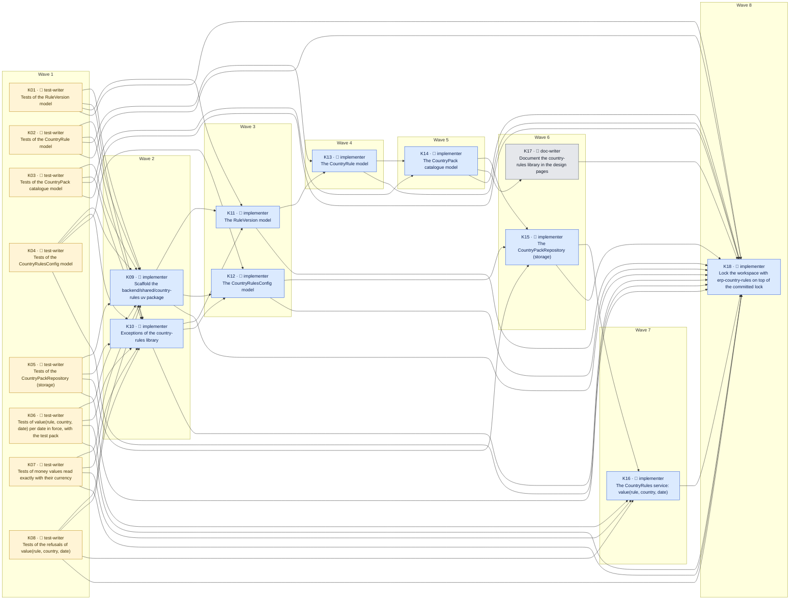

# T0.12: Country-pack rules library, plan

**Plan:** 🟢 Approved

**Push:** 🟢 Approved

<!-- ticket:specs -->
## 📚 Specifications

The specification and design pages of [TICKET.md](TICKET.md), copied by `python3 .claude/scripts/tickets/ticket_refs.py sync`.

- [📝 I-T11-01 Rules library](../../specs/03-technical/t11-legal-corpora/interfaces/i-t11-01-rules-library.md)
- [📌 REQ-T11-02 One rules library by date](../../specs/03-technical/t11-legal-corpora/requirements/req-t11-02-rules-library.md)
- [📌 REQ-T10-03 Money as exact decimals](../../specs/03-technical/t10-translations-and-notifications/requirements/req-t10-03-money-decimals.md)
- [📌 REQ-T11-06 Rules tested per date](../../specs/03-technical/t11-legal-corpora/requirements/req-t11-06-tests-per-date.md)
- [📜 D438 Repository layout](../../specs/06-decisions/technical/d438-repository-layout.md)
- [📜 D405 Architecture and scalability](../../specs/06-decisions/technical/d405-architecture-and-scalability.md)
- [📜 D426 Testing strategy](../../specs/06-decisions/technical/d426-testing-strategy.md)
- [🏗️ Back end](../../technical/architecture/backend.md#target-design-specified-in-gh-2-not-built-yet)
- [🏗️ Repository layout](../../technical/architecture/repository-layout.md)
- [🏗️ Tests and traceability](../../technical/delivery/tests-and-traceability.md#target-design-specified-in-gh-2-not-built-yet)
- [📌 REQ-T11-01](../../specs/03-technical/t11-legal-corpora/requirements/req-t11-01-signed-packs.md)
<!-- /ticket:specs -->

## Summary

T0.12 builds the country-pack rules library `backend/shared/country-rules` (import package `erp_country_rules`). Its entry point is `CountryRules.value(rule, country, date)` from I-T11-01. It reads a YAML pack catalogue of rule versions, each with validity dates (REQ-T11-02, E-T11-02), and returns exact Decimals or erp_models Money (REQ-T10-03). It is tested per date in force (REQ-T11-06). The plan has 17 tasks in 7 waves. Wave 1 has 8 test-writer tasks: one per model (RuleVersion, CountryRule, CountryPack, CountryRulesConfig), one for the storage repository, and three for the service (values by date with the shared test pack and conftest, money values, refusals). Wave 2 adds the package scaffold (pyproject, README, layer packages, uv.lock) and the exceptions package, each exception in its own file. Waves 3 to 7 build in dependency order: RuleVersion and CountryRulesConfig, then CountryRule, then CountryPack, then CountryPackRepository beside the design-page update, then the CountryRules service. The ticket has no screen, so there is no Playwright task.

## Assumptions

- The roadmap row gives no budget and no screen, so none is listed.
- Criteria 3 and 5 restate the roadmap's done-when; criterion 2 of REQ-T11-06 (release blocked) is out of scope because it concerns the release, not the library.
- The pack catalogue format is not specified beyond values with validity dates, so its fields are left to the plan.
- The ticket anchor links to the sprint section #s02 because the roadmap rows carry no anchor of their own.
- check_ticket.py was not run by me; the workflow runs it next.
- The import package is `erp_country_rules` and the uv distribution is `erp-country-rules`. The specifications name only the folder `backend/shared/country-rules` (D572). The `erp_` prefix, like `erp_models`, avoids clashing with other packages in the shared uv environment.
- The pack catalogue format is not specified beyond 'values with validity dates' (REQ-T11-02) and the main fields of E-T11-01 (country, version) and E-T11-02 (rule, value, valid from, valid to). The plan takes those fields and adds nothing else: a YAML file `<packs_dir>/<country in lower case>/rules.yaml` with `country`, `version` and `rules`, each rule holding a list of versions with `valid_from`, `valid_to` and `value`. E-T11-01 and E-T11-02 are not listed in TICKET.md, but the briefs link them because they settle these field names.
- `valid_to` is inclusive (the last day in force) and optional (open-ended). The versions of a rule must be listed by date and never overlap, so an open-ended version can only be the last one. Gaps are allowed, and a date in a gap or before the first version is refused with `SECountryRuleNotInForceError`. This is the most conservative reading: the library never has to choose between two values.
- A rule value is either an exact `Decimal` (a rate, a threshold) or the erp_models money model of T0.03 (an amount with its currency). A YAML float is refused because it is not exact (REQ-T10-03). Text or boolean values are left to later tickets that need them.
- `CountryPack.country` must already be two upper-case letters. The repository strips and upper-cases the country it is asked for, and refuses anything that is not two ASCII letters before building a path, so a country cannot escape the packs folder.
- The packs folder is a configuration section `CountryRulesConfig.packs_dir`, by default `packs/countries` (D438), resolved from the working directory. This ticket adds no real pack data to `packs/countries/`: conversions and real packs are out of scope.
- The money model of erp_models (T0.03), its field names (written here as `amount` and `currency`), `YamlCatalog` and the SE exception bases (T0.04) are not specified by name. Each task reads `backend/models/src/erp_models/` at run time and uses the real names. T0.03 is a prerequisite of T0.04, which is a prerequisite of this ticket.
- The test pack is synthetic, for the fictitious country `ZZ` (D426: synthetic data only). Its fixed dates (2024, 2025, 2026 and 2027-07-01) stand for last year, this year and a future-dated value, so the tests never depend on today's date.
- `value` logs only DEBUG on success, because it runs for every fact read (AGENT.md, Logging), and logs ERROR before each refusal. The repository logs INFO once per pack it loads. No log line quotes a rule value.
- The library has no `api` layer and no factory: it is not a runnable, and the convention tests require every layer only of services.
- K09 changes `uv.lock`, which sits outside the ticket's area `backend/shared/country-rules`, because adding a workspace member needs it. The root `pyproject.toml` and `backend/shared/README.md` are not changed, so that this ticket does not reach other tickets' areas.
- Ruff is assumed to class `erp_country_rules` as first-party the same way it classes the libraries merged before (T0.05, T0.06). If it does not, K09 reports it as blocked rather than changing the root `pyproject.toml`.
- REQ-T11-06 criterion 1 is enforced inside the library's tests: a test fails when a version change in the test pack has no case on the day before and on the day of the change. The release block of criterion 2 is out of scope, as TICKET.md says.

<!-- plan:graph -->

> [!NOTE]
> Generated from the json block at the end of this page by `python3 .claude/scripts/tickets/plan.py render`.
> To change a task, edit the json block, then render again: never edit this view by hand.

## Waves

| Wave | Tasks | Agents running at once |
| --- | --- | --- |
| 1 | [K01](#k01), [K02](#k02), [K03](#k03), [K04](#k04), [K05](#k05), [K06](#k06), [K07](#k07), [K08](#k08) | 8 of 8 |
| 2 | [K09](#k09), [K10](#k10) | 2 of 2 |
| 3 | [K11](#k11), [K12](#k12) | 2 of 2 |
| 4 | [K13](#k13) | 1 of 1 |
| 5 | [K14](#k14) | 1 of 1 |
| 6 | [K15](#k15), [K17](#k17) | 2 of 2 |
| 7 | [K16](#k16) | 1 of 1 |
| 8 | [K18](#k18) | 1 of 1 |

| Wave | Task | Agent | Depends on | Unblocks |
| --- | --- | --- | --- | --- |
| 1 | [K01](#k01) Tests of the RuleVersion model | 🧪 test-writer | none | [K09](#k09), [K10](#k10), [K11](#k11), [K18](#k18) |
| 1 | [K02](#k02) Tests of the CountryRule model | 🧪 test-writer | none | [K09](#k09), [K10](#k10), [K13](#k13), [K18](#k18) |
| 1 | [K03](#k03) Tests of the CountryPack catalogue model | 🧪 test-writer | none | [K09](#k09), [K10](#k10), [K14](#k14), [K18](#k18) |
| 1 | [K04](#k04) Tests of the CountryRulesConfig model | 🧪 test-writer | none | [K09](#k09), [K10](#k10), [K12](#k12), [K18](#k18) |
| 1 | [K05](#k05) Tests of the CountryPackRepository (storage) | 🧪 test-writer | none | [K09](#k09), [K10](#k10), [K15](#k15), [K18](#k18) |
| 1 | [K06](#k06) Tests of value(rule, country, date) per date in force, with the test pack | 🧪 test-writer | none | [K09](#k09), [K10](#k10), [K16](#k16), [K18](#k18) |
| 1 | [K07](#k07) Tests of money values read exactly with their currency | 🧪 test-writer | none | [K09](#k09), [K10](#k10), [K16](#k16), [K18](#k18) |
| 1 | [K08](#k08) Tests of the refusals of value(rule, country, date) | 🧪 test-writer | none | [K09](#k09), [K10](#k10), [K16](#k16), [K18](#k18) |
| 2 | [K09](#k09) Scaffold the backend/shared/country-rules uv package | 🐍 implementer | [K01](#k01), [K02](#k02), [K03](#k03), [K04](#k04), [K05](#k05), [K06](#k06), [K07](#k07), [K08](#k08) | [K11](#k11), [K12](#k12), [K18](#k18) |
| 2 | [K10](#k10) Exceptions of the country-rules library | 🐍 implementer | [K01](#k01), [K02](#k02), [K03](#k03), [K04](#k04), [K05](#k05), [K06](#k06), [K07](#k07), [K08](#k08) | [K11](#k11), [K12](#k12), [K18](#k18) |
| 3 | [K11](#k11) The RuleVersion model | 🐍 implementer | [K01](#k01), [K09](#k09), [K10](#k10) | [K13](#k13), [K18](#k18) |
| 3 | [K12](#k12) The CountryRulesConfig model | 🐍 implementer | [K04](#k04), [K09](#k09), [K10](#k10) | [K15](#k15), [K18](#k18) |
| 4 | [K13](#k13) The CountryRule model | 🐍 implementer | [K02](#k02), [K11](#k11) | [K14](#k14), [K18](#k18) |
| 5 | [K14](#k14) The CountryPack catalogue model | 🐍 implementer | [K03](#k03), [K13](#k13) | [K15](#k15), [K17](#k17), [K18](#k18) |
| 6 | [K15](#k15) The CountryPackRepository (storage) | 🐍 implementer | [K05](#k05), [K12](#k12), [K14](#k14) | [K16](#k16), [K18](#k18) |
| 6 | [K17](#k17) Document the country-rules library in the design pages | 📝 doc-writer | [K14](#k14) | [K18](#k18) |
| 7 | [K16](#k16) The CountryRules service: value(rule, country, date) | 🐍 implementer | [K06](#k06), [K07](#k07), [K08](#k08), [K15](#k15) | [K18](#k18) |
| 8 | [K18](#k18) Lock the workspace with erp-country-rules on top of the committed lock | 🐍 implementer | [K01](#k01), [K02](#k02), [K03](#k03), [K04](#k04), [K05](#k05), [K06](#k06), [K07](#k07), [K08](#k08), [K09](#k09), [K10](#k10), [K11](#k11), [K12](#k12), [K13](#k13), [K14](#k14), [K15](#k15), [K17](#k17), [K16](#k16) | none |

## Dependency graph



## Tasks

### <a id="k01"></a>K01: Tests of the RuleVersion model

| Agent | Wave | Depends on | Unblocks |
| --- | --- | --- | --- |
| 🧪 test-writer | 1 | none | [K09](#k09), [K10](#k10), [K11](#k11), [K18](#k18) |

**Files** (only this task may change them in its wave):

- `backend/shared/country-rules/tests/models/rules/test_rule_version.py`

**Done when:** `uv run ruff check backend/shared/country-rules/tests/models/rules/test_rule_version.py` and `uv run ruff format --check` on the same file pass; `uv run pytest tests/conventions -n 2` passes; `uv run pytest backend/shared/country-rules/tests/models/rules/test_rule_version.py` fails only with a ModuleNotFoundError for `erp_country_rules`.

**Brief:**

Write the tests of the `RuleVersion` model of the country-pack rules library (ticket T0.12), before the code exists.

Specifications applied: [E-T11-02 Country rule](docs/specs/03-technical/t11-legal-corpora/data/e-t11-02-country-rule.md) (a value with its validity dates: rule, value, valid from, valid to), [REQ-T11-02](docs/specs/03-technical/t11-legal-corpora/requirements/req-t11-02-rules-library.md) (values read by the date of the fact), [REQ-T10-03](docs/specs/03-technical/t10-translations-and-notifications/requirements/req-t10-03-money-decimals.md) (money is an exact decimal with its currency), [D426](docs/specs/06-decisions/technical/d426-testing-strategy.md) (errors and edge cases tested, synthetic data), [D438](docs/specs/06-decisions/technical/d438-repository-layout.md) (library under `backend/shared/<lib>`). Design: [Back end](docs/technical/architecture/backend.md), [Tests and traceability](docs/technical/delivery/tests-and-traceability.md). Rules: `AGENT.md` sections Tests, Pydantic models, Exceptions.

Contract under test (import paths are fixed by the plan): `from erp_country_rules.models.rules.rule_version import RuleVersion`; exceptions from `erp_country_rules.models.exceptions`: `SEInvalidRuleVersionException` (model base), `SERuleVersionInvalidValidFrom`, `SERuleVersionInvalidValidTo`, `SERuleVersionInvalidValue`, `SERuleVersionEndsBeforeStart`. `RuleVersion` is frozen, `extra="forbid"`, with the fields `valid_from: datetime.date` (required, no default), `valid_to: Optional[datetime.date] = None` (the last day in force, inclusive; `None` means open-ended), and `value: Union[Money, Decimal]`. `Money` is the money model T0.03 delivered in `erp_models`: read `backend/models/src/erp_models/` for its real module path and field names before writing (this plan calls them `amount` and `currency`).

Write one `TestRuleVersion` class with the AGENT.md model test set and these cases:
- `test_defaults`: only `valid_from` and `value` given, `valid_to` is `None`.
- `test_full_valid_construction`: every field set.
- `test_none_becomes_the_default`: `valid_to=None` gives `None`.
- `test_rejects_bad_values` (parametrised with the exception expected): `valid_from` given as an int, a bool, a `datetime.datetime`, a non-date string -> `SERuleVersionInvalidValidFrom`; the same for `valid_to` -> `SERuleVersionInvalidValidTo`; `value` given as a float (`19.6`, refused because it is not exact), a bool, an empty or blank string, `"abc"`, `"NaN"`, `"Infinity"`, a list, or a money mapping without its currency -> `SERuleVersionInvalidValue`.
- Accepted inputs: `valid_from`/`valid_to` given as `datetime.date` or ISO strings (`"2026-01-01"`); `value` given as a string (`"20"`, `" 19.6 "` stripped) or an int gives an exact `Decimal` (`Decimal("19.6")`, never a float); a mapping of the money fields gives a `Money` whose amount is a `Decimal` and whose currency is kept.
- `valid_to` before `valid_from` -> `SERuleVersionEndsBeforeStart`; `valid_to` equal to `valid_from` (one day in force) is accepted.
- `test_rejects_unknown_keys`, and `test_round_trip` (both `model_dump()` and `model_dump(mode="json")` validate back to an equal model, for a decimal and for a money value).

Rules: one class per file, test names as sentences, `pytest.mark.parametrize` for cases of one behaviour, the specific exception in `pytest.raises`, no `unittest.mock`, no `__init__.py`, no docstrings needed. The tests must fail now only because `erp_country_rules` does not exist yet. The file is `backend/shared/country-rules/tests/models/rules/test_rule_version.py`.

### <a id="k02"></a>K02: Tests of the CountryRule model

| Agent | Wave | Depends on | Unblocks |
| --- | --- | --- | --- |
| 🧪 test-writer | 1 | none | [K09](#k09), [K10](#k10), [K13](#k13), [K18](#k18) |

**Files** (only this task may change them in its wave):

- `backend/shared/country-rules/tests/models/rules/test_country_rule.py`

**Done when:** `uv run ruff check` and `uv run ruff format --check` on `backend/shared/country-rules/tests/models/rules/test_country_rule.py` pass; `uv run pytest tests/conventions -n 2` passes; the file fails only with a ModuleNotFoundError for `erp_country_rules`.

**Brief:**

Write the tests of the `CountryRule` model of the country-pack rules library (ticket T0.12), before the code exists.

Specifications applied: [E-T11-02 Country rule](docs/specs/03-technical/t11-legal-corpora/data/e-t11-02-country-rule.md) (a value with its validity dates), [REQ-T11-02](docs/specs/03-technical/t11-legal-corpora/requirements/req-t11-02-rules-library.md) (one value in force at the date of the fact; a future-dated value applies from its date), [D426](docs/specs/06-decisions/technical/d426-testing-strategy.md) (errors and edge cases tested), [D438](docs/specs/06-decisions/technical/d438-repository-layout.md). Design: [Back end](docs/technical/architecture/backend.md). Rules: `AGENT.md` sections Tests, Pydantic models, Exceptions.

Contract under test: `from erp_country_rules.models.rules.country_rule import CountryRule` and `from erp_country_rules.models.rules.rule_version import RuleVersion`. `CountryRule` is frozen with `extra="forbid"`, and has the fields `rule: str` (the rule's name, such as `standard-rate`: stripped, never empty) and `versions: List[RuleVersion]` (never empty). `RuleVersion` has `valid_from: date`, `valid_to: Optional[date]` (the last day in force, inclusive; `None` means open-ended) and `value: Union[Money, Decimal]`. Exceptions come from `erp_country_rules.models.exceptions`: `SEInvalidCountryRuleException` (the model base), `SECountryRuleInvalidRule`, `SECountryRuleInvalidVersions` and `SECountryRuleOverlappingVersions`.

Write one `TestCountryRule` class with the AGENT.md model test set:
- `test_full_valid_construction`: a rule with three versions given as mappings. The first runs 2024-01-01 to 2025-12-31 with value "19.6". The second runs 2026-01-01 to 2027-06-30 with value "20". The third starts 2027-07-01, is open-ended and has value "21".
- `test_defaults` and `test_none_becomes_the_default` cannot apply, because both fields are required. Instead, test that `None` for either field is refused with its own exception.
- `test_rejects_bad_values`, parametrised. A non-string, empty or blank `rule` raises `SECountryRuleInvalidRule`. A `versions` value that is not a list, is an empty list, or holds a non-mapping raises `SECountryRuleInvalidVersions`.
- Versions that overlap raise `SECountryRuleOverlappingVersions`: two versions in force on the same day, versions not listed in ascending `valid_from` order, or an open-ended version followed by a later one.
- Adjacent versions are accepted (one ends 2025-12-31, the next starts 2026-01-01), and so is a gap between two versions.
- `test_rejects_unknown_keys` and `test_round_trip`.

The usual test rules apply: one class per file, test names as sentences, `parametrize`, the specific exception, no mocks and no `__init__.py`. The file is `backend/shared/country-rules/tests/models/rules/test_country_rule.py`.

### <a id="k03"></a>K03: Tests of the CountryPack catalogue model

| Agent | Wave | Depends on | Unblocks |
| --- | --- | --- | --- |
| 🧪 test-writer | 1 | none | [K09](#k09), [K10](#k10), [K14](#k14), [K18](#k18) |

**Files** (only this task may change them in its wave):

- `backend/shared/country-rules/tests/models/packs/test_country_pack.py`

**Done when:** `uv run ruff check` and `uv run ruff format --check` on the file pass; `uv run pytest tests/conventions -n 2` passes; the file fails only with a ModuleNotFoundError for `erp_country_rules`.

**Brief:**

Write the tests of the `CountryPack` model, the pack catalogue of the country-pack rules library (ticket T0.12), before the code exists.

Specifications applied: [E-T11-01 Country pack](docs/specs/03-technical/t11-legal-corpora/data/e-t11-01-country-pack.md) (a country's pack and its version, such as `FR`, `2026.11`; the signature is out of scope, see REQ-T11-01), [REQ-T11-02](docs/specs/03-technical/t11-legal-corpora/requirements/req-t11-02-rules-library.md) (a pack catalogue of values with validity dates), [I-T11-01](docs/specs/03-technical/t11-legal-corpora/interfaces/i-t11-01-rules-library.md), [D405](docs/specs/06-decisions/technical/d405-architecture-and-scalability.md) (country packs as data read by one rules library), [D426](docs/specs/06-decisions/technical/d426-testing-strategy.md), [D438](docs/specs/06-decisions/technical/d438-repository-layout.md). Design: [Back end](docs/technical/architecture/backend.md). Rules: `AGENT.md` sections Tests, Pydantic models, Data and enums (`YamlCatalog`).

Contract under test: `from erp_country_rules.models.packs.country_pack import CountryPack`. It subclasses the `YamlCatalog` of `erp_models` (T0.03), so `CountryPack.load(path)` reads a YAML file and raises `SECountryPackUnreadable` (its `UNREADABLE` exception) when the file is missing, unreadable or not valid YAML. Read `backend/models/src/erp_models/` for how `YamlCatalog` and its tests work. The model is frozen with `extra="forbid"`, and has these fields:
- `country: str`: exactly two upper-case ASCII letters after stripping. A lower-case code is refused; the repository normalises lookups instead.
- `version: str`: a stripped, non-empty string. A YAML number such as `2026.11` is refused.
- `rules: List[CountryRule]`: never empty, with each `rule` name unique.

Exceptions come from `erp_country_rules.models.exceptions`: `SEInvalidCountryPackException` (the base), `SECountryPackUnreadable`, `SECountryPackInvalidCountry`, `SECountryPackInvalidVersion` and `SECountryPackInvalidRules`.

Write one `TestCountryPack` class:
- The model test set: full valid construction, every required field refused when it is `None`, `test_rejects_bad_values` (parametrised over the three fields: wrong types, empty, `"F"`, `"FRA"`, `"fr"`, `"1A"`, a float version, an empty rules list, two rules with the same name), unknown keys and the round trip.
- `load` of a YAML file written to `tmp_path` gives the expected pack. Dates written unquoted in YAML (`2026-01-01`) are accepted. Money values are mappings of the fields of the erp_models money model.
- `load` of a missing file and of a malformed YAML file raises `SECountryPackUnreadable`.
- Use synthetic data only: the fictitious country `ZZ`.

The usual test rules apply. The file is `backend/shared/country-rules/tests/models/packs/test_country_pack.py`.

### <a id="k04"></a>K04: Tests of the CountryRulesConfig model

| Agent | Wave | Depends on | Unblocks |
| --- | --- | --- | --- |
| 🧪 test-writer | 1 | none | [K09](#k09), [K10](#k10), [K12](#k12), [K18](#k18) |

**Files** (only this task may change them in its wave):

- `backend/shared/country-rules/tests/models/config/test_country_rules_config.py`

**Done when:** `uv run ruff check` and `uv run ruff format --check` on the file pass; `uv run pytest tests/conventions -n 2` passes; the file fails only with a ModuleNotFoundError for `erp_country_rules`.

**Brief:**

Write the tests of `CountryRulesConfig`, the configuration section of the country-pack rules library (ticket T0.12): where the packs are read from. Write them before the code exists.

Specifications and design applied: [D438](docs/specs/06-decisions/technical/d438-repository-layout.md) (`packs/countries/` holds the country packs as data, and the library lives in `backend/shared/<lib>`), [REQ-T11-02](docs/specs/03-technical/t11-legal-corpora/requirements/req-t11-02-rules-library.md), [Repository layout](docs/technical/architecture/repository-layout.md) and [Back end](docs/technical/architecture/backend.md). Rules: `AGENT.md` sections Pydantic models (configuration sections add `validate_default=True`) and Tests.

Contract under test: `from erp_country_rules.models.config.country_rules_config import CountryRulesConfig`. Its one field is `packs_dir: Path`, with the default `Path("packs/countries")`. The model is frozen, with `extra="forbid"` and `validate_default=True`. Exceptions come from `erp_country_rules.models.exceptions`: `SEInvalidCountryRulesConfigException` (the base) and `SECountryRulesConfigInvalidPacksDir`.

Write one `TestCountryRulesConfig` class with the six AGENT.md model tests:
- defaults;
- full valid construction, from a `str` and from a `Path`, with a surrounding blank stripped;
- `None` becomes the default;
- bad values refused with `SECountryRulesConfigInvalidPacksDir`: an empty or blank string, a bool, an int, a list;
- unknown keys refused;
- round trip, including JSON mode.

The usual test rules apply. The file is `backend/shared/country-rules/tests/models/config/test_country_rules_config.py`.

### <a id="k05"></a>K05: Tests of the CountryPackRepository (storage)

| Agent | Wave | Depends on | Unblocks |
| --- | --- | --- | --- |
| 🧪 test-writer | 1 | none | [K09](#k09), [K10](#k10), [K15](#k15), [K18](#k18) |

**Files** (only this task may change them in its wave):

- `backend/shared/country-rules/tests/storage/packs/test_country_pack_repository.py`

**Done when:** `uv run ruff check` and `uv run ruff format --check` on the file pass; `uv run pytest tests/conventions -n 2` passes; the file fails only with a ModuleNotFoundError for `erp_country_rules`.

**Brief:**

Write the tests of the storage layer of the country-pack rules library (ticket T0.12): the repository that reads a country's pack catalogue. Write them before the code exists.

Specifications applied:
- [I-T11-01](docs/specs/03-technical/t11-legal-corpora/interfaces/i-t11-01-rules-library.md): `value(rule, country, date)` reads by country.
- [REQ-T11-02](docs/specs/03-technical/t11-legal-corpora/requirements/req-t11-02-rules-library.md): a pack catalogue of values with validity dates.
- [E-T11-01 Country pack](docs/specs/03-technical/t11-legal-corpora/data/e-t11-01-country-pack.md).
- [D405](docs/specs/06-decisions/technical/d405-architecture-and-scalability.md): country packs are data, read by one rules library.
- [D426](docs/specs/06-decisions/technical/d426-testing-strategy.md): error cases are tested, with synthetic data.
- [D438](docs/specs/06-decisions/technical/d438-repository-layout.md).

Design: [Back end](docs/technical/architecture/backend.md). Rules: `AGENT.md` sections Layout (storage reads data and nothing else) and Tests.

Contract under test:
- `from erp_country_rules.storage.packs.country_pack_repository import CountryPackRepository`, built as `CountryPackRepository(config: CountryRulesConfig, logger: Optional[Logger] = None)`. `CountryRulesConfig` comes from `erp_country_rules.models.config.country_rules_config` and has `packs_dir: Path`.
- `get(country: str) -> CountryPack` strips the country and upper-cases it. It then loads `<packs_dir>/<country in lower case>/rules.yaml` with `CountryPack.load` and keeps the loaded pack, so a second `get` of the same country returns the same object without reading the file again.
- A country that is not two ASCII letters (`"ZZZ"`, `"../zz"`, `""`, `"z1"`) raises `SECountryPackNotFoundError` before any path is built.
- A country with no pack file raises `SECountryPackNotFoundError`. A file that exists but is unreadable or malformed raises `SECountryPackUnreadable`. Both exceptions come from `erp_country_rules.models.exceptions`.

Write one `TestCountryPackRepository` class. Each test writes its own synthetic pack for the fictitious country `ZZ` under `tmp_path`: `tmp_path/zz/rules.yaml`, with `country: ZZ`, `version: "2026.11"` and one rule with two versions. Do not depend on any other test's files. Cover:
- `get("ZZ")`, `get("zz")` and `get(" ZZ ")` give the pack;
- the second `get` returns the same object (check it with `is`, or by deleting the file after the first `get`);
- an unknown country, the malformed and path-escaping country strings, and a malformed YAML file each raise their exception;
- the logger argument accepts a real `logging.Logger`, and the log is captured with `caplog` rather than mocked.

The usual test rules apply. The file is `backend/shared/country-rules/tests/storage/packs/test_country_pack_repository.py`.

### <a id="k06"></a>K06: Tests of value(rule, country, date) per date in force, with the test pack

| Agent | Wave | Depends on | Unblocks |
| --- | --- | --- | --- |
| 🧪 test-writer | 1 | none | [K09](#k09), [K10](#k10), [K16](#k16), [K18](#k18) |

**Files** (only this task may change them in its wave):

- `backend/shared/country-rules/tests/service/rules/country_rules/conftest.py`
- `backend/shared/country-rules/tests/service/rules/country_rules/helpers.py`
- `backend/shared/country-rules/tests/service/rules/country_rules/packs/zz/rules.yaml`
- `backend/shared/country-rules/tests/service/rules/country_rules/test_values_by_date.py`

**Done when:** `uv run ruff check` and `uv run ruff format --check` on the three Python files pass; `uv run pytest tests/conventions -n 2` passes; `python3 -c "import yaml; yaml.safe_load(open('backend/shared/country-rules/tests/service/rules/country_rules/packs/zz/rules.yaml', encoding='utf-8'))"` exits 0; the tests fail only with a ModuleNotFoundError for `erp_country_rules`.

**Brief:**

~~~~text
Write the tests of the service layer of the country-pack rules library (ticket T0.12): `value(rule, country, date)` gives the value in force at the date of the fact. This task also writes the shared test pack and the fixture that K07 and K08 use.

Specifications applied:
- [I-T11-01 Rules library](docs/specs/03-technical/t11-legal-corpora/interfaces/i-t11-01-rules-library.md): `value(rule, country, date)`.
- [REQ-T11-02](docs/specs/03-technical/t11-legal-corpora/requirements/req-t11-02-rules-library.md), criterion 1: an invoice of last year gets last year's rate. Criterion 2: a future-dated rule is applied from its date.
- [REQ-T11-06](docs/specs/03-technical/t11-legal-corpora/requirements/req-t11-06-tests-per-date.md), criterion 1: for every rate change, tests before and after its date.
- [E-T11-02](docs/specs/03-technical/t11-legal-corpora/data/e-t11-02-country-rule.md).
- [D426](docs/specs/06-decisions/technical/d426-testing-strategy.md): synthetic data.
- [D438](docs/specs/06-decisions/technical/d438-repository-layout.md).

Design: [Tests and traceability](docs/technical/delivery/tests-and-traceability.md) (country-pack rules are tested per date in force) and [Back end](docs/technical/architecture/backend.md). Rules: `AGENT.md` section Tests: `conftest.py` holds the fixtures, `helpers.py` the constants that several files share.

Contract under test:
- `from erp_country_rules.service.rules.country_rules import CountryRules`, built as `CountryRules(repository: CountryPackRepository, logger: Optional[Logger] = None)`.
- `value(rule: str, country: str, date: datetime.date) -> Union[Money, Decimal]` returns the value of the one version in force on `date`. A version is in force on day `d` when `valid_from <= d` and either `valid_to` is `None` or `d <= valid_to`.
- `CountryPackRepository(config)` comes from `erp_country_rules.storage.packs.country_pack_repository`, and `CountryRulesConfig(packs_dir=...)` from `erp_country_rules.models.config.country_rules_config`.
- `Money` is the erp_models money model of T0.03. Read `backend/models/src/erp_models/` for its path and its field names.

Write exactly this synthetic test pack, `packs/zz/rules.yaml`, for the fictitious country `ZZ`. Use the money model's real field names in place of `amount` and `currency` if they differ, and keep every value quoted so that none is a float.
```yaml
country: ZZ
version: "2026.11"
rules:
  - rule: standard-rate
    versions:
      - {valid_from: 2024-01-01, valid_to: 2025-12-31, value: "19.6"}
      - {valid_from: 2026-01-01, valid_to: 2027-06-30, value: "20"}
      - {valid_from: 2027-07-01, value: "21"}
  - rule: stamp-duty
    versions:
      - {valid_from: 2024-01-01, valid_to: 2026-12-31, value: {amount: "0.10", currency: EUR}}
      - {valid_from: 2027-01-01, value: {amount: "0.20", currency: EUR}}
```

`conftest.py` defines the fixture `country_rules`. It returns `CountryRules(CountryPackRepository(CountryRulesConfig(packs_dir=Path(__file__).parent / "packs")))`. K07 and K08 use this fixture by name, so keep the name and the pack exactly as written.

`helpers.py` holds the per-date cases as constants: for every version boundary of the pack, the day before and the day of the change, with the value expected. `test_values_by_date.py` holds one `TestValuesByDate` class:
- Criterion 1: a fact dated 2025-06-15 gets `Decimal("19.6")`, the previous year's value, whatever today's date.
- Criterion 2: 2027-06-30 gets `Decimal("20")`, while 2027-07-01 and 2035-01-01 get `Decimal("21")`.
- Per date: a parametrised test over the cases of `helpers.py` covers 2025-12-31 and 2026-01-01, and 2027-06-30 and 2027-07-01 for `standard-rate`; and 2026-12-31 and 2027-01-01 for `stamp-duty`. The first and last day of each version are covered too.
- REQ-T11-06 criterion 1: one test loads the pack with `CountryPack.load` and asserts that every `valid_from` after a rule's first version has a case on the day before and on the day itself in `helpers.py`, so that a rate change added without its tests fails.
- The country is accepted in lower case (`"zz"`).
- The result is a `Decimal`, never a float.

Import helpers by their full path, `tests.service.rules.country_rules.helpers`. The usual test rules apply.
~~~~

### <a id="k07"></a>K07: Tests of money values read exactly with their currency

| Agent | Wave | Depends on | Unblocks |
| --- | --- | --- | --- |
| 🧪 test-writer | 1 | none | [K09](#k09), [K10](#k10), [K16](#k16), [K18](#k18) |

**Files** (only this task may change them in its wave):

- `backend/shared/country-rules/tests/service/rules/country_rules/test_money_values.py`

**Done when:** `uv run ruff check` and `uv run ruff format --check` on `backend/shared/country-rules/tests/service/rules/country_rules/test_money_values.py` pass; `uv run pytest tests/conventions -n 2` passes; the file fails only with a ModuleNotFoundError for `erp_country_rules`.

**Brief:**

Write the tests showing that the country-pack rules library (ticket T0.12) reads money values as exact decimals with their currency, and that summing them leaves no float error.

Specifications applied: [REQ-T10-03 Money as exact decimals](docs/specs/03-technical/t10-translations-and-notifications/requirements/req-t10-03-money-decimals.md) criterion 2 (a sum of lines has no float error; criterion 1, rounding a conversion, is out of scope), [I-T11-01](docs/specs/03-technical/t11-legal-corpora/interfaces/i-t11-01-rules-library.md), [REQ-T11-02](docs/specs/03-technical/t11-legal-corpora/requirements/req-t11-02-rules-library.md), [D426](docs/specs/06-decisions/technical/d426-testing-strategy.md), [D438](docs/specs/06-decisions/technical/d438-repository-layout.md). Design: [Back end](docs/technical/architecture/backend.md). Rules: `AGENT.md` section Tests.

This task writes only `test_money_values.py`. It uses the fixture `country_rules` (a `CountryRules` instance) and the test pack that task K06 writes in the same folder. Do not write or change them. The fixture is defined in `conftest.py` as `CountryRules(CountryPackRepository(CountryRulesConfig(packs_dir=Path(__file__).parent / "packs")))`.

The pack `packs/zz/rules.yaml` holds, for country `ZZ`:
- the rule `standard-rate`, with the value "19.6" from 2024-01-01 to 2025-12-31, "20" from 2026-01-01 to 2027-06-30, and "21" from 2027-07-01;
- the rule `stamp-duty`, with the money value 0.10 EUR from 2024-01-01 to 2026-12-31 and 0.20 EUR from 2027-01-01.

The money values are written as mappings of the erp_models money model's fields. That is the T0.03 model: read `backend/models/src/erp_models/` for its path, its field names and the addition it offers.

Contract: `country_rules.value(rule, country, date)` returns the erp_models `Money` for a money rule and a `Decimal` for a decimal rule.

Write one `TestMoneyValues` class:
- `value("stamp-duty", "ZZ", date(2026, 3, 1))` is a `Money` whose amount is exactly `Decimal("0.10")` (a `Decimal`, not a float) and whose currency is EUR.
- The 2027 value is `0.20` EUR.
- The amounts read on 2026-03-01 and on 2027-03-01, summed, are exactly `0.30` EUR. Sum them with the money model's own addition if it has one, otherwise as `Decimal` amounts. Show in the same test that `0.1 + 0.2 != 0.3` in floats, so the test proves the point.
- Three lines of 0.10 EUR sum exactly to 0.30 EUR.
- `value("standard-rate", "ZZ", ...)` is a `Decimal`, never a `float` or a `Money`.

The usual test rules apply.

### <a id="k08"></a>K08: Tests of the refusals of value(rule, country, date)

| Agent | Wave | Depends on | Unblocks |
| --- | --- | --- | --- |
| 🧪 test-writer | 1 | none | [K09](#k09), [K10](#k10), [K16](#k16), [K18](#k18) |

**Files** (only this task may change them in its wave):

- `backend/shared/country-rules/tests/service/rules/country_rules/test_refusals.py`

**Done when:** `uv run ruff check` and `uv run ruff format --check` on `backend/shared/country-rules/tests/service/rules/country_rules/test_refusals.py` pass; `uv run pytest tests/conventions -n 2` passes; the file fails only with a ModuleNotFoundError for `erp_country_rules`.

**Brief:**

Write the tests of the error cases of `value(rule, country, date)` in the country-pack rules library (ticket T0.12).

Specifications applied: [I-T11-01](docs/specs/03-technical/t11-legal-corpora/interfaces/i-t11-01-rules-library.md), [REQ-T11-02](docs/specs/03-technical/t11-legal-corpora/requirements/req-t11-02-rules-library.md) (a value only applies from its date), [D426](docs/specs/06-decisions/technical/d426-testing-strategy.md) (errors and edge cases tested), [D438](docs/specs/06-decisions/technical/d438-repository-layout.md). Design: [Back end](docs/technical/architecture/backend.md). Rules: `AGENT.md` sections Tests and Exceptions.

This task writes only `test_refusals.py`. It uses the fixture `country_rules` and the test pack that task K06 writes in the same folder; do not write or change them. The fixture, in `conftest.py`, is `CountryRules(CountryPackRepository(CountryRulesConfig(packs_dir=Path(__file__).parent / "packs")))`. The pack `packs/zz/rules.yaml` holds, for country `ZZ`, two rules:
- `standard-rate`: "19.6" from 2024-01-01 to 2025-12-31, "20" from 2026-01-01 to 2027-06-30, then "21" from 2027-07-01;
- `stamp-duty`: 0.10 EUR from 2024-01-01 to 2026-12-31, then 0.20 EUR from 2027-01-01.

The exceptions come from `erp_country_rules.models.exceptions`. `SECountryPackNotFoundError` is raised by the storage layer and left to pass through. `SECountryRuleNotFoundError` and `SECountryRuleNotInForceError` are raised by the service. All three subclass `SECountryRulesError`.

Write one `TestRefusals` class:
- An unknown country (`"YY"`) raises `SECountryPackNotFoundError`, and so does a country that is not two letters (`"ZZZ"`, `"../zz"`).
- A rule not in the pack raises `SECountryRuleNotFoundError`.
- A date before a rule's first version (2023-12-31) raises `SECountryRuleNotInForceError`.
- Each refusal is also an `SECountryRulesError`.
- Each refusal is logged at ERROR, captured with `caplog`, and the log never quotes a rule value.

Use `parametrize` for the cases of one behaviour, and the specific exception in `pytest.raises`. The usual test rules apply.

### <a id="k09"></a>K09: Scaffold the backend/shared/country-rules uv package

| Agent | Wave | Depends on | Unblocks |
| --- | --- | --- | --- |
| 🐍 implementer | 2 | [K01](#k01), [K02](#k02), [K03](#k03), [K04](#k04), [K05](#k05), [K06](#k06), [K07](#k07), [K08](#k08) | [K11](#k11), [K12](#k12), [K18](#k18) |

**Files** (only this task may change them in its wave):

- `backend/shared/country-rules/pyproject.toml`
- `backend/shared/country-rules/README.md`
- `backend/shared/country-rules/src/erp_country_rules/__init__.py`
- `backend/shared/country-rules/src/erp_country_rules/models/__init__.py`
- `backend/shared/country-rules/src/erp_country_rules/storage/__init__.py`
- `backend/shared/country-rules/src/erp_country_rules/service/__init__.py`
- `uv.lock`

**Done when:** `uv sync` succeeds; `uv run --package erp-country-rules python -c "import erp_country_rules.models, erp_country_rules.storage, erp_country_rules.service"` exits 0; `uv run --package erp-country-rules pytest backend/shared/country-rules/tests -n 2` collects the tests (failures only from missing modules of the library); `uv run pytest tests/conventions -n 2` passes.

**Brief:**

Create the uv package of the country-pack rules library, `backend/shared/country-rules`, so that the tests of wave 1 can be collected (ticket T0.12).

Specifications and design applied:
- [D438 Repository layout](docs/specs/06-decisions/technical/d438-repository-layout.md): the shared libraries live under `backend/shared/`.
- [D405](docs/specs/06-decisions/technical/d405-architecture-and-scalability.md): one rules library.
- [I-T11-01](docs/specs/03-technical/t11-legal-corpora/interfaces/i-t11-01-rules-library.md).
- [Repository layout](docs/technical/architecture/repository-layout.md) and [Back end](docs/technical/architecture/backend.md): a service kit with no business rules.

Rules: `AGENT.md` sections Layout, Mono-repo and Commands.

Do this:
1. Write `pyproject.toml` with the distribution name `erp-country-rules` and the import package `erp_country_rules`, in `src/erp_country_rules/`. Set `requires-python = ">=3.13,<3.14"` and list the dependencies on the erp_models workspace package (take its distribution name from `backend/models/pyproject.toml`, with `[tool.uv.sources] ... = { workspace = true }`), `pydantic` and `pyyaml`. Copy exactly the build backend and the pytest settings (`pythonpath`, `asyncio_mode`, `testpaths`) of the shared libraries already in `backend/shared/` (T0.05, T0.06), so that `uv run --package erp-country-rules pytest backend/shared/country-rules/tests -n 2` and imports such as `tests.service.rules.country_rules.helpers` resolve the same way they do there.
2. Leave the root `pyproject.toml` alone: its workspace members already include `backend/shared/*`. Run `uv sync` to update `uv.lock`.
3. Create empty `__init__.py` files for the package and its three layers: `models`, `storage` and `service`. A library has no `api` layer. Never put a layer folder straight under `src/`.
4. Write a `README.md` saying what the library holds, using the contract of this plan:
   - `CountryRules.value(rule, country, date)` returns the `Decimal` or erp_models `Money` in force on the date of the fact;
   - the packs are read from `<packs_dir>/<country in lower case>/rules.yaml` (`packs_dir` of `CountryRulesConfig`, by default `packs/countries`);
   - a pack holds `country`, `version` and `rules`, and each rule holds versions with `valid_from`, an optional inclusive `valid_to` and a `value`;
   - give the layers and how to run the tests.
   Write it in plain British English, with no em dashes.

If ruff does not class `erp_country_rules` as first-party the way it classes the libraries already merged, report it as blocked instead of changing a file outside this list.

### <a id="k10"></a>K10: Exceptions of the country-rules library

| Agent | Wave | Depends on | Unblocks |
| --- | --- | --- | --- |
| 🐍 implementer | 2 | [K01](#k01), [K02](#k02), [K03](#k03), [K04](#k04), [K05](#k05), [K06](#k06), [K07](#k07), [K08](#k08) | [K11](#k11), [K12](#k12), [K18](#k18) |

**Files** (only this task may change them in its wave):

- `backend/shared/country-rules/src/erp_country_rules/models/exceptions/__init__.py`
- `backend/shared/country-rules/src/erp_country_rules/models/exceptions/packs/__init__.py`
- `backend/shared/country-rules/src/erp_country_rules/models/exceptions/packs/se_invalid_country_pack_exception.py`
- `backend/shared/country-rules/src/erp_country_rules/models/exceptions/packs/se_country_pack_unreadable.py`
- `backend/shared/country-rules/src/erp_country_rules/models/exceptions/packs/se_country_pack_invalid_country.py`
- `backend/shared/country-rules/src/erp_country_rules/models/exceptions/packs/se_country_pack_invalid_version.py`
- `backend/shared/country-rules/src/erp_country_rules/models/exceptions/packs/se_country_pack_invalid_rules.py`
- `backend/shared/country-rules/src/erp_country_rules/models/exceptions/rules/__init__.py`
- `backend/shared/country-rules/src/erp_country_rules/models/exceptions/rules/se_invalid_country_rule_exception.py`
- `backend/shared/country-rules/src/erp_country_rules/models/exceptions/rules/se_country_rule_invalid_rule.py`
- `backend/shared/country-rules/src/erp_country_rules/models/exceptions/rules/se_country_rule_invalid_versions.py`
- `backend/shared/country-rules/src/erp_country_rules/models/exceptions/rules/se_country_rule_overlapping_versions.py`
- `backend/shared/country-rules/src/erp_country_rules/models/exceptions/versions/__init__.py`
- `backend/shared/country-rules/src/erp_country_rules/models/exceptions/versions/se_invalid_rule_version_exception.py`
- `backend/shared/country-rules/src/erp_country_rules/models/exceptions/versions/se_rule_version_invalid_valid_from.py`
- `backend/shared/country-rules/src/erp_country_rules/models/exceptions/versions/se_rule_version_invalid_valid_to.py`
- `backend/shared/country-rules/src/erp_country_rules/models/exceptions/versions/se_rule_version_invalid_value.py`
- `backend/shared/country-rules/src/erp_country_rules/models/exceptions/versions/se_rule_version_ends_before_start.py`
- `backend/shared/country-rules/src/erp_country_rules/models/exceptions/config/__init__.py`
- `backend/shared/country-rules/src/erp_country_rules/models/exceptions/config/se_invalid_country_rules_config_exception.py`
- `backend/shared/country-rules/src/erp_country_rules/models/exceptions/config/se_country_rules_config_invalid_packs_dir.py`
- `backend/shared/country-rules/src/erp_country_rules/models/exceptions/errors/__init__.py`
- `backend/shared/country-rules/src/erp_country_rules/models/exceptions/errors/se_country_rules_error.py`
- `backend/shared/country-rules/src/erp_country_rules/models/exceptions/errors/se_country_pack_not_found_error.py`
- `backend/shared/country-rules/src/erp_country_rules/models/exceptions/errors/se_country_rule_not_found_error.py`
- `backend/shared/country-rules/src/erp_country_rules/models/exceptions/errors/se_country_rule_not_in_force_error.py`

**Done when:** `uv run ruff check backend/shared/country-rules/src/erp_country_rules/models/exceptions` passes; `uv run mypy backend/shared/country-rules/src/erp_country_rules/models/exceptions` passes; `uv run pytest tests/conventions -n 2` passes (one class per file, at most five files per folder, sorted `__all__`).

**Brief:**

Write every `SE` exception of the country-pack rules library (ticket T0.12), each in its own file, in `backend/shared/country-rules/src/erp_country_rules/models/exceptions/`.

Specifications applied:
- [I-T11-01](docs/specs/03-technical/t11-legal-corpora/interfaces/i-t11-01-rules-library.md): its errors follow D410 problem+json once served.
- [REQ-T11-02](docs/specs/03-technical/t11-legal-corpora/requirements/req-t11-02-rules-library.md).
- [REQ-T10-03](docs/specs/03-technical/t10-translations-and-notifications/requirements/req-t10-03-money-decimals.md): a non-exact value is refused.
- [E-T11-01](docs/specs/03-technical/t11-legal-corpora/data/e-t11-01-country-pack.md) and [E-T11-02](docs/specs/03-technical/t11-legal-corpora/data/e-t11-02-country-rule.md).
- [D438](docs/specs/06-decisions/technical/d438-repository-layout.md).

Rules: `AGENT.md` sections Exceptions, File shape (at most five files per folder, so the exceptions are dispatched by entity), Naming and Docstrings.

Exceptions, by sub-package:
- `packs/`: `SEInvalidCountryPackException` (model base), `SECountryPackUnreadable` (the `YamlCatalog` UNREADABLE exception), `SECountryPackInvalidCountry`, `SECountryPackInvalidVersion` and `SECountryPackInvalidRules`.
- `rules/`: `SEInvalidCountryRuleException` (model base), `SECountryRuleInvalidRule`, `SECountryRuleInvalidVersions` and `SECountryRuleOverlappingVersions`.
- `versions/`: `SEInvalidRuleVersionException` (model base), `SERuleVersionInvalidValidFrom`, `SERuleVersionInvalidValidTo`, `SERuleVersionInvalidValue` and `SERuleVersionEndsBeforeStart`.
- `config/`: `SEInvalidCountryRulesConfigException` (model base) and `SECountryRulesConfigInvalidPacksDir`.
- `errors/`: `SECountryRulesError` (the layer base: `Base class for every error raised while reading a country rule.`), `SECountryPackNotFoundError`, `SECountryRuleNotFoundError` and `SECountryRuleNotInForceError`.

How to build them:
- Each model base subclasses the model exception base that T0.04 put in `erp_models`, and `SECountryRulesError` subclasses its layer error base. Read `backend/models/src/erp_models/` for their real names and follow how erp_models' own exceptions are written, including how they surface through Pydantic validators.
- Each field and problem exception subclasses the model base of its entity, and each layer error subclasses `SECountryRulesError`. If T0.04 has an unreadable-catalogue base for `YamlCatalog`, `SECountryPackUnreadable` subclasses both bases.
- Write the docstrings from the AGENT.md table: `Exception raised when an invalid ``valid_from`` is provided.`, `Raised when a country rule cannot be found.`, and so on.
- Each sub-package's `__init__.py` re-exports its classes through a sorted `__all__`. `models/exceptions/__init__.py` re-exports every class of the five sub-packages through one sorted `__all__`, so callers write `from erp_country_rules.models.exceptions import SERuleVersionInvalidValue`.
- There is no logic and no logging in these files.

The `models/__init__.py` above this folder belongs to K09: do not create it.

### <a id="k11"></a>K11: The RuleVersion model

| Agent | Wave | Depends on | Unblocks |
| --- | --- | --- | --- |
| 🐍 implementer | 3 | [K01](#k01), [K09](#k09), [K10](#k10) | [K13](#k13), [K18](#k18) |

**Files** (only this task may change them in its wave):

- `backend/shared/country-rules/src/erp_country_rules/models/rules/__init__.py`
- `backend/shared/country-rules/src/erp_country_rules/models/rules/rule_version.py`

**Done when:** `uv run --package erp-country-rules pytest backend/shared/country-rules/tests/models/rules/test_rule_version.py -n 2` passes; `uv run mypy backend/shared/country-rules/src` and `uv run ruff check backend/shared/country-rules` pass; `uv run pytest tests/conventions -n 2` passes.

**Brief:**

Write `RuleVersion` in `backend/shared/country-rules/src/erp_country_rules/models/rules/rule_version.py` (ticket T0.12): one value of a country rule with its validity dates. Make the tests of K01 in `backend/shared/country-rules/tests/models/rules/test_rule_version.py` pass.

Specifications applied:
- [E-T11-02 Country rule](docs/specs/03-technical/t11-legal-corpora/data/e-t11-02-country-rule.md): rule, value, valid from, valid to.
- [REQ-T11-02](docs/specs/03-technical/t11-legal-corpora/requirements/req-t11-02-rules-library.md): values are read by the date of the fact.
- [REQ-T10-03](docs/specs/03-technical/t10-translations-and-notifications/requirements/req-t10-03-money-decimals.md): money is an exact decimal with its currency.
- [D438](docs/specs/06-decisions/technical/d438-repository-layout.md).

Rules: `AGENT.md` sections Pydantic models, Typing, Messages (use the `exception-and-log-messages` skill for every `raise`), Docstrings and File shape.

The model:
- It subclasses the erp_models base model of T0.03 (read `backend/models/src/erp_models/`) and is frozen, with `extra="forbid"`.
- `valid_from: datetime.date` is required. `valid_to: Optional[datetime.date] = None` is the last day in force, inclusive.
- `value: Union[Money, Decimal]`, where `Money` is the erp_models money model.
- Every field has a `Field(description=...)` and a `validate_<field>` validator with `mode="before"`, which raises its own exception from `erp_country_rules.models.exceptions`:
  - `valid_from` and `valid_to` accept a `date` (not a `datetime`) or an ISO date string. They refuse anything else with `SERuleVersionInvalidValidFrom` or `SERuleVersionInvalidValidTo`. `None` becomes the default for `valid_to`.
  - `value` turns a stripped numeric string or an int into a finite `Decimal`, and a mapping into `Money`. It refuses a bool, a float (not exact), an empty or non-numeric string, NaN, Infinity, a list, or an invalid money mapping with `SERuleVersionInvalidValue` (`raise ... from error`).
- A `@model_validator(mode="after")` raises `SERuleVersionEndsBeforeStart` when `valid_to < valid_from`.

Also create an empty `models/rules/__init__.py`. Models never log.

### <a id="k12"></a>K12: The CountryRulesConfig model

| Agent | Wave | Depends on | Unblocks |
| --- | --- | --- | --- |
| 🐍 implementer | 3 | [K04](#k04), [K09](#k09), [K10](#k10) | [K15](#k15), [K18](#k18) |

**Files** (only this task may change them in its wave):

- `backend/shared/country-rules/src/erp_country_rules/models/config/__init__.py`
- `backend/shared/country-rules/src/erp_country_rules/models/config/country_rules_config.py`

**Done when:** `uv run --package erp-country-rules pytest backend/shared/country-rules/tests/models/config -n 2` passes; `uv run mypy backend/shared/country-rules/src` and `uv run ruff check backend/shared/country-rules` pass; `uv run pytest tests/conventions -n 2` passes.

**Brief:**

Write `CountryRulesConfig` in `backend/shared/country-rules/src/erp_country_rules/models/config/country_rules_config.py` (ticket T0.12). It is the configuration section that tells the library where the country packs are. Make the tests of K04 in `backend/shared/country-rules/tests/models/config/test_country_rules_config.py` pass.

Specifications and design applied: [D438](docs/specs/06-decisions/technical/d438-repository-layout.md) (`packs/countries/` holds the country packs as data), [REQ-T11-02](docs/specs/03-technical/t11-legal-corpora/requirements/req-t11-02-rules-library.md), [Repository layout](docs/technical/architecture/repository-layout.md). Rules: `AGENT.md` section Pydantic models (a configuration section adds `validate_default=True`, `None` becomes the default, strings are stripped and empty ones refused, `bool` is rejected), plus Docstrings and Messages.

The model:
- It subclasses the erp_models base model (T0.03), and is frozen with `extra="forbid"` and `validate_default=True`.
- Its one field is `packs_dir: Path = Field(default=Path("packs/countries"), description=...)`.
- `validate_packs_dir` (`mode="before"`) accepts a `str` (stripped) or a `Path`. `None` becomes the default. Anything else, or an empty string, raises `SECountryRulesConfigInvalidPacksDir`, from `erp_country_rules.models.exceptions`, with the message `Invalid packs_dir: {value!r}.` followed by `Must be ...`.

Also create an empty `models/config/__init__.py`. Models never log.

### <a id="k13"></a>K13: The CountryRule model

| Agent | Wave | Depends on | Unblocks |
| --- | --- | --- | --- |
| 🐍 implementer | 4 | [K02](#k02), [K11](#k11) | [K14](#k14), [K18](#k18) |

**Files** (only this task may change them in its wave):

- `backend/shared/country-rules/src/erp_country_rules/models/rules/country_rule.py`

**Done when:** `uv run --package erp-country-rules pytest backend/shared/country-rules/tests/models/rules -n 2` passes; `uv run mypy backend/shared/country-rules/src` and `uv run ruff check backend/shared/country-rules` pass; `uv run pytest tests/conventions -n 2` passes.

**Brief:**

Write `CountryRule` in `backend/shared/country-rules/src/erp_country_rules/models/rules/country_rule.py` (ticket T0.12): one rule of a country pack and its versions over time. Make the tests of K02 in `backend/shared/country-rules/tests/models/rules/test_country_rule.py` pass.

Specifications applied: [E-T11-02 Country rule](docs/specs/03-technical/t11-legal-corpora/data/e-t11-02-country-rule.md), [REQ-T11-02](docs/specs/03-technical/t11-legal-corpora/requirements/req-t11-02-rules-library.md) (exactly one value in force at a date; a future-dated value applies from its date), [D438](docs/specs/06-decisions/technical/d438-repository-layout.md). Rules: `AGENT.md` sections Pydantic models, Messages, Docstrings.

The model:
- It subclasses the erp_models base model and is frozen, with `extra="forbid"`.
- `rule: str` is stripped and never empty, otherwise it raises `SECountryRuleInvalidRule`.
- `versions: List[RuleVersion]` uses `RuleVersion` from `erp_country_rules.models.rules.rule_version`. It must be a non-empty list, otherwise it raises `SECountryRuleInvalidVersions`. A failure inside one version keeps that version's own exception.
- A `@model_validator(mode="after")` raises `SECountryRuleOverlappingVersions` unless the versions are listed by ascending `valid_from` and each one ends (its `valid_to` is set) before the next begins. So an open-ended version can only be the last one. Adjacent versions and gaps are allowed.
- Every field has a `Field(description=...)`, and the exceptions come from `erp_country_rules.models.exceptions`.

Models never log. Do not change `models/rules/__init__.py`, which K11 owns.

### <a id="k14"></a>K14: The CountryPack catalogue model

| Agent | Wave | Depends on | Unblocks |
| --- | --- | --- | --- |
| 🐍 implementer | 5 | [K03](#k03), [K13](#k13) | [K15](#k15), [K17](#k17), [K18](#k18) |

**Files** (only this task may change them in its wave):

- `backend/shared/country-rules/src/erp_country_rules/models/packs/__init__.py`
- `backend/shared/country-rules/src/erp_country_rules/models/packs/country_pack.py`

**Done when:** `uv run --package erp-country-rules pytest backend/shared/country-rules/tests/models -n 2` passes; `uv run mypy backend/shared/country-rules/src` and `uv run ruff check backend/shared/country-rules` pass; `uv run pytest tests/conventions -n 2` passes.

**Brief:**

Write `CountryPack` in `backend/shared/country-rules/src/erp_country_rules/models/packs/country_pack.py` (ticket T0.12): the pack catalogue of one country, loaded from YAML. Make the tests of K03 in `backend/shared/country-rules/tests/models/packs/test_country_pack.py` pass.

Specifications applied:
- [E-T11-01 Country pack](docs/specs/03-technical/t11-legal-corpora/data/e-t11-01-country-pack.md): country and version. The signature is out of scope, see [REQ-T11-01](docs/specs/03-technical/t11-legal-corpora/requirements/req-t11-01-signed-packs.md).
- [REQ-T11-02](docs/specs/03-technical/t11-legal-corpora/requirements/req-t11-02-rules-library.md): a pack catalogue of values with validity dates.
- [D405](docs/specs/06-decisions/technical/d405-architecture-and-scalability.md): country packs are data, read by one rules library.
- [D438](docs/specs/06-decisions/technical/d438-repository-layout.md).

Rules: `AGENT.md` sections Data and enums (`YamlCatalog`), Pydantic models, Messages and Docstrings.

The model:
- It subclasses the `YamlCatalog` of erp_models (T0.03; read `backend/models/src/erp_models/` for its API), with the `UNREADABLE` ClassVar set to `SECountryPackUnreadable`. It is frozen, with `extra="forbid"`.
- `country: str` is stripped, then must be two upper-case ASCII letters, otherwise it raises `SECountryPackInvalidCountry`.
- `version: str` must be a non-empty stripped string, otherwise it raises `SECountryPackInvalidVersion`. A YAML number is refused.
- `rules: List[CountryRule]` uses `CountryRule` from `erp_country_rules.models.rules.country_rule`. It must be a non-empty list, otherwise it raises `SECountryPackInvalidRules`.
- A `@model_validator(mode="after")` raises `SECountryPackInvalidRules` when two rules share a `rule` name.
- Bounds and patterns are `ClassVar` constants in UPPER_CASE, so nothing sits at module level. The exceptions come from `erp_country_rules.models.exceptions`.

Also create an empty `models/packs/__init__.py`. Models never log.

### <a id="k15"></a>K15: The CountryPackRepository (storage)

| Agent | Wave | Depends on | Unblocks |
| --- | --- | --- | --- |
| 🐍 implementer | 6 | [K05](#k05), [K12](#k12), [K14](#k14) | [K16](#k16), [K18](#k18) |

**Files** (only this task may change them in its wave):

- `backend/shared/country-rules/src/erp_country_rules/storage/packs/__init__.py`
- `backend/shared/country-rules/src/erp_country_rules/storage/packs/country_pack_repository.py`

**Done when:** `uv run --package erp-country-rules pytest backend/shared/country-rules/tests/storage -n 2` passes; `uv run mypy backend/shared/country-rules/src` and `uv run ruff check backend/shared/country-rules` pass; `uv run pytest tests/conventions -n 2` passes.

**Brief:**

Write `CountryPackRepository` in `backend/shared/country-rules/src/erp_country_rules/storage/packs/country_pack_repository.py` (ticket T0.12). It reads a country's pack catalogue from disk and nothing else. Make the tests of K05 in `backend/shared/country-rules/tests/storage/packs/test_country_pack_repository.py` pass.

Specifications applied: [I-T11-01](docs/specs/03-technical/t11-legal-corpora/interfaces/i-t11-01-rules-library.md), [REQ-T11-02](docs/specs/03-technical/t11-legal-corpora/requirements/req-t11-02-rules-library.md), [E-T11-01](docs/specs/03-technical/t11-legal-corpora/data/e-t11-01-country-pack.md), [D405](docs/specs/06-decisions/technical/d405-architecture-and-scalability.md) (country packs as data read by one library), [D438](docs/specs/06-decisions/technical/d438-repository-layout.md). Design: [Back end](docs/technical/architecture/backend.md). Rules: `AGENT.md` sections Layout (storage imports only `models` and `erp_models`), Logging, Messages (use the `exception-and-log-messages` skill), Docstrings and File shape (banners, `ClassVar` constants).

The class:
- Its constructor is `__init__(self, config: CountryRulesConfig, logger: Optional[Logger] = None)`. It stores `self.config`, `self.packs: Dict[str, CountryPack]` (packs already loaded, by upper-case country) and `self.logger = logger if logger else getLogger(__name__)`.
- `get(self, country: str) -> CountryPack` strips the country and upper-cases it.
  - If the result is not two ASCII letters, it logs ERROR and raises `SECountryPackNotFoundError` before building any path. This guards against path traversal.
  - It returns the kept pack if there is one, logging DEBUG.
  - Otherwise it builds `config.packs_dir / country.lower() / "rules.yaml"` (the file name is a `ClassVar` constant). A missing file logs ERROR and raises `SECountryPackNotFoundError`.
  - It loads the file with `CountryPack.load`, letting `SECountryPackUnreadable` pass through after logging ERROR with `type(error).__name__`. It keeps the pack and logs INFO with the country, the pack version and the number of rules.
- Use lazy log arguments, and never log a rule value.

Also create an empty `storage/packs/__init__.py`.

### <a id="k17"></a>K17: Document the country-rules library in the design pages

| Agent | Wave | Depends on | Unblocks |
| --- | --- | --- | --- |
| 📝 doc-writer | 6 | [K14](#k14) | [K18](#k18) |

**Files** (only this task may change them in its wave):

- `docs/technical/architecture/backend.md`
- `docs/technical/delivery/tests-and-traceability.md`

**Done when:** Both pages hold the new text, every relative link added resolves to an existing file, and `grep -n 'country-rules' docs/technical/architecture/backend.md docs/technical/delivery/tests-and-traceability.md` finds the additions.

**Brief:**

Update two design pages of `docs/technical/` to say that the country-pack rules library now exists (ticket T0.12). Do not touch `docs/specs/`: it is read-only.

Pages applied:
- [Back end](docs/technical/architecture/backend.md) and [Tests and traceability](docs/technical/delivery/tests-and-traceability.md).
- [I-T11-01 Rules library](docs/specs/03-technical/t11-legal-corpora/interfaces/i-t11-01-rules-library.md), [REQ-T11-02](docs/specs/03-technical/t11-legal-corpora/requirements/req-t11-02-rules-library.md), [REQ-T11-06](docs/specs/03-technical/t11-legal-corpora/requirements/req-t11-06-tests-per-date.md), [REQ-T10-03](docs/specs/03-technical/t10-translations-and-notifications/requirements/req-t10-03-money-decimals.md), [D405](docs/specs/06-decisions/technical/d405-architecture-and-scalability.md), [D426](docs/specs/06-decisions/technical/d426-testing-strategy.md) and [D438](docs/specs/06-decisions/technical/d438-repository-layout.md).

In `backend.md`, under `## Today`, add a short paragraph on the country-pack rules library in `backend/shared/country-rules` (import package `erp_country_rules`). Say that `CountryRules.value(rule, country, date)` returns the value in force at the date of the fact, as an exact `Decimal` or as the erp_models money with its currency. Give the layers: models `CountryPack`, `CountryRule`, `RuleVersion` and `CountryRulesConfig`; storage `CountryPackRepository`; service `CountryRules`. Say that a pack is read from `<packs_dir>/<country in lower case>/rules.yaml`, by default `packs/countries`. Give its shape: `country`, `version` and `rules`, each rule with versions holding `valid_from`, an inclusive optional `valid_to` and a `value`. State that versions never overlap and that a float value is refused. Signed packs and the pack registry are not built yet (REQ-T11-01). Link the I-T11-01 and REQ-T11-02 pages.

In `tests-and-traceability.md`, add one sentence outside the Target design section: the country-rules library's tests check every rate change of its test pack on the day before and on the day of the change (REQ-T11-06 criterion 1). Mention the test that fails when a change has no such tests. Update both pages' `Last reviewed` line to the date of the change.

Link to pages with relative links that resolve. Write in plain British English, with no em dashes. Describe only what this plan builds, using the names above, and invent nothing else.

### <a id="k16"></a>K16: The CountryRules service: value(rule, country, date)

| Agent | Wave | Depends on | Unblocks |
| --- | --- | --- | --- |
| 🐍 implementer | 7 | [K06](#k06), [K07](#k07), [K08](#k08), [K15](#k15) | [K18](#k18) |

**Files** (only this task may change them in its wave):

- `backend/shared/country-rules/src/erp_country_rules/service/rules/__init__.py`
- `backend/shared/country-rules/src/erp_country_rules/service/rules/country_rules.py`

**Done when:** `uv run --package erp-country-rules pytest backend/shared/country-rules/tests -n 2` passes (every test of the library); `uv run mypy backend/shared/country-rules/src` and `uv run ruff check backend/shared/country-rules` pass; `uv run pytest tests/conventions -n 2` passes.

**Brief:**

Write `CountryRules` in `backend/shared/country-rules/src/erp_country_rules/service/rules/country_rules.py` (ticket T0.12). It is the rules library entry point `value(rule, country, date)`. Make the tests of K06, K07 and K08 in `backend/shared/country-rules/tests/service/rules/country_rules/` pass, and with them the whole library.

Specifications applied:
- [I-T11-01 Rules library](docs/specs/03-technical/t11-legal-corpora/interfaces/i-t11-01-rules-library.md): `value(rule, country, date)` in every service.
- [REQ-T11-02](docs/specs/03-technical/t11-legal-corpora/requirements/req-t11-02-rules-library.md): read by the date of the fact. Last year's fact gets last year's value, and a future-dated value applies from its date.
- [REQ-T11-06](docs/specs/03-technical/t11-legal-corpora/requirements/req-t11-06-tests-per-date.md).
- [REQ-T10-03](docs/specs/03-technical/t10-translations-and-notifications/requirements/req-t10-03-money-decimals.md): money is exact, with its currency.
- [D405](docs/specs/06-decisions/technical/d405-architecture-and-scalability.md) and [D438](docs/specs/06-decisions/technical/d438-repository-layout.md).

Design: [Back end](docs/technical/architecture/backend.md): the service kit holds no business rules, so the library only reads values and computes nothing with them. Rules: `AGENT.md` sections Layout (service imports `storage` and `models`), Logging, Messages, Docstrings, File shape and Typing.

The class:
- Its constructor is `__init__(self, repository: CountryPackRepository, logger: Optional[Logger] = None)`.
- `value(self, rule: str, country: str, date: datetime.date) -> Union[Money, Decimal]` gets the pack from the repository, which raises `SECountryPackNotFoundError` for an unknown country; let it pass through.
  - It finds the rule by name. If the rule is missing, it logs ERROR and raises `SECountryRuleNotFoundError`.
  - It returns the `value` of the one version where `valid_from <= date` and either `valid_to` is `None` or `date <= valid_to`. If no version is in force, it logs ERROR and raises `SECountryRuleNotInForceError`.
- Keep the parameter name `date` of I-T11-01. Import the module with `import datetime` so that the name does not shadow the type.
- Put the lookup of the rule and of the version in private helper methods under the Internal Helpers banner. `value` goes under the Publicly Exposed banner.
- Log only a short DEBUG line naming the rule, the country, the date and the version's `valid_from`. A rule read runs for every fact, so there is no INFO line. Never log the value itself.
- Exceptions come from `erp_country_rules.models.exceptions`.

Also create an empty `service/rules/__init__.py`.

### <a id="k18"></a>K18: Lock the workspace with erp-country-rules on top of the committed lock

| Agent | Wave | Depends on | Unblocks |
| --- | --- | --- | --- |
| 🐍 implementer | 8 | [K01](#k01), [K02](#k02), [K03](#k03), [K04](#k04), [K05](#k05), [K06](#k06), [K07](#k07), [K08](#k08), [K09](#k09), [K10](#k10), [K11](#k11), [K12](#k12), [K13](#k13), [K14](#k14), [K15](#k15), [K17](#k17), [K16](#k16) | none |

**Files** (only this task may change them in its wave):

- `uv.lock`

**Done when:** `uv lock --check` passes in the worktree; `git diff HEAD -- uv.lock` adds only erp-country-rules and the packages it depends on, and removes nothing; `uv sync --locked --all-packages` and `uv run --all-packages pytest backend/shared/country-rules/tests -q` pass.

**Brief:**

Regenerate uv.lock so that it is the lock of the shared branch's commit (HEAD of feature/tickets) plus the workspace member backend/shared/country-rules (erp-country-rules) and its dependencies only. Run `uv lock` in your own worktree, which holds only this ticket's files, never in the main checkout: another running ticket's library there would be locked too. Do not edit uv.lock by hand. CI runs `uv sync --locked --all-packages` on the commit of this ticket alone (.github/workflows/python.yml), so the lock must hold no member that this ticket does not commit.

<!-- /plan:graph -->

## Task graph

<details>
<summary>🤖 Task graph as read by <code>/ticket-run</code> (json)</summary>

```json
[
  {
    "id": "K01",
    "title": "Tests of the RuleVersion model",
    "agent": "test-writer",
    "depends_on": [],
    "files": [
      "backend/shared/country-rules/tests/models/rules/test_rule_version.py"
    ],
    "brief": "Write the tests of the `RuleVersion` model of the country-pack rules library (ticket T0.12), before the code exists.\n\nSpecifications applied: [E-T11-02 Country rule](docs/specs/03-technical/t11-legal-corpora/data/e-t11-02-country-rule.md) (a value with its validity dates: rule, value, valid from, valid to), [REQ-T11-02](docs/specs/03-technical/t11-legal-corpora/requirements/req-t11-02-rules-library.md) (values read by the date of the fact), [REQ-T10-03](docs/specs/03-technical/t10-translations-and-notifications/requirements/req-t10-03-money-decimals.md) (money is an exact decimal with its currency), [D426](docs/specs/06-decisions/technical/d426-testing-strategy.md) (errors and edge cases tested, synthetic data), [D438](docs/specs/06-decisions/technical/d438-repository-layout.md) (library under `backend/shared/<lib>`). Design: [Back end](docs/technical/architecture/backend.md), [Tests and traceability](docs/technical/delivery/tests-and-traceability.md). Rules: `AGENT.md` sections Tests, Pydantic models, Exceptions.\n\nContract under test (import paths are fixed by the plan): `from erp_country_rules.models.rules.rule_version import RuleVersion`; exceptions from `erp_country_rules.models.exceptions`: `SEInvalidRuleVersionException` (model base), `SERuleVersionInvalidValidFrom`, `SERuleVersionInvalidValidTo`, `SERuleVersionInvalidValue`, `SERuleVersionEndsBeforeStart`. `RuleVersion` is frozen, `extra=\"forbid\"`, with the fields `valid_from: datetime.date` (required, no default), `valid_to: Optional[datetime.date] = None` (the last day in force, inclusive; `None` means open-ended), and `value: Union[Money, Decimal]`. `Money` is the money model T0.03 delivered in `erp_models`: read `backend/models/src/erp_models/` for its real module path and field names before writing (this plan calls them `amount` and `currency`).\n\nWrite one `TestRuleVersion` class with the AGENT.md model test set and these cases:\n- `test_defaults`: only `valid_from` and `value` given, `valid_to` is `None`.\n- `test_full_valid_construction`: every field set.\n- `test_none_becomes_the_default`: `valid_to=None` gives `None`.\n- `test_rejects_bad_values` (parametrised with the exception expected): `valid_from` given as an int, a bool, a `datetime.datetime`, a non-date string -> `SERuleVersionInvalidValidFrom`; the same for `valid_to` -> `SERuleVersionInvalidValidTo`; `value` given as a float (`19.6`, refused because it is not exact), a bool, an empty or blank string, `\"abc\"`, `\"NaN\"`, `\"Infinity\"`, a list, or a money mapping without its currency -> `SERuleVersionInvalidValue`.\n- Accepted inputs: `valid_from`/`valid_to` given as `datetime.date` or ISO strings (`\"2026-01-01\"`); `value` given as a string (`\"20\"`, `\" 19.6 \"` stripped) or an int gives an exact `Decimal` (`Decimal(\"19.6\")`, never a float); a mapping of the money fields gives a `Money` whose amount is a `Decimal` and whose currency is kept.\n- `valid_to` before `valid_from` -> `SERuleVersionEndsBeforeStart`; `valid_to` equal to `valid_from` (one day in force) is accepted.\n- `test_rejects_unknown_keys`, and `test_round_trip` (both `model_dump()` and `model_dump(mode=\"json\")` validate back to an equal model, for a decimal and for a money value).\n\nRules: one class per file, test names as sentences, `pytest.mark.parametrize` for cases of one behaviour, the specific exception in `pytest.raises`, no `unittest.mock`, no `__init__.py`, no docstrings needed. The tests must fail now only because `erp_country_rules` does not exist yet. The file is `backend/shared/country-rules/tests/models/rules/test_rule_version.py`.",
    "done_when": "`uv run ruff check backend/shared/country-rules/tests/models/rules/test_rule_version.py` and `uv run ruff format --check` on the same file pass; `uv run pytest tests/conventions -n 2` passes; `uv run pytest backend/shared/country-rules/tests/models/rules/test_rule_version.py` fails only with a ModuleNotFoundError for `erp_country_rules`.",
    "wave": 1
  },
  {
    "id": "K02",
    "title": "Tests of the CountryRule model",
    "agent": "test-writer",
    "depends_on": [],
    "files": [
      "backend/shared/country-rules/tests/models/rules/test_country_rule.py"
    ],
    "brief": "Write the tests of the `CountryRule` model of the country-pack rules library (ticket T0.12), before the code exists.\n\nSpecifications applied: [E-T11-02 Country rule](docs/specs/03-technical/t11-legal-corpora/data/e-t11-02-country-rule.md) (a value with its validity dates), [REQ-T11-02](docs/specs/03-technical/t11-legal-corpora/requirements/req-t11-02-rules-library.md) (one value in force at the date of the fact; a future-dated value applies from its date), [D426](docs/specs/06-decisions/technical/d426-testing-strategy.md) (errors and edge cases tested), [D438](docs/specs/06-decisions/technical/d438-repository-layout.md). Design: [Back end](docs/technical/architecture/backend.md). Rules: `AGENT.md` sections Tests, Pydantic models, Exceptions.\n\nContract under test: `from erp_country_rules.models.rules.country_rule import CountryRule` and `from erp_country_rules.models.rules.rule_version import RuleVersion`. `CountryRule` is frozen with `extra=\"forbid\"`, and has the fields `rule: str` (the rule's name, such as `standard-rate`: stripped, never empty) and `versions: List[RuleVersion]` (never empty). `RuleVersion` has `valid_from: date`, `valid_to: Optional[date]` (the last day in force, inclusive; `None` means open-ended) and `value: Union[Money, Decimal]`. Exceptions come from `erp_country_rules.models.exceptions`: `SEInvalidCountryRuleException` (the model base), `SECountryRuleInvalidRule`, `SECountryRuleInvalidVersions` and `SECountryRuleOverlappingVersions`.\n\nWrite one `TestCountryRule` class with the AGENT.md model test set:\n- `test_full_valid_construction`: a rule with three versions given as mappings. The first runs 2024-01-01 to 2025-12-31 with value \"19.6\". The second runs 2026-01-01 to 2027-06-30 with value \"20\". The third starts 2027-07-01, is open-ended and has value \"21\".\n- `test_defaults` and `test_none_becomes_the_default` cannot apply, because both fields are required. Instead, test that `None` for either field is refused with its own exception.\n- `test_rejects_bad_values`, parametrised. A non-string, empty or blank `rule` raises `SECountryRuleInvalidRule`. A `versions` value that is not a list, is an empty list, or holds a non-mapping raises `SECountryRuleInvalidVersions`.\n- Versions that overlap raise `SECountryRuleOverlappingVersions`: two versions in force on the same day, versions not listed in ascending `valid_from` order, or an open-ended version followed by a later one.\n- Adjacent versions are accepted (one ends 2025-12-31, the next starts 2026-01-01), and so is a gap between two versions.\n- `test_rejects_unknown_keys` and `test_round_trip`.\n\nThe usual test rules apply: one class per file, test names as sentences, `parametrize`, the specific exception, no mocks and no `__init__.py`. The file is `backend/shared/country-rules/tests/models/rules/test_country_rule.py`.",
    "done_when": "`uv run ruff check` and `uv run ruff format --check` on `backend/shared/country-rules/tests/models/rules/test_country_rule.py` pass; `uv run pytest tests/conventions -n 2` passes; the file fails only with a ModuleNotFoundError for `erp_country_rules`.",
    "wave": 1
  },
  {
    "id": "K03",
    "title": "Tests of the CountryPack catalogue model",
    "agent": "test-writer",
    "depends_on": [],
    "files": [
      "backend/shared/country-rules/tests/models/packs/test_country_pack.py"
    ],
    "brief": "Write the tests of the `CountryPack` model, the pack catalogue of the country-pack rules library (ticket T0.12), before the code exists.\n\nSpecifications applied: [E-T11-01 Country pack](docs/specs/03-technical/t11-legal-corpora/data/e-t11-01-country-pack.md) (a country's pack and its version, such as `FR`, `2026.11`; the signature is out of scope, see REQ-T11-01), [REQ-T11-02](docs/specs/03-technical/t11-legal-corpora/requirements/req-t11-02-rules-library.md) (a pack catalogue of values with validity dates), [I-T11-01](docs/specs/03-technical/t11-legal-corpora/interfaces/i-t11-01-rules-library.md), [D405](docs/specs/06-decisions/technical/d405-architecture-and-scalability.md) (country packs as data read by one rules library), [D426](docs/specs/06-decisions/technical/d426-testing-strategy.md), [D438](docs/specs/06-decisions/technical/d438-repository-layout.md). Design: [Back end](docs/technical/architecture/backend.md). Rules: `AGENT.md` sections Tests, Pydantic models, Data and enums (`YamlCatalog`).\n\nContract under test: `from erp_country_rules.models.packs.country_pack import CountryPack`. It subclasses the `YamlCatalog` of `erp_models` (T0.03), so `CountryPack.load(path)` reads a YAML file and raises `SECountryPackUnreadable` (its `UNREADABLE` exception) when the file is missing, unreadable or not valid YAML. Read `backend/models/src/erp_models/` for how `YamlCatalog` and its tests work. The model is frozen with `extra=\"forbid\"`, and has these fields:\n- `country: str`: exactly two upper-case ASCII letters after stripping. A lower-case code is refused; the repository normalises lookups instead.\n- `version: str`: a stripped, non-empty string. A YAML number such as `2026.11` is refused.\n- `rules: List[CountryRule]`: never empty, with each `rule` name unique.\n\nExceptions come from `erp_country_rules.models.exceptions`: `SEInvalidCountryPackException` (the base), `SECountryPackUnreadable`, `SECountryPackInvalidCountry`, `SECountryPackInvalidVersion` and `SECountryPackInvalidRules`.\n\nWrite one `TestCountryPack` class:\n- The model test set: full valid construction, every required field refused when it is `None`, `test_rejects_bad_values` (parametrised over the three fields: wrong types, empty, `\"F\"`, `\"FRA\"`, `\"fr\"`, `\"1A\"`, a float version, an empty rules list, two rules with the same name), unknown keys and the round trip.\n- `load` of a YAML file written to `tmp_path` gives the expected pack. Dates written unquoted in YAML (`2026-01-01`) are accepted. Money values are mappings of the fields of the erp_models money model.\n- `load` of a missing file and of a malformed YAML file raises `SECountryPackUnreadable`.\n- Use synthetic data only: the fictitious country `ZZ`.\n\nThe usual test rules apply. The file is `backend/shared/country-rules/tests/models/packs/test_country_pack.py`.",
    "done_when": "`uv run ruff check` and `uv run ruff format --check` on the file pass; `uv run pytest tests/conventions -n 2` passes; the file fails only with a ModuleNotFoundError for `erp_country_rules`.",
    "wave": 1
  },
  {
    "id": "K04",
    "title": "Tests of the CountryRulesConfig model",
    "agent": "test-writer",
    "depends_on": [],
    "files": [
      "backend/shared/country-rules/tests/models/config/test_country_rules_config.py"
    ],
    "brief": "Write the tests of `CountryRulesConfig`, the configuration section of the country-pack rules library (ticket T0.12): where the packs are read from. Write them before the code exists.\n\nSpecifications and design applied: [D438](docs/specs/06-decisions/technical/d438-repository-layout.md) (`packs/countries/` holds the country packs as data, and the library lives in `backend/shared/<lib>`), [REQ-T11-02](docs/specs/03-technical/t11-legal-corpora/requirements/req-t11-02-rules-library.md), [Repository layout](docs/technical/architecture/repository-layout.md) and [Back end](docs/technical/architecture/backend.md). Rules: `AGENT.md` sections Pydantic models (configuration sections add `validate_default=True`) and Tests.\n\nContract under test: `from erp_country_rules.models.config.country_rules_config import CountryRulesConfig`. Its one field is `packs_dir: Path`, with the default `Path(\"packs/countries\")`. The model is frozen, with `extra=\"forbid\"` and `validate_default=True`. Exceptions come from `erp_country_rules.models.exceptions`: `SEInvalidCountryRulesConfigException` (the base) and `SECountryRulesConfigInvalidPacksDir`.\n\nWrite one `TestCountryRulesConfig` class with the six AGENT.md model tests:\n- defaults;\n- full valid construction, from a `str` and from a `Path`, with a surrounding blank stripped;\n- `None` becomes the default;\n- bad values refused with `SECountryRulesConfigInvalidPacksDir`: an empty or blank string, a bool, an int, a list;\n- unknown keys refused;\n- round trip, including JSON mode.\n\nThe usual test rules apply. The file is `backend/shared/country-rules/tests/models/config/test_country_rules_config.py`.",
    "done_when": "`uv run ruff check` and `uv run ruff format --check` on the file pass; `uv run pytest tests/conventions -n 2` passes; the file fails only with a ModuleNotFoundError for `erp_country_rules`.",
    "wave": 1
  },
  {
    "id": "K05",
    "title": "Tests of the CountryPackRepository (storage)",
    "agent": "test-writer",
    "depends_on": [],
    "files": [
      "backend/shared/country-rules/tests/storage/packs/test_country_pack_repository.py"
    ],
    "brief": "Write the tests of the storage layer of the country-pack rules library (ticket T0.12): the repository that reads a country's pack catalogue. Write them before the code exists.\n\nSpecifications applied:\n- [I-T11-01](docs/specs/03-technical/t11-legal-corpora/interfaces/i-t11-01-rules-library.md): `value(rule, country, date)` reads by country.\n- [REQ-T11-02](docs/specs/03-technical/t11-legal-corpora/requirements/req-t11-02-rules-library.md): a pack catalogue of values with validity dates.\n- [E-T11-01 Country pack](docs/specs/03-technical/t11-legal-corpora/data/e-t11-01-country-pack.md).\n- [D405](docs/specs/06-decisions/technical/d405-architecture-and-scalability.md): country packs are data, read by one rules library.\n- [D426](docs/specs/06-decisions/technical/d426-testing-strategy.md): error cases are tested, with synthetic data.\n- [D438](docs/specs/06-decisions/technical/d438-repository-layout.md).\n\nDesign: [Back end](docs/technical/architecture/backend.md). Rules: `AGENT.md` sections Layout (storage reads data and nothing else) and Tests.\n\nContract under test:\n- `from erp_country_rules.storage.packs.country_pack_repository import CountryPackRepository`, built as `CountryPackRepository(config: CountryRulesConfig, logger: Optional[Logger] = None)`. `CountryRulesConfig` comes from `erp_country_rules.models.config.country_rules_config` and has `packs_dir: Path`.\n- `get(country: str) -> CountryPack` strips the country and upper-cases it. It then loads `<packs_dir>/<country in lower case>/rules.yaml` with `CountryPack.load` and keeps the loaded pack, so a second `get` of the same country returns the same object without reading the file again.\n- A country that is not two ASCII letters (`\"ZZZ\"`, `\"../zz\"`, `\"\"`, `\"z1\"`) raises `SECountryPackNotFoundError` before any path is built.\n- A country with no pack file raises `SECountryPackNotFoundError`. A file that exists but is unreadable or malformed raises `SECountryPackUnreadable`. Both exceptions come from `erp_country_rules.models.exceptions`.\n\nWrite one `TestCountryPackRepository` class. Each test writes its own synthetic pack for the fictitious country `ZZ` under `tmp_path`: `tmp_path/zz/rules.yaml`, with `country: ZZ`, `version: \"2026.11\"` and one rule with two versions. Do not depend on any other test's files. Cover:\n- `get(\"ZZ\")`, `get(\"zz\")` and `get(\" ZZ \")` give the pack;\n- the second `get` returns the same object (check it with `is`, or by deleting the file after the first `get`);\n- an unknown country, the malformed and path-escaping country strings, and a malformed YAML file each raise their exception;\n- the logger argument accepts a real `logging.Logger`, and the log is captured with `caplog` rather than mocked.\n\nThe usual test rules apply. The file is `backend/shared/country-rules/tests/storage/packs/test_country_pack_repository.py`.",
    "done_when": "`uv run ruff check` and `uv run ruff format --check` on the file pass; `uv run pytest tests/conventions -n 2` passes; the file fails only with a ModuleNotFoundError for `erp_country_rules`.",
    "wave": 1
  },
  {
    "id": "K06",
    "title": "Tests of value(rule, country, date) per date in force, with the test pack",
    "agent": "test-writer",
    "depends_on": [],
    "files": [
      "backend/shared/country-rules/tests/service/rules/country_rules/conftest.py",
      "backend/shared/country-rules/tests/service/rules/country_rules/helpers.py",
      "backend/shared/country-rules/tests/service/rules/country_rules/packs/zz/rules.yaml",
      "backend/shared/country-rules/tests/service/rules/country_rules/test_values_by_date.py"
    ],
    "brief": "Write the tests of the service layer of the country-pack rules library (ticket T0.12): `value(rule, country, date)` gives the value in force at the date of the fact. This task also writes the shared test pack and the fixture that K07 and K08 use.\n\nSpecifications applied:\n- [I-T11-01 Rules library](docs/specs/03-technical/t11-legal-corpora/interfaces/i-t11-01-rules-library.md): `value(rule, country, date)`.\n- [REQ-T11-02](docs/specs/03-technical/t11-legal-corpora/requirements/req-t11-02-rules-library.md), criterion 1: an invoice of last year gets last year's rate. Criterion 2: a future-dated rule is applied from its date.\n- [REQ-T11-06](docs/specs/03-technical/t11-legal-corpora/requirements/req-t11-06-tests-per-date.md), criterion 1: for every rate change, tests before and after its date.\n- [E-T11-02](docs/specs/03-technical/t11-legal-corpora/data/e-t11-02-country-rule.md).\n- [D426](docs/specs/06-decisions/technical/d426-testing-strategy.md): synthetic data.\n- [D438](docs/specs/06-decisions/technical/d438-repository-layout.md).\n\nDesign: [Tests and traceability](docs/technical/delivery/tests-and-traceability.md) (country-pack rules are tested per date in force) and [Back end](docs/technical/architecture/backend.md). Rules: `AGENT.md` section Tests: `conftest.py` holds the fixtures, `helpers.py` the constants that several files share.\n\nContract under test:\n- `from erp_country_rules.service.rules.country_rules import CountryRules`, built as `CountryRules(repository: CountryPackRepository, logger: Optional[Logger] = None)`.\n- `value(rule: str, country: str, date: datetime.date) -> Union[Money, Decimal]` returns the value of the one version in force on `date`. A version is in force on day `d` when `valid_from <= d` and either `valid_to` is `None` or `d <= valid_to`.\n- `CountryPackRepository(config)` comes from `erp_country_rules.storage.packs.country_pack_repository`, and `CountryRulesConfig(packs_dir=...)` from `erp_country_rules.models.config.country_rules_config`.\n- `Money` is the erp_models money model of T0.03. Read `backend/models/src/erp_models/` for its path and its field names.\n\nWrite exactly this synthetic test pack, `packs/zz/rules.yaml`, for the fictitious country `ZZ`. Use the money model's real field names in place of `amount` and `currency` if they differ, and keep every value quoted so that none is a float.\n```yaml\ncountry: ZZ\nversion: \"2026.11\"\nrules:\n  - rule: standard-rate\n    versions:\n      - {valid_from: 2024-01-01, valid_to: 2025-12-31, value: \"19.6\"}\n      - {valid_from: 2026-01-01, valid_to: 2027-06-30, value: \"20\"}\n      - {valid_from: 2027-07-01, value: \"21\"}\n  - rule: stamp-duty\n    versions:\n      - {valid_from: 2024-01-01, valid_to: 2026-12-31, value: {amount: \"0.10\", currency: EUR}}\n      - {valid_from: 2027-01-01, value: {amount: \"0.20\", currency: EUR}}\n```\n\n`conftest.py` defines the fixture `country_rules`. It returns `CountryRules(CountryPackRepository(CountryRulesConfig(packs_dir=Path(__file__).parent / \"packs\")))`. K07 and K08 use this fixture by name, so keep the name and the pack exactly as written.\n\n`helpers.py` holds the per-date cases as constants: for every version boundary of the pack, the day before and the day of the change, with the value expected. `test_values_by_date.py` holds one `TestValuesByDate` class:\n- Criterion 1: a fact dated 2025-06-15 gets `Decimal(\"19.6\")`, the previous year's value, whatever today's date.\n- Criterion 2: 2027-06-30 gets `Decimal(\"20\")`, while 2027-07-01 and 2035-01-01 get `Decimal(\"21\")`.\n- Per date: a parametrised test over the cases of `helpers.py` covers 2025-12-31 and 2026-01-01, and 2027-06-30 and 2027-07-01 for `standard-rate`; and 2026-12-31 and 2027-01-01 for `stamp-duty`. The first and last day of each version are covered too.\n- REQ-T11-06 criterion 1: one test loads the pack with `CountryPack.load` and asserts that every `valid_from` after a rule's first version has a case on the day before and on the day itself in `helpers.py`, so that a rate change added without its tests fails.\n- The country is accepted in lower case (`\"zz\"`).\n- The result is a `Decimal`, never a float.\n\nImport helpers by their full path, `tests.service.rules.country_rules.helpers`. The usual test rules apply.",
    "done_when": "`uv run ruff check` and `uv run ruff format --check` on the three Python files pass; `uv run pytest tests/conventions -n 2` passes; `python3 -c \"import yaml; yaml.safe_load(open('backend/shared/country-rules/tests/service/rules/country_rules/packs/zz/rules.yaml', encoding='utf-8'))\"` exits 0; the tests fail only with a ModuleNotFoundError for `erp_country_rules`.",
    "wave": 1
  },
  {
    "id": "K07",
    "title": "Tests of money values read exactly with their currency",
    "agent": "test-writer",
    "depends_on": [],
    "files": [
      "backend/shared/country-rules/tests/service/rules/country_rules/test_money_values.py"
    ],
    "brief": "Write the tests showing that the country-pack rules library (ticket T0.12) reads money values as exact decimals with their currency, and that summing them leaves no float error.\n\nSpecifications applied: [REQ-T10-03 Money as exact decimals](docs/specs/03-technical/t10-translations-and-notifications/requirements/req-t10-03-money-decimals.md) criterion 2 (a sum of lines has no float error; criterion 1, rounding a conversion, is out of scope), [I-T11-01](docs/specs/03-technical/t11-legal-corpora/interfaces/i-t11-01-rules-library.md), [REQ-T11-02](docs/specs/03-technical/t11-legal-corpora/requirements/req-t11-02-rules-library.md), [D426](docs/specs/06-decisions/technical/d426-testing-strategy.md), [D438](docs/specs/06-decisions/technical/d438-repository-layout.md). Design: [Back end](docs/technical/architecture/backend.md). Rules: `AGENT.md` section Tests.\n\nThis task writes only `test_money_values.py`. It uses the fixture `country_rules` (a `CountryRules` instance) and the test pack that task K06 writes in the same folder. Do not write or change them. The fixture is defined in `conftest.py` as `CountryRules(CountryPackRepository(CountryRulesConfig(packs_dir=Path(__file__).parent / \"packs\")))`.\n\nThe pack `packs/zz/rules.yaml` holds, for country `ZZ`:\n- the rule `standard-rate`, with the value \"19.6\" from 2024-01-01 to 2025-12-31, \"20\" from 2026-01-01 to 2027-06-30, and \"21\" from 2027-07-01;\n- the rule `stamp-duty`, with the money value 0.10 EUR from 2024-01-01 to 2026-12-31 and 0.20 EUR from 2027-01-01.\n\nThe money values are written as mappings of the erp_models money model's fields. That is the T0.03 model: read `backend/models/src/erp_models/` for its path, its field names and the addition it offers.\n\nContract: `country_rules.value(rule, country, date)` returns the erp_models `Money` for a money rule and a `Decimal` for a decimal rule.\n\nWrite one `TestMoneyValues` class:\n- `value(\"stamp-duty\", \"ZZ\", date(2026, 3, 1))` is a `Money` whose amount is exactly `Decimal(\"0.10\")` (a `Decimal`, not a float) and whose currency is EUR.\n- The 2027 value is `0.20` EUR.\n- The amounts read on 2026-03-01 and on 2027-03-01, summed, are exactly `0.30` EUR. Sum them with the money model's own addition if it has one, otherwise as `Decimal` amounts. Show in the same test that `0.1 + 0.2 != 0.3` in floats, so the test proves the point.\n- Three lines of 0.10 EUR sum exactly to 0.30 EUR.\n- `value(\"standard-rate\", \"ZZ\", ...)` is a `Decimal`, never a `float` or a `Money`.\n\nThe usual test rules apply.",
    "done_when": "`uv run ruff check` and `uv run ruff format --check` on `backend/shared/country-rules/tests/service/rules/country_rules/test_money_values.py` pass; `uv run pytest tests/conventions -n 2` passes; the file fails only with a ModuleNotFoundError for `erp_country_rules`.",
    "wave": 1
  },
  {
    "id": "K08",
    "title": "Tests of the refusals of value(rule, country, date)",
    "agent": "test-writer",
    "depends_on": [],
    "files": [
      "backend/shared/country-rules/tests/service/rules/country_rules/test_refusals.py"
    ],
    "brief": "Write the tests of the error cases of `value(rule, country, date)` in the country-pack rules library (ticket T0.12).\n\nSpecifications applied: [I-T11-01](docs/specs/03-technical/t11-legal-corpora/interfaces/i-t11-01-rules-library.md), [REQ-T11-02](docs/specs/03-technical/t11-legal-corpora/requirements/req-t11-02-rules-library.md) (a value only applies from its date), [D426](docs/specs/06-decisions/technical/d426-testing-strategy.md) (errors and edge cases tested), [D438](docs/specs/06-decisions/technical/d438-repository-layout.md). Design: [Back end](docs/technical/architecture/backend.md). Rules: `AGENT.md` sections Tests and Exceptions.\n\nThis task writes only `test_refusals.py`. It uses the fixture `country_rules` and the test pack that task K06 writes in the same folder; do not write or change them. The fixture, in `conftest.py`, is `CountryRules(CountryPackRepository(CountryRulesConfig(packs_dir=Path(__file__).parent / \"packs\")))`. The pack `packs/zz/rules.yaml` holds, for country `ZZ`, two rules:\n- `standard-rate`: \"19.6\" from 2024-01-01 to 2025-12-31, \"20\" from 2026-01-01 to 2027-06-30, then \"21\" from 2027-07-01;\n- `stamp-duty`: 0.10 EUR from 2024-01-01 to 2026-12-31, then 0.20 EUR from 2027-01-01.\n\nThe exceptions come from `erp_country_rules.models.exceptions`. `SECountryPackNotFoundError` is raised by the storage layer and left to pass through. `SECountryRuleNotFoundError` and `SECountryRuleNotInForceError` are raised by the service. All three subclass `SECountryRulesError`.\n\nWrite one `TestRefusals` class:\n- An unknown country (`\"YY\"`) raises `SECountryPackNotFoundError`, and so does a country that is not two letters (`\"ZZZ\"`, `\"../zz\"`).\n- A rule not in the pack raises `SECountryRuleNotFoundError`.\n- A date before a rule's first version (2023-12-31) raises `SECountryRuleNotInForceError`.\n- Each refusal is also an `SECountryRulesError`.\n- Each refusal is logged at ERROR, captured with `caplog`, and the log never quotes a rule value.\n\nUse `parametrize` for the cases of one behaviour, and the specific exception in `pytest.raises`. The usual test rules apply.",
    "done_when": "`uv run ruff check` and `uv run ruff format --check` on `backend/shared/country-rules/tests/service/rules/country_rules/test_refusals.py` pass; `uv run pytest tests/conventions -n 2` passes; the file fails only with a ModuleNotFoundError for `erp_country_rules`.",
    "wave": 1
  },
  {
    "id": "K09",
    "title": "Scaffold the backend/shared/country-rules uv package",
    "agent": "implementer",
    "depends_on": [
      "K01",
      "K02",
      "K03",
      "K04",
      "K05",
      "K06",
      "K07",
      "K08"
    ],
    "files": [
      "backend/shared/country-rules/pyproject.toml",
      "backend/shared/country-rules/README.md",
      "backend/shared/country-rules/src/erp_country_rules/__init__.py",
      "backend/shared/country-rules/src/erp_country_rules/models/__init__.py",
      "backend/shared/country-rules/src/erp_country_rules/storage/__init__.py",
      "backend/shared/country-rules/src/erp_country_rules/service/__init__.py",
      "uv.lock"
    ],
    "brief": "Create the uv package of the country-pack rules library, `backend/shared/country-rules`, so that the tests of wave 1 can be collected (ticket T0.12).\n\nSpecifications and design applied:\n- [D438 Repository layout](docs/specs/06-decisions/technical/d438-repository-layout.md): the shared libraries live under `backend/shared/`.\n- [D405](docs/specs/06-decisions/technical/d405-architecture-and-scalability.md): one rules library.\n- [I-T11-01](docs/specs/03-technical/t11-legal-corpora/interfaces/i-t11-01-rules-library.md).\n- [Repository layout](docs/technical/architecture/repository-layout.md) and [Back end](docs/technical/architecture/backend.md): a service kit with no business rules.\n\nRules: `AGENT.md` sections Layout, Mono-repo and Commands.\n\nDo this:\n1. Write `pyproject.toml` with the distribution name `erp-country-rules` and the import package `erp_country_rules`, in `src/erp_country_rules/`. Set `requires-python = \">=3.13,<3.14\"` and list the dependencies on the erp_models workspace package (take its distribution name from `backend/models/pyproject.toml`, with `[tool.uv.sources] ... = { workspace = true }`), `pydantic` and `pyyaml`. Copy exactly the build backend and the pytest settings (`pythonpath`, `asyncio_mode`, `testpaths`) of the shared libraries already in `backend/shared/` (T0.05, T0.06), so that `uv run --package erp-country-rules pytest backend/shared/country-rules/tests -n 2` and imports such as `tests.service.rules.country_rules.helpers` resolve the same way they do there.\n2. Leave the root `pyproject.toml` alone: its workspace members already include `backend/shared/*`. Run `uv sync` to update `uv.lock`.\n3. Create empty `__init__.py` files for the package and its three layers: `models`, `storage` and `service`. A library has no `api` layer. Never put a layer folder straight under `src/`.\n4. Write a `README.md` saying what the library holds, using the contract of this plan:\n   - `CountryRules.value(rule, country, date)` returns the `Decimal` or erp_models `Money` in force on the date of the fact;\n   - the packs are read from `<packs_dir>/<country in lower case>/rules.yaml` (`packs_dir` of `CountryRulesConfig`, by default `packs/countries`);\n   - a pack holds `country`, `version` and `rules`, and each rule holds versions with `valid_from`, an optional inclusive `valid_to` and a `value`;\n   - give the layers and how to run the tests.\n   Write it in plain British English, with no em dashes.\n\nIf ruff does not class `erp_country_rules` as first-party the way it classes the libraries already merged, report it as blocked instead of changing a file outside this list.",
    "done_when": "`uv sync` succeeds; `uv run --package erp-country-rules python -c \"import erp_country_rules.models, erp_country_rules.storage, erp_country_rules.service\"` exits 0; `uv run --package erp-country-rules pytest backend/shared/country-rules/tests -n 2` collects the tests (failures only from missing modules of the library); `uv run pytest tests/conventions -n 2` passes.",
    "wave": 2
  },
  {
    "id": "K10",
    "title": "Exceptions of the country-rules library",
    "agent": "implementer",
    "depends_on": [
      "K01",
      "K02",
      "K03",
      "K04",
      "K05",
      "K06",
      "K07",
      "K08"
    ],
    "files": [
      "backend/shared/country-rules/src/erp_country_rules/models/exceptions/__init__.py",
      "backend/shared/country-rules/src/erp_country_rules/models/exceptions/packs/__init__.py",
      "backend/shared/country-rules/src/erp_country_rules/models/exceptions/packs/se_invalid_country_pack_exception.py",
      "backend/shared/country-rules/src/erp_country_rules/models/exceptions/packs/se_country_pack_unreadable.py",
      "backend/shared/country-rules/src/erp_country_rules/models/exceptions/packs/se_country_pack_invalid_country.py",
      "backend/shared/country-rules/src/erp_country_rules/models/exceptions/packs/se_country_pack_invalid_version.py",
      "backend/shared/country-rules/src/erp_country_rules/models/exceptions/packs/se_country_pack_invalid_rules.py",
      "backend/shared/country-rules/src/erp_country_rules/models/exceptions/rules/__init__.py",
      "backend/shared/country-rules/src/erp_country_rules/models/exceptions/rules/se_invalid_country_rule_exception.py",
      "backend/shared/country-rules/src/erp_country_rules/models/exceptions/rules/se_country_rule_invalid_rule.py",
      "backend/shared/country-rules/src/erp_country_rules/models/exceptions/rules/se_country_rule_invalid_versions.py",
      "backend/shared/country-rules/src/erp_country_rules/models/exceptions/rules/se_country_rule_overlapping_versions.py",
      "backend/shared/country-rules/src/erp_country_rules/models/exceptions/versions/__init__.py",
      "backend/shared/country-rules/src/erp_country_rules/models/exceptions/versions/se_invalid_rule_version_exception.py",
      "backend/shared/country-rules/src/erp_country_rules/models/exceptions/versions/se_rule_version_invalid_valid_from.py",
      "backend/shared/country-rules/src/erp_country_rules/models/exceptions/versions/se_rule_version_invalid_valid_to.py",
      "backend/shared/country-rules/src/erp_country_rules/models/exceptions/versions/se_rule_version_invalid_value.py",
      "backend/shared/country-rules/src/erp_country_rules/models/exceptions/versions/se_rule_version_ends_before_start.py",
      "backend/shared/country-rules/src/erp_country_rules/models/exceptions/config/__init__.py",
      "backend/shared/country-rules/src/erp_country_rules/models/exceptions/config/se_invalid_country_rules_config_exception.py",
      "backend/shared/country-rules/src/erp_country_rules/models/exceptions/config/se_country_rules_config_invalid_packs_dir.py",
      "backend/shared/country-rules/src/erp_country_rules/models/exceptions/errors/__init__.py",
      "backend/shared/country-rules/src/erp_country_rules/models/exceptions/errors/se_country_rules_error.py",
      "backend/shared/country-rules/src/erp_country_rules/models/exceptions/errors/se_country_pack_not_found_error.py",
      "backend/shared/country-rules/src/erp_country_rules/models/exceptions/errors/se_country_rule_not_found_error.py",
      "backend/shared/country-rules/src/erp_country_rules/models/exceptions/errors/se_country_rule_not_in_force_error.py"
    ],
    "brief": "Write every `SE` exception of the country-pack rules library (ticket T0.12), each in its own file, in `backend/shared/country-rules/src/erp_country_rules/models/exceptions/`.\n\nSpecifications applied:\n- [I-T11-01](docs/specs/03-technical/t11-legal-corpora/interfaces/i-t11-01-rules-library.md): its errors follow D410 problem+json once served.\n- [REQ-T11-02](docs/specs/03-technical/t11-legal-corpora/requirements/req-t11-02-rules-library.md).\n- [REQ-T10-03](docs/specs/03-technical/t10-translations-and-notifications/requirements/req-t10-03-money-decimals.md): a non-exact value is refused.\n- [E-T11-01](docs/specs/03-technical/t11-legal-corpora/data/e-t11-01-country-pack.md) and [E-T11-02](docs/specs/03-technical/t11-legal-corpora/data/e-t11-02-country-rule.md).\n- [D438](docs/specs/06-decisions/technical/d438-repository-layout.md).\n\nRules: `AGENT.md` sections Exceptions, File shape (at most five files per folder, so the exceptions are dispatched by entity), Naming and Docstrings.\n\nExceptions, by sub-package:\n- `packs/`: `SEInvalidCountryPackException` (model base), `SECountryPackUnreadable` (the `YamlCatalog` UNREADABLE exception), `SECountryPackInvalidCountry`, `SECountryPackInvalidVersion` and `SECountryPackInvalidRules`.\n- `rules/`: `SEInvalidCountryRuleException` (model base), `SECountryRuleInvalidRule`, `SECountryRuleInvalidVersions` and `SECountryRuleOverlappingVersions`.\n- `versions/`: `SEInvalidRuleVersionException` (model base), `SERuleVersionInvalidValidFrom`, `SERuleVersionInvalidValidTo`, `SERuleVersionInvalidValue` and `SERuleVersionEndsBeforeStart`.\n- `config/`: `SEInvalidCountryRulesConfigException` (model base) and `SECountryRulesConfigInvalidPacksDir`.\n- `errors/`: `SECountryRulesError` (the layer base: `Base class for every error raised while reading a country rule.`), `SECountryPackNotFoundError`, `SECountryRuleNotFoundError` and `SECountryRuleNotInForceError`.\n\nHow to build them:\n- Each model base subclasses the model exception base that T0.04 put in `erp_models`, and `SECountryRulesError` subclasses its layer error base. Read `backend/models/src/erp_models/` for their real names and follow how erp_models' own exceptions are written, including how they surface through Pydantic validators.\n- Each field and problem exception subclasses the model base of its entity, and each layer error subclasses `SECountryRulesError`. If T0.04 has an unreadable-catalogue base for `YamlCatalog`, `SECountryPackUnreadable` subclasses both bases.\n- Write the docstrings from the AGENT.md table: `Exception raised when an invalid ``valid_from`` is provided.`, `Raised when a country rule cannot be found.`, and so on.\n- Each sub-package's `__init__.py` re-exports its classes through a sorted `__all__`. `models/exceptions/__init__.py` re-exports every class of the five sub-packages through one sorted `__all__`, so callers write `from erp_country_rules.models.exceptions import SERuleVersionInvalidValue`.\n- There is no logic and no logging in these files.\n\nThe `models/__init__.py` above this folder belongs to K09: do not create it.",
    "done_when": "`uv run ruff check backend/shared/country-rules/src/erp_country_rules/models/exceptions` passes; `uv run mypy backend/shared/country-rules/src/erp_country_rules/models/exceptions` passes; `uv run pytest tests/conventions -n 2` passes (one class per file, at most five files per folder, sorted `__all__`).",
    "wave": 2
  },
  {
    "id": "K11",
    "title": "The RuleVersion model",
    "agent": "implementer",
    "depends_on": [
      "K01",
      "K09",
      "K10"
    ],
    "files": [
      "backend/shared/country-rules/src/erp_country_rules/models/rules/__init__.py",
      "backend/shared/country-rules/src/erp_country_rules/models/rules/rule_version.py"
    ],
    "brief": "Write `RuleVersion` in `backend/shared/country-rules/src/erp_country_rules/models/rules/rule_version.py` (ticket T0.12): one value of a country rule with its validity dates. Make the tests of K01 in `backend/shared/country-rules/tests/models/rules/test_rule_version.py` pass.\n\nSpecifications applied:\n- [E-T11-02 Country rule](docs/specs/03-technical/t11-legal-corpora/data/e-t11-02-country-rule.md): rule, value, valid from, valid to.\n- [REQ-T11-02](docs/specs/03-technical/t11-legal-corpora/requirements/req-t11-02-rules-library.md): values are read by the date of the fact.\n- [REQ-T10-03](docs/specs/03-technical/t10-translations-and-notifications/requirements/req-t10-03-money-decimals.md): money is an exact decimal with its currency.\n- [D438](docs/specs/06-decisions/technical/d438-repository-layout.md).\n\nRules: `AGENT.md` sections Pydantic models, Typing, Messages (use the `exception-and-log-messages` skill for every `raise`), Docstrings and File shape.\n\nThe model:\n- It subclasses the erp_models base model of T0.03 (read `backend/models/src/erp_models/`) and is frozen, with `extra=\"forbid\"`.\n- `valid_from: datetime.date` is required. `valid_to: Optional[datetime.date] = None` is the last day in force, inclusive.\n- `value: Union[Money, Decimal]`, where `Money` is the erp_models money model.\n- Every field has a `Field(description=...)` and a `validate_<field>` validator with `mode=\"before\"`, which raises its own exception from `erp_country_rules.models.exceptions`:\n  - `valid_from` and `valid_to` accept a `date` (not a `datetime`) or an ISO date string. They refuse anything else with `SERuleVersionInvalidValidFrom` or `SERuleVersionInvalidValidTo`. `None` becomes the default for `valid_to`.\n  - `value` turns a stripped numeric string or an int into a finite `Decimal`, and a mapping into `Money`. It refuses a bool, a float (not exact), an empty or non-numeric string, NaN, Infinity, a list, or an invalid money mapping with `SERuleVersionInvalidValue` (`raise ... from error`).\n- A `@model_validator(mode=\"after\")` raises `SERuleVersionEndsBeforeStart` when `valid_to < valid_from`.\n\nAlso create an empty `models/rules/__init__.py`. Models never log.",
    "done_when": "`uv run --package erp-country-rules pytest backend/shared/country-rules/tests/models/rules/test_rule_version.py -n 2` passes; `uv run mypy backend/shared/country-rules/src` and `uv run ruff check backend/shared/country-rules` pass; `uv run pytest tests/conventions -n 2` passes.",
    "wave": 3
  },
  {
    "id": "K12",
    "title": "The CountryRulesConfig model",
    "agent": "implementer",
    "depends_on": [
      "K04",
      "K09",
      "K10"
    ],
    "files": [
      "backend/shared/country-rules/src/erp_country_rules/models/config/__init__.py",
      "backend/shared/country-rules/src/erp_country_rules/models/config/country_rules_config.py"
    ],
    "brief": "Write `CountryRulesConfig` in `backend/shared/country-rules/src/erp_country_rules/models/config/country_rules_config.py` (ticket T0.12). It is the configuration section that tells the library where the country packs are. Make the tests of K04 in `backend/shared/country-rules/tests/models/config/test_country_rules_config.py` pass.\n\nSpecifications and design applied: [D438](docs/specs/06-decisions/technical/d438-repository-layout.md) (`packs/countries/` holds the country packs as data), [REQ-T11-02](docs/specs/03-technical/t11-legal-corpora/requirements/req-t11-02-rules-library.md), [Repository layout](docs/technical/architecture/repository-layout.md). Rules: `AGENT.md` section Pydantic models (a configuration section adds `validate_default=True`, `None` becomes the default, strings are stripped and empty ones refused, `bool` is rejected), plus Docstrings and Messages.\n\nThe model:\n- It subclasses the erp_models base model (T0.03), and is frozen with `extra=\"forbid\"` and `validate_default=True`.\n- Its one field is `packs_dir: Path = Field(default=Path(\"packs/countries\"), description=...)`.\n- `validate_packs_dir` (`mode=\"before\"`) accepts a `str` (stripped) or a `Path`. `None` becomes the default. Anything else, or an empty string, raises `SECountryRulesConfigInvalidPacksDir`, from `erp_country_rules.models.exceptions`, with the message `Invalid packs_dir: {value!r}.` followed by `Must be ...`.\n\nAlso create an empty `models/config/__init__.py`. Models never log.",
    "done_when": "`uv run --package erp-country-rules pytest backend/shared/country-rules/tests/models/config -n 2` passes; `uv run mypy backend/shared/country-rules/src` and `uv run ruff check backend/shared/country-rules` pass; `uv run pytest tests/conventions -n 2` passes.",
    "wave": 3
  },
  {
    "id": "K13",
    "title": "The CountryRule model",
    "agent": "implementer",
    "depends_on": [
      "K02",
      "K11"
    ],
    "files": [
      "backend/shared/country-rules/src/erp_country_rules/models/rules/country_rule.py"
    ],
    "brief": "Write `CountryRule` in `backend/shared/country-rules/src/erp_country_rules/models/rules/country_rule.py` (ticket T0.12): one rule of a country pack and its versions over time. Make the tests of K02 in `backend/shared/country-rules/tests/models/rules/test_country_rule.py` pass.\n\nSpecifications applied: [E-T11-02 Country rule](docs/specs/03-technical/t11-legal-corpora/data/e-t11-02-country-rule.md), [REQ-T11-02](docs/specs/03-technical/t11-legal-corpora/requirements/req-t11-02-rules-library.md) (exactly one value in force at a date; a future-dated value applies from its date), [D438](docs/specs/06-decisions/technical/d438-repository-layout.md). Rules: `AGENT.md` sections Pydantic models, Messages, Docstrings.\n\nThe model:\n- It subclasses the erp_models base model and is frozen, with `extra=\"forbid\"`.\n- `rule: str` is stripped and never empty, otherwise it raises `SECountryRuleInvalidRule`.\n- `versions: List[RuleVersion]` uses `RuleVersion` from `erp_country_rules.models.rules.rule_version`. It must be a non-empty list, otherwise it raises `SECountryRuleInvalidVersions`. A failure inside one version keeps that version's own exception.\n- A `@model_validator(mode=\"after\")` raises `SECountryRuleOverlappingVersions` unless the versions are listed by ascending `valid_from` and each one ends (its `valid_to` is set) before the next begins. So an open-ended version can only be the last one. Adjacent versions and gaps are allowed.\n- Every field has a `Field(description=...)`, and the exceptions come from `erp_country_rules.models.exceptions`.\n\nModels never log. Do not change `models/rules/__init__.py`, which K11 owns.",
    "done_when": "`uv run --package erp-country-rules pytest backend/shared/country-rules/tests/models/rules -n 2` passes; `uv run mypy backend/shared/country-rules/src` and `uv run ruff check backend/shared/country-rules` pass; `uv run pytest tests/conventions -n 2` passes.",
    "wave": 4
  },
  {
    "id": "K14",
    "title": "The CountryPack catalogue model",
    "agent": "implementer",
    "depends_on": [
      "K03",
      "K13"
    ],
    "files": [
      "backend/shared/country-rules/src/erp_country_rules/models/packs/__init__.py",
      "backend/shared/country-rules/src/erp_country_rules/models/packs/country_pack.py"
    ],
    "brief": "Write `CountryPack` in `backend/shared/country-rules/src/erp_country_rules/models/packs/country_pack.py` (ticket T0.12): the pack catalogue of one country, loaded from YAML. Make the tests of K03 in `backend/shared/country-rules/tests/models/packs/test_country_pack.py` pass.\n\nSpecifications applied:\n- [E-T11-01 Country pack](docs/specs/03-technical/t11-legal-corpora/data/e-t11-01-country-pack.md): country and version. The signature is out of scope, see [REQ-T11-01](docs/specs/03-technical/t11-legal-corpora/requirements/req-t11-01-signed-packs.md).\n- [REQ-T11-02](docs/specs/03-technical/t11-legal-corpora/requirements/req-t11-02-rules-library.md): a pack catalogue of values with validity dates.\n- [D405](docs/specs/06-decisions/technical/d405-architecture-and-scalability.md): country packs are data, read by one rules library.\n- [D438](docs/specs/06-decisions/technical/d438-repository-layout.md).\n\nRules: `AGENT.md` sections Data and enums (`YamlCatalog`), Pydantic models, Messages and Docstrings.\n\nThe model:\n- It subclasses the `YamlCatalog` of erp_models (T0.03; read `backend/models/src/erp_models/` for its API), with the `UNREADABLE` ClassVar set to `SECountryPackUnreadable`. It is frozen, with `extra=\"forbid\"`.\n- `country: str` is stripped, then must be two upper-case ASCII letters, otherwise it raises `SECountryPackInvalidCountry`.\n- `version: str` must be a non-empty stripped string, otherwise it raises `SECountryPackInvalidVersion`. A YAML number is refused.\n- `rules: List[CountryRule]` uses `CountryRule` from `erp_country_rules.models.rules.country_rule`. It must be a non-empty list, otherwise it raises `SECountryPackInvalidRules`.\n- A `@model_validator(mode=\"after\")` raises `SECountryPackInvalidRules` when two rules share a `rule` name.\n- Bounds and patterns are `ClassVar` constants in UPPER_CASE, so nothing sits at module level. The exceptions come from `erp_country_rules.models.exceptions`.\n\nAlso create an empty `models/packs/__init__.py`. Models never log.",
    "done_when": "`uv run --package erp-country-rules pytest backend/shared/country-rules/tests/models -n 2` passes; `uv run mypy backend/shared/country-rules/src` and `uv run ruff check backend/shared/country-rules` pass; `uv run pytest tests/conventions -n 2` passes.",
    "wave": 5
  },
  {
    "id": "K15",
    "title": "The CountryPackRepository (storage)",
    "agent": "implementer",
    "depends_on": [
      "K05",
      "K12",
      "K14"
    ],
    "files": [
      "backend/shared/country-rules/src/erp_country_rules/storage/packs/__init__.py",
      "backend/shared/country-rules/src/erp_country_rules/storage/packs/country_pack_repository.py"
    ],
    "brief": "Write `CountryPackRepository` in `backend/shared/country-rules/src/erp_country_rules/storage/packs/country_pack_repository.py` (ticket T0.12). It reads a country's pack catalogue from disk and nothing else. Make the tests of K05 in `backend/shared/country-rules/tests/storage/packs/test_country_pack_repository.py` pass.\n\nSpecifications applied: [I-T11-01](docs/specs/03-technical/t11-legal-corpora/interfaces/i-t11-01-rules-library.md), [REQ-T11-02](docs/specs/03-technical/t11-legal-corpora/requirements/req-t11-02-rules-library.md), [E-T11-01](docs/specs/03-technical/t11-legal-corpora/data/e-t11-01-country-pack.md), [D405](docs/specs/06-decisions/technical/d405-architecture-and-scalability.md) (country packs as data read by one library), [D438](docs/specs/06-decisions/technical/d438-repository-layout.md). Design: [Back end](docs/technical/architecture/backend.md). Rules: `AGENT.md` sections Layout (storage imports only `models` and `erp_models`), Logging, Messages (use the `exception-and-log-messages` skill), Docstrings and File shape (banners, `ClassVar` constants).\n\nThe class:\n- Its constructor is `__init__(self, config: CountryRulesConfig, logger: Optional[Logger] = None)`. It stores `self.config`, `self.packs: Dict[str, CountryPack]` (packs already loaded, by upper-case country) and `self.logger = logger if logger else getLogger(__name__)`.\n- `get(self, country: str) -> CountryPack` strips the country and upper-cases it.\n  - If the result is not two ASCII letters, it logs ERROR and raises `SECountryPackNotFoundError` before building any path. This guards against path traversal.\n  - It returns the kept pack if there is one, logging DEBUG.\n  - Otherwise it builds `config.packs_dir / country.lower() / \"rules.yaml\"` (the file name is a `ClassVar` constant). A missing file logs ERROR and raises `SECountryPackNotFoundError`.\n  - It loads the file with `CountryPack.load`, letting `SECountryPackUnreadable` pass through after logging ERROR with `type(error).__name__`. It keeps the pack and logs INFO with the country, the pack version and the number of rules.\n- Use lazy log arguments, and never log a rule value.\n\nAlso create an empty `storage/packs/__init__.py`.",
    "done_when": "`uv run --package erp-country-rules pytest backend/shared/country-rules/tests/storage -n 2` passes; `uv run mypy backend/shared/country-rules/src` and `uv run ruff check backend/shared/country-rules` pass; `uv run pytest tests/conventions -n 2` passes.",
    "wave": 6
  },
  {
    "id": "K17",
    "title": "Document the country-rules library in the design pages",
    "agent": "doc-writer",
    "depends_on": [
      "K14"
    ],
    "files": [
      "docs/technical/architecture/backend.md",
      "docs/technical/delivery/tests-and-traceability.md"
    ],
    "brief": "Update two design pages of `docs/technical/` to say that the country-pack rules library now exists (ticket T0.12). Do not touch `docs/specs/`: it is read-only.\n\nPages applied:\n- [Back end](docs/technical/architecture/backend.md) and [Tests and traceability](docs/technical/delivery/tests-and-traceability.md).\n- [I-T11-01 Rules library](docs/specs/03-technical/t11-legal-corpora/interfaces/i-t11-01-rules-library.md), [REQ-T11-02](docs/specs/03-technical/t11-legal-corpora/requirements/req-t11-02-rules-library.md), [REQ-T11-06](docs/specs/03-technical/t11-legal-corpora/requirements/req-t11-06-tests-per-date.md), [REQ-T10-03](docs/specs/03-technical/t10-translations-and-notifications/requirements/req-t10-03-money-decimals.md), [D405](docs/specs/06-decisions/technical/d405-architecture-and-scalability.md), [D426](docs/specs/06-decisions/technical/d426-testing-strategy.md) and [D438](docs/specs/06-decisions/technical/d438-repository-layout.md).\n\nIn `backend.md`, under `## Today`, add a short paragraph on the country-pack rules library in `backend/shared/country-rules` (import package `erp_country_rules`). Say that `CountryRules.value(rule, country, date)` returns the value in force at the date of the fact, as an exact `Decimal` or as the erp_models money with its currency. Give the layers: models `CountryPack`, `CountryRule`, `RuleVersion` and `CountryRulesConfig`; storage `CountryPackRepository`; service `CountryRules`. Say that a pack is read from `<packs_dir>/<country in lower case>/rules.yaml`, by default `packs/countries`. Give its shape: `country`, `version` and `rules`, each rule with versions holding `valid_from`, an inclusive optional `valid_to` and a `value`. State that versions never overlap and that a float value is refused. Signed packs and the pack registry are not built yet (REQ-T11-01). Link the I-T11-01 and REQ-T11-02 pages.\n\nIn `tests-and-traceability.md`, add one sentence outside the Target design section: the country-rules library's tests check every rate change of its test pack on the day before and on the day of the change (REQ-T11-06 criterion 1). Mention the test that fails when a change has no such tests. Update both pages' `Last reviewed` line to the date of the change.\n\nLink to pages with relative links that resolve. Write in plain British English, with no em dashes. Describe only what this plan builds, using the names above, and invent nothing else.",
    "done_when": "Both pages hold the new text, every relative link added resolves to an existing file, and `grep -n 'country-rules' docs/technical/architecture/backend.md docs/technical/delivery/tests-and-traceability.md` finds the additions.",
    "wave": 6
  },
  {
    "id": "K16",
    "title": "The CountryRules service: value(rule, country, date)",
    "agent": "implementer",
    "depends_on": [
      "K06",
      "K07",
      "K08",
      "K15"
    ],
    "files": [
      "backend/shared/country-rules/src/erp_country_rules/service/rules/__init__.py",
      "backend/shared/country-rules/src/erp_country_rules/service/rules/country_rules.py"
    ],
    "brief": "Write `CountryRules` in `backend/shared/country-rules/src/erp_country_rules/service/rules/country_rules.py` (ticket T0.12). It is the rules library entry point `value(rule, country, date)`. Make the tests of K06, K07 and K08 in `backend/shared/country-rules/tests/service/rules/country_rules/` pass, and with them the whole library.\n\nSpecifications applied:\n- [I-T11-01 Rules library](docs/specs/03-technical/t11-legal-corpora/interfaces/i-t11-01-rules-library.md): `value(rule, country, date)` in every service.\n- [REQ-T11-02](docs/specs/03-technical/t11-legal-corpora/requirements/req-t11-02-rules-library.md): read by the date of the fact. Last year's fact gets last year's value, and a future-dated value applies from its date.\n- [REQ-T11-06](docs/specs/03-technical/t11-legal-corpora/requirements/req-t11-06-tests-per-date.md).\n- [REQ-T10-03](docs/specs/03-technical/t10-translations-and-notifications/requirements/req-t10-03-money-decimals.md): money is exact, with its currency.\n- [D405](docs/specs/06-decisions/technical/d405-architecture-and-scalability.md) and [D438](docs/specs/06-decisions/technical/d438-repository-layout.md).\n\nDesign: [Back end](docs/technical/architecture/backend.md): the service kit holds no business rules, so the library only reads values and computes nothing with them. Rules: `AGENT.md` sections Layout (service imports `storage` and `models`), Logging, Messages, Docstrings, File shape and Typing.\n\nThe class:\n- Its constructor is `__init__(self, repository: CountryPackRepository, logger: Optional[Logger] = None)`.\n- `value(self, rule: str, country: str, date: datetime.date) -> Union[Money, Decimal]` gets the pack from the repository, which raises `SECountryPackNotFoundError` for an unknown country; let it pass through.\n  - It finds the rule by name. If the rule is missing, it logs ERROR and raises `SECountryRuleNotFoundError`.\n  - It returns the `value` of the one version where `valid_from <= date` and either `valid_to` is `None` or `date <= valid_to`. If no version is in force, it logs ERROR and raises `SECountryRuleNotInForceError`.\n- Keep the parameter name `date` of I-T11-01. Import the module with `import datetime` so that the name does not shadow the type.\n- Put the lookup of the rule and of the version in private helper methods under the Internal Helpers banner. `value` goes under the Publicly Exposed banner.\n- Log only a short DEBUG line naming the rule, the country, the date and the version's `valid_from`. A rule read runs for every fact, so there is no INFO line. Never log the value itself.\n- Exceptions come from `erp_country_rules.models.exceptions`.\n\nAlso create an empty `service/rules/__init__.py`.",
    "done_when": "`uv run --package erp-country-rules pytest backend/shared/country-rules/tests -n 2` passes (every test of the library); `uv run mypy backend/shared/country-rules/src` and `uv run ruff check backend/shared/country-rules` pass; `uv run pytest tests/conventions -n 2` passes.",
    "wave": 7
  },
  {
    "id": "K18",
    "title": "Lock the workspace with erp-country-rules on top of the committed lock",
    "agent": "implementer",
    "depends_on": [
      "K01",
      "K02",
      "K03",
      "K04",
      "K05",
      "K06",
      "K07",
      "K08",
      "K09",
      "K10",
      "K11",
      "K12",
      "K13",
      "K14",
      "K15",
      "K17",
      "K16"
    ],
    "files": [
      "uv.lock"
    ],
    "brief": "Regenerate uv.lock so that it is the lock of the shared branch's commit (HEAD of feature/tickets) plus the workspace member backend/shared/country-rules (erp-country-rules) and its dependencies only. Run `uv lock` in your own worktree, which holds only this ticket's files, never in the main checkout: another running ticket's library there would be locked too. Do not edit uv.lock by hand. CI runs `uv sync --locked --all-packages` on the commit of this ticket alone (.github/workflows/python.yml), so the lock must hold no member that this ticket does not commit.",
    "done_when": "`uv lock --check` passes in the worktree; `git diff HEAD -- uv.lock` adds only erp-country-rules and the packages it depends on, and removes nothing; `uv sync --locked --all-packages` and `uv run --all-packages pytest backend/shared/country-rules/tests -q` pass.",
    "wave": 8
  }
]
```

</details>
