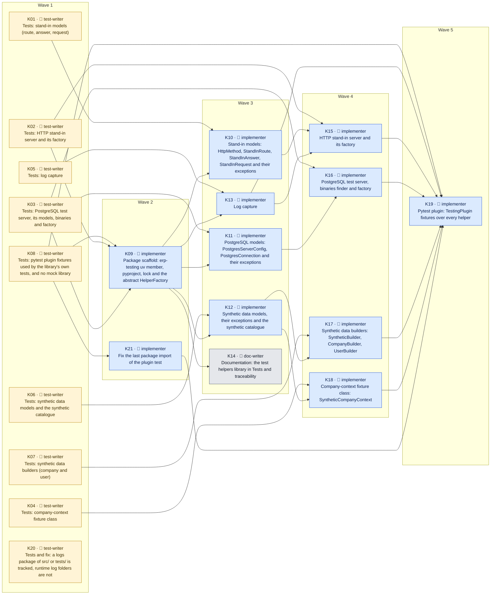

# T0.13: Test helpers library, plan

**Plan:** 🟢 Approved

**Push:** 🟢 Approved

<!-- ticket:specs -->
## 📚 Specifications

The specification and design pages of [TICKET.md](TICKET.md), copied by `python3 .claude/scripts/tickets/ticket_refs.py sync`.

- [Back end, shared code](../../technical/architecture/backend.md#target-design-specified-in-gh-2-not-built-yet)
- [Tests and traceability](../../technical/delivery/tests-and-traceability.md#target-design-specified-in-gh-2-not-built-yet)
- [📜 D426 Testing strategy](../../specs/06-decisions/technical/d426-testing-strategy.md)
- [📜 D438 Repository layout](../../specs/06-decisions/technical/d438-repository-layout.md)
- [🏗️ Tests and traceability](../../technical/delivery/tests-and-traceability.md)
- [🏗️ Back end](../../technical/architecture/backend.md)
- [🏗️ Repository layout](../../technical/architecture/repository-layout.md)
<!-- /ticket:specs -->

## Summary

T0.13 builds the test helpers library `erp_testing`, a uv workspace member at `backend/shared/testing` with no business rules (D438, D426, Tests and traceability). It has five helpers: a local HTTP stand-in server, a PostgreSQL test server started once per session, a company-context fixture built on T0.09's company context, log capture, and synthetic data builders seeded by sector. A pytest plugin class exposes them as fixtures. There is no mock library.

The graph has 19 tasks in 5 waves.

- **Wave 1:** 8 test-writer tasks, one per behaviour: stand-in models, stand-in server, PostgreSQL models and server, company context, log capture, synthetic models and catalogue, builders, and the plugin with the no-mock-library check.
- **Wave 2:** the package scaffold (pyproject, `uv.lock`, the abstract `HelperFactory`).
- **Wave 3:** the three model packages, log capture and the documentation.
- **Wave 4:** the stand-in server, the PostgreSQL server, the builders and the company context.
- **Wave 5:** the pytest plugin, which uses every helper so that the library's own tests run on them (acceptance criterion 1).

Within each wave, every task owns its own files. Exceptions are listed file by file so that no folder holds more than five Python files. Every implementation task's `done_when` includes `uv run pytest tests/conventions -n 2`, which covers acceptance criterion 5. The ticket builds no screen, so there is no Playwright task (TKT-21).

## Assumptions

- TEST-2 is cited by the roadmap row but no page of `docs/specs/` defines it; its wording is taken from the row (a stand-in's default answer is a valid empty value of the real model).
- The ticket graph gives T0.13 the prerequisite T0.09; the roadmap row does not say why, so the company-context fixture is assumed to build on T0.09's company context.
- No page of `docs/specs/03-technical/` or `docs/specs/05-non-functional/` gives this ticket a requirement or a measure, so none is linked and Budgets touched says none.
- Ticket rows of the phase page have no anchor of their own, so the sprint and epic anchors (`#s02`, `#epics`) are used.
- `check_ticket.py` could not be run (no shell tool was available), so the links and anchors were checked by reading only.
- TEST-2 is defined by no page of `docs/specs/`; its wording is taken from the roadmap row, as in TICKET.md. A route with no configured answer answers 200 with `[]` for a list route, else the JSON of `model()` with every field at its default. A route whose model cannot be built empty is refused when it is registered (`SEStandInServerNoEmptyValueError`).
- The library is the uv package `erp-testing` with import package `erp_testing`. The `erp_<lib>` name follows the existing CI fixtures (`erp_logging`, `erp_models`); no specification fixes it.
- T0.05 (lifecycle and factory base), T0.06, T0.03 (`YamlCatalog`, company id type) and T0.09 (company context) are not built yet. The briefs tell the workers to read their code at run time, because the start rule makes T0.09, and through it T0.03, T0.05 and T0.06, done before T0.13 starts. The method names of the factory base and of the context API are taken from that code, not invented here.
- The fixtures are exposed by a `TestingPlugin` class registered in a consumer's `pytest_configure`, not by a `pytest11` entry point. AGENT.md allows nothing but classes at module level in `src/`, and a pytest entry point needs a module of hooks. Inside the library, only `tests/plugin/conftest.py` registers it, so that the other test folders can run before the plugin exists (tests first).
- The PostgreSQL test server is started from the local PostgreSQL binaries (`initdb`, `pg_ctl`, `pg_isready`, `psql`), found in `/usr/lib/postgresql/<version>/bin`, then PATH, then `pg_config --bindir`, with trust authentication on 127.0.0.1 and no password. No Python database driver is added, because no decision chooses one. Docker and testcontainers are not used.
- Where the PostgreSQL binaries are missing, the PostgreSQL tests and the `postgres_server` fixture are skipped with a clear reason, never failed. GitHub's Ubuntu runners ship PostgreSQL under `/usr/lib/postgresql`; installing it explicitly in CI belongs to `.github`, outside this ticket's area (`backend/shared/testing`), and is a follow-up if needed.
- "No production data" is enforced in three ways. All builder data comes from `conf/catalogs/synthetic.yaml` of generic invented words. Every e-mail must be on a reserved test domain (RFC 2606 and RFC 6761: example.com, example.net, example.org, or the .test, .example, .invalid and .localhost suffixes); the catalogue uses `simpleerp.test`. The catalogue's sectors are exactly sc01 to sc20 of `docs/specs/08-sectors/`.
- "Seeded by sector" (D426) is read as builders that are deterministic for a given sector and seed. The full generated company with history per sector and size is the target design of Tests and traceability, built by later tickets.
- Acceptance criterion 1 ("the kit's own tests use these helpers") is read as in TICKET.md: the library's own tests use every helper, through the plugin fixtures in `tests/plugin/`. Moving the other kit libraries' tests onto them is not in this ticket.
- Acceptance criterion 4 is checked by a test that reads the package's pyproject dependencies for known mock libraries (mock, pytest-mock, asynctest, requests-mock, responses, respx, httpretty, aioresponses) and scans its sources and tests for `unittest.mock` and `mock` imports.
- The stand-in server uses only the standard library's threading HTTP server, and its tests use urllib.request, so no HTTP dependency is added.
- Some model fields were reduced to keep every exceptions folder at five Python files or fewer: the PostgreSQL config has no separate bin_dir (a bin folder is a `search_dirs` entry), and a synthetic user has one `name`. This is a design choice of the plan, not of the specifications.
- `uv.lock` is changed by the scaffold task alone (K09). Other open tickets that add workspace members (T0.10 to T0.12) may need their lock merged at integration.

<!-- plan:graph -->

> [!NOTE]
> Generated from the json block at the end of this page by `python3 .claude/scripts/tickets/plan.py render`.
> To change a task, edit the json block, then render again: never edit this view by hand.

## Waves

| Wave | Tasks | Agents running at once |
| --- | --- | --- |
| 1 | [K01](#k01), [K02](#k02), [K03](#k03), [K04](#k04), [K05](#k05), [K06](#k06), [K07](#k07), [K08](#k08), [K20](#k20) | 8 of 9 |
| 2 | [K09](#k09), [K21](#k21) | 2 of 2 |
| 3 | [K10](#k10), [K11](#k11), [K12](#k12), [K13](#k13), [K14](#k14) | 5 of 5 |
| 4 | [K15](#k15), [K16](#k16), [K17](#k17), [K18](#k18) | 4 of 4 |
| 5 | [K19](#k19) | 1 of 1 |

| Wave | Task | Agent | Depends on | Unblocks |
| --- | --- | --- | --- | --- |
| 1 | [K01](#k01) Tests: stand-in models (route, answer, request) | 🧪 test-writer | none | [K10](#k10) |
| 1 | [K02](#k02) Tests: HTTP stand-in server and its factory | 🧪 test-writer | none | [K09](#k09), [K15](#k15) |
| 1 | [K03](#k03) Tests: PostgreSQL test server, its models, binaries and factory | 🧪 test-writer | none | [K09](#k09), [K11](#k11), [K16](#k16) |
| 1 | [K04](#k04) Tests: company-context fixture class | 🧪 test-writer | none | [K18](#k18) |
| 1 | [K05](#k05) Tests: log capture | 🧪 test-writer | none | [K13](#k13) |
| 1 | [K06](#k06) Tests: synthetic data models and the synthetic catalogue | 🧪 test-writer | none | [K12](#k12) |
| 1 | [K07](#k07) Tests: synthetic data builders (company and user) | 🧪 test-writer | none | [K17](#k17) |
| 1 | [K08](#k08) Tests: pytest plugin fixtures used by the library's own tests, and no mock library | 🧪 test-writer | none | [K09](#k09), [K19](#k19), [K21](#k21) |
| 2 | [K09](#k09) Package scaffold: erp-testing uv member, pyproject, lock and the abstract HelperFactory | 🐍 implementer | [K08](#k08), [K02](#k02), [K03](#k03) | [K10](#k10), [K11](#k11), [K12](#k12), [K13](#k13), [K14](#k14) |
| 3 | [K10](#k10) Stand-in models: HttpMethod, StandInRoute, StandInAnswer, StandInRequest and their exceptions | 🐍 implementer | [K01](#k01), [K09](#k09) | [K15](#k15) |
| 3 | [K11](#k11) PostgreSQL models: PostgresServerConfig, PostgresConnection and their exceptions | 🐍 implementer | [K03](#k03), [K09](#k09) | [K16](#k16) |
| 3 | [K12](#k12) Synthetic data models, their exceptions and the synthetic catalogue | 🐍 implementer | [K06](#k06), [K09](#k09) | [K17](#k17), [K18](#k18) |
| 3 | [K13](#k13) Log capture | 🐍 implementer | [K05](#k05), [K09](#k09) | [K15](#k15), [K19](#k19) |
| 3 | [K14](#k14) Documentation: the test helpers library in Tests and traceability | 📝 doc-writer | [K09](#k09) | none |
| 4 | [K15](#k15) HTTP stand-in server and its factory | 🐍 implementer | [K02](#k02), [K10](#k10), [K13](#k13) | [K19](#k19) |
| 4 | [K16](#k16) PostgreSQL test server, binaries finder and factory | 🐍 implementer | [K03](#k03), [K11](#k11) | [K19](#k19) |
| 4 | [K17](#k17) Synthetic data builders: SyntheticBuilder, CompanyBuilder, UserBuilder | 🐍 implementer | [K07](#k07), [K12](#k12) | [K19](#k19) |
| 4 | [K18](#k18) Company-context fixture class: SyntheticCompanyContext | 🐍 implementer | [K04](#k04), [K12](#k12) | [K19](#k19) |
| 5 | [K19](#k19) Pytest plugin: TestingPlugin fixtures over every helper | 🐍 implementer | [K08](#k08), [K13](#k13), [K15](#k15), [K16](#k16), [K17](#k17), [K18](#k18), [K21](#k21) | none |
| 1 | [K20](#k20) Tests and fix: a logs package of src/ or tests/ is tracked, runtime log folders are not | 🧪 test-writer | none | none |
| 2 | [K21](#k21) Fix the last package import of the plugin test | 🐍 implementer | [K08](#k08) | [K19](#k19) |

## Dependency graph



## Tasks

### <a id="k01"></a>K01: Tests: stand-in models (route, answer, request)

| Agent | Wave | Depends on | Unblocks |
| --- | --- | --- | --- |
| 🧪 test-writer | 1 | none | [K10](#k10) |

**Files** (only this task may change them in its wave):

- `backend/shared/testing/tests/models/stand_in/test_stand_in_route.py`
- `backend/shared/testing/tests/models/stand_in/test_stand_in_answer.py`
- `backend/shared/testing/tests/models/stand_in/test_stand_in_request.py`

**Done when:** `uv run ruff check backend/shared/testing/tests/models/stand_in` and `uv run ruff format --check` on the three files pass, `uv run pytest tests/conventions -n 2` passes, and `uv run pytest backend/shared/testing/tests/models/stand_in -n 2` fails only because `erp_testing` does not exist yet.

**Brief:**

Ticket T0.13 (docs/tickets/T0.13/TICKET.md), acceptance criterion 2. Specifications applied: D426 (docs/specs/06-decisions/technical/d426-testing-strategy.md: errors and edge cases covered), D438 (docs/specs/06-decisions/technical/d438-repository-layout.md: library in backend/shared/&lt;lib>), Tests and traceability (docs/technical/delivery/tests-and-traceability.md: real stand-ins rather than mocks), roadmap row T0.13 (docs/specs/00-vision/roadmap/phases/01-p0-foundations.md#s02).

Write the tests first for the Pydantic models of the HTTP stand-in server. They live in the library `erp_testing` (uv package `erp-testing`, folder `backend/shared/testing/src/erp_testing/`) under `erp_testing.models.stand_in`. Import the exceptions from the package `erp_testing.models.stand_in.exceptions`, and the enum from `erp_testing.models.stand_in.enums`.

The contract (the implementer of K10 builds exactly this):
- `HttpMethod` StrEnum, `@unique`, with members GET, POST, PUT, PATCH, DELETE.
- `StandInRoute` (frozen, extra forbidden). Fields: `method: HttpMethod` (a str of a member is accepted, anything else raises `SEStandInRouteInvalidMethod`). `path: str`, stripped, must start with `/` (`SEStandInRouteInvalidPath`). `model: Type[BaseModel]`, the real Pydantic model the route answers with; a value that is not a BaseModel subclass raises `SEStandInRouteInvalidModel`. `many: bool = False`, where a non-bool raises `SEStandInRouteInvalidMany`. The base is `SEInvalidStandInRouteException`.
- `StandInAnswer` (frozen, extra forbidden). Fields: `status: int = 200`, bounds `STATUS_MIN = 100` and `STATUS_MAX = 599`; bools are rejected and errors raise `SEStandInAnswerInvalidStatus`. `body: JsonValue = None`, where a value that is not JSON-serialisable raises `SEStandInAnswerInvalidBody`. `headers: Dict[str, str] = {}`, errors raise `SEStandInAnswerInvalidHeaders`. The base is `SEInvalidStandInAnswerException`.
- `StandInRequest` (frozen, extra forbidden), one request the stand-in received. Fields: `method: HttpMethod` (`SEStandInRequestInvalidMethod`). `path: str` (raw path with its query string, must start with `/`, `SEStandInRequestInvalidPath`). `headers: Dict[str, str] = {}` (`SEStandInRequestInvalidHeaders`). `body: str = ''` (`SEStandInRequestInvalidBody`). The base is `SEInvalidStandInRequestException`.

For every model, write the six model tests of AGENT.md ('Tests'): test_defaults, test_full_valid_construction, test_none_becomes_the_default (parametrised), test_rejects_bad_values (parametrised, asserting the specific exception), test_rejects_unknown_keys, test_round_trip. As a model for `StandInRoute.model`, use a model of the library itself (for example `StandInAnswer`, which has every field defaulted), so that no helper file is needed.

Rules: AGENT.md 'Tests' and 'File shape'. One `Test<Subject>` class per file, test names as sentences, no unittest.mock, at most five Python files per folder, no `__init__.py`, sync methods before async ones. Change only the files listed.

### <a id="k02"></a>K02: Tests: HTTP stand-in server and its factory

| Agent | Wave | Depends on | Unblocks |
| --- | --- | --- | --- |
| 🧪 test-writer | 1 | none | [K09](#k09), [K15](#k15) |

**Files** (only this task may change them in its wave):

- `backend/shared/testing/tests/stand_in/test_stand_in_server.py`
- `backend/shared/testing/tests/factories/stand_in/test_stand_in_server_factory.py`

**Done when:** `uv run ruff check` and `uv run ruff format --check` on the two files pass, `uv run pytest tests/conventions -n 2` passes, and the two files fail only because `erp_testing` does not exist yet.

**Brief:**

Ticket T0.13 (docs/tickets/T0.13/TICKET.md), acceptance criteria 1 and 2. Specifications applied: D426 (docs/specs/06-decisions/technical/d426-testing-strategy.md), Tests and traceability (docs/technical/delivery/tests-and-traceability.md: 'real stand-ins rather than mocks (a local server, ...)'), D438 (docs/specs/06-decisions/technical/d438-repository-layout.md), Back end (docs/technical/architecture/backend.md: test helpers are part of the service kit), roadmap row T0.13 (docs/specs/00-vision/roadmap/phases/01-p0-foundations.md#s02: 'a stand-in's default answer is a valid empty value of the real model (TEST-2)').

Write the tests first for `erp_testing.stand_in.stand_in_server.StandInServer` and `erp_testing.factories.stand_in.stand_in_server_factory.StandInServerFactory`. Read `backend/shared/lifecycle/src/` (built by T0.05) for `Runnable` and the abstract factory base, and call the factory through that base's creation method.

The contract:
- `StandInServer(host: str = '127.0.0.1', port: int = 0, logger: Optional[Logger] = None)` subclasses `Runnable`. It is a real local HTTP server on the standard library's threading HTTP server, with no third-party HTTP framework.
  - `initialize()` binds and is already serving when it returns. `run()` blocks until `close()`. `close()` stops serving and frees the port, and is safe before `initialize()` and when called twice.
  - `url` (property) is `http://<host>:<port>` with the real port. Read before `initialize()`, it raises `SEStandInServerNotStartedError`.
  - `route(route: StandInRoute)` registers a route. When the route's `model` cannot be built empty (`model.model_validate({})` fails) and `many` is False, it raises `SEStandInServerNoEmptyValueError`.
  - `answer(method: HttpMethod, path: str, answer: StandInAnswer)` sets the answer of a registered route. On an unregistered route it raises `SEStandInServerUnknownRouteError`.
  - `requests: List[StandInRequest]` records every request received, in order.
- **TEST-2 behaviour:** a registered route with no answer configured answers 200 with `application/json` and a valid empty value of its real model: `[]` when `many` is True, otherwise the JSON of `model()` with every field at its default, which validates back into the model and equals `model()`.
- A configured answer is returned with its status, headers and JSON body.
- A call to an unknown path answers 404 and logs a WARNING.
- Exceptions come from `erp_testing.models.stand_in.exceptions` and models from `erp_testing.models.stand_in`.

Tests use a real client (urllib.request from the standard library) against a server started in the test, and close it in a `finally` or a fixture of the test file. For the WARNING, capture logs with `erp_testing.logs.log_capture.LogCapture`: `LogCapture(logger_name: Optional[str] = None, level: int = logging.DEBUG)`, a context manager with `records`, `messages(level=None)` and `contains(text, level=None)`. A model with every field defaulted (`StandInAnswer`) and one with a required field (`StandInRequest`) serve as real models. Factory tests: the factory builds a `StandInServer` with the given host, port and logger.

Rules: AGENT.md 'Tests'. One Test class per file, test names as sentences, parametrize for cases of one behaviour, the specific exception asserted, no unittest.mock, no `__init__.py`. Change only the files listed.

### <a id="k03"></a>K03: Tests: PostgreSQL test server, its models, binaries and factory

| Agent | Wave | Depends on | Unblocks |
| --- | --- | --- | --- |
| 🧪 test-writer | 1 | none | [K09](#k09), [K11](#k11), [K16](#k16) |

**Files** (only this task may change them in its wave):

- `backend/shared/testing/tests/models/postgres/test_postgres_server_config.py`
- `backend/shared/testing/tests/models/postgres/test_postgres_connection.py`
- `backend/shared/testing/tests/postgres/fake_postgres_binaries.py`
- `backend/shared/testing/tests/postgres/test_postgres_binaries.py`
- `backend/shared/testing/tests/postgres/test_postgres_test_server.py`
- `backend/shared/testing/tests/factories/postgres/test_postgres_test_server_factory.py`

**Done when:** `uv run ruff check` and `uv run ruff format --check` on the six files pass, `uv run pytest tests/conventions -n 2` passes, and the test files fail only because `erp_testing` does not exist yet.

**Brief:**

Ticket T0.13 (docs/tickets/T0.13/TICKET.md), acceptance criterion 1 (a PostgreSQL test server started per session). Specifications applied: D426 (docs/specs/06-decisions/technical/d426-testing-strategy.md: errors and edge cases covered), D409 PostgreSQL for every company database (docs/specs/06-decisions/technical/d409-storage-choices.md), Tests and traceability (docs/technical/delivery/tests-and-traceability.md: real stand-ins such as 'a fake executable', never mocks), D438 (docs/specs/06-decisions/technical/d438-repository-layout.md), roadmap row T0.13 (docs/specs/00-vision/roadmap/phases/01-p0-foundations.md#s02).

Write the tests first. Read `backend/shared/lifecycle/src/` (T0.05) for `Runnable` and the factory base's creation method.

The contract (package `erp_testing`, exceptions from `erp_testing.models.postgres.exceptions`):
- `erp_testing.models.postgres.postgres_server_config.PostgresServerConfig` (extra forbidden, validate_default). Fields: `search_dirs: List[str] = ['/usr/lib/postgresql']`, folders searched for the binaries; each is a bin folder or a parent of `<version>/bin` folders, and errors raise `SEPostgresServerConfigInvalidSearchDirs`. `database: str = 'erp_test'` (`SEPostgresServerConfigInvalidDatabase`). `user: str = 'erp_test'` (`SEPostgresServerConfigInvalidUser`). `start_timeout_s: float = 30.0`, with `START_TIMEOUT_S_MIN = 0.1` and `START_TIMEOUT_S_MAX = 300.0`, bools rejected (`SEPostgresServerConfigInvalidStartTimeoutS`). The base is `SEInvalidPostgresServerConfigException`.
- `erp_testing.models.postgres.postgres_connection.PostgresConnection` (frozen, extra forbidden). Fields: `host` (`SEPostgresConnectionInvalidHost`), `port` (`PORT_MIN = 1`, `PORT_MAX = 65535`, bools rejected, `SEPostgresConnectionInvalidPort`), `database` (`SEPostgresConnectionInvalidDatabase`) and `user` (`SEPostgresConnectionInvalidUser`). The `dsn` property is `postgresql://<user>@<host>:<port>/<database>`, with no password ever. The base is `SEInvalidPostgresConnectionException`.
- `erp_testing.postgres.postgres_binaries.PostgresBinaries(config: PostgresServerConfig, logger=None)`. `find()` returns the folder holding `initdb`, `pg_ctl`, `pg_isready` and `psql`. It searches `search_dirs` first (newest version first), then PATH, then `pg_config --bindir`, and raises `SEPostgresBinariesNotFoundError` when none holds all four.
- `erp_testing.postgres.postgres_test_server.PostgresTestServer(config: PostgresServerConfig, logger=None)` subclasses `Runnable`.
  - `initialize()` creates a temporary data folder, runs `initdb` with trust authentication for `config.user`, picks a free port, and starts the server on 127.0.0.1 with its socket folder inside the temporary folder. It waits with `pg_isready` up to `start_timeout_s` and creates `config.database`. It raises `SEPostgresTestServerStartFailedError` when the server is not ready in time.
  - `connection` (property) returns a `PostgresConnection`, and raises `SEPostgresTestServerNotStartedError` before `initialize()`. `data_dir` (property) is the temporary folder.
  - `close()` stops the server and removes the folder. It is safe before `initialize()`, after a failed one and twice. `run()` blocks until closed.
- `erp_testing.factories.postgres.postgres_test_server_factory.PostgresTestServerFactory(config, logger=None)` builds a `PostgresTestServer`.

Tests:
- The six AGENT.md model tests for both models, plus the dsn.
- Binaries: `fake_postgres_binaries.py` holds one helper class, `FakePostgresBinaries`, which writes fake executables (shell scripts with given exit codes) into tmp_path. Use it to test that `find()` accepts a folder with the four binaries, prefers the newest `<version>/bin`, and raises when none is found.
- Start failure: fake binaries whose `pg_isready` never succeeds, with `start_timeout_s=0.2`, raise `SEPostgresTestServerStartFailedError`, and `close()` then removes the folder.
- Real server: these tests are skipped with a clear reason when `PostgresBinaries.find()` raises. Otherwise, after `initialize()`, `pg_isready -h host -p port` exits 0 and `psql <dsn> -c 'select 1'` succeeds. After `close()`, `pg_isready` fails and `data_dir` no longer exists.
- Factory: builds a server with the given config.

Rules: AGENT.md 'Tests'. One Test class per file, the helper class in its own file, no unittest.mock, no `__init__.py`. Change only the files listed.

### <a id="k04"></a>K04: Tests: company-context fixture class

| Agent | Wave | Depends on | Unblocks |
| --- | --- | --- | --- |
| 🧪 test-writer | 1 | none | [K18](#k18) |

**Files** (only this task may change them in its wave):

- `backend/shared/testing/tests/context/test_synthetic_company_context.py`

**Done when:** `uv run ruff check` and `uv run ruff format --check` on the file pass, `uv run pytest tests/conventions -n 2` passes, and the file fails only because `erp_testing` does not exist yet.

**Brief:**

Ticket T0.13 (docs/tickets/T0.13/TICKET.md), acceptance criteria 1 and 3. Specifications applied: D426 (docs/specs/06-decisions/technical/d426-testing-strategy.md: synthetic data only), Tests and traceability (docs/technical/delivery/tests-and-traceability.md: 'Only synthetic data ... never production data in tests'), Back end (docs/technical/architecture/backend.md: company-context middleware and test helpers in the service kit), D438 (docs/specs/06-decisions/technical/d438-repository-layout.md), roadmap row T0.13 (docs/specs/00-vision/roadmap/phases/01-p0-foundations.md#s02). The company context it stands for is T0.09's and is out of scope here.

First read `backend/shared/context/src/` (built by T0.09) to find the company context model and how the current context is set and read in the service and storage layers. Read `backend/models/src/erp_models/` (T0.03) for the company id type.

The contract: `erp_testing.context.synthetic_company_context.SyntheticCompanyContext(company: SyntheticCompany, user: SyntheticUser, logger: Optional[Logger] = None)`.
- `context` (property) returns T0.09's company context for that company and user.
- Used as a context manager, it makes that context the current one, as T0.09's middleware would, and restores the previous one on exit, even when the block raises.
- Nesting two contexts restores the outer one.

`SyntheticCompany` and `SyntheticUser` come from `erp_testing.models.synthetic`.
- `SyntheticCompany(id, name, sector)`: `id` of the erp_models company id type, `sector` like `sc03`.
- `SyntheticUser(id, company_id, name, email)`: `email` on a reserved test domain such as `simpleerp.test`.

Build them directly in the tests with synthetic values only (no real company, person or e-mail).

Tests:
- Inside the block, T0.09's reader of the current context returns the company and user.
- Outside it, the reader is back to its previous state.
- An exception in the block still restores the context.
- Nested contexts restore the outer one.
- The `context` property matches the company id and user id.

Rules: AGENT.md 'Tests'. One Test class, names as sentences, no unittest.mock. Change only the file listed.

### <a id="k05"></a>K05: Tests: log capture

| Agent | Wave | Depends on | Unblocks |
| --- | --- | --- | --- |
| 🧪 test-writer | 1 | none | [K13](#k13) |

**Files** (only this task may change them in its wave):

- `backend/shared/testing/tests/logs/test_log_capture.py`

**Done when:** `uv run ruff check` and `uv run ruff format --check` on the file pass, `uv run pytest tests/conventions -n 2` passes, and the file fails only because `erp_testing` does not exist yet.

**Brief:**

Ticket T0.13 (docs/tickets/T0.13/TICKET.md), acceptance criterion 1 (log capture). Specifications applied: Tests and traceability (docs/technical/delivery/tests-and-traceability.md: real things rather than mocks), D426 (docs/specs/06-decisions/technical/d426-testing-strategy.md: errors and edge cases covered), D438 (docs/specs/06-decisions/technical/d438-repository-layout.md), roadmap row T0.13 (docs/specs/00-vision/roadmap/phases/01-p0-foundations.md#s02).

Write the tests first for `erp_testing.logs.log_capture.LogCapture`. It is a `logging.Handler` subclass that records the log records of one logger for a test.

The contract: `LogCapture(logger_name: Optional[str] = None, level: int = logging.DEBUG)`, where None means the root logger.
- `attach()` adds the handler to the logger and lowers the logger's level to `level` if needed. `detach()` removes it and restores the previous level. It is also a context manager that attaches on enter and detaches on exit.
- `records: List[logging.LogRecord]`.
- `messages(level: Optional[int] = None) -> List[str]`: the formatted messages (`record.getMessage()`), only those of that level when given.
- `contains(text: str, level: Optional[int] = None) -> bool`.
- `clear()` empties `records`.

Tests:
- Records of the named logger and of its children are captured.
- Records of another logger are not.
- Lazy arguments are formatted.
- Filtering by level works.
- The logger's level and handlers are restored after the block, and after an exception in it.
- Nothing is captured after `detach()`.
- `contains` is false for absent text, which is how a test proves a secret is never logged.
- `clear` empties the records.

Rules: AGENT.md 'Tests'. One Test class, names as sentences, parametrize for the levels, no unittest.mock and no pytest caplog (this class is the library's own capture). Change only the file listed.

### <a id="k06"></a>K06: Tests: synthetic data models and the synthetic catalogue

| Agent | Wave | Depends on | Unblocks |
| --- | --- | --- | --- |
| 🧪 test-writer | 1 | none | [K12](#k12) |

**Files** (only this task may change them in its wave):

- `backend/shared/testing/tests/models/synthetic/test_synthetic_catalog.py`
- `backend/shared/testing/tests/models/synthetic/test_synthetic_catalog_file.py`
- `backend/shared/testing/tests/models/synthetic/test_synthetic_company.py`
- `backend/shared/testing/tests/models/synthetic/test_synthetic_user.py`

**Done when:** `uv run ruff check` and `uv run ruff format --check` on the four files pass, `uv run pytest tests/conventions -n 2` passes, and the files fail only because `erp_testing` does not exist yet.

**Brief:**

Ticket T0.13 (docs/tickets/T0.13/TICKET.md), acceptance criterion 3 (no production data in any fixture or builder). Specifications applied: D426 (docs/specs/06-decisions/technical/d426-testing-strategy.md: 'Synthetic data, seeded by sector'), Tests and traceability (docs/technical/delivery/tests-and-traceability.md: 'Only synthetic data: one generated company per sector ... never production data in tests'), D438 (docs/specs/06-decisions/technical/d438-repository-layout.md), the sector pages docs/specs/08-sectors/sc01-construction/ to docs/specs/08-sectors/sc20-public-bodies/ (codes sc01 to sc20), roadmap row T0.13 (docs/specs/00-vision/roadmap/phases/01-p0-foundations.md#s02).

Write the tests first. Read `backend/models/src/erp_models/` (T0.03) for `YamlCatalog` and the company id type. The exceptions come from `erp_testing.models.synthetic.exceptions`.

The contract (package `erp_testing.models.synthetic`):
- `SyntheticCatalog(YamlCatalog)` (frozen, extra forbidden). `load(path)` raises `SESyntheticCatalogUnreadable` on a missing or malformed file. `DEFAULT_PATH` is a ClassVar pointing to `backend/shared/testing/conf/catalogs/synthetic.yaml`. The ClassVars `RESERVED_DOMAINS = ('example.com', 'example.net', 'example.org')` and `RESERVED_SUFFIXES = ('.test', '.example', '.invalid', '.localhost')` list the reserved test domains (RFC 2606 and RFC 6761).
  - `sectors: List[str]`: non-empty, unique, each matching `^sc\d{2}$` (`SESyntheticCatalogInvalidSectors`).
  - `company_words: List[str]`, `first_names: List[str]` and `last_names: List[str]`: non-empty lists of stripped non-empty strings (`SESyntheticCatalogInvalidCompanyWords`, `SESyntheticCatalogInvalidFirstNames`, `SESyntheticCatalogInvalidLastNames`).
  - `email_domain: str`: a reserved test domain (`SESyntheticCatalogInvalidEmailDomain`).
  - The base is `SEInvalidSyntheticCatalogException`.
- `SyntheticCompany` (frozen). `id` is the erp_models company id type (`SESyntheticCompanyInvalidId`), `name` is a stripped non-empty string (`SESyntheticCompanyInvalidName`), and `sector` matches `^sc\d{2}$` (`SESyntheticCompanyInvalidSector`). The base is `SEInvalidSyntheticCompanyException`.
- `SyntheticUser` (frozen). Fields: `id` (`SESyntheticUserInvalidId`), `company_id` (company id type, `SESyntheticUserInvalidCompanyId`), `name` (`SESyntheticUserInvalidName`) and `email`. `email` has one `@` and a domain from `SyntheticCatalog.RESERVED_DOMAINS` or `RESERVED_SUFFIXES`; anything else, a real-looking address such as `someone@gmail.com` included, raises `SESyntheticUserInvalidEmail`. The base is `SEInvalidSyntheticUserException`.

Tests:
- The six AGENT.md model tests for each of the three models.
- In `test_synthetic_catalog_file.py`, the shipped catalogue `SyntheticCatalog.DEFAULT_PATH`:
  - loads;
  - its `sectors` are exactly the codes of the folders `docs/specs/08-sectors/scNN-*` (read the folder names in the test);
  - its `email_domain` is reserved;
  - an unreadable file raises `SESyntheticCatalogUnreadable`.

Rules: AGENT.md 'Tests'. One Test class per file, parametrize, the specific exception, no unittest.mock. Change only the files listed.

### <a id="k07"></a>K07: Tests: synthetic data builders (company and user)

| Agent | Wave | Depends on | Unblocks |
| --- | --- | --- | --- |
| 🧪 test-writer | 1 | none | [K17](#k17) |

**Files** (only this task may change them in its wave):

- `backend/shared/testing/tests/synthetic/test_company_builder.py`
- `backend/shared/testing/tests/synthetic/test_user_builder.py`

**Done when:** `uv run ruff check` and `uv run ruff format --check` on the two files pass, `uv run pytest tests/conventions -n 2` passes, and the files fail only because `erp_testing` does not exist yet.

**Brief:**

Ticket T0.13 (docs/tickets/T0.13/TICKET.md), acceptance criteria 1 and 3. Specifications applied: D426 (docs/specs/06-decisions/technical/d426-testing-strategy.md: 'Synthetic data, seeded by sector'), Tests and traceability (docs/technical/delivery/tests-and-traceability.md: 'Only synthetic data ... never production data in tests'), D438 (docs/specs/06-decisions/technical/d438-repository-layout.md), roadmap row T0.13 (docs/specs/00-vision/roadmap/phases/01-p0-foundations.md#s02).

Write the tests first for the builders of `erp_testing.synthetic`. They share the abstract base `erp_testing.synthetic.synthetic_builder.SyntheticBuilder` with `build(self) -> T`.
- `erp_testing.synthetic.company_builder.CompanyBuilder(catalog: SyntheticCatalog, sector: str, seed: int = 0, logger=None)`. `build()` returns the next `SyntheticCompany` of that sector. It raises `SESyntheticSectorUnknownError` (from `erp_testing.models.synthetic.exceptions`, with base `SESyntheticDataError`) when the sector is not in `catalog.sectors`.
- `erp_testing.synthetic.user_builder.UserBuilder(catalog: SyntheticCatalog, company: SyntheticCompany, seed: int = 0, logger=None)`. `build()` returns the next `SyntheticUser` of that company.

The models: `SyntheticCatalog` (`sectors`, `company_words`, `first_names`, `last_names`, `email_domain`; `load(path)`; `DEFAULT_PATH`), `SyntheticCompany` (`id`, `name`, `sector`) and `SyntheticUser` (`id`, `company_id`, `name`, `email`), all in `erp_testing.models.synthetic`.

Tests:
- Deterministic: two builders with the same catalogue, sector and seed give the same sequence.
- Another seed or sector gives other ids.
- Successive builds have distinct ids.
- The company carries its sector, and its name is made only of `catalog.company_words`.
- The user's `company_id` is the company's id, and its name is made only of `first_names` and `last_names` (no production data).
- Its e-mail is on `catalog.email_domain`, and the e-mails of successive users are distinct.
- An unknown sector raises `SESyntheticSectorUnknownError`.

Build catalogues in the tests with `SyntheticCatalog(...)` and small synthetic lists, and also load `SyntheticCatalog.DEFAULT_PATH` once, for every sector.

Rules: AGENT.md 'Tests'. One Test class per file, parametrize over sectors, no unittest.mock. Change only the files listed.

### <a id="k08"></a>K08: Tests: pytest plugin fixtures used by the library's own tests, and no mock library

| Agent | Wave | Depends on | Unblocks |
| --- | --- | --- | --- |
| 🧪 test-writer | 1 | none | [K09](#k09), [K19](#k19), [K21](#k21) |

**Files** (only this task may change them in its wave):

- `backend/shared/testing/tests/plugin/conftest.py`
- `backend/shared/testing/tests/plugin/test_testing_plugin.py`
- `backend/shared/testing/tests/plugin/test_postgres_session_fixture.py`
- `backend/shared/testing/tests/test_no_mock_library.py`

**Done when:** `uv run ruff check` and `uv run ruff format --check` on the four files pass, `uv run pytest tests/conventions -n 2` passes, and the `plugin/` tests fail only because `erp_testing` does not exist yet.

**Brief:**

~~~~text
Ticket T0.13 (docs/tickets/T0.13/TICKET.md), acceptance criteria 1, 2, 3 and 4. Specifications applied: D426 (docs/specs/06-decisions/technical/d426-testing-strategy.md), Tests and traceability (docs/technical/delivery/tests-and-traceability.md: 'real stand-ins rather than mocks', 'Only synthetic data'), Back end (docs/technical/architecture/backend.md: test helpers in the service kit), Repository layout (docs/technical/architecture/repository-layout.md), D438 (docs/specs/06-decisions/technical/d438-repository-layout.md), roadmap row T0.13 (docs/specs/00-vision/roadmap/phases/01-p0-foundations.md#s02: 'The kit's own tests use them ... no mock library').

The library exposes its helpers as pytest fixtures through one class, `erp_testing.plugin.testing_plugin.TestingPlugin`, whose methods are `@pytest.fixture`s. A consumer registers an instance in its conftest:

```python
def pytest_configure(config):
    config.pluginmanager.register(TestingPlugin(), 'erp-testing')
```

The fixtures:
- `stand_in_server`, function scope: a started `StandInServer` (`erp_testing.stand_in.stand_in_server`), built by its factory and closed after the test.
- `postgres_server`, session scope: a started `PostgresTestServer` with the default `PostgresServerConfig`, closed at the end of the session. It skips with a clear reason when the PostgreSQL binaries are not found (`SEPostgresBinariesNotFoundError`).
- `synthetic_catalog`, session scope: `SyntheticCatalog.load(SyntheticCatalog.DEFAULT_PATH)`.
- `company_builder`: a `CompanyBuilder` on the catalogue's first sector, seed 0.
- `user_builder`: a `UserBuilder` for a company built by `company_builder`.
- `company_context`: a `SyntheticCompanyContext` entered for a built company and user, and exited after the test.
- `log_capture`: a `LogCapture` of the root logger, attached for the test.

Write these files:
1. `tests/plugin/conftest.py` registers `TestingPlugin()` as above. It is only in `plugin/`, so that the other test folders run before the plugin exists. If you need `pytester`, load it with `config.pluginmanager.import_plugin('pytester')` there.
2. `tests/plugin/test_testing_plugin.py` uses every fixture once, as the library's own tests (criterion 1):
   - `stand_in_server` answers a registered route without an answer with `model()`'s JSON (criterion 2);
   - `company_context` is the current context (read T0.09's `backend/shared/context/src/` for the reader);
   - `log_capture` captures a line logged in the test;
   - `company_builder` and `user_builder` give a user of the built company on the catalogue's e-mail domain;
   - `postgres_server.connection` answers `pg_isready`.
3. `tests/plugin/test_postgres_session_fixture.py` proves `postgres_server` is started once per session. Use `pytester`: an inner session of two tests that use the fixture runs one server (same port and data folder), with the inner conftest registering the plugin. Skip it when the binaries are missing.
4. `tests/test_no_mock_library.py` (criterion 4):
   - reads `backend/shared/testing/pyproject.toml` with tomllib and asserts that no dependency, optional dependency or dependency group names a mock library: mock, pytest-mock, asynctest, requests-mock, responses, respx, httpretty, aioresponses;
   - parses with ast every Python file of `backend/shared/testing/src` and `backend/shared/testing/tests` and asserts that none imports `unittest.mock` or `mock`.

Rules: AGENT.md 'Tests'. One Test class per test file, names as sentences, no unittest.mock, no `__init__.py`; the conftest holds only `pytest_configure`. Change only the files listed.
~~~~

### <a id="k09"></a>K09: Package scaffold: erp-testing uv member, pyproject, lock and the abstract HelperFactory

| Agent | Wave | Depends on | Unblocks |
| --- | --- | --- | --- |
| 🐍 implementer | 2 | [K08](#k08), [K02](#k02), [K03](#k03) | [K10](#k10), [K11](#k11), [K12](#k12), [K13](#k13), [K14](#k14) |

**Files** (only this task may change them in its wave):

- `backend/shared/testing/pyproject.toml`
- `backend/shared/testing/src/erp_testing/__init__.py`
- `backend/shared/testing/src/erp_testing/py.typed`
- `backend/shared/testing/src/erp_testing/models/__init__.py`
- `backend/shared/testing/src/erp_testing/factories/__init__.py`
- `backend/shared/testing/src/erp_testing/factories/helper_factory.py`
- `uv.lock`

**Done when:** `uv sync` succeeds; `uv run python -c 'import erp_testing'` succeeds; `uv run --package erp-testing pytest backend/shared/testing/tests/test_no_mock_library.py -n 2` passes; `uv run ruff check backend/shared/testing` passes; `uv run mypy backend/shared/testing/src` passes; `uv run pytest tests/conventions -n 2` passes.

**Brief:**

Ticket T0.13 (docs/tickets/T0.13/TICKET.md), acceptance criteria 4 and 5. Specifications applied: D438 (docs/specs/06-decisions/technical/d438-repository-layout.md: shared components as libraries under backend/shared/), Repository layout (docs/technical/architecture/repository-layout.md), Back end (docs/technical/architecture/backend.md: a service kit with no business rules, test helpers included), Tests and traceability (docs/technical/delivery/tests-and-traceability.md: no mocks), roadmap row T0.13 (docs/specs/00-vision/roadmap/phases/01-p0-foundations.md#s02).

Create the library as a uv workspace member, picked up by the root `pyproject.toml` glob `backend/shared/*`. Do not change the root pyproject or `tests/conventions/`.
- `backend/shared/testing/pyproject.toml`: project `erp-testing`, Python 3.13, import package `erp_testing` in `src/`. Copy the build backend and layout of the sibling shared libraries (read `backend/shared/lifecycle/pyproject.toml` and `backend/shared/context/pyproject.toml`).
- Dependencies: pydantic, pyyaml, pytest, and the workspace packages for `erp_models` (backend/models), the lifecycle library (backend/shared/lifecycle) and the context library (backend/shared/context), under `[tool.uv.sources]` with `workspace = true`. Use their real project names from their pyproject files.
- No mock library anywhere (K08's `tests/test_no_mock_library.py` checks it), and no HTTP or database driver (the stand-in uses the standard library, and PostgreSQL is reached through its own binaries).
- Run `uv lock` and `uv sync` to update `uv.lock`.
- Write the empty package `__init__.py` files listed, and `py.typed`.
- `factories/helper_factory.py`: `HelperFactory`, the abstract factory base of the library's runnables (the stand-in server and the PostgreSQL test server, whose concrete factories come in `factories/stand_in/` and `factories/postgres/`). It subclasses the abstract factory base of the lifecycle library (T0.05) and adds nothing but the docstring. Follow AGENT.md 'Lifecycle and factories', 'File shape', 'Imports' and 'Docstrings and comments' (Google docstring with Attributes and Notes).

Change only the files listed.

### <a id="k10"></a>K10: Stand-in models: HttpMethod, StandInRoute, StandInAnswer, StandInRequest and their exceptions

| Agent | Wave | Depends on | Unblocks |
| --- | --- | --- | --- |
| 🐍 implementer | 3 | [K01](#k01), [K09](#k09) | [K15](#k15) |

**Files** (only this task may change them in its wave):

- `backend/shared/testing/src/erp_testing/models/stand_in/__init__.py`
- `backend/shared/testing/src/erp_testing/models/stand_in/stand_in_route.py`
- `backend/shared/testing/src/erp_testing/models/stand_in/stand_in_answer.py`
- `backend/shared/testing/src/erp_testing/models/stand_in/stand_in_request.py`
- `backend/shared/testing/src/erp_testing/models/stand_in/enums/__init__.py`
- `backend/shared/testing/src/erp_testing/models/stand_in/enums/http_method.py`
- `backend/shared/testing/src/erp_testing/models/stand_in/exceptions/__init__.py`
- `backend/shared/testing/src/erp_testing/models/stand_in/exceptions/route/__init__.py`
- `backend/shared/testing/src/erp_testing/models/stand_in/exceptions/route/se_invalid_stand_in_route_exception.py`
- `backend/shared/testing/src/erp_testing/models/stand_in/exceptions/route/se_stand_in_route_invalid_method.py`
- `backend/shared/testing/src/erp_testing/models/stand_in/exceptions/route/se_stand_in_route_invalid_path.py`
- `backend/shared/testing/src/erp_testing/models/stand_in/exceptions/route/se_stand_in_route_invalid_model.py`
- `backend/shared/testing/src/erp_testing/models/stand_in/exceptions/route/se_stand_in_route_invalid_many.py`
- `backend/shared/testing/src/erp_testing/models/stand_in/exceptions/answer/__init__.py`
- `backend/shared/testing/src/erp_testing/models/stand_in/exceptions/answer/se_invalid_stand_in_answer_exception.py`
- `backend/shared/testing/src/erp_testing/models/stand_in/exceptions/answer/se_stand_in_answer_invalid_status.py`
- `backend/shared/testing/src/erp_testing/models/stand_in/exceptions/answer/se_stand_in_answer_invalid_body.py`
- `backend/shared/testing/src/erp_testing/models/stand_in/exceptions/answer/se_stand_in_answer_invalid_headers.py`
- `backend/shared/testing/src/erp_testing/models/stand_in/exceptions/request/__init__.py`
- `backend/shared/testing/src/erp_testing/models/stand_in/exceptions/request/se_invalid_stand_in_request_exception.py`
- `backend/shared/testing/src/erp_testing/models/stand_in/exceptions/request/se_stand_in_request_invalid_method.py`
- `backend/shared/testing/src/erp_testing/models/stand_in/exceptions/request/se_stand_in_request_invalid_path.py`
- `backend/shared/testing/src/erp_testing/models/stand_in/exceptions/request/se_stand_in_request_invalid_headers.py`
- `backend/shared/testing/src/erp_testing/models/stand_in/exceptions/request/se_stand_in_request_invalid_body.py`
- `backend/shared/testing/src/erp_testing/models/stand_in/exceptions/server/__init__.py`
- `backend/shared/testing/src/erp_testing/models/stand_in/exceptions/server/se_stand_in_server_error.py`
- `backend/shared/testing/src/erp_testing/models/stand_in/exceptions/server/se_stand_in_server_not_started_error.py`
- `backend/shared/testing/src/erp_testing/models/stand_in/exceptions/server/se_stand_in_server_no_empty_value_error.py`
- `backend/shared/testing/src/erp_testing/models/stand_in/exceptions/server/se_stand_in_server_unknown_route_error.py`

**Done when:** `uv run --package erp-testing pytest backend/shared/testing/tests/models/stand_in -n 2` passes; `uv run ruff check backend/shared/testing/src/erp_testing/models/stand_in` passes; `uv run mypy backend/shared/testing/src` passes; `uv run pytest tests/conventions -n 2` passes.

**Brief:**

Ticket T0.13 (docs/tickets/T0.13/TICKET.md), acceptance criterion 2. Specifications applied: D426 (docs/specs/06-decisions/technical/d426-testing-strategy.md), Tests and traceability (docs/technical/delivery/tests-and-traceability.md: real stand-ins), D438 (docs/specs/06-decisions/technical/d438-repository-layout.md: Pydantic models in the models layer), roadmap row T0.13 (docs/specs/00-vision/roadmap/phases/01-p0-foundations.md#s02: 'a stand-in's default answer is a valid empty value of the real model (TEST-2)').

Implement the models layer of the stand-in server in `erp_testing.models.stand_in`, so that K01's tests in `backend/shared/testing/tests/models/stand_in/` pass without changing them.
- `HttpMethod`: a `@unique` StrEnum with GET, POST, PUT, PATCH, DELETE, members listed under Attributes, re-exported by `enums/__init__.py`.
- `StandInRoute`: frozen, extra forbidden. Fields `method`, `path` (stripped, starts with `/`), `model` (a `Type[BaseModel]` subclass) and `many` (bool, default False).
- `StandInAnswer`: frozen, extra forbidden. Fields `status` (default 200, `STATUS_MIN = 100`, `STATUS_MAX = 599`, bools rejected), `body` (JsonValue, default None, must be JSON-serialisable) and `headers` (Dict[str, str], default empty).
- `StandInRequest`: frozen, extra forbidden. Fields `method`, `path` (with its query string, starts with `/`), `headers` (default empty) and `body` (str, default '').

Every field has `Field(description=...)` and a `validate_<field>` `mode='before'` validator that raises its own exception, with None becoming the default.

The exceptions are one per file, as listed: model bases `SEInvalid<Model>Exception`, field exceptions `SE<Model>Invalid<Field>`, and the server's layer exceptions `SEStandInServerError` (base), `SEStandInServerNotStartedError`, `SEStandInServerNoEmptyValueError` and `SEStandInServerUnknownRouteError`, which K15 raises. Each `__init__.py` re-exports everything under it through a sorted `__all__`, so callers import from `erp_testing.models.stand_in.exceptions`.

Models never log. Messages follow the 'exception-and-log-messages' skill and AGENT.md 'Messages' ('Invalid &lt;field>: {value!r}.' then 'Must be ...'). Follow AGENT.md 'Pydantic models', 'Exceptions', 'File shape', 'Typing' and 'Docstrings'. Change only the files listed.

### <a id="k11"></a>K11: PostgreSQL models: PostgresServerConfig, PostgresConnection and their exceptions

| Agent | Wave | Depends on | Unblocks |
| --- | --- | --- | --- |
| 🐍 implementer | 3 | [K03](#k03), [K09](#k09) | [K16](#k16) |

**Files** (only this task may change them in its wave):

- `backend/shared/testing/src/erp_testing/models/postgres/__init__.py`
- `backend/shared/testing/src/erp_testing/models/postgres/postgres_server_config.py`
- `backend/shared/testing/src/erp_testing/models/postgres/postgres_connection.py`
- `backend/shared/testing/src/erp_testing/models/postgres/exceptions/__init__.py`
- `backend/shared/testing/src/erp_testing/models/postgres/exceptions/config/__init__.py`
- `backend/shared/testing/src/erp_testing/models/postgres/exceptions/config/se_invalid_postgres_server_config_exception.py`
- `backend/shared/testing/src/erp_testing/models/postgres/exceptions/config/se_postgres_server_config_invalid_search_dirs.py`
- `backend/shared/testing/src/erp_testing/models/postgres/exceptions/config/se_postgres_server_config_invalid_database.py`
- `backend/shared/testing/src/erp_testing/models/postgres/exceptions/config/se_postgres_server_config_invalid_user.py`
- `backend/shared/testing/src/erp_testing/models/postgres/exceptions/config/se_postgres_server_config_invalid_start_timeout_s.py`
- `backend/shared/testing/src/erp_testing/models/postgres/exceptions/connection/__init__.py`
- `backend/shared/testing/src/erp_testing/models/postgres/exceptions/connection/se_invalid_postgres_connection_exception.py`
- `backend/shared/testing/src/erp_testing/models/postgres/exceptions/connection/se_postgres_connection_invalid_host.py`
- `backend/shared/testing/src/erp_testing/models/postgres/exceptions/connection/se_postgres_connection_invalid_port.py`
- `backend/shared/testing/src/erp_testing/models/postgres/exceptions/connection/se_postgres_connection_invalid_database.py`
- `backend/shared/testing/src/erp_testing/models/postgres/exceptions/connection/se_postgres_connection_invalid_user.py`
- `backend/shared/testing/src/erp_testing/models/postgres/exceptions/server/__init__.py`
- `backend/shared/testing/src/erp_testing/models/postgres/exceptions/server/se_postgres_test_server_error.py`
- `backend/shared/testing/src/erp_testing/models/postgres/exceptions/server/se_postgres_binaries_not_found_error.py`
- `backend/shared/testing/src/erp_testing/models/postgres/exceptions/server/se_postgres_test_server_start_failed_error.py`
- `backend/shared/testing/src/erp_testing/models/postgres/exceptions/server/se_postgres_test_server_not_started_error.py`

**Done when:** `uv run --package erp-testing pytest backend/shared/testing/tests/models/postgres -n 2` passes; `uv run ruff check backend/shared/testing/src/erp_testing/models/postgres` passes; `uv run mypy backend/shared/testing/src` passes; `uv run pytest tests/conventions -n 2` passes.

**Brief:**

Ticket T0.13 (docs/tickets/T0.13/TICKET.md), acceptance criterion 1 (PostgreSQL test server). Specifications applied: D409 (docs/specs/06-decisions/technical/d409-storage-choices.md: PostgreSQL for every company database), D426 (docs/specs/06-decisions/technical/d426-testing-strategy.md), Tests and traceability (docs/technical/delivery/tests-and-traceability.md), D438 (docs/specs/06-decisions/technical/d438-repository-layout.md), roadmap row T0.13 (docs/specs/00-vision/roadmap/phases/01-p0-foundations.md#s02).

Implement `erp_testing.models.postgres` so that K03's model tests in `backend/shared/testing/tests/models/postgres/` pass without changing them.
- `PostgresServerConfig`: extra forbidden, validate_default. Fields `search_dirs: List[str] = ['/usr/lib/postgresql']`, `database: str = 'erp_test'`, `user: str = 'erp_test'`, and `start_timeout_s: float = 30.0` with `START_TIMEOUT_S_MIN = 0.1` and `START_TIMEOUT_S_MAX = 300.0`, bools rejected.
- `PostgresConnection`: frozen, extra forbidden. Fields `host`, `port` (`PORT_MIN = 1`, `PORT_MAX = 65535`, bools rejected), `database` and `user`. The `dsn` property is `postgresql://<user>@<host>:<port>/<database>`, with no password, since secrets never sit in models or logs.

Every field has `Field(description=...)`, a `validate_<field>` `mode='before'` validator with its own exception, strings stripped and non-empty, and None becoming the default.

The exceptions are one per file, as listed, with the layer exceptions `SEPostgresTestServerError` (base), `SEPostgresBinariesNotFoundError`, `SEPostgresTestServerStartFailedError` and `SEPostgresTestServerNotStartedError`, which K16 raises. They are re-exported with a sorted `__all__` from `erp_testing.models.postgres.exceptions`.

Models never log. Follow AGENT.md 'Pydantic models', 'Exceptions', 'Messages', 'Naming' (units in names, bounds as ClassVars), 'File shape' and 'Docstrings'. Change only the files listed.

### <a id="k12"></a>K12: Synthetic data models, their exceptions and the synthetic catalogue

| Agent | Wave | Depends on | Unblocks |
| --- | --- | --- | --- |
| 🐍 implementer | 3 | [K06](#k06), [K09](#k09) | [K17](#k17), [K18](#k18) |

**Files** (only this task may change them in its wave):

- `backend/shared/testing/conf/catalogs/synthetic.yaml`
- `backend/shared/testing/src/erp_testing/models/synthetic/__init__.py`
- `backend/shared/testing/src/erp_testing/models/synthetic/synthetic_catalog.py`
- `backend/shared/testing/src/erp_testing/models/synthetic/synthetic_company.py`
- `backend/shared/testing/src/erp_testing/models/synthetic/synthetic_user.py`
- `backend/shared/testing/src/erp_testing/models/synthetic/exceptions/__init__.py`
- `backend/shared/testing/src/erp_testing/models/synthetic/exceptions/catalog/__init__.py`
- `backend/shared/testing/src/erp_testing/models/synthetic/exceptions/catalog/se_invalid_synthetic_catalog_exception.py`
- `backend/shared/testing/src/erp_testing/models/synthetic/exceptions/catalog/se_synthetic_catalog_unreadable.py`
- `backend/shared/testing/src/erp_testing/models/synthetic/exceptions/catalog/se_synthetic_catalog_invalid_sectors.py`
- `backend/shared/testing/src/erp_testing/models/synthetic/exceptions/catalog/se_synthetic_catalog_invalid_company_words.py`
- `backend/shared/testing/src/erp_testing/models/synthetic/exceptions/catalog/se_synthetic_catalog_invalid_email_domain.py`
- `backend/shared/testing/src/erp_testing/models/synthetic/exceptions/catalog/names/__init__.py`
- `backend/shared/testing/src/erp_testing/models/synthetic/exceptions/catalog/names/se_synthetic_catalog_invalid_first_names.py`
- `backend/shared/testing/src/erp_testing/models/synthetic/exceptions/catalog/names/se_synthetic_catalog_invalid_last_names.py`
- `backend/shared/testing/src/erp_testing/models/synthetic/exceptions/company/__init__.py`
- `backend/shared/testing/src/erp_testing/models/synthetic/exceptions/company/se_invalid_synthetic_company_exception.py`
- `backend/shared/testing/src/erp_testing/models/synthetic/exceptions/company/se_synthetic_company_invalid_id.py`
- `backend/shared/testing/src/erp_testing/models/synthetic/exceptions/company/se_synthetic_company_invalid_name.py`
- `backend/shared/testing/src/erp_testing/models/synthetic/exceptions/company/se_synthetic_company_invalid_sector.py`
- `backend/shared/testing/src/erp_testing/models/synthetic/exceptions/user/__init__.py`
- `backend/shared/testing/src/erp_testing/models/synthetic/exceptions/user/se_invalid_synthetic_user_exception.py`
- `backend/shared/testing/src/erp_testing/models/synthetic/exceptions/user/se_synthetic_user_invalid_id.py`
- `backend/shared/testing/src/erp_testing/models/synthetic/exceptions/user/se_synthetic_user_invalid_company_id.py`
- `backend/shared/testing/src/erp_testing/models/synthetic/exceptions/user/se_synthetic_user_invalid_name.py`
- `backend/shared/testing/src/erp_testing/models/synthetic/exceptions/user/se_synthetic_user_invalid_email.py`
- `backend/shared/testing/src/erp_testing/models/synthetic/exceptions/builder/__init__.py`
- `backend/shared/testing/src/erp_testing/models/synthetic/exceptions/builder/se_synthetic_data_error.py`
- `backend/shared/testing/src/erp_testing/models/synthetic/exceptions/builder/se_synthetic_sector_unknown_error.py`

**Done when:** `uv run --package erp-testing pytest backend/shared/testing/tests/models/synthetic -n 2` passes; `uv run ruff check backend/shared/testing/src/erp_testing/models/synthetic` passes; `uv run mypy backend/shared/testing/src` passes; `uv run pytest tests/conventions -n 2` passes.

**Brief:**

Ticket T0.13 (docs/tickets/T0.13/TICKET.md), acceptance criterion 3 (all data synthetic). Specifications applied: D426 (docs/specs/06-decisions/technical/d426-testing-strategy.md: 'Synthetic data, seeded by sector'), Tests and traceability (docs/technical/delivery/tests-and-traceability.md: 'Only synthetic data ... never production data in tests'), D438 (docs/specs/06-decisions/technical/d438-repository-layout.md), the sector folders docs/specs/08-sectors/sc01-construction/ to docs/specs/08-sectors/sc20-public-bodies/, roadmap row T0.13 (docs/specs/00-vision/roadmap/phases/01-p0-foundations.md#s02).

Implement `erp_testing.models.synthetic` and the catalogue so that K06's tests in `backend/shared/testing/tests/models/synthetic/` pass without changing them. Read `backend/models/src/erp_models/` (T0.03) for `YamlCatalog` and the company id type.
- `SyntheticCatalog(YamlCatalog)`: frozen, extra forbidden. Its UNREADABLE exception is `SESyntheticCatalogUnreadable`.
  - ClassVars: `DEFAULT_PATH`, the `Path` of `backend/shared/testing/conf/catalogs/synthetic.yaml` resolved from the module's own location; `RESERVED_DOMAINS = ('example.com', 'example.net', 'example.org')`; `RESERVED_SUFFIXES = ('.test', '.example', '.invalid', '.localhost')`.
  - Fields: `sectors` (unique, `^sc\d{2}$`), `company_words`, `first_names`, `last_names` and `email_domain` (reserved).
- `SyntheticCompany` (frozen): `id` (erp_models company id type), `name` and `sector`.
- `SyntheticUser` (frozen): `id`, `company_id`, `name` and `email`. The e-mail has one `@` and a domain checked against `SyntheticCatalog.RESERVED_DOMAINS` and `RESERVED_SUFFIXES`, so the rule is written once. `id` uses the erp_models id type if T0.03 has one, else a UUID.
- `conf/catalogs/synthetic.yaml`:
  - `sectors` lists sc01 to sc20, exactly the folders of `docs/specs/08-sectors/`;
  - `company_words`, `first_names` and `last_names` are generic invented words, never a real company's name;
  - `email_domain: simpleerp.test`.
- Exceptions: one per file as listed, re-exported from `erp_testing.models.synthetic.exceptions` with sorted `__all__`. The builder layer exceptions `SESyntheticDataError` (base) and `SESyntheticSectorUnknownError` are raised by K17.

Every field has `Field(description=...)` and its own validator, as in AGENT.md 'Pydantic models'. Models never log. Open files with utf-8. Follow AGENT.md 'Data and enums', 'Exceptions', 'Messages' and 'Docstrings'. Change only the files listed.

### <a id="k13"></a>K13: Log capture

| Agent | Wave | Depends on | Unblocks |
| --- | --- | --- | --- |
| 🐍 implementer | 3 | [K05](#k05), [K09](#k09) | [K15](#k15), [K19](#k19) |

**Files** (only this task may change them in its wave):

- `backend/shared/testing/src/erp_testing/logs/__init__.py`
- `backend/shared/testing/src/erp_testing/logs/log_capture.py`

**Done when:** `uv run --package erp-testing pytest backend/shared/testing/tests/logs -n 2` passes; `uv run ruff check backend/shared/testing/src/erp_testing/logs` passes; `uv run mypy backend/shared/testing/src` passes; `uv run pytest tests/conventions -n 2` passes.

**Brief:**

Ticket T0.13 (docs/tickets/T0.13/TICKET.md), acceptance criterion 1 (log capture). Specifications applied: Tests and traceability (docs/technical/delivery/tests-and-traceability.md: real things rather than mocks), D426 (docs/specs/06-decisions/technical/d426-testing-strategy.md: errors and edge cases covered), D438 (docs/specs/06-decisions/technical/d438-repository-layout.md), roadmap row T0.13 (docs/specs/00-vision/roadmap/phases/01-p0-foundations.md#s02).

Implement `erp_testing.logs.log_capture.LogCapture`, a `logging.Handler` subclass, so that K05's tests in `backend/shared/testing/tests/logs/test_log_capture.py` pass without changing them.
- The constructor is `LogCapture(logger_name: Optional[str] = None, level: int = logging.DEBUG)`, where None means the root logger. Attributes have no leading underscore: `records`, `logger_name`, `level` and the logger's previous level.
- `emit(record)` appends to `records`.
- `attach()` adds the handler and lowers the logger's level if needed. `detach()` removes it and restores the level. `__enter__` and `__exit__` attach and detach, even on error.
- `messages(level=None) -> List[str]`, `contains(text, level=None) -> bool` and `clear()`.

The class is a data holder that runs for every log event, so it does not log itself, which would also feed back into its own records. Say so in its Notes, as AGENT.md 'Logging' allows. Follow AGENT.md 'File shape' (banners; sync methods before async), 'Imports', 'Typing' and 'Docstrings'. Change only the files listed.

### <a id="k14"></a>K14: Documentation: the test helpers library in Tests and traceability

| Agent | Wave | Depends on | Unblocks |
| --- | --- | --- | --- |
| 📝 doc-writer | 3 | [K09](#k09) | none |

**Files** (only this task may change them in its wave):

- `docs/technical/delivery/tests-and-traceability.md`

**Done when:** `grep -n '## Test helpers' docs/technical/delivery/tests-and-traceability.md` finds the section; every relative link of the page resolves to an existing file; the page has no em dash (`grep -c '—' docs/technical/delivery/tests-and-traceability.md` prints 0).

**Brief:**

Ticket T0.13 (docs/tickets/T0.13/TICKET.md). Pages applied: D426 (docs/specs/06-decisions/technical/d426-testing-strategy.md), D438 (docs/specs/06-decisions/technical/d438-repository-layout.md), Tests and traceability (docs/technical/delivery/tests-and-traceability.md), Back end (docs/technical/architecture/backend.md), Repository layout (docs/technical/architecture/repository-layout.md), roadmap row T0.13 (docs/specs/00-vision/roadmap/phases/01-p0-foundations.md#s02). The specifications under docs/specs/ are read-only.

In `docs/technical/delivery/tests-and-traceability.md`, add a section 'Test helpers' after the paragraph on stand-ins (before 'Tests first'). It describes the library `backend/shared/testing` (package `erp_testing`, uv package `erp-testing`), with no business rules.
- Its helpers, each by class and module:
  - `StandInServer` (`erp_testing.stand_in`): a local HTTP stand-in. A route with no configured answer answers a valid empty value of its real model, `[]` for a list (TEST-2).
  - `PostgresTestServer` (`erp_testing.postgres`): a PostgreSQL started once per session from the local PostgreSQL binaries, skipped with a reason where they are missing.
  - `SyntheticCompanyContext` (`erp_testing.context`): a company context for a synthetic company and user, built on the context library of `backend/shared/context`.
  - `LogCapture` (`erp_testing.logs`).
  - `CompanyBuilder` and `UserBuilder` (`erp_testing.synthetic`): seeded by sector and seed, from `conf/catalogs/synthetic.yaml`, e-mails on a reserved test domain.
- The pytest fixtures of `TestingPlugin` (`erp_testing.plugin`): `stand_in_server`, `postgres_server`, `synthetic_catalog`, `company_builder`, `user_builder`, `company_context` and `log_capture`. Show the three-line conftest that registers the plugin in `pytest_configure`, in a fenced python block.
- That no mock library is used, which a test of the library checks.

Add a small Mermaid diagram from the fixtures to the helpers they build, if it helps. Link D426 and D438 by their IDs. Update the 'Last reviewed' line to today's date. Follow DOC-2 of `.claude/rules/ticket-documentation.md`: plain British English, no em dashes. Change only the file listed.

### <a id="k15"></a>K15: HTTP stand-in server and its factory

| Agent | Wave | Depends on | Unblocks |
| --- | --- | --- | --- |
| 🐍 implementer | 4 | [K02](#k02), [K10](#k10), [K13](#k13) | [K19](#k19) |

**Files** (only this task may change them in its wave):

- `backend/shared/testing/src/erp_testing/stand_in/__init__.py`
- `backend/shared/testing/src/erp_testing/stand_in/stand_in_server.py`
- `backend/shared/testing/src/erp_testing/stand_in/stand_in_http_server.py`
- `backend/shared/testing/src/erp_testing/stand_in/stand_in_handler.py`
- `backend/shared/testing/src/erp_testing/factories/stand_in/__init__.py`
- `backend/shared/testing/src/erp_testing/factories/stand_in/stand_in_server_factory.py`

**Done when:** `uv run --package erp-testing pytest backend/shared/testing/tests/stand_in -n 2` and `uv run --package erp-testing pytest backend/shared/testing/tests/factories/stand_in -n 2` pass; `uv run ruff check backend/shared/testing/src` passes; `uv run mypy backend/shared/testing/src` passes; `uv run pytest tests/conventions -n 2` passes.

**Brief:**

Ticket T0.13 (docs/tickets/T0.13/TICKET.md), acceptance criteria 1 and 2. Specifications applied: Tests and traceability (docs/technical/delivery/tests-and-traceability.md: 'real stand-ins rather than mocks (a local server, ...)'), D426 (docs/specs/06-decisions/technical/d426-testing-strategy.md), Back end (docs/technical/architecture/backend.md), D438 (docs/specs/06-decisions/technical/d438-repository-layout.md), roadmap row T0.13 (docs/specs/00-vision/roadmap/phases/01-p0-foundations.md#s02: 'a stand-in's default answer is a valid empty value of the real model (TEST-2)').

Implement the stand-in server so that K02's tests (`backend/shared/testing/tests/stand_in/test_stand_in_server.py` and `tests/factories/stand_in/test_stand_in_server_factory.py`) pass without changing them. Read `backend/shared/lifecycle/src/` (T0.05) for `Runnable` and the factory base.
- `StandInServer(Runnable)` (`stand_in_server.py`), with constructor `(host='127.0.0.1', port=0, logger=None)`.
  - `initialize()` binds a `StandInHttpServer` and serves it in a background thread, already serving on return. `run()` blocks until closed. `close()` shuts down and frees the port, and is safe before initialize and twice.
  - `url` (property) raises `SEStandInServerNotStartedError` before initialize.
  - `route(route: StandInRoute)` raises `SEStandInServerNoEmptyValueError` when `many` is False and `route.model.model_validate({})` fails, keeping the cause.
  - `answer(method, path, answer)` raises `SEStandInServerUnknownRouteError` for an unregistered route.
  - `requests: List[StandInRequest]`.
- `StandInHttpServer` (`stand_in_http_server.py`): a `ThreadingHTTPServer` subclass that holds the `StandInServer` so the handler reaches its routes.
- `StandInHandler` (`stand_in_handler.py`): a `BaseHTTPRequestHandler` subclass with one `do_<METHOD>` per `HttpMethod`.
  - It records a `StandInRequest`, then answers the configured `StandInAnswer`. Without one, it answers 200 `application/json` with the valid empty value of the real model: `[]` when `many`, else `route.model().model_dump(mode='json')` (TEST-2).
  - An unknown path answers 404 and logs a WARNING.
  - It sends the standard library's access log to the logger instead of stderr.
- `StandInServerFactory(HelperFactory)` (`factories/stand_in/`): built with host, port and logger, it creates the server.

Use only the standard library for HTTP. Every method logs as AGENT.md 'Logging' asks (lazy arguments, ERROR just before raising, no typed value or secret). Follow 'Lifecycle and factories', 'File shape' (one class per file, banners, sync methods before async), 'Imports', 'Messages' and 'Docstrings'. Do not change files of other tasks; report a wrong test as blocked (TKT-19). Change only the files listed.

### <a id="k16"></a>K16: PostgreSQL test server, binaries finder and factory

| Agent | Wave | Depends on | Unblocks |
| --- | --- | --- | --- |
| 🐍 implementer | 4 | [K03](#k03), [K11](#k11) | [K19](#k19) |

**Files** (only this task may change them in its wave):

- `backend/shared/testing/src/erp_testing/postgres/__init__.py`
- `backend/shared/testing/src/erp_testing/postgres/postgres_binaries.py`
- `backend/shared/testing/src/erp_testing/postgres/postgres_test_server.py`
- `backend/shared/testing/src/erp_testing/factories/postgres/__init__.py`
- `backend/shared/testing/src/erp_testing/factories/postgres/postgres_test_server_factory.py`

**Done when:** `uv run --package erp-testing pytest backend/shared/testing/tests/postgres -n 2` and `uv run --package erp-testing pytest backend/shared/testing/tests/factories/postgres -n 2` pass (the real-server tests run where PostgreSQL binaries are installed, and are skipped with their reason otherwise); `uv run ruff check backend/shared/testing/src` passes; `uv run mypy backend/shared/testing/src` passes; `uv run pytest tests/conventions -n 2` passes.

**Brief:**

Ticket T0.13 (docs/tickets/T0.13/TICKET.md), acceptance criterion 1 (a PostgreSQL test server started per session). Specifications applied: D409 (docs/specs/06-decisions/technical/d409-storage-choices.md: PostgreSQL), D426 (docs/specs/06-decisions/technical/d426-testing-strategy.md), Tests and traceability (docs/technical/delivery/tests-and-traceability.md: real stand-ins, not mocks), D438 (docs/specs/06-decisions/technical/d438-repository-layout.md), roadmap row T0.13 (docs/specs/00-vision/roadmap/phases/01-p0-foundations.md#s02).

Implement the PostgreSQL helpers so that K03's tests (`backend/shared/testing/tests/postgres/` and `tests/factories/postgres/`) pass without changing them. Read `backend/shared/lifecycle/src/` (T0.05) for `Runnable` and the factory base.
- `PostgresBinaries(config: PostgresServerConfig, logger=None)` (`postgres_binaries.py`). `find() -> Path` returns the folder holding `initdb`, `pg_ctl`, `pg_isready` and `psql`. It searches each of `config.search_dirs` (itself, then its `<version>/bin` children, newest version first), then PATH, then `pg_config --bindir`, and raises `SEPostgresBinariesNotFoundError` otherwise.
- `PostgresTestServer(Runnable)` (`postgres_test_server.py`), with constructor `(config: PostgresServerConfig, logger=None)`.
  - `initialize()` creates a temporary folder and runs `initdb -A trust -U <user>`. It picks a free port and starts with `pg_ctl` on 127.0.0.1 (`HOST` ClassVar) with its unix socket folder in the temporary folder. It polls `pg_isready` until `start_timeout_s` and raises `SEPostgresTestServerStartFailedError` on timeout or on a failed command (keep the cause, log ERROR first). Then it creates `config.database` with `psql`.
  - `connection` (property) returns a `PostgresConnection` and raises `SEPostgresTestServerNotStartedError` before initialize. `data_dir` (property).
  - `run()` blocks until closed. `close()` stops with `pg_ctl stop -m fast` and removes the folder. It is safe before or after a failed initialize, and twice.
  - Use `subprocess.run` with argument lists (never a shell), and decode output as utf-8.
- `PostgresTestServerFactory(HelperFactory)` (`factories/postgres/`) creates the server from its config and logger.

No database driver is added. Every method logs as AGENT.md 'Logging' asks (lazy arguments, DEBUG for steps, INFO for start and stop, ERROR before raising). Follow 'Lifecycle and factories', 'File shape', 'Naming' (units in names), 'Imports', 'Messages' and 'Docstrings'. Report a wrong test as blocked (TKT-19). Change only the files listed.

### <a id="k17"></a>K17: Synthetic data builders: SyntheticBuilder, CompanyBuilder, UserBuilder

| Agent | Wave | Depends on | Unblocks |
| --- | --- | --- | --- |
| 🐍 implementer | 4 | [K07](#k07), [K12](#k12) | [K19](#k19) |

**Files** (only this task may change them in its wave):

- `backend/shared/testing/src/erp_testing/synthetic/__init__.py`
- `backend/shared/testing/src/erp_testing/synthetic/synthetic_builder.py`
- `backend/shared/testing/src/erp_testing/synthetic/company_builder.py`
- `backend/shared/testing/src/erp_testing/synthetic/user_builder.py`

**Done when:** `uv run --package erp-testing pytest backend/shared/testing/tests/synthetic -n 2` passes; `uv run ruff check backend/shared/testing/src/erp_testing/synthetic` passes; `uv run mypy backend/shared/testing/src` passes; `uv run pytest tests/conventions -n 2` passes.

**Brief:**

Ticket T0.13 (docs/tickets/T0.13/TICKET.md), acceptance criteria 1 and 3. Specifications applied: D426 (docs/specs/06-decisions/technical/d426-testing-strategy.md: 'Synthetic data, seeded by sector'), Tests and traceability (docs/technical/delivery/tests-and-traceability.md: 'Only synthetic data ... never production data in tests'), D438 (docs/specs/06-decisions/technical/d438-repository-layout.md), roadmap row T0.13 (docs/specs/00-vision/roadmap/phases/01-p0-foundations.md#s02).

Implement the builders so that K07's tests in `backend/shared/testing/tests/synthetic/` pass without changing them.
- `SyntheticBuilder` (`synthetic_builder.py`): an abstract generic base (`Generic[T]`, ABC) with the abstract `build(self) -> T`. The two builders share the method name, so they share the base (AGENT.md 'File shape').
- `CompanyBuilder(catalog: SyntheticCatalog, sector: str, seed: int = 0, logger=None)`. Its `build()` returns the next `SyntheticCompany` and raises `SESyntheticSectorUnknownError` (log ERROR first) when the sector is not in the catalogue.
  - Draws are deterministic, from a `random.Random` seeded by the sector and seed: ids (the erp_models company id type, built from the random generator's bits so they repeat for the same seed) and a name made of catalogue `company_words`.
- `UserBuilder(catalog: SyntheticCatalog, company: SyntheticCompany, seed: int = 0, logger=None)`. Its `build()` returns the next `SyntheticUser`, deterministic from the company id and seed: the name from `first_names` and `last_names`, and a distinct lower-case ASCII e-mail on `catalog.email_domain`.

No data is written in Python: it all comes from the catalogue. Methods log as AGENT.md 'Logging' asks: DEBUG for each build, with no personal value logged beyond ids. Follow 'File shape', 'Imports', 'Typing', 'Messages' and 'Docstrings'. Report a wrong test as blocked (TKT-19). Change only the files listed.

### <a id="k18"></a>K18: Company-context fixture class: SyntheticCompanyContext

| Agent | Wave | Depends on | Unblocks |
| --- | --- | --- | --- |
| 🐍 implementer | 4 | [K04](#k04), [K12](#k12) | [K19](#k19) |

**Files** (only this task may change them in its wave):

- `backend/shared/testing/src/erp_testing/context/__init__.py`
- `backend/shared/testing/src/erp_testing/context/synthetic_company_context.py`

**Done when:** `uv run --package erp-testing pytest backend/shared/testing/tests/context -n 2` passes; `uv run ruff check backend/shared/testing/src/erp_testing/context` passes; `uv run mypy backend/shared/testing/src` passes; `uv run pytest tests/conventions -n 2` passes.

**Brief:**

Ticket T0.13 (docs/tickets/T0.13/TICKET.md), acceptance criteria 1 and 3. Specifications applied: Back end (docs/technical/architecture/backend.md: the company-context middleware and test helpers in the service kit), D426 (docs/specs/06-decisions/technical/d426-testing-strategy.md: synthetic data only), Tests and traceability (docs/technical/delivery/tests-and-traceability.md), D438 (docs/specs/06-decisions/technical/d438-repository-layout.md), roadmap row T0.13 (docs/specs/00-vision/roadmap/phases/01-p0-foundations.md#s02). The middleware itself is T0.09's and out of scope.

Implement `erp_testing.context.synthetic_company_context.SyntheticCompanyContext` so that K04's tests in `backend/shared/testing/tests/context/` pass without changing them. First read `backend/shared/context/src/` (T0.09) for its company context model and for how the current context is set and reset.
- The constructor is `(company: SyntheticCompany, user: SyntheticUser, logger=None)`.
- `context` (property) builds T0.09's context for the company id and user id.
- `__enter__` makes it the current context through T0.09's own API, keeping what is needed to restore the previous one. `__exit__` restores it whatever happens, and nested uses restore the outer one.

Do not copy or re-implement T0.09's mechanism: use its public API. If it offers no way to set a context outside a request, report the task as blocked and name what is missing. Methods log at DEBUG with ids only (AGENT.md 'Logging'). Follow 'File shape', 'Imports', 'Typing' and 'Docstrings'. Change only the files listed.

### <a id="k19"></a>K19: Pytest plugin: TestingPlugin fixtures over every helper

| Agent | Wave | Depends on | Unblocks |
| --- | --- | --- | --- |
| 🐍 implementer | 5 | [K08](#k08), [K13](#k13), [K15](#k15), [K16](#k16), [K17](#k17), [K18](#k18), [K21](#k21) | none |

**Files** (only this task may change them in its wave):

- `backend/shared/testing/src/erp_testing/plugin/__init__.py`
- `backend/shared/testing/src/erp_testing/plugin/testing_plugin.py`

**Done when:** `uv run --package erp-testing pytest backend/shared/testing/tests -n 2` passes with every folder of the library's tests, the PostgreSQL tests skipped with their reason only where no binaries are installed; `uv run ruff check backend/shared/testing` and `uv run ruff format --check backend/shared/testing/src/erp_testing/plugin` pass; `uv run mypy backend/shared/testing/src` passes; `uv run pytest tests/conventions -n 2` passes with no change to `tests/conventions/`.

**Brief:**

Ticket T0.13 (docs/tickets/T0.13/TICKET.md), acceptance criteria 1 to 5. Specifications applied: D426 (docs/specs/06-decisions/technical/d426-testing-strategy.md), Tests and traceability (docs/technical/delivery/tests-and-traceability.md: real stand-ins, synthetic data, no mocks), Back end (docs/technical/architecture/backend.md), Repository layout (docs/technical/architecture/repository-layout.md), D438 (docs/specs/06-decisions/technical/d438-repository-layout.md: the conventions hold with no change), roadmap row T0.13 (docs/specs/00-vision/roadmap/phases/01-p0-foundations.md#s02: 'The kit's own tests use them').

Implement `erp_testing.plugin.testing_plugin.TestingPlugin` so that K08's tests (`backend/shared/testing/tests/plugin/` and `tests/test_no_mock_library.py`) pass without changing them. Its methods are `@pytest.fixture`s on an instance that a conftest registers with `config.pluginmanager.register(TestingPlugin(), 'erp-testing')`.
- `stand_in_server` (function): built with `StandInServerFactory`, initialised, yielded, closed in `finally`.
- `postgres_server` (session): built with `PostgresTestServerFactory` and the default `PostgresServerConfig`, initialised once, yielded, closed. `pytest.skip` with the error's message when `SEPostgresBinariesNotFoundError` is raised.
- `synthetic_catalog` (session): `SyntheticCatalog.load(SyntheticCatalog.DEFAULT_PATH)`.
- `company_builder` (function): `CompanyBuilder(synthetic_catalog, synthetic_catalog.sectors[0], seed=0)`.
- `user_builder` (function): `UserBuilder(synthetic_catalog, company_builder.build(), seed=0)`.
- `company_context` (function): a `SyntheticCompanyContext` for a company and a user from the builders, entered for the test and exited after.
- `log_capture` (function): a `LogCapture()` attached for the test and detached after.

Runnables are built only through their factories (AGENT.md 'Lifecycle and factories'). Fixture methods are generator methods, not nested functions. Each fixture logs at DEBUG what it starts and stops. Follow 'File shape' (banners: the fixtures are public; sync before async), 'Imports', 'Typing' (no Any) and 'Docstrings'. Report a wrong test as blocked (TKT-19). Change only the files listed.

### <a id="k20"></a>K20: Tests and fix: a logs package of src/ or tests/ is tracked, runtime log folders are not

| Agent | Wave | Depends on | Unblocks |
| --- | --- | --- | --- |
| 🧪 test-writer | 1 | none | none |

**Files** (only this task may change them in its wave):

- `tests/ci/gitignore/test_logs_folders.py`
- `.gitignore`

**Done when:** The test fails on the .gitignore of the shared branch's commit and passes with the two new lines; `uv run --all-packages pytest tests/ci/gitignore/test_logs_folders.py -q` passes; `git check-ignore backend/shared/testing/tests/logs/test_log_capture.py` prints nothing; `git check-ignore backend/services/platform/logs/platform.log` prints the path. ruff check and ruff format --check pass on the test file.

**Brief:**

`.gitignore` line 36 (`logs/`) ignores every folder named logs, so a source or test package named logs is invisible to git: the hand-off of K05 (backend/shared/testing/tests/logs/test_log_capture.py) listed no file twice, and K13's src/erp_testing/logs/ would be lost the same way. Write tests/ci/gitignore/test_logs_folders.py, one TestLogsFolders class, that runs `git check-ignore` (subprocess, from the repository root found from the test file) on paths that do not need to exist and asserts: tracked (not ignored) for backend/shared/testing/src/erp_testing/logs/log_capture.py, backend/shared/testing/tests/logs/test_log_capture.py, backend/services/demo/src/demo/logs/__init__.py and backend/services/demo/tests/logs/sub/test_x.py; ignored for logs/app.log, backend/services/platform/logs/platform.log and backend/shared/logging/logs/logging.jsonl. Use pytest.mark.parametrize for each group. No mock. Then make them pass: Under the `logs/` rule of .gitignore (its comment: log files written by the logging configuration), add the two lines `!**/src/**/logs/` and `!**/tests/**/logs/`, and extend the comment in one sentence: a package named logs under src/ or tests/ is code and stays tracked. Change nothing else in the file. Checked by hand in a scratch repository: with these lines, src/pkg/logs/m.py, tests/logs/test_m.py and tests/logs/sub/t.py are tracked, logs/y.log and backend/services/x/logs/x.log stay ignored.

### <a id="k21"></a>K21: Fix the last package import of the plugin test

| Agent | Wave | Depends on | Unblocks |
| --- | --- | --- | --- |
| 🐍 implementer | 2 | [K08](#k08) | [K19](#k19) |

**Files** (only this task may change them in its wave):

- `backend/shared/testing/tests/plugin/test_testing_plugin.py`

**Done when:** `uv run --all-packages pytest backend/shared/testing/tests/plugin/test_testing_plugin.py --collect-only -q` collects without an error; ruff check and ruff format --check pass on the file.

**Brief:**

K19 (the pytest plugin) is complete, but backend/shared/testing/tests/plugin/test_testing_plugin.py cannot be collected: line 15 does `from erp_testing.models.synthetic import SyntheticCatalog, SyntheticCompany, SyntheticUser`, and backend/shared/testing/src/erp_testing/models/synthetic/__init__.py re-exports only SyntheticCompany and SyntheticUser. AGENT.md (File shape): code other than enums and exceptions is imported by its full path. Replace line 15 with three imports: `from erp_testing.models.synthetic.synthetic_catalog import SyntheticCatalog`, `from erp_testing.models.synthetic.synthetic_company import SyntheticCompany` and `from erp_testing.models.synthetic.synthetic_user import SyntheticUser`, in sorted order among the other imports. Change nothing else in the file (lines 12 to 14 are already right).

<!-- /plan:graph -->

## Task graph

<details>
<summary>🤖 Task graph as read by <code>/ticket-run</code> (json)</summary>

```json
[
  {
    "id": "K01",
    "title": "Tests: stand-in models (route, answer, request)",
    "agent": "test-writer",
    "depends_on": [],
    "files": [
      "backend/shared/testing/tests/models/stand_in/test_stand_in_route.py",
      "backend/shared/testing/tests/models/stand_in/test_stand_in_answer.py",
      "backend/shared/testing/tests/models/stand_in/test_stand_in_request.py"
    ],
    "brief": "Ticket T0.13 (docs/tickets/T0.13/TICKET.md), acceptance criterion 2. Specifications applied: D426 (docs/specs/06-decisions/technical/d426-testing-strategy.md: errors and edge cases covered), D438 (docs/specs/06-decisions/technical/d438-repository-layout.md: library in backend/shared/<lib>), Tests and traceability (docs/technical/delivery/tests-and-traceability.md: real stand-ins rather than mocks), roadmap row T0.13 (docs/specs/00-vision/roadmap/phases/01-p0-foundations.md#s02).\n\nWrite the tests first for the Pydantic models of the HTTP stand-in server. They live in the library `erp_testing` (uv package `erp-testing`, folder `backend/shared/testing/src/erp_testing/`) under `erp_testing.models.stand_in`. Import the exceptions from the package `erp_testing.models.stand_in.exceptions`, and the enum from `erp_testing.models.stand_in.enums`.\n\nThe contract (the implementer of K10 builds exactly this):\n- `HttpMethod` StrEnum, `@unique`, with members GET, POST, PUT, PATCH, DELETE.\n- `StandInRoute` (frozen, extra forbidden). Fields: `method: HttpMethod` (a str of a member is accepted, anything else raises `SEStandInRouteInvalidMethod`). `path: str`, stripped, must start with `/` (`SEStandInRouteInvalidPath`). `model: Type[BaseModel]`, the real Pydantic model the route answers with; a value that is not a BaseModel subclass raises `SEStandInRouteInvalidModel`. `many: bool = False`, where a non-bool raises `SEStandInRouteInvalidMany`. The base is `SEInvalidStandInRouteException`.\n- `StandInAnswer` (frozen, extra forbidden). Fields: `status: int = 200`, bounds `STATUS_MIN = 100` and `STATUS_MAX = 599`; bools are rejected and errors raise `SEStandInAnswerInvalidStatus`. `body: JsonValue = None`, where a value that is not JSON-serialisable raises `SEStandInAnswerInvalidBody`. `headers: Dict[str, str] = {}`, errors raise `SEStandInAnswerInvalidHeaders`. The base is `SEInvalidStandInAnswerException`.\n- `StandInRequest` (frozen, extra forbidden), one request the stand-in received. Fields: `method: HttpMethod` (`SEStandInRequestInvalidMethod`). `path: str` (raw path with its query string, must start with `/`, `SEStandInRequestInvalidPath`). `headers: Dict[str, str] = {}` (`SEStandInRequestInvalidHeaders`). `body: str = ''` (`SEStandInRequestInvalidBody`). The base is `SEInvalidStandInRequestException`.\n\nFor every model, write the six model tests of AGENT.md ('Tests'): test_defaults, test_full_valid_construction, test_none_becomes_the_default (parametrised), test_rejects_bad_values (parametrised, asserting the specific exception), test_rejects_unknown_keys, test_round_trip. As a model for `StandInRoute.model`, use a model of the library itself (for example `StandInAnswer`, which has every field defaulted), so that no helper file is needed.\n\nRules: AGENT.md 'Tests' and 'File shape'. One `Test<Subject>` class per file, test names as sentences, no unittest.mock, at most five Python files per folder, no `__init__.py`, sync methods before async ones. Change only the files listed.",
    "done_when": "`uv run ruff check backend/shared/testing/tests/models/stand_in` and `uv run ruff format --check` on the three files pass, `uv run pytest tests/conventions -n 2` passes, and `uv run pytest backend/shared/testing/tests/models/stand_in -n 2` fails only because `erp_testing` does not exist yet.",
    "wave": 1
  },
  {
    "id": "K02",
    "title": "Tests: HTTP stand-in server and its factory",
    "agent": "test-writer",
    "depends_on": [],
    "files": [
      "backend/shared/testing/tests/stand_in/test_stand_in_server.py",
      "backend/shared/testing/tests/factories/stand_in/test_stand_in_server_factory.py"
    ],
    "brief": "Ticket T0.13 (docs/tickets/T0.13/TICKET.md), acceptance criteria 1 and 2. Specifications applied: D426 (docs/specs/06-decisions/technical/d426-testing-strategy.md), Tests and traceability (docs/technical/delivery/tests-and-traceability.md: 'real stand-ins rather than mocks (a local server, ...)'), D438 (docs/specs/06-decisions/technical/d438-repository-layout.md), Back end (docs/technical/architecture/backend.md: test helpers are part of the service kit), roadmap row T0.13 (docs/specs/00-vision/roadmap/phases/01-p0-foundations.md#s02: 'a stand-in's default answer is a valid empty value of the real model (TEST-2)').\n\nWrite the tests first for `erp_testing.stand_in.stand_in_server.StandInServer` and `erp_testing.factories.stand_in.stand_in_server_factory.StandInServerFactory`. Read `backend/shared/lifecycle/src/` (built by T0.05) for `Runnable` and the abstract factory base, and call the factory through that base's creation method.\n\nThe contract:\n- `StandInServer(host: str = '127.0.0.1', port: int = 0, logger: Optional[Logger] = None)` subclasses `Runnable`. It is a real local HTTP server on the standard library's threading HTTP server, with no third-party HTTP framework.\n  - `initialize()` binds and is already serving when it returns. `run()` blocks until `close()`. `close()` stops serving and frees the port, and is safe before `initialize()` and when called twice.\n  - `url` (property) is `http://<host>:<port>` with the real port. Read before `initialize()`, it raises `SEStandInServerNotStartedError`.\n  - `route(route: StandInRoute)` registers a route. When the route's `model` cannot be built empty (`model.model_validate({})` fails) and `many` is False, it raises `SEStandInServerNoEmptyValueError`.\n  - `answer(method: HttpMethod, path: str, answer: StandInAnswer)` sets the answer of a registered route. On an unregistered route it raises `SEStandInServerUnknownRouteError`.\n  - `requests: List[StandInRequest]` records every request received, in order.\n- **TEST-2 behaviour:** a registered route with no answer configured answers 200 with `application/json` and a valid empty value of its real model: `[]` when `many` is True, otherwise the JSON of `model()` with every field at its default, which validates back into the model and equals `model()`.\n- A configured answer is returned with its status, headers and JSON body.\n- A call to an unknown path answers 404 and logs a WARNING.\n- Exceptions come from `erp_testing.models.stand_in.exceptions` and models from `erp_testing.models.stand_in`.\n\nTests use a real client (urllib.request from the standard library) against a server started in the test, and close it in a `finally` or a fixture of the test file. For the WARNING, capture logs with `erp_testing.logs.log_capture.LogCapture`: `LogCapture(logger_name: Optional[str] = None, level: int = logging.DEBUG)`, a context manager with `records`, `messages(level=None)` and `contains(text, level=None)`. A model with every field defaulted (`StandInAnswer`) and one with a required field (`StandInRequest`) serve as real models. Factory tests: the factory builds a `StandInServer` with the given host, port and logger.\n\nRules: AGENT.md 'Tests'. One Test class per file, test names as sentences, parametrize for cases of one behaviour, the specific exception asserted, no unittest.mock, no `__init__.py`. Change only the files listed.",
    "done_when": "`uv run ruff check` and `uv run ruff format --check` on the two files pass, `uv run pytest tests/conventions -n 2` passes, and the two files fail only because `erp_testing` does not exist yet.",
    "wave": 1
  },
  {
    "id": "K03",
    "title": "Tests: PostgreSQL test server, its models, binaries and factory",
    "agent": "test-writer",
    "depends_on": [],
    "files": [
      "backend/shared/testing/tests/models/postgres/test_postgres_server_config.py",
      "backend/shared/testing/tests/models/postgres/test_postgres_connection.py",
      "backend/shared/testing/tests/postgres/fake_postgres_binaries.py",
      "backend/shared/testing/tests/postgres/test_postgres_binaries.py",
      "backend/shared/testing/tests/postgres/test_postgres_test_server.py",
      "backend/shared/testing/tests/factories/postgres/test_postgres_test_server_factory.py"
    ],
    "brief": "Ticket T0.13 (docs/tickets/T0.13/TICKET.md), acceptance criterion 1 (a PostgreSQL test server started per session). Specifications applied: D426 (docs/specs/06-decisions/technical/d426-testing-strategy.md: errors and edge cases covered), D409 PostgreSQL for every company database (docs/specs/06-decisions/technical/d409-storage-choices.md), Tests and traceability (docs/technical/delivery/tests-and-traceability.md: real stand-ins such as 'a fake executable', never mocks), D438 (docs/specs/06-decisions/technical/d438-repository-layout.md), roadmap row T0.13 (docs/specs/00-vision/roadmap/phases/01-p0-foundations.md#s02).\n\nWrite the tests first. Read `backend/shared/lifecycle/src/` (T0.05) for `Runnable` and the factory base's creation method.\n\nThe contract (package `erp_testing`, exceptions from `erp_testing.models.postgres.exceptions`):\n- `erp_testing.models.postgres.postgres_server_config.PostgresServerConfig` (extra forbidden, validate_default). Fields: `search_dirs: List[str] = ['/usr/lib/postgresql']`, folders searched for the binaries; each is a bin folder or a parent of `<version>/bin` folders, and errors raise `SEPostgresServerConfigInvalidSearchDirs`. `database: str = 'erp_test'` (`SEPostgresServerConfigInvalidDatabase`). `user: str = 'erp_test'` (`SEPostgresServerConfigInvalidUser`). `start_timeout_s: float = 30.0`, with `START_TIMEOUT_S_MIN = 0.1` and `START_TIMEOUT_S_MAX = 300.0`, bools rejected (`SEPostgresServerConfigInvalidStartTimeoutS`). The base is `SEInvalidPostgresServerConfigException`.\n- `erp_testing.models.postgres.postgres_connection.PostgresConnection` (frozen, extra forbidden). Fields: `host` (`SEPostgresConnectionInvalidHost`), `port` (`PORT_MIN = 1`, `PORT_MAX = 65535`, bools rejected, `SEPostgresConnectionInvalidPort`), `database` (`SEPostgresConnectionInvalidDatabase`) and `user` (`SEPostgresConnectionInvalidUser`). The `dsn` property is `postgresql://<user>@<host>:<port>/<database>`, with no password ever. The base is `SEInvalidPostgresConnectionException`.\n- `erp_testing.postgres.postgres_binaries.PostgresBinaries(config: PostgresServerConfig, logger=None)`. `find()` returns the folder holding `initdb`, `pg_ctl`, `pg_isready` and `psql`. It searches `search_dirs` first (newest version first), then PATH, then `pg_config --bindir`, and raises `SEPostgresBinariesNotFoundError` when none holds all four.\n- `erp_testing.postgres.postgres_test_server.PostgresTestServer(config: PostgresServerConfig, logger=None)` subclasses `Runnable`.\n  - `initialize()` creates a temporary data folder, runs `initdb` with trust authentication for `config.user`, picks a free port, and starts the server on 127.0.0.1 with its socket folder inside the temporary folder. It waits with `pg_isready` up to `start_timeout_s` and creates `config.database`. It raises `SEPostgresTestServerStartFailedError` when the server is not ready in time.\n  - `connection` (property) returns a `PostgresConnection`, and raises `SEPostgresTestServerNotStartedError` before `initialize()`. `data_dir` (property) is the temporary folder.\n  - `close()` stops the server and removes the folder. It is safe before `initialize()`, after a failed one and twice. `run()` blocks until closed.\n- `erp_testing.factories.postgres.postgres_test_server_factory.PostgresTestServerFactory(config, logger=None)` builds a `PostgresTestServer`.\n\nTests:\n- The six AGENT.md model tests for both models, plus the dsn.\n- Binaries: `fake_postgres_binaries.py` holds one helper class, `FakePostgresBinaries`, which writes fake executables (shell scripts with given exit codes) into tmp_path. Use it to test that `find()` accepts a folder with the four binaries, prefers the newest `<version>/bin`, and raises when none is found.\n- Start failure: fake binaries whose `pg_isready` never succeeds, with `start_timeout_s=0.2`, raise `SEPostgresTestServerStartFailedError`, and `close()` then removes the folder.\n- Real server: these tests are skipped with a clear reason when `PostgresBinaries.find()` raises. Otherwise, after `initialize()`, `pg_isready -h host -p port` exits 0 and `psql <dsn> -c 'select 1'` succeeds. After `close()`, `pg_isready` fails and `data_dir` no longer exists.\n- Factory: builds a server with the given config.\n\nRules: AGENT.md 'Tests'. One Test class per file, the helper class in its own file, no unittest.mock, no `__init__.py`. Change only the files listed.",
    "done_when": "`uv run ruff check` and `uv run ruff format --check` on the six files pass, `uv run pytest tests/conventions -n 2` passes, and the test files fail only because `erp_testing` does not exist yet.",
    "wave": 1
  },
  {
    "id": "K04",
    "title": "Tests: company-context fixture class",
    "agent": "test-writer",
    "depends_on": [],
    "files": [
      "backend/shared/testing/tests/context/test_synthetic_company_context.py"
    ],
    "brief": "Ticket T0.13 (docs/tickets/T0.13/TICKET.md), acceptance criteria 1 and 3. Specifications applied: D426 (docs/specs/06-decisions/technical/d426-testing-strategy.md: synthetic data only), Tests and traceability (docs/technical/delivery/tests-and-traceability.md: 'Only synthetic data ... never production data in tests'), Back end (docs/technical/architecture/backend.md: company-context middleware and test helpers in the service kit), D438 (docs/specs/06-decisions/technical/d438-repository-layout.md), roadmap row T0.13 (docs/specs/00-vision/roadmap/phases/01-p0-foundations.md#s02). The company context it stands for is T0.09's and is out of scope here.\n\nFirst read `backend/shared/context/src/` (built by T0.09) to find the company context model and how the current context is set and read in the service and storage layers. Read `backend/models/src/erp_models/` (T0.03) for the company id type.\n\nThe contract: `erp_testing.context.synthetic_company_context.SyntheticCompanyContext(company: SyntheticCompany, user: SyntheticUser, logger: Optional[Logger] = None)`.\n- `context` (property) returns T0.09's company context for that company and user.\n- Used as a context manager, it makes that context the current one, as T0.09's middleware would, and restores the previous one on exit, even when the block raises.\n- Nesting two contexts restores the outer one.\n\n`SyntheticCompany` and `SyntheticUser` come from `erp_testing.models.synthetic`.\n- `SyntheticCompany(id, name, sector)`: `id` of the erp_models company id type, `sector` like `sc03`.\n- `SyntheticUser(id, company_id, name, email)`: `email` on a reserved test domain such as `simpleerp.test`.\n\nBuild them directly in the tests with synthetic values only (no real company, person or e-mail).\n\nTests:\n- Inside the block, T0.09's reader of the current context returns the company and user.\n- Outside it, the reader is back to its previous state.\n- An exception in the block still restores the context.\n- Nested contexts restore the outer one.\n- The `context` property matches the company id and user id.\n\nRules: AGENT.md 'Tests'. One Test class, names as sentences, no unittest.mock. Change only the file listed.",
    "done_when": "`uv run ruff check` and `uv run ruff format --check` on the file pass, `uv run pytest tests/conventions -n 2` passes, and the file fails only because `erp_testing` does not exist yet.",
    "wave": 1
  },
  {
    "id": "K05",
    "title": "Tests: log capture",
    "agent": "test-writer",
    "depends_on": [],
    "files": [
      "backend/shared/testing/tests/logs/test_log_capture.py"
    ],
    "brief": "Ticket T0.13 (docs/tickets/T0.13/TICKET.md), acceptance criterion 1 (log capture). Specifications applied: Tests and traceability (docs/technical/delivery/tests-and-traceability.md: real things rather than mocks), D426 (docs/specs/06-decisions/technical/d426-testing-strategy.md: errors and edge cases covered), D438 (docs/specs/06-decisions/technical/d438-repository-layout.md), roadmap row T0.13 (docs/specs/00-vision/roadmap/phases/01-p0-foundations.md#s02).\n\nWrite the tests first for `erp_testing.logs.log_capture.LogCapture`. It is a `logging.Handler` subclass that records the log records of one logger for a test.\n\nThe contract: `LogCapture(logger_name: Optional[str] = None, level: int = logging.DEBUG)`, where None means the root logger.\n- `attach()` adds the handler to the logger and lowers the logger's level to `level` if needed. `detach()` removes it and restores the previous level. It is also a context manager that attaches on enter and detaches on exit.\n- `records: List[logging.LogRecord]`.\n- `messages(level: Optional[int] = None) -> List[str]`: the formatted messages (`record.getMessage()`), only those of that level when given.\n- `contains(text: str, level: Optional[int] = None) -> bool`.\n- `clear()` empties `records`.\n\nTests:\n- Records of the named logger and of its children are captured.\n- Records of another logger are not.\n- Lazy arguments are formatted.\n- Filtering by level works.\n- The logger's level and handlers are restored after the block, and after an exception in it.\n- Nothing is captured after `detach()`.\n- `contains` is false for absent text, which is how a test proves a secret is never logged.\n- `clear` empties the records.\n\nRules: AGENT.md 'Tests'. One Test class, names as sentences, parametrize for the levels, no unittest.mock and no pytest caplog (this class is the library's own capture). Change only the file listed.",
    "done_when": "`uv run ruff check` and `uv run ruff format --check` on the file pass, `uv run pytest tests/conventions -n 2` passes, and the file fails only because `erp_testing` does not exist yet.",
    "wave": 1
  },
  {
    "id": "K06",
    "title": "Tests: synthetic data models and the synthetic catalogue",
    "agent": "test-writer",
    "depends_on": [],
    "files": [
      "backend/shared/testing/tests/models/synthetic/test_synthetic_catalog.py",
      "backend/shared/testing/tests/models/synthetic/test_synthetic_catalog_file.py",
      "backend/shared/testing/tests/models/synthetic/test_synthetic_company.py",
      "backend/shared/testing/tests/models/synthetic/test_synthetic_user.py"
    ],
    "brief": "Ticket T0.13 (docs/tickets/T0.13/TICKET.md), acceptance criterion 3 (no production data in any fixture or builder). Specifications applied: D426 (docs/specs/06-decisions/technical/d426-testing-strategy.md: 'Synthetic data, seeded by sector'), Tests and traceability (docs/technical/delivery/tests-and-traceability.md: 'Only synthetic data: one generated company per sector ... never production data in tests'), D438 (docs/specs/06-decisions/technical/d438-repository-layout.md), the sector pages docs/specs/08-sectors/sc01-construction/ to docs/specs/08-sectors/sc20-public-bodies/ (codes sc01 to sc20), roadmap row T0.13 (docs/specs/00-vision/roadmap/phases/01-p0-foundations.md#s02).\n\nWrite the tests first. Read `backend/models/src/erp_models/` (T0.03) for `YamlCatalog` and the company id type. The exceptions come from `erp_testing.models.synthetic.exceptions`.\n\nThe contract (package `erp_testing.models.synthetic`):\n- `SyntheticCatalog(YamlCatalog)` (frozen, extra forbidden). `load(path)` raises `SESyntheticCatalogUnreadable` on a missing or malformed file. `DEFAULT_PATH` is a ClassVar pointing to `backend/shared/testing/conf/catalogs/synthetic.yaml`. The ClassVars `RESERVED_DOMAINS = ('example.com', 'example.net', 'example.org')` and `RESERVED_SUFFIXES = ('.test', '.example', '.invalid', '.localhost')` list the reserved test domains (RFC 2606 and RFC 6761).\n  - `sectors: List[str]`: non-empty, unique, each matching `^sc\\d{2}$` (`SESyntheticCatalogInvalidSectors`).\n  - `company_words: List[str]`, `first_names: List[str]` and `last_names: List[str]`: non-empty lists of stripped non-empty strings (`SESyntheticCatalogInvalidCompanyWords`, `SESyntheticCatalogInvalidFirstNames`, `SESyntheticCatalogInvalidLastNames`).\n  - `email_domain: str`: a reserved test domain (`SESyntheticCatalogInvalidEmailDomain`).\n  - The base is `SEInvalidSyntheticCatalogException`.\n- `SyntheticCompany` (frozen). `id` is the erp_models company id type (`SESyntheticCompanyInvalidId`), `name` is a stripped non-empty string (`SESyntheticCompanyInvalidName`), and `sector` matches `^sc\\d{2}$` (`SESyntheticCompanyInvalidSector`). The base is `SEInvalidSyntheticCompanyException`.\n- `SyntheticUser` (frozen). Fields: `id` (`SESyntheticUserInvalidId`), `company_id` (company id type, `SESyntheticUserInvalidCompanyId`), `name` (`SESyntheticUserInvalidName`) and `email`. `email` has one `@` and a domain from `SyntheticCatalog.RESERVED_DOMAINS` or `RESERVED_SUFFIXES`; anything else, a real-looking address such as `someone@gmail.com` included, raises `SESyntheticUserInvalidEmail`. The base is `SEInvalidSyntheticUserException`.\n\nTests:\n- The six AGENT.md model tests for each of the three models.\n- In `test_synthetic_catalog_file.py`, the shipped catalogue `SyntheticCatalog.DEFAULT_PATH`:\n  - loads;\n  - its `sectors` are exactly the codes of the folders `docs/specs/08-sectors/scNN-*` (read the folder names in the test);\n  - its `email_domain` is reserved;\n  - an unreadable file raises `SESyntheticCatalogUnreadable`.\n\nRules: AGENT.md 'Tests'. One Test class per file, parametrize, the specific exception, no unittest.mock. Change only the files listed.",
    "done_when": "`uv run ruff check` and `uv run ruff format --check` on the four files pass, `uv run pytest tests/conventions -n 2` passes, and the files fail only because `erp_testing` does not exist yet.",
    "wave": 1
  },
  {
    "id": "K07",
    "title": "Tests: synthetic data builders (company and user)",
    "agent": "test-writer",
    "depends_on": [],
    "files": [
      "backend/shared/testing/tests/synthetic/test_company_builder.py",
      "backend/shared/testing/tests/synthetic/test_user_builder.py"
    ],
    "brief": "Ticket T0.13 (docs/tickets/T0.13/TICKET.md), acceptance criteria 1 and 3. Specifications applied: D426 (docs/specs/06-decisions/technical/d426-testing-strategy.md: 'Synthetic data, seeded by sector'), Tests and traceability (docs/technical/delivery/tests-and-traceability.md: 'Only synthetic data ... never production data in tests'), D438 (docs/specs/06-decisions/technical/d438-repository-layout.md), roadmap row T0.13 (docs/specs/00-vision/roadmap/phases/01-p0-foundations.md#s02).\n\nWrite the tests first for the builders of `erp_testing.synthetic`. They share the abstract base `erp_testing.synthetic.synthetic_builder.SyntheticBuilder` with `build(self) -> T`.\n- `erp_testing.synthetic.company_builder.CompanyBuilder(catalog: SyntheticCatalog, sector: str, seed: int = 0, logger=None)`. `build()` returns the next `SyntheticCompany` of that sector. It raises `SESyntheticSectorUnknownError` (from `erp_testing.models.synthetic.exceptions`, with base `SESyntheticDataError`) when the sector is not in `catalog.sectors`.\n- `erp_testing.synthetic.user_builder.UserBuilder(catalog: SyntheticCatalog, company: SyntheticCompany, seed: int = 0, logger=None)`. `build()` returns the next `SyntheticUser` of that company.\n\nThe models: `SyntheticCatalog` (`sectors`, `company_words`, `first_names`, `last_names`, `email_domain`; `load(path)`; `DEFAULT_PATH`), `SyntheticCompany` (`id`, `name`, `sector`) and `SyntheticUser` (`id`, `company_id`, `name`, `email`), all in `erp_testing.models.synthetic`.\n\nTests:\n- Deterministic: two builders with the same catalogue, sector and seed give the same sequence.\n- Another seed or sector gives other ids.\n- Successive builds have distinct ids.\n- The company carries its sector, and its name is made only of `catalog.company_words`.\n- The user's `company_id` is the company's id, and its name is made only of `first_names` and `last_names` (no production data).\n- Its e-mail is on `catalog.email_domain`, and the e-mails of successive users are distinct.\n- An unknown sector raises `SESyntheticSectorUnknownError`.\n\nBuild catalogues in the tests with `SyntheticCatalog(...)` and small synthetic lists, and also load `SyntheticCatalog.DEFAULT_PATH` once, for every sector.\n\nRules: AGENT.md 'Tests'. One Test class per file, parametrize over sectors, no unittest.mock. Change only the files listed.",
    "done_when": "`uv run ruff check` and `uv run ruff format --check` on the two files pass, `uv run pytest tests/conventions -n 2` passes, and the files fail only because `erp_testing` does not exist yet.",
    "wave": 1
  },
  {
    "id": "K08",
    "title": "Tests: pytest plugin fixtures used by the library's own tests, and no mock library",
    "agent": "test-writer",
    "depends_on": [],
    "files": [
      "backend/shared/testing/tests/plugin/conftest.py",
      "backend/shared/testing/tests/plugin/test_testing_plugin.py",
      "backend/shared/testing/tests/plugin/test_postgres_session_fixture.py",
      "backend/shared/testing/tests/test_no_mock_library.py"
    ],
    "brief": "Ticket T0.13 (docs/tickets/T0.13/TICKET.md), acceptance criteria 1, 2, 3 and 4. Specifications applied: D426 (docs/specs/06-decisions/technical/d426-testing-strategy.md), Tests and traceability (docs/technical/delivery/tests-and-traceability.md: 'real stand-ins rather than mocks', 'Only synthetic data'), Back end (docs/technical/architecture/backend.md: test helpers in the service kit), Repository layout (docs/technical/architecture/repository-layout.md), D438 (docs/specs/06-decisions/technical/d438-repository-layout.md), roadmap row T0.13 (docs/specs/00-vision/roadmap/phases/01-p0-foundations.md#s02: 'The kit's own tests use them ... no mock library').\n\nThe library exposes its helpers as pytest fixtures through one class, `erp_testing.plugin.testing_plugin.TestingPlugin`, whose methods are `@pytest.fixture`s. A consumer registers an instance in its conftest:\n\n```python\ndef pytest_configure(config):\n    config.pluginmanager.register(TestingPlugin(), 'erp-testing')\n```\n\nThe fixtures:\n- `stand_in_server`, function scope: a started `StandInServer` (`erp_testing.stand_in.stand_in_server`), built by its factory and closed after the test.\n- `postgres_server`, session scope: a started `PostgresTestServer` with the default `PostgresServerConfig`, closed at the end of the session. It skips with a clear reason when the PostgreSQL binaries are not found (`SEPostgresBinariesNotFoundError`).\n- `synthetic_catalog`, session scope: `SyntheticCatalog.load(SyntheticCatalog.DEFAULT_PATH)`.\n- `company_builder`: a `CompanyBuilder` on the catalogue's first sector, seed 0.\n- `user_builder`: a `UserBuilder` for a company built by `company_builder`.\n- `company_context`: a `SyntheticCompanyContext` entered for a built company and user, and exited after the test.\n- `log_capture`: a `LogCapture` of the root logger, attached for the test.\n\nWrite these files:\n1. `tests/plugin/conftest.py` registers `TestingPlugin()` as above. It is only in `plugin/`, so that the other test folders run before the plugin exists. If you need `pytester`, load it with `config.pluginmanager.import_plugin('pytester')` there.\n2. `tests/plugin/test_testing_plugin.py` uses every fixture once, as the library's own tests (criterion 1):\n   - `stand_in_server` answers a registered route without an answer with `model()`'s JSON (criterion 2);\n   - `company_context` is the current context (read T0.09's `backend/shared/context/src/` for the reader);\n   - `log_capture` captures a line logged in the test;\n   - `company_builder` and `user_builder` give a user of the built company on the catalogue's e-mail domain;\n   - `postgres_server.connection` answers `pg_isready`.\n3. `tests/plugin/test_postgres_session_fixture.py` proves `postgres_server` is started once per session. Use `pytester`: an inner session of two tests that use the fixture runs one server (same port and data folder), with the inner conftest registering the plugin. Skip it when the binaries are missing.\n4. `tests/test_no_mock_library.py` (criterion 4):\n   - reads `backend/shared/testing/pyproject.toml` with tomllib and asserts that no dependency, optional dependency or dependency group names a mock library: mock, pytest-mock, asynctest, requests-mock, responses, respx, httpretty, aioresponses;\n   - parses with ast every Python file of `backend/shared/testing/src` and `backend/shared/testing/tests` and asserts that none imports `unittest.mock` or `mock`.\n\nRules: AGENT.md 'Tests'. One Test class per test file, names as sentences, no unittest.mock, no `__init__.py`; the conftest holds only `pytest_configure`. Change only the files listed.",
    "done_when": "`uv run ruff check` and `uv run ruff format --check` on the four files pass, `uv run pytest tests/conventions -n 2` passes, and the `plugin/` tests fail only because `erp_testing` does not exist yet.",
    "wave": 1
  },
  {
    "id": "K09",
    "title": "Package scaffold: erp-testing uv member, pyproject, lock and the abstract HelperFactory",
    "agent": "implementer",
    "depends_on": [
      "K08",
      "K02",
      "K03"
    ],
    "files": [
      "backend/shared/testing/pyproject.toml",
      "backend/shared/testing/src/erp_testing/__init__.py",
      "backend/shared/testing/src/erp_testing/py.typed",
      "backend/shared/testing/src/erp_testing/models/__init__.py",
      "backend/shared/testing/src/erp_testing/factories/__init__.py",
      "backend/shared/testing/src/erp_testing/factories/helper_factory.py",
      "uv.lock"
    ],
    "brief": "Ticket T0.13 (docs/tickets/T0.13/TICKET.md), acceptance criteria 4 and 5. Specifications applied: D438 (docs/specs/06-decisions/technical/d438-repository-layout.md: shared components as libraries under backend/shared/), Repository layout (docs/technical/architecture/repository-layout.md), Back end (docs/technical/architecture/backend.md: a service kit with no business rules, test helpers included), Tests and traceability (docs/technical/delivery/tests-and-traceability.md: no mocks), roadmap row T0.13 (docs/specs/00-vision/roadmap/phases/01-p0-foundations.md#s02).\n\nCreate the library as a uv workspace member, picked up by the root `pyproject.toml` glob `backend/shared/*`. Do not change the root pyproject or `tests/conventions/`.\n- `backend/shared/testing/pyproject.toml`: project `erp-testing`, Python 3.13, import package `erp_testing` in `src/`. Copy the build backend and layout of the sibling shared libraries (read `backend/shared/lifecycle/pyproject.toml` and `backend/shared/context/pyproject.toml`).\n- Dependencies: pydantic, pyyaml, pytest, and the workspace packages for `erp_models` (backend/models), the lifecycle library (backend/shared/lifecycle) and the context library (backend/shared/context), under `[tool.uv.sources]` with `workspace = true`. Use their real project names from their pyproject files.\n- No mock library anywhere (K08's `tests/test_no_mock_library.py` checks it), and no HTTP or database driver (the stand-in uses the standard library, and PostgreSQL is reached through its own binaries).\n- Run `uv lock` and `uv sync` to update `uv.lock`.\n- Write the empty package `__init__.py` files listed, and `py.typed`.\n- `factories/helper_factory.py`: `HelperFactory`, the abstract factory base of the library's runnables (the stand-in server and the PostgreSQL test server, whose concrete factories come in `factories/stand_in/` and `factories/postgres/`). It subclasses the abstract factory base of the lifecycle library (T0.05) and adds nothing but the docstring. Follow AGENT.md 'Lifecycle and factories', 'File shape', 'Imports' and 'Docstrings and comments' (Google docstring with Attributes and Notes).\n\nChange only the files listed.",
    "done_when": "`uv sync` succeeds; `uv run python -c 'import erp_testing'` succeeds; `uv run --package erp-testing pytest backend/shared/testing/tests/test_no_mock_library.py -n 2` passes; `uv run ruff check backend/shared/testing` passes; `uv run mypy backend/shared/testing/src` passes; `uv run pytest tests/conventions -n 2` passes.",
    "wave": 2
  },
  {
    "id": "K10",
    "title": "Stand-in models: HttpMethod, StandInRoute, StandInAnswer, StandInRequest and their exceptions",
    "agent": "implementer",
    "depends_on": [
      "K01",
      "K09"
    ],
    "files": [
      "backend/shared/testing/src/erp_testing/models/stand_in/__init__.py",
      "backend/shared/testing/src/erp_testing/models/stand_in/stand_in_route.py",
      "backend/shared/testing/src/erp_testing/models/stand_in/stand_in_answer.py",
      "backend/shared/testing/src/erp_testing/models/stand_in/stand_in_request.py",
      "backend/shared/testing/src/erp_testing/models/stand_in/enums/__init__.py",
      "backend/shared/testing/src/erp_testing/models/stand_in/enums/http_method.py",
      "backend/shared/testing/src/erp_testing/models/stand_in/exceptions/__init__.py",
      "backend/shared/testing/src/erp_testing/models/stand_in/exceptions/route/__init__.py",
      "backend/shared/testing/src/erp_testing/models/stand_in/exceptions/route/se_invalid_stand_in_route_exception.py",
      "backend/shared/testing/src/erp_testing/models/stand_in/exceptions/route/se_stand_in_route_invalid_method.py",
      "backend/shared/testing/src/erp_testing/models/stand_in/exceptions/route/se_stand_in_route_invalid_path.py",
      "backend/shared/testing/src/erp_testing/models/stand_in/exceptions/route/se_stand_in_route_invalid_model.py",
      "backend/shared/testing/src/erp_testing/models/stand_in/exceptions/route/se_stand_in_route_invalid_many.py",
      "backend/shared/testing/src/erp_testing/models/stand_in/exceptions/answer/__init__.py",
      "backend/shared/testing/src/erp_testing/models/stand_in/exceptions/answer/se_invalid_stand_in_answer_exception.py",
      "backend/shared/testing/src/erp_testing/models/stand_in/exceptions/answer/se_stand_in_answer_invalid_status.py",
      "backend/shared/testing/src/erp_testing/models/stand_in/exceptions/answer/se_stand_in_answer_invalid_body.py",
      "backend/shared/testing/src/erp_testing/models/stand_in/exceptions/answer/se_stand_in_answer_invalid_headers.py",
      "backend/shared/testing/src/erp_testing/models/stand_in/exceptions/request/__init__.py",
      "backend/shared/testing/src/erp_testing/models/stand_in/exceptions/request/se_invalid_stand_in_request_exception.py",
      "backend/shared/testing/src/erp_testing/models/stand_in/exceptions/request/se_stand_in_request_invalid_method.py",
      "backend/shared/testing/src/erp_testing/models/stand_in/exceptions/request/se_stand_in_request_invalid_path.py",
      "backend/shared/testing/src/erp_testing/models/stand_in/exceptions/request/se_stand_in_request_invalid_headers.py",
      "backend/shared/testing/src/erp_testing/models/stand_in/exceptions/request/se_stand_in_request_invalid_body.py",
      "backend/shared/testing/src/erp_testing/models/stand_in/exceptions/server/__init__.py",
      "backend/shared/testing/src/erp_testing/models/stand_in/exceptions/server/se_stand_in_server_error.py",
      "backend/shared/testing/src/erp_testing/models/stand_in/exceptions/server/se_stand_in_server_not_started_error.py",
      "backend/shared/testing/src/erp_testing/models/stand_in/exceptions/server/se_stand_in_server_no_empty_value_error.py",
      "backend/shared/testing/src/erp_testing/models/stand_in/exceptions/server/se_stand_in_server_unknown_route_error.py"
    ],
    "brief": "Ticket T0.13 (docs/tickets/T0.13/TICKET.md), acceptance criterion 2. Specifications applied: D426 (docs/specs/06-decisions/technical/d426-testing-strategy.md), Tests and traceability (docs/technical/delivery/tests-and-traceability.md: real stand-ins), D438 (docs/specs/06-decisions/technical/d438-repository-layout.md: Pydantic models in the models layer), roadmap row T0.13 (docs/specs/00-vision/roadmap/phases/01-p0-foundations.md#s02: 'a stand-in's default answer is a valid empty value of the real model (TEST-2)').\n\nImplement the models layer of the stand-in server in `erp_testing.models.stand_in`, so that K01's tests in `backend/shared/testing/tests/models/stand_in/` pass without changing them.\n- `HttpMethod`: a `@unique` StrEnum with GET, POST, PUT, PATCH, DELETE, members listed under Attributes, re-exported by `enums/__init__.py`.\n- `StandInRoute`: frozen, extra forbidden. Fields `method`, `path` (stripped, starts with `/`), `model` (a `Type[BaseModel]` subclass) and `many` (bool, default False).\n- `StandInAnswer`: frozen, extra forbidden. Fields `status` (default 200, `STATUS_MIN = 100`, `STATUS_MAX = 599`, bools rejected), `body` (JsonValue, default None, must be JSON-serialisable) and `headers` (Dict[str, str], default empty).\n- `StandInRequest`: frozen, extra forbidden. Fields `method`, `path` (with its query string, starts with `/`), `headers` (default empty) and `body` (str, default '').\n\nEvery field has `Field(description=...)` and a `validate_<field>` `mode='before'` validator that raises its own exception, with None becoming the default.\n\nThe exceptions are one per file, as listed: model bases `SEInvalid<Model>Exception`, field exceptions `SE<Model>Invalid<Field>`, and the server's layer exceptions `SEStandInServerError` (base), `SEStandInServerNotStartedError`, `SEStandInServerNoEmptyValueError` and `SEStandInServerUnknownRouteError`, which K15 raises. Each `__init__.py` re-exports everything under it through a sorted `__all__`, so callers import from `erp_testing.models.stand_in.exceptions`.\n\nModels never log. Messages follow the 'exception-and-log-messages' skill and AGENT.md 'Messages' ('Invalid <field>: {value!r}.' then 'Must be ...'). Follow AGENT.md 'Pydantic models', 'Exceptions', 'File shape', 'Typing' and 'Docstrings'. Change only the files listed.",
    "done_when": "`uv run --package erp-testing pytest backend/shared/testing/tests/models/stand_in -n 2` passes; `uv run ruff check backend/shared/testing/src/erp_testing/models/stand_in` passes; `uv run mypy backend/shared/testing/src` passes; `uv run pytest tests/conventions -n 2` passes.",
    "wave": 3
  },
  {
    "id": "K11",
    "title": "PostgreSQL models: PostgresServerConfig, PostgresConnection and their exceptions",
    "agent": "implementer",
    "depends_on": [
      "K03",
      "K09"
    ],
    "files": [
      "backend/shared/testing/src/erp_testing/models/postgres/__init__.py",
      "backend/shared/testing/src/erp_testing/models/postgres/postgres_server_config.py",
      "backend/shared/testing/src/erp_testing/models/postgres/postgres_connection.py",
      "backend/shared/testing/src/erp_testing/models/postgres/exceptions/__init__.py",
      "backend/shared/testing/src/erp_testing/models/postgres/exceptions/config/__init__.py",
      "backend/shared/testing/src/erp_testing/models/postgres/exceptions/config/se_invalid_postgres_server_config_exception.py",
      "backend/shared/testing/src/erp_testing/models/postgres/exceptions/config/se_postgres_server_config_invalid_search_dirs.py",
      "backend/shared/testing/src/erp_testing/models/postgres/exceptions/config/se_postgres_server_config_invalid_database.py",
      "backend/shared/testing/src/erp_testing/models/postgres/exceptions/config/se_postgres_server_config_invalid_user.py",
      "backend/shared/testing/src/erp_testing/models/postgres/exceptions/config/se_postgres_server_config_invalid_start_timeout_s.py",
      "backend/shared/testing/src/erp_testing/models/postgres/exceptions/connection/__init__.py",
      "backend/shared/testing/src/erp_testing/models/postgres/exceptions/connection/se_invalid_postgres_connection_exception.py",
      "backend/shared/testing/src/erp_testing/models/postgres/exceptions/connection/se_postgres_connection_invalid_host.py",
      "backend/shared/testing/src/erp_testing/models/postgres/exceptions/connection/se_postgres_connection_invalid_port.py",
      "backend/shared/testing/src/erp_testing/models/postgres/exceptions/connection/se_postgres_connection_invalid_database.py",
      "backend/shared/testing/src/erp_testing/models/postgres/exceptions/connection/se_postgres_connection_invalid_user.py",
      "backend/shared/testing/src/erp_testing/models/postgres/exceptions/server/__init__.py",
      "backend/shared/testing/src/erp_testing/models/postgres/exceptions/server/se_postgres_test_server_error.py",
      "backend/shared/testing/src/erp_testing/models/postgres/exceptions/server/se_postgres_binaries_not_found_error.py",
      "backend/shared/testing/src/erp_testing/models/postgres/exceptions/server/se_postgres_test_server_start_failed_error.py",
      "backend/shared/testing/src/erp_testing/models/postgres/exceptions/server/se_postgres_test_server_not_started_error.py"
    ],
    "brief": "Ticket T0.13 (docs/tickets/T0.13/TICKET.md), acceptance criterion 1 (PostgreSQL test server). Specifications applied: D409 (docs/specs/06-decisions/technical/d409-storage-choices.md: PostgreSQL for every company database), D426 (docs/specs/06-decisions/technical/d426-testing-strategy.md), Tests and traceability (docs/technical/delivery/tests-and-traceability.md), D438 (docs/specs/06-decisions/technical/d438-repository-layout.md), roadmap row T0.13 (docs/specs/00-vision/roadmap/phases/01-p0-foundations.md#s02).\n\nImplement `erp_testing.models.postgres` so that K03's model tests in `backend/shared/testing/tests/models/postgres/` pass without changing them.\n- `PostgresServerConfig`: extra forbidden, validate_default. Fields `search_dirs: List[str] = ['/usr/lib/postgresql']`, `database: str = 'erp_test'`, `user: str = 'erp_test'`, and `start_timeout_s: float = 30.0` with `START_TIMEOUT_S_MIN = 0.1` and `START_TIMEOUT_S_MAX = 300.0`, bools rejected.\n- `PostgresConnection`: frozen, extra forbidden. Fields `host`, `port` (`PORT_MIN = 1`, `PORT_MAX = 65535`, bools rejected), `database` and `user`. The `dsn` property is `postgresql://<user>@<host>:<port>/<database>`, with no password, since secrets never sit in models or logs.\n\nEvery field has `Field(description=...)`, a `validate_<field>` `mode='before'` validator with its own exception, strings stripped and non-empty, and None becoming the default.\n\nThe exceptions are one per file, as listed, with the layer exceptions `SEPostgresTestServerError` (base), `SEPostgresBinariesNotFoundError`, `SEPostgresTestServerStartFailedError` and `SEPostgresTestServerNotStartedError`, which K16 raises. They are re-exported with a sorted `__all__` from `erp_testing.models.postgres.exceptions`.\n\nModels never log. Follow AGENT.md 'Pydantic models', 'Exceptions', 'Messages', 'Naming' (units in names, bounds as ClassVars), 'File shape' and 'Docstrings'. Change only the files listed.",
    "done_when": "`uv run --package erp-testing pytest backend/shared/testing/tests/models/postgres -n 2` passes; `uv run ruff check backend/shared/testing/src/erp_testing/models/postgres` passes; `uv run mypy backend/shared/testing/src` passes; `uv run pytest tests/conventions -n 2` passes.",
    "wave": 3
  },
  {
    "id": "K12",
    "title": "Synthetic data models, their exceptions and the synthetic catalogue",
    "agent": "implementer",
    "depends_on": [
      "K06",
      "K09"
    ],
    "files": [
      "backend/shared/testing/conf/catalogs/synthetic.yaml",
      "backend/shared/testing/src/erp_testing/models/synthetic/__init__.py",
      "backend/shared/testing/src/erp_testing/models/synthetic/synthetic_catalog.py",
      "backend/shared/testing/src/erp_testing/models/synthetic/synthetic_company.py",
      "backend/shared/testing/src/erp_testing/models/synthetic/synthetic_user.py",
      "backend/shared/testing/src/erp_testing/models/synthetic/exceptions/__init__.py",
      "backend/shared/testing/src/erp_testing/models/synthetic/exceptions/catalog/__init__.py",
      "backend/shared/testing/src/erp_testing/models/synthetic/exceptions/catalog/se_invalid_synthetic_catalog_exception.py",
      "backend/shared/testing/src/erp_testing/models/synthetic/exceptions/catalog/se_synthetic_catalog_unreadable.py",
      "backend/shared/testing/src/erp_testing/models/synthetic/exceptions/catalog/se_synthetic_catalog_invalid_sectors.py",
      "backend/shared/testing/src/erp_testing/models/synthetic/exceptions/catalog/se_synthetic_catalog_invalid_company_words.py",
      "backend/shared/testing/src/erp_testing/models/synthetic/exceptions/catalog/se_synthetic_catalog_invalid_email_domain.py",
      "backend/shared/testing/src/erp_testing/models/synthetic/exceptions/catalog/names/__init__.py",
      "backend/shared/testing/src/erp_testing/models/synthetic/exceptions/catalog/names/se_synthetic_catalog_invalid_first_names.py",
      "backend/shared/testing/src/erp_testing/models/synthetic/exceptions/catalog/names/se_synthetic_catalog_invalid_last_names.py",
      "backend/shared/testing/src/erp_testing/models/synthetic/exceptions/company/__init__.py",
      "backend/shared/testing/src/erp_testing/models/synthetic/exceptions/company/se_invalid_synthetic_company_exception.py",
      "backend/shared/testing/src/erp_testing/models/synthetic/exceptions/company/se_synthetic_company_invalid_id.py",
      "backend/shared/testing/src/erp_testing/models/synthetic/exceptions/company/se_synthetic_company_invalid_name.py",
      "backend/shared/testing/src/erp_testing/models/synthetic/exceptions/company/se_synthetic_company_invalid_sector.py",
      "backend/shared/testing/src/erp_testing/models/synthetic/exceptions/user/__init__.py",
      "backend/shared/testing/src/erp_testing/models/synthetic/exceptions/user/se_invalid_synthetic_user_exception.py",
      "backend/shared/testing/src/erp_testing/models/synthetic/exceptions/user/se_synthetic_user_invalid_id.py",
      "backend/shared/testing/src/erp_testing/models/synthetic/exceptions/user/se_synthetic_user_invalid_company_id.py",
      "backend/shared/testing/src/erp_testing/models/synthetic/exceptions/user/se_synthetic_user_invalid_name.py",
      "backend/shared/testing/src/erp_testing/models/synthetic/exceptions/user/se_synthetic_user_invalid_email.py",
      "backend/shared/testing/src/erp_testing/models/synthetic/exceptions/builder/__init__.py",
      "backend/shared/testing/src/erp_testing/models/synthetic/exceptions/builder/se_synthetic_data_error.py",
      "backend/shared/testing/src/erp_testing/models/synthetic/exceptions/builder/se_synthetic_sector_unknown_error.py"
    ],
    "brief": "Ticket T0.13 (docs/tickets/T0.13/TICKET.md), acceptance criterion 3 (all data synthetic). Specifications applied: D426 (docs/specs/06-decisions/technical/d426-testing-strategy.md: 'Synthetic data, seeded by sector'), Tests and traceability (docs/technical/delivery/tests-and-traceability.md: 'Only synthetic data ... never production data in tests'), D438 (docs/specs/06-decisions/technical/d438-repository-layout.md), the sector folders docs/specs/08-sectors/sc01-construction/ to docs/specs/08-sectors/sc20-public-bodies/, roadmap row T0.13 (docs/specs/00-vision/roadmap/phases/01-p0-foundations.md#s02).\n\nImplement `erp_testing.models.synthetic` and the catalogue so that K06's tests in `backend/shared/testing/tests/models/synthetic/` pass without changing them. Read `backend/models/src/erp_models/` (T0.03) for `YamlCatalog` and the company id type.\n- `SyntheticCatalog(YamlCatalog)`: frozen, extra forbidden. Its UNREADABLE exception is `SESyntheticCatalogUnreadable`.\n  - ClassVars: `DEFAULT_PATH`, the `Path` of `backend/shared/testing/conf/catalogs/synthetic.yaml` resolved from the module's own location; `RESERVED_DOMAINS = ('example.com', 'example.net', 'example.org')`; `RESERVED_SUFFIXES = ('.test', '.example', '.invalid', '.localhost')`.\n  - Fields: `sectors` (unique, `^sc\\d{2}$`), `company_words`, `first_names`, `last_names` and `email_domain` (reserved).\n- `SyntheticCompany` (frozen): `id` (erp_models company id type), `name` and `sector`.\n- `SyntheticUser` (frozen): `id`, `company_id`, `name` and `email`. The e-mail has one `@` and a domain checked against `SyntheticCatalog.RESERVED_DOMAINS` and `RESERVED_SUFFIXES`, so the rule is written once. `id` uses the erp_models id type if T0.03 has one, else a UUID.\n- `conf/catalogs/synthetic.yaml`:\n  - `sectors` lists sc01 to sc20, exactly the folders of `docs/specs/08-sectors/`;\n  - `company_words`, `first_names` and `last_names` are generic invented words, never a real company's name;\n  - `email_domain: simpleerp.test`.\n- Exceptions: one per file as listed, re-exported from `erp_testing.models.synthetic.exceptions` with sorted `__all__`. The builder layer exceptions `SESyntheticDataError` (base) and `SESyntheticSectorUnknownError` are raised by K17.\n\nEvery field has `Field(description=...)` and its own validator, as in AGENT.md 'Pydantic models'. Models never log. Open files with utf-8. Follow AGENT.md 'Data and enums', 'Exceptions', 'Messages' and 'Docstrings'. Change only the files listed.",
    "done_when": "`uv run --package erp-testing pytest backend/shared/testing/tests/models/synthetic -n 2` passes; `uv run ruff check backend/shared/testing/src/erp_testing/models/synthetic` passes; `uv run mypy backend/shared/testing/src` passes; `uv run pytest tests/conventions -n 2` passes.",
    "wave": 3
  },
  {
    "id": "K13",
    "title": "Log capture",
    "agent": "implementer",
    "depends_on": [
      "K05",
      "K09"
    ],
    "files": [
      "backend/shared/testing/src/erp_testing/logs/__init__.py",
      "backend/shared/testing/src/erp_testing/logs/log_capture.py"
    ],
    "brief": "Ticket T0.13 (docs/tickets/T0.13/TICKET.md), acceptance criterion 1 (log capture). Specifications applied: Tests and traceability (docs/technical/delivery/tests-and-traceability.md: real things rather than mocks), D426 (docs/specs/06-decisions/technical/d426-testing-strategy.md: errors and edge cases covered), D438 (docs/specs/06-decisions/technical/d438-repository-layout.md), roadmap row T0.13 (docs/specs/00-vision/roadmap/phases/01-p0-foundations.md#s02).\n\nImplement `erp_testing.logs.log_capture.LogCapture`, a `logging.Handler` subclass, so that K05's tests in `backend/shared/testing/tests/logs/test_log_capture.py` pass without changing them.\n- The constructor is `LogCapture(logger_name: Optional[str] = None, level: int = logging.DEBUG)`, where None means the root logger. Attributes have no leading underscore: `records`, `logger_name`, `level` and the logger's previous level.\n- `emit(record)` appends to `records`.\n- `attach()` adds the handler and lowers the logger's level if needed. `detach()` removes it and restores the level. `__enter__` and `__exit__` attach and detach, even on error.\n- `messages(level=None) -> List[str]`, `contains(text, level=None) -> bool` and `clear()`.\n\nThe class is a data holder that runs for every log event, so it does not log itself, which would also feed back into its own records. Say so in its Notes, as AGENT.md 'Logging' allows. Follow AGENT.md 'File shape' (banners; sync methods before async), 'Imports', 'Typing' and 'Docstrings'. Change only the files listed.",
    "done_when": "`uv run --package erp-testing pytest backend/shared/testing/tests/logs -n 2` passes; `uv run ruff check backend/shared/testing/src/erp_testing/logs` passes; `uv run mypy backend/shared/testing/src` passes; `uv run pytest tests/conventions -n 2` passes.",
    "wave": 3
  },
  {
    "id": "K14",
    "title": "Documentation: the test helpers library in Tests and traceability",
    "agent": "doc-writer",
    "depends_on": [
      "K09"
    ],
    "files": [
      "docs/technical/delivery/tests-and-traceability.md"
    ],
    "brief": "Ticket T0.13 (docs/tickets/T0.13/TICKET.md). Pages applied: D426 (docs/specs/06-decisions/technical/d426-testing-strategy.md), D438 (docs/specs/06-decisions/technical/d438-repository-layout.md), Tests and traceability (docs/technical/delivery/tests-and-traceability.md), Back end (docs/technical/architecture/backend.md), Repository layout (docs/technical/architecture/repository-layout.md), roadmap row T0.13 (docs/specs/00-vision/roadmap/phases/01-p0-foundations.md#s02). The specifications under docs/specs/ are read-only.\n\nIn `docs/technical/delivery/tests-and-traceability.md`, add a section 'Test helpers' after the paragraph on stand-ins (before 'Tests first'). It describes the library `backend/shared/testing` (package `erp_testing`, uv package `erp-testing`), with no business rules.\n- Its helpers, each by class and module:\n  - `StandInServer` (`erp_testing.stand_in`): a local HTTP stand-in. A route with no configured answer answers a valid empty value of its real model, `[]` for a list (TEST-2).\n  - `PostgresTestServer` (`erp_testing.postgres`): a PostgreSQL started once per session from the local PostgreSQL binaries, skipped with a reason where they are missing.\n  - `SyntheticCompanyContext` (`erp_testing.context`): a company context for a synthetic company and user, built on the context library of `backend/shared/context`.\n  - `LogCapture` (`erp_testing.logs`).\n  - `CompanyBuilder` and `UserBuilder` (`erp_testing.synthetic`): seeded by sector and seed, from `conf/catalogs/synthetic.yaml`, e-mails on a reserved test domain.\n- The pytest fixtures of `TestingPlugin` (`erp_testing.plugin`): `stand_in_server`, `postgres_server`, `synthetic_catalog`, `company_builder`, `user_builder`, `company_context` and `log_capture`. Show the three-line conftest that registers the plugin in `pytest_configure`, in a fenced python block.\n- That no mock library is used, which a test of the library checks.\n\nAdd a small Mermaid diagram from the fixtures to the helpers they build, if it helps. Link D426 and D438 by their IDs. Update the 'Last reviewed' line to today's date. Follow DOC-2 of `.claude/rules/ticket-documentation.md`: plain British English, no em dashes. Change only the file listed.",
    "done_when": "`grep -n '## Test helpers' docs/technical/delivery/tests-and-traceability.md` finds the section; every relative link of the page resolves to an existing file; the page has no em dash (`grep -c '—' docs/technical/delivery/tests-and-traceability.md` prints 0).",
    "wave": 3
  },
  {
    "id": "K15",
    "title": "HTTP stand-in server and its factory",
    "agent": "implementer",
    "depends_on": [
      "K02",
      "K10",
      "K13"
    ],
    "files": [
      "backend/shared/testing/src/erp_testing/stand_in/__init__.py",
      "backend/shared/testing/src/erp_testing/stand_in/stand_in_server.py",
      "backend/shared/testing/src/erp_testing/stand_in/stand_in_http_server.py",
      "backend/shared/testing/src/erp_testing/stand_in/stand_in_handler.py",
      "backend/shared/testing/src/erp_testing/factories/stand_in/__init__.py",
      "backend/shared/testing/src/erp_testing/factories/stand_in/stand_in_server_factory.py"
    ],
    "brief": "Ticket T0.13 (docs/tickets/T0.13/TICKET.md), acceptance criteria 1 and 2. Specifications applied: Tests and traceability (docs/technical/delivery/tests-and-traceability.md: 'real stand-ins rather than mocks (a local server, ...)'), D426 (docs/specs/06-decisions/technical/d426-testing-strategy.md), Back end (docs/technical/architecture/backend.md), D438 (docs/specs/06-decisions/technical/d438-repository-layout.md), roadmap row T0.13 (docs/specs/00-vision/roadmap/phases/01-p0-foundations.md#s02: 'a stand-in's default answer is a valid empty value of the real model (TEST-2)').\n\nImplement the stand-in server so that K02's tests (`backend/shared/testing/tests/stand_in/test_stand_in_server.py` and `tests/factories/stand_in/test_stand_in_server_factory.py`) pass without changing them. Read `backend/shared/lifecycle/src/` (T0.05) for `Runnable` and the factory base.\n- `StandInServer(Runnable)` (`stand_in_server.py`), with constructor `(host='127.0.0.1', port=0, logger=None)`.\n  - `initialize()` binds a `StandInHttpServer` and serves it in a background thread, already serving on return. `run()` blocks until closed. `close()` shuts down and frees the port, and is safe before initialize and twice.\n  - `url` (property) raises `SEStandInServerNotStartedError` before initialize.\n  - `route(route: StandInRoute)` raises `SEStandInServerNoEmptyValueError` when `many` is False and `route.model.model_validate({})` fails, keeping the cause.\n  - `answer(method, path, answer)` raises `SEStandInServerUnknownRouteError` for an unregistered route.\n  - `requests: List[StandInRequest]`.\n- `StandInHttpServer` (`stand_in_http_server.py`): a `ThreadingHTTPServer` subclass that holds the `StandInServer` so the handler reaches its routes.\n- `StandInHandler` (`stand_in_handler.py`): a `BaseHTTPRequestHandler` subclass with one `do_<METHOD>` per `HttpMethod`.\n  - It records a `StandInRequest`, then answers the configured `StandInAnswer`. Without one, it answers 200 `application/json` with the valid empty value of the real model: `[]` when `many`, else `route.model().model_dump(mode='json')` (TEST-2).\n  - An unknown path answers 404 and logs a WARNING.\n  - It sends the standard library's access log to the logger instead of stderr.\n- `StandInServerFactory(HelperFactory)` (`factories/stand_in/`): built with host, port and logger, it creates the server.\n\nUse only the standard library for HTTP. Every method logs as AGENT.md 'Logging' asks (lazy arguments, ERROR just before raising, no typed value or secret). Follow 'Lifecycle and factories', 'File shape' (one class per file, banners, sync methods before async), 'Imports', 'Messages' and 'Docstrings'. Do not change files of other tasks; report a wrong test as blocked (TKT-19). Change only the files listed.",
    "done_when": "`uv run --package erp-testing pytest backend/shared/testing/tests/stand_in -n 2` and `uv run --package erp-testing pytest backend/shared/testing/tests/factories/stand_in -n 2` pass; `uv run ruff check backend/shared/testing/src` passes; `uv run mypy backend/shared/testing/src` passes; `uv run pytest tests/conventions -n 2` passes.",
    "wave": 4
  },
  {
    "id": "K16",
    "title": "PostgreSQL test server, binaries finder and factory",
    "agent": "implementer",
    "depends_on": [
      "K03",
      "K11"
    ],
    "files": [
      "backend/shared/testing/src/erp_testing/postgres/__init__.py",
      "backend/shared/testing/src/erp_testing/postgres/postgres_binaries.py",
      "backend/shared/testing/src/erp_testing/postgres/postgres_test_server.py",
      "backend/shared/testing/src/erp_testing/factories/postgres/__init__.py",
      "backend/shared/testing/src/erp_testing/factories/postgres/postgres_test_server_factory.py"
    ],
    "brief": "Ticket T0.13 (docs/tickets/T0.13/TICKET.md), acceptance criterion 1 (a PostgreSQL test server started per session). Specifications applied: D409 (docs/specs/06-decisions/technical/d409-storage-choices.md: PostgreSQL), D426 (docs/specs/06-decisions/technical/d426-testing-strategy.md), Tests and traceability (docs/technical/delivery/tests-and-traceability.md: real stand-ins, not mocks), D438 (docs/specs/06-decisions/technical/d438-repository-layout.md), roadmap row T0.13 (docs/specs/00-vision/roadmap/phases/01-p0-foundations.md#s02).\n\nImplement the PostgreSQL helpers so that K03's tests (`backend/shared/testing/tests/postgres/` and `tests/factories/postgres/`) pass without changing them. Read `backend/shared/lifecycle/src/` (T0.05) for `Runnable` and the factory base.\n- `PostgresBinaries(config: PostgresServerConfig, logger=None)` (`postgres_binaries.py`). `find() -> Path` returns the folder holding `initdb`, `pg_ctl`, `pg_isready` and `psql`. It searches each of `config.search_dirs` (itself, then its `<version>/bin` children, newest version first), then PATH, then `pg_config --bindir`, and raises `SEPostgresBinariesNotFoundError` otherwise.\n- `PostgresTestServer(Runnable)` (`postgres_test_server.py`), with constructor `(config: PostgresServerConfig, logger=None)`.\n  - `initialize()` creates a temporary folder and runs `initdb -A trust -U <user>`. It picks a free port and starts with `pg_ctl` on 127.0.0.1 (`HOST` ClassVar) with its unix socket folder in the temporary folder. It polls `pg_isready` until `start_timeout_s` and raises `SEPostgresTestServerStartFailedError` on timeout or on a failed command (keep the cause, log ERROR first). Then it creates `config.database` with `psql`.\n  - `connection` (property) returns a `PostgresConnection` and raises `SEPostgresTestServerNotStartedError` before initialize. `data_dir` (property).\n  - `run()` blocks until closed. `close()` stops with `pg_ctl stop -m fast` and removes the folder. It is safe before or after a failed initialize, and twice.\n  - Use `subprocess.run` with argument lists (never a shell), and decode output as utf-8.\n- `PostgresTestServerFactory(HelperFactory)` (`factories/postgres/`) creates the server from its config and logger.\n\nNo database driver is added. Every method logs as AGENT.md 'Logging' asks (lazy arguments, DEBUG for steps, INFO for start and stop, ERROR before raising). Follow 'Lifecycle and factories', 'File shape', 'Naming' (units in names), 'Imports', 'Messages' and 'Docstrings'. Report a wrong test as blocked (TKT-19). Change only the files listed.",
    "done_when": "`uv run --package erp-testing pytest backend/shared/testing/tests/postgres -n 2` and `uv run --package erp-testing pytest backend/shared/testing/tests/factories/postgres -n 2` pass (the real-server tests run where PostgreSQL binaries are installed, and are skipped with their reason otherwise); `uv run ruff check backend/shared/testing/src` passes; `uv run mypy backend/shared/testing/src` passes; `uv run pytest tests/conventions -n 2` passes.",
    "wave": 4
  },
  {
    "id": "K17",
    "title": "Synthetic data builders: SyntheticBuilder, CompanyBuilder, UserBuilder",
    "agent": "implementer",
    "depends_on": [
      "K07",
      "K12"
    ],
    "files": [
      "backend/shared/testing/src/erp_testing/synthetic/__init__.py",
      "backend/shared/testing/src/erp_testing/synthetic/synthetic_builder.py",
      "backend/shared/testing/src/erp_testing/synthetic/company_builder.py",
      "backend/shared/testing/src/erp_testing/synthetic/user_builder.py"
    ],
    "brief": "Ticket T0.13 (docs/tickets/T0.13/TICKET.md), acceptance criteria 1 and 3. Specifications applied: D426 (docs/specs/06-decisions/technical/d426-testing-strategy.md: 'Synthetic data, seeded by sector'), Tests and traceability (docs/technical/delivery/tests-and-traceability.md: 'Only synthetic data ... never production data in tests'), D438 (docs/specs/06-decisions/technical/d438-repository-layout.md), roadmap row T0.13 (docs/specs/00-vision/roadmap/phases/01-p0-foundations.md#s02).\n\nImplement the builders so that K07's tests in `backend/shared/testing/tests/synthetic/` pass without changing them.\n- `SyntheticBuilder` (`synthetic_builder.py`): an abstract generic base (`Generic[T]`, ABC) with the abstract `build(self) -> T`. The two builders share the method name, so they share the base (AGENT.md 'File shape').\n- `CompanyBuilder(catalog: SyntheticCatalog, sector: str, seed: int = 0, logger=None)`. Its `build()` returns the next `SyntheticCompany` and raises `SESyntheticSectorUnknownError` (log ERROR first) when the sector is not in the catalogue.\n  - Draws are deterministic, from a `random.Random` seeded by the sector and seed: ids (the erp_models company id type, built from the random generator's bits so they repeat for the same seed) and a name made of catalogue `company_words`.\n- `UserBuilder(catalog: SyntheticCatalog, company: SyntheticCompany, seed: int = 0, logger=None)`. Its `build()` returns the next `SyntheticUser`, deterministic from the company id and seed: the name from `first_names` and `last_names`, and a distinct lower-case ASCII e-mail on `catalog.email_domain`.\n\nNo data is written in Python: it all comes from the catalogue. Methods log as AGENT.md 'Logging' asks: DEBUG for each build, with no personal value logged beyond ids. Follow 'File shape', 'Imports', 'Typing', 'Messages' and 'Docstrings'. Report a wrong test as blocked (TKT-19). Change only the files listed.",
    "done_when": "`uv run --package erp-testing pytest backend/shared/testing/tests/synthetic -n 2` passes; `uv run ruff check backend/shared/testing/src/erp_testing/synthetic` passes; `uv run mypy backend/shared/testing/src` passes; `uv run pytest tests/conventions -n 2` passes.",
    "wave": 4
  },
  {
    "id": "K18",
    "title": "Company-context fixture class: SyntheticCompanyContext",
    "agent": "implementer",
    "depends_on": [
      "K04",
      "K12"
    ],
    "files": [
      "backend/shared/testing/src/erp_testing/context/__init__.py",
      "backend/shared/testing/src/erp_testing/context/synthetic_company_context.py"
    ],
    "brief": "Ticket T0.13 (docs/tickets/T0.13/TICKET.md), acceptance criteria 1 and 3. Specifications applied: Back end (docs/technical/architecture/backend.md: the company-context middleware and test helpers in the service kit), D426 (docs/specs/06-decisions/technical/d426-testing-strategy.md: synthetic data only), Tests and traceability (docs/technical/delivery/tests-and-traceability.md), D438 (docs/specs/06-decisions/technical/d438-repository-layout.md), roadmap row T0.13 (docs/specs/00-vision/roadmap/phases/01-p0-foundations.md#s02). The middleware itself is T0.09's and out of scope.\n\nImplement `erp_testing.context.synthetic_company_context.SyntheticCompanyContext` so that K04's tests in `backend/shared/testing/tests/context/` pass without changing them. First read `backend/shared/context/src/` (T0.09) for its company context model and for how the current context is set and reset.\n- The constructor is `(company: SyntheticCompany, user: SyntheticUser, logger=None)`.\n- `context` (property) builds T0.09's context for the company id and user id.\n- `__enter__` makes it the current context through T0.09's own API, keeping what is needed to restore the previous one. `__exit__` restores it whatever happens, and nested uses restore the outer one.\n\nDo not copy or re-implement T0.09's mechanism: use its public API. If it offers no way to set a context outside a request, report the task as blocked and name what is missing. Methods log at DEBUG with ids only (AGENT.md 'Logging'). Follow 'File shape', 'Imports', 'Typing' and 'Docstrings'. Change only the files listed.",
    "done_when": "`uv run --package erp-testing pytest backend/shared/testing/tests/context -n 2` passes; `uv run ruff check backend/shared/testing/src/erp_testing/context` passes; `uv run mypy backend/shared/testing/src` passes; `uv run pytest tests/conventions -n 2` passes.",
    "wave": 4
  },
  {
    "id": "K19",
    "title": "Pytest plugin: TestingPlugin fixtures over every helper",
    "agent": "implementer",
    "depends_on": [
      "K08",
      "K13",
      "K15",
      "K16",
      "K17",
      "K18",
      "K21"
    ],
    "files": [
      "backend/shared/testing/src/erp_testing/plugin/__init__.py",
      "backend/shared/testing/src/erp_testing/plugin/testing_plugin.py"
    ],
    "brief": "Ticket T0.13 (docs/tickets/T0.13/TICKET.md), acceptance criteria 1 to 5. Specifications applied: D426 (docs/specs/06-decisions/technical/d426-testing-strategy.md), Tests and traceability (docs/technical/delivery/tests-and-traceability.md: real stand-ins, synthetic data, no mocks), Back end (docs/technical/architecture/backend.md), Repository layout (docs/technical/architecture/repository-layout.md), D438 (docs/specs/06-decisions/technical/d438-repository-layout.md: the conventions hold with no change), roadmap row T0.13 (docs/specs/00-vision/roadmap/phases/01-p0-foundations.md#s02: 'The kit's own tests use them').\n\nImplement `erp_testing.plugin.testing_plugin.TestingPlugin` so that K08's tests (`backend/shared/testing/tests/plugin/` and `tests/test_no_mock_library.py`) pass without changing them. Its methods are `@pytest.fixture`s on an instance that a conftest registers with `config.pluginmanager.register(TestingPlugin(), 'erp-testing')`.\n- `stand_in_server` (function): built with `StandInServerFactory`, initialised, yielded, closed in `finally`.\n- `postgres_server` (session): built with `PostgresTestServerFactory` and the default `PostgresServerConfig`, initialised once, yielded, closed. `pytest.skip` with the error's message when `SEPostgresBinariesNotFoundError` is raised.\n- `synthetic_catalog` (session): `SyntheticCatalog.load(SyntheticCatalog.DEFAULT_PATH)`.\n- `company_builder` (function): `CompanyBuilder(synthetic_catalog, synthetic_catalog.sectors[0], seed=0)`.\n- `user_builder` (function): `UserBuilder(synthetic_catalog, company_builder.build(), seed=0)`.\n- `company_context` (function): a `SyntheticCompanyContext` for a company and a user from the builders, entered for the test and exited after.\n- `log_capture` (function): a `LogCapture()` attached for the test and detached after.\n\nRunnables are built only through their factories (AGENT.md 'Lifecycle and factories'). Fixture methods are generator methods, not nested functions. Each fixture logs at DEBUG what it starts and stops. Follow 'File shape' (banners: the fixtures are public; sync before async), 'Imports', 'Typing' (no Any) and 'Docstrings'. Report a wrong test as blocked (TKT-19). Change only the files listed.",
    "done_when": "`uv run --package erp-testing pytest backend/shared/testing/tests -n 2` passes with every folder of the library's tests, the PostgreSQL tests skipped with their reason only where no binaries are installed; `uv run ruff check backend/shared/testing` and `uv run ruff format --check backend/shared/testing/src/erp_testing/plugin` pass; `uv run mypy backend/shared/testing/src` passes; `uv run pytest tests/conventions -n 2` passes with no change to `tests/conventions/`.",
    "wave": 5
  },
  {
    "id": "K20",
    "title": "Tests and fix: a logs package of src/ or tests/ is tracked, runtime log folders are not",
    "agent": "test-writer",
    "depends_on": [],
    "files": [
      "tests/ci/gitignore/test_logs_folders.py",
      ".gitignore"
    ],
    "brief": "`.gitignore` line 36 (`logs/`) ignores every folder named logs, so a source or test package named logs is invisible to git: the hand-off of K05 (backend/shared/testing/tests/logs/test_log_capture.py) listed no file twice, and K13's src/erp_testing/logs/ would be lost the same way. Write tests/ci/gitignore/test_logs_folders.py, one TestLogsFolders class, that runs `git check-ignore` (subprocess, from the repository root found from the test file) on paths that do not need to exist and asserts: tracked (not ignored) for backend/shared/testing/src/erp_testing/logs/log_capture.py, backend/shared/testing/tests/logs/test_log_capture.py, backend/services/demo/src/demo/logs/__init__.py and backend/services/demo/tests/logs/sub/test_x.py; ignored for logs/app.log, backend/services/platform/logs/platform.log and backend/shared/logging/logs/logging.jsonl. Use pytest.mark.parametrize for each group. No mock. Then make them pass: Under the `logs/` rule of .gitignore (its comment: log files written by the logging configuration), add the two lines `!**/src/**/logs/` and `!**/tests/**/logs/`, and extend the comment in one sentence: a package named logs under src/ or tests/ is code and stays tracked. Change nothing else in the file. Checked by hand in a scratch repository: with these lines, src/pkg/logs/m.py, tests/logs/test_m.py and tests/logs/sub/t.py are tracked, logs/y.log and backend/services/x/logs/x.log stay ignored.",
    "done_when": "The test fails on the .gitignore of the shared branch's commit and passes with the two new lines; `uv run --all-packages pytest tests/ci/gitignore/test_logs_folders.py -q` passes; `git check-ignore backend/shared/testing/tests/logs/test_log_capture.py` prints nothing; `git check-ignore backend/services/platform/logs/platform.log` prints the path. ruff check and ruff format --check pass on the test file.",
    "wave": 1
  },
  {
    "id": "K21",
    "title": "Fix the last package import of the plugin test",
    "agent": "implementer",
    "depends_on": [
      "K08"
    ],
    "files": [
      "backend/shared/testing/tests/plugin/test_testing_plugin.py"
    ],
    "brief": "K19 (the pytest plugin) is complete, but backend/shared/testing/tests/plugin/test_testing_plugin.py cannot be collected: line 15 does `from erp_testing.models.synthetic import SyntheticCatalog, SyntheticCompany, SyntheticUser`, and backend/shared/testing/src/erp_testing/models/synthetic/__init__.py re-exports only SyntheticCompany and SyntheticUser. AGENT.md (File shape): code other than enums and exceptions is imported by its full path. Replace line 15 with three imports: `from erp_testing.models.synthetic.synthetic_catalog import SyntheticCatalog`, `from erp_testing.models.synthetic.synthetic_company import SyntheticCompany` and `from erp_testing.models.synthetic.synthetic_user import SyntheticUser`, in sorted order among the other imports. Change nothing else in the file (lines 12 to 14 are already right).",
    "done_when": "`uv run --all-packages pytest backend/shared/testing/tests/plugin/test_testing_plugin.py --collect-only -q` collects without an error; ruff check and ruff format --check pass on the file.",
    "wave": 2
  }
]
```

</details>
