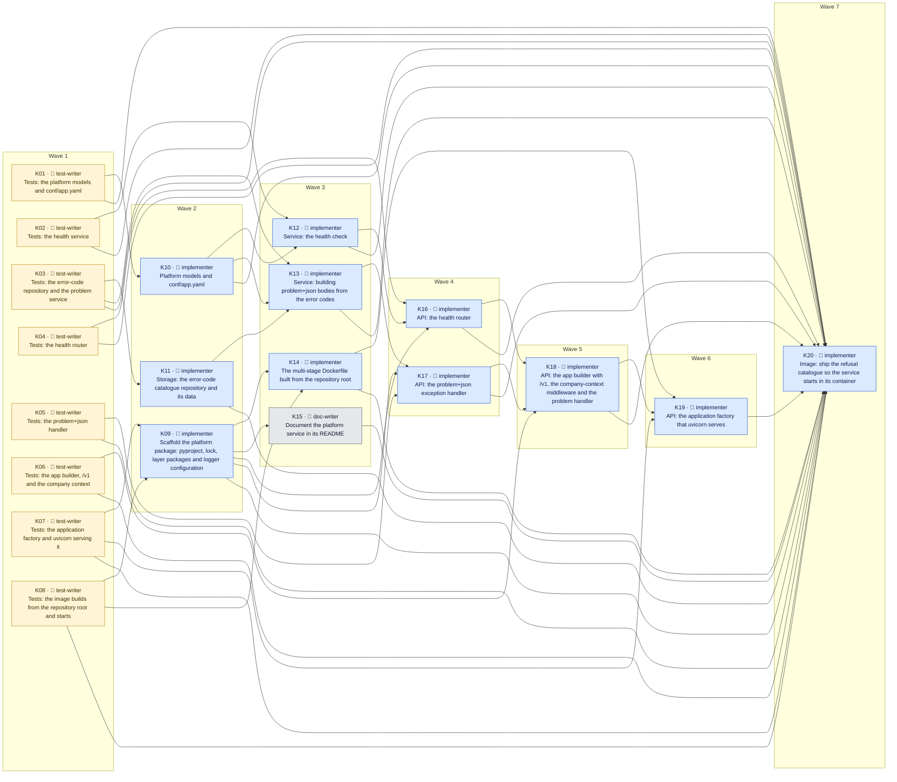

# T0.14: Plan

**Plan:** 🟢 Approved

**Push:** 🟢 Approved

<!-- ticket:specs -->
## 📚 Specifications

The specification and design pages of [TICKET.md](TICKET.md), copied by `python3 .claude/scripts/tickets/ticket_refs.py sync`.

- [Repository layout](../../technical/architecture/repository-layout.md#target-design-specified-in-gh-2-not-built-yet)
- [Back end](../../technical/architecture/backend.md#target-design-specified-in-gh-2-not-built-yet)
- [REQ-T05-03](../../specs/03-technical/t05-api-and-webhooks/requirements/req-t05-03-problem-json.md)
- [D122](../../specs/06-decisions/ux/d122-error-message-standard.md)
- [D419](../../specs/06-decisions/technical/d419-ci-cd-and-registry.md)
- [📌 REQ-T01-02: The company context at every layer](../../specs/03-technical/t01-companies-and-data-isolation/requirements/req-t01-02-company-context-everywhere.md)
- [📜 D406: Back end](../../specs/06-decisions/technical/d406-back-end.md)
- [📜 D438: Repository layout](../../specs/06-decisions/technical/d438-repository-layout.md)
- [Repository layout](../../technical/architecture/repository-layout.md)
- [Back end](../../technical/architecture/backend.md)
<!-- /ticket:specs -->

## Summary

T0.14 builds `backend/services/platform`, the first AGENT.md service. It has its own `erp_platform` package, because `platform` would shadow the standard-library module. It has the four layers and factories, `conf/app.yaml`, FastAPI under `/v1` with `GET /v1/health`, and a problem+json handler that uses D122 codes from its own catalogue. It mounts the T0.09 company-context middleware and builds a multi-stage image from the repository root.

The plan has 19 tasks in 6 waves. Wave 1 has 8 test-writer tasks, one per behaviour: models and `conf/app.yaml`; the health service; the error-code repository and problem service; the health router; the problem handler; the app builder with `/v1` and the company context; the application factory and uvicorn serving it; and the image smoke test. Wave 2 has three tasks: the package scaffold with `pyproject.toml` and `uv.lock`, the models with `conf/app.yaml`, and the storage repository of the error-code catalogue with its YAML data. Wave 3 has the health service, the problem service, the Dockerfile and the service README. Wave 4 has the health router and the problem handler. Wave 5 has the app builder. Wave 6 has the application factory that uvicorn serves.

The ticket has no front end, so it needs no Playwright task (TKT-21). No task changes `tests/conventions/` or `docs/specs/`.

## Assumptions

- The context middleware is assumed to be the library of T0.09 (`backend/shared/context`); the lifecycle base comes from T0.05 and logging and configuration from T0.06.
- The service's Python package name is not specified: `platform` is assumed, to adjust if it collides with the standard library module.
- The health endpoint path (for example `/v1/health`) is not specified, so the most conservative option is taken.
- The roadmap row and the specifications give the ticket no budget, so none is listed.
- Ticket anchor in the roadmap links uses the sprint anchor `#s02`, as the phase page has no per-ticket anchors.
- `check_ticket.py` was not run, as no shell tool was available to this agent.
- The Python package is `erp_platform`, not `platform`: a top-level `platform` package in the shared uv environment would shadow the standard-library module that many libraries import. The uv distribution keeps the name `platform`, so `uv run --package platform` matches AGENT.md's commands (TICKET.md assumption 2, settled here).
- The health endpoint is `GET /v1/health`, answering 200 `{"status": "ok"}`. It is the only path in `public_paths` and passes the company-context middleware without a company, because probes carry none. Every other path under `/v1` requires a company (REQ-T01-02 criterion 1).
- The service is a regular FastAPI application with no command line, as the owner decided on 2026-11-27 ([D406](../../specs/06-decisions/technical/d406-back-end.md), AGENT.md "Layout"). `AppFactory.create()` in `api/app_factory.py` builds it and uvicorn serves it (`--host 0.0.0.0 --port 8000` in the image). The service has no console script, no `cli` package and no server runnable, so `PlatformConfig` holds no `host` and no `port`. The factories the roadmap row names are this application factory: the skeleton has no runnable.
- The `/v1` prefix is a contract constant (`AppBuilder.API_PREFIX`), not configuration. `PlatformConfig` holds `public_paths` and `error_codes_path` (`conf/catalogs/error_codes.yaml`, relative to the service folder, which is the image's working directory). The specifications give none of these values, so the most conservative ones are taken.
- The problem+json body uses the RFC 9457 members `title`, `status` and `detail`, plus an extension member `code` carrying the D122 code. `title` and `detail` hold the code's title and why message keys from the catalogue, never free text, so no secret can reach a body. `type` is left out, which RFC 9457 reads as about:blank. T0.20 takes the name of the code member from this ticket.
- The platform's own D122 codes, `PLATFORM-ROUTE-01` (404), `PLATFORM-METHOD-01` (405), `PLATFORM-REQUEST-01` (422) and `PLATFORM-INTERNAL-01` (500), live in `backend/services/platform/conf/catalogs/error_codes.yaml`. They are read with the T0.04 catalogue model of `erp_models`, so `backend/models` is not changed (T0.04 assumption: later tickets add their own codes). The middleware's refusal keeps the code T0.09 gives it.
- If `erp_models` already holds a problem+json model (from T0.04 or T0.09), the platform reuses it, and the `models/problems/` files and their test are not created. A public contract is defined once (AGENT.md).
- Reading the error-code catalogue is the platform's storage layer (`ErrorCodeRepository`). `ProblemService` builds it, because the api layer may not import storage. P0 has no database (one database per company is out of scope), so this is the only storage the skeleton has.
- The exact names of the prerequisite libraries (T0.03 and T0.04 `erp_models`, T0.05 lifecycle and factory base, T0.06 logging and configuration, T0.09 company-context middleware) are read from their merged code at run time. No task changes them. If the T0.09 middleware cannot leave a path out, the platform wraps it in its own `PublicPathGate` ASGI class rather than changing the library.
- "The image builds in CI and starts" is proven two ways. CI's existing `images.yml` builds every changed `Dockerfile` with the repository root as context. The service's own test `tests/image/test_image.py` builds and runs the image and calls `/v1/health`; it skips only where Docker is absent. No change to `.github/` is needed, which keeps the ticket to its area.
- `uv.lock` is changed by the scaffold task (K09), because adding the workspace member changes the single lock. The root `pyproject.toml` already lists `backend/services/*` and is not changed.
- No other design page (such as `docs/technical/architecture/backend.md`) is updated by this ticket. The service is documented in its own README, so the ticket stays clear of the `docs/technical` pages other P0 tickets may touch. Updating the "Today" sections is left as a follow-up.
- Health, routes and handlers need no test helpers from `backend/shared/testing` (T0.13), which is not a prerequisite of T0.14 in the ticket graph. The tests use httpx's ASGI transport, real uvicorn servers on free ports, child processes and Docker instead.

<!-- plan:graph -->

> [!NOTE]
> Generated from the json block at the end of this page by `python3 .claude/scripts/tickets/plan.py render`.
> To change a task, edit the json block, then render again: never edit this view by hand.

## Waves

| Wave | Tasks | Agents running at once |
| --- | --- | --- |
| 1 | [K01](#k01), [K02](#k02), [K03](#k03), [K04](#k04), [K05](#k05), [K06](#k06), [K07](#k07), [K08](#k08) | 8 of 8 |
| 2 | [K09](#k09), [K10](#k10), [K11](#k11) | 3 of 3 |
| 3 | [K12](#k12), [K13](#k13), [K14](#k14), [K15](#k15) | 4 of 4 |
| 4 | [K16](#k16), [K17](#k17) | 2 of 2 |
| 5 | [K18](#k18) | 1 of 1 |
| 6 | [K19](#k19) | 1 of 1 |
| 7 | [K20](#k20) | 1 of 1 |

| Wave | Task | Agent | Depends on | Unblocks |
| --- | --- | --- | --- | --- |
| 1 | [K01](#k01) Tests: the platform models and conf/app.yaml | 🧪 test-writer | none | [K10](#k10), [K20](#k20) |
| 1 | [K02](#k02) Tests: the health service | 🧪 test-writer | none | [K12](#k12), [K20](#k20) |
| 1 | [K03](#k03) Tests: the error-code repository and the problem service | 🧪 test-writer | none | [K11](#k11), [K13](#k13), [K20](#k20) |
| 1 | [K04](#k04) Tests: the health router | 🧪 test-writer | none | [K16](#k16), [K20](#k20) |
| 1 | [K05](#k05) Tests: the problem+json handler | 🧪 test-writer | none | [K17](#k17), [K20](#k20) |
| 1 | [K06](#k06) Tests: the app builder, /v1 and the company context | 🧪 test-writer | none | [K18](#k18), [K20](#k20) |
| 1 | [K07](#k07) Tests: the application factory and uvicorn serving it | 🧪 test-writer | none | [K09](#k09), [K19](#k19), [K20](#k20) |
| 1 | [K08](#k08) Tests: the image builds from the repository root and starts | 🧪 test-writer | none | [K09](#k09), [K14](#k14), [K20](#k20) |
| 2 | [K09](#k09) Scaffold the platform package: pyproject, lock, layer packages and logger configuration | 🐍 implementer | [K07](#k07), [K08](#k08) | [K14](#k14), [K15](#k15), [K16](#k16), [K17](#k17), [K20](#k20) |
| 2 | [K10](#k10) Platform models and conf/app.yaml | 🐍 implementer | [K01](#k01) | [K12](#k12), [K13](#k13), [K20](#k20) |
| 2 | [K11](#k11) Storage: the error-code catalogue repository and its data | 🐍 implementer | [K03](#k03) | [K13](#k13), [K20](#k20) |
| 3 | [K12](#k12) Service: the health check | 🐍 implementer | [K02](#k02), [K10](#k10) | [K16](#k16), [K20](#k20) |
| 3 | [K13](#k13) Service: building problem+json bodies from the error codes | 🐍 implementer | [K03](#k03), [K10](#k10), [K11](#k11) | [K17](#k17), [K20](#k20) |
| 3 | [K14](#k14) The multi-stage Dockerfile built from the repository root | 🐍 implementer | [K08](#k08), [K09](#k09) | [K19](#k19), [K20](#k20) |
| 3 | [K15](#k15) Document the platform service in its README | 📝 doc-writer | [K09](#k09) | [K20](#k20) |
| 4 | [K16](#k16) API: the health router | 🐍 implementer | [K04](#k04), [K09](#k09), [K12](#k12) | [K18](#k18), [K20](#k20) |
| 4 | [K17](#k17) API: the problem+json exception handler | 🐍 implementer | [K05](#k05), [K09](#k09), [K13](#k13) | [K18](#k18), [K20](#k20) |
| 5 | [K18](#k18) API: the app builder with /v1, the company-context middleware and the problem handler | 🐍 implementer | [K06](#k06), [K16](#k16), [K17](#k17) | [K19](#k19), [K20](#k20) |
| 6 | [K19](#k19) API: the application factory that uvicorn serves | 🐍 implementer | [K07](#k07), [K14](#k14), [K18](#k18) | [K20](#k20) |
| 7 | [K20](#k20) Image: ship the refusal catalogue so the service starts in its container | 🐍 implementer | [K01](#k01), [K02](#k02), [K03](#k03), [K04](#k04), [K05](#k05), [K06](#k06), [K07](#k07), [K08](#k08), [K09](#k09), [K10](#k10), [K11](#k11), [K12](#k12), [K13](#k13), [K14](#k14), [K15](#k15), [K16](#k16), [K17](#k17), [K18](#k18), [K19](#k19) | none |

## Dependency graph



## Tasks

### <a id="k01"></a>K01: Tests: the platform models and conf/app.yaml

| Agent | Wave | Depends on | Unblocks |
| --- | --- | --- | --- |
| 🧪 test-writer | 1 | none | [K10](#k10), [K20](#k20) |

**Files** (only this task may change them in its wave):

- `backend/services/platform/tests/models/config/test_platform_config.py`
- `backend/services/platform/tests/models/health/test_health_status.py`
- `backend/services/platform/tests/models/health/enums/test_health_state.py`
- `backend/services/platform/tests/models/problems/test_problem_details.py`
- `backend/services/platform/tests/conf/test_app_yaml.py`

**Done when:** `uv run ruff check backend/services/platform/tests/models backend/services/platform/tests/conf` and `uv run ruff format --check` on the same files pass, and `uv run pytest tests/conventions -n 2` passes with the new test files (the tests themselves fail until K10 lands).

**Brief:**

Context: ticket T0.14 (docs/tickets/T0.14/TICKET.md) builds the `platform` service in `backend/services/platform` as an AGENT.md service. Its Python package is `erp_platform` (not `platform`, which would shadow the standard-library module in the shared uv environment), and its uv distribution is `platform`. It builds on code merged before it: `erp_models` in `backend/models` (T0.03 base model and `YamlCatalog`, T0.04 `SE` bases and the D122 error-code catalogue), `backend/shared/lifecycle` (T0.05), `backend/shared/logging` and `backend/shared/config` (T0.06), and `backend/shared/context` (T0.09). Read their code for exact names and never change them.

Write the tests first (the code does not exist yet), following AGENT.md "Tests": one `Test<Subject>` class per file, test names as sentences, no `unittest.mock`, the specific exception in `pytest.raises`, and the six model tests of AGENT.md for every model (`test_defaults`, `test_full_valid_construction`, `test_none_becomes_the_default`, `test_rejects_bad_values`, `test_rejects_unknown_keys`, `test_round_trip`).

1. `test_platform_config.py`: `PlatformConfig` from `erp_platform.models.config.platform_config`, a configuration section (`extra="forbid"`, `validate_default=True`), loadable by the configuration loader of `backend/shared/config` (subclass its base if it has one). It holds no `host` and no `port`: the service is a regular FastAPI application, and the address and the port are uvicorn's options (D406, AGENT.md "Layout"). Its fields:
   - `public_paths`: List[str], default ["/v1/health"]. These are the paths the company-context middleware lets through. Each entry is non-empty and starts with "/". Raises `SEPlatformConfigInvalidPublicPaths`.
   - `error_codes_path`: str, default "conf/catalogs/error_codes.yaml", stripped, empty refused, raises `SEPlatformConfigInvalidErrorCodesPath`.
   The exceptions are imported from `erp_platform.models.config.exceptions`, and their base is `SEInvalidPlatformConfigException`.
2. `test_health_status.py`: `HealthStatus` from `erp_platform.models.health.health_status`, frozen, with field `status: HealthState` (default `HealthState.OK`, raises `SEHealthStatusInvalidStatus`, base `SEInvalidHealthStatusException`, both from `erp_platform.models.health.exceptions`). It serialises to `{"status": "ok"}`.
3. `test_health_state.py`: `HealthState`, a `@unique` `StrEnum` from `erp_platform.models.health.enums` with `OK = "ok"`.
4. `test_problem_details.py`: write this file only if `backend/models/src/erp_models` holds no problem+json model. If it holds one, the platform reuses it: skip the file and record it as an assumption. The model is `ProblemDetails` from `erp_platform.models.problems.problem_details`, the RFC 9457 body. Its fields:
   - `title`: the code's title key.
   - `status`: int, `STATUS_MIN` 400, `STATUS_MAX` 599.
   - `detail`: the code's why key.
   - `code`: the D122 code.
   There is no `type` member, which RFC 9457 reads as about:blank. The strings are stripped and non-empty, and bools are refused for `status`. The exceptions are `SEProblemDetailsInvalidTitle`, `...InvalidStatus`, `...InvalidDetail` and `...InvalidCode`, with base `SEInvalidProblemDetailsException`, from `erp_platform.models.problems.exceptions`.
5. `test_app_yaml.py`: `backend/services/platform/conf/app.yaml` loads through `backend/shared/config` into `PlatformConfig`. Every field of `PlatformConfig` is written in the file with its default (AGENT.md: "every default written out"). The environment variable that `backend/shared/config` maps to `error_codes_path` overrides it (`monkeypatch.setenv`). Locate the file from the test file's path.

Specifications applied: D406 docs/specs/06-decisions/technical/d406-back-end.md (every service a regular FastAPI application, built by its application factory and served by uvicorn, with no command line); D438 docs/specs/06-decisions/technical/d438-repository-layout.md; REQ-T05-03 docs/specs/03-technical/t05-api-and-webhooks/requirements/req-t05-03-problem-json.md; D122 docs/specs/06-decisions/ux/d122-error-message-standard.md; docs/technical/architecture/repository-layout.md; docs/technical/architecture/backend.md.

### <a id="k02"></a>K02: Tests: the health service

| Agent | Wave | Depends on | Unblocks |
| --- | --- | --- | --- |
| 🧪 test-writer | 1 | none | [K12](#k12), [K20](#k20) |

**Files** (only this task may change them in its wave):

- `backend/services/platform/tests/service/health/test_health_service.py`

**Done when:** `uv run ruff check backend/services/platform/tests/service/health` and `uv run ruff format --check backend/services/platform/tests/service/health/test_health_service.py` pass, and `uv run pytest tests/conventions -n 2` passes.

**Brief:**

Context: ticket T0.14 (docs/tickets/T0.14/TICKET.md) builds the `platform` service in `backend/services/platform`, with package `erp_platform` and uv distribution `platform`, as an AGENT.md service.

Write the tests first, following AGENT.md "Tests": one `TestHealthService` class, sentence names, no mocks, `caplog` allowed.

The subject is `HealthService` from `erp_platform.service.health.health_service`, built as `HealthService(logger: Optional[Logger] = None)`. Its method `check() -> HealthStatus` returns `HealthStatus(status=HealthState.OK)` (models of K01: `erp_platform.models.health.health_status`, `erp_platform.models.health.enums`). Tests:
- the check answers ok;
- two checks give equal values;
- the check writes a log line at INFO or DEBUG through the logger it was given (AGENT.md "Logging": every method logs).

Specifications applied: D438 docs/specs/06-decisions/technical/d438-repository-layout.md (service layer); docs/technical/architecture/backend.md (FastAPI services, api, service, storage layers); docs/technical/architecture/repository-layout.md.

### <a id="k03"></a>K03: Tests: the error-code repository and the problem service

| Agent | Wave | Depends on | Unblocks |
| --- | --- | --- | --- |
| 🧪 test-writer | 1 | none | [K11](#k11), [K13](#k13), [K20](#k20) |

**Files** (only this task may change them in its wave):

- `backend/services/platform/tests/storage/catalogs/test_error_code_repository.py`
- `backend/services/platform/tests/service/problems/test_problem_service.py`

**Done when:** `uv run ruff check` and `uv run ruff format --check` pass on both files, and `uv run pytest tests/conventions -n 2` passes.

**Brief:**

Context: ticket T0.14 (docs/tickets/T0.14/TICKET.md) builds `backend/services/platform` (package `erp_platform`, distribution `platform`). Its errors are problem+json bodies that carry the D122 error codes. The codes come from a catalogue of the service, `backend/services/platform/conf/catalogs/error_codes.yaml`, read with the error-code catalogue model that T0.04 put in `erp_models` (read `backend/models` for its name and its `load(path)`; never change it).

The platform's codes, fixed by this plan:
- `PLATFORM-ROUTE-01`: no such route, 404.
- `PLATFORM-METHOD-01`: method not allowed, 405.
- `PLATFORM-REQUEST-01`: invalid request, 422.
- `PLATFORM-INTERNAL-01`: unexpected error, 500.
Each has its title key, why key, action key and support reference, as the T0.04 model asks.

Write the tests first (AGENT.md "Tests": one class per file, sentence names, no mocks, the specific exception).

1. `test_error_code_repository.py`: `ErrorCodeRepository(path: Path, logger: Optional[Logger] = None)` from `erp_platform.storage.catalogs.error_code_repository`. `load()` returns the T0.04 catalogue model holding the four codes above. An unreadable or missing file raises `SEErrorCodeCatalogUnreadableError` (from `erp_platform.storage.catalogs.exceptions`, base `SEErrorCodeStorageError`), keeps the cause, and writes an ERROR log line (`caplog`). Use `tmp_path` for the broken files.
2. `test_problem_service.py`: `ProblemService(error_codes_path: Path, logger: Optional[Logger] = None)` from `erp_platform.service.problems.problem_service`. It loads the catalogue through `ErrorCodeRepository` at construction. `problem(code: str, status: int)` returns the problem+json body model (`ProblemDetails` of `erp_platform.models.problems.problem_details`, or the `erp_models` problem model if T0.04 or T0.09 delivered one). The body holds `title` = the code's title key, `detail` = the code's why key, `code` = the code and `status`. Tests:
   - each of the four codes gives its keys and status;
   - an unknown code raises `SEProblemUnknownCodeError` (from `erp_platform.service.problems.exceptions`, base `SEProblemError`) and logs ERROR;
   - the serialised body of every code holds only the catalogue's keys, the code and the status, and no free text (REQ-T05-03 criterion 2: no secret in an error).
   Point both classes at the real `conf/catalogs/error_codes.yaml`, located from the test file's path.

Specifications applied: REQ-T05-03 docs/specs/03-technical/t05-api-and-webhooks/requirements/req-t05-03-problem-json.md (criteria 1 and 2); D122 docs/specs/06-decisions/ux/d122-error-message-standard.md and its pattern docs/specs/04-ux/design-system/patterns/error-messages.md; D438 docs/specs/06-decisions/technical/d438-repository-layout.md (storage reads data and nothing else, service calls storage).

### <a id="k04"></a>K04: Tests: the health router

| Agent | Wave | Depends on | Unblocks |
| --- | --- | --- | --- |
| 🧪 test-writer | 1 | none | [K16](#k16), [K20](#k20) |

**Files** (only this task may change them in its wave):

- `backend/services/platform/tests/api/http/test_health_router.py`

**Done when:** `uv run ruff check` and `uv run ruff format --check` pass on the file, and `uv run pytest tests/conventions -n 2` passes.

**Brief:**

Context: ticket T0.14 (docs/tickets/T0.14/TICKET.md) builds `backend/services/platform` (package `erp_platform`, distribution `platform`) with FastAPI.

Write the tests first (AGENT.md "Tests": one `TestHealthRouter` class, sentence names, no mocks, no nested functions; async tests need no marker).

The subject is `HealthRouter(health_service: HealthService, logger: Optional[Logger] = None)` from `erp_platform.api.http.health_router`. Its `router` property returns a FastAPI `APIRouter` with `GET /health`, response model `HealthStatus`, which calls `HealthService.check()` (`erp_platform.service.health.health_service`). The `/v1` prefix is added by the app builder (K06), not here.

Tests: include the router in a bare `FastAPI()` and call it through `httpx.AsyncClient(transport=httpx.ASGITransport(app=...), base_url="http://test")`.
- `GET /health` answers 200 with `application/json` and `{"status": "ok"}`.
- The route accepts only GET.

Specifications applied: docs/technical/architecture/backend.md (FastAPI for the HTTP services); D438 docs/specs/06-decisions/technical/d438-repository-layout.md (api calls service and holds no business rule); docs/technical/architecture/repository-layout.md.

### <a id="k05"></a>K05: Tests: the problem+json handler

| Agent | Wave | Depends on | Unblocks |
| --- | --- | --- | --- |
| 🧪 test-writer | 1 | none | [K17](#k17), [K20](#k20) |

**Files** (only this task may change them in its wave):

- `backend/services/platform/tests/api/http/test_problem_handler.py`

**Done when:** `uv run ruff check` and `uv run ruff format --check` pass on the file, and `uv run pytest tests/conventions -n 2` passes.

**Brief:**

Context: ticket T0.14 (docs/tickets/T0.14/TICKET.md) builds `backend/services/platform` (package `erp_platform`, distribution `platform`). Every error it answers is problem+json with its D122 code (REQ-T05-03), and no secret is in it.

Write the tests first (AGENT.md "Tests": one `TestProblemHandler` class, sentence names, no mocks, no nested functions). Test routes are bound methods of the test class, added with `app.add_api_route`.

The subject is `ProblemHandler(problem_service: ProblemService, logger: Optional[Logger] = None)` from `erp_platform.api.http.problem_handler`. Its `register(app: FastAPI) -> None` adds the exception handlers. `ProblemService` comes from `erp_platform.service.problems.problem_service`, built with the real `backend/services/platform/conf/catalogs/error_codes.yaml` located from the test file. The mapping:
- Starlette `HTTPException` 404 gives `PLATFORM-ROUTE-01`.
- 405 gives `PLATFORM-METHOD-01`.
- `RequestValidationError` gives 422 `PLATFORM-REQUEST-01`.
- Any other exception gives 500 `PLATFORM-INTERNAL-01`.
- An exception that carries a D122 code of the catalogue (an `SE` exception from `backend/shared/context`, if T0.09 raises refusals rather than answering them) answers with that code. Test it only if T0.09 offers such an exception.
Every response has media type `application/problem+json` and a body with `title`, `status`, `detail` and `code`.

Tests use a bare `FastAPI()` and `httpx.AsyncClient(transport=httpx.ASGITransport(app=..., raise_app_exceptions=False))`:
- an unknown path gives 404 with `PLATFORM-ROUTE-01`;
- POST to a GET-only route gives 405;
- a bad typed query parameter gives 422;
- a route that raises `RuntimeError("password=s3cr3t-value token=abc123")` gives 500 with `PLATFORM-INTERNAL-01`. Neither the body nor the log records (`caplog`) hold `s3cr3t-value` or `abc123` (REQ-T05-03 criterion 2; AGENT.md "Never log a secret").

Specifications applied: REQ-T05-03 docs/specs/03-technical/t05-api-and-webhooks/requirements/req-t05-03-problem-json.md (criteria 1 and 2); D122 docs/specs/06-decisions/ux/d122-error-message-standard.md; docs/technical/architecture/backend.md.

### <a id="k06"></a>K06: Tests: the app builder, /v1 and the company context

| Agent | Wave | Depends on | Unblocks |
| --- | --- | --- | --- |
| 🧪 test-writer | 1 | none | [K18](#k18), [K20](#k20) |

**Files** (only this task may change them in its wave):

- `backend/services/platform/tests/api/http/test_app_builder.py`

**Done when:** `uv run ruff check` and `uv run ruff format --check` pass on the file, and `uv run pytest tests/conventions -n 2` passes.

**Brief:**

Context: ticket T0.14 (docs/tickets/T0.14/TICKET.md) builds `backend/services/platform` (package `erp_platform`, distribution `platform`). Its FastAPI app serves under `/v1`, mounts the company-context middleware of `backend/shared/context` (T0.09), and registers the problem+json handler. Read `backend/shared/context` for how a request carries its company (header or token, and its test helpers if it has any), and for the code of its refusal. Never hard-code a guess, and never change that library.

Write the tests first (AGENT.md "Tests": one `TestAppBuilder` class, sentence names, no mocks).

The subject is `AppBuilder(config: PlatformConfig, logger: Optional[Logger] = None)` from `erp_platform.api.http.app_builder`, with `API_PREFIX: ClassVar[str] = "/v1"`. `build() -> FastAPI` does four things:
- includes the health router under `/v1`;
- mounts the T0.09 middleware, letting `config.public_paths` through without a company;
- registers `ProblemHandler`;
- builds `ProblemService` from `config.error_codes_path`.
`PlatformConfig` comes from `erp_platform.models.config.platform_config`. Build it with `error_codes_path` pointing to the real `backend/services/platform/conf/catalogs/error_codes.yaml`, located from the test file.

Tests go through `httpx.ASGITransport`:
1. `GET /v1/health` with no company answers 200 `{"status": "ok"}`. Health is a public path, for probes.
2. `GET /v1/anything` with no company is refused as problem+json, with the T0.09 refusal code (REQ-T01-02 criterion 1, TICKET criterion 5).
3. The same request with a company answers 404 problem+json `PLATFORM-ROUTE-01`, which shows it passed the middleware.
4. `GET /health` with a company answers 404 problem+json: routes are under `/v1` only.
5. Every refusal body holds no secret: it holds only `title`, `status`, `detail`, `code` and the T0.09 refusal's own members.

Specifications applied: REQ-T01-02 docs/specs/03-technical/t01-companies-and-data-isolation/requirements/req-t01-02-company-context-everywhere.md (criterion 1); REQ-T05-03 docs/specs/03-technical/t05-api-and-webhooks/requirements/req-t05-03-problem-json.md; D122 docs/specs/06-decisions/ux/d122-error-message-standard.md; docs/technical/architecture/backend.md.

### <a id="k07"></a>K07: Tests: the application factory and uvicorn serving it

| Agent | Wave | Depends on | Unblocks |
| --- | --- | --- | --- |
| 🧪 test-writer | 1 | none | [K09](#k09), [K19](#k19), [K20](#k20) |

**Files** (only this task may change them in its wave):

- `backend/services/platform/tests/api/test_app_factory.py`

**Done when:** `uv run ruff check` and `uv run ruff format --check` pass on the file, and `uv run pytest tests/conventions -n 2` passes.

**Brief:**

Context: ticket T0.14 (docs/tickets/T0.14/TICKET.md) builds `backend/services/platform` (package `erp_platform`, distribution `platform`). The service is a regular FastAPI application with no command line (D406, AGENT.md "Layout"). `AppFactory` in `erp_platform.api.app_factory` has a `@classmethod` `create() -> FastAPI` that takes no argument. It reads `conf/app.yaml` in the working folder into `PlatformConfig` through `backend/shared/config` (T0.06), sets up logging from `conf/logger.yaml` through `backend/shared/logging` (T0.06) with the service tag `platform`, and returns `AppBuilder(config).build()`. uvicorn serves it with `uvicorn --factory erp_platform.api.app_factory:AppFactory.create`. The service has no console script, no `cli` module, no argument parser and no server runnable of its own: uvicorn runs the application.

Write the tests first (AGENT.md "Tests": one `TestAppFactory` class, sentence names, no mocks, real servers on a free local port found by binding port 0, a timeout on every wait).

1. With the working folder set to `backend/services/platform` (`monkeypatch.chdir`, the folder located from the test file), `AppFactory.create()` returns a `FastAPI` application, and `GET /v1/health` through `httpx.ASGITransport` answers 200 `{"status": "ok"}`.
2. uvicorn serves the factory as a child process: `uv run --package platform uvicorn --factory erp_platform.api.app_factory:AppFactory.create --host 127.0.0.1 --port <free port>`, cwd `backend/services/platform`.
   - `http://127.0.0.1:<port>/v1/health` answers 200 `{"status": "ok"}` within 30 seconds (poll).
   - SIGTERM ends it with exit code 0.
3. The same child process, with the T0.06 environment variable for `error_codes_path` set to an empty value, exits non-zero before it serves, and its output holds no secret.

Specifications applied: D406 docs/specs/06-decisions/technical/d406-back-end.md (every service a regular FastAPI application, built by its application factory and served by uvicorn, with no command line); D438 docs/specs/06-decisions/technical/d438-repository-layout.md; D419 docs/specs/06-decisions/technical/d419-ci-cd-and-registry.md (the service starts); docs/technical/architecture/backend.md; docs/technical/architecture/repository-layout.md.

### <a id="k08"></a>K08: Tests: the image builds from the repository root and starts

| Agent | Wave | Depends on | Unblocks |
| --- | --- | --- | --- |
| 🧪 test-writer | 1 | none | [K09](#k09), [K14](#k14), [K20](#k20) |

**Files** (only this task may change them in its wave):

- `backend/services/platform/tests/image/test_image.py`

**Done when:** `uv run ruff check` and `uv run ruff format --check` pass on the file, and `uv run pytest tests/conventions -n 2` passes.

**Brief:**

Context: ticket T0.14 (docs/tickets/T0.14/TICKET.md), acceptance criteria 1 and 2: the image of `backend/services/platform`, built from the repository root by its multi-stage `backend/services/platform/Dockerfile` (D419, AGENT.md "Docker images"), builds and starts, and its health call answers. CI's `images.yml` builds it, and this test proves it starts.

Write one `TestImage` class (AGENT.md "Tests", no mocks), with a module-level `pytest.mark.timeout(900)` or the same mark on the class.

A fixture of the class builds the image once:
- `docker build -f backend/services/platform/Dockerfile -t simpleerp-platform:test .`, with the repository root found from the test file's path;
- it runs it with `docker run -d -p <free port>:8000 simpleerp-platform:test`;
- it removes the container with `docker rm -f` whatever happens.
Tests:
1. `/v1/health` answers 200 `{"status": "ok"}` within 60 seconds of the start (poll).
2. `GET /v1/anything` with no company answers a problem+json refusal (`application/problem+json`, a `code` member).
3. The container is still running after the calls.

When the `docker` command is missing or its daemon does not answer, skip with a reason that says the environment has no Docker. Never skip for any other reason. CI's runners have Docker, so the test runs there.

Specifications applied: D419 docs/specs/06-decisions/technical/d419-ci-cd-and-registry.md; D438 docs/specs/06-decisions/technical/d438-repository-layout.md (one image per service, built from the root); REQ-T01-02 docs/specs/03-technical/t01-companies-and-data-isolation/requirements/req-t01-02-company-context-everywhere.md (criterion 1); REQ-T05-03 docs/specs/03-technical/t05-api-and-webhooks/requirements/req-t05-03-problem-json.md.

### <a id="k09"></a>K09: Scaffold the platform package: pyproject, lock, layer packages and logger configuration

| Agent | Wave | Depends on | Unblocks |
| --- | --- | --- | --- |
| 🐍 implementer | 2 | [K07](#k07), [K08](#k08) | [K14](#k14), [K15](#k15), [K16](#k16), [K17](#k17), [K20](#k20) |

**Files** (only this task may change them in its wave):

- `backend/services/platform/pyproject.toml`
- `uv.lock`
- `backend/services/platform/conf/logger.yaml`
- `backend/services/platform/src/erp_platform/__init__.py`
- `backend/services/platform/src/erp_platform/models/__init__.py`
- `backend/services/platform/src/erp_platform/storage/__init__.py`
- `backend/services/platform/src/erp_platform/service/__init__.py`
- `backend/services/platform/src/erp_platform/api/__init__.py`
- `backend/services/platform/src/erp_platform/api/http/__init__.py`

**Done when:** `uv sync --locked` passes; `uv run --package platform python -c "import erp_platform.api, erp_platform.service, erp_platform.storage, erp_platform.models"` exits 0; `uv run ruff check backend/services/platform/src` passes; `uv run pytest tests/conventions -n 2` passes.

**Brief:**

Create the uv package of the `platform` service in `backend/services/platform` (ticket T0.14, docs/tickets/T0.14/TICKET.md; AGENT.md "Layout" and "Mono-repo").

- `pyproject.toml`: distribution name `platform`, Python 3.13, package `erp_platform` under `src/`. Use the build backend of the other workspace members (read `backend/models/pyproject.toml`).
  - Runtime dependencies: `fastapi`, `uvicorn`, and the workspace members `erp_models` (`backend/models`) and `backend/shared/lifecycle`, `backend/shared/logging`, `backend/shared/config` and `backend/shared/context`, with their distribution names read from their `pyproject.toml` and `[tool.uv.sources] <name> = { workspace = true }`.
  - `httpx` for the tests, in the package's dev dependency group if `uv run --package platform pytest` installs it from there, otherwise as a dependency. Report the choice.
  - No `[project.scripts]` and no other console script: uvicorn serves the application (D406, AGENT.md "Layout"), and `tests/conventions/entrypoints/` fails on any console script.
  - No mock library.
- Run `uv lock` so that `uv.lock` holds the new member. The root `pyproject.toml` already lists `backend/services/*` as members: do not change it.
- `conf/logger.yaml`: the shape of the repository's `conf/logger.yaml` and of what `backend/shared/logging` (T0.06) reads, with the service tagged `platform` and the file `logs/platform.log`.
- The layer packages: `__init__.py` files with no code (a docstring at most) for the package, `models`, `storage`, `service`, `api` and `api/http`. No `cli` package, and no `server` or `factories` package in `api`: the application factory is the module `api/app_factory.py` of K19. Never a top-level `api`, `service`, `storage` or `models` package (AGENT.md).

Specifications applied: D406 docs/specs/06-decisions/technical/d406-back-end.md (every service a regular FastAPI application, built by its application factory and served by uvicorn, with no command line); D438 docs/specs/06-decisions/technical/d438-repository-layout.md; docs/technical/architecture/repository-layout.md; docs/technical/architecture/backend.md (Python 3.13 with uv, FastAPI). The package is `erp_platform` because `platform` would shadow the standard-library module in the shared environment (TICKET assumption 2).

### <a id="k10"></a>K10: Platform models and conf/app.yaml

| Agent | Wave | Depends on | Unblocks |
| --- | --- | --- | --- |
| 🐍 implementer | 2 | [K01](#k01) | [K12](#k12), [K13](#k13), [K20](#k20) |

**Files** (only this task may change them in its wave):

- `backend/services/platform/conf/app.yaml`
- `backend/services/platform/src/erp_platform/models/config/__init__.py`
- `backend/services/platform/src/erp_platform/models/config/platform_config.py`
- `backend/services/platform/src/erp_platform/models/config/exceptions/__init__.py`
- `backend/services/platform/src/erp_platform/models/config/exceptions/se_invalid_platform_config_exception.py`
- `backend/services/platform/src/erp_platform/models/config/exceptions/se_platform_config_invalid_public_paths.py`
- `backend/services/platform/src/erp_platform/models/config/exceptions/se_platform_config_invalid_error_codes_path.py`
- `backend/services/platform/src/erp_platform/models/health/__init__.py`
- `backend/services/platform/src/erp_platform/models/health/health_status.py`
- `backend/services/platform/src/erp_platform/models/health/enums/__init__.py`
- `backend/services/platform/src/erp_platform/models/health/enums/health_state.py`
- `backend/services/platform/src/erp_platform/models/health/exceptions/__init__.py`
- `backend/services/platform/src/erp_platform/models/health/exceptions/se_invalid_health_status_exception.py`
- `backend/services/platform/src/erp_platform/models/health/exceptions/se_health_status_invalid_status.py`
- `backend/services/platform/src/erp_platform/models/problems/__init__.py`
- `backend/services/platform/src/erp_platform/models/problems/problem_details.py`
- `backend/services/platform/src/erp_platform/models/problems/exceptions/__init__.py`
- `backend/services/platform/src/erp_platform/models/problems/exceptions/se_invalid_problem_details_exception.py`
- `backend/services/platform/src/erp_platform/models/problems/exceptions/se_problem_details_invalid_title.py`
- `backend/services/platform/src/erp_platform/models/problems/exceptions/se_problem_details_invalid_status.py`
- `backend/services/platform/src/erp_platform/models/problems/exceptions/se_problem_details_invalid_detail.py`
- `backend/services/platform/src/erp_platform/models/problems/exceptions/se_problem_details_invalid_code.py`

**Done when:** `uv run --package platform pytest backend/services/platform/tests/models -n 2` and `uv run --package platform pytest backend/services/platform/tests/conf -n 2` pass; `uv run ruff check backend/services/platform/src/erp_platform/models` passes; `MYPYPATH=backend/services/platform/src uv run mypy backend/services/platform/src` reports no error in `models/`; `uv run pytest tests/conventions -n 2` passes.

**Brief:**

Implement the `models` layer of `erp_platform` (ticket T0.14, docs/tickets/T0.14/TICKET.md) so that the tests of K01 pass: `backend/services/platform/tests/models/` and `backend/services/platform/tests/conf/test_app_yaml.py`. Read those tests first: they fix the names, fields, defaults and exceptions.

- `PlatformConfig`: `public_paths` and `error_codes_path`, with no `host` and no `port` (uvicorn's options, D406), loaded by `backend/shared/config` (T0.06; subclass its base if it has one).
- `HealthStatus`, frozen, and the `HealthState` `StrEnum`.
- `ProblemDetails`: create the `models/problems/` files only if `backend/models/src/erp_models` has no problem+json model. Otherwise leave them out, reuse that model, and record it.
- `conf/app.yaml` with every field written with its default.

Follow AGENT.md "Pydantic models" (`Field(description=...)`, a `validate_<field>` `mode="before"` validator per field raising its own exception, `None` becomes the default, bools refused, strings stripped, `extra="forbid"`, `validate_default=True` for configuration, `<FIELD>_MIN`/`_MAX` `ClassVar`s), "Exceptions" (one per file, a sorted `__all__` re-export in `exceptions/__init__.py`, model base `SEInvalid<Model>Exception`, field `SE<Model>Invalid<Field>`), "Messages" (`Invalid <field>: {value!r}.` then `Must be ...`, use the exception-and-log-messages skill), "Data and enums" (`@unique` `StrEnum`), "File shape", "Docstrings" and "Typing". Models never log. Base the models on the `erp_models` base model of T0.03 if it fits.

Specifications applied: D406 docs/specs/06-decisions/technical/d406-back-end.md (every service a regular FastAPI application, built by its application factory and served by uvicorn, with no command line); D438 docs/specs/06-decisions/technical/d438-repository-layout.md; REQ-T05-03 docs/specs/03-technical/t05-api-and-webhooks/requirements/req-t05-03-problem-json.md; D122 docs/specs/06-decisions/ux/d122-error-message-standard.md; docs/technical/architecture/backend.md; docs/technical/architecture/repository-layout.md.

### <a id="k11"></a>K11: Storage: the error-code catalogue repository and its data

| Agent | Wave | Depends on | Unblocks |
| --- | --- | --- | --- |
| 🐍 implementer | 2 | [K03](#k03) | [K13](#k13), [K20](#k20) |

**Files** (only this task may change them in its wave):

- `backend/services/platform/conf/catalogs/error_codes.yaml`
- `backend/services/platform/src/erp_platform/storage/catalogs/__init__.py`
- `backend/services/platform/src/erp_platform/storage/catalogs/error_code_repository.py`
- `backend/services/platform/src/erp_platform/storage/catalogs/exceptions/__init__.py`
- `backend/services/platform/src/erp_platform/storage/catalogs/exceptions/se_error_code_storage_error.py`
- `backend/services/platform/src/erp_platform/storage/catalogs/exceptions/se_error_code_catalog_unreadable_error.py`

**Done when:** `uv run --package platform pytest backend/services/platform/tests/storage -n 2` passes; `uv run ruff check backend/services/platform/src/erp_platform/storage` passes; mypy on `backend/services/platform/src` reports no error in `storage/`; `uv run pytest tests/conventions -n 2` passes.

**Brief:**

Implement the `storage` layer of `erp_platform` (ticket T0.14, docs/tickets/T0.14/TICKET.md) so that `backend/services/platform/tests/storage/catalogs/test_error_code_repository.py` (K03) passes. Read the test first.

- `conf/catalogs/error_codes.yaml`: the platform's D122 codes, in the shape the T0.04 error-code catalogue model of `erp_models` reads (read `backend/models` and its own `conf/catalogs/`).
  - The codes: `PLATFORM-ROUTE-01` (no such route), `PLATFORM-METHOD-01` (method not allowed), `PLATFORM-REQUEST-01` (invalid request) and `PLATFORM-INTERNAL-01` (unexpected error).
  - Each has its title key, why key, action key and support reference, named like the keys of the `erp_models` catalogue.
  - Keys only, with no message text and no secret. The texts belong to the P2 translation catalogues.
- `ErrorCodeRepository(path: Path, logger: Optional[Logger] = None)` with `load()`, which reads the file with the T0.04 catalogue model's `load(path)`.
  - On its unreadable exception, it logs at ERROR and raises `SEErrorCodeCatalogUnreadableError(...) from error`.
  - The base is `SEErrorCodeStorageError`, the layer base `SE<Domain>Error` of AGENT.md.
  - It logs what it loaded at INFO and its steps at DEBUG, with lazy arguments.
- Storage reads data and nothing else (AGENT.md "Layout"). It imports only `storage`, `models` and `erp_models`.

Follow AGENT.md "Exceptions", "Logging", "Messages" (the exception-and-log-messages skill), "File shape" (banners) and "Docstrings".

Specifications applied: REQ-T05-03 docs/specs/03-technical/t05-api-and-webhooks/requirements/req-t05-03-problem-json.md (criteria 1 and 2); D122 docs/specs/06-decisions/ux/d122-error-message-standard.md and docs/specs/04-ux/design-system/patterns/error-messages.md; D438 docs/specs/06-decisions/technical/d438-repository-layout.md.

### <a id="k12"></a>K12: Service: the health check

| Agent | Wave | Depends on | Unblocks |
| --- | --- | --- | --- |
| 🐍 implementer | 3 | [K02](#k02), [K10](#k10) | [K16](#k16), [K20](#k20) |

**Files** (only this task may change them in its wave):

- `backend/services/platform/src/erp_platform/service/health/__init__.py`
- `backend/services/platform/src/erp_platform/service/health/health_service.py`

**Done when:** `uv run --package platform pytest backend/services/platform/tests/service/health -n 2` passes; `uv run ruff check backend/services/platform/src/erp_platform/service/health` passes; mypy on `backend/services/platform/src` reports no error in `service/health/`; `uv run pytest tests/conventions -n 2` passes.

**Brief:**

Implement `HealthService` in `erp_platform.service.health.health_service` (ticket T0.14, docs/tickets/T0.14/TICKET.md) so that `backend/services/platform/tests/service/health/test_health_service.py` (K02) passes.

`HealthService(logger: Optional[Logger] = None)` has `check() -> HealthStatus`, which returns `HealthStatus(status=HealthState.OK)` and logs the check (AGENT.md "Logging": lazy arguments, at DEBUG or INFO). The service layer imports only `service`, `storage`, `models` and `erp_models`. Follow AGENT.md "File shape", "Docstrings", "Typing" and "Logging" (logger as the last constructor argument).

Specifications applied: D438 docs/specs/06-decisions/technical/d438-repository-layout.md; docs/technical/architecture/backend.md; docs/technical/architecture/repository-layout.md.

### <a id="k13"></a>K13: Service: building problem+json bodies from the error codes

| Agent | Wave | Depends on | Unblocks |
| --- | --- | --- | --- |
| 🐍 implementer | 3 | [K03](#k03), [K10](#k10), [K11](#k11) | [K17](#k17), [K20](#k20) |

**Files** (only this task may change them in its wave):

- `backend/services/platform/src/erp_platform/service/problems/__init__.py`
- `backend/services/platform/src/erp_platform/service/problems/problem_service.py`
- `backend/services/platform/src/erp_platform/service/problems/exceptions/__init__.py`
- `backend/services/platform/src/erp_platform/service/problems/exceptions/se_problem_error.py`
- `backend/services/platform/src/erp_platform/service/problems/exceptions/se_problem_unknown_code_error.py`

**Done when:** `uv run --package platform pytest backend/services/platform/tests/service/problems -n 2` passes; `uv run ruff check backend/services/platform/src/erp_platform/service/problems` passes; mypy on `backend/services/platform/src` reports no error in `service/problems/`; `uv run pytest tests/conventions -n 2` passes.

**Brief:**

Implement `ProblemService` in `erp_platform.service.problems.problem_service` (ticket T0.14, docs/tickets/T0.14/TICKET.md) so that `backend/services/platform/tests/service/problems/test_problem_service.py` (K03) passes. Read the test first.

- `ProblemService(error_codes_path: Path, logger: Optional[Logger] = None)` builds its `ErrorCodeRepository` (`erp_platform.storage.catalogs.error_code_repository`, K11) and loads the catalogue once, at construction.
- `problem(code: str, status: int)` returns the problem+json body model with `title` = the code's title key, `detail` = the code's why key, `code` and `status`. The model is the `erp_models` one if it exists, otherwise `ProblemDetails` of `erp_platform.models.problems.problem_details` (K10).
- It takes no free text, so no exception message or secret can reach a body (REQ-T05-03 criterion 2).
- An unknown code (the T0.04 catalogue refuses it) logs at ERROR and raises `SEProblemUnknownCodeError(...) from error`, with base `SEProblemError`.

Follow AGENT.md "Exceptions", "Logging" (lazy arguments, never a typed value), "Messages" (the exception-and-log-messages skill), "File shape" and "Docstrings". The service imports `storage`, `models` and `erp_models`, never `api`.

Specifications applied: REQ-T05-03 docs/specs/03-technical/t05-api-and-webhooks/requirements/req-t05-03-problem-json.md; D122 docs/specs/06-decisions/ux/d122-error-message-standard.md; D438 docs/specs/06-decisions/technical/d438-repository-layout.md.

### <a id="k14"></a>K14: The multi-stage Dockerfile built from the repository root

| Agent | Wave | Depends on | Unblocks |
| --- | --- | --- | --- |
| 🐍 implementer | 3 | [K08](#k08), [K09](#k09) | [K19](#k19), [K20](#k20) |

**Files** (only this task may change them in its wave):

- `backend/services/platform/Dockerfile`

**Done when:** From the repository root, `docker build -f backend/services/platform/Dockerfile -t simpleerp-platform:test .` exits 0 (where Docker is available; otherwise the verifier marks it not applicable).

**Brief:**

Write `backend/services/platform/Dockerfile` (ticket T0.14, docs/tickets/T0.14/TICKET.md, criterion 1; D419; AGENT.md "Docker images"). It is one multi-stage image, and its build context is the repository root, because `uv.lock` is there. CI's `.github/workflows/images.yml` builds it with `context: .` and `file: backend/services/platform/Dockerfile`. Do not change CI.

- Builder stage: Python 3.13 with uv. Copy what `uv sync --locked --no-dev --package platform --no-editable` needs: the root `pyproject.toml`, `uv.lock` and `.python-version`, and every workspace member's `pyproject.toml` (the lock covers all members, so `--locked` fails without them). Copy the sources of `backend/models`, the `backend/shared` libraries the service uses, and `backend/services/platform`. Then sync into a virtual environment.
- Runtime stage: a slim Python 3.13 image with the virtual environment and the service's `conf/` only.
  - `WORKDIR` is the folder holding `conf/`, so `conf/app.yaml` and `conf/catalogs/error_codes.yaml` resolve.
  - Run as a non-root user.
  - `EXPOSE 8000`.
  - Add a `HEALTHCHECK` that calls `http://127.0.0.1:8000/v1/health` with Python's standard library.
  - `CMD ["uvicorn", "--factory", "erp_platform.api.app_factory:AppFactory.create", "--host", "0.0.0.0", "--port", "8000"]`: uvicorn serves the application factory, and the image has no console script of its own (D406, AGENT.md "Docker images").
- Pin the base images by digest if the repository's other Dockerfiles do. Put no secret in any layer.

The image test of K08 (`backend/services/platform/tests/image/test_image.py`) passes once K19 lands. Here, the build must succeed.

Specifications applied: D406 docs/specs/06-decisions/technical/d406-back-end.md (every service a regular FastAPI application, built by its application factory and served by uvicorn, with no command line); D419 docs/specs/06-decisions/technical/d419-ci-cd-and-registry.md; D438 docs/specs/06-decisions/technical/d438-repository-layout.md; docs/technical/architecture/repository-layout.md (one image per service).

### <a id="k15"></a>K15: Document the platform service in its README

| Agent | Wave | Depends on | Unblocks |
| --- | --- | --- | --- |
| 📝 doc-writer | 3 | [K09](#k09) | [K20](#k20) |

**Files** (only this task may change them in its wave):

- `backend/services/platform/README.md`

**Done when:** `backend/services/platform/README.md` exists with the sections above, every relative link in it resolves to an existing file, and it holds no em dash.

**Brief:**

Write `backend/services/platform/README.md` (ticket T0.14, docs/tickets/T0.14/TICKET.md) in plain British English, with no em dashes (AGENT.md "Formatting and prose"). It covers:
- What the service is: the first back-end service and the skeleton the next ones copy.
- Its layers under `src/erp_platform/` (`api`, `service`, `storage`, `models`), each calling only the one below, and why the package is `erp_platform`: `platform` would shadow the standard-library module.
- Its configuration `conf/app.yaml`: `public_paths` (`/v1/health`) and `error_codes_path` (`conf/catalogs/error_codes.yaml`), overridden by environment variables through `backend/shared/config`. Also `conf/logger.yaml`. The address and the port are uvicorn's options, not configuration.
- The endpoint `GET /v1/health`, answering `{"status": "ok"}` without a company, and the rule that every other request needs a company, through the company-context middleware of `backend/shared/context` (REQ-T01-02).
- Errors as `application/problem+json` with `title`, `status`, `detail` and `code` (REQ-T05-03, D122), and the table of codes: `PLATFORM-ROUTE-01` 404, `PLATFORM-METHOD-01` 405, `PLATFORM-REQUEST-01` 422 and `PLATFORM-INTERNAL-01` 500. A body never holds a secret.
- How to run it: the service is a regular FastAPI application with no command line (D406), so uvicorn serves its application factory: `uv run --package platform uvicorn --factory erp_platform.api.app_factory:AppFactory.create --port 8000` from `backend/services/platform`.
- How to build and run the image from the repository root: `docker build -f backend/services/platform/Dockerfile -t simpleerp-platform .` and `docker run -p 8000:8000 simpleerp-platform`.
- How to test it: `uv run --package platform pytest backend/services/platform/tests/<folder> -n 2`, one folder at a time.
- What comes later: the OpenAPI document (T0.18), the typed client (T0.20), the Bruno collection (T0.24), Compose and Helm (T0.21, T0.19).
Link the specification pages by relative path.

Specifications applied: D406 docs/specs/06-decisions/technical/d406-back-end.md (every service a regular FastAPI application, built by its application factory and served by uvicorn, with no command line); D438 docs/specs/06-decisions/technical/d438-repository-layout.md; D419 docs/specs/06-decisions/technical/d419-ci-cd-and-registry.md; REQ-T05-03 docs/specs/03-technical/t05-api-and-webhooks/requirements/req-t05-03-problem-json.md; REQ-T01-02 docs/specs/03-technical/t01-companies-and-data-isolation/requirements/req-t01-02-company-context-everywhere.md; D122 docs/specs/06-decisions/ux/d122-error-message-standard.md; docs/technical/architecture/backend.md; docs/technical/architecture/repository-layout.md.

### <a id="k16"></a>K16: API: the health router

| Agent | Wave | Depends on | Unblocks |
| --- | --- | --- | --- |
| 🐍 implementer | 4 | [K04](#k04), [K09](#k09), [K12](#k12) | [K18](#k18), [K20](#k20) |

**Files** (only this task may change them in its wave):

- `backend/services/platform/src/erp_platform/api/http/health_router.py`

**Done when:** `uv run --package platform pytest backend/services/platform/tests/api/http/test_health_router.py -n 2` passes; `uv run ruff check backend/services/platform/src/erp_platform/api/http/health_router.py` passes; mypy on `backend/services/platform/src` reports no error in this file; `uv run pytest tests/conventions -n 2` passes.

**Brief:**

Implement `HealthRouter` in `erp_platform.api.http.health_router` (ticket T0.14, docs/tickets/T0.14/TICKET.md, criterion 2) so that `backend/services/platform/tests/api/http/test_health_router.py` (K04) passes. Read the test first.

`HealthRouter(health_service: HealthService, logger: Optional[Logger] = None)` has a `router` property returning an `APIRouter` with `GET /health`, response model `HealthStatus`, whose handler is a method of the class (no nested function) that calls `HealthService.check()`. The `/v1` prefix is the app builder's (K18). The api layer imports `api`, `service`, `models` and `erp_models`, never `storage`, and holds no business rule. Follow AGENT.md "File shape" (banners, sync methods before async ones in a section), "Docstrings", "Typing" and "Logging".

Specifications applied: docs/technical/architecture/backend.md (FastAPI); D438 docs/specs/06-decisions/technical/d438-repository-layout.md; docs/technical/architecture/repository-layout.md.

### <a id="k17"></a>K17: API: the problem+json exception handler

| Agent | Wave | Depends on | Unblocks |
| --- | --- | --- | --- |
| 🐍 implementer | 4 | [K05](#k05), [K09](#k09), [K13](#k13) | [K18](#k18), [K20](#k20) |

**Files** (only this task may change them in its wave):

- `backend/services/platform/src/erp_platform/api/http/problem_handler.py`

**Done when:** `uv run --package platform pytest backend/services/platform/tests/api/http/test_problem_handler.py -n 2` passes; `uv run ruff check backend/services/platform/src/erp_platform/api/http/problem_handler.py` passes; mypy on `backend/services/platform/src` reports no error in this file; `uv run pytest tests/conventions -n 2` passes.

**Brief:**

Implement `ProblemHandler` in `erp_platform.api.http.problem_handler` (ticket T0.14, docs/tickets/T0.14/TICKET.md, criteria 3 and 4) so that `backend/services/platform/tests/api/http/test_problem_handler.py` (K05) passes. Read the test first.

`ProblemHandler(problem_service: ProblemService, logger: Optional[Logger] = None)` has `register(app: FastAPI) -> None`, which adds exception handlers (methods of the class) with this mapping:
- Starlette `HTTPException` 404 gives `PLATFORM-ROUTE-01`.
- 405 gives `PLATFORM-METHOD-01`.
- `RequestValidationError` gives 422 `PLATFORM-REQUEST-01`.
- An `SE` refusal of `backend/shared/context` that carries a code keeps its code and status, if T0.09 raises one.
- Any other exception gives 500 `PLATFORM-INTERNAL-01`.

Each handler answers a `JSONResponse` with media type `application/problem+json` and the body of `ProblemService.problem(code, status)`.

The broad handler for any exception exists because every failure must be reported rather than end the request (AGENT.md "Exceptions"). It logs at ERROR with `type(error).__name__` only, never the message, which may quote a secret (AGENT.md "Logging"; REQ-T05-03 criterion 2). The api layer never imports `storage`. Follow AGENT.md "File shape", "Docstrings", "Typing", "Logging" and "Messages" (the exception-and-log-messages skill).

Specifications applied: REQ-T05-03 docs/specs/03-technical/t05-api-and-webhooks/requirements/req-t05-03-problem-json.md; D122 docs/specs/06-decisions/ux/d122-error-message-standard.md; docs/technical/architecture/backend.md; D438 docs/specs/06-decisions/technical/d438-repository-layout.md.

### <a id="k18"></a>K18: API: the app builder with /v1, the company-context middleware and the problem handler

| Agent | Wave | Depends on | Unblocks |
| --- | --- | --- | --- |
| 🐍 implementer | 5 | [K06](#k06), [K16](#k16), [K17](#k17) | [K19](#k19), [K20](#k20) |

**Files** (only this task may change them in its wave):

- `backend/services/platform/src/erp_platform/api/http/app_builder.py`
- `backend/services/platform/src/erp_platform/api/http/public_path_gate.py`

**Done when:** `uv run --package platform pytest backend/services/platform/tests/api/http -n 2` passes; `uv run ruff check backend/services/platform/src/erp_platform/api/http` passes; mypy on `backend/services/platform/src` reports no error in `api/http/`; `uv run pytest tests/conventions -n 2` passes.

**Brief:**

Implement `AppBuilder` in `erp_platform.api.http.app_builder` (ticket T0.14, docs/tickets/T0.14/TICKET.md, criteria 2, 3 and 5) so that `backend/services/platform/tests/api/http/test_app_builder.py` (K06) passes. Read the test first.

`AppBuilder(config: PlatformConfig, logger: Optional[Logger] = None)` has `API_PREFIX: ClassVar[str] = "/v1"` and `build() -> FastAPI`, which:
- creates the FastAPI app;
- builds `HealthService` and `ProblemService(Path(config.error_codes_path))` (service layer);
- includes `HealthRouter(...).router` under `/v1`;
- registers `ProblemHandler`;
- mounts the company-context middleware of `backend/shared/context` (T0.09; read it for its class and options, never change it), so that a request without a company is refused there with its problem+json code (REQ-T01-02 criterion 1), and the paths of `config.public_paths` (`/v1/health`, for probes) pass without a company.

Use the middleware's own way to leave paths out if it has one. If it has none, write `PublicPathGate` in `public_path_gate.py`: a pure ASGI wrapper class (no `run`, no `start`) that sends the public paths straight to the app and every other request through the T0.09 middleware. Report which way was taken.

The api layer never imports `storage` and holds no business rule. Follow AGENT.md "File shape", "Docstrings", "Typing" and "Logging".

Specifications applied: REQ-T01-02 docs/specs/03-technical/t01-companies-and-data-isolation/requirements/req-t01-02-company-context-everywhere.md; REQ-T05-03 docs/specs/03-technical/t05-api-and-webhooks/requirements/req-t05-03-problem-json.md; D122 docs/specs/06-decisions/ux/d122-error-message-standard.md; docs/technical/architecture/backend.md; D438 docs/specs/06-decisions/technical/d438-repository-layout.md.

### <a id="k19"></a>K19: API: the application factory that uvicorn serves

| Agent | Wave | Depends on | Unblocks |
| --- | --- | --- | --- |
| 🐍 implementer | 6 | [K07](#k07), [K14](#k14), [K18](#k18) | [K20](#k20) |

**Files** (only this task may change them in its wave):

- `backend/services/platform/src/erp_platform/api/app_factory.py`

**Done when:** `uv run --package platform pytest backend/services/platform/tests/api -n 2` and `uv run --package platform pytest backend/services/platform/tests/image -n 2` pass (the image test may skip only where Docker is absent); `uv run ruff check backend/services/platform` and `uv run ruff format --check backend/services/platform` pass; `MYPYPATH=backend/services/platform/src uv run mypy backend/services/platform/src` passes; `uv run pytest tests/conventions -n 2` passes with no change to `tests/conventions/` (criterion 6), its no-command-line rule included.

**Brief:**

Implement `AppFactory` in `erp_platform.api.app_factory` (ticket T0.14, docs/tickets/T0.14/TICKET.md, criteria 1, 2 and 6) so that the tests of K07 pass: `backend/services/platform/tests/api/test_app_factory.py`. After this task the image test of K08 also passes. Read the tests first.

The service is a regular FastAPI application with no command line (D406, AGENT.md "Layout"):
- `AppFactory.create() -> FastAPI` is a `@classmethod` that takes no argument, which uvicorn calls with `--factory`.
  - It loads `conf/app.yaml` from the working folder into `PlatformConfig` through `backend/shared/config`.
  - It sets up logging from `conf/logger.yaml` through `backend/shared/logging` with the service tag `platform`.
  - It logs at INFO that the application is built, and returns `AppBuilder(config).build()`.
- An invalid configuration raises the configuration's own exception, after an ERROR log that holds no secret, so that uvicorn exits non-zero before it serves.
- No `main()`, no console script, no `cli` module, no argument parser, no `print` and no module-level application (AGENT.md "File shape", "Layout"). The service has no server runnable and no runnable factory of its own: uvicorn runs the application.

Follow AGENT.md "File shape" (banners), "Docstrings", "Typing", "Logging" and "Messages" (the exception-and-log-messages skill). The api layer never imports `storage`.

Specifications applied: D406 docs/specs/06-decisions/technical/d406-back-end.md (every service a regular FastAPI application, built by its application factory and served by uvicorn, with no command line); D419 docs/specs/06-decisions/technical/d419-ci-cd-and-registry.md; D438 docs/specs/06-decisions/technical/d438-repository-layout.md; REQ-T01-02 docs/specs/03-technical/t01-companies-and-data-isolation/requirements/req-t01-02-company-context-everywhere.md; REQ-T05-03 docs/specs/03-technical/t05-api-and-webhooks/requirements/req-t05-03-problem-json.md; docs/technical/architecture/backend.md; docs/technical/architecture/repository-layout.md.

### <a id="k20"></a>K20: Image: ship the refusal catalogue so the service starts in its container

| Agent | Wave | Depends on | Unblocks |
| --- | --- | --- | --- |
| 🐍 implementer | 7 | [K01](#k01), [K02](#k02), [K03](#k03), [K04](#k04), [K05](#k05), [K06](#k06), [K07](#k07), [K08](#k08), [K09](#k09), [K10](#k10), [K11](#k11), [K12](#k12), [K13](#k13), [K14](#k14), [K15](#k15), [K16](#k16), [K17](#k17), [K18](#k18), [K19](#k19) | none |

**Files** (only this task may change them in its wave):

- `backend/services/platform/Dockerfile`

**Done when:** `docker build -f backend/services/platform/Dockerfile .` succeeds from the repository root; the container started from it answers 200 on /v1/health within 60 s; `uv run --all-packages pytest backend/services/platform/tests/image -q` passes (3 passed) where Docker is available.

**Brief:**

The service exits at startup inside its image, so every test of backend/services/platform/tests/image/test_image.py times out (`The container did not answer within 60 s: URLError`). Reproduced with `docker build -f backend/services/platform/Dockerfile -t erp-platform-diag .` then `docker run -P erp-platform-diag`: uvicorn stops on `SERefusalCatalogUnreadable: Unreadable catalogue: /opt/venv/lib/python3.13/conf/catalogs/refusal_codes.yaml`. `AppBuilder._refusal_codes_path` (backend/services/platform/src/erp_platform/api/http/app_builder.py:59-70) first looks beside the error catalogue (`/app/conf/catalogs/refusal_codes.yaml` in the image), then under the installed erp_context package. In the image erp_context is installed non-editable into site-packages, and its catalogue backend/shared/context/conf/catalogs/refusal_codes.yaml sits outside its src/, so neither path exists. Fix it in the Dockerfile only: in the runtime stage, copy backend/shared/context/conf/catalogs/refusal_codes.yaml to /app/conf/catalogs/refusal_codes.yaml, after the COPY of the service's conf/. Do not change the test, the application code or uv.lock: they are right.

<!-- /plan:graph -->

## Task graph

<details>
<summary>🤖 Task graph as read by <code>/ticket-run</code> (json)</summary>

```json
[
  {
    "id": "K01",
    "title": "Tests: the platform models and conf/app.yaml",
    "agent": "test-writer",
    "depends_on": [],
    "files": [
      "backend/services/platform/tests/models/config/test_platform_config.py",
      "backend/services/platform/tests/models/health/test_health_status.py",
      "backend/services/platform/tests/models/health/enums/test_health_state.py",
      "backend/services/platform/tests/models/problems/test_problem_details.py",
      "backend/services/platform/tests/conf/test_app_yaml.py"
    ],
    "brief": "Context: ticket T0.14 (docs/tickets/T0.14/TICKET.md) builds the `platform` service in `backend/services/platform` as an AGENT.md service. Its Python package is `erp_platform` (not `platform`, which would shadow the standard-library module in the shared uv environment), and its uv distribution is `platform`. It builds on code merged before it: `erp_models` in `backend/models` (T0.03 base model and `YamlCatalog`, T0.04 `SE` bases and the D122 error-code catalogue), `backend/shared/lifecycle` (T0.05), `backend/shared/logging` and `backend/shared/config` (T0.06), and `backend/shared/context` (T0.09). Read their code for exact names and never change them.\n\nWrite the tests first (the code does not exist yet), following AGENT.md \"Tests\": one `Test<Subject>` class per file, test names as sentences, no `unittest.mock`, the specific exception in `pytest.raises`, and the six model tests of AGENT.md for every model (`test_defaults`, `test_full_valid_construction`, `test_none_becomes_the_default`, `test_rejects_bad_values`, `test_rejects_unknown_keys`, `test_round_trip`).\n\n1. `test_platform_config.py`: `PlatformConfig` from `erp_platform.models.config.platform_config`, a configuration section (`extra=\"forbid\"`, `validate_default=True`), loadable by the configuration loader of `backend/shared/config` (subclass its base if it has one). It holds no `host` and no `port`: the service is a regular FastAPI application, and the address and the port are uvicorn's options (D406, AGENT.md \"Layout\"). Its fields:\n   - `public_paths`: List[str], default [\"/v1/health\"]. These are the paths the company-context middleware lets through. Each entry is non-empty and starts with \"/\". Raises `SEPlatformConfigInvalidPublicPaths`.\n   - `error_codes_path`: str, default \"conf/catalogs/error_codes.yaml\", stripped, empty refused, raises `SEPlatformConfigInvalidErrorCodesPath`.\n   The exceptions are imported from `erp_platform.models.config.exceptions`, and their base is `SEInvalidPlatformConfigException`.\n2. `test_health_status.py`: `HealthStatus` from `erp_platform.models.health.health_status`, frozen, with field `status: HealthState` (default `HealthState.OK`, raises `SEHealthStatusInvalidStatus`, base `SEInvalidHealthStatusException`, both from `erp_platform.models.health.exceptions`). It serialises to `{\"status\": \"ok\"}`.\n3. `test_health_state.py`: `HealthState`, a `@unique` `StrEnum` from `erp_platform.models.health.enums` with `OK = \"ok\"`.\n4. `test_problem_details.py`: write this file only if `backend/models/src/erp_models` holds no problem+json model. If it holds one, the platform reuses it: skip the file and record it as an assumption. The model is `ProblemDetails` from `erp_platform.models.problems.problem_details`, the RFC 9457 body. Its fields:\n   - `title`: the code's title key.\n   - `status`: int, `STATUS_MIN` 400, `STATUS_MAX` 599.\n   - `detail`: the code's why key.\n   - `code`: the D122 code.\n   There is no `type` member, which RFC 9457 reads as about:blank. The strings are stripped and non-empty, and bools are refused for `status`. The exceptions are `SEProblemDetailsInvalidTitle`, `...InvalidStatus`, `...InvalidDetail` and `...InvalidCode`, with base `SEInvalidProblemDetailsException`, from `erp_platform.models.problems.exceptions`.\n5. `test_app_yaml.py`: `backend/services/platform/conf/app.yaml` loads through `backend/shared/config` into `PlatformConfig`. Every field of `PlatformConfig` is written in the file with its default (AGENT.md: \"every default written out\"). The environment variable that `backend/shared/config` maps to `error_codes_path` overrides it (`monkeypatch.setenv`). Locate the file from the test file's path.\n\nSpecifications applied: D406 docs/specs/06-decisions/technical/d406-back-end.md (every service a regular FastAPI application, built by its application factory and served by uvicorn, with no command line); D438 docs/specs/06-decisions/technical/d438-repository-layout.md; REQ-T05-03 docs/specs/03-technical/t05-api-and-webhooks/requirements/req-t05-03-problem-json.md; D122 docs/specs/06-decisions/ux/d122-error-message-standard.md; docs/technical/architecture/repository-layout.md; docs/technical/architecture/backend.md.",
    "done_when": "`uv run ruff check backend/services/platform/tests/models backend/services/platform/tests/conf` and `uv run ruff format --check` on the same files pass, and `uv run pytest tests/conventions -n 2` passes with the new test files (the tests themselves fail until K10 lands).",
    "wave": 1
  },
  {
    "id": "K02",
    "title": "Tests: the health service",
    "agent": "test-writer",
    "depends_on": [],
    "files": [
      "backend/services/platform/tests/service/health/test_health_service.py"
    ],
    "brief": "Context: ticket T0.14 (docs/tickets/T0.14/TICKET.md) builds the `platform` service in `backend/services/platform`, with package `erp_platform` and uv distribution `platform`, as an AGENT.md service.\n\nWrite the tests first, following AGENT.md \"Tests\": one `TestHealthService` class, sentence names, no mocks, `caplog` allowed.\n\nThe subject is `HealthService` from `erp_platform.service.health.health_service`, built as `HealthService(logger: Optional[Logger] = None)`. Its method `check() -> HealthStatus` returns `HealthStatus(status=HealthState.OK)` (models of K01: `erp_platform.models.health.health_status`, `erp_platform.models.health.enums`). Tests:\n- the check answers ok;\n- two checks give equal values;\n- the check writes a log line at INFO or DEBUG through the logger it was given (AGENT.md \"Logging\": every method logs).\n\nSpecifications applied: D438 docs/specs/06-decisions/technical/d438-repository-layout.md (service layer); docs/technical/architecture/backend.md (FastAPI services, api, service, storage layers); docs/technical/architecture/repository-layout.md.",
    "done_when": "`uv run ruff check backend/services/platform/tests/service/health` and `uv run ruff format --check backend/services/platform/tests/service/health/test_health_service.py` pass, and `uv run pytest tests/conventions -n 2` passes.",
    "wave": 1
  },
  {
    "id": "K03",
    "title": "Tests: the error-code repository and the problem service",
    "agent": "test-writer",
    "depends_on": [],
    "files": [
      "backend/services/platform/tests/storage/catalogs/test_error_code_repository.py",
      "backend/services/platform/tests/service/problems/test_problem_service.py"
    ],
    "brief": "Context: ticket T0.14 (docs/tickets/T0.14/TICKET.md) builds `backend/services/platform` (package `erp_platform`, distribution `platform`). Its errors are problem+json bodies that carry the D122 error codes. The codes come from a catalogue of the service, `backend/services/platform/conf/catalogs/error_codes.yaml`, read with the error-code catalogue model that T0.04 put in `erp_models` (read `backend/models` for its name and its `load(path)`; never change it).\n\nThe platform's codes, fixed by this plan:\n- `PLATFORM-ROUTE-01`: no such route, 404.\n- `PLATFORM-METHOD-01`: method not allowed, 405.\n- `PLATFORM-REQUEST-01`: invalid request, 422.\n- `PLATFORM-INTERNAL-01`: unexpected error, 500.\nEach has its title key, why key, action key and support reference, as the T0.04 model asks.\n\nWrite the tests first (AGENT.md \"Tests\": one class per file, sentence names, no mocks, the specific exception).\n\n1. `test_error_code_repository.py`: `ErrorCodeRepository(path: Path, logger: Optional[Logger] = None)` from `erp_platform.storage.catalogs.error_code_repository`. `load()` returns the T0.04 catalogue model holding the four codes above. An unreadable or missing file raises `SEErrorCodeCatalogUnreadableError` (from `erp_platform.storage.catalogs.exceptions`, base `SEErrorCodeStorageError`), keeps the cause, and writes an ERROR log line (`caplog`). Use `tmp_path` for the broken files.\n2. `test_problem_service.py`: `ProblemService(error_codes_path: Path, logger: Optional[Logger] = None)` from `erp_platform.service.problems.problem_service`. It loads the catalogue through `ErrorCodeRepository` at construction. `problem(code: str, status: int)` returns the problem+json body model (`ProblemDetails` of `erp_platform.models.problems.problem_details`, or the `erp_models` problem model if T0.04 or T0.09 delivered one). The body holds `title` = the code's title key, `detail` = the code's why key, `code` = the code and `status`. Tests:\n   - each of the four codes gives its keys and status;\n   - an unknown code raises `SEProblemUnknownCodeError` (from `erp_platform.service.problems.exceptions`, base `SEProblemError`) and logs ERROR;\n   - the serialised body of every code holds only the catalogue's keys, the code and the status, and no free text (REQ-T05-03 criterion 2: no secret in an error).\n   Point both classes at the real `conf/catalogs/error_codes.yaml`, located from the test file's path.\n\nSpecifications applied: REQ-T05-03 docs/specs/03-technical/t05-api-and-webhooks/requirements/req-t05-03-problem-json.md (criteria 1 and 2); D122 docs/specs/06-decisions/ux/d122-error-message-standard.md and its pattern docs/specs/04-ux/design-system/patterns/error-messages.md; D438 docs/specs/06-decisions/technical/d438-repository-layout.md (storage reads data and nothing else, service calls storage).",
    "done_when": "`uv run ruff check` and `uv run ruff format --check` pass on both files, and `uv run pytest tests/conventions -n 2` passes.",
    "wave": 1
  },
  {
    "id": "K04",
    "title": "Tests: the health router",
    "agent": "test-writer",
    "depends_on": [],
    "files": [
      "backend/services/platform/tests/api/http/test_health_router.py"
    ],
    "brief": "Context: ticket T0.14 (docs/tickets/T0.14/TICKET.md) builds `backend/services/platform` (package `erp_platform`, distribution `platform`) with FastAPI.\n\nWrite the tests first (AGENT.md \"Tests\": one `TestHealthRouter` class, sentence names, no mocks, no nested functions; async tests need no marker).\n\nThe subject is `HealthRouter(health_service: HealthService, logger: Optional[Logger] = None)` from `erp_platform.api.http.health_router`. Its `router` property returns a FastAPI `APIRouter` with `GET /health`, response model `HealthStatus`, which calls `HealthService.check()` (`erp_platform.service.health.health_service`). The `/v1` prefix is added by the app builder (K06), not here.\n\nTests: include the router in a bare `FastAPI()` and call it through `httpx.AsyncClient(transport=httpx.ASGITransport(app=...), base_url=\"http://test\")`.\n- `GET /health` answers 200 with `application/json` and `{\"status\": \"ok\"}`.\n- The route accepts only GET.\n\nSpecifications applied: docs/technical/architecture/backend.md (FastAPI for the HTTP services); D438 docs/specs/06-decisions/technical/d438-repository-layout.md (api calls service and holds no business rule); docs/technical/architecture/repository-layout.md.",
    "done_when": "`uv run ruff check` and `uv run ruff format --check` pass on the file, and `uv run pytest tests/conventions -n 2` passes.",
    "wave": 1
  },
  {
    "id": "K05",
    "title": "Tests: the problem+json handler",
    "agent": "test-writer",
    "depends_on": [],
    "files": [
      "backend/services/platform/tests/api/http/test_problem_handler.py"
    ],
    "brief": "Context: ticket T0.14 (docs/tickets/T0.14/TICKET.md) builds `backend/services/platform` (package `erp_platform`, distribution `platform`). Every error it answers is problem+json with its D122 code (REQ-T05-03), and no secret is in it.\n\nWrite the tests first (AGENT.md \"Tests\": one `TestProblemHandler` class, sentence names, no mocks, no nested functions). Test routes are bound methods of the test class, added with `app.add_api_route`.\n\nThe subject is `ProblemHandler(problem_service: ProblemService, logger: Optional[Logger] = None)` from `erp_platform.api.http.problem_handler`. Its `register(app: FastAPI) -> None` adds the exception handlers. `ProblemService` comes from `erp_platform.service.problems.problem_service`, built with the real `backend/services/platform/conf/catalogs/error_codes.yaml` located from the test file. The mapping:\n- Starlette `HTTPException` 404 gives `PLATFORM-ROUTE-01`.\n- 405 gives `PLATFORM-METHOD-01`.\n- `RequestValidationError` gives 422 `PLATFORM-REQUEST-01`.\n- Any other exception gives 500 `PLATFORM-INTERNAL-01`.\n- An exception that carries a D122 code of the catalogue (an `SE` exception from `backend/shared/context`, if T0.09 raises refusals rather than answering them) answers with that code. Test it only if T0.09 offers such an exception.\nEvery response has media type `application/problem+json` and a body with `title`, `status`, `detail` and `code`.\n\nTests use a bare `FastAPI()` and `httpx.AsyncClient(transport=httpx.ASGITransport(app=..., raise_app_exceptions=False))`:\n- an unknown path gives 404 with `PLATFORM-ROUTE-01`;\n- POST to a GET-only route gives 405;\n- a bad typed query parameter gives 422;\n- a route that raises `RuntimeError(\"password=s3cr3t-value token=abc123\")` gives 500 with `PLATFORM-INTERNAL-01`. Neither the body nor the log records (`caplog`) hold `s3cr3t-value` or `abc123` (REQ-T05-03 criterion 2; AGENT.md \"Never log a secret\").\n\nSpecifications applied: REQ-T05-03 docs/specs/03-technical/t05-api-and-webhooks/requirements/req-t05-03-problem-json.md (criteria 1 and 2); D122 docs/specs/06-decisions/ux/d122-error-message-standard.md; docs/technical/architecture/backend.md.",
    "done_when": "`uv run ruff check` and `uv run ruff format --check` pass on the file, and `uv run pytest tests/conventions -n 2` passes.",
    "wave": 1
  },
  {
    "id": "K06",
    "title": "Tests: the app builder, /v1 and the company context",
    "agent": "test-writer",
    "depends_on": [],
    "files": [
      "backend/services/platform/tests/api/http/test_app_builder.py"
    ],
    "brief": "Context: ticket T0.14 (docs/tickets/T0.14/TICKET.md) builds `backend/services/platform` (package `erp_platform`, distribution `platform`). Its FastAPI app serves under `/v1`, mounts the company-context middleware of `backend/shared/context` (T0.09), and registers the problem+json handler. Read `backend/shared/context` for how a request carries its company (header or token, and its test helpers if it has any), and for the code of its refusal. Never hard-code a guess, and never change that library.\n\nWrite the tests first (AGENT.md \"Tests\": one `TestAppBuilder` class, sentence names, no mocks).\n\nThe subject is `AppBuilder(config: PlatformConfig, logger: Optional[Logger] = None)` from `erp_platform.api.http.app_builder`, with `API_PREFIX: ClassVar[str] = \"/v1\"`. `build() -> FastAPI` does four things:\n- includes the health router under `/v1`;\n- mounts the T0.09 middleware, letting `config.public_paths` through without a company;\n- registers `ProblemHandler`;\n- builds `ProblemService` from `config.error_codes_path`.\n`PlatformConfig` comes from `erp_platform.models.config.platform_config`. Build it with `error_codes_path` pointing to the real `backend/services/platform/conf/catalogs/error_codes.yaml`, located from the test file.\n\nTests go through `httpx.ASGITransport`:\n1. `GET /v1/health` with no company answers 200 `{\"status\": \"ok\"}`. Health is a public path, for probes.\n2. `GET /v1/anything` with no company is refused as problem+json, with the T0.09 refusal code (REQ-T01-02 criterion 1, TICKET criterion 5).\n3. The same request with a company answers 404 problem+json `PLATFORM-ROUTE-01`, which shows it passed the middleware.\n4. `GET /health` with a company answers 404 problem+json: routes are under `/v1` only.\n5. Every refusal body holds no secret: it holds only `title`, `status`, `detail`, `code` and the T0.09 refusal's own members.\n\nSpecifications applied: REQ-T01-02 docs/specs/03-technical/t01-companies-and-data-isolation/requirements/req-t01-02-company-context-everywhere.md (criterion 1); REQ-T05-03 docs/specs/03-technical/t05-api-and-webhooks/requirements/req-t05-03-problem-json.md; D122 docs/specs/06-decisions/ux/d122-error-message-standard.md; docs/technical/architecture/backend.md.",
    "done_when": "`uv run ruff check` and `uv run ruff format --check` pass on the file, and `uv run pytest tests/conventions -n 2` passes.",
    "wave": 1
  },
  {
    "id": "K07",
    "title": "Tests: the application factory and uvicorn serving it",
    "agent": "test-writer",
    "depends_on": [],
    "files": [
      "backend/services/platform/tests/api/test_app_factory.py"
    ],
    "brief": "Context: ticket T0.14 (docs/tickets/T0.14/TICKET.md) builds `backend/services/platform` (package `erp_platform`, distribution `platform`). The service is a regular FastAPI application with no command line (D406, AGENT.md \"Layout\"). `AppFactory` in `erp_platform.api.app_factory` has a `@classmethod` `create() -> FastAPI` that takes no argument. It reads `conf/app.yaml` in the working folder into `PlatformConfig` through `backend/shared/config` (T0.06), sets up logging from `conf/logger.yaml` through `backend/shared/logging` (T0.06) with the service tag `platform`, and returns `AppBuilder(config).build()`. uvicorn serves it with `uvicorn --factory erp_platform.api.app_factory:AppFactory.create`. The service has no console script, no `cli` module, no argument parser and no server runnable of its own: uvicorn runs the application.\n\nWrite the tests first (AGENT.md \"Tests\": one `TestAppFactory` class, sentence names, no mocks, real servers on a free local port found by binding port 0, a timeout on every wait).\n\n1. With the working folder set to `backend/services/platform` (`monkeypatch.chdir`, the folder located from the test file), `AppFactory.create()` returns a `FastAPI` application, and `GET /v1/health` through `httpx.ASGITransport` answers 200 `{\"status\": \"ok\"}`.\n2. uvicorn serves the factory as a child process: `uv run --package platform uvicorn --factory erp_platform.api.app_factory:AppFactory.create --host 127.0.0.1 --port <free port>`, cwd `backend/services/platform`.\n   - `http://127.0.0.1:<port>/v1/health` answers 200 `{\"status\": \"ok\"}` within 30 seconds (poll).\n   - SIGTERM ends it with exit code 0.\n3. The same child process, with the T0.06 environment variable for `error_codes_path` set to an empty value, exits non-zero before it serves, and its output holds no secret.\n\nSpecifications applied: D406 docs/specs/06-decisions/technical/d406-back-end.md (every service a regular FastAPI application, built by its application factory and served by uvicorn, with no command line); D438 docs/specs/06-decisions/technical/d438-repository-layout.md; D419 docs/specs/06-decisions/technical/d419-ci-cd-and-registry.md (the service starts); docs/technical/architecture/backend.md; docs/technical/architecture/repository-layout.md.",
    "done_when": "`uv run ruff check` and `uv run ruff format --check` pass on the file, and `uv run pytest tests/conventions -n 2` passes.",
    "wave": 1
  },
  {
    "id": "K08",
    "title": "Tests: the image builds from the repository root and starts",
    "agent": "test-writer",
    "depends_on": [],
    "files": [
      "backend/services/platform/tests/image/test_image.py"
    ],
    "brief": "Context: ticket T0.14 (docs/tickets/T0.14/TICKET.md), acceptance criteria 1 and 2: the image of `backend/services/platform`, built from the repository root by its multi-stage `backend/services/platform/Dockerfile` (D419, AGENT.md \"Docker images\"), builds and starts, and its health call answers. CI's `images.yml` builds it, and this test proves it starts.\n\nWrite one `TestImage` class (AGENT.md \"Tests\", no mocks), with a module-level `pytest.mark.timeout(900)` or the same mark on the class.\n\nA fixture of the class builds the image once:\n- `docker build -f backend/services/platform/Dockerfile -t simpleerp-platform:test .`, with the repository root found from the test file's path;\n- it runs it with `docker run -d -p <free port>:8000 simpleerp-platform:test`;\n- it removes the container with `docker rm -f` whatever happens.\nTests:\n1. `/v1/health` answers 200 `{\"status\": \"ok\"}` within 60 seconds of the start (poll).\n2. `GET /v1/anything` with no company answers a problem+json refusal (`application/problem+json`, a `code` member).\n3. The container is still running after the calls.\n\nWhen the `docker` command is missing or its daemon does not answer, skip with a reason that says the environment has no Docker. Never skip for any other reason. CI's runners have Docker, so the test runs there.\n\nSpecifications applied: D419 docs/specs/06-decisions/technical/d419-ci-cd-and-registry.md; D438 docs/specs/06-decisions/technical/d438-repository-layout.md (one image per service, built from the root); REQ-T01-02 docs/specs/03-technical/t01-companies-and-data-isolation/requirements/req-t01-02-company-context-everywhere.md (criterion 1); REQ-T05-03 docs/specs/03-technical/t05-api-and-webhooks/requirements/req-t05-03-problem-json.md.",
    "done_when": "`uv run ruff check` and `uv run ruff format --check` pass on the file, and `uv run pytest tests/conventions -n 2` passes.",
    "wave": 1
  },
  {
    "id": "K09",
    "title": "Scaffold the platform package: pyproject, lock, layer packages and logger configuration",
    "agent": "implementer",
    "depends_on": [
      "K07",
      "K08"
    ],
    "files": [
      "backend/services/platform/pyproject.toml",
      "uv.lock",
      "backend/services/platform/conf/logger.yaml",
      "backend/services/platform/src/erp_platform/__init__.py",
      "backend/services/platform/src/erp_platform/models/__init__.py",
      "backend/services/platform/src/erp_platform/storage/__init__.py",
      "backend/services/platform/src/erp_platform/service/__init__.py",
      "backend/services/platform/src/erp_platform/api/__init__.py",
      "backend/services/platform/src/erp_platform/api/http/__init__.py"
    ],
    "brief": "Create the uv package of the `platform` service in `backend/services/platform` (ticket T0.14, docs/tickets/T0.14/TICKET.md; AGENT.md \"Layout\" and \"Mono-repo\").\n\n- `pyproject.toml`: distribution name `platform`, Python 3.13, package `erp_platform` under `src/`. Use the build backend of the other workspace members (read `backend/models/pyproject.toml`).\n  - Runtime dependencies: `fastapi`, `uvicorn`, and the workspace members `erp_models` (`backend/models`) and `backend/shared/lifecycle`, `backend/shared/logging`, `backend/shared/config` and `backend/shared/context`, with their distribution names read from their `pyproject.toml` and `[tool.uv.sources] <name> = { workspace = true }`.\n  - `httpx` for the tests, in the package's dev dependency group if `uv run --package platform pytest` installs it from there, otherwise as a dependency. Report the choice.\n  - No `[project.scripts]` and no other console script: uvicorn serves the application (D406, AGENT.md \"Layout\"), and `tests/conventions/entrypoints/` fails on any console script.\n  - No mock library.\n- Run `uv lock` so that `uv.lock` holds the new member. The root `pyproject.toml` already lists `backend/services/*` as members: do not change it.\n- `conf/logger.yaml`: the shape of the repository's `conf/logger.yaml` and of what `backend/shared/logging` (T0.06) reads, with the service tagged `platform` and the file `logs/platform.log`.\n- The layer packages: `__init__.py` files with no code (a docstring at most) for the package, `models`, `storage`, `service`, `api` and `api/http`. No `cli` package, and no `server` or `factories` package in `api`: the application factory is the module `api/app_factory.py` of K19. Never a top-level `api`, `service`, `storage` or `models` package (AGENT.md).\n\nSpecifications applied: D406 docs/specs/06-decisions/technical/d406-back-end.md (every service a regular FastAPI application, built by its application factory and served by uvicorn, with no command line); D438 docs/specs/06-decisions/technical/d438-repository-layout.md; docs/technical/architecture/repository-layout.md; docs/technical/architecture/backend.md (Python 3.13 with uv, FastAPI). The package is `erp_platform` because `platform` would shadow the standard-library module in the shared environment (TICKET assumption 2).",
    "done_when": "`uv sync --locked` passes; `uv run --package platform python -c \"import erp_platform.api, erp_platform.service, erp_platform.storage, erp_platform.models\"` exits 0; `uv run ruff check backend/services/platform/src` passes; `uv run pytest tests/conventions -n 2` passes.",
    "wave": 2
  },
  {
    "id": "K10",
    "title": "Platform models and conf/app.yaml",
    "agent": "implementer",
    "depends_on": [
      "K01"
    ],
    "files": [
      "backend/services/platform/conf/app.yaml",
      "backend/services/platform/src/erp_platform/models/config/__init__.py",
      "backend/services/platform/src/erp_platform/models/config/platform_config.py",
      "backend/services/platform/src/erp_platform/models/config/exceptions/__init__.py",
      "backend/services/platform/src/erp_platform/models/config/exceptions/se_invalid_platform_config_exception.py",
      "backend/services/platform/src/erp_platform/models/config/exceptions/se_platform_config_invalid_public_paths.py",
      "backend/services/platform/src/erp_platform/models/config/exceptions/se_platform_config_invalid_error_codes_path.py",
      "backend/services/platform/src/erp_platform/models/health/__init__.py",
      "backend/services/platform/src/erp_platform/models/health/health_status.py",
      "backend/services/platform/src/erp_platform/models/health/enums/__init__.py",
      "backend/services/platform/src/erp_platform/models/health/enums/health_state.py",
      "backend/services/platform/src/erp_platform/models/health/exceptions/__init__.py",
      "backend/services/platform/src/erp_platform/models/health/exceptions/se_invalid_health_status_exception.py",
      "backend/services/platform/src/erp_platform/models/health/exceptions/se_health_status_invalid_status.py",
      "backend/services/platform/src/erp_platform/models/problems/__init__.py",
      "backend/services/platform/src/erp_platform/models/problems/problem_details.py",
      "backend/services/platform/src/erp_platform/models/problems/exceptions/__init__.py",
      "backend/services/platform/src/erp_platform/models/problems/exceptions/se_invalid_problem_details_exception.py",
      "backend/services/platform/src/erp_platform/models/problems/exceptions/se_problem_details_invalid_title.py",
      "backend/services/platform/src/erp_platform/models/problems/exceptions/se_problem_details_invalid_status.py",
      "backend/services/platform/src/erp_platform/models/problems/exceptions/se_problem_details_invalid_detail.py",
      "backend/services/platform/src/erp_platform/models/problems/exceptions/se_problem_details_invalid_code.py"
    ],
    "brief": "Implement the `models` layer of `erp_platform` (ticket T0.14, docs/tickets/T0.14/TICKET.md) so that the tests of K01 pass: `backend/services/platform/tests/models/` and `backend/services/platform/tests/conf/test_app_yaml.py`. Read those tests first: they fix the names, fields, defaults and exceptions.\n\n- `PlatformConfig`: `public_paths` and `error_codes_path`, with no `host` and no `port` (uvicorn's options, D406), loaded by `backend/shared/config` (T0.06; subclass its base if it has one).\n- `HealthStatus`, frozen, and the `HealthState` `StrEnum`.\n- `ProblemDetails`: create the `models/problems/` files only if `backend/models/src/erp_models` has no problem+json model. Otherwise leave them out, reuse that model, and record it.\n- `conf/app.yaml` with every field written with its default.\n\nFollow AGENT.md \"Pydantic models\" (`Field(description=...)`, a `validate_<field>` `mode=\"before\"` validator per field raising its own exception, `None` becomes the default, bools refused, strings stripped, `extra=\"forbid\"`, `validate_default=True` for configuration, `<FIELD>_MIN`/`_MAX` `ClassVar`s), \"Exceptions\" (one per file, a sorted `__all__` re-export in `exceptions/__init__.py`, model base `SEInvalid<Model>Exception`, field `SE<Model>Invalid<Field>`), \"Messages\" (`Invalid <field>: {value!r}.` then `Must be ...`, use the exception-and-log-messages skill), \"Data and enums\" (`@unique` `StrEnum`), \"File shape\", \"Docstrings\" and \"Typing\". Models never log. Base the models on the `erp_models` base model of T0.03 if it fits.\n\nSpecifications applied: D406 docs/specs/06-decisions/technical/d406-back-end.md (every service a regular FastAPI application, built by its application factory and served by uvicorn, with no command line); D438 docs/specs/06-decisions/technical/d438-repository-layout.md; REQ-T05-03 docs/specs/03-technical/t05-api-and-webhooks/requirements/req-t05-03-problem-json.md; D122 docs/specs/06-decisions/ux/d122-error-message-standard.md; docs/technical/architecture/backend.md; docs/technical/architecture/repository-layout.md.",
    "done_when": "`uv run --package platform pytest backend/services/platform/tests/models -n 2` and `uv run --package platform pytest backend/services/platform/tests/conf -n 2` pass; `uv run ruff check backend/services/platform/src/erp_platform/models` passes; `MYPYPATH=backend/services/platform/src uv run mypy backend/services/platform/src` reports no error in `models/`; `uv run pytest tests/conventions -n 2` passes.",
    "wave": 2
  },
  {
    "id": "K11",
    "title": "Storage: the error-code catalogue repository and its data",
    "agent": "implementer",
    "depends_on": [
      "K03"
    ],
    "files": [
      "backend/services/platform/conf/catalogs/error_codes.yaml",
      "backend/services/platform/src/erp_platform/storage/catalogs/__init__.py",
      "backend/services/platform/src/erp_platform/storage/catalogs/error_code_repository.py",
      "backend/services/platform/src/erp_platform/storage/catalogs/exceptions/__init__.py",
      "backend/services/platform/src/erp_platform/storage/catalogs/exceptions/se_error_code_storage_error.py",
      "backend/services/platform/src/erp_platform/storage/catalogs/exceptions/se_error_code_catalog_unreadable_error.py"
    ],
    "brief": "Implement the `storage` layer of `erp_platform` (ticket T0.14, docs/tickets/T0.14/TICKET.md) so that `backend/services/platform/tests/storage/catalogs/test_error_code_repository.py` (K03) passes. Read the test first.\n\n- `conf/catalogs/error_codes.yaml`: the platform's D122 codes, in the shape the T0.04 error-code catalogue model of `erp_models` reads (read `backend/models` and its own `conf/catalogs/`).\n  - The codes: `PLATFORM-ROUTE-01` (no such route), `PLATFORM-METHOD-01` (method not allowed), `PLATFORM-REQUEST-01` (invalid request) and `PLATFORM-INTERNAL-01` (unexpected error).\n  - Each has its title key, why key, action key and support reference, named like the keys of the `erp_models` catalogue.\n  - Keys only, with no message text and no secret. The texts belong to the P2 translation catalogues.\n- `ErrorCodeRepository(path: Path, logger: Optional[Logger] = None)` with `load()`, which reads the file with the T0.04 catalogue model's `load(path)`.\n  - On its unreadable exception, it logs at ERROR and raises `SEErrorCodeCatalogUnreadableError(...) from error`.\n  - The base is `SEErrorCodeStorageError`, the layer base `SE<Domain>Error` of AGENT.md.\n  - It logs what it loaded at INFO and its steps at DEBUG, with lazy arguments.\n- Storage reads data and nothing else (AGENT.md \"Layout\"). It imports only `storage`, `models` and `erp_models`.\n\nFollow AGENT.md \"Exceptions\", \"Logging\", \"Messages\" (the exception-and-log-messages skill), \"File shape\" (banners) and \"Docstrings\".\n\nSpecifications applied: REQ-T05-03 docs/specs/03-technical/t05-api-and-webhooks/requirements/req-t05-03-problem-json.md (criteria 1 and 2); D122 docs/specs/06-decisions/ux/d122-error-message-standard.md and docs/specs/04-ux/design-system/patterns/error-messages.md; D438 docs/specs/06-decisions/technical/d438-repository-layout.md.",
    "done_when": "`uv run --package platform pytest backend/services/platform/tests/storage -n 2` passes; `uv run ruff check backend/services/platform/src/erp_platform/storage` passes; mypy on `backend/services/platform/src` reports no error in `storage/`; `uv run pytest tests/conventions -n 2` passes.",
    "wave": 2
  },
  {
    "id": "K12",
    "title": "Service: the health check",
    "agent": "implementer",
    "depends_on": [
      "K02",
      "K10"
    ],
    "files": [
      "backend/services/platform/src/erp_platform/service/health/__init__.py",
      "backend/services/platform/src/erp_platform/service/health/health_service.py"
    ],
    "brief": "Implement `HealthService` in `erp_platform.service.health.health_service` (ticket T0.14, docs/tickets/T0.14/TICKET.md) so that `backend/services/platform/tests/service/health/test_health_service.py` (K02) passes.\n\n`HealthService(logger: Optional[Logger] = None)` has `check() -> HealthStatus`, which returns `HealthStatus(status=HealthState.OK)` and logs the check (AGENT.md \"Logging\": lazy arguments, at DEBUG or INFO). The service layer imports only `service`, `storage`, `models` and `erp_models`. Follow AGENT.md \"File shape\", \"Docstrings\", \"Typing\" and \"Logging\" (logger as the last constructor argument).\n\nSpecifications applied: D438 docs/specs/06-decisions/technical/d438-repository-layout.md; docs/technical/architecture/backend.md; docs/technical/architecture/repository-layout.md.",
    "done_when": "`uv run --package platform pytest backend/services/platform/tests/service/health -n 2` passes; `uv run ruff check backend/services/platform/src/erp_platform/service/health` passes; mypy on `backend/services/platform/src` reports no error in `service/health/`; `uv run pytest tests/conventions -n 2` passes.",
    "wave": 3
  },
  {
    "id": "K13",
    "title": "Service: building problem+json bodies from the error codes",
    "agent": "implementer",
    "depends_on": [
      "K03",
      "K10",
      "K11"
    ],
    "files": [
      "backend/services/platform/src/erp_platform/service/problems/__init__.py",
      "backend/services/platform/src/erp_platform/service/problems/problem_service.py",
      "backend/services/platform/src/erp_platform/service/problems/exceptions/__init__.py",
      "backend/services/platform/src/erp_platform/service/problems/exceptions/se_problem_error.py",
      "backend/services/platform/src/erp_platform/service/problems/exceptions/se_problem_unknown_code_error.py"
    ],
    "brief": "Implement `ProblemService` in `erp_platform.service.problems.problem_service` (ticket T0.14, docs/tickets/T0.14/TICKET.md) so that `backend/services/platform/tests/service/problems/test_problem_service.py` (K03) passes. Read the test first.\n\n- `ProblemService(error_codes_path: Path, logger: Optional[Logger] = None)` builds its `ErrorCodeRepository` (`erp_platform.storage.catalogs.error_code_repository`, K11) and loads the catalogue once, at construction.\n- `problem(code: str, status: int)` returns the problem+json body model with `title` = the code's title key, `detail` = the code's why key, `code` and `status`. The model is the `erp_models` one if it exists, otherwise `ProblemDetails` of `erp_platform.models.problems.problem_details` (K10).\n- It takes no free text, so no exception message or secret can reach a body (REQ-T05-03 criterion 2).\n- An unknown code (the T0.04 catalogue refuses it) logs at ERROR and raises `SEProblemUnknownCodeError(...) from error`, with base `SEProblemError`.\n\nFollow AGENT.md \"Exceptions\", \"Logging\" (lazy arguments, never a typed value), \"Messages\" (the exception-and-log-messages skill), \"File shape\" and \"Docstrings\". The service imports `storage`, `models` and `erp_models`, never `api`.\n\nSpecifications applied: REQ-T05-03 docs/specs/03-technical/t05-api-and-webhooks/requirements/req-t05-03-problem-json.md; D122 docs/specs/06-decisions/ux/d122-error-message-standard.md; D438 docs/specs/06-decisions/technical/d438-repository-layout.md.",
    "done_when": "`uv run --package platform pytest backend/services/platform/tests/service/problems -n 2` passes; `uv run ruff check backend/services/platform/src/erp_platform/service/problems` passes; mypy on `backend/services/platform/src` reports no error in `service/problems/`; `uv run pytest tests/conventions -n 2` passes.",
    "wave": 3
  },
  {
    "id": "K14",
    "title": "The multi-stage Dockerfile built from the repository root",
    "agent": "implementer",
    "depends_on": [
      "K08",
      "K09"
    ],
    "files": [
      "backend/services/platform/Dockerfile"
    ],
    "brief": "Write `backend/services/platform/Dockerfile` (ticket T0.14, docs/tickets/T0.14/TICKET.md, criterion 1; D419; AGENT.md \"Docker images\"). It is one multi-stage image, and its build context is the repository root, because `uv.lock` is there. CI's `.github/workflows/images.yml` builds it with `context: .` and `file: backend/services/platform/Dockerfile`. Do not change CI.\n\n- Builder stage: Python 3.13 with uv. Copy what `uv sync --locked --no-dev --package platform --no-editable` needs: the root `pyproject.toml`, `uv.lock` and `.python-version`, and every workspace member's `pyproject.toml` (the lock covers all members, so `--locked` fails without them). Copy the sources of `backend/models`, the `backend/shared` libraries the service uses, and `backend/services/platform`. Then sync into a virtual environment.\n- Runtime stage: a slim Python 3.13 image with the virtual environment and the service's `conf/` only.\n  - `WORKDIR` is the folder holding `conf/`, so `conf/app.yaml` and `conf/catalogs/error_codes.yaml` resolve.\n  - Run as a non-root user.\n  - `EXPOSE 8000`.\n  - Add a `HEALTHCHECK` that calls `http://127.0.0.1:8000/v1/health` with Python's standard library.\n  - `CMD [\"uvicorn\", \"--factory\", \"erp_platform.api.app_factory:AppFactory.create\", \"--host\", \"0.0.0.0\", \"--port\", \"8000\"]`: uvicorn serves the application factory, and the image has no console script of its own (D406, AGENT.md \"Docker images\").\n- Pin the base images by digest if the repository's other Dockerfiles do. Put no secret in any layer.\n\nThe image test of K08 (`backend/services/platform/tests/image/test_image.py`) passes once K19 lands. Here, the build must succeed.\n\nSpecifications applied: D406 docs/specs/06-decisions/technical/d406-back-end.md (every service a regular FastAPI application, built by its application factory and served by uvicorn, with no command line); D419 docs/specs/06-decisions/technical/d419-ci-cd-and-registry.md; D438 docs/specs/06-decisions/technical/d438-repository-layout.md; docs/technical/architecture/repository-layout.md (one image per service).",
    "done_when": "From the repository root, `docker build -f backend/services/platform/Dockerfile -t simpleerp-platform:test .` exits 0 (where Docker is available; otherwise the verifier marks it not applicable).",
    "wave": 3
  },
  {
    "id": "K15",
    "title": "Document the platform service in its README",
    "agent": "doc-writer",
    "depends_on": [
      "K09"
    ],
    "files": [
      "backend/services/platform/README.md"
    ],
    "brief": "Write `backend/services/platform/README.md` (ticket T0.14, docs/tickets/T0.14/TICKET.md) in plain British English, with no em dashes (AGENT.md \"Formatting and prose\"). It covers:\n- What the service is: the first back-end service and the skeleton the next ones copy.\n- Its layers under `src/erp_platform/` (`api`, `service`, `storage`, `models`), each calling only the one below, and why the package is `erp_platform`: `platform` would shadow the standard-library module.\n- Its configuration `conf/app.yaml`: `public_paths` (`/v1/health`) and `error_codes_path` (`conf/catalogs/error_codes.yaml`), overridden by environment variables through `backend/shared/config`. Also `conf/logger.yaml`. The address and the port are uvicorn's options, not configuration.\n- The endpoint `GET /v1/health`, answering `{\"status\": \"ok\"}` without a company, and the rule that every other request needs a company, through the company-context middleware of `backend/shared/context` (REQ-T01-02).\n- Errors as `application/problem+json` with `title`, `status`, `detail` and `code` (REQ-T05-03, D122), and the table of codes: `PLATFORM-ROUTE-01` 404, `PLATFORM-METHOD-01` 405, `PLATFORM-REQUEST-01` 422 and `PLATFORM-INTERNAL-01` 500. A body never holds a secret.\n- How to run it: the service is a regular FastAPI application with no command line (D406), so uvicorn serves its application factory: `uv run --package platform uvicorn --factory erp_platform.api.app_factory:AppFactory.create --port 8000` from `backend/services/platform`.\n- How to build and run the image from the repository root: `docker build -f backend/services/platform/Dockerfile -t simpleerp-platform .` and `docker run -p 8000:8000 simpleerp-platform`.\n- How to test it: `uv run --package platform pytest backend/services/platform/tests/<folder> -n 2`, one folder at a time.\n- What comes later: the OpenAPI document (T0.18), the typed client (T0.20), the Bruno collection (T0.24), Compose and Helm (T0.21, T0.19).\nLink the specification pages by relative path.\n\nSpecifications applied: D406 docs/specs/06-decisions/technical/d406-back-end.md (every service a regular FastAPI application, built by its application factory and served by uvicorn, with no command line); D438 docs/specs/06-decisions/technical/d438-repository-layout.md; D419 docs/specs/06-decisions/technical/d419-ci-cd-and-registry.md; REQ-T05-03 docs/specs/03-technical/t05-api-and-webhooks/requirements/req-t05-03-problem-json.md; REQ-T01-02 docs/specs/03-technical/t01-companies-and-data-isolation/requirements/req-t01-02-company-context-everywhere.md; D122 docs/specs/06-decisions/ux/d122-error-message-standard.md; docs/technical/architecture/backend.md; docs/technical/architecture/repository-layout.md.",
    "done_when": "`backend/services/platform/README.md` exists with the sections above, every relative link in it resolves to an existing file, and it holds no em dash.",
    "wave": 3
  },
  {
    "id": "K16",
    "title": "API: the health router",
    "agent": "implementer",
    "depends_on": [
      "K04",
      "K09",
      "K12"
    ],
    "files": [
      "backend/services/platform/src/erp_platform/api/http/health_router.py"
    ],
    "brief": "Implement `HealthRouter` in `erp_platform.api.http.health_router` (ticket T0.14, docs/tickets/T0.14/TICKET.md, criterion 2) so that `backend/services/platform/tests/api/http/test_health_router.py` (K04) passes. Read the test first.\n\n`HealthRouter(health_service: HealthService, logger: Optional[Logger] = None)` has a `router` property returning an `APIRouter` with `GET /health`, response model `HealthStatus`, whose handler is a method of the class (no nested function) that calls `HealthService.check()`. The `/v1` prefix is the app builder's (K18). The api layer imports `api`, `service`, `models` and `erp_models`, never `storage`, and holds no business rule. Follow AGENT.md \"File shape\" (banners, sync methods before async ones in a section), \"Docstrings\", \"Typing\" and \"Logging\".\n\nSpecifications applied: docs/technical/architecture/backend.md (FastAPI); D438 docs/specs/06-decisions/technical/d438-repository-layout.md; docs/technical/architecture/repository-layout.md.",
    "done_when": "`uv run --package platform pytest backend/services/platform/tests/api/http/test_health_router.py -n 2` passes; `uv run ruff check backend/services/platform/src/erp_platform/api/http/health_router.py` passes; mypy on `backend/services/platform/src` reports no error in this file; `uv run pytest tests/conventions -n 2` passes.",
    "wave": 4
  },
  {
    "id": "K17",
    "title": "API: the problem+json exception handler",
    "agent": "implementer",
    "depends_on": [
      "K05",
      "K09",
      "K13"
    ],
    "files": [
      "backend/services/platform/src/erp_platform/api/http/problem_handler.py"
    ],
    "brief": "Implement `ProblemHandler` in `erp_platform.api.http.problem_handler` (ticket T0.14, docs/tickets/T0.14/TICKET.md, criteria 3 and 4) so that `backend/services/platform/tests/api/http/test_problem_handler.py` (K05) passes. Read the test first.\n\n`ProblemHandler(problem_service: ProblemService, logger: Optional[Logger] = None)` has `register(app: FastAPI) -> None`, which adds exception handlers (methods of the class) with this mapping:\n- Starlette `HTTPException` 404 gives `PLATFORM-ROUTE-01`.\n- 405 gives `PLATFORM-METHOD-01`.\n- `RequestValidationError` gives 422 `PLATFORM-REQUEST-01`.\n- An `SE` refusal of `backend/shared/context` that carries a code keeps its code and status, if T0.09 raises one.\n- Any other exception gives 500 `PLATFORM-INTERNAL-01`.\n\nEach handler answers a `JSONResponse` with media type `application/problem+json` and the body of `ProblemService.problem(code, status)`.\n\nThe broad handler for any exception exists because every failure must be reported rather than end the request (AGENT.md \"Exceptions\"). It logs at ERROR with `type(error).__name__` only, never the message, which may quote a secret (AGENT.md \"Logging\"; REQ-T05-03 criterion 2). The api layer never imports `storage`. Follow AGENT.md \"File shape\", \"Docstrings\", \"Typing\", \"Logging\" and \"Messages\" (the exception-and-log-messages skill).\n\nSpecifications applied: REQ-T05-03 docs/specs/03-technical/t05-api-and-webhooks/requirements/req-t05-03-problem-json.md; D122 docs/specs/06-decisions/ux/d122-error-message-standard.md; docs/technical/architecture/backend.md; D438 docs/specs/06-decisions/technical/d438-repository-layout.md.",
    "done_when": "`uv run --package platform pytest backend/services/platform/tests/api/http/test_problem_handler.py -n 2` passes; `uv run ruff check backend/services/platform/src/erp_platform/api/http/problem_handler.py` passes; mypy on `backend/services/platform/src` reports no error in this file; `uv run pytest tests/conventions -n 2` passes.",
    "wave": 4
  },
  {
    "id": "K18",
    "title": "API: the app builder with /v1, the company-context middleware and the problem handler",
    "agent": "implementer",
    "depends_on": [
      "K06",
      "K16",
      "K17"
    ],
    "files": [
      "backend/services/platform/src/erp_platform/api/http/app_builder.py",
      "backend/services/platform/src/erp_platform/api/http/public_path_gate.py"
    ],
    "brief": "Implement `AppBuilder` in `erp_platform.api.http.app_builder` (ticket T0.14, docs/tickets/T0.14/TICKET.md, criteria 2, 3 and 5) so that `backend/services/platform/tests/api/http/test_app_builder.py` (K06) passes. Read the test first.\n\n`AppBuilder(config: PlatformConfig, logger: Optional[Logger] = None)` has `API_PREFIX: ClassVar[str] = \"/v1\"` and `build() -> FastAPI`, which:\n- creates the FastAPI app;\n- builds `HealthService` and `ProblemService(Path(config.error_codes_path))` (service layer);\n- includes `HealthRouter(...).router` under `/v1`;\n- registers `ProblemHandler`;\n- mounts the company-context middleware of `backend/shared/context` (T0.09; read it for its class and options, never change it), so that a request without a company is refused there with its problem+json code (REQ-T01-02 criterion 1), and the paths of `config.public_paths` (`/v1/health`, for probes) pass without a company.\n\nUse the middleware's own way to leave paths out if it has one. If it has none, write `PublicPathGate` in `public_path_gate.py`: a pure ASGI wrapper class (no `run`, no `start`) that sends the public paths straight to the app and every other request through the T0.09 middleware. Report which way was taken.\n\nThe api layer never imports `storage` and holds no business rule. Follow AGENT.md \"File shape\", \"Docstrings\", \"Typing\" and \"Logging\".\n\nSpecifications applied: REQ-T01-02 docs/specs/03-technical/t01-companies-and-data-isolation/requirements/req-t01-02-company-context-everywhere.md; REQ-T05-03 docs/specs/03-technical/t05-api-and-webhooks/requirements/req-t05-03-problem-json.md; D122 docs/specs/06-decisions/ux/d122-error-message-standard.md; docs/technical/architecture/backend.md; D438 docs/specs/06-decisions/technical/d438-repository-layout.md.",
    "done_when": "`uv run --package platform pytest backend/services/platform/tests/api/http -n 2` passes; `uv run ruff check backend/services/platform/src/erp_platform/api/http` passes; mypy on `backend/services/platform/src` reports no error in `api/http/`; `uv run pytest tests/conventions -n 2` passes.",
    "wave": 5
  },
  {
    "id": "K19",
    "title": "API: the application factory that uvicorn serves",
    "agent": "implementer",
    "depends_on": [
      "K07",
      "K14",
      "K18"
    ],
    "files": [
      "backend/services/platform/src/erp_platform/api/app_factory.py"
    ],
    "brief": "Implement `AppFactory` in `erp_platform.api.app_factory` (ticket T0.14, docs/tickets/T0.14/TICKET.md, criteria 1, 2 and 6) so that the tests of K07 pass: `backend/services/platform/tests/api/test_app_factory.py`. After this task the image test of K08 also passes. Read the tests first.\n\nThe service is a regular FastAPI application with no command line (D406, AGENT.md \"Layout\"):\n- `AppFactory.create() -> FastAPI` is a `@classmethod` that takes no argument, which uvicorn calls with `--factory`.\n  - It loads `conf/app.yaml` from the working folder into `PlatformConfig` through `backend/shared/config`.\n  - It sets up logging from `conf/logger.yaml` through `backend/shared/logging` with the service tag `platform`.\n  - It logs at INFO that the application is built, and returns `AppBuilder(config).build()`.\n- An invalid configuration raises the configuration's own exception, after an ERROR log that holds no secret, so that uvicorn exits non-zero before it serves.\n- No `main()`, no console script, no `cli` module, no argument parser, no `print` and no module-level application (AGENT.md \"File shape\", \"Layout\"). The service has no server runnable and no runnable factory of its own: uvicorn runs the application.\n\nFollow AGENT.md \"File shape\" (banners), \"Docstrings\", \"Typing\", \"Logging\" and \"Messages\" (the exception-and-log-messages skill). The api layer never imports `storage`.\n\nSpecifications applied: D406 docs/specs/06-decisions/technical/d406-back-end.md (every service a regular FastAPI application, built by its application factory and served by uvicorn, with no command line); D419 docs/specs/06-decisions/technical/d419-ci-cd-and-registry.md; D438 docs/specs/06-decisions/technical/d438-repository-layout.md; REQ-T01-02 docs/specs/03-technical/t01-companies-and-data-isolation/requirements/req-t01-02-company-context-everywhere.md; REQ-T05-03 docs/specs/03-technical/t05-api-and-webhooks/requirements/req-t05-03-problem-json.md; docs/technical/architecture/backend.md; docs/technical/architecture/repository-layout.md.",
    "done_when": "`uv run --package platform pytest backend/services/platform/tests/api -n 2` and `uv run --package platform pytest backend/services/platform/tests/image -n 2` pass (the image test may skip only where Docker is absent); `uv run ruff check backend/services/platform` and `uv run ruff format --check backend/services/platform` pass; `MYPYPATH=backend/services/platform/src uv run mypy backend/services/platform/src` passes; `uv run pytest tests/conventions -n 2` passes with no change to `tests/conventions/` (criterion 6), its no-command-line rule included.",
    "wave": 6
  },
  {
    "id": "K20",
    "title": "Image: ship the refusal catalogue so the service starts in its container",
    "agent": "implementer",
    "depends_on": [
      "K01",
      "K02",
      "K03",
      "K04",
      "K05",
      "K06",
      "K07",
      "K08",
      "K09",
      "K10",
      "K11",
      "K12",
      "K13",
      "K14",
      "K15",
      "K16",
      "K17",
      "K18",
      "K19"
    ],
    "files": [
      "backend/services/platform/Dockerfile"
    ],
    "brief": "The service exits at startup inside its image, so every test of backend/services/platform/tests/image/test_image.py times out (`The container did not answer within 60 s: URLError`). Reproduced with `docker build -f backend/services/platform/Dockerfile -t erp-platform-diag .` then `docker run -P erp-platform-diag`: uvicorn stops on `SERefusalCatalogUnreadable: Unreadable catalogue: /opt/venv/lib/python3.13/conf/catalogs/refusal_codes.yaml`. `AppBuilder._refusal_codes_path` (backend/services/platform/src/erp_platform/api/http/app_builder.py:59-70) first looks beside the error catalogue (`/app/conf/catalogs/refusal_codes.yaml` in the image), then under the installed erp_context package. In the image erp_context is installed non-editable into site-packages, and its catalogue backend/shared/context/conf/catalogs/refusal_codes.yaml sits outside its src/, so neither path exists. Fix it in the Dockerfile only: in the runtime stage, copy backend/shared/context/conf/catalogs/refusal_codes.yaml to /app/conf/catalogs/refusal_codes.yaml, after the COPY of the service's conf/. Do not change the test, the application code or uv.lock: they are right.",
    "done_when": "`docker build -f backend/services/platform/Dockerfile .` succeeds from the repository root; the container started from it answers 200 on /v1/health within 60 s; `uv run --all-packages pytest backend/services/platform/tests/image -q` passes (3 passed) where Docker is available.",
    "wave": 7
  }
]
```

</details>
