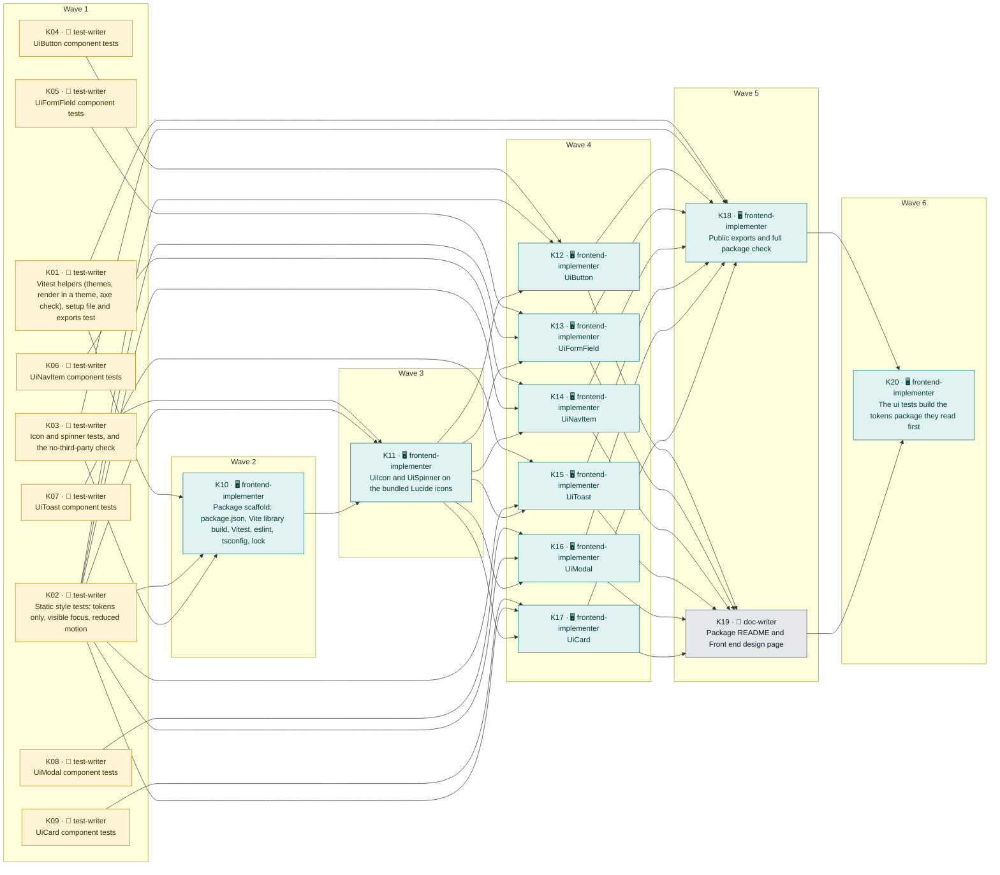

# T0.15: Base UI components, plan

**Plan:** 🟢 Approved

**Push:** 🟢 Approved

<!-- ticket:specs -->
## 📚 Specifications

The specification and design pages of [TICKET.md](TICKET.md), copied by `python3 .claude/scripts/tickets/ticket_refs.py sync`.

- [Front end](../../technical/architecture/frontend.md)
- [D43](../../specs/06-decisions/ux/d43-light-and-dark.md)
- [D46](../../specs/06-decisions/ux/d46-accessibility-standard.md)
- [D45](../../specs/06-decisions/ux/d45-lucide-icons.md)
- [📜 D407 Front end](../../specs/06-decisions/technical/d407-front-end.md)
- [♿ Accessibility](../../specs/05-non-functional/accessibility.md#measures)
<!-- /ticket:specs -->

## Summary

T0.15 builds `frontend/packages/ui`: six base Vue 3 components (UiButton, UiFormField, UiNavItem, UiToast, UiModal, UiCard), with UiIcon and UiSpinner wrapping the bundled Lucide icons. They work in light and dark, can be reached by keyboard with a visible focus, take their styles from the tokens package only, and have Vitest tests that include an axe-core check. Wave 1 has nine test-writer tasks: the shared Vitest helpers and the exports test, the static style rules (tokens only, visible focus, reduced motion), the icon tests with the check that nothing comes from a third party, and one spec per component. Wave 2 is the package scaffold (package.json, Vite library build, Vitest with jsdom, eslint, tsconfig, lock). Wave 3 is UiIcon and UiSpinner. Wave 4 is the six components, one task each. Wave 5 fills the public exports and writes the docs beside it. No screen is touched, so there is no Playwright task (TICKET.md: No screen).

## Assumptions

- The roadmap names no use case, screen, business rule or entity for this ticket; the design-system component pages settle what each component does.
- Navigation item is taken as the item of C-08 Navigation alone, not the whole sidebar (T0.17).
- The tokens package of T0.07 is assumed available; the ticket graph is the authority on that prerequisite.
- The accessibility check tool is not named in the roadmap row; axe-core (named by the design system for Playwright) is assumed for the component tests.
- The Accessibility budget page has no measures yet, so none is stated beyond the roadmap row.
- No screen is built: frontend/packages/ui is a shared component package, so TICKET.md says No screen with the reason (TKT-21).
- check_ticket.py could not be run (no shell tool available), so links and anchors were verified by reading only; component page link texts use 'C-01 Button' style titles, not formal IDs.
- T0.02 (frontend/packages/config) and T0.07 (frontend/packages/tokens) are merged before this ticket runs, as the start rule requires. Their package scope, CSS variable names, CSS entry and theme mechanism are read from those packages, not invented. If the tokens package can switch to dark only through prefers-color-scheme, K01 reports itself blocked.
- The component tests run in Vitest with jsdom, @testing-library/vue, @testing-library/user-event and axe-core. jsdom cannot compute colour contrast, so the axe check turns off `color-contrast` only. Contrast is covered by the tokens' contrast test (T0.07) and by the Playwright axe runs (T0.22). The alternative, Vitest browser mode, would need browsers in CI, which this ticket's area does not cover.
- Visible focus (criterion 3) is checked in two ways: statically, with a `:focus-visible` or `:focus-within` rule using `color-primary` at 2 px in each component's styles, and dynamically, with keyboard reachability through user-event. jsdom does not paint focus rings.
- The primary button's text uses `color-surface`: white in light, as C-01 says, and the dark surface in dark. The tokens have no on-primary colour, and white on the dark primary #A3A6FF would fail AA.
- Hover is made with `color-mix` towards `color-text` (8 %). That is darker in light and lighter in dark, as C-01 asks, without a colour outside the tokens.
- UiFormField covers only the native text-like types (text, number, date, email, tel, url), with the locked, loading, help, error and unit states. The other F2 field types of C-02 (select, switch, money, record link, files and the rest) come with the tickets that need them. The field shows the error its caller gives and never validates by itself.
- UiNavItem is one link with no vue-router dependency. The nav landmark, the sidebar, the skip link and routing belong to T0.17.
- UiToast neither positions itself nor enforces one toast at a time. The host that places it bottom right (above the tab bar on phones) and replaces the old toast belongs to the app shell. After a hover or focus pause, it resumes with the time left.
- The Empty and Error states of the card and the error variant of the modal take their content from slots. C-10 Empty state and the error message component belong to other tickets (T0.23 for the error pattern).
- No text is hard-coded in the components. Labels such as the close button's accessible name are required props until the i18n base of T0.16.
- Lucide comes from the npm package lucide-vue-next (ISC), pinned exactly in pnpm-lock.yaml (D415), and bundled at build time. No icon is loaded at runtime. That is how the plan reads 'served by SimpleERP itself' (D45).
- Tests live in frontend/packages/ui/tests/, mirroring src/, as AGENT.md's tests rule does for Python. The components live in src/components/Ui<Name>.vue.
- Until wave 4 is integrated, the spec files of components not built yet fail the package typecheck in the worktrees of earlier tasks. This is the expected tests-first state (TKT-4, TKT-13), and no task shims it.

<!-- plan:graph -->

> [!NOTE]
> Generated from the json block at the end of this page by `python3 .claude/scripts/tickets/plan.py render`.
> To change a task, edit the json block, then render again: never edit this view by hand.

## Waves

| Wave | Tasks | Agents running at once |
| --- | --- | --- |
| 1 | [K01](#k01), [K02](#k02), [K03](#k03), [K04](#k04), [K05](#k05), [K06](#k06), [K07](#k07), [K08](#k08), [K09](#k09) | 8 of 9 |
| 2 | [K10](#k10) | 1 of 1 |
| 3 | [K11](#k11) | 1 of 1 |
| 4 | [K12](#k12), [K13](#k13), [K14](#k14), [K15](#k15), [K16](#k16), [K17](#k17) | 6 of 6 |
| 5 | [K18](#k18), [K19](#k19) | 2 of 2 |
| 6 | [K20](#k20) | 1 of 1 |

| Wave | Task | Agent | Depends on | Unblocks |
| --- | --- | --- | --- | --- |
| 1 | [K01](#k01) Vitest helpers (themes, render in a theme, axe check), setup file and exports test | 🧪 test-writer | none | [K10](#k10), [K18](#k18) |
| 1 | [K02](#k02) Static style tests: tokens only, visible focus, reduced motion | 🧪 test-writer | none | [K10](#k10), [K11](#k11), [K12](#k12), [K13](#k13), [K14](#k14), [K15](#k15), [K16](#k16), [K17](#k17) |
| 1 | [K03](#k03) Icon and spinner tests, and the no-third-party check | 🧪 test-writer | none | [K10](#k10), [K11](#k11), [K18](#k18) |
| 1 | [K04](#k04) UiButton component tests | 🧪 test-writer | none | [K12](#k12) |
| 1 | [K05](#k05) UiFormField component tests | 🧪 test-writer | none | [K13](#k13) |
| 1 | [K06](#k06) UiNavItem component tests | 🧪 test-writer | none | [K14](#k14) |
| 1 | [K07](#k07) UiToast component tests | 🧪 test-writer | none | [K15](#k15) |
| 1 | [K08](#k08) UiModal component tests | 🧪 test-writer | none | [K16](#k16) |
| 1 | [K09](#k09) UiCard component tests | 🧪 test-writer | none | [K17](#k17) |
| 2 | [K10](#k10) Package scaffold: package.json, Vite library build, Vitest, eslint, tsconfig, lock | 🖥️ frontend-implementer | [K01](#k01), [K02](#k02), [K03](#k03) | [K11](#k11) |
| 3 | [K11](#k11) UiIcon and UiSpinner on the bundled Lucide icons | 🖥️ frontend-implementer | [K03](#k03), [K02](#k02), [K10](#k10) | [K12](#k12), [K13](#k13), [K14](#k14), [K15](#k15), [K16](#k16), [K17](#k17) |
| 4 | [K12](#k12) UiButton | 🖥️ frontend-implementer | [K04](#k04), [K02](#k02), [K11](#k11) | [K18](#k18), [K19](#k19) |
| 4 | [K13](#k13) UiFormField | 🖥️ frontend-implementer | [K05](#k05), [K02](#k02), [K11](#k11) | [K18](#k18), [K19](#k19) |
| 4 | [K14](#k14) UiNavItem | 🖥️ frontend-implementer | [K06](#k06), [K02](#k02), [K11](#k11) | [K18](#k18), [K19](#k19) |
| 4 | [K15](#k15) UiToast | 🖥️ frontend-implementer | [K07](#k07), [K02](#k02), [K11](#k11) | [K18](#k18), [K19](#k19) |
| 4 | [K16](#k16) UiModal | 🖥️ frontend-implementer | [K08](#k08), [K02](#k02), [K11](#k11) | [K18](#k18), [K19](#k19) |
| 4 | [K17](#k17) UiCard | 🖥️ frontend-implementer | [K09](#k09), [K02](#k02), [K11](#k11) | [K18](#k18), [K19](#k19) |
| 5 | [K18](#k18) Public exports and full package check | 🖥️ frontend-implementer | [K01](#k01), [K03](#k03), [K12](#k12), [K13](#k13), [K14](#k14), [K15](#k15), [K16](#k16), [K17](#k17) | [K20](#k20) |
| 5 | [K19](#k19) Package README and Front end design page | 📝 doc-writer | [K12](#k12), [K13](#k13), [K14](#k14), [K15](#k15), [K16](#k16), [K17](#k17) | [K20](#k20) |
| 6 | [K20](#k20) The ui tests build the tokens package they read first | 🖥️ frontend-implementer | [K18](#k18), [K19](#k19) | none |

## Dependency graph



## Tasks

### <a id="k01"></a>K01: Vitest helpers (themes, render in a theme, axe check), setup file and exports test

| Agent | Wave | Depends on | Unblocks |
| --- | --- | --- | --- |
| 🧪 test-writer | 1 | none | [K10](#k10), [K18](#k18) |

**Files** (only this task may change them in its wave):

- `frontend/packages/ui/tests/setup.ts`
- `frontend/packages/ui/tests/helpers/themes.ts`
- `frontend/packages/ui/tests/helpers/render-in-theme.ts`
- `frontend/packages/ui/tests/helpers/expect-no-axe-violations.ts`
- `frontend/packages/ui/tests/index.spec.ts`

**Done when:** The five files exist with the exact API above. Once K10 has landed, `pnpm --filter ./frontend/packages/ui exec vitest run tests/index.spec.ts` fails only because `src/index.ts` exports nothing yet, and `pnpm --filter ./frontend/packages/ui exec eslint tests/helpers tests/setup.ts tests/index.spec.ts` reports no error.

**Brief:**

Ticket T0.15 (docs/tickets/T0.15/TICKET.md) creates `frontend/packages/ui`, the base component package of D407 (docs/specs/06-decisions/technical/d407-front-end.md) at the D438 path (docs/specs/06-decisions/technical/d438-repository-layout.md). Every other test task of this ticket imports the helpers you write, so their API must be exactly this. The stack: Vitest with the jsdom environment, @testing-library/vue, @testing-library/user-event and axe-core. Task K10 installs them later, so you do not run them now.

Write:
1. `tests/helpers/themes.ts`: `export const THEMES = ['light', 'dark'] as const` and `export type Theme = (typeof THEMES)[number]`. D43 (docs/specs/06-decisions/ux/d43-light-and-dark.md) asks for both themes.
2. `tests/helpers/render-in-theme.ts`: `export function renderInTheme(component: Component, options: { theme: Theme; props?: Record<string, unknown>; slots?: Record<string, unknown>; attrs?: Record<string, unknown> }): RenderResult`. It applies the theme to `document.documentElement` with the mechanism the tokens package of T0.07 provides, then calls `render` of @testing-library/vue. Read `frontend/packages/tokens` (its package.json exports and README) for the mechanism: an attribute, a class, or a helper it exports. Use exactly that mechanism and report it as a decision. If the package selects the dark theme only through `prefers-color-scheme`, report the task as blocked and do not invent an attribute. Also export `currentTheme(): Theme`, which reads the theme back from the root element.
3. `tests/helpers/expect-no-axe-violations.ts`: `export async function expectNoAxeViolations(container: Element): Promise<void>`. It runs `axe.run(container, { runOnly: { type: 'tag', values: ['wcag2a', 'wcag2aa', 'wcag21a', 'wcag21aa', 'wcag22aa'] } })` and fails with the id, impact and target of every violation. This is the automated check of Accessibility (docs/specs/04-ux/design-system/accessibility.md) and D46 (docs/specs/06-decisions/ux/d46-accessibility-standard.md). Disable only the `color-contrast` rule, which jsdom cannot compute. Contrast is covered by the tokens' contrast test of T0.07 and by the Playwright axe runs of T0.22, so say so in a comment-free docstring (JSDoc).
4. `tests/setup.ts`: imports the tokens package's CSS entry, calls `cleanup()` after each test, and resets the theme on the root element after each test. It stubs `window.matchMedia` only if jsdom lacks it, with a real minimal implementation, not a mock library.
5. `tests/index.spec.ts`: `describe('package exports')`. It uses `import * as ui from '../src/index'` and checks `Object.keys(ui)` by string only, so it type-checks before the components exist. `src/index.ts` exports `UiButton`, `UiFormField`, `UiNavItem`, `UiToast`, `UiModal`, `UiCard`, `UiIcon` and `UiSpinner`, and each is a Vue component (an object or a function).

Follow the front-end rules of AGENT.md (Front ends, Tests: name tests as sentences, no mocks) and TKT-4. Change only these files.

### <a id="k02"></a>K02: Static style tests: tokens only, visible focus, reduced motion

| Agent | Wave | Depends on | Unblocks |
| --- | --- | --- | --- |
| 🧪 test-writer | 1 | none | [K10](#k10), [K11](#k11), [K12](#k12), [K13](#k13), [K14](#k14), [K15](#k15), [K16](#k16), [K17](#k17) |

**Files** (only this task may change them in its wave):

- `frontend/packages/ui/tests/styles/component-styles.ts`
- `frontend/packages/ui/tests/styles/tokens-only.spec.ts`
- `frontend/packages/ui/tests/styles/focus-visible.spec.ts`

**Done when:** The three files exist with one case per component. Once K10 has landed, `pnpm --filter ./frontend/packages/ui exec vitest run tests/styles` fails only because the component files are missing, and `pnpm --filter ./frontend/packages/ui exec eslint tests/styles` reports no error.

**Brief:**

Ticket T0.15 (docs/tickets/T0.15/TICKET.md), acceptance criteria 3 and 5: the styles of the components come from the tokens package, and every interactive component shows a visible focus. The pages: Tokens (docs/specs/04-ux/design-system/tokens.md), D46 (docs/specs/06-decisions/ux/d46-accessibility-standard.md), C-01 Button (docs/specs/04-ux/design-system/components/c-01-button.md, focus is a 2 px `color-primary` ring offset 2 px), C-02 Form field (docs/specs/04-ux/design-system/components/c-02-form-field.md, focus is a 2 px `color-primary` edge), C-04 Card (docs/specs/04-ux/design-system/components/c-04-card.md), C-05 Modal (docs/specs/04-ux/design-system/components/c-05-modal.md), C-06 Toast (docs/specs/04-ux/design-system/components/c-06-toast.md), C-08 Navigation (docs/specs/04-ux/design-system/components/c-08-navigation.md) and Motion (docs/specs/04-ux/visual-identity/motion.md, instant transitions with reduced motion).

The components are `frontend/packages/ui/src/components/{UiButton,UiFormField,UiNavItem,UiToast,UiModal,UiCard,UiIcon,UiSpinner}.vue`, single-file components whose styles sit in `<style scoped>` blocks.

1. `tests/styles/component-styles.ts` reads the `<style>` blocks of a component file, with node `fs` and `encoding 'utf-8'`, into declarations (selector, property, value), with a small parser or `postcss`. postcss is a dependency of Vite, so K10 adds it as a dev dependency. It also reads the set of CSS custom properties the tokens package defines: find its CSS entry from `frontend/packages/tokens/package.json` and collect every `--name:` declaration.
2. `tests/styles/tokens-only.spec.ts`: `describe('component styles')` with `it.each` over the eight component names. Every test title contains the component name, so that `-t UiButton` selects it. For each component:
   - Colour properties (`color`, `background`, `background-color`, `border`, `border-*`, `outline`, `outline-color`, `fill`, `stroke`, `caret-color`, `text-decoration-color`) hold no hex, `rgb(`, `rgba(`, `hsl(` or `hsla(`. The only words allowed are `var(...)`, `currentColor`, `transparent`, `inherit`, `none`, `solid`, `dashed`, `color-mix`, `in` and `srgb`, with numbers, `px` and `%`. So `color-mix(in srgb, var(--color-text) 45%, transparent)` passes and `white` fails.
   - `box-shadow` is a `var(--...)` or `none`. `border-radius` is a `var(--...)`, `0` or `50%`.
   - `padding*`, `margin*`, `gap`, `row-gap` and `column-gap` are made only of `var(--...)`, `0`, `auto` or a `calc()` of them.
   - `font-family` and `font-size` are a `var(--...)` or `inherit`.
   - Every `var(--x)` names a property the tokens package defines, or one declared in the same style block.
   - Every component with a `transition` or an `animation` also has a `@media (prefers-reduced-motion: reduce)` block.
3. `tests/styles/focus-visible.spec.ts`: `describe('focus styles')`, `it.each` over UiButton, UiFormField, UiNavItem, UiToast, UiModal and UiCard. Each has a rule whose selector holds `:focus-visible` or `:focus-within` (UiFormField may use `:focus`) and whose declarations use the token of `color-primary` in an `outline` or `border` 2px wide. Take the token's CSS name from the tokens package. Each component file must exist, so a missing file fails its own case.

Follow AGENT.md (Front ends, Tests) and TKT-4. Change only these files.

### <a id="k03"></a>K03: Icon and spinner tests, and the no-third-party check

| Agent | Wave | Depends on | Unblocks |
| --- | --- | --- | --- |
| 🧪 test-writer | 1 | none | [K10](#k10), [K11](#k11), [K18](#k18) |

**Files** (only this task may change them in its wave):

- `frontend/packages/ui/tests/components/ui-icon.spec.ts`
- `frontend/packages/ui/tests/components/ui-spinner.spec.ts`
- `frontend/packages/ui/tests/build/no-third-party.spec.ts`

**Done when:** The three files exist with these cases. Once K10 has landed, `pnpm --filter ./frontend/packages/ui exec vitest run tests/components/ui-icon.spec.ts tests/components/ui-spinner.spec.ts tests/build` fails only because the icon components and `src/` are missing, and eslint reports no error in the three files.

**Brief:**

Ticket T0.15 (docs/tickets/T0.15/TICKET.md), acceptance criterion 4: the Lucide icons come from the package itself and nothing is fetched from a third party, as D45 decides (docs/specs/06-decisions/ux/d45-lucide-icons.md: Lucide, ISC licence, served by SimpleERP itself). Iconography (docs/specs/04-ux/visual-identity/iconography.md) gives 16, 20 and 24 px sizes, stroke width 2, and an accessible name for an icon shown alone. The icons come from the npm package `lucide-vue-next`, which is bundled.

The helpers of K01 are `renderInTheme(component, { theme, props })` from `tests/helpers/render-in-theme.ts`, `THEMES` from `tests/helpers/themes.ts` and `expectNoAxeViolations(container)` from `tests/helpers/expect-no-axe-violations.ts`.

The component APIs:
- `src/components/UiIcon.vue` has props `icon` (a Lucide component, required), `size` (16 | 20 | 24, default 20) and `label` (string, optional).
- `src/components/UiSpinner.vue` has props `size` (default 20) and `label` (optional).

Write:
1. `ui-icon.spec.ts`, `describe('UiIcon')`:
   - In each theme of THEMES, it renders an inline `<svg>` in the DOM, never an `` or a `<use href>`, with width and height equal to `size` and `stroke-width` 2.
   - Without a label, it is `aria-hidden="true"`. With a label, it has `role="img"` and `aria-label` equal to the label.
   - `expectNoAxeViolations` passes in both themes, with and without a label.
2. `ui-spinner.spec.ts`, `describe('UiSpinner')`:
   - It renders the Lucide `LoaderCircle` svg, hidden from screen readers without a label.
   - Its SFC source, read as text, has an animation and a `@media (prefers-reduced-motion: reduce)` block that removes it (Motion, docs/specs/04-ux/visual-identity/motion.md).
   - axe passes in both themes.
3. `tests/build/no-third-party.spec.ts`, `describe('third parties')`:
   - (a) No file under `src/` holds `http://`, `https://` or a protocol-relative `//` URL, except the SVG namespace `http://www.w3.org/`.
   - (b) Every icon import in `src/` comes from `lucide-vue-next`, and `package.json` lists `lucide-vue-next` under `dependencies` with an exact version (D415: pinned).
   - (c) `build()` of Vite, called with the package's `vite.config.ts` and `write: false`, gives output chunks and CSS with no `http(s)://` URL except the w3.org namespace.

Follow AGENT.md (Front ends, Tests) and TKT-4. Change only these files.

### <a id="k04"></a>K04: UiButton component tests

| Agent | Wave | Depends on | Unblocks |
| --- | --- | --- | --- |
| 🧪 test-writer | 1 | none | [K12](#k12) |

**Files** (only this task may change them in its wave):

- `frontend/packages/ui/tests/components/ui-button.spec.ts`

**Done when:** `frontend/packages/ui/tests/components/ui-button.spec.ts` exists with these cases. Once K10 has landed, `pnpm --filter ./frontend/packages/ui exec vitest run tests/components/ui-button.spec.ts` fails only because `UiButton.vue` is missing.

**Brief:**

Ticket T0.15 (docs/tickets/T0.15/TICKET.md), criteria 1, 2 and 3, for C-01 Button (docs/specs/04-ux/design-system/components/c-01-button.md). D43 (docs/specs/06-decisions/ux/d43-light-and-dark.md) asks for both themes, D46 (docs/specs/06-decisions/ux/d46-accessibility-standard.md) and Accessibility (docs/specs/04-ux/design-system/accessibility.md) for the axe check and keyboard use.

The component is `src/components/UiButton.vue`. Its props:
- `variant`: 'primary' | 'secondary' | 'danger' | 'ghost', default 'primary'.
- `label`: string, required. It is the visible label, or the accessible name when `iconOnly`.
- `icon`: a Lucide component, optional. `iconOnly`: boolean.
- `type`: 'button' | 'submit' | 'reset', default 'button'.
- `href`: optional, renders an `<a>` for an action that opens a page.
- `loading`, `disabled`: boolean. `disabledReason`: string, optional. `block`: boolean, full width on phones.
It emits `click`.

Use the K01 helpers `renderInTheme`, `THEMES` and `expectNoAxeViolations` (paths `tests/helpers/render-in-theme.ts`, `tests/helpers/themes.ts`, `tests/helpers/expect-no-axe-violations.ts`) and `@testing-library/user-event`. Put everything under `describe('UiButton')`, with `describe.each(THEMES)` for the cases that run in both themes.

Cases:
- In each theme, every variant and the icon-only button have their label as accessible name and no axe violation.
- It renders a native `<button type="button">` by default. With `href`, it renders an `<a href>`.
- Keyboard: `user.tab()` focuses it, and Enter and Space each emit exactly one `click`.
- An icon renders an `aria-hidden` svg before the label (use `Send` of lucide-vue-next). An icon-only button has `aria-label` equal to the label and shows no label text.
- Loading: the spinner svg replaces the icon, the label stays, `aria-busy="true"` and `aria-disabled="true"` are set, it stays in the tab order, and pointer and keyboard presses emit no `click`.
- Disabled: native `disabled`, skipped by `user.tab()`, no `click`. `disabledReason` sets the `title`.

Name tests as sentences. Use no mock library (AGENT.md Tests). Change only this file.

### <a id="k05"></a>K05: UiFormField component tests

| Agent | Wave | Depends on | Unblocks |
| --- | --- | --- | --- |
| 🧪 test-writer | 1 | none | [K13](#k13) |

**Files** (only this task may change them in its wave):

- `frontend/packages/ui/tests/components/ui-form-field.spec.ts`

**Done when:** `frontend/packages/ui/tests/components/ui-form-field.spec.ts` exists with these cases. Once K10 has landed, running it with `pnpm --filter ./frontend/packages/ui exec vitest run tests/components/ui-form-field.spec.ts` fails only because `UiFormField.vue` is missing.

**Brief:**

Ticket T0.15 (docs/tickets/T0.15/TICKET.md), criteria 1, 2 and 3, for C-02 Form field (docs/specs/04-ux/design-system/components/c-02-form-field.md), with D43 (docs/specs/06-decisions/ux/d43-light-and-dark.md), D46 (docs/specs/06-decisions/ux/d46-accessibility-standard.md) and Accessibility (docs/specs/04-ux/design-system/accessibility.md).

The component is `src/components/UiFormField.vue`, the base text-like field. Its props:
- `label`: required. `modelValue`: string | number | null.
- `type`: 'text' | 'number' | 'date' | 'email' | 'tel' | 'url', default 'text'.
- `id`: optional, generated otherwise.
- `required`, `disabled`, `readonly`, `locked` (read-only with a lock icon), `loading`: boolean.
- `help`, `error`, `unit`, `placeholder`: string, optional. `icon`: a Lucide component, optional.
It emits `update:modelValue` and `blur`.

Use the K01 helpers `renderInTheme`, `THEMES` and `expectNoAxeViolations` from `tests/helpers/` and `@testing-library/user-event`. Put everything under `describe('UiFormField')`, with `describe.each(THEMES)` for the theme cases.

Cases:
- In each theme, no axe violation for the default, help, error, required, disabled, locked and loading fields.
- `getByLabelText(label)` returns the input, and the label stays visible when a placeholder is set.
- The help is linked by `aria-describedby`. An error replaces the help, `aria-describedby` points at the error, `aria-invalid="true"` is set, and the error shows an `aria-hidden` alert svg and its text.
- Required: the input has `required`, and the visible mark is `aria-hidden`.
- Typing emits `update:modelValue` with the value, and leaving the field emits `blur`.
- Keyboard: `user.tab()` reaches the input. A disabled input is skipped. A locked input is reachable, `readonly`, not changed by typing, and shows a lock svg.
- Loading: the spinner svg is inside the field and the input has `aria-busy="true"`.
- `unit` is rendered inside the field.

Name tests as sentences. Use no mocks. Change only this file.

### <a id="k06"></a>K06: UiNavItem component tests

| Agent | Wave | Depends on | Unblocks |
| --- | --- | --- | --- |
| 🧪 test-writer | 1 | none | [K14](#k14) |

**Files** (only this task may change them in its wave):

- `frontend/packages/ui/tests/components/ui-nav-item.spec.ts`

**Done when:** `frontend/packages/ui/tests/components/ui-nav-item.spec.ts` exists with these cases. Once K10 has landed, `pnpm --filter ./frontend/packages/ui exec vitest run tests/components/ui-nav-item.spec.ts` fails only because `UiNavItem.vue` is missing.

**Brief:**

Ticket T0.15 (docs/tickets/T0.15/TICKET.md), criteria 1, 2 and 3, for the item of C-08 Navigation (docs/specs/04-ux/design-system/components/c-08-navigation.md). Its states are default, hover, focus, active (the current page) and with a badge for counts; the current page is marked `aria-current`, and every item is reachable by keyboard. Also D43 (docs/specs/06-decisions/ux/d43-light-and-dark.md), D46 (docs/specs/06-decisions/ux/d46-accessibility-standard.md) and Accessibility (docs/specs/04-ux/design-system/accessibility.md).

The sidebar, the `nav` landmark and the skip link belong to T0.17 and are out of scope. The component is `src/components/UiNavItem.vue`. It renders one `<a>` and has these props:
- `href`: required. `label`: required.
- `icon`: a Lucide component, optional.
- `current`: boolean. `badge`: number, optional.
- `collapsed`: boolean, icon only, the sidebar collapsed to icons.

Render it inside `<nav aria-label="Main"><ul><li>`, built with `h()` render functions so that no runtime template compiler is needed. Use the K01 helpers `renderInTheme`, `THEMES` and `expectNoAxeViolations` from `tests/helpers/`, and `@testing-library/user-event`. Put everything under `describe('UiNavItem')`.

Cases:
- In each theme, no axe violation for the default, current, with-badge and collapsed items.
- `aria-current="page"` is present only when `current`.
- `user.tab()` focuses the link.
- The icon svg is `aria-hidden`.
- Collapsed: the label is not visible text, but the accessible name of the link equals the label.
- With a badge, the count is rendered and is part of the accessible name.

Name tests as sentences. Use no mocks. Change only this file.

### <a id="k07"></a>K07: UiToast component tests

| Agent | Wave | Depends on | Unblocks |
| --- | --- | --- | --- |
| 🧪 test-writer | 1 | none | [K15](#k15) |

**Files** (only this task may change them in its wave):

- `frontend/packages/ui/tests/components/ui-toast.spec.ts`

**Done when:** `frontend/packages/ui/tests/components/ui-toast.spec.ts` exists with these cases. Once K10 has landed, running it with vitest fails only because `UiToast.vue` is missing.

**Brief:**

Ticket T0.15 (docs/tickets/T0.15/TICKET.md), criteria 1, 2, 3 and 6, for C-06 Toast (docs/specs/04-ux/design-system/components/c-06-toast.md). The toast is announced politely (`role="status"`) and never takes the focus. Without an action it closes after 6 seconds. It pauses while hovered or focused. With an action, it stays until closed, and its action can be reached by keyboard. Also D43 (docs/specs/06-decisions/ux/d43-light-and-dark.md), D46 (docs/specs/06-decisions/ux/d46-accessibility-standard.md) and Accessibility (docs/specs/04-ux/design-system/accessibility.md).

The component is `src/components/UiToast.vue`. Its props:
- `kind`: 'success' | 'info', default 'success'.
- `message`: required. `actionLabel`: optional.
- `closeLabel`: required, the accessible name of the close button.
- `durationMs`: default 6000.
It emits `action` and `close`.

Use the K01 helpers `renderInTheme`, `THEMES` and `expectNoAxeViolations` from `tests/helpers/`, `@testing-library/user-event`, and `vi.useFakeTimers()`. Put everything under `describe('UiToast')`.

Cases:
- In each theme, no axe violation for success, info and with an action.
- It has `role="status"` and no `role="alert"`.
- A button focused before the toast mounts is still `document.activeElement` after it mounts, with and without an action.
- Without an action, it emits `close` once at 6000 ms and not at 5999 ms.
- Hover (`mouseenter`) or focus inside (`focusin`) pauses the timer. After `mouseleave` or `focusout`, it closes after the time that was left.
- With an action, it does not close by itself after 60 s. The action button is reached by `user.tab()` and emits `action` on Enter.
- The close button is named by `closeLabel` and emits `close`.
- The success and info kinds render different `aria-hidden` icons.

Name tests as sentences. Use no mock library: fake timers are Vitest's own. Change only this file.

### <a id="k08"></a>K08: UiModal component tests

| Agent | Wave | Depends on | Unblocks |
| --- | --- | --- | --- |
| 🧪 test-writer | 1 | none | [K16](#k16) |

**Files** (only this task may change them in its wave):

- `frontend/packages/ui/tests/components/ui-modal.spec.ts`

**Done when:** `frontend/packages/ui/tests/components/ui-modal.spec.ts` exists with these cases. Once K10 has landed, running it with vitest fails only because `UiModal.vue` is missing.

**Brief:**

Ticket T0.15 (docs/tickets/T0.15/TICKET.md), criteria 1, 2 and 3, for C-05 Modal (docs/specs/04-ux/design-system/components/c-05-modal.md):
- `role="dialog"`, or `alertdialog` for an error, with `aria-modal`, named by its title.
- Focus moves to the first field, or else to the dialog. It stays inside while the modal is open and returns to the opener on closing.
- Escape cancels. The close button has an accessible name.
Also D43 (docs/specs/06-decisions/ux/d43-light-and-dark.md), D46 (docs/specs/06-decisions/ux/d46-accessibility-standard.md) and Accessibility (docs/specs/04-ux/design-system/accessibility.md).

The component is `src/components/UiModal.vue`. Its props:
- `open`: boolean. `title`: required.
- `variant`: 'confirmation' | 'error' | 'form', default 'confirmation'.
- `closeLabel`: required.
Its slots are the default slot (the content) and `actions`. It emits `close`. It may teleport to `body`, so query through `screen`.

Use the K01 helpers `renderInTheme`, `THEMES` and `expectNoAxeViolations` from `tests/helpers/` and `@testing-library/user-event`, and build slot content with `h()`. Put everything under `describe('UiModal')`.

Cases:
- Closed: no dialog in the DOM.
- Open: role `dialog`, or `alertdialog` for `variant: 'error'`, with `aria-modal="true"` and the title as accessible name.
- Focus goes to the first input of the content. Without a field, focus goes to the dialog.
- Tab on the last focusable element goes to the first, and Shift+Tab on the first goes to the last.
- Escape emits `close`. The close button, named by `closeLabel`, emits `close`.
- A button focused before opening gets the focus back when `open` turns false (rerender).
- The error variant shows an `aria-hidden` error icon.
- In each theme, no axe violation for each variant.

Name tests as sentences. Use no mocks. Change only this file.

### <a id="k09"></a>K09: UiCard component tests

| Agent | Wave | Depends on | Unblocks |
| --- | --- | --- | --- |
| 🧪 test-writer | 1 | none | [K17](#k17) |

**Files** (only this task may change them in its wave):

- `frontend/packages/ui/tests/components/ui-card.spec.ts`

**Done when:** `frontend/packages/ui/tests/components/ui-card.spec.ts` exists with these cases. Once K10 has landed, running it with vitest fails only because `UiCard.vue` is missing.

**Brief:**

Ticket T0.15 (docs/tickets/T0.15/TICKET.md), criteria 1, 2 and 3, for C-04 Card (docs/specs/04-ux/design-system/components/c-04-card.md):
- A card has a heading.
- A clickable card holds one link, its title, and other actions are separate buttons, never inside the link.
- A selectable card has radio or checkbox semantics, and when selected it shows a check icon.
- Loading shows skeleton lines.
Also D43 (docs/specs/06-decisions/ux/d43-light-and-dark.md), D46 (docs/specs/06-decisions/ux/d46-accessibility-standard.md) and Accessibility (docs/specs/04-ux/design-system/accessibility.md).

The component is `src/components/UiCard.vue`. Its props:
- `title`: required. `headingLevel`: 2 to 6, default 3.
- `href`: optional, makes a clickable card.
- `selectable`: 'radio' | 'checkbox', optional, with `selected` (boolean), `name` and `value`.
- `figure` and `change`: optional, for the figure card.
- `loading`: boolean.
Its slots are the default slot and `actions`. It emits `update:selected`.

Use the K01 helpers `renderInTheme`, `THEMES` and `expectNoAxeViolations` from `tests/helpers/` and `@testing-library/user-event`. Put everything under `describe('UiCard')`.

Cases:
- A heading of `headingLevel` holds the title.
- With `href`, there is exactly one link, named by the title, and a button in the `actions` slot is not inside it.
- Selectable radio: role `radio`, checked when `selected`. Space on it emits `update:selected` with true. The checkbox variant does the same with role `checkbox`. When selected, an `aria-hidden` check svg is shown.
- Loading: `aria-busy="true"`, skeleton lines, no slot content.
- The figure and the change are rendered.
- The link and the selectable input are reached by `user.tab()`.
- In each theme, no axe violation for content, figure, clickable, selectable (radio and checkbox, selected or not) and loading cards.

Name tests as sentences. Use no mocks. Change only this file.

### <a id="k10"></a>K10: Package scaffold: package.json, Vite library build, Vitest, eslint, tsconfig, lock

| Agent | Wave | Depends on | Unblocks |
| --- | --- | --- | --- |
| 🖥️ frontend-implementer | 2 | [K01](#k01), [K02](#k02), [K03](#k03) | [K11](#k11) |

**Files** (only this task may change them in its wave):

- `frontend/packages/ui/package.json`
- `frontend/packages/ui/tsconfig.json`
- `frontend/packages/ui/vite.config.ts`
- `frontend/packages/ui/vitest.config.ts`
- `frontend/packages/ui/eslint.config.js`
- `frontend/packages/ui/src/env.d.ts`
- `frontend/packages/ui/src/index.ts`
- `pnpm-workspace.yaml`
- `pnpm-lock.yaml`

**Done when:** `pnpm install --frozen-lockfile` passes at the repository root. `pnpm --filter ./frontend/packages/ui exec vitest list` collects the spec files of `tests/`. `pnpm --filter ./frontend/packages/ui exec eslint package.json vite.config.ts vitest.config.ts eslint.config.js src` reports no error.

**Brief:**

Ticket T0.15 (docs/tickets/T0.15/TICKET.md) creates `frontend/packages/ui`. It is a pnpm workspace package at the D438 path (docs/specs/06-decisions/technical/d438-repository-layout.md), Vue 3 with TypeScript and Vite as D407 (docs/specs/06-decisions/technical/d407-front-end.md) and Front end (docs/technical/architecture/frontend.md) say, built on the tokens package of T0.07.

Write:
1. `package.json`.
   - Name it after the scope of the existing `frontend/packages/tokens` and `frontend/packages/config`.
   - Make it `private` and `type: module`. Export `src/index.ts` for the workspace and the built `dist/` for the image builds, the way the tokens package does.
   - Scripts: `lint` (eslint .), `typecheck` (vue-tsc --noEmit), `test` (vitest run) and `build` (vite build).
   - `dependencies`: the tokens package (`workspace:*`) and `lucide-vue-next` (ISC licence, D45 docs/specs/06-decisions/ux/d45-lucide-icons.md). `peerDependencies`: `vue`.
   - `devDependencies`: vue, vite, @vitejs/plugin-vue, vitest, jsdom, @vue/test-utils, @testing-library/vue, @testing-library/user-event, axe-core, postcss, typescript, vue-tsc, eslint and the shared config package.
   - Pin every version exactly, as D415 asks (pinned locks).
2. `vite.config.ts`: library mode, entry `src/index.ts`, ES output. `vue`, `lucide-vue-next` and the tokens package are external, and the CSS is emitted with the bundle.
3. `vitest.config.ts`: environment jsdom, `setupFiles: ['tests/setup.ts']` (written by K01), include `tests/**/*.spec.ts`, and the Vue plugin.
4. `tsconfig.json` and `eslint.config.js`, extending the strict settings of `frontend/packages/config` (T0.02), with `tests/` included.
5. `src/env.d.ts`, the `*.vue` module declaration, if the config package does not already provide one.
6. `src/index.ts` as a placeholder holding `export {}`. Task K18 fills it.
7. Update `pnpm-lock.yaml` with `pnpm install`. Change `pnpm-workspace.yaml` only if it does not already include `frontend/packages/*`.

The tests of K01, K02 and K03 are already in `tests/`. Spec files import components that later tasks build, so their typecheck and test failures are expected now. Do not shim them or touch them (TKT-19).

Follow AGENT.md (Front ends, Commands). Change only these files.

### <a id="k11"></a>K11: UiIcon and UiSpinner on the bundled Lucide icons

| Agent | Wave | Depends on | Unblocks |
| --- | --- | --- | --- |
| 🖥️ frontend-implementer | 3 | [K03](#k03), [K02](#k02), [K10](#k10) | [K12](#k12), [K13](#k13), [K14](#k14), [K15](#k15), [K16](#k16), [K17](#k17) |

**Files** (only this task may change them in its wave):

- `frontend/packages/ui/src/components/UiIcon.vue`
- `frontend/packages/ui/src/components/UiSpinner.vue`

**Done when:** `pnpm --filter ./frontend/packages/ui exec vitest run tests/components/ui-icon.spec.ts tests/components/ui-spinner.spec.ts` passes. `pnpm --filter ./frontend/packages/ui exec vitest run tests/styles -t "UiIcon|UiSpinner"` passes. eslint reports no error in the two files.

**Brief:**

Ticket T0.15 (docs/tickets/T0.15/TICKET.md), criterion 4. Lucide is served by the package itself (D45, docs/specs/06-decisions/ux/d45-lucide-icons.md). Iconography (docs/specs/04-ux/visual-identity/iconography.md) sets the sizes at 16, 20 and 24 px, the stroke width at 2, and asks for an accessible name on an icon shown alone. Motion (docs/specs/04-ux/visual-identity/motion.md) makes motion instant when the device asks for reduced motion. Tokens (docs/specs/04-ux/design-system/tokens.md) apply.

1. `src/components/UiIcon.vue` (`<script setup lang="ts">`) has props `icon` (a Lucide component from `lucide-vue-next`, typed with the icon type it exports), `size` (16 | 20 | 24, default 20) and `label` (optional). It renders the Lucide component inline with that size and `stroke-width` 2, coloured `currentColor`. Without a label, it is `aria-hidden="true"` and `focusable="false"`. With a label, it has `role="img"` and `aria-label`.
2. `src/components/UiSpinner.vue` has props `size` (default 20) and `label` (optional). It renders `LoaderCircle` through UiIcon with a rotation animation, removed under `@media (prefers-reduced-motion: reduce)`.

The styles use only token CSS variables (the static rules of K02). Add no URL and no runtime fetch.

### <a id="k12"></a>K12: UiButton

| Agent | Wave | Depends on | Unblocks |
| --- | --- | --- | --- |
| 🖥️ frontend-implementer | 4 | [K04](#k04), [K02](#k02), [K11](#k11) | [K18](#k18), [K19](#k19) |

**Files** (only this task may change them in its wave):

- `frontend/packages/ui/src/components/UiButton.vue`

**Done when:** `pnpm --filter ./frontend/packages/ui exec vitest run tests/components/ui-button.spec.ts` passes. `pnpm --filter ./frontend/packages/ui exec vitest run tests/styles -t UiButton` passes. eslint reports no error in `src/components/UiButton.vue`.

**Brief:**

Ticket T0.15 (docs/tickets/T0.15/TICKET.md). Build `src/components/UiButton.vue` as C-01 Button says (docs/specs/04-ux/design-system/components/c-01-button.md), in light and dark (D43, docs/specs/06-decisions/ux/d43-light-and-dark.md), keyboard reachable with a visible focus (D46, docs/specs/06-decisions/ux/d46-accessibility-standard.md), on the tokens (docs/specs/04-ux/design-system/tokens.md).

Its props:
- `variant`: primary | secondary | danger | ghost, default primary.
- `label`: required. `icon`: a Lucide component, optional. `iconOnly`: boolean.
- `type`: default 'button'. `href`: renders an `<a>`.
- `loading`, `disabled`: boolean. `disabledReason`: sets the `title`. `block`: full width on phones.
It emits `click`.

The variants:
- Primary: a `color-primary` fill with `color-surface` text. That is white in light. In dark, white on #A3A6FF would fail AA, so the dark surface is used instead.
- Secondary: `color-surface` with a `color-border-strong` edge.
- Danger: `color-error` text and edge on `color-surface`.
- Ghost: `color-primary` text with no edge.

The states:
- Hover: 8 % towards `color-text`, with `color-mix(in srgb, var(primary) , var(text) 8%)`. That is darker in light and lighter in dark, as the spec asks.
- Focus: a 2 px `color-primary` outline offset 2 px on `:focus-visible`.
- Active: the hover look, without elevation.
- Disabled: `color-text-muted` on `color-surface-alt`, native `disabled`.
- Loading: UiSpinner replaces the icon, the label stays, and `aria-busy` and `aria-disabled` are set. Clicks are swallowed, but the button stays in the tab order.

The height is the `field-height` token, the radius the 8 px field radius token, the type `font-label`, and the transition 150 ms with an instant `prefers-reduced-motion` block (Motion, docs/specs/04-ux/visual-identity/motion.md). Icons use `src/components/UiIcon.vue` at 20 px, `aria-hidden`. An icon-only button carries `aria-label`. It is a native button, so Enter and Space work.

Use only token CSS variables (K02 rules).

### <a id="k13"></a>K13: UiFormField

| Agent | Wave | Depends on | Unblocks |
| --- | --- | --- | --- |
| 🖥️ frontend-implementer | 4 | [K05](#k05), [K02](#k02), [K11](#k11) | [K18](#k18), [K19](#k19) |

**Files** (only this task may change them in its wave):

- `frontend/packages/ui/src/components/UiFormField.vue`

**Done when:** `pnpm --filter ./frontend/packages/ui exec vitest run tests/components/ui-form-field.spec.ts` passes. `pnpm --filter ./frontend/packages/ui exec vitest run tests/styles -t UiFormField` passes. eslint reports no error in the file.

**Brief:**

Ticket T0.15 (docs/tickets/T0.15/TICKET.md). Build `src/components/UiFormField.vue` as C-02 Form field says (docs/specs/04-ux/design-system/components/c-02-form-field.md), for the text-like types only (text, number, date, email, tel, url), in light and dark (D43, docs/specs/06-decisions/ux/d43-light-and-dark.md), accessible (D46, docs/specs/06-decisions/ux/d46-accessibility-standard.md), on the tokens (docs/specs/04-ux/design-system/tokens.md).

Its props:
- `label`: required. `modelValue`.
- `type`: default 'text'. `id`: generated with Vue `useId()` when absent.
- `required`, `disabled`, `readonly`, `locked`, `loading`: boolean.
- `help`, `error`, `unit`, `placeholder`: optional. `icon`: optional.
It emits `update:modelValue` and `blur`.

The anatomy: the label above the input, always visible, tied by `for`/`id`. A required mark is `aria-hidden`, and the input has `required`. The help is one line in `font-caption` and `color-text-muted`. The error replaces the help, with the `CircleAlert` icon through `src/components/UiIcon.vue`. `aria-describedby` points at the help or the error, and `aria-invalid="true"` is set when there is an error. The error text comes from the caller: no message is hard-coded (i18n is T0.16).

The states:
- Default: a 1 px `color-border-strong` edge.
- Hover: the edge in `color-text-muted`.
- Focus: a 2 px `color-primary` edge, with `:focus-within` or `:focus`.
- Disabled or read-only: `color-surface-alt` fill and `color-text-muted` text.
- Error: a 2 px `color-error` edge.
- Loading: UiSpinner inside, and the input `aria-busy`.
- Locked: `readonly`, a lock icon, `color-surface-alt` with a dashed edge.

The height is `field-height`, the text `body-size` and `font-body`, the radius the 8 px field token.

Use only token CSS variables (K02 rules).

### <a id="k14"></a>K14: UiNavItem

| Agent | Wave | Depends on | Unblocks |
| --- | --- | --- | --- |
| 🖥️ frontend-implementer | 4 | [K06](#k06), [K02](#k02), [K11](#k11) | [K18](#k18), [K19](#k19) |

**Files** (only this task may change them in its wave):

- `frontend/packages/ui/src/components/UiNavItem.vue`

**Done when:** `pnpm --filter ./frontend/packages/ui exec vitest run tests/components/ui-nav-item.spec.ts` passes. `pnpm --filter ./frontend/packages/ui exec vitest run tests/styles -t UiNavItem` passes. eslint reports no error in the file.

**Brief:**

Ticket T0.15 (docs/tickets/T0.15/TICKET.md). Build `src/components/UiNavItem.vue`, the item of C-08 Navigation (docs/specs/04-ux/design-system/components/c-08-navigation.md). Its states are default, hover, focus, active (the current page) and with a badge. It uses `color-primary` for the active item on the `color-surface-alt` sidebar, is reachable by keyboard and carries `aria-current`. It works in light and dark (D43, docs/specs/06-decisions/ux/d43-light-and-dark.md), meets D46 (docs/specs/06-decisions/ux/d46-accessibility-standard.md) and uses the tokens (docs/specs/04-ux/design-system/tokens.md).

It renders one `<a :href>`, with no vue-router dependency, since routing comes with the shell of T0.17. Its props:
- `href` and `label`: required.
- `icon`: optional, rendered at 24 px in the sidebar (Iconography, docs/specs/04-ux/visual-identity/iconography.md) through `src/components/UiIcon.vue`, `aria-hidden`.
- `current`: sets `aria-current="page"`.
- `badge`: a count, rendered and part of the accessible name.
- `collapsed`: icon only. The label stays as visually hidden text, so the accessible name is the label.

The focus is a 2 px `color-primary` outline on `:focus-visible`. The badge uses the full radius token.

Use only token CSS variables (K02 rules).

### <a id="k15"></a>K15: UiToast

| Agent | Wave | Depends on | Unblocks |
| --- | --- | --- | --- |
| 🖥️ frontend-implementer | 4 | [K07](#k07), [K02](#k02), [K11](#k11) | [K18](#k18), [K19](#k19) |

**Files** (only this task may change them in its wave):

- `frontend/packages/ui/src/components/UiToast.vue`

**Done when:** `pnpm --filter ./frontend/packages/ui exec vitest run tests/components/ui-toast.spec.ts` passes. `pnpm --filter ./frontend/packages/ui exec vitest run tests/styles -t UiToast` passes. eslint reports no error in the file.

**Brief:**

Ticket T0.15 (docs/tickets/T0.15/TICKET.md), criterion 6. Build `src/components/UiToast.vue` as C-06 Toast says (docs/specs/04-ux/design-system/components/c-06-toast.md), in light and dark (D43, docs/specs/06-decisions/ux/d43-light-and-dark.md), with D46 (docs/specs/06-decisions/ux/d46-accessibility-standard.md) and the tokens (docs/specs/04-ux/design-system/tokens.md).

Its props:
- `kind`: success | info, default success.
- `message`: required. `actionLabel`: optional.
- `closeLabel`: required.
- `durationMs`: default 6000.
It emits `action` and `close`.

The anatomy: an icon (`CircleCheck` for success, `Info` for information) at 20 px through `src/components/UiIcon.vue`, `aria-hidden`; one sentence; an optional action button; a close button named by `closeLabel`.

Behaviour:
- `role="status"`. It never moves the focus.
- Without an action, it emits `close` after `durationMs`. The timer pauses on `mouseenter` and `focusin` and resumes with the time left on `mouseleave` and `focusout`.
- With an action, it never closes by itself.

The look: a `color-text` background with `color-surface` text, the 8 px radius, `elevation-2`, `font-body`, and an entering transition of 150 ms that is instant under `prefers-reduced-motion` (Motion, docs/specs/04-ux/visual-identity/motion.md). Its buttons have a visible 2 px focus outline in `color-surface` or `color-primary` that shows on the `color-text` background, on `:focus-visible`. K02 requires `color-primary` in a focus rule, so take a `color-mix` of `color-primary` towards `color-surface` if contrast needs it, and report the choice.

It does not position itself, stack or queue. The one-toast-at-a-time host belongs to the shell.

Use only token CSS variables (K02 rules).

### <a id="k16"></a>K16: UiModal

| Agent | Wave | Depends on | Unblocks |
| --- | --- | --- | --- |
| 🖥️ frontend-implementer | 4 | [K08](#k08), [K02](#k02), [K11](#k11) | [K18](#k18), [K19](#k19) |

**Files** (only this task may change them in its wave):

- `frontend/packages/ui/src/components/UiModal.vue`

**Done when:** `pnpm --filter ./frontend/packages/ui exec vitest run tests/components/ui-modal.spec.ts` passes. `pnpm --filter ./frontend/packages/ui exec vitest run tests/styles -t UiModal` passes. eslint reports no error in the file.

**Brief:**

Ticket T0.15 (docs/tickets/T0.15/TICKET.md). Build `src/components/UiModal.vue` as C-05 Modal says (docs/specs/04-ux/design-system/components/c-05-modal.md), in light and dark (D43, docs/specs/06-decisions/ux/d43-light-and-dark.md), with D46 (docs/specs/06-decisions/ux/d46-accessibility-standard.md) and the tokens (docs/specs/04-ux/design-system/tokens.md).

Its props:
- `open`: boolean. `title`: required.
- `variant`: confirmation | form | error.
- `closeLabel`: required.
Its slots are the default slot and `actions`. It emits `close`. Render it through `<Teleport to="body">` only while open.

The anatomy:
- An icon: `Info` in `color-primary`, or `CircleAlert` in `color-error` for the error variant, through `src/components/UiIcon.vue`, `aria-hidden`.
- The title in `font-h3`, which names the dialog through `aria-labelledby`.
- A close button with `aria-label` equal to `closeLabel`, made with `src/components/UiButton.vue` ghost icon-only if K12 is integrated, otherwise its own button. The integration order puts K12 in the same wave, so use your own native button with a `:focus-visible` 2 px `color-primary` outline.
- The content, then the actions on the right.
- The veil: `color-mix(in srgb, var(color-text) 45%, transparent)`.
- The panel: `color-surface`, `elevation-2`, the 12 px panel radius token, width 520 px on desktop, full width from the bottom on phones with the actions stacked.

Accessibility:
- `role="dialog"`, or `alertdialog` for an error, with `aria-modal="true"`.
- On open, focus goes to the first input, select or textarea of the content, otherwise to the panel (`tabindex=-1`, with a visible focus).
- Tab and Shift+Tab are trapped inside. Escape emits `close`.
- On close, the focus returns to the element that was focused before opening.

Motion: a 250 ms panel transition, instant under `prefers-reduced-motion` (docs/specs/04-ux/visual-identity/motion.md).

Use only token CSS variables (K02 rules).

### <a id="k17"></a>K17: UiCard

| Agent | Wave | Depends on | Unblocks |
| --- | --- | --- | --- |
| 🖥️ frontend-implementer | 4 | [K09](#k09), [K02](#k02), [K11](#k11) | [K18](#k18), [K19](#k19) |

**Files** (only this task may change them in its wave):

- `frontend/packages/ui/src/components/UiCard.vue`

**Done when:** `pnpm --filter ./frontend/packages/ui exec vitest run tests/components/ui-card.spec.ts` passes. `pnpm --filter ./frontend/packages/ui exec vitest run tests/styles -t UiCard` passes. eslint reports no error in the file.

**Brief:**

Ticket T0.15 (docs/tickets/T0.15/TICKET.md). Build `src/components/UiCard.vue` as C-04 Card says (docs/specs/04-ux/design-system/components/c-04-card.md), in light and dark (D43, docs/specs/06-decisions/ux/d43-light-and-dark.md), with D46 (docs/specs/06-decisions/ux/d46-accessibility-standard.md) and the tokens (docs/specs/04-ux/design-system/tokens.md: the 8 px card radius, `elevation-1`, and in dark mode elevation shown as a lighter surface).

Its props:
- `title`: required. `headingLevel`: 2 to 6, default 3, rendered as a dynamic `h<n>`.
- `href`: the title becomes the card's only link. The `actions` slot sits outside the link.
- `selectable`: radio | checkbox, with `selected`, `name` and `value`. It renders a native visually hidden input labelled by the title and emits `update:selected`.
- `figure` and `change`: the figure card. The figure is in the display typeface token (Plus Jakarta Sans, Typography docs/specs/04-ux/visual-identity/typography.md).
- `loading`: `aria-busy`, with skeleton lines instead of the slot content.
Its slots are the default slot and `actions`.

The states:
- Default: `color-surface`, a `color-border` edge, `elevation-1`.
- Hover, for a clickable card only: the edge in `color-border-strong`.
- Focus: a 2 px `color-primary` ring around the card, with `:focus-within` on the link or the input.
- Selected: a 2 px `color-primary` edge and the Lucide `Check` icon through `src/components/UiIcon.vue`, `aria-hidden`.
The Empty and Error states take the slot content, since C-10 and the error pattern belong to T0.23 and later.

Padding: 24 px on desktop, 16 px on phone, both spacing tokens.

Use only token CSS variables (K02 rules).

### <a id="k18"></a>K18: Public exports and full package check

| Agent | Wave | Depends on | Unblocks |
| --- | --- | --- | --- |
| 🖥️ frontend-implementer | 5 | [K01](#k01), [K03](#k03), [K12](#k12), [K13](#k13), [K14](#k14), [K15](#k15), [K16](#k16), [K17](#k17) | [K20](#k20) |

**Files** (only this task may change them in its wave):

- `frontend/packages/ui/src/index.ts`

**Done when:** From the repository root, these all pass: `pnpm --filter ./frontend/packages/ui run test`, `pnpm --filter ./frontend/packages/ui run lint`, `pnpm --filter ./frontend/packages/ui run typecheck` and `pnpm --filter ./frontend/packages/ui run build`.

**Brief:**

Ticket T0.15 (docs/tickets/T0.15/TICKET.md). Replace the placeholder `src/index.ts` with the named exports of the package: `UiButton`, `UiFormField`, `UiNavItem`, `UiToast`, `UiModal`, `UiCard`, `UiIcon` and `UiSpinner`, all from `src/components/`. Also export their prop types if the components declare them as exported types.

Then run the whole package to close acceptance criteria 1 to 6:
- Vitest in both themes (D43, docs/specs/06-decisions/ux/d43-light-and-dark.md).
- axe with no violation (Accessibility, docs/specs/04-ux/design-system/accessibility.md; D46, docs/specs/06-decisions/ux/d46-accessibility-standard.md).
- Keyboard and focus (C-01, docs/specs/04-ux/design-system/components/c-01-button.md).
- Lucide bundled, with no third party (D45, docs/specs/06-decisions/ux/d45-lucide-icons.md).
- Tokens only (docs/specs/04-ux/design-system/tokens.md).
- The toast's `role="status"` (C-06, docs/specs/04-ux/design-system/components/c-06-toast.md).

If a failure sits in a file of another task, report it as blocked with the file and the fix (TKT-19). Do not change that file.

### <a id="k19"></a>K19: Package README and Front end design page

| Agent | Wave | Depends on | Unblocks |
| --- | --- | --- | --- |
| 📝 doc-writer | 5 | [K12](#k12), [K13](#k13), [K14](#k14), [K15](#k15), [K16](#k16), [K17](#k17) | [K20](#k20) |

**Files** (only this task may change them in its wave):

- `frontend/packages/ui/README.md`
- `frontend/packages/README.md`
- `docs/technical/architecture/frontend.md`

**Done when:** The files are updated, and every relative link in them opens an existing file.

**Brief:**

Ticket T0.15 (docs/tickets/T0.15/TICKET.md).

Write `frontend/packages/ui/README.md`:
- What the package holds: the six base components and UiIcon and UiSpinner, built on the tokens package.
- How to import them.
- The props, slots and events of each component, read from `src/components/*.vue`.
- How light and dark apply, following the tokens package.
- That the Lucide icons are bundled from `lucide-vue-next` and nothing is fetched from a third party.
- How to run `lint`, `typecheck`, `test` and `build` with `pnpm --filter ./frontend/packages/ui`.
- That jsdom leaves colour contrast to the tokens' test and to Playwright.
Link the specification pages by their IDs as relative links: C-01 (docs/specs/04-ux/design-system/components/c-01-button.md), C-02 (docs/specs/04-ux/design-system/components/c-02-form-field.md), C-04 (docs/specs/04-ux/design-system/components/c-04-card.md), C-05 (docs/specs/04-ux/design-system/components/c-05-modal.md), C-06 (docs/specs/04-ux/design-system/components/c-06-toast.md), C-08 (docs/specs/04-ux/design-system/components/c-08-navigation.md), D43 (docs/specs/06-decisions/ux/d43-light-and-dark.md), D45 (docs/specs/06-decisions/ux/d45-lucide-icons.md), D46 (docs/specs/06-decisions/ux/d46-accessibility-standard.md), D407 (docs/specs/06-decisions/technical/d407-front-end.md), Tokens (docs/specs/04-ux/design-system/tokens.md) and Accessibility (docs/specs/04-ux/design-system/accessibility.md).

If `frontend/packages/README.md` lists the packages, add `ui` to it. Otherwise leave it unchanged.

In `docs/technical/architecture/frontend.md`, update the "Today" section to say that `frontend/packages/ui` exists with these components on the tokens. Update "Last reviewed" too.

Use plain British English with no em dashes. `docs/specs/` is read-only.

### <a id="k20"></a>K20: The ui tests build the tokens package they read first

| Agent | Wave | Depends on | Unblocks |
| --- | --- | --- | --- |
| 🖥️ frontend-implementer | 6 | [K18](#k18), [K19](#k19) | none |

**Files** (only this task may change them in its wave):

- `frontend/packages/ui/package.json`

**Done when:** In a checkout with no `frontend/packages/tokens/dist/`, `pnpm --filter @simpleerp/ui run test` and `pnpm --filter @simpleerp/ui run typecheck` pass, and `git status` shows no `dist/` file.

**Brief:**

Plan change of 2026-11-27 20:20 (owner's P0 approval). Every test file of `frontend/packages/ui` fails to load in a clean checkout, and would in CI: `tests/setup.ts` imports `@simpleerp/tokens/tokens.css`, which the tokens package exports from its build output `dist/tokens.css`, and `dist/` is not committed (generated, git-ignored). Make the ui package's `test` and `typecheck` scripts build the tokens package first, for example `pnpm --filter @simpleerp/tokens run build && vitest run`, keeping every other script, dependency and version unchanged. Do not commit any `dist/` folder and do not change the tokens package.

<!-- /plan:graph -->

## Task graph

<details>
<summary>🤖 Task graph as read by <code>/ticket-run</code> (json)</summary>

```json
[
  {
    "id": "K01",
    "title": "Vitest helpers (themes, render in a theme, axe check), setup file and exports test",
    "agent": "test-writer",
    "depends_on": [],
    "files": [
      "frontend/packages/ui/tests/setup.ts",
      "frontend/packages/ui/tests/helpers/themes.ts",
      "frontend/packages/ui/tests/helpers/render-in-theme.ts",
      "frontend/packages/ui/tests/helpers/expect-no-axe-violations.ts",
      "frontend/packages/ui/tests/index.spec.ts"
    ],
    "brief": "Ticket T0.15 (docs/tickets/T0.15/TICKET.md) creates `frontend/packages/ui`, the base component package of D407 (docs/specs/06-decisions/technical/d407-front-end.md) at the D438 path (docs/specs/06-decisions/technical/d438-repository-layout.md). Every other test task of this ticket imports the helpers you write, so their API must be exactly this. The stack: Vitest with the jsdom environment, @testing-library/vue, @testing-library/user-event and axe-core. Task K10 installs them later, so you do not run them now.\n\nWrite:\n1. `tests/helpers/themes.ts`: `export const THEMES = ['light', 'dark'] as const` and `export type Theme = (typeof THEMES)[number]`. D43 (docs/specs/06-decisions/ux/d43-light-and-dark.md) asks for both themes.\n2. `tests/helpers/render-in-theme.ts`: `export function renderInTheme(component: Component, options: { theme: Theme; props?: Record<string, unknown>; slots?: Record<string, unknown>; attrs?: Record<string, unknown> }): RenderResult`. It applies the theme to `document.documentElement` with the mechanism the tokens package of T0.07 provides, then calls `render` of @testing-library/vue. Read `frontend/packages/tokens` (its package.json exports and README) for the mechanism: an attribute, a class, or a helper it exports. Use exactly that mechanism and report it as a decision. If the package selects the dark theme only through `prefers-color-scheme`, report the task as blocked and do not invent an attribute. Also export `currentTheme(): Theme`, which reads the theme back from the root element.\n3. `tests/helpers/expect-no-axe-violations.ts`: `export async function expectNoAxeViolations(container: Element): Promise<void>`. It runs `axe.run(container, { runOnly: { type: 'tag', values: ['wcag2a', 'wcag2aa', 'wcag21a', 'wcag21aa', 'wcag22aa'] } })` and fails with the id, impact and target of every violation. This is the automated check of Accessibility (docs/specs/04-ux/design-system/accessibility.md) and D46 (docs/specs/06-decisions/ux/d46-accessibility-standard.md). Disable only the `color-contrast` rule, which jsdom cannot compute. Contrast is covered by the tokens' contrast test of T0.07 and by the Playwright axe runs of T0.22, so say so in a comment-free docstring (JSDoc).\n4. `tests/setup.ts`: imports the tokens package's CSS entry, calls `cleanup()` after each test, and resets the theme on the root element after each test. It stubs `window.matchMedia` only if jsdom lacks it, with a real minimal implementation, not a mock library.\n5. `tests/index.spec.ts`: `describe('package exports')`. It uses `import * as ui from '../src/index'` and checks `Object.keys(ui)` by string only, so it type-checks before the components exist. `src/index.ts` exports `UiButton`, `UiFormField`, `UiNavItem`, `UiToast`, `UiModal`, `UiCard`, `UiIcon` and `UiSpinner`, and each is a Vue component (an object or a function).\n\nFollow the front-end rules of AGENT.md (Front ends, Tests: name tests as sentences, no mocks) and TKT-4. Change only these files.",
    "done_when": "The five files exist with the exact API above. Once K10 has landed, `pnpm --filter ./frontend/packages/ui exec vitest run tests/index.spec.ts` fails only because `src/index.ts` exports nothing yet, and `pnpm --filter ./frontend/packages/ui exec eslint tests/helpers tests/setup.ts tests/index.spec.ts` reports no error.",
    "wave": 1
  },
  {
    "id": "K02",
    "title": "Static style tests: tokens only, visible focus, reduced motion",
    "agent": "test-writer",
    "depends_on": [],
    "files": [
      "frontend/packages/ui/tests/styles/component-styles.ts",
      "frontend/packages/ui/tests/styles/tokens-only.spec.ts",
      "frontend/packages/ui/tests/styles/focus-visible.spec.ts"
    ],
    "brief": "Ticket T0.15 (docs/tickets/T0.15/TICKET.md), acceptance criteria 3 and 5: the styles of the components come from the tokens package, and every interactive component shows a visible focus. The pages: Tokens (docs/specs/04-ux/design-system/tokens.md), D46 (docs/specs/06-decisions/ux/d46-accessibility-standard.md), C-01 Button (docs/specs/04-ux/design-system/components/c-01-button.md, focus is a 2 px `color-primary` ring offset 2 px), C-02 Form field (docs/specs/04-ux/design-system/components/c-02-form-field.md, focus is a 2 px `color-primary` edge), C-04 Card (docs/specs/04-ux/design-system/components/c-04-card.md), C-05 Modal (docs/specs/04-ux/design-system/components/c-05-modal.md), C-06 Toast (docs/specs/04-ux/design-system/components/c-06-toast.md), C-08 Navigation (docs/specs/04-ux/design-system/components/c-08-navigation.md) and Motion (docs/specs/04-ux/visual-identity/motion.md, instant transitions with reduced motion).\n\nThe components are `frontend/packages/ui/src/components/{UiButton,UiFormField,UiNavItem,UiToast,UiModal,UiCard,UiIcon,UiSpinner}.vue`, single-file components whose styles sit in `<style scoped>` blocks.\n\n1. `tests/styles/component-styles.ts` reads the `<style>` blocks of a component file, with node `fs` and `encoding 'utf-8'`, into declarations (selector, property, value), with a small parser or `postcss`. postcss is a dependency of Vite, so K10 adds it as a dev dependency. It also reads the set of CSS custom properties the tokens package defines: find its CSS entry from `frontend/packages/tokens/package.json` and collect every `--name:` declaration.\n2. `tests/styles/tokens-only.spec.ts`: `describe('component styles')` with `it.each` over the eight component names. Every test title contains the component name, so that `-t UiButton` selects it. For each component:\n   - Colour properties (`color`, `background`, `background-color`, `border`, `border-*`, `outline`, `outline-color`, `fill`, `stroke`, `caret-color`, `text-decoration-color`) hold no hex, `rgb(`, `rgba(`, `hsl(` or `hsla(`. The only words allowed are `var(...)`, `currentColor`, `transparent`, `inherit`, `none`, `solid`, `dashed`, `color-mix`, `in` and `srgb`, with numbers, `px` and `%`. So `color-mix(in srgb, var(--color-text) 45%, transparent)` passes and `white` fails.\n   - `box-shadow` is a `var(--...)` or `none`. `border-radius` is a `var(--...)`, `0` or `50%`.\n   - `padding*`, `margin*`, `gap`, `row-gap` and `column-gap` are made only of `var(--...)`, `0`, `auto` or a `calc()` of them.\n   - `font-family` and `font-size` are a `var(--...)` or `inherit`.\n   - Every `var(--x)` names a property the tokens package defines, or one declared in the same style block.\n   - Every component with a `transition` or an `animation` also has a `@media (prefers-reduced-motion: reduce)` block.\n3. `tests/styles/focus-visible.spec.ts`: `describe('focus styles')`, `it.each` over UiButton, UiFormField, UiNavItem, UiToast, UiModal and UiCard. Each has a rule whose selector holds `:focus-visible` or `:focus-within` (UiFormField may use `:focus`) and whose declarations use the token of `color-primary` in an `outline` or `border` 2px wide. Take the token's CSS name from the tokens package. Each component file must exist, so a missing file fails its own case.\n\nFollow AGENT.md (Front ends, Tests) and TKT-4. Change only these files.",
    "done_when": "The three files exist with one case per component. Once K10 has landed, `pnpm --filter ./frontend/packages/ui exec vitest run tests/styles` fails only because the component files are missing, and `pnpm --filter ./frontend/packages/ui exec eslint tests/styles` reports no error.",
    "wave": 1
  },
  {
    "id": "K03",
    "title": "Icon and spinner tests, and the no-third-party check",
    "agent": "test-writer",
    "depends_on": [],
    "files": [
      "frontend/packages/ui/tests/components/ui-icon.spec.ts",
      "frontend/packages/ui/tests/components/ui-spinner.spec.ts",
      "frontend/packages/ui/tests/build/no-third-party.spec.ts"
    ],
    "brief": "Ticket T0.15 (docs/tickets/T0.15/TICKET.md), acceptance criterion 4: the Lucide icons come from the package itself and nothing is fetched from a third party, as D45 decides (docs/specs/06-decisions/ux/d45-lucide-icons.md: Lucide, ISC licence, served by SimpleERP itself). Iconography (docs/specs/04-ux/visual-identity/iconography.md) gives 16, 20 and 24 px sizes, stroke width 2, and an accessible name for an icon shown alone. The icons come from the npm package `lucide-vue-next`, which is bundled.\n\nThe helpers of K01 are `renderInTheme(component, { theme, props })` from `tests/helpers/render-in-theme.ts`, `THEMES` from `tests/helpers/themes.ts` and `expectNoAxeViolations(container)` from `tests/helpers/expect-no-axe-violations.ts`.\n\nThe component APIs:\n- `src/components/UiIcon.vue` has props `icon` (a Lucide component, required), `size` (16 | 20 | 24, default 20) and `label` (string, optional).\n- `src/components/UiSpinner.vue` has props `size` (default 20) and `label` (optional).\n\nWrite:\n1. `ui-icon.spec.ts`, `describe('UiIcon')`:\n   - In each theme of THEMES, it renders an inline `<svg>` in the DOM, never an `` or a `<use href>`, with width and height equal to `size` and `stroke-width` 2.\n   - Without a label, it is `aria-hidden=\"true\"`. With a label, it has `role=\"img\"` and `aria-label` equal to the label.\n   - `expectNoAxeViolations` passes in both themes, with and without a label.\n2. `ui-spinner.spec.ts`, `describe('UiSpinner')`:\n   - It renders the Lucide `LoaderCircle` svg, hidden from screen readers without a label.\n   - Its SFC source, read as text, has an animation and a `@media (prefers-reduced-motion: reduce)` block that removes it (Motion, docs/specs/04-ux/visual-identity/motion.md).\n   - axe passes in both themes.\n3. `tests/build/no-third-party.spec.ts`, `describe('third parties')`:\n   - (a) No file under `src/` holds `http://`, `https://` or a protocol-relative `//` URL, except the SVG namespace `http://www.w3.org/`.\n   - (b) Every icon import in `src/` comes from `lucide-vue-next`, and `package.json` lists `lucide-vue-next` under `dependencies` with an exact version (D415: pinned).\n   - (c) `build()` of Vite, called with the package's `vite.config.ts` and `write: false`, gives output chunks and CSS with no `http(s)://` URL except the w3.org namespace.\n\nFollow AGENT.md (Front ends, Tests) and TKT-4. Change only these files.",
    "done_when": "The three files exist with these cases. Once K10 has landed, `pnpm --filter ./frontend/packages/ui exec vitest run tests/components/ui-icon.spec.ts tests/components/ui-spinner.spec.ts tests/build` fails only because the icon components and `src/` are missing, and eslint reports no error in the three files.",
    "wave": 1
  },
  {
    "id": "K04",
    "title": "UiButton component tests",
    "agent": "test-writer",
    "depends_on": [],
    "files": [
      "frontend/packages/ui/tests/components/ui-button.spec.ts"
    ],
    "brief": "Ticket T0.15 (docs/tickets/T0.15/TICKET.md), criteria 1, 2 and 3, for C-01 Button (docs/specs/04-ux/design-system/components/c-01-button.md). D43 (docs/specs/06-decisions/ux/d43-light-and-dark.md) asks for both themes, D46 (docs/specs/06-decisions/ux/d46-accessibility-standard.md) and Accessibility (docs/specs/04-ux/design-system/accessibility.md) for the axe check and keyboard use.\n\nThe component is `src/components/UiButton.vue`. Its props:\n- `variant`: 'primary' | 'secondary' | 'danger' | 'ghost', default 'primary'.\n- `label`: string, required. It is the visible label, or the accessible name when `iconOnly`.\n- `icon`: a Lucide component, optional. `iconOnly`: boolean.\n- `type`: 'button' | 'submit' | 'reset', default 'button'.\n- `href`: optional, renders an `<a>` for an action that opens a page.\n- `loading`, `disabled`: boolean. `disabledReason`: string, optional. `block`: boolean, full width on phones.\nIt emits `click`.\n\nUse the K01 helpers `renderInTheme`, `THEMES` and `expectNoAxeViolations` (paths `tests/helpers/render-in-theme.ts`, `tests/helpers/themes.ts`, `tests/helpers/expect-no-axe-violations.ts`) and `@testing-library/user-event`. Put everything under `describe('UiButton')`, with `describe.each(THEMES)` for the cases that run in both themes.\n\nCases:\n- In each theme, every variant and the icon-only button have their label as accessible name and no axe violation.\n- It renders a native `<button type=\"button\">` by default. With `href`, it renders an `<a href>`.\n- Keyboard: `user.tab()` focuses it, and Enter and Space each emit exactly one `click`.\n- An icon renders an `aria-hidden` svg before the label (use `Send` of lucide-vue-next). An icon-only button has `aria-label` equal to the label and shows no label text.\n- Loading: the spinner svg replaces the icon, the label stays, `aria-busy=\"true\"` and `aria-disabled=\"true\"` are set, it stays in the tab order, and pointer and keyboard presses emit no `click`.\n- Disabled: native `disabled`, skipped by `user.tab()`, no `click`. `disabledReason` sets the `title`.\n\nName tests as sentences. Use no mock library (AGENT.md Tests). Change only this file.",
    "done_when": "`frontend/packages/ui/tests/components/ui-button.spec.ts` exists with these cases. Once K10 has landed, `pnpm --filter ./frontend/packages/ui exec vitest run tests/components/ui-button.spec.ts` fails only because `UiButton.vue` is missing.",
    "wave": 1
  },
  {
    "id": "K05",
    "title": "UiFormField component tests",
    "agent": "test-writer",
    "depends_on": [],
    "files": [
      "frontend/packages/ui/tests/components/ui-form-field.spec.ts"
    ],
    "brief": "Ticket T0.15 (docs/tickets/T0.15/TICKET.md), criteria 1, 2 and 3, for C-02 Form field (docs/specs/04-ux/design-system/components/c-02-form-field.md), with D43 (docs/specs/06-decisions/ux/d43-light-and-dark.md), D46 (docs/specs/06-decisions/ux/d46-accessibility-standard.md) and Accessibility (docs/specs/04-ux/design-system/accessibility.md).\n\nThe component is `src/components/UiFormField.vue`, the base text-like field. Its props:\n- `label`: required. `modelValue`: string | number | null.\n- `type`: 'text' | 'number' | 'date' | 'email' | 'tel' | 'url', default 'text'.\n- `id`: optional, generated otherwise.\n- `required`, `disabled`, `readonly`, `locked` (read-only with a lock icon), `loading`: boolean.\n- `help`, `error`, `unit`, `placeholder`: string, optional. `icon`: a Lucide component, optional.\nIt emits `update:modelValue` and `blur`.\n\nUse the K01 helpers `renderInTheme`, `THEMES` and `expectNoAxeViolations` from `tests/helpers/` and `@testing-library/user-event`. Put everything under `describe('UiFormField')`, with `describe.each(THEMES)` for the theme cases.\n\nCases:\n- In each theme, no axe violation for the default, help, error, required, disabled, locked and loading fields.\n- `getByLabelText(label)` returns the input, and the label stays visible when a placeholder is set.\n- The help is linked by `aria-describedby`. An error replaces the help, `aria-describedby` points at the error, `aria-invalid=\"true\"` is set, and the error shows an `aria-hidden` alert svg and its text.\n- Required: the input has `required`, and the visible mark is `aria-hidden`.\n- Typing emits `update:modelValue` with the value, and leaving the field emits `blur`.\n- Keyboard: `user.tab()` reaches the input. A disabled input is skipped. A locked input is reachable, `readonly`, not changed by typing, and shows a lock svg.\n- Loading: the spinner svg is inside the field and the input has `aria-busy=\"true\"`.\n- `unit` is rendered inside the field.\n\nName tests as sentences. Use no mocks. Change only this file.",
    "done_when": "`frontend/packages/ui/tests/components/ui-form-field.spec.ts` exists with these cases. Once K10 has landed, running it with `pnpm --filter ./frontend/packages/ui exec vitest run tests/components/ui-form-field.spec.ts` fails only because `UiFormField.vue` is missing.",
    "wave": 1
  },
  {
    "id": "K06",
    "title": "UiNavItem component tests",
    "agent": "test-writer",
    "depends_on": [],
    "files": [
      "frontend/packages/ui/tests/components/ui-nav-item.spec.ts"
    ],
    "brief": "Ticket T0.15 (docs/tickets/T0.15/TICKET.md), criteria 1, 2 and 3, for the item of C-08 Navigation (docs/specs/04-ux/design-system/components/c-08-navigation.md). Its states are default, hover, focus, active (the current page) and with a badge for counts; the current page is marked `aria-current`, and every item is reachable by keyboard. Also D43 (docs/specs/06-decisions/ux/d43-light-and-dark.md), D46 (docs/specs/06-decisions/ux/d46-accessibility-standard.md) and Accessibility (docs/specs/04-ux/design-system/accessibility.md).\n\nThe sidebar, the `nav` landmark and the skip link belong to T0.17 and are out of scope. The component is `src/components/UiNavItem.vue`. It renders one `<a>` and has these props:\n- `href`: required. `label`: required.\n- `icon`: a Lucide component, optional.\n- `current`: boolean. `badge`: number, optional.\n- `collapsed`: boolean, icon only, the sidebar collapsed to icons.\n\nRender it inside `<nav aria-label=\"Main\"><ul><li>`, built with `h()` render functions so that no runtime template compiler is needed. Use the K01 helpers `renderInTheme`, `THEMES` and `expectNoAxeViolations` from `tests/helpers/`, and `@testing-library/user-event`. Put everything under `describe('UiNavItem')`.\n\nCases:\n- In each theme, no axe violation for the default, current, with-badge and collapsed items.\n- `aria-current=\"page\"` is present only when `current`.\n- `user.tab()` focuses the link.\n- The icon svg is `aria-hidden`.\n- Collapsed: the label is not visible text, but the accessible name of the link equals the label.\n- With a badge, the count is rendered and is part of the accessible name.\n\nName tests as sentences. Use no mocks. Change only this file.",
    "done_when": "`frontend/packages/ui/tests/components/ui-nav-item.spec.ts` exists with these cases. Once K10 has landed, `pnpm --filter ./frontend/packages/ui exec vitest run tests/components/ui-nav-item.spec.ts` fails only because `UiNavItem.vue` is missing.",
    "wave": 1
  },
  {
    "id": "K07",
    "title": "UiToast component tests",
    "agent": "test-writer",
    "depends_on": [],
    "files": [
      "frontend/packages/ui/tests/components/ui-toast.spec.ts"
    ],
    "brief": "Ticket T0.15 (docs/tickets/T0.15/TICKET.md), criteria 1, 2, 3 and 6, for C-06 Toast (docs/specs/04-ux/design-system/components/c-06-toast.md). The toast is announced politely (`role=\"status\"`) and never takes the focus. Without an action it closes after 6 seconds. It pauses while hovered or focused. With an action, it stays until closed, and its action can be reached by keyboard. Also D43 (docs/specs/06-decisions/ux/d43-light-and-dark.md), D46 (docs/specs/06-decisions/ux/d46-accessibility-standard.md) and Accessibility (docs/specs/04-ux/design-system/accessibility.md).\n\nThe component is `src/components/UiToast.vue`. Its props:\n- `kind`: 'success' | 'info', default 'success'.\n- `message`: required. `actionLabel`: optional.\n- `closeLabel`: required, the accessible name of the close button.\n- `durationMs`: default 6000.\nIt emits `action` and `close`.\n\nUse the K01 helpers `renderInTheme`, `THEMES` and `expectNoAxeViolations` from `tests/helpers/`, `@testing-library/user-event`, and `vi.useFakeTimers()`. Put everything under `describe('UiToast')`.\n\nCases:\n- In each theme, no axe violation for success, info and with an action.\n- It has `role=\"status\"` and no `role=\"alert\"`.\n- A button focused before the toast mounts is still `document.activeElement` after it mounts, with and without an action.\n- Without an action, it emits `close` once at 6000 ms and not at 5999 ms.\n- Hover (`mouseenter`) or focus inside (`focusin`) pauses the timer. After `mouseleave` or `focusout`, it closes after the time that was left.\n- With an action, it does not close by itself after 60 s. The action button is reached by `user.tab()` and emits `action` on Enter.\n- The close button is named by `closeLabel` and emits `close`.\n- The success and info kinds render different `aria-hidden` icons.\n\nName tests as sentences. Use no mock library: fake timers are Vitest's own. Change only this file.",
    "done_when": "`frontend/packages/ui/tests/components/ui-toast.spec.ts` exists with these cases. Once K10 has landed, running it with vitest fails only because `UiToast.vue` is missing.",
    "wave": 1
  },
  {
    "id": "K08",
    "title": "UiModal component tests",
    "agent": "test-writer",
    "depends_on": [],
    "files": [
      "frontend/packages/ui/tests/components/ui-modal.spec.ts"
    ],
    "brief": "Ticket T0.15 (docs/tickets/T0.15/TICKET.md), criteria 1, 2 and 3, for C-05 Modal (docs/specs/04-ux/design-system/components/c-05-modal.md):\n- `role=\"dialog\"`, or `alertdialog` for an error, with `aria-modal`, named by its title.\n- Focus moves to the first field, or else to the dialog. It stays inside while the modal is open and returns to the opener on closing.\n- Escape cancels. The close button has an accessible name.\nAlso D43 (docs/specs/06-decisions/ux/d43-light-and-dark.md), D46 (docs/specs/06-decisions/ux/d46-accessibility-standard.md) and Accessibility (docs/specs/04-ux/design-system/accessibility.md).\n\nThe component is `src/components/UiModal.vue`. Its props:\n- `open`: boolean. `title`: required.\n- `variant`: 'confirmation' | 'error' | 'form', default 'confirmation'.\n- `closeLabel`: required.\nIts slots are the default slot (the content) and `actions`. It emits `close`. It may teleport to `body`, so query through `screen`.\n\nUse the K01 helpers `renderInTheme`, `THEMES` and `expectNoAxeViolations` from `tests/helpers/` and `@testing-library/user-event`, and build slot content with `h()`. Put everything under `describe('UiModal')`.\n\nCases:\n- Closed: no dialog in the DOM.\n- Open: role `dialog`, or `alertdialog` for `variant: 'error'`, with `aria-modal=\"true\"` and the title as accessible name.\n- Focus goes to the first input of the content. Without a field, focus goes to the dialog.\n- Tab on the last focusable element goes to the first, and Shift+Tab on the first goes to the last.\n- Escape emits `close`. The close button, named by `closeLabel`, emits `close`.\n- A button focused before opening gets the focus back when `open` turns false (rerender).\n- The error variant shows an `aria-hidden` error icon.\n- In each theme, no axe violation for each variant.\n\nName tests as sentences. Use no mocks. Change only this file.",
    "done_when": "`frontend/packages/ui/tests/components/ui-modal.spec.ts` exists with these cases. Once K10 has landed, running it with vitest fails only because `UiModal.vue` is missing.",
    "wave": 1
  },
  {
    "id": "K09",
    "title": "UiCard component tests",
    "agent": "test-writer",
    "depends_on": [],
    "files": [
      "frontend/packages/ui/tests/components/ui-card.spec.ts"
    ],
    "brief": "Ticket T0.15 (docs/tickets/T0.15/TICKET.md), criteria 1, 2 and 3, for C-04 Card (docs/specs/04-ux/design-system/components/c-04-card.md):\n- A card has a heading.\n- A clickable card holds one link, its title, and other actions are separate buttons, never inside the link.\n- A selectable card has radio or checkbox semantics, and when selected it shows a check icon.\n- Loading shows skeleton lines.\nAlso D43 (docs/specs/06-decisions/ux/d43-light-and-dark.md), D46 (docs/specs/06-decisions/ux/d46-accessibility-standard.md) and Accessibility (docs/specs/04-ux/design-system/accessibility.md).\n\nThe component is `src/components/UiCard.vue`. Its props:\n- `title`: required. `headingLevel`: 2 to 6, default 3.\n- `href`: optional, makes a clickable card.\n- `selectable`: 'radio' | 'checkbox', optional, with `selected` (boolean), `name` and `value`.\n- `figure` and `change`: optional, for the figure card.\n- `loading`: boolean.\nIts slots are the default slot and `actions`. It emits `update:selected`.\n\nUse the K01 helpers `renderInTheme`, `THEMES` and `expectNoAxeViolations` from `tests/helpers/` and `@testing-library/user-event`. Put everything under `describe('UiCard')`.\n\nCases:\n- A heading of `headingLevel` holds the title.\n- With `href`, there is exactly one link, named by the title, and a button in the `actions` slot is not inside it.\n- Selectable radio: role `radio`, checked when `selected`. Space on it emits `update:selected` with true. The checkbox variant does the same with role `checkbox`. When selected, an `aria-hidden` check svg is shown.\n- Loading: `aria-busy=\"true\"`, skeleton lines, no slot content.\n- The figure and the change are rendered.\n- The link and the selectable input are reached by `user.tab()`.\n- In each theme, no axe violation for content, figure, clickable, selectable (radio and checkbox, selected or not) and loading cards.\n\nName tests as sentences. Use no mocks. Change only this file.",
    "done_when": "`frontend/packages/ui/tests/components/ui-card.spec.ts` exists with these cases. Once K10 has landed, running it with vitest fails only because `UiCard.vue` is missing.",
    "wave": 1
  },
  {
    "id": "K10",
    "title": "Package scaffold: package.json, Vite library build, Vitest, eslint, tsconfig, lock",
    "agent": "frontend-implementer",
    "depends_on": [
      "K01",
      "K02",
      "K03"
    ],
    "files": [
      "frontend/packages/ui/package.json",
      "frontend/packages/ui/tsconfig.json",
      "frontend/packages/ui/vite.config.ts",
      "frontend/packages/ui/vitest.config.ts",
      "frontend/packages/ui/eslint.config.js",
      "frontend/packages/ui/src/env.d.ts",
      "frontend/packages/ui/src/index.ts",
      "pnpm-workspace.yaml",
      "pnpm-lock.yaml"
    ],
    "brief": "Ticket T0.15 (docs/tickets/T0.15/TICKET.md) creates `frontend/packages/ui`. It is a pnpm workspace package at the D438 path (docs/specs/06-decisions/technical/d438-repository-layout.md), Vue 3 with TypeScript and Vite as D407 (docs/specs/06-decisions/technical/d407-front-end.md) and Front end (docs/technical/architecture/frontend.md) say, built on the tokens package of T0.07.\n\nWrite:\n1. `package.json`.\n   - Name it after the scope of the existing `frontend/packages/tokens` and `frontend/packages/config`.\n   - Make it `private` and `type: module`. Export `src/index.ts` for the workspace and the built `dist/` for the image builds, the way the tokens package does.\n   - Scripts: `lint` (eslint .), `typecheck` (vue-tsc --noEmit), `test` (vitest run) and `build` (vite build).\n   - `dependencies`: the tokens package (`workspace:*`) and `lucide-vue-next` (ISC licence, D45 docs/specs/06-decisions/ux/d45-lucide-icons.md). `peerDependencies`: `vue`.\n   - `devDependencies`: vue, vite, @vitejs/plugin-vue, vitest, jsdom, @vue/test-utils, @testing-library/vue, @testing-library/user-event, axe-core, postcss, typescript, vue-tsc, eslint and the shared config package.\n   - Pin every version exactly, as D415 asks (pinned locks).\n2. `vite.config.ts`: library mode, entry `src/index.ts`, ES output. `vue`, `lucide-vue-next` and the tokens package are external, and the CSS is emitted with the bundle.\n3. `vitest.config.ts`: environment jsdom, `setupFiles: ['tests/setup.ts']` (written by K01), include `tests/**/*.spec.ts`, and the Vue plugin.\n4. `tsconfig.json` and `eslint.config.js`, extending the strict settings of `frontend/packages/config` (T0.02), with `tests/` included.\n5. `src/env.d.ts`, the `*.vue` module declaration, if the config package does not already provide one.\n6. `src/index.ts` as a placeholder holding `export {}`. Task K18 fills it.\n7. Update `pnpm-lock.yaml` with `pnpm install`. Change `pnpm-workspace.yaml` only if it does not already include `frontend/packages/*`.\n\nThe tests of K01, K02 and K03 are already in `tests/`. Spec files import components that later tasks build, so their typecheck and test failures are expected now. Do not shim them or touch them (TKT-19).\n\nFollow AGENT.md (Front ends, Commands). Change only these files.",
    "done_when": "`pnpm install --frozen-lockfile` passes at the repository root. `pnpm --filter ./frontend/packages/ui exec vitest list` collects the spec files of `tests/`. `pnpm --filter ./frontend/packages/ui exec eslint package.json vite.config.ts vitest.config.ts eslint.config.js src` reports no error.",
    "wave": 2
  },
  {
    "id": "K11",
    "title": "UiIcon and UiSpinner on the bundled Lucide icons",
    "agent": "frontend-implementer",
    "depends_on": [
      "K03",
      "K02",
      "K10"
    ],
    "files": [
      "frontend/packages/ui/src/components/UiIcon.vue",
      "frontend/packages/ui/src/components/UiSpinner.vue"
    ],
    "brief": "Ticket T0.15 (docs/tickets/T0.15/TICKET.md), criterion 4. Lucide is served by the package itself (D45, docs/specs/06-decisions/ux/d45-lucide-icons.md). Iconography (docs/specs/04-ux/visual-identity/iconography.md) sets the sizes at 16, 20 and 24 px, the stroke width at 2, and asks for an accessible name on an icon shown alone. Motion (docs/specs/04-ux/visual-identity/motion.md) makes motion instant when the device asks for reduced motion. Tokens (docs/specs/04-ux/design-system/tokens.md) apply.\n\n1. `src/components/UiIcon.vue` (`<script setup lang=\"ts\">`) has props `icon` (a Lucide component from `lucide-vue-next`, typed with the icon type it exports), `size` (16 | 20 | 24, default 20) and `label` (optional). It renders the Lucide component inline with that size and `stroke-width` 2, coloured `currentColor`. Without a label, it is `aria-hidden=\"true\"` and `focusable=\"false\"`. With a label, it has `role=\"img\"` and `aria-label`.\n2. `src/components/UiSpinner.vue` has props `size` (default 20) and `label` (optional). It renders `LoaderCircle` through UiIcon with a rotation animation, removed under `@media (prefers-reduced-motion: reduce)`.\n\nThe styles use only token CSS variables (the static rules of K02). Add no URL and no runtime fetch.",
    "done_when": "`pnpm --filter ./frontend/packages/ui exec vitest run tests/components/ui-icon.spec.ts tests/components/ui-spinner.spec.ts` passes. `pnpm --filter ./frontend/packages/ui exec vitest run tests/styles -t \"UiIcon|UiSpinner\"` passes. eslint reports no error in the two files.",
    "wave": 3
  },
  {
    "id": "K12",
    "title": "UiButton",
    "agent": "frontend-implementer",
    "depends_on": [
      "K04",
      "K02",
      "K11"
    ],
    "files": [
      "frontend/packages/ui/src/components/UiButton.vue"
    ],
    "brief": "Ticket T0.15 (docs/tickets/T0.15/TICKET.md). Build `src/components/UiButton.vue` as C-01 Button says (docs/specs/04-ux/design-system/components/c-01-button.md), in light and dark (D43, docs/specs/06-decisions/ux/d43-light-and-dark.md), keyboard reachable with a visible focus (D46, docs/specs/06-decisions/ux/d46-accessibility-standard.md), on the tokens (docs/specs/04-ux/design-system/tokens.md).\n\nIts props:\n- `variant`: primary | secondary | danger | ghost, default primary.\n- `label`: required. `icon`: a Lucide component, optional. `iconOnly`: boolean.\n- `type`: default 'button'. `href`: renders an `<a>`.\n- `loading`, `disabled`: boolean. `disabledReason`: sets the `title`. `block`: full width on phones.\nIt emits `click`.\n\nThe variants:\n- Primary: a `color-primary` fill with `color-surface` text. That is white in light. In dark, white on #A3A6FF would fail AA, so the dark surface is used instead.\n- Secondary: `color-surface` with a `color-border-strong` edge.\n- Danger: `color-error` text and edge on `color-surface`.\n- Ghost: `color-primary` text with no edge.\n\nThe states:\n- Hover: 8 % towards `color-text`, with `color-mix(in srgb, var(primary) , var(text) 8%)`. That is darker in light and lighter in dark, as the spec asks.\n- Focus: a 2 px `color-primary` outline offset 2 px on `:focus-visible`.\n- Active: the hover look, without elevation.\n- Disabled: `color-text-muted` on `color-surface-alt`, native `disabled`.\n- Loading: UiSpinner replaces the icon, the label stays, and `aria-busy` and `aria-disabled` are set. Clicks are swallowed, but the button stays in the tab order.\n\nThe height is the `field-height` token, the radius the 8 px field radius token, the type `font-label`, and the transition 150 ms with an instant `prefers-reduced-motion` block (Motion, docs/specs/04-ux/visual-identity/motion.md). Icons use `src/components/UiIcon.vue` at 20 px, `aria-hidden`. An icon-only button carries `aria-label`. It is a native button, so Enter and Space work.\n\nUse only token CSS variables (K02 rules).",
    "done_when": "`pnpm --filter ./frontend/packages/ui exec vitest run tests/components/ui-button.spec.ts` passes. `pnpm --filter ./frontend/packages/ui exec vitest run tests/styles -t UiButton` passes. eslint reports no error in `src/components/UiButton.vue`.",
    "wave": 4
  },
  {
    "id": "K13",
    "title": "UiFormField",
    "agent": "frontend-implementer",
    "depends_on": [
      "K05",
      "K02",
      "K11"
    ],
    "files": [
      "frontend/packages/ui/src/components/UiFormField.vue"
    ],
    "brief": "Ticket T0.15 (docs/tickets/T0.15/TICKET.md). Build `src/components/UiFormField.vue` as C-02 Form field says (docs/specs/04-ux/design-system/components/c-02-form-field.md), for the text-like types only (text, number, date, email, tel, url), in light and dark (D43, docs/specs/06-decisions/ux/d43-light-and-dark.md), accessible (D46, docs/specs/06-decisions/ux/d46-accessibility-standard.md), on the tokens (docs/specs/04-ux/design-system/tokens.md).\n\nIts props:\n- `label`: required. `modelValue`.\n- `type`: default 'text'. `id`: generated with Vue `useId()` when absent.\n- `required`, `disabled`, `readonly`, `locked`, `loading`: boolean.\n- `help`, `error`, `unit`, `placeholder`: optional. `icon`: optional.\nIt emits `update:modelValue` and `blur`.\n\nThe anatomy: the label above the input, always visible, tied by `for`/`id`. A required mark is `aria-hidden`, and the input has `required`. The help is one line in `font-caption` and `color-text-muted`. The error replaces the help, with the `CircleAlert` icon through `src/components/UiIcon.vue`. `aria-describedby` points at the help or the error, and `aria-invalid=\"true\"` is set when there is an error. The error text comes from the caller: no message is hard-coded (i18n is T0.16).\n\nThe states:\n- Default: a 1 px `color-border-strong` edge.\n- Hover: the edge in `color-text-muted`.\n- Focus: a 2 px `color-primary` edge, with `:focus-within` or `:focus`.\n- Disabled or read-only: `color-surface-alt` fill and `color-text-muted` text.\n- Error: a 2 px `color-error` edge.\n- Loading: UiSpinner inside, and the input `aria-busy`.\n- Locked: `readonly`, a lock icon, `color-surface-alt` with a dashed edge.\n\nThe height is `field-height`, the text `body-size` and `font-body`, the radius the 8 px field token.\n\nUse only token CSS variables (K02 rules).",
    "done_when": "`pnpm --filter ./frontend/packages/ui exec vitest run tests/components/ui-form-field.spec.ts` passes. `pnpm --filter ./frontend/packages/ui exec vitest run tests/styles -t UiFormField` passes. eslint reports no error in the file.",
    "wave": 4
  },
  {
    "id": "K14",
    "title": "UiNavItem",
    "agent": "frontend-implementer",
    "depends_on": [
      "K06",
      "K02",
      "K11"
    ],
    "files": [
      "frontend/packages/ui/src/components/UiNavItem.vue"
    ],
    "brief": "Ticket T0.15 (docs/tickets/T0.15/TICKET.md). Build `src/components/UiNavItem.vue`, the item of C-08 Navigation (docs/specs/04-ux/design-system/components/c-08-navigation.md). Its states are default, hover, focus, active (the current page) and with a badge. It uses `color-primary` for the active item on the `color-surface-alt` sidebar, is reachable by keyboard and carries `aria-current`. It works in light and dark (D43, docs/specs/06-decisions/ux/d43-light-and-dark.md), meets D46 (docs/specs/06-decisions/ux/d46-accessibility-standard.md) and uses the tokens (docs/specs/04-ux/design-system/tokens.md).\n\nIt renders one `<a :href>`, with no vue-router dependency, since routing comes with the shell of T0.17. Its props:\n- `href` and `label`: required.\n- `icon`: optional, rendered at 24 px in the sidebar (Iconography, docs/specs/04-ux/visual-identity/iconography.md) through `src/components/UiIcon.vue`, `aria-hidden`.\n- `current`: sets `aria-current=\"page\"`.\n- `badge`: a count, rendered and part of the accessible name.\n- `collapsed`: icon only. The label stays as visually hidden text, so the accessible name is the label.\n\nThe focus is a 2 px `color-primary` outline on `:focus-visible`. The badge uses the full radius token.\n\nUse only token CSS variables (K02 rules).",
    "done_when": "`pnpm --filter ./frontend/packages/ui exec vitest run tests/components/ui-nav-item.spec.ts` passes. `pnpm --filter ./frontend/packages/ui exec vitest run tests/styles -t UiNavItem` passes. eslint reports no error in the file.",
    "wave": 4
  },
  {
    "id": "K15",
    "title": "UiToast",
    "agent": "frontend-implementer",
    "depends_on": [
      "K07",
      "K02",
      "K11"
    ],
    "files": [
      "frontend/packages/ui/src/components/UiToast.vue"
    ],
    "brief": "Ticket T0.15 (docs/tickets/T0.15/TICKET.md), criterion 6. Build `src/components/UiToast.vue` as C-06 Toast says (docs/specs/04-ux/design-system/components/c-06-toast.md), in light and dark (D43, docs/specs/06-decisions/ux/d43-light-and-dark.md), with D46 (docs/specs/06-decisions/ux/d46-accessibility-standard.md) and the tokens (docs/specs/04-ux/design-system/tokens.md).\n\nIts props:\n- `kind`: success | info, default success.\n- `message`: required. `actionLabel`: optional.\n- `closeLabel`: required.\n- `durationMs`: default 6000.\nIt emits `action` and `close`.\n\nThe anatomy: an icon (`CircleCheck` for success, `Info` for information) at 20 px through `src/components/UiIcon.vue`, `aria-hidden`; one sentence; an optional action button; a close button named by `closeLabel`.\n\nBehaviour:\n- `role=\"status\"`. It never moves the focus.\n- Without an action, it emits `close` after `durationMs`. The timer pauses on `mouseenter` and `focusin` and resumes with the time left on `mouseleave` and `focusout`.\n- With an action, it never closes by itself.\n\nThe look: a `color-text` background with `color-surface` text, the 8 px radius, `elevation-2`, `font-body`, and an entering transition of 150 ms that is instant under `prefers-reduced-motion` (Motion, docs/specs/04-ux/visual-identity/motion.md). Its buttons have a visible 2 px focus outline in `color-surface` or `color-primary` that shows on the `color-text` background, on `:focus-visible`. K02 requires `color-primary` in a focus rule, so take a `color-mix` of `color-primary` towards `color-surface` if contrast needs it, and report the choice.\n\nIt does not position itself, stack or queue. The one-toast-at-a-time host belongs to the shell.\n\nUse only token CSS variables (K02 rules).",
    "done_when": "`pnpm --filter ./frontend/packages/ui exec vitest run tests/components/ui-toast.spec.ts` passes. `pnpm --filter ./frontend/packages/ui exec vitest run tests/styles -t UiToast` passes. eslint reports no error in the file.",
    "wave": 4
  },
  {
    "id": "K16",
    "title": "UiModal",
    "agent": "frontend-implementer",
    "depends_on": [
      "K08",
      "K02",
      "K11"
    ],
    "files": [
      "frontend/packages/ui/src/components/UiModal.vue"
    ],
    "brief": "Ticket T0.15 (docs/tickets/T0.15/TICKET.md). Build `src/components/UiModal.vue` as C-05 Modal says (docs/specs/04-ux/design-system/components/c-05-modal.md), in light and dark (D43, docs/specs/06-decisions/ux/d43-light-and-dark.md), with D46 (docs/specs/06-decisions/ux/d46-accessibility-standard.md) and the tokens (docs/specs/04-ux/design-system/tokens.md).\n\nIts props:\n- `open`: boolean. `title`: required.\n- `variant`: confirmation | form | error.\n- `closeLabel`: required.\nIts slots are the default slot and `actions`. It emits `close`. Render it through `<Teleport to=\"body\">` only while open.\n\nThe anatomy:\n- An icon: `Info` in `color-primary`, or `CircleAlert` in `color-error` for the error variant, through `src/components/UiIcon.vue`, `aria-hidden`.\n- The title in `font-h3`, which names the dialog through `aria-labelledby`.\n- A close button with `aria-label` equal to `closeLabel`, made with `src/components/UiButton.vue` ghost icon-only if K12 is integrated, otherwise its own button. The integration order puts K12 in the same wave, so use your own native button with a `:focus-visible` 2 px `color-primary` outline.\n- The content, then the actions on the right.\n- The veil: `color-mix(in srgb, var(color-text) 45%, transparent)`.\n- The panel: `color-surface`, `elevation-2`, the 12 px panel radius token, width 520 px on desktop, full width from the bottom on phones with the actions stacked.\n\nAccessibility:\n- `role=\"dialog\"`, or `alertdialog` for an error, with `aria-modal=\"true\"`.\n- On open, focus goes to the first input, select or textarea of the content, otherwise to the panel (`tabindex=-1`, with a visible focus).\n- Tab and Shift+Tab are trapped inside. Escape emits `close`.\n- On close, the focus returns to the element that was focused before opening.\n\nMotion: a 250 ms panel transition, instant under `prefers-reduced-motion` (docs/specs/04-ux/visual-identity/motion.md).\n\nUse only token CSS variables (K02 rules).",
    "done_when": "`pnpm --filter ./frontend/packages/ui exec vitest run tests/components/ui-modal.spec.ts` passes. `pnpm --filter ./frontend/packages/ui exec vitest run tests/styles -t UiModal` passes. eslint reports no error in the file.",
    "wave": 4
  },
  {
    "id": "K17",
    "title": "UiCard",
    "agent": "frontend-implementer",
    "depends_on": [
      "K09",
      "K02",
      "K11"
    ],
    "files": [
      "frontend/packages/ui/src/components/UiCard.vue"
    ],
    "brief": "Ticket T0.15 (docs/tickets/T0.15/TICKET.md). Build `src/components/UiCard.vue` as C-04 Card says (docs/specs/04-ux/design-system/components/c-04-card.md), in light and dark (D43, docs/specs/06-decisions/ux/d43-light-and-dark.md), with D46 (docs/specs/06-decisions/ux/d46-accessibility-standard.md) and the tokens (docs/specs/04-ux/design-system/tokens.md: the 8 px card radius, `elevation-1`, and in dark mode elevation shown as a lighter surface).\n\nIts props:\n- `title`: required. `headingLevel`: 2 to 6, default 3, rendered as a dynamic `h<n>`.\n- `href`: the title becomes the card's only link. The `actions` slot sits outside the link.\n- `selectable`: radio | checkbox, with `selected`, `name` and `value`. It renders a native visually hidden input labelled by the title and emits `update:selected`.\n- `figure` and `change`: the figure card. The figure is in the display typeface token (Plus Jakarta Sans, Typography docs/specs/04-ux/visual-identity/typography.md).\n- `loading`: `aria-busy`, with skeleton lines instead of the slot content.\nIts slots are the default slot and `actions`.\n\nThe states:\n- Default: `color-surface`, a `color-border` edge, `elevation-1`.\n- Hover, for a clickable card only: the edge in `color-border-strong`.\n- Focus: a 2 px `color-primary` ring around the card, with `:focus-within` on the link or the input.\n- Selected: a 2 px `color-primary` edge and the Lucide `Check` icon through `src/components/UiIcon.vue`, `aria-hidden`.\nThe Empty and Error states take the slot content, since C-10 and the error pattern belong to T0.23 and later.\n\nPadding: 24 px on desktop, 16 px on phone, both spacing tokens.\n\nUse only token CSS variables (K02 rules).",
    "done_when": "`pnpm --filter ./frontend/packages/ui exec vitest run tests/components/ui-card.spec.ts` passes. `pnpm --filter ./frontend/packages/ui exec vitest run tests/styles -t UiCard` passes. eslint reports no error in the file.",
    "wave": 4
  },
  {
    "id": "K18",
    "title": "Public exports and full package check",
    "agent": "frontend-implementer",
    "depends_on": [
      "K01",
      "K03",
      "K12",
      "K13",
      "K14",
      "K15",
      "K16",
      "K17"
    ],
    "files": [
      "frontend/packages/ui/src/index.ts"
    ],
    "brief": "Ticket T0.15 (docs/tickets/T0.15/TICKET.md). Replace the placeholder `src/index.ts` with the named exports of the package: `UiButton`, `UiFormField`, `UiNavItem`, `UiToast`, `UiModal`, `UiCard`, `UiIcon` and `UiSpinner`, all from `src/components/`. Also export their prop types if the components declare them as exported types.\n\nThen run the whole package to close acceptance criteria 1 to 6:\n- Vitest in both themes (D43, docs/specs/06-decisions/ux/d43-light-and-dark.md).\n- axe with no violation (Accessibility, docs/specs/04-ux/design-system/accessibility.md; D46, docs/specs/06-decisions/ux/d46-accessibility-standard.md).\n- Keyboard and focus (C-01, docs/specs/04-ux/design-system/components/c-01-button.md).\n- Lucide bundled, with no third party (D45, docs/specs/06-decisions/ux/d45-lucide-icons.md).\n- Tokens only (docs/specs/04-ux/design-system/tokens.md).\n- The toast's `role=\"status\"` (C-06, docs/specs/04-ux/design-system/components/c-06-toast.md).\n\nIf a failure sits in a file of another task, report it as blocked with the file and the fix (TKT-19). Do not change that file.",
    "done_when": "From the repository root, these all pass: `pnpm --filter ./frontend/packages/ui run test`, `pnpm --filter ./frontend/packages/ui run lint`, `pnpm --filter ./frontend/packages/ui run typecheck` and `pnpm --filter ./frontend/packages/ui run build`.",
    "wave": 5
  },
  {
    "id": "K19",
    "title": "Package README and Front end design page",
    "agent": "doc-writer",
    "depends_on": [
      "K12",
      "K13",
      "K14",
      "K15",
      "K16",
      "K17"
    ],
    "files": [
      "frontend/packages/ui/README.md",
      "frontend/packages/README.md",
      "docs/technical/architecture/frontend.md"
    ],
    "brief": "Ticket T0.15 (docs/tickets/T0.15/TICKET.md).\n\nWrite `frontend/packages/ui/README.md`:\n- What the package holds: the six base components and UiIcon and UiSpinner, built on the tokens package.\n- How to import them.\n- The props, slots and events of each component, read from `src/components/*.vue`.\n- How light and dark apply, following the tokens package.\n- That the Lucide icons are bundled from `lucide-vue-next` and nothing is fetched from a third party.\n- How to run `lint`, `typecheck`, `test` and `build` with `pnpm --filter ./frontend/packages/ui`.\n- That jsdom leaves colour contrast to the tokens' test and to Playwright.\nLink the specification pages by their IDs as relative links: C-01 (docs/specs/04-ux/design-system/components/c-01-button.md), C-02 (docs/specs/04-ux/design-system/components/c-02-form-field.md), C-04 (docs/specs/04-ux/design-system/components/c-04-card.md), C-05 (docs/specs/04-ux/design-system/components/c-05-modal.md), C-06 (docs/specs/04-ux/design-system/components/c-06-toast.md), C-08 (docs/specs/04-ux/design-system/components/c-08-navigation.md), D43 (docs/specs/06-decisions/ux/d43-light-and-dark.md), D45 (docs/specs/06-decisions/ux/d45-lucide-icons.md), D46 (docs/specs/06-decisions/ux/d46-accessibility-standard.md), D407 (docs/specs/06-decisions/technical/d407-front-end.md), Tokens (docs/specs/04-ux/design-system/tokens.md) and Accessibility (docs/specs/04-ux/design-system/accessibility.md).\n\nIf `frontend/packages/README.md` lists the packages, add `ui` to it. Otherwise leave it unchanged.\n\nIn `docs/technical/architecture/frontend.md`, update the \"Today\" section to say that `frontend/packages/ui` exists with these components on the tokens. Update \"Last reviewed\" too.\n\nUse plain British English with no em dashes. `docs/specs/` is read-only.",
    "done_when": "The files are updated, and every relative link in them opens an existing file.",
    "wave": 5
  },
  {
    "id": "K20",
    "title": "The ui tests build the tokens package they read first",
    "agent": "frontend-implementer",
    "depends_on": [
      "K18",
      "K19"
    ],
    "files": [
      "frontend/packages/ui/package.json"
    ],
    "brief": "Plan change of 2026-11-27 20:20 (owner's P0 approval). Every test file of `frontend/packages/ui` fails to load in a clean checkout, and would in CI: `tests/setup.ts` imports `@simpleerp/tokens/tokens.css`, which the tokens package exports from its build output `dist/tokens.css`, and `dist/` is not committed (generated, git-ignored). Make the ui package's `test` and `typecheck` scripts build the tokens package first, for example `pnpm --filter @simpleerp/tokens run build && vitest run`, keeping every other script, dependency and version unchanged. Do not commit any `dist/` folder and do not change the tokens package.",
    "done_when": "In a checkout with no `frontend/packages/tokens/dist/`, `pnpm --filter @simpleerp/ui run test` and `pnpm --filter @simpleerp/ui run typecheck` pass, and `git status` shows no `dist/` file.",
    "wave": 6
  }
]
```

</details>
