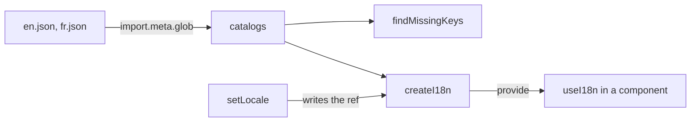

# T0.16: Internationalisation base

**Status:** ✅ Done · **Ticket:** [TICKET.md](TICKET.md) · **Choices and trade-offs:** [IMPLEMENTATION.md](IMPLEMENTATION.md) · **Review:** [REVIEW.md](REVIEW.md)

## 🔭 What it does

- A new package `@simpleerp/i18n` holds one message catalogue per language, French and English at launch. Adding a `<code>.json` file adds a language with no code change.
- A check lists every key that one language lacks while another has it, and a test runs it on the shipped catalogues, so CI fails on a key added in one language only.
- A Vue plugin translates dotted keys, and switching the language re-renders the components with no page reload.
- Money, numbers and dates are formatted per locale. Money keeps its exact decimals and is never rounded.

## ⚙️ How it works

1. **Load the catalogues:** `import.meta.glob` reads every `*.json` of the catalogues folder at build time, eagerly, in [`frontend/packages/i18n/src/catalogs/catalogs.ts:3`](../../../frontend/packages/i18n/src/catalogs/catalogs.ts#L3). `build` takes the language code from the file name ([`catalogs.ts:10-17`](../../../frontend/packages/i18n/src/catalogs/catalogs.ts#L10-L17)), and `availableLanguages()` lists them sorted ([`catalogs.ts:26`](../../../frontend/packages/i18n/src/catalogs/catalogs.ts#L26)).
2. **Check completeness:** `findMissingKeys` flattens each catalogue to dotted leaf paths ([`findMissingKeys.ts:3-12`](../../../frontend/packages/i18n/src/check/findMissingKeys.ts#L3-L12)), takes the union of all paths as the expected set ([`findMissingKeys.ts:32-41`](../../../frontend/packages/i18n/src/check/findMissingKeys.ts#L32-L41)), then reports each language whose leaf is absent, not a string, or blank ([`findMissingKeys.ts:42-50`](../../../frontend/packages/i18n/src/check/findMissingKeys.ts#L42-L50)). The result is sorted by language then key with a code-unit comparison ([`findMissingKeys.ts:14-19`](../../../frontend/packages/i18n/src/check/findMissingKeys.ts#L14-L19), [`:51`](../../../frontend/packages/i18n/src/check/findMissingKeys.ts#L51)). [`catalogsComplete.test.ts`](../../../frontend/packages/i18n/tests/catalogs/catalogsComplete.test.ts) runs it on the real catalogues.
3. **Create the translator:** `createI18n` checks that a catalogue matches the starting locale, then keeps the full tag in a `ref` ([`createI18n.ts:37-40`](../../../frontend/packages/i18n/src/translate/createI18n.ts#L37-L40)). It is exposed read-only ([`createI18n.ts:43`](../../../frontend/packages/i18n/src/translate/createI18n.ts#L43)).
4. **Translate:** `t()` reads `locale.value` on every call, so a component that calls it tracks the locale. It picks the catalogue by language subtag, case-insensitively ([`createI18n.ts:9-16`](../../../frontend/packages/i18n/src/translate/createI18n.ts#L9-L16)), walks the dotted key with `Object.hasOwn` ([`createI18n.ts:19-28`](../../../frontend/packages/i18n/src/translate/createI18n.ts#L19-L28)), returns the key itself when nothing matches, and substitutes `{name}` placeholders ([`createI18n.ts:44-52`](../../../frontend/packages/i18n/src/translate/createI18n.ts#L44-L52)).
5. **Switch the language:** `setLocale` refuses an unknown language and keeps the current one, otherwise it writes the ref ([`createI18n.ts:53-56`](../../../frontend/packages/i18n/src/translate/createI18n.ts#L53-L56)). Vue re-renders the readers of the ref, with no reload.
6. **Install and use:** `install` provides the translator under `I18N_KEY` ([`createI18n.ts:57-59`](../../../frontend/packages/i18n/src/translate/createI18n.ts#L57-L59)), and `useI18n` injects it or throws when the plugin is missing ([`useI18n.ts:12-18`](../../../frontend/packages/i18n/src/translate/useI18n.ts#L12-L18)).
7. **Format money:** `formatMoney` validates the amount and the currency ([`formatMoney.ts:18-23`](../../../frontend/packages/i18n/src/format/formatMoney.ts#L18-L23)), reads the currency's minor digits, and sets the fraction digits between those and the amount's own decimals ([`formatMoney.ts:24-32`](../../../frontend/packages/i18n/src/format/formatMoney.ts#L24-L32)). The string goes to `Intl.NumberFormat` unchanged ([`formatMoney.ts:33`](../../../frontend/packages/i18n/src/format/formatMoney.ts#L33)), so it is padded and never rounded.
8. **Format numbers and dates:** `formatNumber` validates a string or number and throws `RangeError` ([`formatNumber.ts:19-26`](../../../frontend/packages/i18n/src/format/formatNumber.ts#L19-L26)). `formatDate` parses a string, rejects an invalid date, and leaves the time zone to the caller ([`formatDate.ts:10-16`](../../../frontend/packages/i18n/src/format/formatDate.ts#L10-L16)).
9. **Public API:** [`index.ts`](../../../frontend/packages/i18n/src/index.ts#L1-L8) re-exports the functions and the types by name.



## 🧱 Files and lines changed

<!-- changes -->
| File | Change | Lines in the new version | Added | Removed |
| --- | --- | --- | --- | --- |
| [`docs/technical/architecture/frontend.md`](../../../docs/technical/architecture/frontend.md) | Modified | [11-16](../../../docs/technical/architecture/frontend.md#L11) | +6 | −0 |
| [`frontend/packages/i18n/README.md`](../../../frontend/packages/i18n/README.md) | Added | [1-94](../../../frontend/packages/i18n/README.md#L1) | +94 | −0 |
| [`frontend/packages/i18n/eslint.config.js`](../../../frontend/packages/i18n/eslint.config.js) | Added | [1-3](../../../frontend/packages/i18n/eslint.config.js#L1) | +3 | −0 |
| [`frontend/packages/i18n/package.json`](../../../frontend/packages/i18n/package.json) | Added | [1-33](../../../frontend/packages/i18n/package.json#L1) | +33 | −0 |
| [`frontend/packages/i18n/src/catalogs/catalogs.ts`](../../../frontend/packages/i18n/src/catalogs/catalogs.ts) | Added | [1-28](../../../frontend/packages/i18n/src/catalogs/catalogs.ts#L1) | +28 | −0 |
| [`frontend/packages/i18n/src/catalogs/en.json`](../../../frontend/packages/i18n/src/catalogs/en.json) | Added | [1](../../../frontend/packages/i18n/src/catalogs/en.json#L1) | +1 | −0 |
| [`frontend/packages/i18n/src/catalogs/fr.json`](../../../frontend/packages/i18n/src/catalogs/fr.json) | Added | [1](../../../frontend/packages/i18n/src/catalogs/fr.json#L1) | +1 | −0 |
| [`frontend/packages/i18n/src/check/findMissingKeys.ts`](../../../frontend/packages/i18n/src/check/findMissingKeys.ts) | Added | [1-52](../../../frontend/packages/i18n/src/check/findMissingKeys.ts#L1) | +52 | −0 |
| [`frontend/packages/i18n/src/format/formatDate.ts`](../../../frontend/packages/i18n/src/format/formatDate.ts) | Added | [1-16](../../../frontend/packages/i18n/src/format/formatDate.ts#L1) | +16 | −0 |
| [`frontend/packages/i18n/src/format/formatMoney.ts`](../../../frontend/packages/i18n/src/format/formatMoney.ts) | Added | [1-34](../../../frontend/packages/i18n/src/format/formatMoney.ts#L1) | +34 | −0 |
| [`frontend/packages/i18n/src/format/formatNumber.ts`](../../../frontend/packages/i18n/src/format/formatNumber.ts) | Added | [1-27](../../../frontend/packages/i18n/src/format/formatNumber.ts#L1) | +27 | −0 |
| [`frontend/packages/i18n/src/index.ts`](../../../frontend/packages/i18n/src/index.ts) | Added | [1-8](../../../frontend/packages/i18n/src/index.ts#L1) | +8 | −0 |
| [`frontend/packages/i18n/src/translate/createI18n.ts`](../../../frontend/packages/i18n/src/translate/createI18n.ts) | Added | [1-62](../../../frontend/packages/i18n/src/translate/createI18n.ts#L1) | +62 | −0 |
| [`frontend/packages/i18n/src/translate/useI18n.ts`](../../../frontend/packages/i18n/src/translate/useI18n.ts) | Added | [1-18](../../../frontend/packages/i18n/src/translate/useI18n.ts#L1) | +18 | −0 |
| [`frontend/packages/i18n/src/types.ts`](../../../frontend/packages/i18n/src/types.ts) | Added | [1-25](../../../frontend/packages/i18n/src/types.ts#L1) | +25 | −0 |
| [`frontend/packages/i18n/tests/catalogs/catalogs.test.ts`](../../../frontend/packages/i18n/tests/catalogs/catalogs.test.ts) | Added | [1-56](../../../frontend/packages/i18n/tests/catalogs/catalogs.test.ts#L1) | +56 | −0 |
| [`frontend/packages/i18n/tests/catalogs/catalogsComplete.test.ts`](../../../frontend/packages/i18n/tests/catalogs/catalogsComplete.test.ts) | Added | [1-12](../../../frontend/packages/i18n/tests/catalogs/catalogsComplete.test.ts#L1) | +12 | −0 |
| [`frontend/packages/i18n/tests/check/findMissingKeys.test.ts`](../../../frontend/packages/i18n/tests/check/findMissingKeys.test.ts) | Added | [1-90](../../../frontend/packages/i18n/tests/check/findMissingKeys.test.ts#L1) | +90 | −0 |
| [`frontend/packages/i18n/tests/format/formatDate.test.ts`](../../../frontend/packages/i18n/tests/format/formatDate.test.ts) | Added | [1-40](../../../frontend/packages/i18n/tests/format/formatDate.test.ts#L1) | +40 | −0 |
| [`frontend/packages/i18n/tests/format/formatMoney.test.ts`](../../../frontend/packages/i18n/tests/format/formatMoney.test.ts) | Added | [1-50](../../../frontend/packages/i18n/tests/format/formatMoney.test.ts#L1) | +50 | −0 |
| [`frontend/packages/i18n/tests/format/formatNumber.test.ts`](../../../frontend/packages/i18n/tests/format/formatNumber.test.ts) | Added | [1-39](../../../frontend/packages/i18n/tests/format/formatNumber.test.ts#L1) | +39 | −0 |
| [`frontend/packages/i18n/tests/index.test.ts`](../../../frontend/packages/i18n/tests/index.test.ts) | Added | [1-43](../../../frontend/packages/i18n/tests/index.test.ts#L1) | +43 | −0 |
| [`frontend/packages/i18n/tests/translate/createI18n.test.ts`](../../../frontend/packages/i18n/tests/translate/createI18n.test.ts) | Added | [1-74](../../../frontend/packages/i18n/tests/translate/createI18n.test.ts#L1) | +74 | −0 |
| [`frontend/packages/i18n/tests/translate/languageSwitch.test.ts`](../../../frontend/packages/i18n/tests/translate/languageSwitch.test.ts) | Added | [1-56](../../../frontend/packages/i18n/tests/translate/languageSwitch.test.ts#L1) | +56 | −0 |
| [`frontend/packages/i18n/tsconfig.json`](../../../frontend/packages/i18n/tsconfig.json) | Added | [1-10](../../../frontend/packages/i18n/tsconfig.json#L1) | +10 | −0 |
| [`frontend/packages/i18n/vitest.config.ts`](../../../frontend/packages/i18n/vitest.config.ts) | Added | [1-8](../../../frontend/packages/i18n/vitest.config.ts#L1) | +8 | −0 |
| [`pnpm-lock.yaml`](../../../pnpm-lock.yaml) | Modified | [44-74](../../../pnpm-lock.yaml#L44), [98](../../../pnpm-lock.yaml#L98), [102-118](../../../pnpm-lock.yaml#L102), [320-328](../../../pnpm-lock.yaml#L320), [380-382](../../../pnpm-lock.yaml#L380), [585-650](../../../pnpm-lock.yaml#L585), [664-666](../../../pnpm-lock.yaml#L664), [675-680](../../../pnpm-lock.yaml#L675), [695-701](../../../pnpm-lock.yaml#L695), [706-712](../../../pnpm-lock.yaml#L706), [722-724](../../../pnpm-lock.yaml#L722), [732-744](../../../pnpm-lock.yaml#L732), [809-811](../../../pnpm-lock.yaml#L809), [863-866](../../../pnpm-lock.yaml#L863), [881-884](../../../pnpm-lock.yaml#L881), [897-908](../../../pnpm-lock.yaml#L897), [917-919](../../../pnpm-lock.yaml#L917), [923-939](../../../pnpm-lock.yaml#L923), [1031-1037](../../../pnpm-lock.yaml#L1031), [1041-1044](../../../pnpm-lock.yaml#L1041), [1049-1052](../../../pnpm-lock.yaml#L1049), [1056-1058](../../../pnpm-lock.yaml#L1056), [1073-1077](../../../pnpm-lock.yaml#L1073), [1097-1105](../../../pnpm-lock.yaml#L1097), [1114-1117](../../../pnpm-lock.yaml#L1114), [1137-1139](../../../pnpm-lock.yaml#L1137), [1153-1156](../../../pnpm-lock.yaml#L1153), [1189-1203](../../../pnpm-lock.yaml#L1189), [1239-1242](../../../pnpm-lock.yaml#L1239), [1333-1351](../../../pnpm-lock.yaml#L1333), [1358-1387](../../../pnpm-lock.yaml#L1358), [1406-1408](../../../pnpm-lock.yaml#L1406), [1415-1427](../../../pnpm-lock.yaml#L1415), [1552-1553](../../../pnpm-lock.yaml#L1552), [1595-1596](../../../pnpm-lock.yaml#L1595), [1774-1872](../../../pnpm-lock.yaml#L1774), [1886-1887](../../../pnpm-lock.yaml#L1886), [1892-1899](../../../pnpm-lock.yaml#L1892), [1916-1922](../../../pnpm-lock.yaml#L1916), [1929-1937](../../../pnpm-lock.yaml#L1929), [1942-1943](../../../pnpm-lock.yaml#L1942), [1948-1958](../../../pnpm-lock.yaml#L1948), [2067-2068](../../../pnpm-lock.yaml#L2067), [2111-2116](../../../pnpm-lock.yaml#L2111), [2127-2132](../../../pnpm-lock.yaml#L2127), [2139-2149](../../../pnpm-lock.yaml#L2139), [2156-2157](../../../pnpm-lock.yaml#L2156), [2160-2192](../../../pnpm-lock.yaml#L2160), [2259-2264](../../../pnpm-lock.yaml#L2259), [2269-2272](../../../pnpm-lock.yaml#L2269), [2278-2279](../../../pnpm-lock.yaml#L2278), [2282-2283](../../../pnpm-lock.yaml#L2282), [2291-2294](../../../pnpm-lock.yaml#L2291), [2318-2327](../../../pnpm-lock.yaml#L2318), [2332-2336](../../../pnpm-lock.yaml#L2332), [2353-2354](../../../pnpm-lock.yaml#L2353), [2383-2386](../../../pnpm-lock.yaml#L2383), [2408-2421](../../../pnpm-lock.yaml#L2408), [2454-2455](../../../pnpm-lock.yaml#L2454), [2476](../../../pnpm-lock.yaml#L2476), [2494](../../../pnpm-lock.yaml#L2494), [2498-2512](../../../pnpm-lock.yaml#L2498), [2525-2556](../../../pnpm-lock.yaml#L2525), [2567-2568](../../../pnpm-lock.yaml#L2567) | +644 | −3 |
| **27 files** | | | **+1530** | **−3** |
<!-- /changes -->

- [`frontend/packages/i18n/package.json`](../../../frontend/packages/i18n/package.json), [`tsconfig.json`](../../../frontend/packages/i18n/tsconfig.json), [`eslint.config.js`](../../../frontend/packages/i18n/eslint.config.js), [`vitest.config.ts`](../../../frontend/packages/i18n/vitest.config.ts): the package wiring. Exact pins, vue as a peer ([`package.json:19-32`](../../../frontend/packages/i18n/package.json#L19-L32)), the lib override and `vite/client` types for `import.meta.glob` ([`tsconfig.json:5-7`](../../../frontend/packages/i18n/tsconfig.json#L5-L7)), a jsdom environment to mount a component ([`vitest.config.ts:6`](../../../frontend/packages/i18n/vitest.config.ts#L6)), and the shared ESLint base re-exported.
- [`pnpm-lock.yaml`](../../../pnpm-lock.yaml): the importer of the new package.
- [`frontend/packages/i18n/src/catalogs/`](../../../frontend/packages/i18n/src/catalogs/catalogs.ts): the loader, and the [English](../../../frontend/packages/i18n/src/catalogs/en.json) and [French](../../../frontend/packages/i18n/src/catalogs/fr.json) catalogues.
- [`frontend/packages/i18n/src/check/findMissingKeys.ts`](../../../frontend/packages/i18n/src/check/findMissingKeys.ts): the completeness check, lines 3-52.
- [`frontend/packages/i18n/src/translate/`](../../../frontend/packages/i18n/src/translate/createI18n.ts): `createI18n` and [`useI18n`](../../../frontend/packages/i18n/src/translate/useI18n.ts).
- [`frontend/packages/i18n/src/format/`](../../../frontend/packages/i18n/src/format/formatMoney.ts): [`formatNumber`](../../../frontend/packages/i18n/src/format/formatNumber.ts) and [`formatDate`](../../../frontend/packages/i18n/src/format/formatDate.ts) beside it.
- [`frontend/packages/i18n/src/types.ts`](../../../frontend/packages/i18n/src/types.ts), lines 3-25: the public types. [`src/index.ts`](../../../frontend/packages/i18n/src/index.ts) is the public API.
- [`frontend/packages/i18n/tests/`](../../../frontend/packages/i18n/tests/index.test.ts): nine test files, 75 tests, written first (TKT-4): [catalogues](../../../frontend/packages/i18n/tests/catalogs/catalogs.test.ts), [completeness](../../../frontend/packages/i18n/tests/catalogs/catalogsComplete.test.ts), [the check](../../../frontend/packages/i18n/tests/check/findMissingKeys.test.ts), [money](../../../frontend/packages/i18n/tests/format/formatMoney.test.ts), [numbers](../../../frontend/packages/i18n/tests/format/formatNumber.test.ts), [dates](../../../frontend/packages/i18n/tests/format/formatDate.test.ts), [the translator](../../../frontend/packages/i18n/tests/translate/createI18n.test.ts), [the language switch](../../../frontend/packages/i18n/tests/translate/languageSwitch.test.ts).
- [`frontend/packages/i18n/README.md`](../../../frontend/packages/i18n/README.md): how to use the package and where it sits.
- [`docs/technical/architecture/frontend.md`](../../../docs/technical/architecture/frontend.md), lines 11-16: a paragraph on the package in the Today section.

## 🧪 How to test it

```bash
pnpm install --frozen-lockfile
pnpm --filter ./frontend/packages/i18n run lint
pnpm --filter ./frontend/packages/i18n run typecheck
pnpm --filter ./frontend/packages/i18n run test
```

To see the check fail, remove a key from `fr.json` only and run the test: `catalogsComplete.test.ts` lists the language and the key.

## 🔗 Evidence

- [Tests](tests-evidences/test.txt): the package's tests pass.
- [Lint](tests-evidences/lint.txt): no lint error.
- [Type check](tests-evidences/typecheck.txt): no type error.
- [Frozen install](tests-evidences/pnpm-install.txt): the lockfile matches the pins.
- [Ticket references](tests-evidences/ticket-refs.txt) and [plan view](tests-evidences/plan-view.txt): the ticket and the plan are consistent.

## 📝 Assumptions accepted

- A single language gives an empty list, and a string in one language against an object in another is reported on both sides (K01).
- Blank strings count as missing, and an empty object has no leaf and is ignored (K01, K02, K11).
- Tests accept either minus sign, use fixed UTC dates and normalise the ICU spaces with a local `plain()` helper (K03 to K05).
- The locale ref keeps the full tag, subtags match case-insensitively, only hyphenated tags are supported, and a missing plugin throws (K06, K07, K15).
- `catalogs` is exported as a value, pins are exact, vue is a peer, the test environment is jsdom (K08, K09).
- The minor digits default to 2 when `resolvedOptions` omits them (K12).
- The README API is the brief's contract and matches the code. The review workflow is deferred to P2 (K17, K18).
- The ticket builds no screen, so "No screen" is sound (TKT-21).

## 🔜 Follow-ups

| File | What to change |
| --- | --- |
| [`frontend/packages/i18n/src/format/formatNumber.ts`](../../../frontend/packages/i18n/src/format/formatNumber.ts#L6) | The comment says a decimal string "stays exact", but the default options round it to 3 fraction digits. Document it, or default the maximum to the string's own decimals as `formatMoney` does, with a test (K13). |
| [`frontend/packages/i18n/src/check/findMissingKeys.ts`](../../../frontend/packages/i18n/src/check/findMissingKeys.ts#L3-L12) | `flatten` silently drops a number or array leaf and throws on null. Report them as missing, with a test (K11, K01). |
| [`frontend/packages/i18n/README.md`](../../../frontend/packages/i18n/README.md) | It says the package is "built on the design system's tokens" but it does not depend on them. List the consuming apps as the target until T0.17 (K17). |
| [`frontend/packages/i18n/src`](../../../frontend/packages/i18n/src/index.ts) | Quote and semicolon style is mixed across files. Add a formatter rule to `@simpleerp/config` (K10 to K16). |
| [`frontend/packages/i18n/src/translate/createI18n.ts`](../../../frontend/packages/i18n/src/translate/createI18n.ts#L8-L28) | The private helpers `flatten`, `compare`, `pickCatalog` and `resolveKey` lack the full TSDoc of the public functions (K11, K15). |
