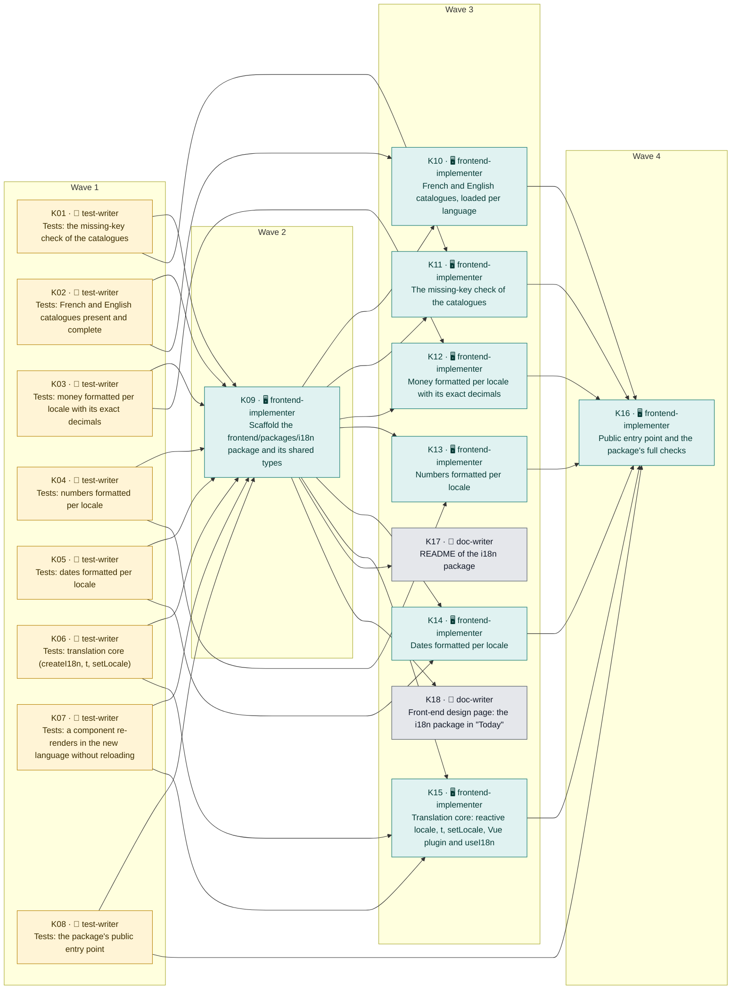

# T0.16: Plan

**Plan:** 🟢 Approved

**Push:** 🟢 Approved

<!-- ticket:specs -->
## 📚 Specifications

The specification and design pages of [TICKET.md](TICKET.md), copied by `python3 .claude/scripts/tickets/ticket_refs.py sync`.

- [D21](../../specs/06-decisions/foundations/d21-languages.md)
- [Localisation](../../specs/05-non-functional/localisation.md)
- [REQ-T10-03](../../specs/03-technical/t10-translations-and-notifications/requirements/req-t10-03-money-decimals.md)
- [REQ-T10-01](../../specs/03-technical/t10-translations-and-notifications/requirements/req-t10-01-translation-catalogues.md)
- [📜 D407 Front end](../../specs/06-decisions/technical/d407-front-end.md)
- [🏗️ Front end](../../technical/architecture/frontend.md)
- [🌐 Localisation](../../specs/05-non-functional/localisation.md#measures)
<!-- /ticket:specs -->

## Summary

T0.16 builds the new pnpm package `frontend/packages/i18n` with no screen. The plan has 18 tasks in 4 waves.

- **Wave 1:** 8 test-writer tasks, one per behaviour (K01 to K08). They cover the missing-key check, the catalogues being present, the shipped catalogues being complete (this is the CI gate), exact-decimal money, numbers, dates, the translation core, the language switch re-rendering without a reload, and the public entry point.
- **Wave 2:** K09 scaffolds the package. It writes `package.json` with the lint, typecheck and test scripts that `typescript.yml` runs in CI, the configs, the shared `src/types.ts` contract and the root `pnpm-lock.yaml`.
- **Wave 3:** 6 frontend-implementer tasks run in parallel, one per module: the catalogues, the checker, `formatMoney`, `formatNumber`, `formatDate` and the translation core with `useI18n`. Two doc-writer tasks run beside them: the package README and the "Today" section of `docs/technical/architecture/frontend.md`.
- **Wave 4:** K16 writes `src/index.ts` and runs the full lint, typecheck and test suite.

Every brief repeats the same API, so tests and code written in parallel agree. Every brief links D21, REQ-T10-01, REQ-T10-03, D407, D438, Localisation and the Front end page as the TICKET lists them. TICKET.md lists no screen ("➖ No screen"), so TKT-21 needs no Playwright task.

## Assumptions

- The roadmap row has no anchor of its own, so the ticket links to the sprint anchor #s03 and the epic to #epics.
- No use case or business rule applies, so the criteria come from the roadmap row's Delivers and Done when text.
- The measures of the Localisation page are still To be specified, so no budget figure is set.
- The package has no design page of its own in docs/technical/; the Front end page and D407 settle its framework.
- I had no shell tool, so check_ticket.py was not run; the links were written by hand from the pages read.
- T0.16's prerequisite T0.02 (and through it T0.01) is merged before the run. They provide the pnpm workspace covering `frontend/packages/*`, Node 22, and the shared eslint and strict TypeScript settings of `frontend/packages/config`. Today the repository has no `frontend/` folder at all, so K09 follows whatever names those tickets choose (package scope, script names) and reports blocked if the workspace does not include the package.
- No third-party i18n library (such as vue-i18n) is added. The package is built on Vue reactivity and the platform `Intl` API, the most conservative choice under the pinned supply chain of D415. The specifications name no library.
- Catalogues are JSON files, one per language, named by the ISO 639-1 code (`src/catalogs/en.json`, `src/catalogs/fr.json`). They are loaded through `import.meta.glob`, so a new language file is picked up with no code change, as Localisation asks for community or plugin languages. The folder is named `catalogs` because AGENT.md spells identifiers `catalog`.
- At launch the catalogues hold only the names of the two languages (`language.en`, `language.fr`) for the language switch. The shell (T0.17) and the error messages (T0.23) add their own keys, and no other text is invented.
- The catalogue check is a Vitest test run by the package's `test` script, which `.github/workflows/typescript.yml` already runs in CI. No new CI job is added. An empty or blank value counts as a missing key.
- Locales are BCP 47 tags. The lower-cased language subtag picks the catalogue (`fr-FR` gives `fr`), and the full tag drives `Intl` formatting. A locale with no catalogue is refused with `RangeError`. The package sets no default language: the app passes the user's locale (T0.17).
- At runtime, `t` returns the key itself when it is not found (the completeness check keeps this from happening across languages), and replaces simple `{name}` placeholders. Pluralisation is not part of this ticket.
- Money arrives as a decimal string with an ISO 4217 code and is never converted to a JS number. It is padded to the currency's minor digits but never rounded, because REQ-T10-03 says rounding follows the country pack, which is out of scope. Summing money lines (REQ-T10-03 criterion 2) belongs to `erp_models` money (T0.03), not to this formatting package.
- Formatting tests assert the output of Node 22's ICU for `fr-FR`, `en-GB` and `en-US`, after normalising U+202F and U+00A0 to plain spaces, and use `timeZone: 'UTC'` for dates.
- The ticket builds no screen ("➖ No screen"), so "re-renders without reloading" is proven by a Vitest component test with `@vue/test-utils` in a jsdom environment (or the environment the sibling packages use), not by Playwright. Unit tests live in `frontend/packages/i18n/tests/`, mirroring `src/`.
- The Localisation budget has no measures yet ("To be specified"), so no task checks a budget figure.

<!-- plan:graph -->

> [!NOTE]
> Generated from the json block at the end of this page by `python3 .claude/scripts/tickets/plan.py render`.
> To change a task, edit the json block, then render again: never edit this view by hand.

## Waves

| Wave | Tasks | Agents running at once |
| --- | --- | --- |
| 1 | [K01](#k01), [K02](#k02), [K03](#k03), [K04](#k04), [K05](#k05), [K06](#k06), [K07](#k07), [K08](#k08) | 8 of 8 |
| 2 | [K09](#k09) | 1 of 1 |
| 3 | [K10](#k10), [K11](#k11), [K12](#k12), [K13](#k13), [K14](#k14), [K15](#k15), [K17](#k17), [K18](#k18) | 8 of 8 |
| 4 | [K16](#k16) | 1 of 1 |

| Wave | Task | Agent | Depends on | Unblocks |
| --- | --- | --- | --- | --- |
| 1 | [K01](#k01) Tests: the missing-key check of the catalogues | 🧪 test-writer | none | [K09](#k09), [K11](#k11) |
| 1 | [K02](#k02) Tests: French and English catalogues present and complete | 🧪 test-writer | none | [K09](#k09), [K10](#k10) |
| 1 | [K03](#k03) Tests: money formatted per locale with its exact decimals | 🧪 test-writer | none | [K09](#k09), [K12](#k12) |
| 1 | [K04](#k04) Tests: numbers formatted per locale | 🧪 test-writer | none | [K09](#k09), [K13](#k13) |
| 1 | [K05](#k05) Tests: dates formatted per locale | 🧪 test-writer | none | [K09](#k09), [K14](#k14) |
| 1 | [K06](#k06) Tests: translation core (createI18n, t, setLocale) | 🧪 test-writer | none | [K09](#k09), [K15](#k15) |
| 1 | [K07](#k07) Tests: a component re-renders in the new language without reloading | 🧪 test-writer | none | [K09](#k09), [K15](#k15) |
| 1 | [K08](#k08) Tests: the package's public entry point | 🧪 test-writer | none | [K09](#k09), [K16](#k16) |
| 2 | [K09](#k09) Scaffold the frontend/packages/i18n package and its shared types | 🖥️ frontend-implementer | [K01](#k01), [K02](#k02), [K03](#k03), [K04](#k04), [K05](#k05), [K06](#k06), [K07](#k07), [K08](#k08) | [K10](#k10), [K11](#k11), [K12](#k12), [K13](#k13), [K14](#k14), [K15](#k15), [K17](#k17), [K18](#k18) |
| 3 | [K10](#k10) French and English catalogues, loaded per language | 🖥️ frontend-implementer | [K02](#k02), [K09](#k09) | [K16](#k16) |
| 3 | [K11](#k11) The missing-key check of the catalogues | 🖥️ frontend-implementer | [K01](#k01), [K09](#k09) | [K16](#k16) |
| 3 | [K12](#k12) Money formatted per locale with its exact decimals | 🖥️ frontend-implementer | [K03](#k03), [K09](#k09) | [K16](#k16) |
| 3 | [K13](#k13) Numbers formatted per locale | 🖥️ frontend-implementer | [K04](#k04), [K09](#k09) | [K16](#k16) |
| 3 | [K14](#k14) Dates formatted per locale | 🖥️ frontend-implementer | [K05](#k05), [K09](#k09) | [K16](#k16) |
| 3 | [K15](#k15) Translation core: reactive locale, t, setLocale, Vue plugin and useI18n | 🖥️ frontend-implementer | [K06](#k06), [K07](#k07), [K09](#k09) | [K16](#k16) |
| 3 | [K17](#k17) README of the i18n package | 📝 doc-writer | [K09](#k09) | none |
| 3 | [K18](#k18) Front-end design page: the i18n package in "Today" | 📝 doc-writer | [K09](#k09) | none |
| 4 | [K16](#k16) Public entry point and the package's full checks | 🖥️ frontend-implementer | [K08](#k08), [K10](#k10), [K11](#k11), [K12](#k12), [K13](#k13), [K14](#k14), [K15](#k15) | none |

## Dependency graph



## Tasks

### <a id="k01"></a>K01: Tests: the missing-key check of the catalogues

| Agent | Wave | Depends on | Unblocks |
| --- | --- | --- | --- |
| 🧪 test-writer | 1 | none | [K09](#k09), [K11](#k11) |

**Files** (only this task may change them in its wave):

- `frontend/packages/i18n/tests/check/findMissingKeys.test.ts`

**Done when:** `frontend/packages/i18n/tests/check/findMissingKeys.test.ts` exists with the cases above. It imports only `vitest`, `../../src/check/findMissingKeys` and `../../src/types`. After K11, `pnpm --filter ./frontend/packages/i18n exec vitest run tests/check` runs it.

**Brief:**

Ticket T0.16 (docs/tickets/T0.16/TICKET.md), acceptance criterion 1. Applies REQ-T10-01 (docs/specs/03-technical/t10-translations-and-notifications/requirements/req-t10-01-translation-catalogues.md: translations live in catalogues; the review workflow is out of scope, P2), D21 (docs/specs/06-decisions/foundations/d21-languages.md) and Localisation (docs/specs/05-non-functional/localisation.md: every text in translation files). Package `frontend/packages/i18n` (D438 docs/specs/06-decisions/technical/d438-repository-layout.md, D407 docs/specs/06-decisions/technical/d407-front-end.md, design page docs/technical/architecture/frontend.md).

Write the Vitest tests of the pure checker, before it exists. Contract (fixed by the plan, do not change it): `src/check/findMissingKeys.ts` exports `function findMissingKeys(catalogs: Catalogs): MissingKey[]`; the types come from `src/types.ts`: `type Catalog = { [key: string]: string | Catalog }`, `type Catalogs = Readonly<Record<string, Catalog>>` (language code to catalogue), `type MissingKey = { language: string; key: string }`. Nested keys are flattened to dotted paths (`language.en`). For each language it reports every key that another language has and that it lacks, or holds as an empty or blank string. The result is sorted by language, then key, and is empty when every language has every key.

Import with relative paths: `../../src/check/findMissingKeys` and `import type` from `../../src/types`. One `describe('findMissingKeys')` block, test names written as sentences. Use small inline fixture catalogues (no real catalogue), for example `{ en: { greeting: 'Hello', extra: 'Only English' }, fr: { greeting: 'Bonjour' } }`. Cases:
- a key added in English only is reported as missing in French (`[{ language: 'fr', key: 'extra' }]`). This is acceptance criterion 1;
- a key present in French only is reported as missing in English;
- identical key sets give an empty list;
- nested keys are compared by dotted path (`menu.file.open`);
- a key that is a string in one language and a nested object in another is reported on both sides;
- an empty or blank string counts as missing;
- three languages: each one lacking a key is reported;
- the order is stable (sorted by language, then key).
Use `it.each` for cases of the same behaviour. No mocks.

The package scaffold (`package.json`, Vitest config) arrives in wave 2, so these tests cannot run yet. They run in wave 3 with K11.

### <a id="k02"></a>K02: Tests: French and English catalogues present and complete

| Agent | Wave | Depends on | Unblocks |
| --- | --- | --- | --- |
| 🧪 test-writer | 1 | none | [K09](#k09), [K10](#k10) |

**Files** (only this task may change them in its wave):

- `frontend/packages/i18n/tests/catalogs/catalogs.test.ts`
- `frontend/packages/i18n/tests/catalogs/catalogsComplete.test.ts`

**Done when:** Both files exist with the tests above. After K10, `pnpm --filter ./frontend/packages/i18n exec vitest run tests/catalogs/catalogs.test.ts` runs the first. After K16, the whole suite runs the second.

**Brief:**

Ticket T0.16 (docs/tickets/T0.16/TICKET.md), acceptance criteria 1 and 5. Applies D21 (docs/specs/06-decisions/foundations/d21-languages.md: French and English at launch, every text in translation files), Localisation (docs/specs/05-non-functional/localisation.md: the community or a plugin can add a language) and REQ-T10-01 (docs/specs/03-technical/t10-translations-and-notifications/requirements/req-t10-01-translation-catalogues.md). Package `frontend/packages/i18n` (D438 docs/specs/06-decisions/technical/d438-repository-layout.md, D407 docs/specs/06-decisions/technical/d407-front-end.md, docs/technical/architecture/frontend.md).

Contract (fixed by the plan): `src/catalogs/catalogs.ts` exports `const catalogs: Catalogs` and `function availableLanguages(): string[]`. It loads every `src/catalogs/*.json` through `import.meta.glob(..., { eager: true })`. The language code is the file name (`en.json` gives `en`), and `availableLanguages()` returns the codes sorted. The catalogues at launch are `src/catalogs/en.json` and `src/catalogs/fr.json`. Each holds at least the keys `language.en` and `language.fr` (the names of the two languages, for the language switch). `findMissingKeys(catalogs)` comes from `src/check/findMissingKeys.ts` (see K01: it returns `{ language, key }[]` and is empty when complete).

Write two Vitest files with relative imports (`../../src/catalogs/catalogs`, `../../src/check/findMissingKeys`):
1. `catalogs.test.ts`, `describe('catalogs')`: `availableLanguages()` contains `en` and `fr` (criterion 5); `catalogs.en` and `catalogs.fr` are non-empty objects; each catalogue holds non-empty strings for `language.en` and `language.fr`; every leaf value is a non-empty string.
2. `catalogsComplete.test.ts`, `describe('shipped catalogs')`: `findMissingKeys(catalogs)` equals `[]`. On failure the message lists each missing `language: key`, for instance through `expect(..., message)`. This is the CI gate of criterion 1: `typescript.yml` runs the package's `test` script, so a key added in English only fails CI.
Test names are sentences. No mocks.

The scaffold arrives in wave 2, and the catalogues and checker in wave 3 (K10, K11).

### <a id="k03"></a>K03: Tests: money formatted per locale with its exact decimals

| Agent | Wave | Depends on | Unblocks |
| --- | --- | --- | --- |
| 🧪 test-writer | 1 | none | [K09](#k09), [K12](#k12) |

**Files** (only this task may change them in its wave):

- `frontend/packages/i18n/tests/format/formatMoney.test.ts`

**Done when:** The file exists with these cases. After K12, `pnpm --filter ./frontend/packages/i18n exec vitest run tests/format/formatMoney.test.ts` runs it.

**Brief:**

Ticket T0.16 (docs/tickets/T0.16/TICKET.md), acceptance criterion 3. Applies REQ-T10-03 (docs/specs/03-technical/t10-translations-and-notifications/requirements/req-t10-03-money-decimals.md: money is an exact decimal with its currency, with no float error) and Localisation (docs/specs/05-non-functional/localisation.md). Package `frontend/packages/i18n` (D438 docs/specs/06-decisions/technical/d438-repository-layout.md, D407 docs/specs/06-decisions/technical/d407-front-end.md).

Contract (fixed by the plan): `src/format/formatMoney.ts` exports `function formatMoney(amount: string, currency: string, locale: string): string`.
- `amount` is a decimal string matching `^-?\d+(\.\d+)?$` and is never converted to a JS number.
- `currency` is an ISO 4217 code of three upper-case letters.
- `locale` is a BCP 47 tag.
- It formats through `Intl.NumberFormat` with `style: 'currency'`. It keeps every decimal of the amount and never rounds: rounding follows the country pack, which is out of scope. It pads up to the currency's minor digits.
- It throws `RangeError` for a malformed amount (`'1,5'`, `'abc'`, `''`, `'1e3'`) or a malformed currency (`'eur'`, `'EURO'`).

Write one Vitest file, `describe('formatMoney')`, importing `../../src/format/formatMoney`. Compare outputs after normalising U+202F and U+00A0 to a plain space, because Node 22's ICU uses them in French. Cases:
- `formatMoney('1234567890123456.78', 'EUR', 'fr-FR')` gives `1 234 567 890 123 456,78 €`, and in `en-GB` gives `€1,234,567,890,123,456.78`. A float would lose these digits;
- `formatMoney('0.30', 'EUR', 'en-GB')` gives `€0.30`;
- `formatMoney('0.1', 'EUR', 'en-GB')` gives `€0.10` (padded);
- `formatMoney('12.345', 'EUR', 'en-GB')` gives `€12.345` (kept, not rounded);
- `formatMoney('-5.50', 'EUR', 'fr-FR')` holds `5,50` and a minus sign;
- the same amount differs between `fr-FR` and `en-GB` (decimal separator `,` against `.`);
- the bad amounts and currencies above throw `RangeError` (`it.each`).
Test names are sentences.

### <a id="k04"></a>K04: Tests: numbers formatted per locale

| Agent | Wave | Depends on | Unblocks |
| --- | --- | --- | --- |
| 🧪 test-writer | 1 | none | [K09](#k09), [K13](#k13) |

**Files** (only this task may change them in its wave):

- `frontend/packages/i18n/tests/format/formatNumber.test.ts`

**Done when:** The file exists with these cases. After K13, `pnpm --filter ./frontend/packages/i18n exec vitest run tests/format/formatNumber.test.ts` runs it.

**Brief:**

Ticket T0.16 (docs/tickets/T0.16/TICKET.md), acceptance criterion 4. Applies Localisation (docs/specs/05-non-functional/localisation.md) and D21 (docs/specs/06-decisions/foundations/d21-languages.md). Package `frontend/packages/i18n` (D438 docs/specs/06-decisions/technical/d438-repository-layout.md, D407 docs/specs/06-decisions/technical/d407-front-end.md).

Contract (fixed by the plan): `src/format/formatNumber.ts` exports `function formatNumber(value: number | string, locale: string, options?: Intl.NumberFormatOptions): string`. It uses `Intl.NumberFormat(locale, options)`. A string value is a decimal string (`^-?\d+(\.\d+)?$`) passed to Intl as a string, so it stays exact. A malformed string or a non-finite number throws `RangeError`.

Write one Vitest file, `describe('formatNumber')`, importing `../../src/format/formatNumber`. Normalise U+202F and U+00A0 to a plain space before comparing. Cases:
- `formatNumber(1234.5, 'fr-FR')` gives `1 234,5` and `formatNumber(1234.5, 'en-GB')` gives `1,234.5`;
- `formatNumber('12345678901234567890.12', 'en-GB', { maximumFractionDigits: 2 })` gives `12,345,678,901,234,567,890.12`;
- `options` are honoured (`{ style: 'percent' }` with `0.25` gives `25%` in `en-GB` and `25 %` in `fr-FR`);
- `'abc'`, `NaN` and `Infinity` throw `RangeError` (`it.each`).
Test names are sentences.

### <a id="k05"></a>K05: Tests: dates formatted per locale

| Agent | Wave | Depends on | Unblocks |
| --- | --- | --- | --- |
| 🧪 test-writer | 1 | none | [K09](#k09), [K14](#k14) |

**Files** (only this task may change them in its wave):

- `frontend/packages/i18n/tests/format/formatDate.test.ts`

**Done when:** The file exists with these cases. After K14, `pnpm --filter ./frontend/packages/i18n exec vitest run tests/format/formatDate.test.ts` runs it.

**Brief:**

Ticket T0.16 (docs/tickets/T0.16/TICKET.md), acceptance criterion 4. Applies Localisation (docs/specs/05-non-functional/localisation.md) and D21 (docs/specs/06-decisions/foundations/d21-languages.md). Package `frontend/packages/i18n` (D438 docs/specs/06-decisions/technical/d438-repository-layout.md, D407 docs/specs/06-decisions/technical/d407-front-end.md).

Contract (fixed by the plan): `src/format/formatDate.ts` exports `function formatDate(value: Date | string, locale: string, options?: Intl.DateTimeFormatOptions): string`. A string is an ISO 8601 date or date-time. It uses `Intl.DateTimeFormat(locale, options)`, and with no options it uses Intl's own defaults. An invalid date (a malformed string or `new Date('x')`) throws `RangeError`.

Write one Vitest file, `describe('formatDate')`, importing `../../src/format/formatDate`. Always pass `timeZone: 'UTC'` so the result does not depend on the machine, and normalise U+202F and U+00A0 to a plain space. Cases:
- `formatDate('2027-01-18T10:00:00Z', 'fr-FR', { dateStyle: 'long', timeZone: 'UTC' })` gives `18 janvier 2027`, and in `en-GB` gives `18 January 2027`;
- `{ dateStyle: 'short', timeZone: 'UTC' }` for 2027-01-05 gives `05/01/2027` in `fr-FR` and `1/5/27` in `en-US`, so the day and month order follows the locale;
- a `Date` and its ISO string give the same output;
- `'not a date'` and `new Date('x')` throw `RangeError` (`it.each`).
Test names are sentences.

### <a id="k06"></a>K06: Tests: translation core (createI18n, t, setLocale)

| Agent | Wave | Depends on | Unblocks |
| --- | --- | --- | --- |
| 🧪 test-writer | 1 | none | [K09](#k09), [K15](#k15) |

**Files** (only this task may change them in its wave):

- `frontend/packages/i18n/tests/translate/createI18n.test.ts`

**Done when:** The file exists with these cases. After K15, `pnpm --filter ./frontend/packages/i18n exec vitest run tests/translate/createI18n.test.ts` runs it.

**Brief:**

Ticket T0.16 (docs/tickets/T0.16/TICKET.md), acceptance criteria 2 and 5. Applies D21 (docs/specs/06-decisions/foundations/d21-languages.md: each text from translation files), Localisation (docs/specs/05-non-functional/localisation.md: each user chooses their language) and D407 (docs/specs/06-decisions/technical/d407-front-end.md: Vue 3 with TypeScript). Package `frontend/packages/i18n` (D438 docs/specs/06-decisions/technical/d438-repository-layout.md).

Contract (fixed by the plan):
- `src/translate/createI18n.ts` exports `function createI18n(options: { locale: string; catalogs: Catalogs }): I18n` and `const I18N_KEY: InjectionKey<I18n>`.
- `src/types.ts` defines `interface I18n { readonly locale: Readonly<Ref<string>>; t(key: string, params?: TranslateParams): string; setLocale(locale: string): void; install(app: App): void }` and `type TranslateParams = Readonly<Record<string, string | number>>`.
- `locale` is a BCP 47 tag. Its language subtag, lower-cased (`fr-FR` gives `fr`), picks the catalogue.
- `createI18n` and `setLocale` throw `RangeError` when no catalogue matches. `setLocale` then leaves the current locale unchanged.
- `t` looks up a dotted key in the current catalogue and replaces `{name}` placeholders from `params`. An unknown placeholder stays as it is. A key that is not found returns the key itself.
- `locale` is a reactive Vue ref.
- `install(app)` provides the instance under `I18N_KEY`.

Write one Vitest file, `describe('createI18n')`, importing `../../src/translate/createI18n` and Vue (`isRef`, `watch` or `nextTick`). Use inline fixture catalogues, such as `{ en: { greeting: 'Hello {name}', menu: { open: 'Open' } }, fr: { greeting: 'Bonjour {name}', menu: { open: 'Ouvrir' } } }`. Cases:
- `t` returns the text of the starting locale's language;
- nested keys resolve by dotted path;
- `{name}` is replaced;
- after `setLocale('fr-FR')`, `t` returns French and `locale.value` is `fr-FR`;
- `locale` is a ref and a `watch` on it fires on `setLocale`;
- an unknown key returns the key;
- `createI18n({ locale: 'de-DE', ... })` throws `RangeError`;
- `setLocale('de')` throws `RangeError` and keeps the locale;
- the language subtag is matched case-insensitively (`EN-gb`).
Test names are sentences. No mocks.

### <a id="k07"></a>K07: Tests: a component re-renders in the new language without reloading

| Agent | Wave | Depends on | Unblocks |
| --- | --- | --- | --- |
| 🧪 test-writer | 1 | none | [K09](#k09), [K15](#k15) |

**Files** (only this task may change them in its wave):

- `frontend/packages/i18n/tests/translate/languageSwitch.test.ts`

**Done when:** The file exists with these cases. After K15, `pnpm --filter ./frontend/packages/i18n exec vitest run tests/translate/languageSwitch.test.ts` runs it.

**Brief:**

Ticket T0.16 (docs/tickets/T0.16/TICKET.md), acceptance criterion 2: given a component showing a translated text, when the user switches language, then it re-renders in the new language without reloading. Applies D21 (docs/specs/06-decisions/foundations/d21-languages.md), Localisation (docs/specs/05-non-functional/localisation.md: each user chooses their language) and D407 (docs/specs/06-decisions/technical/d407-front-end.md: Vue 3). Package `frontend/packages/i18n` (D438 docs/specs/06-decisions/technical/d438-repository-layout.md, docs/technical/architecture/frontend.md).

Contract (fixed by the plan): `createI18n({ locale, catalogs })` and `I18N_KEY` come from `src/translate/createI18n.ts`, and `useI18n(): I18n` from `src/translate/useI18n.ts`. `useI18n` injects the instance that `app.use(i18n)` installed, and throws `Error` when none is installed. `I18n` is described in K06: reactive `locale`, `t`, `setLocale`, `install`. The Vitest environment is a DOM (jsdom, set by the scaffold K09).

Write one Vitest file, `describe('language switch')`, with `@vue/test-utils` `mount`. Define the component inline with `defineComponent` and a `setup` that calls `useI18n()` and renders `t('greeting')` in an element, so no `.vue` file is needed. Use fixture catalogues `{ en: { greeting: 'Hello' }, fr: { greeting: 'Bonjour' } }` and install the plugin through `global: { plugins: [i18n] }`. Cases:
- the component first shows `Hello`;
- after `i18n.setLocale('fr-FR')` and `await nextTick()`, the same mounted element (keep a reference to the DOM node and check it is the same node) shows `Bonjour`;
- `window.location.href` is unchanged, so no reload happened;
- switching back to `en-GB` shows `Hello` again;
- a component that calls `useI18n()` without the plugin throws `Error`.
Test names are sentences. No mocks.

### <a id="k08"></a>K08: Tests: the package's public entry point

| Agent | Wave | Depends on | Unblocks |
| --- | --- | --- | --- |
| 🧪 test-writer | 1 | none | [K09](#k09), [K16](#k16) |

**Files** (only this task may change them in its wave):

- `frontend/packages/i18n/tests/index.test.ts`

**Done when:** The file exists with these cases. After K16, `pnpm --filter ./frontend/packages/i18n exec vitest run tests/index.test.ts` runs it.

**Brief:**

Ticket T0.16 (docs/tickets/T0.16/TICKET.md), the whole "What it delivers" list: catalogues (D21 docs/specs/06-decisions/foundations/d21-languages.md, Localisation docs/specs/05-non-functional/localisation.md), formatting (REQ-T10-03 docs/specs/03-technical/t10-translations-and-notifications/requirements/req-t10-03-money-decimals.md), language switch, key check (REQ-T10-01 docs/specs/03-technical/t10-translations-and-notifications/requirements/req-t10-01-translation-catalogues.md). Package `frontend/packages/i18n` (D438 docs/specs/06-decisions/technical/d438-repository-layout.md, D407 docs/specs/06-decisions/technical/d407-front-end.md).

Contract (fixed by the plan): `src/index.ts` re-exports the following.
- Functions: `createI18n` and the `I18N_KEY` symbol (`src/translate/createI18n.ts`), `useI18n` (`src/translate/useI18n.ts`), `catalogs` and `availableLanguages` (`src/catalogs/catalogs.ts`), `findMissingKeys` (`src/check/findMissingKeys.ts`), `formatMoney`, `formatNumber` and `formatDate` (`src/format/*.ts`).
- Types: `Catalog`, `Catalogs`, `MissingKey`, `TranslateParams` and `I18n` (`src/types.ts`).

Write one Vitest file, `describe('package entry point')`, importing `* as i18n from '../src/index'` and the types with `import type`. Cases:
- each function export above is a function (`it.each` over the names);
- `I18N_KEY` is a symbol;
- `availableLanguages()` through the entry point contains `en` and `fr`;
- `createI18n({ locale: 'fr-FR', catalogs: i18n.catalogs }).t('language.fr')` is a non-empty string.
Test names are sentences.

### <a id="k09"></a>K09: Scaffold the frontend/packages/i18n package and its shared types

| Agent | Wave | Depends on | Unblocks |
| --- | --- | --- | --- |
| 🖥️ frontend-implementer | 2 | [K01](#k01), [K02](#k02), [K03](#k03), [K04](#k04), [K05](#k05), [K06](#k06), [K07](#k07), [K08](#k08) | [K10](#k10), [K11](#k11), [K12](#k12), [K13](#k13), [K14](#k14), [K15](#k15), [K17](#k17), [K18](#k18) |

**Files** (only this task may change them in its wave):

- `frontend/packages/i18n/package.json`
- `frontend/packages/i18n/tsconfig.json`
- `frontend/packages/i18n/eslint.config.js`
- `frontend/packages/i18n/vitest.config.ts`
- `frontend/packages/i18n/src/types.ts`
- `pnpm-lock.yaml`

**Done when:** `pnpm install --frozen-lockfile` passes from the repository root after the lock update. `pnpm --filter ./frontend/packages/i18n run test` starts Vitest and collects the files of `tests/`. They fail only because the `src/` modules of wave 3 do not exist yet.

**Brief:**

Ticket T0.16 (docs/tickets/T0.16/TICKET.md). Create the pnpm package `frontend/packages/i18n`, at the place D438 gives it (docs/specs/06-decisions/technical/d438-repository-layout.md, docs/technical/architecture/repository-layout.md), with Vue 3, TypeScript and Vite tooling as D407 decides (docs/specs/06-decisions/technical/d407-front-end.md, docs/technical/architecture/frontend.md). It is the base of D21 (docs/specs/06-decisions/foundations/d21-languages.md), REQ-T10-01 (docs/specs/03-technical/t10-translations-and-notifications/requirements/req-t10-01-translation-catalogues.md) and REQ-T10-03 (docs/specs/03-technical/t10-translations-and-notifications/requirements/req-t10-03-money-decimals.md). Prerequisites: T0.01 (pnpm workspace, Node 22) and T0.02 (`frontend/packages/config`, the shared eslint and strict TypeScript settings) are merged. Read `pnpm-workspace.yaml`, `frontend/packages/config` and any sibling package (`frontend/packages/tokens`, `frontend/packages/ui`), and follow their package-name scope, script names and dependency versions. If the workspace does not already include `frontend/packages/*`, stop and report blocked.

Files:
- `package.json`: private, `type: module`, the sibling packages' scope with the name `i18n`, `main`/`exports` pointing at `src/index.ts` (written later by K16). Scripts as CI runs them (`.github/workflows/typescript.yml`): `lint` (`eslint .`), `typecheck` (`vue-tsc --noEmit`) and `test` (`vitest run`). `vue` is a peer and dev dependency. Dev dependencies: `vitest`, `@vue/test-utils`, `jsdom` (unless the sibling packages use another DOM environment, which then wins), `typescript`, `vue-tsc`, `eslint` and the config package (`workspace:*`). Add no i18n library: the package is built on Vue reactivity and the platform `Intl` API.
- `tsconfig.json`: extends the strict config of `frontend/packages/config`, with `resolveJsonModule`, `vite/client` types (for `import.meta.glob`) and a lib that includes ES2023 (`Intl.NumberFormat` string input). It includes `src` and `tests`.
- `eslint.config.js`: the shared config of `frontend/packages/config`.
- `vitest.config.ts`: `environment: 'jsdom'` (or the siblings' environment), `include: ['tests/**/*.test.ts']`.
- `src/types.ts`: exactly this contract, which every other task relies on: `export type Catalog = { [key: string]: string | Catalog }`; `export type Catalogs = Readonly<Record<string, Catalog>>`; `export type MissingKey = { language: string; key: string }`; `export type TranslateParams = Readonly<Record<string, string | number>>`; `export interface I18n { readonly locale: Readonly<Ref<string>>; t(key: string, params?: TranslateParams): string; setLocale(locale: string): void; install(app: App): void }` (with `import type { App, Ref } from 'vue'`). Each type gets a TSDoc comment.
- Root `pnpm-lock.yaml`: updated by `pnpm install`, with versions pinned (D415).

Do not write `src/index.ts`, any other `src/` module or any test.

### <a id="k10"></a>K10: French and English catalogues, loaded per language

| Agent | Wave | Depends on | Unblocks |
| --- | --- | --- | --- |
| 🖥️ frontend-implementer | 3 | [K02](#k02), [K09](#k09) | [K16](#k16) |

**Files** (only this task may change them in its wave):

- `frontend/packages/i18n/src/catalogs/catalogs.ts`
- `frontend/packages/i18n/src/catalogs/en.json`
- `frontend/packages/i18n/src/catalogs/fr.json`

**Done when:** `pnpm --filter ./frontend/packages/i18n exec vitest run tests/catalogs/catalogs.test.ts` passes, and `pnpm --filter ./frontend/packages/i18n exec eslint src/catalogs` passes.

**Brief:**

Ticket T0.16 (docs/tickets/T0.16/TICKET.md), acceptance criterion 5. Applies D21 (docs/specs/06-decisions/foundations/d21-languages.md: French and English at launch, every text in translation files), Localisation (docs/specs/05-non-functional/localisation.md: a community or plugin can add a language) and REQ-T10-01 (docs/specs/03-technical/t10-translations-and-notifications/requirements/req-t10-01-translation-catalogues.md: translations live in catalogues). Package `frontend/packages/i18n` (D438 docs/specs/06-decisions/technical/d438-repository-layout.md, D407 docs/specs/06-decisions/technical/d407-front-end.md).

Write the following.
- `src/catalogs/en.json` and `src/catalogs/fr.json`. Each holds only the language names for the language switch: `{ "language": { "en": ..., "fr": ... } }`, with English "English" and "French", and French "Anglais" and "Français". The later tickets (T0.17 the shell, T0.23 the error messages) add their own keys. Invent no other text.
- `src/catalogs/catalogs.ts`, which exports `const catalogs: Catalogs` and `function availableLanguages(): string[]`. It builds `catalogs` from `import.meta.glob('./*.json', { eager: true, import: 'default' })`, with the language code taken from the file name. Adding `de.json` then adds German with no code change. `availableLanguages()` returns the codes sorted. Use the types of `src/types.ts` (K09) and do not change that file. Add TSDoc comments.

The tests of K02 (`tests/catalogs/catalogs.test.ts`) are the contract. Change no test.

### <a id="k11"></a>K11: The missing-key check of the catalogues

| Agent | Wave | Depends on | Unblocks |
| --- | --- | --- | --- |
| 🖥️ frontend-implementer | 3 | [K01](#k01), [K09](#k09) | [K16](#k16) |

**Files** (only this task may change them in its wave):

- `frontend/packages/i18n/src/check/findMissingKeys.ts`

**Done when:** `pnpm --filter ./frontend/packages/i18n exec vitest run tests/check` passes, and `pnpm --filter ./frontend/packages/i18n exec eslint src/check` passes.

**Brief:**

Ticket T0.16 (docs/tickets/T0.16/TICKET.md), acceptance criterion 1: a key added in English only fails CI. Applies REQ-T10-01 (docs/specs/03-technical/t10-translations-and-notifications/requirements/req-t10-01-translation-catalogues.md; the review workflow of machine drafts and human review is out of scope, P2) and D21 (docs/specs/06-decisions/foundations/d21-languages.md). Package `frontend/packages/i18n` (D438 docs/specs/06-decisions/technical/d438-repository-layout.md, D407 docs/specs/06-decisions/technical/d407-front-end.md).

Write `src/check/findMissingKeys.ts`, which exports `function findMissingKeys(catalogs: Catalogs): MissingKey[]` (types from `src/types.ts`, K09, unchanged).
- It flattens each catalogue to dotted leaf paths.
- The union of every language's paths is the expected key set. For each language, it reports each expected path that is absent, that is not a string leaf, or whose value is empty or blank after trimming.
- A path that is a leaf in one language and an object in another is reported on both sides.
- The result is sorted by language, then key.
- It is a pure function, with no I/O and no Vue, and has a TSDoc comment.

The tests of K01 (`tests/check/findMissingKeys.test.ts`) are the contract. Change no test. The CI gate itself is K02's `tests/catalogs/catalogsComplete.test.ts`, run by the package's `test` script in `.github/workflows/typescript.yml`.

### <a id="k12"></a>K12: Money formatted per locale with its exact decimals

| Agent | Wave | Depends on | Unblocks |
| --- | --- | --- | --- |
| 🖥️ frontend-implementer | 3 | [K03](#k03), [K09](#k09) | [K16](#k16) |

**Files** (only this task may change them in its wave):

- `frontend/packages/i18n/src/format/formatMoney.ts`

**Done when:** `pnpm --filter ./frontend/packages/i18n exec vitest run tests/format/formatMoney.test.ts` passes, and `pnpm --filter ./frontend/packages/i18n exec eslint src/format/formatMoney.ts` passes.

**Brief:**

Ticket T0.16 (docs/tickets/T0.16/TICKET.md), acceptance criterion 3. Applies REQ-T10-03 (docs/specs/03-technical/t10-translations-and-notifications/requirements/req-t10-03-money-decimals.md: money is an exact decimal with its currency; rounding follows the country pack, which is not this ticket) and Localisation (docs/specs/05-non-functional/localisation.md). Package `frontend/packages/i18n` (D438 docs/specs/06-decisions/technical/d438-repository-layout.md, D407 docs/specs/06-decisions/technical/d407-front-end.md).

Write `src/format/formatMoney.ts`, which exports `function formatMoney(amount: string, currency: string, locale: string): string`.
- Validate `amount` against `^-?\d+(\.\d+)?$` and `currency` against `^[A-Z]{3}$`, and throw `RangeError` with a full-sentence message otherwise.
- Never convert `amount` to a `number`. Pass the string to `Intl.NumberFormat.prototype.format`, which Node 22 and current browsers read as an exact decimal.
- Take the currency's minor digits from `new Intl.NumberFormat(locale, { style: 'currency', currency }).resolvedOptions().minimumFractionDigits`.
- Format with `style: 'currency'`, `minimumFractionDigits` set to those digits and `maximumFractionDigits` set to the larger of those digits and the amount's own decimals. The amount is then never rounded, only padded.
- Add a TSDoc comment, with the reasoning (exact decimals, no rounding here) in it.

The tests of K03 (`tests/format/formatMoney.test.ts`) are the contract. Change no test.

### <a id="k13"></a>K13: Numbers formatted per locale

| Agent | Wave | Depends on | Unblocks |
| --- | --- | --- | --- |
| 🖥️ frontend-implementer | 3 | [K04](#k04), [K09](#k09) | [K16](#k16) |

**Files** (only this task may change them in its wave):

- `frontend/packages/i18n/src/format/formatNumber.ts`

**Done when:** `pnpm --filter ./frontend/packages/i18n exec vitest run tests/format/formatNumber.test.ts` passes, and `pnpm --filter ./frontend/packages/i18n exec eslint src/format/formatNumber.ts` passes.

**Brief:**

Ticket T0.16 (docs/tickets/T0.16/TICKET.md), acceptance criterion 4. Applies Localisation (docs/specs/05-non-functional/localisation.md) and D21 (docs/specs/06-decisions/foundations/d21-languages.md). A decimal string stays exact, in line with REQ-T10-03 (docs/specs/03-technical/t10-translations-and-notifications/requirements/req-t10-03-money-decimals.md). Package `frontend/packages/i18n` (D438 docs/specs/06-decisions/technical/d438-repository-layout.md, D407 docs/specs/06-decisions/technical/d407-front-end.md).

Write `src/format/formatNumber.ts`, which exports `function formatNumber(value: number | string, locale: string, options?: Intl.NumberFormatOptions): string`.
- A string must match `^-?\d+(\.\d+)?$` and is passed to Intl as a string, never converted.
- A number must be finite.
- Otherwise it throws `RangeError` with a full-sentence message.
- It formats with `new Intl.NumberFormat(locale, options)`.
- Add a TSDoc comment.

The tests of K04 (`tests/format/formatNumber.test.ts`) are the contract. Change no test.

### <a id="k14"></a>K14: Dates formatted per locale

| Agent | Wave | Depends on | Unblocks |
| --- | --- | --- | --- |
| 🖥️ frontend-implementer | 3 | [K05](#k05), [K09](#k09) | [K16](#k16) |

**Files** (only this task may change them in its wave):

- `frontend/packages/i18n/src/format/formatDate.ts`

**Done when:** `pnpm --filter ./frontend/packages/i18n exec vitest run tests/format/formatDate.test.ts` passes, and `pnpm --filter ./frontend/packages/i18n exec eslint src/format/formatDate.ts` passes.

**Brief:**

Ticket T0.16 (docs/tickets/T0.16/TICKET.md), acceptance criterion 4. Applies Localisation (docs/specs/05-non-functional/localisation.md) and D21 (docs/specs/06-decisions/foundations/d21-languages.md). Package `frontend/packages/i18n` (D438 docs/specs/06-decisions/technical/d438-repository-layout.md, D407 docs/specs/06-decisions/technical/d407-front-end.md).

Write `src/format/formatDate.ts`, which exports `function formatDate(value: Date | string, locale: string, options?: Intl.DateTimeFormatOptions): string`.
- A string is parsed as ISO 8601 through `new Date(value)`.
- An invalid date (`Number.isNaN(date.getTime())`) throws `RangeError` with a full-sentence message.
- It formats with `new Intl.DateTimeFormat(locale, options)`. It adds no default option of its own, so the time zone is the caller's choice.
- Add a TSDoc comment.

The tests of K05 (`tests/format/formatDate.test.ts`) are the contract. Change no test.

### <a id="k15"></a>K15: Translation core: reactive locale, t, setLocale, Vue plugin and useI18n

| Agent | Wave | Depends on | Unblocks |
| --- | --- | --- | --- |
| 🖥️ frontend-implementer | 3 | [K06](#k06), [K07](#k07), [K09](#k09) | [K16](#k16) |

**Files** (only this task may change them in its wave):

- `frontend/packages/i18n/src/translate/createI18n.ts`
- `frontend/packages/i18n/src/translate/useI18n.ts`

**Done when:** `pnpm --filter ./frontend/packages/i18n exec vitest run tests/translate` passes, and `pnpm --filter ./frontend/packages/i18n exec eslint src/translate` passes.

**Brief:**

Ticket T0.16 (docs/tickets/T0.16/TICKET.md), acceptance criterion 2: the user's language is applied without reloading. Applies D21 (docs/specs/06-decisions/foundations/d21-languages.md), Localisation (docs/specs/05-non-functional/localisation.md: each user chooses their language) and D407 (docs/specs/06-decisions/technical/d407-front-end.md: Vue 3 with TypeScript, Pinia for app state, docs/technical/architecture/frontend.md). Package `frontend/packages/i18n` (D438 docs/specs/06-decisions/technical/d438-repository-layout.md).

Write the following, with the types of `src/types.ts` (K09, unchanged), no third-party i18n library, and a TSDoc comment on every export.
- `src/translate/createI18n.ts` exports `const I18N_KEY: InjectionKey<I18n>` (a `Symbol`) and `function createI18n(options: { locale: string; catalogs: Catalogs }): I18n`.
  - It holds the locale in a Vue `ref` and exposes it read-only (`readonly`/`shallowReadonly`).
  - It picks the catalogue by the lower-cased language subtag of the BCP 47 tag (`fr-FR` gives `fr`).
  - It throws `RangeError` when no catalogue matches, both at creation and in `setLocale`, which then keeps the current locale.
  - `t(key, params)` reads the current locale's ref, so a component's render depends on it and re-renders on `setLocale`. It resolves the dotted key in the catalogue and replaces `{name}` placeholders from `params`. An unknown placeholder stays as it is, and a key that is not found returns the key itself.
  - `install(app)` calls `app.provide(I18N_KEY, instance)`.
- `src/translate/useI18n.ts` exports `function useI18n(): I18n`, which calls `inject(I18N_KEY)` and throws `Error` with a full-sentence message when the plugin is not installed.

The package chooses no default language: the app passes the user's locale (T0.17). The tests of K06 (`tests/translate/createI18n.test.ts`) and K07 (`tests/translate/languageSwitch.test.ts`) are the contract. Change no test.

### <a id="k17"></a>K17: README of the i18n package

| Agent | Wave | Depends on | Unblocks |
| --- | --- | --- | --- |
| 📝 doc-writer | 3 | [K09](#k09) | none |

**Files** (only this task may change them in its wave):

- `frontend/packages/i18n/README.md`

**Done when:** `frontend/packages/i18n/README.md` exists, covers the points above, and every relative link in it resolves to an existing file.

**Brief:**

Ticket T0.16 (docs/tickets/T0.16/TICKET.md). Write `frontend/packages/i18n/README.md`, in plain British English with no em dashes. It covers the following.
- What the package holds: message catalogues per language, French and English at launch (D21 docs/specs/06-decisions/foundations/d21-languages.md, Localisation docs/specs/05-non-functional/localisation.md); dates, numbers and money formatted per locale, money kept as an exact decimal (REQ-T10-03 docs/specs/03-technical/t10-translations-and-notifications/requirements/req-t10-03-money-decimals.md); the user's language applied without reloading; the missing-key check (REQ-T10-01 docs/specs/03-technical/t10-translations-and-notifications/requirements/req-t10-01-translation-catalogues.md, review workflow in P2).
- Where it sits (D438 docs/specs/06-decisions/technical/d438-repository-layout.md, D407 docs/specs/06-decisions/technical/d407-front-end.md, docs/technical/architecture/frontend.md).
- How to add a key: in every `src/catalogs/<language>.json`, or the test suite fails CI.
- How to add a language: a new `src/catalogs/<code>.json` with every key, picked up with no code change.
- How an app installs it: `app.use(createI18n({ locale, catalogs }))`, `useI18n()` giving `t`, `locale` and `setLocale`, the format functions taking the locale.
- The commands: `pnpm --filter ./frontend/packages/i18n run lint|typecheck|test`.

Use the API exactly as the plan's contract gives it: `createI18n`, `I18N_KEY`, `useI18n`, `catalogs`, `availableLanguages`, `findMissingKeys`, `formatMoney(amount: string, currency: string, locale: string)`, `formatNumber`, `formatDate`. Take the package name from `frontend/packages/i18n/package.json` (K09). Link the specification pages by relative paths from the README's folder. State nothing the specifications do not say.

### <a id="k18"></a>K18: Front-end design page: the i18n package in "Today"

| Agent | Wave | Depends on | Unblocks |
| --- | --- | --- | --- |
| 📝 doc-writer | 3 | [K09](#k09) | none |

**Files** (only this task may change them in its wave):

- `docs/technical/architecture/frontend.md`

**Done when:** `grep -n 'frontend/packages/i18n' docs/technical/architecture/frontend.md` finds the line in the "Today" section, and its links resolve.

**Brief:**

Ticket T0.16 (docs/tickets/T0.16/TICKET.md). In the design page `docs/technical/architecture/frontend.md`, update only the "## Today" section, keeping what other tickets wrote there. Add one bullet or sentence saying that `frontend/packages/i18n` exists, with a link to `../../../frontend/packages/i18n/README.md`. It holds the French and English message catalogues (D21 `../../specs/06-decisions/foundations/d21-languages.md`), formatting of dates, numbers and money per locale with money as an exact decimal (REQ-T10-03 `../../specs/03-technical/t10-translations-and-notifications/requirements/req-t10-03-money-decimals.md`), a language switch without reloading, and a check that fails CI when a key misses in one language (REQ-T10-01 `../../specs/03-technical/t10-translations-and-notifications/requirements/req-t10-01-translation-catalogues.md`, review workflow in P2). It is built on Vue 3 and the platform `Intl` API (D407 `../../specs/06-decisions/technical/d407-front-end.md`). Leave the "Target design" section unchanged. If the "Today" sentence still says no front end is built, correct it only as far as this package. Plain British English, no em dashes. Do not touch `docs/specs/`.

### <a id="k16"></a>K16: Public entry point and the package's full checks

| Agent | Wave | Depends on | Unblocks |
| --- | --- | --- | --- |
| 🖥️ frontend-implementer | 4 | [K08](#k08), [K10](#k10), [K11](#k11), [K12](#k12), [K13](#k13), [K14](#k14), [K15](#k15) | none |

**Files** (only this task may change them in its wave):

- `frontend/packages/i18n/src/index.ts`

**Done when:** `pnpm --filter ./frontend/packages/i18n run lint`, `pnpm --filter ./frontend/packages/i18n run typecheck` and `pnpm --filter ./frontend/packages/i18n run test` all pass.

**Brief:**

Ticket T0.16 (docs/tickets/T0.16/TICKET.md), every acceptance criterion. Applies D21 (docs/specs/06-decisions/foundations/d21-languages.md), Localisation (docs/specs/05-non-functional/localisation.md), REQ-T10-01 (docs/specs/03-technical/t10-translations-and-notifications/requirements/req-t10-01-translation-catalogues.md), REQ-T10-03 (docs/specs/03-technical/t10-translations-and-notifications/requirements/req-t10-03-money-decimals.md), D407 (docs/specs/06-decisions/technical/d407-front-end.md) and D438 (docs/specs/06-decisions/technical/d438-repository-layout.md).

Write `src/index.ts`, which re-exports the following.
- `createI18n` and `I18N_KEY` from `./translate/createI18n`, and `useI18n` from `./translate/useI18n`.
- `catalogs` and `availableLanguages` from `./catalogs/catalogs`.
- `findMissingKeys` from `./check/findMissingKeys`.
- `formatMoney`, `formatNumber` and `formatDate` from `./format/*`.
- With `export type`: `Catalog`, `Catalogs`, `MissingKey`, `TranslateParams` and `I18n` from `./types`.

Then run the whole package's checks, as `.github/workflows/typescript.yml` runs them in CI. This includes K02's `tests/catalogs/catalogsComplete.test.ts`, the CI gate of criterion 1. A failure in a file of another task is reported as blocked, naming that file and what to change (TKT-19). Do not edit the file yourself. The tests of K08 (`tests/index.test.ts`) are the contract.

<!-- /plan:graph -->

## Task graph

<details>
<summary>🤖 Task graph as read by <code>/ticket-run</code> (json)</summary>

```json
[
  {
    "id": "K01",
    "title": "Tests: the missing-key check of the catalogues",
    "agent": "test-writer",
    "depends_on": [],
    "files": [
      "frontend/packages/i18n/tests/check/findMissingKeys.test.ts"
    ],
    "brief": "Ticket T0.16 (docs/tickets/T0.16/TICKET.md), acceptance criterion 1. Applies REQ-T10-01 (docs/specs/03-technical/t10-translations-and-notifications/requirements/req-t10-01-translation-catalogues.md: translations live in catalogues; the review workflow is out of scope, P2), D21 (docs/specs/06-decisions/foundations/d21-languages.md) and Localisation (docs/specs/05-non-functional/localisation.md: every text in translation files). Package `frontend/packages/i18n` (D438 docs/specs/06-decisions/technical/d438-repository-layout.md, D407 docs/specs/06-decisions/technical/d407-front-end.md, design page docs/technical/architecture/frontend.md).\n\nWrite the Vitest tests of the pure checker, before it exists. Contract (fixed by the plan, do not change it): `src/check/findMissingKeys.ts` exports `function findMissingKeys(catalogs: Catalogs): MissingKey[]`; the types come from `src/types.ts`: `type Catalog = { [key: string]: string | Catalog }`, `type Catalogs = Readonly<Record<string, Catalog>>` (language code to catalogue), `type MissingKey = { language: string; key: string }`. Nested keys are flattened to dotted paths (`language.en`). For each language it reports every key that another language has and that it lacks, or holds as an empty or blank string. The result is sorted by language, then key, and is empty when every language has every key.\n\nImport with relative paths: `../../src/check/findMissingKeys` and `import type` from `../../src/types`. One `describe('findMissingKeys')` block, test names written as sentences. Use small inline fixture catalogues (no real catalogue), for example `{ en: { greeting: 'Hello', extra: 'Only English' }, fr: { greeting: 'Bonjour' } }`. Cases:\n- a key added in English only is reported as missing in French (`[{ language: 'fr', key: 'extra' }]`). This is acceptance criterion 1;\n- a key present in French only is reported as missing in English;\n- identical key sets give an empty list;\n- nested keys are compared by dotted path (`menu.file.open`);\n- a key that is a string in one language and a nested object in another is reported on both sides;\n- an empty or blank string counts as missing;\n- three languages: each one lacking a key is reported;\n- the order is stable (sorted by language, then key).\nUse `it.each` for cases of the same behaviour. No mocks.\n\nThe package scaffold (`package.json`, Vitest config) arrives in wave 2, so these tests cannot run yet. They run in wave 3 with K11.",
    "done_when": "`frontend/packages/i18n/tests/check/findMissingKeys.test.ts` exists with the cases above. It imports only `vitest`, `../../src/check/findMissingKeys` and `../../src/types`. After K11, `pnpm --filter ./frontend/packages/i18n exec vitest run tests/check` runs it.",
    "wave": 1
  },
  {
    "id": "K02",
    "title": "Tests: French and English catalogues present and complete",
    "agent": "test-writer",
    "depends_on": [],
    "files": [
      "frontend/packages/i18n/tests/catalogs/catalogs.test.ts",
      "frontend/packages/i18n/tests/catalogs/catalogsComplete.test.ts"
    ],
    "brief": "Ticket T0.16 (docs/tickets/T0.16/TICKET.md), acceptance criteria 1 and 5. Applies D21 (docs/specs/06-decisions/foundations/d21-languages.md: French and English at launch, every text in translation files), Localisation (docs/specs/05-non-functional/localisation.md: the community or a plugin can add a language) and REQ-T10-01 (docs/specs/03-technical/t10-translations-and-notifications/requirements/req-t10-01-translation-catalogues.md). Package `frontend/packages/i18n` (D438 docs/specs/06-decisions/technical/d438-repository-layout.md, D407 docs/specs/06-decisions/technical/d407-front-end.md, docs/technical/architecture/frontend.md).\n\nContract (fixed by the plan): `src/catalogs/catalogs.ts` exports `const catalogs: Catalogs` and `function availableLanguages(): string[]`. It loads every `src/catalogs/*.json` through `import.meta.glob(..., { eager: true })`. The language code is the file name (`en.json` gives `en`), and `availableLanguages()` returns the codes sorted. The catalogues at launch are `src/catalogs/en.json` and `src/catalogs/fr.json`. Each holds at least the keys `language.en` and `language.fr` (the names of the two languages, for the language switch). `findMissingKeys(catalogs)` comes from `src/check/findMissingKeys.ts` (see K01: it returns `{ language, key }[]` and is empty when complete).\n\nWrite two Vitest files with relative imports (`../../src/catalogs/catalogs`, `../../src/check/findMissingKeys`):\n1. `catalogs.test.ts`, `describe('catalogs')`: `availableLanguages()` contains `en` and `fr` (criterion 5); `catalogs.en` and `catalogs.fr` are non-empty objects; each catalogue holds non-empty strings for `language.en` and `language.fr`; every leaf value is a non-empty string.\n2. `catalogsComplete.test.ts`, `describe('shipped catalogs')`: `findMissingKeys(catalogs)` equals `[]`. On failure the message lists each missing `language: key`, for instance through `expect(..., message)`. This is the CI gate of criterion 1: `typescript.yml` runs the package's `test` script, so a key added in English only fails CI.\nTest names are sentences. No mocks.\n\nThe scaffold arrives in wave 2, and the catalogues and checker in wave 3 (K10, K11).",
    "done_when": "Both files exist with the tests above. After K10, `pnpm --filter ./frontend/packages/i18n exec vitest run tests/catalogs/catalogs.test.ts` runs the first. After K16, the whole suite runs the second.",
    "wave": 1
  },
  {
    "id": "K03",
    "title": "Tests: money formatted per locale with its exact decimals",
    "agent": "test-writer",
    "depends_on": [],
    "files": [
      "frontend/packages/i18n/tests/format/formatMoney.test.ts"
    ],
    "brief": "Ticket T0.16 (docs/tickets/T0.16/TICKET.md), acceptance criterion 3. Applies REQ-T10-03 (docs/specs/03-technical/t10-translations-and-notifications/requirements/req-t10-03-money-decimals.md: money is an exact decimal with its currency, with no float error) and Localisation (docs/specs/05-non-functional/localisation.md). Package `frontend/packages/i18n` (D438 docs/specs/06-decisions/technical/d438-repository-layout.md, D407 docs/specs/06-decisions/technical/d407-front-end.md).\n\nContract (fixed by the plan): `src/format/formatMoney.ts` exports `function formatMoney(amount: string, currency: string, locale: string): string`.\n- `amount` is a decimal string matching `^-?\\d+(\\.\\d+)?$` and is never converted to a JS number.\n- `currency` is an ISO 4217 code of three upper-case letters.\n- `locale` is a BCP 47 tag.\n- It formats through `Intl.NumberFormat` with `style: 'currency'`. It keeps every decimal of the amount and never rounds: rounding follows the country pack, which is out of scope. It pads up to the currency's minor digits.\n- It throws `RangeError` for a malformed amount (`'1,5'`, `'abc'`, `''`, `'1e3'`) or a malformed currency (`'eur'`, `'EURO'`).\n\nWrite one Vitest file, `describe('formatMoney')`, importing `../../src/format/formatMoney`. Compare outputs after normalising U+202F and U+00A0 to a plain space, because Node 22's ICU uses them in French. Cases:\n- `formatMoney('1234567890123456.78', 'EUR', 'fr-FR')` gives `1 234 567 890 123 456,78 €`, and in `en-GB` gives `€1,234,567,890,123,456.78`. A float would lose these digits;\n- `formatMoney('0.30', 'EUR', 'en-GB')` gives `€0.30`;\n- `formatMoney('0.1', 'EUR', 'en-GB')` gives `€0.10` (padded);\n- `formatMoney('12.345', 'EUR', 'en-GB')` gives `€12.345` (kept, not rounded);\n- `formatMoney('-5.50', 'EUR', 'fr-FR')` holds `5,50` and a minus sign;\n- the same amount differs between `fr-FR` and `en-GB` (decimal separator `,` against `.`);\n- the bad amounts and currencies above throw `RangeError` (`it.each`).\nTest names are sentences.",
    "done_when": "The file exists with these cases. After K12, `pnpm --filter ./frontend/packages/i18n exec vitest run tests/format/formatMoney.test.ts` runs it.",
    "wave": 1
  },
  {
    "id": "K04",
    "title": "Tests: numbers formatted per locale",
    "agent": "test-writer",
    "depends_on": [],
    "files": [
      "frontend/packages/i18n/tests/format/formatNumber.test.ts"
    ],
    "brief": "Ticket T0.16 (docs/tickets/T0.16/TICKET.md), acceptance criterion 4. Applies Localisation (docs/specs/05-non-functional/localisation.md) and D21 (docs/specs/06-decisions/foundations/d21-languages.md). Package `frontend/packages/i18n` (D438 docs/specs/06-decisions/technical/d438-repository-layout.md, D407 docs/specs/06-decisions/technical/d407-front-end.md).\n\nContract (fixed by the plan): `src/format/formatNumber.ts` exports `function formatNumber(value: number | string, locale: string, options?: Intl.NumberFormatOptions): string`. It uses `Intl.NumberFormat(locale, options)`. A string value is a decimal string (`^-?\\d+(\\.\\d+)?$`) passed to Intl as a string, so it stays exact. A malformed string or a non-finite number throws `RangeError`.\n\nWrite one Vitest file, `describe('formatNumber')`, importing `../../src/format/formatNumber`. Normalise U+202F and U+00A0 to a plain space before comparing. Cases:\n- `formatNumber(1234.5, 'fr-FR')` gives `1 234,5` and `formatNumber(1234.5, 'en-GB')` gives `1,234.5`;\n- `formatNumber('12345678901234567890.12', 'en-GB', { maximumFractionDigits: 2 })` gives `12,345,678,901,234,567,890.12`;\n- `options` are honoured (`{ style: 'percent' }` with `0.25` gives `25%` in `en-GB` and `25 %` in `fr-FR`);\n- `'abc'`, `NaN` and `Infinity` throw `RangeError` (`it.each`).\nTest names are sentences.",
    "done_when": "The file exists with these cases. After K13, `pnpm --filter ./frontend/packages/i18n exec vitest run tests/format/formatNumber.test.ts` runs it.",
    "wave": 1
  },
  {
    "id": "K05",
    "title": "Tests: dates formatted per locale",
    "agent": "test-writer",
    "depends_on": [],
    "files": [
      "frontend/packages/i18n/tests/format/formatDate.test.ts"
    ],
    "brief": "Ticket T0.16 (docs/tickets/T0.16/TICKET.md), acceptance criterion 4. Applies Localisation (docs/specs/05-non-functional/localisation.md) and D21 (docs/specs/06-decisions/foundations/d21-languages.md). Package `frontend/packages/i18n` (D438 docs/specs/06-decisions/technical/d438-repository-layout.md, D407 docs/specs/06-decisions/technical/d407-front-end.md).\n\nContract (fixed by the plan): `src/format/formatDate.ts` exports `function formatDate(value: Date | string, locale: string, options?: Intl.DateTimeFormatOptions): string`. A string is an ISO 8601 date or date-time. It uses `Intl.DateTimeFormat(locale, options)`, and with no options it uses Intl's own defaults. An invalid date (a malformed string or `new Date('x')`) throws `RangeError`.\n\nWrite one Vitest file, `describe('formatDate')`, importing `../../src/format/formatDate`. Always pass `timeZone: 'UTC'` so the result does not depend on the machine, and normalise U+202F and U+00A0 to a plain space. Cases:\n- `formatDate('2027-01-18T10:00:00Z', 'fr-FR', { dateStyle: 'long', timeZone: 'UTC' })` gives `18 janvier 2027`, and in `en-GB` gives `18 January 2027`;\n- `{ dateStyle: 'short', timeZone: 'UTC' }` for 2027-01-05 gives `05/01/2027` in `fr-FR` and `1/5/27` in `en-US`, so the day and month order follows the locale;\n- a `Date` and its ISO string give the same output;\n- `'not a date'` and `new Date('x')` throw `RangeError` (`it.each`).\nTest names are sentences.",
    "done_when": "The file exists with these cases. After K14, `pnpm --filter ./frontend/packages/i18n exec vitest run tests/format/formatDate.test.ts` runs it.",
    "wave": 1
  },
  {
    "id": "K06",
    "title": "Tests: translation core (createI18n, t, setLocale)",
    "agent": "test-writer",
    "depends_on": [],
    "files": [
      "frontend/packages/i18n/tests/translate/createI18n.test.ts"
    ],
    "brief": "Ticket T0.16 (docs/tickets/T0.16/TICKET.md), acceptance criteria 2 and 5. Applies D21 (docs/specs/06-decisions/foundations/d21-languages.md: each text from translation files), Localisation (docs/specs/05-non-functional/localisation.md: each user chooses their language) and D407 (docs/specs/06-decisions/technical/d407-front-end.md: Vue 3 with TypeScript). Package `frontend/packages/i18n` (D438 docs/specs/06-decisions/technical/d438-repository-layout.md).\n\nContract (fixed by the plan):\n- `src/translate/createI18n.ts` exports `function createI18n(options: { locale: string; catalogs: Catalogs }): I18n` and `const I18N_KEY: InjectionKey<I18n>`.\n- `src/types.ts` defines `interface I18n { readonly locale: Readonly<Ref<string>>; t(key: string, params?: TranslateParams): string; setLocale(locale: string): void; install(app: App): void }` and `type TranslateParams = Readonly<Record<string, string | number>>`.\n- `locale` is a BCP 47 tag. Its language subtag, lower-cased (`fr-FR` gives `fr`), picks the catalogue.\n- `createI18n` and `setLocale` throw `RangeError` when no catalogue matches. `setLocale` then leaves the current locale unchanged.\n- `t` looks up a dotted key in the current catalogue and replaces `{name}` placeholders from `params`. An unknown placeholder stays as it is. A key that is not found returns the key itself.\n- `locale` is a reactive Vue ref.\n- `install(app)` provides the instance under `I18N_KEY`.\n\nWrite one Vitest file, `describe('createI18n')`, importing `../../src/translate/createI18n` and Vue (`isRef`, `watch` or `nextTick`). Use inline fixture catalogues, such as `{ en: { greeting: 'Hello {name}', menu: { open: 'Open' } }, fr: { greeting: 'Bonjour {name}', menu: { open: 'Ouvrir' } } }`. Cases:\n- `t` returns the text of the starting locale's language;\n- nested keys resolve by dotted path;\n- `{name}` is replaced;\n- after `setLocale('fr-FR')`, `t` returns French and `locale.value` is `fr-FR`;\n- `locale` is a ref and a `watch` on it fires on `setLocale`;\n- an unknown key returns the key;\n- `createI18n({ locale: 'de-DE', ... })` throws `RangeError`;\n- `setLocale('de')` throws `RangeError` and keeps the locale;\n- the language subtag is matched case-insensitively (`EN-gb`).\nTest names are sentences. No mocks.",
    "done_when": "The file exists with these cases. After K15, `pnpm --filter ./frontend/packages/i18n exec vitest run tests/translate/createI18n.test.ts` runs it.",
    "wave": 1
  },
  {
    "id": "K07",
    "title": "Tests: a component re-renders in the new language without reloading",
    "agent": "test-writer",
    "depends_on": [],
    "files": [
      "frontend/packages/i18n/tests/translate/languageSwitch.test.ts"
    ],
    "brief": "Ticket T0.16 (docs/tickets/T0.16/TICKET.md), acceptance criterion 2: given a component showing a translated text, when the user switches language, then it re-renders in the new language without reloading. Applies D21 (docs/specs/06-decisions/foundations/d21-languages.md), Localisation (docs/specs/05-non-functional/localisation.md: each user chooses their language) and D407 (docs/specs/06-decisions/technical/d407-front-end.md: Vue 3). Package `frontend/packages/i18n` (D438 docs/specs/06-decisions/technical/d438-repository-layout.md, docs/technical/architecture/frontend.md).\n\nContract (fixed by the plan): `createI18n({ locale, catalogs })` and `I18N_KEY` come from `src/translate/createI18n.ts`, and `useI18n(): I18n` from `src/translate/useI18n.ts`. `useI18n` injects the instance that `app.use(i18n)` installed, and throws `Error` when none is installed. `I18n` is described in K06: reactive `locale`, `t`, `setLocale`, `install`. The Vitest environment is a DOM (jsdom, set by the scaffold K09).\n\nWrite one Vitest file, `describe('language switch')`, with `@vue/test-utils` `mount`. Define the component inline with `defineComponent` and a `setup` that calls `useI18n()` and renders `t('greeting')` in an element, so no `.vue` file is needed. Use fixture catalogues `{ en: { greeting: 'Hello' }, fr: { greeting: 'Bonjour' } }` and install the plugin through `global: { plugins: [i18n] }`. Cases:\n- the component first shows `Hello`;\n- after `i18n.setLocale('fr-FR')` and `await nextTick()`, the same mounted element (keep a reference to the DOM node and check it is the same node) shows `Bonjour`;\n- `window.location.href` is unchanged, so no reload happened;\n- switching back to `en-GB` shows `Hello` again;\n- a component that calls `useI18n()` without the plugin throws `Error`.\nTest names are sentences. No mocks.",
    "done_when": "The file exists with these cases. After K15, `pnpm --filter ./frontend/packages/i18n exec vitest run tests/translate/languageSwitch.test.ts` runs it.",
    "wave": 1
  },
  {
    "id": "K08",
    "title": "Tests: the package's public entry point",
    "agent": "test-writer",
    "depends_on": [],
    "files": [
      "frontend/packages/i18n/tests/index.test.ts"
    ],
    "brief": "Ticket T0.16 (docs/tickets/T0.16/TICKET.md), the whole \"What it delivers\" list: catalogues (D21 docs/specs/06-decisions/foundations/d21-languages.md, Localisation docs/specs/05-non-functional/localisation.md), formatting (REQ-T10-03 docs/specs/03-technical/t10-translations-and-notifications/requirements/req-t10-03-money-decimals.md), language switch, key check (REQ-T10-01 docs/specs/03-technical/t10-translations-and-notifications/requirements/req-t10-01-translation-catalogues.md). Package `frontend/packages/i18n` (D438 docs/specs/06-decisions/technical/d438-repository-layout.md, D407 docs/specs/06-decisions/technical/d407-front-end.md).\n\nContract (fixed by the plan): `src/index.ts` re-exports the following.\n- Functions: `createI18n` and the `I18N_KEY` symbol (`src/translate/createI18n.ts`), `useI18n` (`src/translate/useI18n.ts`), `catalogs` and `availableLanguages` (`src/catalogs/catalogs.ts`), `findMissingKeys` (`src/check/findMissingKeys.ts`), `formatMoney`, `formatNumber` and `formatDate` (`src/format/*.ts`).\n- Types: `Catalog`, `Catalogs`, `MissingKey`, `TranslateParams` and `I18n` (`src/types.ts`).\n\nWrite one Vitest file, `describe('package entry point')`, importing `* as i18n from '../src/index'` and the types with `import type`. Cases:\n- each function export above is a function (`it.each` over the names);\n- `I18N_KEY` is a symbol;\n- `availableLanguages()` through the entry point contains `en` and `fr`;\n- `createI18n({ locale: 'fr-FR', catalogs: i18n.catalogs }).t('language.fr')` is a non-empty string.\nTest names are sentences.",
    "done_when": "The file exists with these cases. After K16, `pnpm --filter ./frontend/packages/i18n exec vitest run tests/index.test.ts` runs it.",
    "wave": 1
  },
  {
    "id": "K09",
    "title": "Scaffold the frontend/packages/i18n package and its shared types",
    "agent": "frontend-implementer",
    "depends_on": [
      "K01",
      "K02",
      "K03",
      "K04",
      "K05",
      "K06",
      "K07",
      "K08"
    ],
    "files": [
      "frontend/packages/i18n/package.json",
      "frontend/packages/i18n/tsconfig.json",
      "frontend/packages/i18n/eslint.config.js",
      "frontend/packages/i18n/vitest.config.ts",
      "frontend/packages/i18n/src/types.ts",
      "pnpm-lock.yaml"
    ],
    "brief": "Ticket T0.16 (docs/tickets/T0.16/TICKET.md). Create the pnpm package `frontend/packages/i18n`, at the place D438 gives it (docs/specs/06-decisions/technical/d438-repository-layout.md, docs/technical/architecture/repository-layout.md), with Vue 3, TypeScript and Vite tooling as D407 decides (docs/specs/06-decisions/technical/d407-front-end.md, docs/technical/architecture/frontend.md). It is the base of D21 (docs/specs/06-decisions/foundations/d21-languages.md), REQ-T10-01 (docs/specs/03-technical/t10-translations-and-notifications/requirements/req-t10-01-translation-catalogues.md) and REQ-T10-03 (docs/specs/03-technical/t10-translations-and-notifications/requirements/req-t10-03-money-decimals.md). Prerequisites: T0.01 (pnpm workspace, Node 22) and T0.02 (`frontend/packages/config`, the shared eslint and strict TypeScript settings) are merged. Read `pnpm-workspace.yaml`, `frontend/packages/config` and any sibling package (`frontend/packages/tokens`, `frontend/packages/ui`), and follow their package-name scope, script names and dependency versions. If the workspace does not already include `frontend/packages/*`, stop and report blocked.\n\nFiles:\n- `package.json`: private, `type: module`, the sibling packages' scope with the name `i18n`, `main`/`exports` pointing at `src/index.ts` (written later by K16). Scripts as CI runs them (`.github/workflows/typescript.yml`): `lint` (`eslint .`), `typecheck` (`vue-tsc --noEmit`) and `test` (`vitest run`). `vue` is a peer and dev dependency. Dev dependencies: `vitest`, `@vue/test-utils`, `jsdom` (unless the sibling packages use another DOM environment, which then wins), `typescript`, `vue-tsc`, `eslint` and the config package (`workspace:*`). Add no i18n library: the package is built on Vue reactivity and the platform `Intl` API.\n- `tsconfig.json`: extends the strict config of `frontend/packages/config`, with `resolveJsonModule`, `vite/client` types (for `import.meta.glob`) and a lib that includes ES2023 (`Intl.NumberFormat` string input). It includes `src` and `tests`.\n- `eslint.config.js`: the shared config of `frontend/packages/config`.\n- `vitest.config.ts`: `environment: 'jsdom'` (or the siblings' environment), `include: ['tests/**/*.test.ts']`.\n- `src/types.ts`: exactly this contract, which every other task relies on: `export type Catalog = { [key: string]: string | Catalog }`; `export type Catalogs = Readonly<Record<string, Catalog>>`; `export type MissingKey = { language: string; key: string }`; `export type TranslateParams = Readonly<Record<string, string | number>>`; `export interface I18n { readonly locale: Readonly<Ref<string>>; t(key: string, params?: TranslateParams): string; setLocale(locale: string): void; install(app: App): void }` (with `import type { App, Ref } from 'vue'`). Each type gets a TSDoc comment.\n- Root `pnpm-lock.yaml`: updated by `pnpm install`, with versions pinned (D415).\n\nDo not write `src/index.ts`, any other `src/` module or any test.",
    "done_when": "`pnpm install --frozen-lockfile` passes from the repository root after the lock update. `pnpm --filter ./frontend/packages/i18n run test` starts Vitest and collects the files of `tests/`. They fail only because the `src/` modules of wave 3 do not exist yet.",
    "wave": 2
  },
  {
    "id": "K10",
    "title": "French and English catalogues, loaded per language",
    "agent": "frontend-implementer",
    "depends_on": [
      "K02",
      "K09"
    ],
    "files": [
      "frontend/packages/i18n/src/catalogs/catalogs.ts",
      "frontend/packages/i18n/src/catalogs/en.json",
      "frontend/packages/i18n/src/catalogs/fr.json"
    ],
    "brief": "Ticket T0.16 (docs/tickets/T0.16/TICKET.md), acceptance criterion 5. Applies D21 (docs/specs/06-decisions/foundations/d21-languages.md: French and English at launch, every text in translation files), Localisation (docs/specs/05-non-functional/localisation.md: a community or plugin can add a language) and REQ-T10-01 (docs/specs/03-technical/t10-translations-and-notifications/requirements/req-t10-01-translation-catalogues.md: translations live in catalogues). Package `frontend/packages/i18n` (D438 docs/specs/06-decisions/technical/d438-repository-layout.md, D407 docs/specs/06-decisions/technical/d407-front-end.md).\n\nWrite the following.\n- `src/catalogs/en.json` and `src/catalogs/fr.json`. Each holds only the language names for the language switch: `{ \"language\": { \"en\": ..., \"fr\": ... } }`, with English \"English\" and \"French\", and French \"Anglais\" and \"Français\". The later tickets (T0.17 the shell, T0.23 the error messages) add their own keys. Invent no other text.\n- `src/catalogs/catalogs.ts`, which exports `const catalogs: Catalogs` and `function availableLanguages(): string[]`. It builds `catalogs` from `import.meta.glob('./*.json', { eager: true, import: 'default' })`, with the language code taken from the file name. Adding `de.json` then adds German with no code change. `availableLanguages()` returns the codes sorted. Use the types of `src/types.ts` (K09) and do not change that file. Add TSDoc comments.\n\nThe tests of K02 (`tests/catalogs/catalogs.test.ts`) are the contract. Change no test.",
    "done_when": "`pnpm --filter ./frontend/packages/i18n exec vitest run tests/catalogs/catalogs.test.ts` passes, and `pnpm --filter ./frontend/packages/i18n exec eslint src/catalogs` passes.",
    "wave": 3
  },
  {
    "id": "K11",
    "title": "The missing-key check of the catalogues",
    "agent": "frontend-implementer",
    "depends_on": [
      "K01",
      "K09"
    ],
    "files": [
      "frontend/packages/i18n/src/check/findMissingKeys.ts"
    ],
    "brief": "Ticket T0.16 (docs/tickets/T0.16/TICKET.md), acceptance criterion 1: a key added in English only fails CI. Applies REQ-T10-01 (docs/specs/03-technical/t10-translations-and-notifications/requirements/req-t10-01-translation-catalogues.md; the review workflow of machine drafts and human review is out of scope, P2) and D21 (docs/specs/06-decisions/foundations/d21-languages.md). Package `frontend/packages/i18n` (D438 docs/specs/06-decisions/technical/d438-repository-layout.md, D407 docs/specs/06-decisions/technical/d407-front-end.md).\n\nWrite `src/check/findMissingKeys.ts`, which exports `function findMissingKeys(catalogs: Catalogs): MissingKey[]` (types from `src/types.ts`, K09, unchanged).\n- It flattens each catalogue to dotted leaf paths.\n- The union of every language's paths is the expected key set. For each language, it reports each expected path that is absent, that is not a string leaf, or whose value is empty or blank after trimming.\n- A path that is a leaf in one language and an object in another is reported on both sides.\n- The result is sorted by language, then key.\n- It is a pure function, with no I/O and no Vue, and has a TSDoc comment.\n\nThe tests of K01 (`tests/check/findMissingKeys.test.ts`) are the contract. Change no test. The CI gate itself is K02's `tests/catalogs/catalogsComplete.test.ts`, run by the package's `test` script in `.github/workflows/typescript.yml`.",
    "done_when": "`pnpm --filter ./frontend/packages/i18n exec vitest run tests/check` passes, and `pnpm --filter ./frontend/packages/i18n exec eslint src/check` passes.",
    "wave": 3
  },
  {
    "id": "K12",
    "title": "Money formatted per locale with its exact decimals",
    "agent": "frontend-implementer",
    "depends_on": [
      "K03",
      "K09"
    ],
    "files": [
      "frontend/packages/i18n/src/format/formatMoney.ts"
    ],
    "brief": "Ticket T0.16 (docs/tickets/T0.16/TICKET.md), acceptance criterion 3. Applies REQ-T10-03 (docs/specs/03-technical/t10-translations-and-notifications/requirements/req-t10-03-money-decimals.md: money is an exact decimal with its currency; rounding follows the country pack, which is not this ticket) and Localisation (docs/specs/05-non-functional/localisation.md). Package `frontend/packages/i18n` (D438 docs/specs/06-decisions/technical/d438-repository-layout.md, D407 docs/specs/06-decisions/technical/d407-front-end.md).\n\nWrite `src/format/formatMoney.ts`, which exports `function formatMoney(amount: string, currency: string, locale: string): string`.\n- Validate `amount` against `^-?\\d+(\\.\\d+)?$` and `currency` against `^[A-Z]{3}$`, and throw `RangeError` with a full-sentence message otherwise.\n- Never convert `amount` to a `number`. Pass the string to `Intl.NumberFormat.prototype.format`, which Node 22 and current browsers read as an exact decimal.\n- Take the currency's minor digits from `new Intl.NumberFormat(locale, { style: 'currency', currency }).resolvedOptions().minimumFractionDigits`.\n- Format with `style: 'currency'`, `minimumFractionDigits` set to those digits and `maximumFractionDigits` set to the larger of those digits and the amount's own decimals. The amount is then never rounded, only padded.\n- Add a TSDoc comment, with the reasoning (exact decimals, no rounding here) in it.\n\nThe tests of K03 (`tests/format/formatMoney.test.ts`) are the contract. Change no test.",
    "done_when": "`pnpm --filter ./frontend/packages/i18n exec vitest run tests/format/formatMoney.test.ts` passes, and `pnpm --filter ./frontend/packages/i18n exec eslint src/format/formatMoney.ts` passes.",
    "wave": 3
  },
  {
    "id": "K13",
    "title": "Numbers formatted per locale",
    "agent": "frontend-implementer",
    "depends_on": [
      "K04",
      "K09"
    ],
    "files": [
      "frontend/packages/i18n/src/format/formatNumber.ts"
    ],
    "brief": "Ticket T0.16 (docs/tickets/T0.16/TICKET.md), acceptance criterion 4. Applies Localisation (docs/specs/05-non-functional/localisation.md) and D21 (docs/specs/06-decisions/foundations/d21-languages.md). A decimal string stays exact, in line with REQ-T10-03 (docs/specs/03-technical/t10-translations-and-notifications/requirements/req-t10-03-money-decimals.md). Package `frontend/packages/i18n` (D438 docs/specs/06-decisions/technical/d438-repository-layout.md, D407 docs/specs/06-decisions/technical/d407-front-end.md).\n\nWrite `src/format/formatNumber.ts`, which exports `function formatNumber(value: number | string, locale: string, options?: Intl.NumberFormatOptions): string`.\n- A string must match `^-?\\d+(\\.\\d+)?$` and is passed to Intl as a string, never converted.\n- A number must be finite.\n- Otherwise it throws `RangeError` with a full-sentence message.\n- It formats with `new Intl.NumberFormat(locale, options)`.\n- Add a TSDoc comment.\n\nThe tests of K04 (`tests/format/formatNumber.test.ts`) are the contract. Change no test.",
    "done_when": "`pnpm --filter ./frontend/packages/i18n exec vitest run tests/format/formatNumber.test.ts` passes, and `pnpm --filter ./frontend/packages/i18n exec eslint src/format/formatNumber.ts` passes.",
    "wave": 3
  },
  {
    "id": "K14",
    "title": "Dates formatted per locale",
    "agent": "frontend-implementer",
    "depends_on": [
      "K05",
      "K09"
    ],
    "files": [
      "frontend/packages/i18n/src/format/formatDate.ts"
    ],
    "brief": "Ticket T0.16 (docs/tickets/T0.16/TICKET.md), acceptance criterion 4. Applies Localisation (docs/specs/05-non-functional/localisation.md) and D21 (docs/specs/06-decisions/foundations/d21-languages.md). Package `frontend/packages/i18n` (D438 docs/specs/06-decisions/technical/d438-repository-layout.md, D407 docs/specs/06-decisions/technical/d407-front-end.md).\n\nWrite `src/format/formatDate.ts`, which exports `function formatDate(value: Date | string, locale: string, options?: Intl.DateTimeFormatOptions): string`.\n- A string is parsed as ISO 8601 through `new Date(value)`.\n- An invalid date (`Number.isNaN(date.getTime())`) throws `RangeError` with a full-sentence message.\n- It formats with `new Intl.DateTimeFormat(locale, options)`. It adds no default option of its own, so the time zone is the caller's choice.\n- Add a TSDoc comment.\n\nThe tests of K05 (`tests/format/formatDate.test.ts`) are the contract. Change no test.",
    "done_when": "`pnpm --filter ./frontend/packages/i18n exec vitest run tests/format/formatDate.test.ts` passes, and `pnpm --filter ./frontend/packages/i18n exec eslint src/format/formatDate.ts` passes.",
    "wave": 3
  },
  {
    "id": "K15",
    "title": "Translation core: reactive locale, t, setLocale, Vue plugin and useI18n",
    "agent": "frontend-implementer",
    "depends_on": [
      "K06",
      "K07",
      "K09"
    ],
    "files": [
      "frontend/packages/i18n/src/translate/createI18n.ts",
      "frontend/packages/i18n/src/translate/useI18n.ts"
    ],
    "brief": "Ticket T0.16 (docs/tickets/T0.16/TICKET.md), acceptance criterion 2: the user's language is applied without reloading. Applies D21 (docs/specs/06-decisions/foundations/d21-languages.md), Localisation (docs/specs/05-non-functional/localisation.md: each user chooses their language) and D407 (docs/specs/06-decisions/technical/d407-front-end.md: Vue 3 with TypeScript, Pinia for app state, docs/technical/architecture/frontend.md). Package `frontend/packages/i18n` (D438 docs/specs/06-decisions/technical/d438-repository-layout.md).\n\nWrite the following, with the types of `src/types.ts` (K09, unchanged), no third-party i18n library, and a TSDoc comment on every export.\n- `src/translate/createI18n.ts` exports `const I18N_KEY: InjectionKey<I18n>` (a `Symbol`) and `function createI18n(options: { locale: string; catalogs: Catalogs }): I18n`.\n  - It holds the locale in a Vue `ref` and exposes it read-only (`readonly`/`shallowReadonly`).\n  - It picks the catalogue by the lower-cased language subtag of the BCP 47 tag (`fr-FR` gives `fr`).\n  - It throws `RangeError` when no catalogue matches, both at creation and in `setLocale`, which then keeps the current locale.\n  - `t(key, params)` reads the current locale's ref, so a component's render depends on it and re-renders on `setLocale`. It resolves the dotted key in the catalogue and replaces `{name}` placeholders from `params`. An unknown placeholder stays as it is, and a key that is not found returns the key itself.\n  - `install(app)` calls `app.provide(I18N_KEY, instance)`.\n- `src/translate/useI18n.ts` exports `function useI18n(): I18n`, which calls `inject(I18N_KEY)` and throws `Error` with a full-sentence message when the plugin is not installed.\n\nThe package chooses no default language: the app passes the user's locale (T0.17). The tests of K06 (`tests/translate/createI18n.test.ts`) and K07 (`tests/translate/languageSwitch.test.ts`) are the contract. Change no test.",
    "done_when": "`pnpm --filter ./frontend/packages/i18n exec vitest run tests/translate` passes, and `pnpm --filter ./frontend/packages/i18n exec eslint src/translate` passes.",
    "wave": 3
  },
  {
    "id": "K17",
    "title": "README of the i18n package",
    "agent": "doc-writer",
    "depends_on": [
      "K09"
    ],
    "files": [
      "frontend/packages/i18n/README.md"
    ],
    "brief": "Ticket T0.16 (docs/tickets/T0.16/TICKET.md). Write `frontend/packages/i18n/README.md`, in plain British English with no em dashes. It covers the following.\n- What the package holds: message catalogues per language, French and English at launch (D21 docs/specs/06-decisions/foundations/d21-languages.md, Localisation docs/specs/05-non-functional/localisation.md); dates, numbers and money formatted per locale, money kept as an exact decimal (REQ-T10-03 docs/specs/03-technical/t10-translations-and-notifications/requirements/req-t10-03-money-decimals.md); the user's language applied without reloading; the missing-key check (REQ-T10-01 docs/specs/03-technical/t10-translations-and-notifications/requirements/req-t10-01-translation-catalogues.md, review workflow in P2).\n- Where it sits (D438 docs/specs/06-decisions/technical/d438-repository-layout.md, D407 docs/specs/06-decisions/technical/d407-front-end.md, docs/technical/architecture/frontend.md).\n- How to add a key: in every `src/catalogs/<language>.json`, or the test suite fails CI.\n- How to add a language: a new `src/catalogs/<code>.json` with every key, picked up with no code change.\n- How an app installs it: `app.use(createI18n({ locale, catalogs }))`, `useI18n()` giving `t`, `locale` and `setLocale`, the format functions taking the locale.\n- The commands: `pnpm --filter ./frontend/packages/i18n run lint|typecheck|test`.\n\nUse the API exactly as the plan's contract gives it: `createI18n`, `I18N_KEY`, `useI18n`, `catalogs`, `availableLanguages`, `findMissingKeys`, `formatMoney(amount: string, currency: string, locale: string)`, `formatNumber`, `formatDate`. Take the package name from `frontend/packages/i18n/package.json` (K09). Link the specification pages by relative paths from the README's folder. State nothing the specifications do not say.",
    "done_when": "`frontend/packages/i18n/README.md` exists, covers the points above, and every relative link in it resolves to an existing file.",
    "wave": 3
  },
  {
    "id": "K18",
    "title": "Front-end design page: the i18n package in \"Today\"",
    "agent": "doc-writer",
    "depends_on": [
      "K09"
    ],
    "files": [
      "docs/technical/architecture/frontend.md"
    ],
    "brief": "Ticket T0.16 (docs/tickets/T0.16/TICKET.md). In the design page `docs/technical/architecture/frontend.md`, update only the \"## Today\" section, keeping what other tickets wrote there. Add one bullet or sentence saying that `frontend/packages/i18n` exists, with a link to `../../../frontend/packages/i18n/README.md`. It holds the French and English message catalogues (D21 `../../specs/06-decisions/foundations/d21-languages.md`), formatting of dates, numbers and money per locale with money as an exact decimal (REQ-T10-03 `../../specs/03-technical/t10-translations-and-notifications/requirements/req-t10-03-money-decimals.md`), a language switch without reloading, and a check that fails CI when a key misses in one language (REQ-T10-01 `../../specs/03-technical/t10-translations-and-notifications/requirements/req-t10-01-translation-catalogues.md`, review workflow in P2). It is built on Vue 3 and the platform `Intl` API (D407 `../../specs/06-decisions/technical/d407-front-end.md`). Leave the \"Target design\" section unchanged. If the \"Today\" sentence still says no front end is built, correct it only as far as this package. Plain British English, no em dashes. Do not touch `docs/specs/`.",
    "done_when": "`grep -n 'frontend/packages/i18n' docs/technical/architecture/frontend.md` finds the line in the \"Today\" section, and its links resolve.",
    "wave": 3
  },
  {
    "id": "K16",
    "title": "Public entry point and the package's full checks",
    "agent": "frontend-implementer",
    "depends_on": [
      "K08",
      "K10",
      "K11",
      "K12",
      "K13",
      "K14",
      "K15"
    ],
    "files": [
      "frontend/packages/i18n/src/index.ts"
    ],
    "brief": "Ticket T0.16 (docs/tickets/T0.16/TICKET.md), every acceptance criterion. Applies D21 (docs/specs/06-decisions/foundations/d21-languages.md), Localisation (docs/specs/05-non-functional/localisation.md), REQ-T10-01 (docs/specs/03-technical/t10-translations-and-notifications/requirements/req-t10-01-translation-catalogues.md), REQ-T10-03 (docs/specs/03-technical/t10-translations-and-notifications/requirements/req-t10-03-money-decimals.md), D407 (docs/specs/06-decisions/technical/d407-front-end.md) and D438 (docs/specs/06-decisions/technical/d438-repository-layout.md).\n\nWrite `src/index.ts`, which re-exports the following.\n- `createI18n` and `I18N_KEY` from `./translate/createI18n`, and `useI18n` from `./translate/useI18n`.\n- `catalogs` and `availableLanguages` from `./catalogs/catalogs`.\n- `findMissingKeys` from `./check/findMissingKeys`.\n- `formatMoney`, `formatNumber` and `formatDate` from `./format/*`.\n- With `export type`: `Catalog`, `Catalogs`, `MissingKey`, `TranslateParams` and `I18n` from `./types`.\n\nThen run the whole package's checks, as `.github/workflows/typescript.yml` runs them in CI. This includes K02's `tests/catalogs/catalogsComplete.test.ts`, the CI gate of criterion 1. A failure in a file of another task is reported as blocked, naming that file and what to change (TKT-19). Do not edit the file yourself. The tests of K08 (`tests/index.test.ts`) are the contract.",
    "done_when": "`pnpm --filter ./frontend/packages/i18n run lint`, `pnpm --filter ./frontend/packages/i18n run typecheck` and `pnpm --filter ./frontend/packages/i18n run test` all pass.",
    "wave": 4
  }
]
```

</details>
