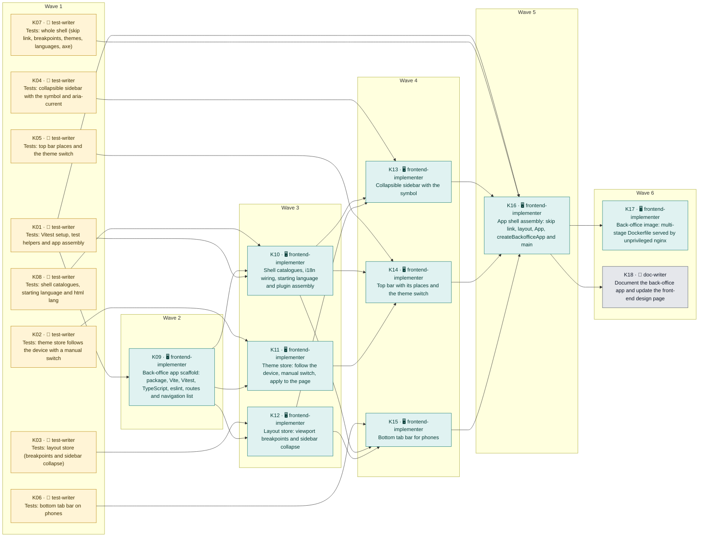

# T0.17: Plan

**Plan:** 🟢 Approved

**Push:** 🟢 Approved

<!-- ticket:specs -->
## 📚 Specifications

The specification and design pages of [TICKET.md](TICKET.md), copied by `python3 .claude/scripts/tickets/ticket_refs.py sync`.

- [Front end](../../technical/architecture/frontend.md#target-design-specified-in-gh-2-not-built-yet)
- [D43](../../specs/06-decisions/ux/d43-light-and-dark.md)
- [D46](../../specs/06-decisions/ux/d46-accessibility-standard.md)
- [D438](../../specs/06-decisions/technical/d438-repository-layout.md)
- [📜 D407 Front end](../../specs/06-decisions/technical/d407-front-end.md)
- [📜 D47 App shell](../../specs/06-decisions/ux/d47-app-shell.md)
- [📜 D49 Assistant side panel](../../specs/06-decisions/ux/d49-assistant-side-panel.md)
- [📜 D21 Languages](../../specs/06-decisions/foundations/d21-languages.md)
- [🏗️ Front end](../../technical/architecture/frontend.md)
- [🏗️ Repository layout](../../technical/architecture/repository-layout.md)
- [♿ Accessibility](../../specs/05-non-functional/accessibility.md#requirement)
- [🌍 Localisation](../../specs/05-non-functional/localisation.md)
<!-- /ticket:specs -->

## Summary

T0.17 builds frontend/backoffice from nothing: a Vue 3, Vite, Pinia and vue-router app with the D47/C-08 shell, its Vitest tests and its own image. The graph has 18 tasks in 6 waves.

Wave 1 has 8 test-writer tasks:
- K01: the shared test helpers and the app test.
- K02 and K03: the theme store and the layout store.
- K04: the sidebar, with a check that the symbol matches docs/assets/symbol.svg.
- K05 and K06: the top bar and the bottom tab bar.
- K07: the whole shell (skip link, breakpoints, both themes and both languages, axe).
- K08: the French and English catalogues, the starting language and `<html lang>`.

Wave 2: K09 sets up the app: package.json, the lock file, Vite, Vitest, TypeScript and eslint settings, index.html, the routes and the navigation list.

Wave 3 has three tasks in parallel. K10 adds the shell's catalogues and the plugin assembly. K11 adds the theme store and K12 the layout store.

Wave 4 builds the three shell parts in parallel: K13 the sidebar with the symbol, K14 the top bar with the theme switch, K15 the bottom tab bar.

Wave 5: K16 puts the app together (AppShell, SkipLink, App.vue, createBackofficeApp, main.ts, base styles). It must pass lint, typecheck, test and build for the whole app.

Wave 6 runs two tasks side by side. K17 adds the multi-stage Dockerfile (unprivileged nginx on port 8080, SPA fallback, HEALTHCHECK) and its own Dockerfile.dockerignore. K18 updates frontend/backoffice/README.md and docs/technical/architecture/frontend.md.

The briefs fix the module paths, the exports, the DOM attributes (`data-shell`, `data-nav-item`, `data-place`) and the catalogue keys, so that the tests written first and the code agree. No Playwright task is planned, because TICKET.md lists no screen (`➖ No screen`) and T0.22 owns the Playwright tests.

The plan has three weak points:
- **Expected hook failures:** the stop hook runs lint, typecheck and test for the whole app. Until K16 lands, these fail on test files of later waves. Every brief says this is expected and gives a `done_when` limited to its own test files.
- **Prerequisite packages:** the names and APIs of the config, tokens, ui and i18n packages (T0.02, T0.07, T0.15, T0.16) cannot be checked yet. The briefs tell each worker to read them when it runs.
- **Planner's choices:** these are listed as assumptions for review:
  - French wording of the shell labels.
  - Which navigation entries P0 has.
  - The search, assistant, notifications, site switcher and user menu controls are present and named but inactive (`aria-disabled`).
  - The theme switch's place in the top bar.
  - `localStorage` keeps the manual theme choice.
  - Port 8080.

## Assumptions

- No screen page specifies the shell (the phase page says the shell has no business screen), so Screens touched is `➖ No screen` with that reason; the shell's states come from D47 and C-08.
- The roadmap row has no anchor of its own, so the sprint anchor `#s03` stands for the ticket, and `#epics` for the epic.
- The shell may use the tokens (T0.07), base components (T0.15) and i18n package (T0.16); the row does not list them as prerequisites, so the ticket graph decides.
- The accessibility NFR page has no measures yet, so the ticket keeps to the D46 standard; the Localisation page link and the symbol path `docs/assets/symbol.svg` were not verified, and `check_ticket.py` could not be run by this agent.
- Acceptance criteria 2 to 8 are derived from the roadmap row's done-when and from D47, D43, D46, D21 and C-08, not from use cases (none exist for the shell).
- TICKET.md lists no screen (`➖ No screen`), so no Playwright task is planned: `check_plan.py` requires one only when screens are listed, and T0.22 owns `frontend/backoffice/e2e/`.
- The prerequisite packages of the ticket graph (`frontend/packages/config` of T0.02, `tokens` of T0.07, `ui` of T0.15, `i18n` of T0.16) exist when T0.17 runs. Their package names, exports, catalogue format and default locale are read from the packages at run time, because none of them is built yet.
- Vitest tests live in `frontend/backoffice/tests/`, mirroring `src/`, in a jsdom environment. AGENT.md places only the Playwright tests (`e2e/`). They use real Pinia, vue-router (memory history) and the i18n plugin, and no `vi.mock`. The only stand-in is `window.matchMedia`, because jsdom has none.
- The theme is applied as `data-theme='light|dark'` and `color-scheme` on `<html>`, plus whatever selector the tokens package uses for dark values.
- The manual theme choice is kept in `localStorage` key `simpleerp.theme` in the browser, until user preferences exist on the server. D43 says "per user" and no user exists in P0.
- Sidebar entries in P0 are Home, Tasks and Assistant: the C-08 image without its business modules. Phone tabs are Home, Tasks, Assistant and Me (C-08 anatomy).
- Home (`/`) and Tasks (`/tasks`) are routes to a placeholder page with its `h1`, and unknown paths redirect to Home.
- Assistant, Me, notifications, the site switcher and the user menu are named places with `aria-disabled='true'`, and the search field is inert, until their features ship. No assistant panel is built: D49 and C-11 make it a later component, and D49 rejects a separate page.
- The theme switch is a top-bar button placed before the user menu. D43 requires a manual switch but does not place it.
- The starting language is the first browser language that is French or English, else the i18n package's default. The shell has no language switch, and `<html lang>` follows the active locale.
- Breakpoints come from the Layout grid: phone up to 767 px, tablet 768 to 1,199 px, desktop from 1,200 px. On tablet the sidebar starts collapsed (Responsive), and the top bar stays on phones.
- The sidebar's collapsed state is kept in Pinia for the session and not persisted.
- The French wording of the shell labels is proposed by the plan: no specification page gives it.
- The symbol is copied into `frontend/backoffice/src/assets/symbol.svg`, with a test that keeps it byte-identical to `docs/assets/symbol.svg`, so that the image does not depend on `docs/`.
- The image is built with Node 22 and pnpm (frozen lock) and served by unprivileged nginx on port 8080, with an SPA fallback and a HEALTHCHECK. A `Dockerfile.dockerignore` sits beside the Dockerfile rather than a root `.dockerignore` shared by every image. Compose and Helm wiring stay with T0.21 and T0.19.
- Until K16 lands, the stop hook's app-wide lint, typecheck and test fail on test files of later waves (tests first). Each brief says this is expected, and each `done_when` runs only the task's own tests.

<!-- plan:graph -->

> [!NOTE]
> Generated from the json block at the end of this page by `python3 .claude/scripts/tickets/plan.py render`.
> To change a task, edit the json block, then render again: never edit this view by hand.

## Waves

| Wave | Tasks | Agents running at once |
| --- | --- | --- |
| 1 | [K01](#k01), [K02](#k02), [K03](#k03), [K04](#k04), [K05](#k05), [K06](#k06), [K07](#k07), [K08](#k08) | 8 of 8 |
| 2 | [K09](#k09) | 1 of 1 |
| 3 | [K10](#k10), [K11](#k11), [K12](#k12) | 3 of 3 |
| 4 | [K13](#k13), [K14](#k14), [K15](#k15) | 3 of 3 |
| 5 | [K16](#k16) | 1 of 1 |
| 6 | [K17](#k17), [K18](#k18) | 2 of 2 |

| Wave | Task | Agent | Depends on | Unblocks |
| --- | --- | --- | --- | --- |
| 1 | [K01](#k01) Tests: Vitest setup, test helpers and app assembly | 🧪 test-writer | none | [K09](#k09), [K10](#k10), [K16](#k16) |
| 1 | [K02](#k02) Tests: theme store follows the device with a manual switch | 🧪 test-writer | none | [K11](#k11) |
| 1 | [K03](#k03) Tests: layout store (breakpoints and sidebar collapse) | 🧪 test-writer | none | [K12](#k12) |
| 1 | [K04](#k04) Tests: collapsible sidebar with the symbol and aria-current | 🧪 test-writer | none | [K13](#k13) |
| 1 | [K05](#k05) Tests: top bar places and the theme switch | 🧪 test-writer | none | [K14](#k14) |
| 1 | [K06](#k06) Tests: bottom tab bar on phones | 🧪 test-writer | none | [K15](#k15) |
| 1 | [K07](#k07) Tests: whole shell (skip link, breakpoints, themes, languages, axe) | 🧪 test-writer | none | [K16](#k16) |
| 1 | [K08](#k08) Tests: shell catalogues, starting language and html lang | 🧪 test-writer | none | [K10](#k10) |
| 2 | [K09](#k09) Back-office app scaffold: package, Vite, Vitest, TypeScript, eslint, routes and navigation list | 🖥️ frontend-implementer | [K01](#k01) | [K10](#k10), [K11](#k11), [K12](#k12) |
| 3 | [K10](#k10) Shell catalogues, i18n wiring, starting language and plugin assembly | 🖥️ frontend-implementer | [K08](#k08), [K09](#k09), [K01](#k01) | [K13](#k13), [K14](#k14), [K15](#k15) |
| 3 | [K11](#k11) Theme store: follow the device, manual switch, apply to the page | 🖥️ frontend-implementer | [K02](#k02), [K09](#k09) | [K14](#k14) |
| 3 | [K12](#k12) Layout store: viewport breakpoints and sidebar collapse | 🖥️ frontend-implementer | [K03](#k03), [K09](#k09) | [K13](#k13), [K15](#k15) |
| 4 | [K13](#k13) Collapsible sidebar with the symbol | 🖥️ frontend-implementer | [K04](#k04), [K10](#k10), [K12](#k12) | [K16](#k16) |
| 4 | [K14](#k14) Top bar with its places and the theme switch | 🖥️ frontend-implementer | [K05](#k05), [K10](#k10), [K11](#k11) | [K16](#k16) |
| 4 | [K15](#k15) Bottom tab bar for phones | 🖥️ frontend-implementer | [K06](#k06), [K10](#k10), [K12](#k12) | [K16](#k16) |
| 5 | [K16](#k16) App shell assembly: skip link, layout, App, createBackofficeApp and main | 🖥️ frontend-implementer | [K01](#k01), [K07](#k07), [K13](#k13), [K14](#k14), [K15](#k15) | [K17](#k17), [K18](#k18) |
| 6 | [K17](#k17) Back-office image: multi-stage Dockerfile served by unprivileged nginx | 🖥️ frontend-implementer | [K16](#k16) | none |
| 6 | [K18](#k18) Document the back-office app and update the front-end design page | 📝 doc-writer | [K16](#k16) | none |

## Dependency graph



## Tasks

### <a id="k01"></a>K01: Tests: Vitest setup, test helpers and app assembly

| Agent | Wave | Depends on | Unblocks |
| --- | --- | --- | --- |
| 🧪 test-writer | 1 | none | [K09](#k09), [K10](#k10), [K16](#k16) |

**Files** (only this task may change them in its wave):

- `frontend/backoffice/tests/setup.ts`
- `frontend/backoffice/tests/helpers/media.ts`
- `frontend/backoffice/tests/helpers/mountComponent.ts`
- `frontend/backoffice/tests/helpers/mountApp.ts`
- `frontend/backoffice/tests/app/createBackofficeApp.spec.ts`

**Done when:** The five files exist with the exact exports above. createBackofficeApp.spec.ts covers every case listed. The files import only the source paths and exports named in this brief. They fail until K09, K10 and K16 land, and `pnpm --filter ./frontend/backoffice exec vitest run tests/app/createBackofficeApp.spec.ts` passes once K16 is integrated.

**Brief:**

Ticket T0.17 (docs/tickets/T0.17/TICKET.md), back-office app shell. The app is frontend/backoffice/ (Vue 3, TypeScript, Vite, Pinia, vue-router: D407 docs/specs/06-decisions/technical/d407-front-end.md, docs/technical/architecture/frontend.md; layout D438 docs/specs/06-decisions/technical/d438-repository-layout.md, docs/technical/architecture/repository-layout.md). The prerequisite packages frontend/packages/config, tokens, ui and i18n exist. Read their package.json and README for their names and APIs, and never change them.

Write the Vitest infrastructure that every other test of this ticket imports, plus the app assembly test. Tests are written first: they import modules that do not exist yet and fail until the implementation lands. Vitest runs in jsdom (configured by K09 with setupFiles ['tests/setup.ts'] and include ['tests/**/*.spec.ts']). Use real Pinia, real vue-router with createMemoryHistory and the real i18n plugin. Use no vi.mock and no mocking library (AGENT.md 'Prefer real things to mocks'). The only stand-in is window.matchMedia, because jsdom has none.

Files and exact API, which other test-writers of this wave rely on. Do not change the names.
1. tests/helpers/media.ts:
   - `export interface MediaState { widthPx: number; dark: boolean }`
   - `export interface MediaController { setWidth(px: number): void; setDark(dark: boolean): void; uninstall(): void }`
   - `export function installMatchMedia(state: MediaState): MediaController`
   It replaces window.matchMedia with an evaluator of `(max-width: Npx)`, `(min-width: Npx)`, the two joined by `and`, and `(prefers-color-scheme: dark|light)`. It sets window.innerWidth. The MediaQueryList objects it returns support addEventListener/removeEventListener('change') and the legacy addListener/removeListener. setWidth/setDark re-evaluate and dispatch a `change` event to the lists whose `matches` changed. uninstall restores the previous value.
2. tests/setup.ts:
   - beforeEach installs a default matchMedia: 1280 px wide, light.
   - afterEach uninstalls it, clears localStorage, removes `data-theme` and `lang` from document.documentElement, resets its style.colorScheme and empties document.body.
3. tests/helpers/mountComponent.ts:
   - `export interface MountOptions { widthPx?: number; dark?: boolean; locale?: 'en' | 'fr'; path?: string; storedTheme?: 'light' | 'dark'; props?: Record<string, unknown> }`
   - `export async function mountComponent(component: Component, options?: MountOptions): Promise<{ wrapper: VueWrapper; router: Router; media: MediaController }>`
   - Defaults: 1280 px, light, 'en', '/'.
   - Steps: install matchMedia; if storedTheme is given, write it to localStorage key 'simpleerp.theme'; call `createBackofficePlugins({ history: createMemoryHistory(), locale })` from 'src/app/createBackofficePlugins.ts' (returns `{ router, pinia, i18n }`); push the path and await router.isReady(); mount with @vue/test-utils with global.plugins [pinia, router, i18n] and attachTo document.body.
4. tests/helpers/mountApp.ts:
   - `export async function mountApp(options?: Omit<MountOptions, 'props'>): Promise<{ container: HTMLElement; router: Router; media: MediaController; unmount(): void }>`
   - It uses `createBackofficeApp({ history: createMemoryHistory(), locale })` from 'src/app/createBackofficeApp.ts' (returns `{ app, router, pinia, i18n }`), pushes the path, awaits router.isReady() and mounts `app` on a div appended to document.body.
   - Keep it in its own file, so that component tests do not import createBackofficeApp before it exists.
5. tests/app/createBackofficeApp.spec.ts, `describe('createBackofficeApp')`, tests named as sentences:
   - At '/' the page heading (h1) reads 'Home' in 'en' and 'Accueil' in 'fr'.
   - At '/tasks' it reads 'Tasks' / 'Tâches'.
   - An unknown path ends on the route named 'home'.
   - `<html lang>` equals the locale.
   - A `main#main-content` element holds the page.
   - The theme store is usable (Pinia installed): document.documentElement has `data-theme` 'light' with a light device.

Import source modules through relative paths from the test file (e.g. '../../src/app/createBackofficeApp'). Use it.each for cases of the same behaviour. Write TypeScript compatible with strict mode.

### <a id="k02"></a>K02: Tests: theme store follows the device with a manual switch

| Agent | Wave | Depends on | Unblocks |
| --- | --- | --- | --- |
| 🧪 test-writer | 1 | none | [K11](#k11) |

**Files** (only this task may change them in its wave):

- `frontend/backoffice/tests/stores/theme.spec.ts`

**Done when:** The file exists and covers every case listed, importing only '../../src/stores/theme' and '../helpers/media'. `pnpm --filter ./frontend/backoffice exec vitest run tests/stores/theme.spec.ts` passes once K11 is integrated.

**Brief:**

Ticket T0.17 (docs/tickets/T0.17/TICKET.md), acceptance criteria 2 and 7. D43 (docs/specs/06-decisions/ux/d43-light-and-dark.md): 'Light and dark themes, following the device's setting, with a manual switch per user.' Framework: D407 (docs/specs/06-decisions/technical/d407-front-end.md), app in frontend/backoffice (D438, docs/specs/06-decisions/technical/d438-repository-layout.md).

Write frontend/backoffice/tests/stores/theme.spec.ts, `describe('useThemeStore')`, for the Pinia store of 'src/stores/theme.ts' (built by K11). Contract:
- `export const useThemeStore` is a Pinia store with id 'theme'.
- `preference`: 'system' | 'light' | 'dark'.
- `resolved`: 'light' | 'dark'.
- `setPreference(p)`.
- `toggle()`: sets the explicit preference opposite to `resolved`.
- The device setting is read through window.matchMedia('(prefers-color-scheme: dark)'), and its change events are followed while the preference is 'system'.
- The manual choice is stored in localStorage under 'simpleerp.theme' as 'light' or 'dark'. 'system' removes the key, and an invalid stored value counts as 'system'.
- The resolved theme is applied to document.documentElement as attribute `data-theme` ('light' | 'dark') and as style.colorScheme.

Cases, named as sentences:
- With no stored choice, it follows a light device and a dark device.
- A device change while on 'system' switches the theme live.
- toggle() on a light device gives 'dark', stores 'dark' and sets data-theme 'dark'.
- A stored 'dark' wins over a light device at creation.
- A device change does not override a manual choice.
- setPreference('system') removes the key and follows the device again.
- An invalid stored value is treated as 'system'.

Use `setActivePinia(createPinia())` per test, and the stand-in of tests/helpers/media.ts written by K01: `installMatchMedia({ widthPx, dark }): MediaController` with `setDark(dark)`, `setWidth(px)`, `uninstall()`. tests/setup.ts (K01) clears localStorage and the root attributes after each test. Real Pinia, no vi.mock. Use it.each for cases of one behaviour. Tests are written first and fail until K11 lands.

### <a id="k03"></a>K03: Tests: layout store (breakpoints and sidebar collapse)

| Agent | Wave | Depends on | Unblocks |
| --- | --- | --- | --- |
| 🧪 test-writer | 1 | none | [K12](#k12) |

**Files** (only this task may change them in its wave):

- `frontend/backoffice/tests/stores/layout.spec.ts`

**Done when:** The file exists and covers every case listed, importing only '../../src/stores/layout' and '../helpers/media'. `pnpm --filter ./frontend/backoffice exec vitest run tests/stores/layout.spec.ts` passes once K12 is integrated.

**Brief:**

Ticket T0.17 (docs/tickets/T0.17/TICKET.md), acceptance criteria 3 and 4. D47 (docs/specs/06-decisions/ux/d47-app-shell.md): a collapsible left sidebar, a bottom tab bar on phones. C-08 Navigation (docs/specs/04-ux/design-system/components/c-08-navigation.md): 'Desktop: sidebar expanded or collapsed to icons. Phone: bottom tab bar.' Responsive (docs/specs/04-ux/design-system/responsive.md): on tablet 'The sidebar collapses to icons'. Breakpoints are those of docs/specs/04-ux/design-system/layout-grid.md: phone up to 767 px, tablet 768 to 1,199 px, desktop from 1,200 px. App frontend/backoffice, D407 (docs/specs/06-decisions/technical/d407-front-end.md), D438 (docs/specs/06-decisions/technical/d438-repository-layout.md).

Write frontend/backoffice/tests/stores/layout.spec.ts, `describe('useLayoutStore')`, for 'src/stores/layout.ts' (built by K12). Contract:
- `export const useLayoutStore` is a Pinia store with id 'layout'.
- `viewport`: 'phone' | 'tablet' | 'desktop', from window.matchMedia('(max-width: 767px)') and '(min-width: 1200px)', following their change events.
- `sidebarCollapsed`: boolean. It is the user's choice once toggled in the session, else true on tablet and false on desktop.
- `toggleSidebar()`.
- Nothing is persisted.

Cases:
- 375, 767, 768, 1199, 1200 and 1600 px give phone, phone, tablet, tablet, desktop, desktop (it.each).
- A width change updates `viewport` live.
- On desktop the sidebar starts expanded, and on tablet collapsed.
- toggleSidebar() collapses then expands it.
- A toggled choice survives a change between tablet and desktop.
- localStorage stays empty.

Use `setActivePinia(createPinia())` and the stand-in of tests/helpers/media.ts by K01: `installMatchMedia({ widthPx, dark }): MediaController` with `setWidth(px)`, `setDark(dark)`, `uninstall()`. Real Pinia, no vi.mock. Tests are written first and fail until K12 lands.

### <a id="k04"></a>K04: Tests: collapsible sidebar with the symbol and aria-current

| Agent | Wave | Depends on | Unblocks |
| --- | --- | --- | --- |
| 🧪 test-writer | 1 | none | [K13](#k13) |

**Files** (only this task may change them in its wave):

- `frontend/backoffice/tests/shell/AppSidebar.spec.ts`
- `frontend/backoffice/tests/assets/symbol.spec.ts`

**Done when:** Both files exist and cover every case listed, importing only '../../src/shell/AppSidebar.vue', '../helpers/mountComponent' and node built-ins. `pnpm --filter ./frontend/backoffice exec vitest run tests/shell/AppSidebar.spec.ts tests/assets/symbol.spec.ts` passes once K13 is integrated.

**Brief:**

Ticket T0.17 (docs/tickets/T0.17/TICKET.md), acceptance criteria 3 and 6. Sources:
- D47 (docs/specs/06-decisions/ux/d47-app-shell.md).
- C-08 Navigation (docs/specs/04-ux/design-system/components/c-08-navigation.md): 'A nav landmark with a name; the current page marked aria-current; ... every item reachable by keyboard'. Its image is docs/specs/04-ux/design-system/images/c-08-navigation-desktop-light.png.
- D46 (docs/specs/06-decisions/ux/d46-accessibility-standard.md).
- Responsive (docs/specs/04-ux/design-system/responsive.md): tablet collapses to icons.
- D21 (docs/specs/06-decisions/foundations/d21-languages.md).
- The symbol docs/assets/symbol.svg.
- App frontend/backoffice, D407 (docs/specs/06-decisions/technical/d407-front-end.md), D438 (docs/specs/06-decisions/technical/d438-repository-layout.md).

1. tests/shell/AppSidebar.spec.ts, `describe('AppSidebar')`, for 'src/shell/AppSidebar.vue' (K13). Mount with `mountComponent(AppSidebar, { widthPx, locale, path })` from tests/helpers/mountComponent.ts (K01). It returns `{ wrapper, router, media }` with defaults 1280 px, light, 'en', '/'.
   DOM contract:
   - The root is `<aside data-shell="sidebar" data-collapsed="true|false">`.
   - It contains a `<nav>` whose aria-label is 'Main navigation' (en) / 'Navigation principale' (fr).
   - The symbol is `` whose src ends with 'symbol.svg'.
   - The wordmark 'SimpleERP' shows when expanded.
   - Items: `[data-nav-item="home"]` and `[data-nav-item="tasks"]` are `<a>` links to '/' and '/tasks'. `[data-nav-item="assistant"]` is a `<button aria-disabled="true">`.
   - Each item contains an `svg` icon.
   - The toggle is `<button data-shell="sidebar-toggle">` with aria-expanded and aria-controls pointing to an existing id. Its aria-label is 'Collapse the menu' / 'Réduire le menu' when expanded, and 'Expand the menu' / 'Déplier le menu' when collapsed.
   Cases:
   - At 1280 px it is expanded and each item shows its label: 'Home', 'Tasks', 'Assistant' / 'Accueil', 'Tâches', 'Assistant'.
   - Pressing the toggle collapses it. data-collapsed becomes 'true', each item's text is empty but its aria-label keeps the label and its svg stays (icons only), the wordmark is gone and aria-expanded is 'false'.
   - Pressing it again restores the labels.
   - At 1000 px (tablet) it starts collapsed.
   - At '/' the home link has aria-current='page' and tasks has none. After router.push('/tasks') it moves to tasks.
   - Every item and the toggle are keyboard reachable: links have href, buttons are button elements, no tabindex -1.
2. tests/assets/symbol.spec.ts, `describe('symbol asset')`: the file frontend/backoffice/src/assets/symbol.svg is byte-identical to docs/assets/symbol.svg. Read both with node:fs, resolving paths from import.meta.url.

Real Pinia, router and i18n, no vi.mock. Use it.each for the en and fr cases. Tests are written first and fail until K13 lands.

### <a id="k05"></a>K05: Tests: top bar places and the theme switch

| Agent | Wave | Depends on | Unblocks |
| --- | --- | --- | --- |
| 🧪 test-writer | 1 | none | [K14](#k14) |

**Files** (only this task may change them in its wave):

- `frontend/backoffice/tests/shell/TopBar.spec.ts`

**Done when:** The file exists and covers every case listed, importing only '../../src/shell/TopBar.vue' and '../helpers/mountComponent'. `pnpm --filter ./frontend/backoffice exec vitest run tests/shell/TopBar.spec.ts` passes once K14 is integrated.

**Brief:**

Ticket T0.17 (docs/tickets/T0.17/TICKET.md), acceptance criteria 2, 5 and 7. Sources:
- D47 (docs/specs/06-decisions/ux/d47-app-shell.md): 'a top bar with global search, the AI assistant, notifications, the site switcher and the user menu'.
- D49 (docs/specs/06-decisions/ux/d49-assistant-side-panel.md).
- C-08 Navigation (docs/specs/04-ux/design-system/components/c-08-navigation.md, image docs/specs/04-ux/design-system/images/c-08-navigation-desktop-light.png).
- D43 (docs/specs/06-decisions/ux/d43-light-and-dark.md): manual switch.
- D21 (docs/specs/06-decisions/foundations/d21-languages.md).
- D46 (docs/specs/06-decisions/ux/d46-accessibility-standard.md).
- App frontend/backoffice, D407 (docs/specs/06-decisions/technical/d407-front-end.md), D438 (docs/specs/06-decisions/technical/d438-repository-layout.md).

Write tests/shell/TopBar.spec.ts, `describe('TopBar')`, for 'src/shell/TopBar.vue' (K14, which uses 'src/shell/ThemeSwitch.vue'). Mount with `mountComponent(TopBar, { locale, dark, storedTheme })` from tests/helpers/mountComponent.ts (K01). It returns `{ wrapper, router, media }`, where media has `setDark(dark)`.

DOM contract:
- The root is `<header data-shell="topbar">`.
- `[data-place="search"]` is a `<form role="search">` holding an `<input type="search">`. Its accessible name is 'Search' / 'Rechercher' and its placeholder 'Search customers, invoices, people...' / 'Rechercher des clients, des factures, des personnes...'.
- `[data-place="assistant"]`, `[data-place="notifications"]`, `[data-place="site"]` and `[data-place="user"]` are `<button aria-disabled="true">` elements. Their accessible names (aria-label or text) are 'Assistant' / 'Assistant', 'Notifications' / 'Notifications', 'Switch site' / 'Changer de site' and 'User menu' / 'Menu utilisateur'.
- `[data-place="theme"]` is an enabled `<button>`. Its aria-label is 'Switch to dark mode' / 'Passer en mode sombre' when the resolved theme is light, and 'Switch to light mode' / 'Passer en mode clair' when dark.

Cases:
- The five places are present in that DOM order (search, assistant, notifications, site, user), with their names in en and in fr (it.each).
- The four inactive places are aria-disabled.
- On a light device the theme switch offers dark. Clicking it sets document.documentElement data-theme 'dark', stores 'dark' in localStorage 'simpleerp.theme' and its label becomes the light one.
- On a dark device it offers light.
- After a manual choice, media.setDark() no longer changes data-theme.

Real Pinia, router and i18n, no vi.mock. Tests are written first and fail until K14 lands.

### <a id="k06"></a>K06: Tests: bottom tab bar on phones

| Agent | Wave | Depends on | Unblocks |
| --- | --- | --- | --- |
| 🧪 test-writer | 1 | none | [K15](#k15) |

**Files** (only this task may change them in its wave):

- `frontend/backoffice/tests/shell/BottomTabBar.spec.ts`

**Done when:** The file exists and covers every case listed, importing only '../../src/shell/BottomTabBar.vue' and '../helpers/mountComponent'. `pnpm --filter ./frontend/backoffice exec vitest run tests/shell/BottomTabBar.spec.ts` passes once K15 is integrated.

**Brief:**

Ticket T0.17 (docs/tickets/T0.17/TICKET.md), acceptance criteria 4 and 6. Sources:
- D47 (docs/specs/06-decisions/ux/d47-app-shell.md): 'On phones: a bottom tab bar.'
- C-08 Navigation (docs/specs/04-ux/design-system/components/c-08-navigation.md): 'phone: page content + bottom tabs [Home] [Tasks] [Assistant] [Me]', a named nav landmark and aria-current.
- Responsive (docs/specs/04-ux/design-system/responsive.md).
- D46 (docs/specs/06-decisions/ux/d46-accessibility-standard.md).
- D21 (docs/specs/06-decisions/foundations/d21-languages.md).
- App frontend/backoffice, D407 (docs/specs/06-decisions/technical/d407-front-end.md), D438 (docs/specs/06-decisions/technical/d438-repository-layout.md).

Write tests/shell/BottomTabBar.spec.ts, `describe('BottomTabBar')`, for 'src/shell/BottomTabBar.vue' (K15). Mount with `mountComponent(BottomTabBar, { widthPx: 375, locale, path })` from tests/helpers/mountComponent.ts (K01). It returns `{ wrapper, router, media }`.

DOM contract:
- The root is `<nav data-shell="tabbar">` with aria-label 'Main navigation' / 'Navigation principale'.
- Items `[data-nav-item="home"]`, `[data-nav-item="tasks"]`, `[data-nav-item="assistant"]` and `[data-nav-item="me"]`, in that order.
- Each item holds an `svg` icon and a visible label: 'Home', 'Tasks', 'Assistant', 'Me' / 'Accueil', 'Tâches', 'Assistant', 'Moi'.
- home and tasks are `<a>` links to '/' and '/tasks'. assistant and me are `<button aria-disabled="true">`.

Cases:
- The four tabs are in order with icon and label in en and fr (it.each).
- At '/' home carries aria-current='page'. After router.push('/tasks'), tasks carries it and home does not.
- Clicking the tasks link navigates to the route named 'tasks'.
- The inactive tabs are aria-disabled buttons.

Real Pinia, router and i18n, no vi.mock. Tests are written first and fail until K15 lands.

### <a id="k07"></a>K07: Tests: whole shell (skip link, breakpoints, themes, languages, axe)

| Agent | Wave | Depends on | Unblocks |
| --- | --- | --- | --- |
| 🧪 test-writer | 1 | none | [K16](#k16) |

**Files** (only this task may change them in its wave):

- `frontend/backoffice/tests/shell/AppShell.spec.ts`

**Done when:** The file exists and covers every case listed, importing only '../helpers/mountApp' and 'axe-core'. `pnpm --filter ./frontend/backoffice exec vitest run tests/shell/AppShell.spec.ts` passes once K16 is integrated.

**Brief:**

Ticket T0.17 (docs/tickets/T0.17/TICKET.md), acceptance criteria 2, 4, 6 and 7. Sources:
- D47 (docs/specs/06-decisions/ux/d47-app-shell.md).
- C-08 Navigation (docs/specs/04-ux/design-system/components/c-08-navigation.md): 'a "skip to content" link first'.
- D46 (docs/specs/06-decisions/ux/d46-accessibility-standard.md), with the budget docs/specs/05-non-functional/accessibility.md and the checks of docs/specs/04-ux/design-system/accessibility.md (axe-core).
- D43 (docs/specs/06-decisions/ux/d43-light-and-dark.md).
- D21 (docs/specs/06-decisions/foundations/d21-languages.md), with docs/specs/05-non-functional/localisation.md.
- Responsive (docs/specs/04-ux/design-system/responsive.md).
- App frontend/backoffice, D407 (docs/specs/06-decisions/technical/d407-front-end.md), D438 (docs/specs/06-decisions/technical/d438-repository-layout.md).

Write tests/shell/AppShell.spec.ts, `describe('AppShell')`. Mount the whole app with `mountApp({ widthPx, dark, locale, path, storedTheme })` from tests/helpers/mountApp.ts (K01). It returns `{ container, router, media, unmount }` and uses createBackofficeApp (K16).

DOM contract:
- The skip link is `<a data-shell="skip-link" href="#main-content">` with text 'Skip to content' / 'Aller au contenu'.
- The page is in `<main id="main-content" tabindex="-1">`.
- The sidebar is `[data-shell="sidebar"]`, the top bar `[data-shell="topbar"]` and the tab bar `[data-shell="tabbar"]`.
- Nav items are `[data-nav-item]`.

Cases:
- The first focusable element in document order (a[href], button, input, select, textarea, [tabindex]:not([tabindex="-1"])) is the skip link.
- Clicking the skip link moves focus to main#main-content.
- At 1280 px and at 1000 px the sidebar and the top bar are rendered and the tab bar is not.
- At 375 px the tab bar and the top bar are rendered and the sidebar is not.
- media.setWidth(375) on a mounted desktop shell swaps the sidebar for the tab bar.
- Exactly one `nav` landmark with a non-empty aria-label exists at each width.
- At '/' the current item carries aria-current='page': in the sidebar on desktop, in the tab bar on phone.
- For each pair of theme (light, dark device) and locale (en, fr) (it.each over the four), the shell renders with data-theme matching the device, `<html lang>` equal to the locale and the skip link text in that language. axe-core (`import axe from 'axe-core'`, `axe.run(container, { rules: { 'color-contrast': { enabled: false } } })`, contrast being unmeasurable in jsdom) reports no violation. Also run axe at 375 px.
- A stored 'dark' choice with a light device renders dark, and survives an unmount and a new mount.

Real Pinia, router and i18n, no vi.mock. Tests are written first and fail until K16 lands.

### <a id="k08"></a>K08: Tests: shell catalogues, starting language and html lang

| Agent | Wave | Depends on | Unblocks |
| --- | --- | --- | --- |
| 🧪 test-writer | 1 | none | [K10](#k10) |

**Files** (only this task may change them in its wave):

- `frontend/backoffice/tests/locales/catalogues.spec.ts`
- `frontend/backoffice/tests/i18n/resolveInitialLocale.spec.ts`
- `frontend/backoffice/tests/app/createBackofficePlugins.spec.ts`

**Done when:** The three files exist and cover every case listed, importing only the source paths named here, the i18n package, vue, vue-router, pinia and @vue/test-utils. `pnpm --filter ./frontend/backoffice exec vitest run tests/locales tests/i18n tests/app/createBackofficePlugins.spec.ts` passes once K10 is integrated.

**Brief:**

Ticket T0.17 (docs/tickets/T0.17/TICKET.md), acceptance criterion 2. Sources:
- D21 (docs/specs/06-decisions/foundations/d21-languages.md): 'French and English at launch, every text in translation files'.
- Localisation budget docs/specs/05-non-functional/localisation.md.
- D46 (docs/specs/06-decisions/ux/d46-accessibility-standard.md): the page language must be declared.
- App frontend/backoffice, D407 (docs/specs/06-decisions/technical/d407-front-end.md), D438 (docs/specs/06-decisions/technical/d438-repository-layout.md).

The i18n package of frontend/packages/i18n (T0.16) exists. Read its README and exports for its API, its catalogue format and its default locale.

Write:
1. tests/locales/catalogues.spec.ts, `describe('shell catalogues')`, on src/locales/en.json and src/locales/fr.json (K10):
   - Both have exactly the same set of keys (flattened dotted paths), with no empty value.
   - Both hold every key of this table, with these values (en / fr):
     - app.name: SimpleERP / SimpleERP
     - shell.skipToContent: Skip to content / Aller au contenu
     - shell.navigation: Main navigation / Navigation principale
     - shell.collapseSidebar: Collapse the menu / Réduire le menu
     - shell.expandSidebar: Expand the menu / Déplier le menu
     - shell.search: Search / Rechercher
     - shell.searchPlaceholder: Search customers, invoices, people... / Rechercher des clients, des factures, des personnes...
     - shell.assistant: Assistant / Assistant
     - shell.notifications: Notifications / Notifications
     - shell.siteSwitcher: Switch site / Changer de site
     - shell.userMenu: User menu / Menu utilisateur
     - shell.switchToDark: Switch to dark mode / Passer en mode sombre
     - shell.switchToLight: Switch to light mode / Passer en mode clair
     - nav.home: Home / Accueil
     - nav.tasks: Tasks / Tâches
     - nav.assistant: Assistant / Assistant
     - nav.me: Me / Moi
     - page.empty: Nothing here yet. / Rien ici pour le moment.
   - If the i18n package exports its missing-key check, the two catalogues also pass it.
2. tests/i18n/resolveInitialLocale.spec.ts, `describe('resolveInitialLocale')`, for `resolveInitialLocale(languages: readonly string[]): BackofficeLocale` of src/i18n/resolveInitialLocale.ts, with `BackofficeLocale = 'fr' | 'en'`. Cases (it.each):
   - ['fr-FR'] gives 'fr'.
   - ['en-GB'] gives 'en'.
   - ['de-DE', 'fr'] gives 'fr'.
   - ['EN-us'] gives 'en'.
   - ['de'] and [] give the i18n package's default locale.
3. tests/app/createBackofficePlugins.spec.ts, `describe('createBackofficePlugins')`, for `createBackofficePlugins(options?: { history?: RouterHistory; locale?: BackofficeLocale }): { router: Router; pinia: Pinia; i18n: Plugin }` of src/app/createBackofficePlugins.ts:
   - Installing the three plugins on an app (mount a tiny component through @vue/test-utils with global.plugins) sets document.documentElement lang to 'fr' or 'en' as asked.
   - A component using the i18n package's translation function renders 'Aller au contenu' for shell.skipToContent in 'fr' and 'Skip to content' in 'en'.
   - Switching the locale through the i18n package's API re-renders the component and updates `<html lang>` without a reload.
   - The router has the routes named 'home' ('/') and 'tasks' ('/tasks').

Use createMemoryHistory. Real plugins, no vi.mock. Tests are written first and fail until K09 and K10 land.

### <a id="k09"></a>K09: Back-office app scaffold: package, Vite, Vitest, TypeScript, eslint, routes and navigation list

| Agent | Wave | Depends on | Unblocks |
| --- | --- | --- | --- |
| 🖥️ frontend-implementer | 2 | [K01](#k01) | [K10](#k10), [K11](#k11), [K12](#k12) |

**Files** (only this task may change them in its wave):

- `frontend/backoffice/package.json`
- `frontend/backoffice/vite.config.ts`
- `frontend/backoffice/tsconfig.json`
- `frontend/backoffice/tsconfig.app.json`
- `frontend/backoffice/tsconfig.node.json`
- `frontend/backoffice/tsconfig.vitest.json`
- `frontend/backoffice/eslint.config.js`
- `frontend/backoffice/index.html`
- `frontend/backoffice/src/env.d.ts`
- `frontend/backoffice/src/router/routes.ts`
- `frontend/backoffice/src/router/createBackofficeRouter.ts`
- `frontend/backoffice/src/views/PlaceholderView.vue`
- `frontend/backoffice/src/navigation/items.ts`
- `pnpm-lock.yaml`

**Done when:** From the repository root, `pnpm install --frozen-lockfile` passes. `pnpm --filter ./frontend/backoffice exec vue-tsc --noEmit -p tsconfig.app.json` passes, and so does `pnpm --filter ./frontend/backoffice exec eslint src vite.config.ts eslint.config.js`.

**Brief:**

Ticket T0.17 (docs/tickets/T0.17/TICKET.md). Create the frontend/backoffice project as a Vue 3, TypeScript, Vite, Pinia and vue-router app. Sources: D407 (docs/specs/06-decisions/technical/d407-front-end.md), docs/technical/architecture/frontend.md, D438 (docs/specs/06-decisions/technical/d438-repository-layout.md), docs/technical/architecture/repository-layout.md. Follow AGENT.md 'Front ends' and the existing pnpm workspace (root package.json and pnpm-workspace.yaml from T0.01). Read frontend/packages/config (shared eslint and strict TypeScript, T0.02), tokens (T0.07), ui (components and Lucide icons, T0.15, D45) and i18n (T0.16) for their package names, versions and exports. Align dependency versions with them, and do not change them.

1. package.json:
   - Named like the other workspace packages (for example '@simpleerp/backoffice'), private, "type": "module".
   - Scripts: dev 'vite', build 'vue-tsc --build && vite build', preview 'vite preview', lint 'eslint .', typecheck 'vue-tsc --build', test 'vitest run'.
   - Dependencies: vue, vue-router, pinia, and the tokens, ui and i18n packages as 'workspace:*'.
   - devDependencies: vite, @vitejs/plugin-vue, typescript, vue-tsc, vitest, @vue/test-utils, jsdom, axe-core, @types/node, eslint and whatever the shared config package needs.
2. vite.config.ts:
   - The vue plugin and an '@' alias to src.
   - A `test` block: environment 'jsdom', setupFiles ['tests/setup.ts'], include ['tests/**/*.spec.ts'], e2e/ excluded (T0.22 owns it).
3. TypeScript project files:
   - tsconfig.json references tsconfig.app.json (src/**/*, src/**/*.vue, src/env.d.ts, extending the shared strict config), tsconfig.vitest.json (tests/**/*, types vitest/jsdom/node) and tsconfig.node.json (vite.config.ts, eslint.config.js).
   - src/env.d.ts declares Vite client types and *.vue modules.
4. eslint.config.js: flat config built on the shared config of frontend/packages/config, ignoring dist/.
5. index.html:
   - `<html lang="en">` (the runtime sets the real language), `<title>SimpleERP</title>`, `<div id="app"></div>` and the module script /src/main.ts.
   - No third-party font, script or style: the tokens package serves the typefaces (D44).
   - src/main.ts is written by K16.
6. src/router/routes.ts: `export const routes: RouteRecordRaw[]` with three entries:
   - '/' named 'home', meta { titleKey: 'nav.home' }.
   - '/tasks' named 'tasks', meta { titleKey: 'nav.tasks' }.
   - A catch-all that redirects to { name: 'home' }.
   - Pages are lazy-loaded from src/views/PlaceholderView.vue. Type the meta with a RouteMeta augmentation.
7. src/router/createBackofficeRouter.ts: `export function createBackofficeRouter(history?: RouterHistory): Router`, with createWebHistory(import.meta.env.BASE_URL) by default.
8. src/views/PlaceholderView.vue: an `<h1>` with the translation of route.meta.titleKey and a `<p>` with 'page.empty', using the i18n package's translation API. P0 has no business screen.
9. src/navigation/items.ts:
   - `export type NavItemId = 'home' | 'tasks' | 'assistant' | 'me'`
   - `export interface NavItem { id: NavItemId; labelKey: string; icon: Component; routeName?: 'home' | 'tasks'; placements: readonly ('sidebar' | 'tabs')[] }`
   - `export const navItems: readonly NavItem[]`:
     - home: nav.home, House icon, route 'home', sidebar and tabs.
     - tasks: nav.tasks, ListChecks, route 'tasks', sidebar and tabs.
     - assistant: nav.assistant, Bot, no route, sidebar and tabs.
     - me: nav.me, User, no route, tabs only.
   - Icons come from the ui package's Lucide exports (D45). The entries follow C-08 (docs/specs/04-ux/design-system/components/c-08-navigation.md and its image docs/specs/04-ux/design-system/images/c-08-navigation-desktop-light.png) without the business modules, which P0 does not have.
10. Run `pnpm install` at the root to update pnpm-lock.yaml. Then `pnpm install --frozen-lockfile` must pass.

The test files of tests/ belong to K01 to K08. Do not change them. The app-wide lint, typecheck and test run by the stop hook will fail on tests whose modules later tasks build (stores, shell, i18n wiring, createBackofficeApp). That is expected (tests first, TKT-4): do not report it as blocked. Your check is the one below.

### <a id="k10"></a>K10: Shell catalogues, i18n wiring, starting language and plugin assembly

| Agent | Wave | Depends on | Unblocks |
| --- | --- | --- | --- |
| 🖥️ frontend-implementer | 3 | [K08](#k08), [K09](#k09), [K01](#k01) | [K13](#k13), [K14](#k14), [K15](#k15) |

**Files** (only this task may change them in its wave):

- `frontend/backoffice/src/locales/en.json`
- `frontend/backoffice/src/locales/fr.json`
- `frontend/backoffice/src/i18n/resolveInitialLocale.ts`
- `frontend/backoffice/src/i18n/createBackofficeI18n.ts`
- `frontend/backoffice/src/app/createBackofficePlugins.ts`

**Done when:** `pnpm --filter ./frontend/backoffice exec vitest run tests/locales tests/i18n tests/app/createBackofficePlugins.spec.ts` passes, and `pnpm --filter ./frontend/backoffice exec vue-tsc --noEmit -p tsconfig.app.json` passes.

**Brief:**

Ticket T0.17 (docs/tickets/T0.17/TICKET.md), acceptance criterion 2. Sources:
- D21 (docs/specs/06-decisions/foundations/d21-languages.md): French and English, every text in translation files.
- docs/specs/05-non-functional/localisation.md.
- D46 (docs/specs/06-decisions/ux/d46-accessibility-standard.md): `<html lang>`.
- D407 (docs/specs/06-decisions/technical/d407-front-end.md), D438 (docs/specs/06-decisions/technical/d438-repository-layout.md).

Use the public API of frontend/packages/i18n (T0.16): read its README and exports. Do not change it.

1. src/locales/en.json and src/locales/fr.json: the shell's catalogues, in the catalogue format the i18n package accepts, with exactly the keys and values of the table in tests/locales/catalogues.spec.ts (K08): app.name, shell.skipToContent, shell.navigation, shell.collapseSidebar, shell.expandSidebar, shell.search, shell.searchPlaceholder, shell.assistant, shell.notifications, shell.siteSwitcher, shell.userMenu, shell.switchToDark, shell.switchToLight, nav.home, nav.tasks, nav.assistant, nav.me, page.empty. Both languages have the same keys.
2. src/i18n/resolveInitialLocale.ts:
   - `export type BackofficeLocale = 'fr' | 'en'`
   - `export function resolveInitialLocale(languages: readonly string[]): BackofficeLocale`: the first language whose primary subtag (case-insensitive) is fr or en, else the i18n package's default locale.
3. src/i18n/createBackofficeI18n.ts: `export function createBackofficeI18n(locale: BackofficeLocale): Plugin`. It builds the package's i18n instance with the two catalogues, and keeps document.documentElement.lang equal to the active locale, at install and on every locale change, without reloading.
4. src/app/createBackofficePlugins.ts:
   - `export interface BackofficeOptions { history?: RouterHistory; locale?: BackofficeLocale }`
   - `export function createBackofficePlugins(options?: BackofficeOptions): { router: Router; pinia: Pinia; i18n: Plugin }`
   - It uses createBackofficeRouter (src/router/createBackofficeRouter.ts), createPinia and createBackofficeI18n. The locale defaults to resolveInitialLocale(navigator.languages).
   - tests/helpers/mountComponent.ts (K01) relies on this exact signature.

No inline hard-coded user-facing text. The app-wide checks of the stop hook fail on test files of later tasks (stores, shell, createBackofficeApp): expected, do not report blocked for them. Do not change any test file.

### <a id="k11"></a>K11: Theme store: follow the device, manual switch, apply to the page

| Agent | Wave | Depends on | Unblocks |
| --- | --- | --- | --- |
| 🖥️ frontend-implementer | 3 | [K02](#k02), [K09](#k09) | [K14](#k14) |

**Files** (only this task may change them in its wave):

- `frontend/backoffice/src/stores/theme.ts`

**Done when:** `pnpm --filter ./frontend/backoffice exec vitest run tests/stores/theme.spec.ts` passes, and `pnpm --filter ./frontend/backoffice exec vue-tsc --noEmit -p tsconfig.app.json` passes.

**Brief:**

Ticket T0.17 (docs/tickets/T0.17/TICKET.md), acceptance criteria 2 and 7. D43 (docs/specs/06-decisions/ux/d43-light-and-dark.md): 'Light and dark themes, following the device's setting, with a manual switch per user.' Also D407 (docs/specs/06-decisions/technical/d407-front-end.md) and D438 (docs/specs/06-decisions/technical/d438-repository-layout.md).

Write src/stores/theme.ts: `export const useThemeStore`, a Pinia setup store with id 'theme'.
- `preference`: ref of 'system' | 'light' | 'dark', read at creation from localStorage 'simpleerp.theme'. A value other than 'light' or 'dark' means 'system'.
- `resolved`: computed 'light' | 'dark'. It is the explicit preference, else the device: window.matchMedia('(prefers-color-scheme: dark)'), whose 'change' events update it live.
- `setPreference(p)`: 'system' removes the key, the others store it.
- `toggle()`: sets the preference opposite to `resolved`.
- A watcher (immediate) applies `resolved` to document.documentElement as attribute data-theme and as style.colorScheme.
- Read frontend/packages/tokens (T0.07) to see how its CSS selects the dark values. If it uses another selector than [data-theme="dark"] (a class, another attribute), also apply that one, so that the tokens switch.
- Guard against environments without matchMedia: treat them as light.

Tests: tests/stores/theme.spec.ts (K02). Do not change it. The app-wide checks of the stop hook fail on test files of tasks not built yet: expected, do not report blocked for them.

### <a id="k12"></a>K12: Layout store: viewport breakpoints and sidebar collapse

| Agent | Wave | Depends on | Unblocks |
| --- | --- | --- | --- |
| 🖥️ frontend-implementer | 3 | [K03](#k03), [K09](#k09) | [K13](#k13), [K15](#k15) |

**Files** (only this task may change them in its wave):

- `frontend/backoffice/src/stores/layout.ts`

**Done when:** `pnpm --filter ./frontend/backoffice exec vitest run tests/stores/layout.spec.ts` passes, and `pnpm --filter ./frontend/backoffice exec vue-tsc --noEmit -p tsconfig.app.json` passes.

**Brief:**

Ticket T0.17 (docs/tickets/T0.17/TICKET.md), acceptance criteria 3 and 4. Sources:
- D47 (docs/specs/06-decisions/ux/d47-app-shell.md).
- C-08 Navigation (docs/specs/04-ux/design-system/components/c-08-navigation.md): sidebar expanded or collapsed to icons, and bottom tabs on phones.
- Responsive (docs/specs/04-ux/design-system/responsive.md): the tablet collapses the sidebar to icons.
- Breakpoints of docs/specs/04-ux/design-system/layout-grid.md: phone up to 767 px, tablet 768 to 1,199 px, desktop from 1,200 px.
- D407 (docs/specs/06-decisions/technical/d407-front-end.md), D438 (docs/specs/06-decisions/technical/d438-repository-layout.md).

Write src/stores/layout.ts: `export const useLayoutStore`, a Pinia setup store with id 'layout'.
- `viewport`: ref of 'phone' | 'tablet' | 'desktop', from matchMedia('(max-width: 767px)') and matchMedia('(min-width: 1200px)'), updated on their 'change' events.
- `sidebarCollapsed`: computed. It is the user's choice once toggled in the session, else viewport === 'tablet'.
- `toggleSidebar()`: flips the current value into the user's choice.
- Nothing is persisted.
- Without matchMedia, the viewport is 'desktop'.

Tests: tests/stores/layout.spec.ts (K03). Do not change it. The app-wide checks of the stop hook fail on test files of tasks not built yet: expected, do not report blocked for them.

### <a id="k13"></a>K13: Collapsible sidebar with the symbol

| Agent | Wave | Depends on | Unblocks |
| --- | --- | --- | --- |
| 🖥️ frontend-implementer | 4 | [K04](#k04), [K10](#k10), [K12](#k12) | [K16](#k16) |

**Files** (only this task may change them in its wave):

- `frontend/backoffice/src/shell/AppSidebar.vue`
- `frontend/backoffice/src/assets/symbol.svg`

**Done when:** `pnpm --filter ./frontend/backoffice exec vitest run tests/shell/AppSidebar.spec.ts tests/assets/symbol.spec.ts` passes, and `pnpm --filter ./frontend/backoffice exec vue-tsc --noEmit -p tsconfig.app.json` passes.

**Brief:**

Ticket T0.17 (docs/tickets/T0.17/TICKET.md), acceptance criteria 2, 3 and 6. Sources:
- D47 (docs/specs/06-decisions/ux/d47-app-shell.md).
- C-08 Navigation (docs/specs/04-ux/design-system/components/c-08-navigation.md): anatomy, the desktop variants (expanded, collapsed to icons), item states, the tokens color-primary for the active item and color-surface-alt for the sidebar, a named nav landmark, aria-current, keyboard reachable. Images: docs/specs/04-ux/design-system/images/c-08-navigation-desktop-light.png and -dark.png.
- Responsive (docs/specs/04-ux/design-system/responsive.md).
- D43 (docs/specs/06-decisions/ux/d43-light-and-dark.md), D46 (docs/specs/06-decisions/ux/d46-accessibility-standard.md), D21 (docs/specs/06-decisions/foundations/d21-languages.md), D407 (docs/specs/06-decisions/technical/d407-front-end.md), D438 (docs/specs/06-decisions/technical/d438-repository-layout.md).

1. Copy docs/assets/symbol.svg byte for byte to src/assets/symbol.svg. tests/assets/symbol.spec.ts keeps them identical.
2. Write src/shell/AppSidebar.vue. It reads useLayoutStore (src/stores/layout.ts), navItems with placement 'sidebar' (src/navigation/items.ts) and the i18n package's translation API.
   - The root is `<aside data-shell="sidebar" :data-collapsed>` (string 'true' or 'false').
   - Header: `` imported from '../assets/symbol.svg', and the wordmark t('app.name') shown only when expanded.
   - A `<nav :aria-label="t('shell.navigation')">` holding a list with an id.
   - Items carry `data-nav-item` = the item id. Items with a routeName are RouterLinks: aria-current='page' when exact-active, which RouterLink gives. The assistant item is a `<button type="button" aria-disabled="true">`: the assistant panel (D49, C-11) is not in this ticket.
   - Each item renders its Lucide icon (svg, aria-hidden) and, when expanded, its label. When collapsed, the label text is not rendered and the item carries aria-label = label (icons only).
   - Use the ui package's navigation item component (T0.15, C-08 item) if its API fits this contract (it must pass data-nav-item and aria attributes through). Otherwise build the item here with the tokens.
   - A `<button type="button" data-shell="sidebar-toggle">` with aria-expanded = !collapsed, aria-controls = the list id and aria-label t('shell.collapseSidebar') or t('shell.expandSidebar'). It calls toggleSidebar().
   - Styles: scoped, only token CSS variables of frontend/packages/tokens (surface-alt background, primary for the active item, a visible focus ring), working in both themes with no colour of their own.

Tests: tests/shell/AppSidebar.spec.ts and tests/assets/symbol.spec.ts (K04). Do not change them. The app-wide checks of the stop hook fail on test files of tasks not built yet (AppShell, createBackofficeApp): expected, do not report blocked for them.

### <a id="k14"></a>K14: Top bar with its places and the theme switch

| Agent | Wave | Depends on | Unblocks |
| --- | --- | --- | --- |
| 🖥️ frontend-implementer | 4 | [K05](#k05), [K10](#k10), [K11](#k11) | [K16](#k16) |

**Files** (only this task may change them in its wave):

- `frontend/backoffice/src/shell/TopBar.vue`
- `frontend/backoffice/src/shell/ThemeSwitch.vue`

**Done when:** `pnpm --filter ./frontend/backoffice exec vitest run tests/shell/TopBar.spec.ts` passes, and `pnpm --filter ./frontend/backoffice exec vue-tsc --noEmit -p tsconfig.app.json` passes.

**Brief:**

Ticket T0.17 (docs/tickets/T0.17/TICKET.md), acceptance criteria 2, 5 and 7. Sources:
- D47 (docs/specs/06-decisions/ux/d47-app-shell.md): the top bar with global search, the AI assistant, notifications, the site switcher and the user menu.
- D49 (docs/specs/06-decisions/ux/d49-assistant-side-panel.md).
- C-08 Navigation (docs/specs/04-ux/design-system/components/c-08-navigation.md) and its images docs/specs/04-ux/design-system/images/c-08-navigation-desktop-light.png and -dark.png: search field, Assistant button, bell, site switcher with map pin and chevron, avatar.
- D43 (docs/specs/06-decisions/ux/d43-light-and-dark.md): manual switch.
- D46 (docs/specs/06-decisions/ux/d46-accessibility-standard.md), D21 (docs/specs/06-decisions/foundations/d21-languages.md), D407 (docs/specs/06-decisions/technical/d407-front-end.md), D438 (docs/specs/06-decisions/technical/d438-repository-layout.md).

1. src/shell/ThemeSwitch.vue: a `<button type="button" data-place="theme">` with a Lucide Moon or Sun icon (aria-hidden) from the ui package. Its aria-label is t('shell.switchToDark') when useThemeStore().resolved is 'light', else t('shell.switchToLight'). Clicking it calls toggle().
2. src/shell/TopBar.vue: `<header data-shell="topbar">` holding, in this order:
   - `<form role="search" data-place="search" @submit.prevent>` with `<input type="search">` named by t('shell.search') (a label or aria-label) and placeholder t('shell.searchPlaceholder'). It is inert: search comes with its feature.
   - `<button data-place="assistant" aria-disabled="true">`: Bot icon and visible text t('shell.assistant').
   - `<button data-place="notifications" aria-disabled="true" :aria-label="t('shell.notifications')">` with a Bell icon.
   - `<button data-place="site" aria-disabled="true" :aria-label="t('shell.siteSwitcher')">` with MapPin and ChevronDown icons.
   - The ThemeSwitch.
   - `<button data-place="user" aria-disabled="true" :aria-label="t('shell.userMenu')">` with a User icon. There is no user yet, so no initials.
   These are places only: the assistant panel, notifications, sites and the user menu come with their features.
3. Use the ui package's button component where its API keeps these attributes. Otherwise use plain buttons styled with the token CSS variables (visible focus, both themes).
4. The top bar stays on phones (D47 only replaces the sidebar): keep it compact below 768 px.

Tests: tests/shell/TopBar.spec.ts (K05). Do not change it. The app-wide checks of the stop hook fail on test files of tasks not built yet: expected, do not report blocked for them.

### <a id="k15"></a>K15: Bottom tab bar for phones

| Agent | Wave | Depends on | Unblocks |
| --- | --- | --- | --- |
| 🖥️ frontend-implementer | 4 | [K06](#k06), [K10](#k10), [K12](#k12) | [K16](#k16) |

**Files** (only this task may change them in its wave):

- `frontend/backoffice/src/shell/BottomTabBar.vue`

**Done when:** `pnpm --filter ./frontend/backoffice exec vitest run tests/shell/BottomTabBar.spec.ts` passes, and `pnpm --filter ./frontend/backoffice exec vue-tsc --noEmit -p tsconfig.app.json` passes.

**Brief:**

Ticket T0.17 (docs/tickets/T0.17/TICKET.md), acceptance criteria 4 and 6. Sources:
- D47 (docs/specs/06-decisions/ux/d47-app-shell.md): 'On phones: a bottom tab bar.'
- C-08 Navigation (docs/specs/04-ux/design-system/components/c-08-navigation.md): bottom tabs [Home] [Tasks] [Assistant] [Me], a named nav landmark, aria-current, color-primary for the active item. Image docs/specs/04-ux/design-system/images/c-08-navigation-desktop-light.png, 'Phone tab bar'.
- Responsive (docs/specs/04-ux/design-system/responsive.md): comfortable density on phones.
- D46 (docs/specs/06-decisions/ux/d46-accessibility-standard.md), D43 (docs/specs/06-decisions/ux/d43-light-and-dark.md), D21 (docs/specs/06-decisions/foundations/d21-languages.md), D407 (docs/specs/06-decisions/technical/d407-front-end.md), D438 (docs/specs/06-decisions/technical/d438-repository-layout.md).

Write src/shell/BottomTabBar.vue:
- `<nav data-shell="tabbar" :aria-label="t('shell.navigation')">` with the navItems of placement 'tabs' (src/navigation/items.ts), in order home, tasks, assistant, me.
- Each item carries data-nav-item = id, a Lucide icon (svg, aria-hidden) and a visible label t(labelKey).
- Items with a routeName are RouterLinks (aria-current='page' when exact-active). assistant and me are `<button type="button" aria-disabled="true">`: their panel and menu come with their features.
- Scoped styles with token CSS variables only: fixed to the bottom, touch targets of at least 44 px (comfortable density), primary colour for the current tab, visible focus, both themes.
- The component itself is not hidden by width: AppShell (K16) decides when it shows.

Tests: tests/shell/BottomTabBar.spec.ts (K06). Do not change it. The app-wide checks of the stop hook fail on test files of tasks not built yet: expected, do not report blocked for them.

### <a id="k16"></a>K16: App shell assembly: skip link, layout, App, createBackofficeApp and main

| Agent | Wave | Depends on | Unblocks |
| --- | --- | --- | --- |
| 🖥️ frontend-implementer | 5 | [K01](#k01), [K07](#k07), [K13](#k13), [K14](#k14), [K15](#k15) | [K17](#k17), [K18](#k18) |

**Files** (only this task may change them in its wave):

- `frontend/backoffice/src/shell/SkipLink.vue`
- `frontend/backoffice/src/shell/AppShell.vue`
- `frontend/backoffice/src/App.vue`
- `frontend/backoffice/src/app/createBackofficeApp.ts`
- `frontend/backoffice/src/main.ts`
- `frontend/backoffice/src/styles/base.css`

**Done when:** From the repository root, `pnpm --filter ./frontend/backoffice run lint`, `pnpm --filter ./frontend/backoffice run typecheck`, `pnpm --filter ./frontend/backoffice run test` and `pnpm --filter ./frontend/backoffice run build` all pass, and every test file of tests/ passes.

**Brief:**

Ticket T0.17 (docs/tickets/T0.17/TICKET.md), all acceptance criteria. Sources:
- D47 (docs/specs/06-decisions/ux/d47-app-shell.md).
- C-08 Navigation (docs/specs/04-ux/design-system/components/c-08-navigation.md): 'a "skip to content" link first'.
- Responsive (docs/specs/04-ux/design-system/responsive.md), with the breakpoints of docs/specs/04-ux/design-system/layout-grid.md.
- D43 (docs/specs/06-decisions/ux/d43-light-and-dark.md).
- D46 (docs/specs/06-decisions/ux/d46-accessibility-standard.md), with docs/specs/05-non-functional/accessibility.md.
- D21 (docs/specs/06-decisions/foundations/d21-languages.md), with docs/specs/05-non-functional/localisation.md.
- D49 (docs/specs/06-decisions/ux/d49-assistant-side-panel.md).
- D407 (docs/specs/06-decisions/technical/d407-front-end.md), D438 (docs/specs/06-decisions/technical/d438-repository-layout.md), docs/technical/architecture/frontend.md.

1. src/shell/SkipLink.vue: `<a data-shell="skip-link" href="#main-content">` with text t('shell.skipToContent'). It is visually hidden until focused, then visible with the token focus style. On click it focuses #main-content and prevents the hash navigation, so that the memory and web routers stay put.
2. src/shell/AppShell.vue: renders, in this DOM order:
   - SkipLink, first focusable element.
   - AppSidebar (K13) when useLayoutStore().viewport is not 'phone'.
   - TopBar (K14).
   - `<main id="main-content" tabindex="-1"><slot/></main>`.
   - BottomTabBar (K15) when the viewport is 'phone'.
   A CSS grid lays them out: sidebar left, top bar above main, tab bar at the bottom with main padded so it is not covered. Exactly one nav landmark exists at a time. It creates useThemeStore() so that the theme is applied from the first render.
3. src/App.vue: `<AppShell><RouterView/></AppShell>`.
4. src/app/createBackofficeApp.ts: `export function createBackofficeApp(options?: BackofficeOptions): { app: App<Element>; router: Router; pinia: Pinia; i18n: Plugin }`. It is createApp(App) using the plugins of createBackofficePlugins (src/app/createBackofficePlugins.ts, K10). tests/helpers/mountApp.ts (K01) relies on this signature.
5. src/main.ts: imports the tokens package's CSS (and the ui package's, if it ships one) and ./styles/base.css, then `createBackofficeApp().app.mount('#app')` once router.isReady().
6. src/styles/base.css: body margin 0, background, text colour and body font from the token CSS variables, `color-scheme` following data-theme, and a visible focus outline. No colour or font of its own (D43, D44), and nothing fetched from a third party.

Do not change any test or any file of K09 to K15. If one of them blocks you, report it in blocked_by (TKT-19).

### <a id="k17"></a>K17: Back-office image: multi-stage Dockerfile served by unprivileged nginx

| Agent | Wave | Depends on | Unblocks |
| --- | --- | --- | --- |
| 🖥️ frontend-implementer | 6 | [K16](#k16) | none |

**Files** (only this task may change them in its wave):

- `frontend/backoffice/Dockerfile`
- `frontend/backoffice/Dockerfile.dockerignore`
- `frontend/backoffice/nginx.conf`

**Done when:** From the repository root:
- `docker build -f frontend/backoffice/Dockerfile -t simpleerp-backoffice:local .` succeeds.
- `docker run -d --rm -p 8080:8080 --name bo simpleerp-backoffice:local` starts a container that docker reports healthy.
- `curl -fsS http://localhost:8080/` returns the built index.html with `<div id="app">`, and `curl -fsS http://localhost:8080/tasks` returns the same index.
- `docker run --rm --entrypoint id simpleerp-backoffice:local -u` prints a non-zero uid.
- If trivy is installed, `trivy image --severity HIGH,CRITICAL --ignore-unfixed --exit-code 1 simpleerp-backoffice:local` passes.

**Brief:**

Ticket T0.17 (docs/tickets/T0.17/TICKET.md), acceptance criterion 8. Sources:
- D438 (docs/specs/06-decisions/technical/d438-repository-layout.md) and docs/technical/architecture/repository-layout.md: one image per front end.
- D407 (docs/specs/06-decisions/technical/d407-front-end.md) and docs/technical/architecture/frontend.md.
- AGENT.md 'Docker images': exactly one multi-stage Dockerfile in the app's folder, with the repository root as build context because pnpm-lock.yaml is there.
- CI builds it from .github/workflows/images.yml, with `context: .` and `file: frontend/backoffice/Dockerfile`, then scans it with Trivy (HIGH and CRITICAL fail). .github/scripts/detect_changes.py finds it by its Dockerfile, so CI needs no change.

1. frontend/backoffice/Dockerfile:
   - Build stage on Node 22: enable pnpm through corepack, at the version of the root package.json 'packageManager'.
   - Copy only package.json, pnpm-workspace.yaml, pnpm-lock.yaml, frontend/packages/ and frontend/backoffice/.
   - Run `pnpm install --frozen-lockfile --filter ./frontend/backoffice...`, then `pnpm --filter ./frontend/backoffice run build`.
   - Runtime stage on an unprivileged nginx image (non-root, listening on 8080): copy frontend/backoffice/dist and nginx.conf.
   - EXPOSE 8080, and a HEALTHCHECK fetching http://127.0.0.1:8080/ with a tool the runtime image holds.
   - Use current base images, so that Trivy finds no fixable HIGH or CRITICAL issue.
2. frontend/backoffice/Dockerfile.dockerignore (BuildKit reads it beside the Dockerfile, so the root holds no .dockerignore shared by every image): exclude node_modules, dist, e2e test outputs, .git and docs, keeping only what the copy needs.
3. frontend/backoffice/nginx.conf:
   - Listen on 8080, server_tokens off.
   - SPA fallback: `try_files $uri $uri/ /index.html`.
   - Long cache for the hashed files of /assets/, no-cache for index.html.
   - Nothing proxied: the API wiring comes with T0.20, T0.21 and T0.23.

Ports and Compose wiring belong to T0.21 (compose.e2e.yaml) and T0.19 (Helm), which are out of scope.

### <a id="k18"></a>K18: Document the back-office app and update the front-end design page

| Agent | Wave | Depends on | Unblocks |
| --- | --- | --- | --- |
| 📝 doc-writer | 6 | [K16](#k16) | none |

**Files** (only this task may change them in its wave):

- `frontend/backoffice/README.md`
- `docs/technical/architecture/frontend.md`

**Done when:** Both files are updated as described. Every relative link in them resolves to an existing file, the 'Today' section of docs/technical/architecture/frontend.md no longer says that no front end is built, and the commands quoted in the README match the scripts of frontend/backoffice/package.json.

**Brief:**

Ticket T0.17 (docs/tickets/T0.17/TICKET.md). Update the documentation for the back-office app shell. Write in plain British English, with no em dashes, and keep the existing structure and style of each page. Pages and decisions to cite by ID, as relative links:
- D407 (docs/specs/06-decisions/technical/d407-front-end.md)
- D47 (docs/specs/06-decisions/ux/d47-app-shell.md)
- D49 (docs/specs/06-decisions/ux/d49-assistant-side-panel.md)
- D43 (docs/specs/06-decisions/ux/d43-light-and-dark.md)
- D46 (docs/specs/06-decisions/ux/d46-accessibility-standard.md)
- D21 (docs/specs/06-decisions/foundations/d21-languages.md)
- D438 (docs/specs/06-decisions/technical/d438-repository-layout.md)
- C-08 (docs/specs/04-ux/design-system/components/c-08-navigation.md)
- Responsive (docs/specs/04-ux/design-system/responsive.md)

1. frontend/backoffice/README.md (created by T0.01): replace or extend it with what the app holds. Cover:
   - The shell: the collapsible sidebar with the symbol, the top bar and its places (search, assistant, notifications, site switcher, user menu, theme switch), the bottom tab bar under 768 px, the theme following the device with a manual switch stored in localStorage 'simpleerp.theme', French and English with `<html lang>`, the skip link and aria-current.
   - The folders: src/app, src/router, src/navigation, src/stores, src/shell, src/i18n, src/locales, src/views, src/styles, src/assets, tests/ (Vitest in jsdom), e2e/ (Playwright, from T0.22).
   - The commands: pnpm --filter ./frontend/backoffice run dev, build, lint, typecheck and test.
   - The image: `docker build -f frontend/backoffice/Dockerfile .` from the root, served on port 8080.
2. docs/technical/architecture/frontend.md: rewrite the 'Today' section, which says no front end is built. Say that frontend/backoffice now holds the app shell of D47 and C-08 on Vue 3, Vite, Pinia and vue-router (D407), with its own image (D438), and that the business screens, the assistant panel and the Playwright tests come later (T0.22, T0.23, the feature phases). Keep the target design section and update the 'Last reviewed' line with today's date and T0.17.

Read the delivered files under frontend/backoffice/ to describe them accurately. Invent nothing: an unknown detail is left out.

<!-- /plan:graph -->

## Task graph

<details>
<summary>🤖 Task graph as read by <code>/ticket-run</code> (json)</summary>

```json
[
  {
    "id": "K01",
    "title": "Tests: Vitest setup, test helpers and app assembly",
    "agent": "test-writer",
    "depends_on": [],
    "files": [
      "frontend/backoffice/tests/setup.ts",
      "frontend/backoffice/tests/helpers/media.ts",
      "frontend/backoffice/tests/helpers/mountComponent.ts",
      "frontend/backoffice/tests/helpers/mountApp.ts",
      "frontend/backoffice/tests/app/createBackofficeApp.spec.ts"
    ],
    "brief": "Ticket T0.17 (docs/tickets/T0.17/TICKET.md), back-office app shell. The app is frontend/backoffice/ (Vue 3, TypeScript, Vite, Pinia, vue-router: D407 docs/specs/06-decisions/technical/d407-front-end.md, docs/technical/architecture/frontend.md; layout D438 docs/specs/06-decisions/technical/d438-repository-layout.md, docs/technical/architecture/repository-layout.md). The prerequisite packages frontend/packages/config, tokens, ui and i18n exist. Read their package.json and README for their names and APIs, and never change them.\n\nWrite the Vitest infrastructure that every other test of this ticket imports, plus the app assembly test. Tests are written first: they import modules that do not exist yet and fail until the implementation lands. Vitest runs in jsdom (configured by K09 with setupFiles ['tests/setup.ts'] and include ['tests/**/*.spec.ts']). Use real Pinia, real vue-router with createMemoryHistory and the real i18n plugin. Use no vi.mock and no mocking library (AGENT.md 'Prefer real things to mocks'). The only stand-in is window.matchMedia, because jsdom has none.\n\nFiles and exact API, which other test-writers of this wave rely on. Do not change the names.\n1. tests/helpers/media.ts:\n   - `export interface MediaState { widthPx: number; dark: boolean }`\n   - `export interface MediaController { setWidth(px: number): void; setDark(dark: boolean): void; uninstall(): void }`\n   - `export function installMatchMedia(state: MediaState): MediaController`\n   It replaces window.matchMedia with an evaluator of `(max-width: Npx)`, `(min-width: Npx)`, the two joined by `and`, and `(prefers-color-scheme: dark|light)`. It sets window.innerWidth. The MediaQueryList objects it returns support addEventListener/removeEventListener('change') and the legacy addListener/removeListener. setWidth/setDark re-evaluate and dispatch a `change` event to the lists whose `matches` changed. uninstall restores the previous value.\n2. tests/setup.ts:\n   - beforeEach installs a default matchMedia: 1280 px wide, light.\n   - afterEach uninstalls it, clears localStorage, removes `data-theme` and `lang` from document.documentElement, resets its style.colorScheme and empties document.body.\n3. tests/helpers/mountComponent.ts:\n   - `export interface MountOptions { widthPx?: number; dark?: boolean; locale?: 'en' | 'fr'; path?: string; storedTheme?: 'light' | 'dark'; props?: Record<string, unknown> }`\n   - `export async function mountComponent(component: Component, options?: MountOptions): Promise<{ wrapper: VueWrapper; router: Router; media: MediaController }>`\n   - Defaults: 1280 px, light, 'en', '/'.\n   - Steps: install matchMedia; if storedTheme is given, write it to localStorage key 'simpleerp.theme'; call `createBackofficePlugins({ history: createMemoryHistory(), locale })` from 'src/app/createBackofficePlugins.ts' (returns `{ router, pinia, i18n }`); push the path and await router.isReady(); mount with @vue/test-utils with global.plugins [pinia, router, i18n] and attachTo document.body.\n4. tests/helpers/mountApp.ts:\n   - `export async function mountApp(options?: Omit<MountOptions, 'props'>): Promise<{ container: HTMLElement; router: Router; media: MediaController; unmount(): void }>`\n   - It uses `createBackofficeApp({ history: createMemoryHistory(), locale })` from 'src/app/createBackofficeApp.ts' (returns `{ app, router, pinia, i18n }`), pushes the path, awaits router.isReady() and mounts `app` on a div appended to document.body.\n   - Keep it in its own file, so that component tests do not import createBackofficeApp before it exists.\n5. tests/app/createBackofficeApp.spec.ts, `describe('createBackofficeApp')`, tests named as sentences:\n   - At '/' the page heading (h1) reads 'Home' in 'en' and 'Accueil' in 'fr'.\n   - At '/tasks' it reads 'Tasks' / 'Tâches'.\n   - An unknown path ends on the route named 'home'.\n   - `<html lang>` equals the locale.\n   - A `main#main-content` element holds the page.\n   - The theme store is usable (Pinia installed): document.documentElement has `data-theme` 'light' with a light device.\n\nImport source modules through relative paths from the test file (e.g. '../../src/app/createBackofficeApp'). Use it.each for cases of the same behaviour. Write TypeScript compatible with strict mode.",
    "done_when": "The five files exist with the exact exports above. createBackofficeApp.spec.ts covers every case listed. The files import only the source paths and exports named in this brief. They fail until K09, K10 and K16 land, and `pnpm --filter ./frontend/backoffice exec vitest run tests/app/createBackofficeApp.spec.ts` passes once K16 is integrated.",
    "wave": 1
  },
  {
    "id": "K02",
    "title": "Tests: theme store follows the device with a manual switch",
    "agent": "test-writer",
    "depends_on": [],
    "files": [
      "frontend/backoffice/tests/stores/theme.spec.ts"
    ],
    "brief": "Ticket T0.17 (docs/tickets/T0.17/TICKET.md), acceptance criteria 2 and 7. D43 (docs/specs/06-decisions/ux/d43-light-and-dark.md): 'Light and dark themes, following the device's setting, with a manual switch per user.' Framework: D407 (docs/specs/06-decisions/technical/d407-front-end.md), app in frontend/backoffice (D438, docs/specs/06-decisions/technical/d438-repository-layout.md).\n\nWrite frontend/backoffice/tests/stores/theme.spec.ts, `describe('useThemeStore')`, for the Pinia store of 'src/stores/theme.ts' (built by K11). Contract:\n- `export const useThemeStore` is a Pinia store with id 'theme'.\n- `preference`: 'system' | 'light' | 'dark'.\n- `resolved`: 'light' | 'dark'.\n- `setPreference(p)`.\n- `toggle()`: sets the explicit preference opposite to `resolved`.\n- The device setting is read through window.matchMedia('(prefers-color-scheme: dark)'), and its change events are followed while the preference is 'system'.\n- The manual choice is stored in localStorage under 'simpleerp.theme' as 'light' or 'dark'. 'system' removes the key, and an invalid stored value counts as 'system'.\n- The resolved theme is applied to document.documentElement as attribute `data-theme` ('light' | 'dark') and as style.colorScheme.\n\nCases, named as sentences:\n- With no stored choice, it follows a light device and a dark device.\n- A device change while on 'system' switches the theme live.\n- toggle() on a light device gives 'dark', stores 'dark' and sets data-theme 'dark'.\n- A stored 'dark' wins over a light device at creation.\n- A device change does not override a manual choice.\n- setPreference('system') removes the key and follows the device again.\n- An invalid stored value is treated as 'system'.\n\nUse `setActivePinia(createPinia())` per test, and the stand-in of tests/helpers/media.ts written by K01: `installMatchMedia({ widthPx, dark }): MediaController` with `setDark(dark)`, `setWidth(px)`, `uninstall()`. tests/setup.ts (K01) clears localStorage and the root attributes after each test. Real Pinia, no vi.mock. Use it.each for cases of one behaviour. Tests are written first and fail until K11 lands.",
    "done_when": "The file exists and covers every case listed, importing only '../../src/stores/theme' and '../helpers/media'. `pnpm --filter ./frontend/backoffice exec vitest run tests/stores/theme.spec.ts` passes once K11 is integrated.",
    "wave": 1
  },
  {
    "id": "K03",
    "title": "Tests: layout store (breakpoints and sidebar collapse)",
    "agent": "test-writer",
    "depends_on": [],
    "files": [
      "frontend/backoffice/tests/stores/layout.spec.ts"
    ],
    "brief": "Ticket T0.17 (docs/tickets/T0.17/TICKET.md), acceptance criteria 3 and 4. D47 (docs/specs/06-decisions/ux/d47-app-shell.md): a collapsible left sidebar, a bottom tab bar on phones. C-08 Navigation (docs/specs/04-ux/design-system/components/c-08-navigation.md): 'Desktop: sidebar expanded or collapsed to icons. Phone: bottom tab bar.' Responsive (docs/specs/04-ux/design-system/responsive.md): on tablet 'The sidebar collapses to icons'. Breakpoints are those of docs/specs/04-ux/design-system/layout-grid.md: phone up to 767 px, tablet 768 to 1,199 px, desktop from 1,200 px. App frontend/backoffice, D407 (docs/specs/06-decisions/technical/d407-front-end.md), D438 (docs/specs/06-decisions/technical/d438-repository-layout.md).\n\nWrite frontend/backoffice/tests/stores/layout.spec.ts, `describe('useLayoutStore')`, for 'src/stores/layout.ts' (built by K12). Contract:\n- `export const useLayoutStore` is a Pinia store with id 'layout'.\n- `viewport`: 'phone' | 'tablet' | 'desktop', from window.matchMedia('(max-width: 767px)') and '(min-width: 1200px)', following their change events.\n- `sidebarCollapsed`: boolean. It is the user's choice once toggled in the session, else true on tablet and false on desktop.\n- `toggleSidebar()`.\n- Nothing is persisted.\n\nCases:\n- 375, 767, 768, 1199, 1200 and 1600 px give phone, phone, tablet, tablet, desktop, desktop (it.each).\n- A width change updates `viewport` live.\n- On desktop the sidebar starts expanded, and on tablet collapsed.\n- toggleSidebar() collapses then expands it.\n- A toggled choice survives a change between tablet and desktop.\n- localStorage stays empty.\n\nUse `setActivePinia(createPinia())` and the stand-in of tests/helpers/media.ts by K01: `installMatchMedia({ widthPx, dark }): MediaController` with `setWidth(px)`, `setDark(dark)`, `uninstall()`. Real Pinia, no vi.mock. Tests are written first and fail until K12 lands.",
    "done_when": "The file exists and covers every case listed, importing only '../../src/stores/layout' and '../helpers/media'. `pnpm --filter ./frontend/backoffice exec vitest run tests/stores/layout.spec.ts` passes once K12 is integrated.",
    "wave": 1
  },
  {
    "id": "K04",
    "title": "Tests: collapsible sidebar with the symbol and aria-current",
    "agent": "test-writer",
    "depends_on": [],
    "files": [
      "frontend/backoffice/tests/shell/AppSidebar.spec.ts",
      "frontend/backoffice/tests/assets/symbol.spec.ts"
    ],
    "brief": "Ticket T0.17 (docs/tickets/T0.17/TICKET.md), acceptance criteria 3 and 6. Sources:\n- D47 (docs/specs/06-decisions/ux/d47-app-shell.md).\n- C-08 Navigation (docs/specs/04-ux/design-system/components/c-08-navigation.md): 'A nav landmark with a name; the current page marked aria-current; ... every item reachable by keyboard'. Its image is docs/specs/04-ux/design-system/images/c-08-navigation-desktop-light.png.\n- D46 (docs/specs/06-decisions/ux/d46-accessibility-standard.md).\n- Responsive (docs/specs/04-ux/design-system/responsive.md): tablet collapses to icons.\n- D21 (docs/specs/06-decisions/foundations/d21-languages.md).\n- The symbol docs/assets/symbol.svg.\n- App frontend/backoffice, D407 (docs/specs/06-decisions/technical/d407-front-end.md), D438 (docs/specs/06-decisions/technical/d438-repository-layout.md).\n\n1. tests/shell/AppSidebar.spec.ts, `describe('AppSidebar')`, for 'src/shell/AppSidebar.vue' (K13). Mount with `mountComponent(AppSidebar, { widthPx, locale, path })` from tests/helpers/mountComponent.ts (K01). It returns `{ wrapper, router, media }` with defaults 1280 px, light, 'en', '/'.\n   DOM contract:\n   - The root is `<aside data-shell=\"sidebar\" data-collapsed=\"true|false\">`.\n   - It contains a `<nav>` whose aria-label is 'Main navigation' (en) / 'Navigation principale' (fr).\n   - The symbol is `` whose src ends with 'symbol.svg'.\n   - The wordmark 'SimpleERP' shows when expanded.\n   - Items: `[data-nav-item=\"home\"]` and `[data-nav-item=\"tasks\"]` are `<a>` links to '/' and '/tasks'. `[data-nav-item=\"assistant\"]` is a `<button aria-disabled=\"true\">`.\n   - Each item contains an `svg` icon.\n   - The toggle is `<button data-shell=\"sidebar-toggle\">` with aria-expanded and aria-controls pointing to an existing id. Its aria-label is 'Collapse the menu' / 'Réduire le menu' when expanded, and 'Expand the menu' / 'Déplier le menu' when collapsed.\n   Cases:\n   - At 1280 px it is expanded and each item shows its label: 'Home', 'Tasks', 'Assistant' / 'Accueil', 'Tâches', 'Assistant'.\n   - Pressing the toggle collapses it. data-collapsed becomes 'true', each item's text is empty but its aria-label keeps the label and its svg stays (icons only), the wordmark is gone and aria-expanded is 'false'.\n   - Pressing it again restores the labels.\n   - At 1000 px (tablet) it starts collapsed.\n   - At '/' the home link has aria-current='page' and tasks has none. After router.push('/tasks') it moves to tasks.\n   - Every item and the toggle are keyboard reachable: links have href, buttons are button elements, no tabindex -1.\n2. tests/assets/symbol.spec.ts, `describe('symbol asset')`: the file frontend/backoffice/src/assets/symbol.svg is byte-identical to docs/assets/symbol.svg. Read both with node:fs, resolving paths from import.meta.url.\n\nReal Pinia, router and i18n, no vi.mock. Use it.each for the en and fr cases. Tests are written first and fail until K13 lands.",
    "done_when": "Both files exist and cover every case listed, importing only '../../src/shell/AppSidebar.vue', '../helpers/mountComponent' and node built-ins. `pnpm --filter ./frontend/backoffice exec vitest run tests/shell/AppSidebar.spec.ts tests/assets/symbol.spec.ts` passes once K13 is integrated.",
    "wave": 1
  },
  {
    "id": "K05",
    "title": "Tests: top bar places and the theme switch",
    "agent": "test-writer",
    "depends_on": [],
    "files": [
      "frontend/backoffice/tests/shell/TopBar.spec.ts"
    ],
    "brief": "Ticket T0.17 (docs/tickets/T0.17/TICKET.md), acceptance criteria 2, 5 and 7. Sources:\n- D47 (docs/specs/06-decisions/ux/d47-app-shell.md): 'a top bar with global search, the AI assistant, notifications, the site switcher and the user menu'.\n- D49 (docs/specs/06-decisions/ux/d49-assistant-side-panel.md).\n- C-08 Navigation (docs/specs/04-ux/design-system/components/c-08-navigation.md, image docs/specs/04-ux/design-system/images/c-08-navigation-desktop-light.png).\n- D43 (docs/specs/06-decisions/ux/d43-light-and-dark.md): manual switch.\n- D21 (docs/specs/06-decisions/foundations/d21-languages.md).\n- D46 (docs/specs/06-decisions/ux/d46-accessibility-standard.md).\n- App frontend/backoffice, D407 (docs/specs/06-decisions/technical/d407-front-end.md), D438 (docs/specs/06-decisions/technical/d438-repository-layout.md).\n\nWrite tests/shell/TopBar.spec.ts, `describe('TopBar')`, for 'src/shell/TopBar.vue' (K14, which uses 'src/shell/ThemeSwitch.vue'). Mount with `mountComponent(TopBar, { locale, dark, storedTheme })` from tests/helpers/mountComponent.ts (K01). It returns `{ wrapper, router, media }`, where media has `setDark(dark)`.\n\nDOM contract:\n- The root is `<header data-shell=\"topbar\">`.\n- `[data-place=\"search\"]` is a `<form role=\"search\">` holding an `<input type=\"search\">`. Its accessible name is 'Search' / 'Rechercher' and its placeholder 'Search customers, invoices, people...' / 'Rechercher des clients, des factures, des personnes...'.\n- `[data-place=\"assistant\"]`, `[data-place=\"notifications\"]`, `[data-place=\"site\"]` and `[data-place=\"user\"]` are `<button aria-disabled=\"true\">` elements. Their accessible names (aria-label or text) are 'Assistant' / 'Assistant', 'Notifications' / 'Notifications', 'Switch site' / 'Changer de site' and 'User menu' / 'Menu utilisateur'.\n- `[data-place=\"theme\"]` is an enabled `<button>`. Its aria-label is 'Switch to dark mode' / 'Passer en mode sombre' when the resolved theme is light, and 'Switch to light mode' / 'Passer en mode clair' when dark.\n\nCases:\n- The five places are present in that DOM order (search, assistant, notifications, site, user), with their names in en and in fr (it.each).\n- The four inactive places are aria-disabled.\n- On a light device the theme switch offers dark. Clicking it sets document.documentElement data-theme 'dark', stores 'dark' in localStorage 'simpleerp.theme' and its label becomes the light one.\n- On a dark device it offers light.\n- After a manual choice, media.setDark() no longer changes data-theme.\n\nReal Pinia, router and i18n, no vi.mock. Tests are written first and fail until K14 lands.",
    "done_when": "The file exists and covers every case listed, importing only '../../src/shell/TopBar.vue' and '../helpers/mountComponent'. `pnpm --filter ./frontend/backoffice exec vitest run tests/shell/TopBar.spec.ts` passes once K14 is integrated.",
    "wave": 1
  },
  {
    "id": "K06",
    "title": "Tests: bottom tab bar on phones",
    "agent": "test-writer",
    "depends_on": [],
    "files": [
      "frontend/backoffice/tests/shell/BottomTabBar.spec.ts"
    ],
    "brief": "Ticket T0.17 (docs/tickets/T0.17/TICKET.md), acceptance criteria 4 and 6. Sources:\n- D47 (docs/specs/06-decisions/ux/d47-app-shell.md): 'On phones: a bottom tab bar.'\n- C-08 Navigation (docs/specs/04-ux/design-system/components/c-08-navigation.md): 'phone: page content + bottom tabs [Home] [Tasks] [Assistant] [Me]', a named nav landmark and aria-current.\n- Responsive (docs/specs/04-ux/design-system/responsive.md).\n- D46 (docs/specs/06-decisions/ux/d46-accessibility-standard.md).\n- D21 (docs/specs/06-decisions/foundations/d21-languages.md).\n- App frontend/backoffice, D407 (docs/specs/06-decisions/technical/d407-front-end.md), D438 (docs/specs/06-decisions/technical/d438-repository-layout.md).\n\nWrite tests/shell/BottomTabBar.spec.ts, `describe('BottomTabBar')`, for 'src/shell/BottomTabBar.vue' (K15). Mount with `mountComponent(BottomTabBar, { widthPx: 375, locale, path })` from tests/helpers/mountComponent.ts (K01). It returns `{ wrapper, router, media }`.\n\nDOM contract:\n- The root is `<nav data-shell=\"tabbar\">` with aria-label 'Main navigation' / 'Navigation principale'.\n- Items `[data-nav-item=\"home\"]`, `[data-nav-item=\"tasks\"]`, `[data-nav-item=\"assistant\"]` and `[data-nav-item=\"me\"]`, in that order.\n- Each item holds an `svg` icon and a visible label: 'Home', 'Tasks', 'Assistant', 'Me' / 'Accueil', 'Tâches', 'Assistant', 'Moi'.\n- home and tasks are `<a>` links to '/' and '/tasks'. assistant and me are `<button aria-disabled=\"true\">`.\n\nCases:\n- The four tabs are in order with icon and label in en and fr (it.each).\n- At '/' home carries aria-current='page'. After router.push('/tasks'), tasks carries it and home does not.\n- Clicking the tasks link navigates to the route named 'tasks'.\n- The inactive tabs are aria-disabled buttons.\n\nReal Pinia, router and i18n, no vi.mock. Tests are written first and fail until K15 lands.",
    "done_when": "The file exists and covers every case listed, importing only '../../src/shell/BottomTabBar.vue' and '../helpers/mountComponent'. `pnpm --filter ./frontend/backoffice exec vitest run tests/shell/BottomTabBar.spec.ts` passes once K15 is integrated.",
    "wave": 1
  },
  {
    "id": "K07",
    "title": "Tests: whole shell (skip link, breakpoints, themes, languages, axe)",
    "agent": "test-writer",
    "depends_on": [],
    "files": [
      "frontend/backoffice/tests/shell/AppShell.spec.ts"
    ],
    "brief": "Ticket T0.17 (docs/tickets/T0.17/TICKET.md), acceptance criteria 2, 4, 6 and 7. Sources:\n- D47 (docs/specs/06-decisions/ux/d47-app-shell.md).\n- C-08 Navigation (docs/specs/04-ux/design-system/components/c-08-navigation.md): 'a \"skip to content\" link first'.\n- D46 (docs/specs/06-decisions/ux/d46-accessibility-standard.md), with the budget docs/specs/05-non-functional/accessibility.md and the checks of docs/specs/04-ux/design-system/accessibility.md (axe-core).\n- D43 (docs/specs/06-decisions/ux/d43-light-and-dark.md).\n- D21 (docs/specs/06-decisions/foundations/d21-languages.md), with docs/specs/05-non-functional/localisation.md.\n- Responsive (docs/specs/04-ux/design-system/responsive.md).\n- App frontend/backoffice, D407 (docs/specs/06-decisions/technical/d407-front-end.md), D438 (docs/specs/06-decisions/technical/d438-repository-layout.md).\n\nWrite tests/shell/AppShell.spec.ts, `describe('AppShell')`. Mount the whole app with `mountApp({ widthPx, dark, locale, path, storedTheme })` from tests/helpers/mountApp.ts (K01). It returns `{ container, router, media, unmount }` and uses createBackofficeApp (K16).\n\nDOM contract:\n- The skip link is `<a data-shell=\"skip-link\" href=\"#main-content\">` with text 'Skip to content' / 'Aller au contenu'.\n- The page is in `<main id=\"main-content\" tabindex=\"-1\">`.\n- The sidebar is `[data-shell=\"sidebar\"]`, the top bar `[data-shell=\"topbar\"]` and the tab bar `[data-shell=\"tabbar\"]`.\n- Nav items are `[data-nav-item]`.\n\nCases:\n- The first focusable element in document order (a[href], button, input, select, textarea, [tabindex]:not([tabindex=\"-1\"])) is the skip link.\n- Clicking the skip link moves focus to main#main-content.\n- At 1280 px and at 1000 px the sidebar and the top bar are rendered and the tab bar is not.\n- At 375 px the tab bar and the top bar are rendered and the sidebar is not.\n- media.setWidth(375) on a mounted desktop shell swaps the sidebar for the tab bar.\n- Exactly one `nav` landmark with a non-empty aria-label exists at each width.\n- At '/' the current item carries aria-current='page': in the sidebar on desktop, in the tab bar on phone.\n- For each pair of theme (light, dark device) and locale (en, fr) (it.each over the four), the shell renders with data-theme matching the device, `<html lang>` equal to the locale and the skip link text in that language. axe-core (`import axe from 'axe-core'`, `axe.run(container, { rules: { 'color-contrast': { enabled: false } } })`, contrast being unmeasurable in jsdom) reports no violation. Also run axe at 375 px.\n- A stored 'dark' choice with a light device renders dark, and survives an unmount and a new mount.\n\nReal Pinia, router and i18n, no vi.mock. Tests are written first and fail until K16 lands.",
    "done_when": "The file exists and covers every case listed, importing only '../helpers/mountApp' and 'axe-core'. `pnpm --filter ./frontend/backoffice exec vitest run tests/shell/AppShell.spec.ts` passes once K16 is integrated.",
    "wave": 1
  },
  {
    "id": "K08",
    "title": "Tests: shell catalogues, starting language and html lang",
    "agent": "test-writer",
    "depends_on": [],
    "files": [
      "frontend/backoffice/tests/locales/catalogues.spec.ts",
      "frontend/backoffice/tests/i18n/resolveInitialLocale.spec.ts",
      "frontend/backoffice/tests/app/createBackofficePlugins.spec.ts"
    ],
    "brief": "Ticket T0.17 (docs/tickets/T0.17/TICKET.md), acceptance criterion 2. Sources:\n- D21 (docs/specs/06-decisions/foundations/d21-languages.md): 'French and English at launch, every text in translation files'.\n- Localisation budget docs/specs/05-non-functional/localisation.md.\n- D46 (docs/specs/06-decisions/ux/d46-accessibility-standard.md): the page language must be declared.\n- App frontend/backoffice, D407 (docs/specs/06-decisions/technical/d407-front-end.md), D438 (docs/specs/06-decisions/technical/d438-repository-layout.md).\n\nThe i18n package of frontend/packages/i18n (T0.16) exists. Read its README and exports for its API, its catalogue format and its default locale.\n\nWrite:\n1. tests/locales/catalogues.spec.ts, `describe('shell catalogues')`, on src/locales/en.json and src/locales/fr.json (K10):\n   - Both have exactly the same set of keys (flattened dotted paths), with no empty value.\n   - Both hold every key of this table, with these values (en / fr):\n     - app.name: SimpleERP / SimpleERP\n     - shell.skipToContent: Skip to content / Aller au contenu\n     - shell.navigation: Main navigation / Navigation principale\n     - shell.collapseSidebar: Collapse the menu / Réduire le menu\n     - shell.expandSidebar: Expand the menu / Déplier le menu\n     - shell.search: Search / Rechercher\n     - shell.searchPlaceholder: Search customers, invoices, people... / Rechercher des clients, des factures, des personnes...\n     - shell.assistant: Assistant / Assistant\n     - shell.notifications: Notifications / Notifications\n     - shell.siteSwitcher: Switch site / Changer de site\n     - shell.userMenu: User menu / Menu utilisateur\n     - shell.switchToDark: Switch to dark mode / Passer en mode sombre\n     - shell.switchToLight: Switch to light mode / Passer en mode clair\n     - nav.home: Home / Accueil\n     - nav.tasks: Tasks / Tâches\n     - nav.assistant: Assistant / Assistant\n     - nav.me: Me / Moi\n     - page.empty: Nothing here yet. / Rien ici pour le moment.\n   - If the i18n package exports its missing-key check, the two catalogues also pass it.\n2. tests/i18n/resolveInitialLocale.spec.ts, `describe('resolveInitialLocale')`, for `resolveInitialLocale(languages: readonly string[]): BackofficeLocale` of src/i18n/resolveInitialLocale.ts, with `BackofficeLocale = 'fr' | 'en'`. Cases (it.each):\n   - ['fr-FR'] gives 'fr'.\n   - ['en-GB'] gives 'en'.\n   - ['de-DE', 'fr'] gives 'fr'.\n   - ['EN-us'] gives 'en'.\n   - ['de'] and [] give the i18n package's default locale.\n3. tests/app/createBackofficePlugins.spec.ts, `describe('createBackofficePlugins')`, for `createBackofficePlugins(options?: { history?: RouterHistory; locale?: BackofficeLocale }): { router: Router; pinia: Pinia; i18n: Plugin }` of src/app/createBackofficePlugins.ts:\n   - Installing the three plugins on an app (mount a tiny component through @vue/test-utils with global.plugins) sets document.documentElement lang to 'fr' or 'en' as asked.\n   - A component using the i18n package's translation function renders 'Aller au contenu' for shell.skipToContent in 'fr' and 'Skip to content' in 'en'.\n   - Switching the locale through the i18n package's API re-renders the component and updates `<html lang>` without a reload.\n   - The router has the routes named 'home' ('/') and 'tasks' ('/tasks').\n\nUse createMemoryHistory. Real plugins, no vi.mock. Tests are written first and fail until K09 and K10 land.",
    "done_when": "The three files exist and cover every case listed, importing only the source paths named here, the i18n package, vue, vue-router, pinia and @vue/test-utils. `pnpm --filter ./frontend/backoffice exec vitest run tests/locales tests/i18n tests/app/createBackofficePlugins.spec.ts` passes once K10 is integrated.",
    "wave": 1
  },
  {
    "id": "K09",
    "title": "Back-office app scaffold: package, Vite, Vitest, TypeScript, eslint, routes and navigation list",
    "agent": "frontend-implementer",
    "depends_on": [
      "K01"
    ],
    "files": [
      "frontend/backoffice/package.json",
      "frontend/backoffice/vite.config.ts",
      "frontend/backoffice/tsconfig.json",
      "frontend/backoffice/tsconfig.app.json",
      "frontend/backoffice/tsconfig.node.json",
      "frontend/backoffice/tsconfig.vitest.json",
      "frontend/backoffice/eslint.config.js",
      "frontend/backoffice/index.html",
      "frontend/backoffice/src/env.d.ts",
      "frontend/backoffice/src/router/routes.ts",
      "frontend/backoffice/src/router/createBackofficeRouter.ts",
      "frontend/backoffice/src/views/PlaceholderView.vue",
      "frontend/backoffice/src/navigation/items.ts",
      "pnpm-lock.yaml"
    ],
    "brief": "Ticket T0.17 (docs/tickets/T0.17/TICKET.md). Create the frontend/backoffice project as a Vue 3, TypeScript, Vite, Pinia and vue-router app. Sources: D407 (docs/specs/06-decisions/technical/d407-front-end.md), docs/technical/architecture/frontend.md, D438 (docs/specs/06-decisions/technical/d438-repository-layout.md), docs/technical/architecture/repository-layout.md. Follow AGENT.md 'Front ends' and the existing pnpm workspace (root package.json and pnpm-workspace.yaml from T0.01). Read frontend/packages/config (shared eslint and strict TypeScript, T0.02), tokens (T0.07), ui (components and Lucide icons, T0.15, D45) and i18n (T0.16) for their package names, versions and exports. Align dependency versions with them, and do not change them.\n\n1. package.json:\n   - Named like the other workspace packages (for example '@simpleerp/backoffice'), private, \"type\": \"module\".\n   - Scripts: dev 'vite', build 'vue-tsc --build && vite build', preview 'vite preview', lint 'eslint .', typecheck 'vue-tsc --build', test 'vitest run'.\n   - Dependencies: vue, vue-router, pinia, and the tokens, ui and i18n packages as 'workspace:*'.\n   - devDependencies: vite, @vitejs/plugin-vue, typescript, vue-tsc, vitest, @vue/test-utils, jsdom, axe-core, @types/node, eslint and whatever the shared config package needs.\n2. vite.config.ts:\n   - The vue plugin and an '@' alias to src.\n   - A `test` block: environment 'jsdom', setupFiles ['tests/setup.ts'], include ['tests/**/*.spec.ts'], e2e/ excluded (T0.22 owns it).\n3. TypeScript project files:\n   - tsconfig.json references tsconfig.app.json (src/**/*, src/**/*.vue, src/env.d.ts, extending the shared strict config), tsconfig.vitest.json (tests/**/*, types vitest/jsdom/node) and tsconfig.node.json (vite.config.ts, eslint.config.js).\n   - src/env.d.ts declares Vite client types and *.vue modules.\n4. eslint.config.js: flat config built on the shared config of frontend/packages/config, ignoring dist/.\n5. index.html:\n   - `<html lang=\"en\">` (the runtime sets the real language), `<title>SimpleERP</title>`, `<div id=\"app\"></div>` and the module script /src/main.ts.\n   - No third-party font, script or style: the tokens package serves the typefaces (D44).\n   - src/main.ts is written by K16.\n6. src/router/routes.ts: `export const routes: RouteRecordRaw[]` with three entries:\n   - '/' named 'home', meta { titleKey: 'nav.home' }.\n   - '/tasks' named 'tasks', meta { titleKey: 'nav.tasks' }.\n   - A catch-all that redirects to { name: 'home' }.\n   - Pages are lazy-loaded from src/views/PlaceholderView.vue. Type the meta with a RouteMeta augmentation.\n7. src/router/createBackofficeRouter.ts: `export function createBackofficeRouter(history?: RouterHistory): Router`, with createWebHistory(import.meta.env.BASE_URL) by default.\n8. src/views/PlaceholderView.vue: an `<h1>` with the translation of route.meta.titleKey and a `<p>` with 'page.empty', using the i18n package's translation API. P0 has no business screen.\n9. src/navigation/items.ts:\n   - `export type NavItemId = 'home' | 'tasks' | 'assistant' | 'me'`\n   - `export interface NavItem { id: NavItemId; labelKey: string; icon: Component; routeName?: 'home' | 'tasks'; placements: readonly ('sidebar' | 'tabs')[] }`\n   - `export const navItems: readonly NavItem[]`:\n     - home: nav.home, House icon, route 'home', sidebar and tabs.\n     - tasks: nav.tasks, ListChecks, route 'tasks', sidebar and tabs.\n     - assistant: nav.assistant, Bot, no route, sidebar and tabs.\n     - me: nav.me, User, no route, tabs only.\n   - Icons come from the ui package's Lucide exports (D45). The entries follow C-08 (docs/specs/04-ux/design-system/components/c-08-navigation.md and its image docs/specs/04-ux/design-system/images/c-08-navigation-desktop-light.png) without the business modules, which P0 does not have.\n10. Run `pnpm install` at the root to update pnpm-lock.yaml. Then `pnpm install --frozen-lockfile` must pass.\n\nThe test files of tests/ belong to K01 to K08. Do not change them. The app-wide lint, typecheck and test run by the stop hook will fail on tests whose modules later tasks build (stores, shell, i18n wiring, createBackofficeApp). That is expected (tests first, TKT-4): do not report it as blocked. Your check is the one below.",
    "done_when": "From the repository root, `pnpm install --frozen-lockfile` passes. `pnpm --filter ./frontend/backoffice exec vue-tsc --noEmit -p tsconfig.app.json` passes, and so does `pnpm --filter ./frontend/backoffice exec eslint src vite.config.ts eslint.config.js`.",
    "wave": 2
  },
  {
    "id": "K10",
    "title": "Shell catalogues, i18n wiring, starting language and plugin assembly",
    "agent": "frontend-implementer",
    "depends_on": [
      "K08",
      "K09",
      "K01"
    ],
    "files": [
      "frontend/backoffice/src/locales/en.json",
      "frontend/backoffice/src/locales/fr.json",
      "frontend/backoffice/src/i18n/resolveInitialLocale.ts",
      "frontend/backoffice/src/i18n/createBackofficeI18n.ts",
      "frontend/backoffice/src/app/createBackofficePlugins.ts"
    ],
    "brief": "Ticket T0.17 (docs/tickets/T0.17/TICKET.md), acceptance criterion 2. Sources:\n- D21 (docs/specs/06-decisions/foundations/d21-languages.md): French and English, every text in translation files.\n- docs/specs/05-non-functional/localisation.md.\n- D46 (docs/specs/06-decisions/ux/d46-accessibility-standard.md): `<html lang>`.\n- D407 (docs/specs/06-decisions/technical/d407-front-end.md), D438 (docs/specs/06-decisions/technical/d438-repository-layout.md).\n\nUse the public API of frontend/packages/i18n (T0.16): read its README and exports. Do not change it.\n\n1. src/locales/en.json and src/locales/fr.json: the shell's catalogues, in the catalogue format the i18n package accepts, with exactly the keys and values of the table in tests/locales/catalogues.spec.ts (K08): app.name, shell.skipToContent, shell.navigation, shell.collapseSidebar, shell.expandSidebar, shell.search, shell.searchPlaceholder, shell.assistant, shell.notifications, shell.siteSwitcher, shell.userMenu, shell.switchToDark, shell.switchToLight, nav.home, nav.tasks, nav.assistant, nav.me, page.empty. Both languages have the same keys.\n2. src/i18n/resolveInitialLocale.ts:\n   - `export type BackofficeLocale = 'fr' | 'en'`\n   - `export function resolveInitialLocale(languages: readonly string[]): BackofficeLocale`: the first language whose primary subtag (case-insensitive) is fr or en, else the i18n package's default locale.\n3. src/i18n/createBackofficeI18n.ts: `export function createBackofficeI18n(locale: BackofficeLocale): Plugin`. It builds the package's i18n instance with the two catalogues, and keeps document.documentElement.lang equal to the active locale, at install and on every locale change, without reloading.\n4. src/app/createBackofficePlugins.ts:\n   - `export interface BackofficeOptions { history?: RouterHistory; locale?: BackofficeLocale }`\n   - `export function createBackofficePlugins(options?: BackofficeOptions): { router: Router; pinia: Pinia; i18n: Plugin }`\n   - It uses createBackofficeRouter (src/router/createBackofficeRouter.ts), createPinia and createBackofficeI18n. The locale defaults to resolveInitialLocale(navigator.languages).\n   - tests/helpers/mountComponent.ts (K01) relies on this exact signature.\n\nNo inline hard-coded user-facing text. The app-wide checks of the stop hook fail on test files of later tasks (stores, shell, createBackofficeApp): expected, do not report blocked for them. Do not change any test file.",
    "done_when": "`pnpm --filter ./frontend/backoffice exec vitest run tests/locales tests/i18n tests/app/createBackofficePlugins.spec.ts` passes, and `pnpm --filter ./frontend/backoffice exec vue-tsc --noEmit -p tsconfig.app.json` passes.",
    "wave": 3
  },
  {
    "id": "K11",
    "title": "Theme store: follow the device, manual switch, apply to the page",
    "agent": "frontend-implementer",
    "depends_on": [
      "K02",
      "K09"
    ],
    "files": [
      "frontend/backoffice/src/stores/theme.ts"
    ],
    "brief": "Ticket T0.17 (docs/tickets/T0.17/TICKET.md), acceptance criteria 2 and 7. D43 (docs/specs/06-decisions/ux/d43-light-and-dark.md): 'Light and dark themes, following the device's setting, with a manual switch per user.' Also D407 (docs/specs/06-decisions/technical/d407-front-end.md) and D438 (docs/specs/06-decisions/technical/d438-repository-layout.md).\n\nWrite src/stores/theme.ts: `export const useThemeStore`, a Pinia setup store with id 'theme'.\n- `preference`: ref of 'system' | 'light' | 'dark', read at creation from localStorage 'simpleerp.theme'. A value other than 'light' or 'dark' means 'system'.\n- `resolved`: computed 'light' | 'dark'. It is the explicit preference, else the device: window.matchMedia('(prefers-color-scheme: dark)'), whose 'change' events update it live.\n- `setPreference(p)`: 'system' removes the key, the others store it.\n- `toggle()`: sets the preference opposite to `resolved`.\n- A watcher (immediate) applies `resolved` to document.documentElement as attribute data-theme and as style.colorScheme.\n- Read frontend/packages/tokens (T0.07) to see how its CSS selects the dark values. If it uses another selector than [data-theme=\"dark\"] (a class, another attribute), also apply that one, so that the tokens switch.\n- Guard against environments without matchMedia: treat them as light.\n\nTests: tests/stores/theme.spec.ts (K02). Do not change it. The app-wide checks of the stop hook fail on test files of tasks not built yet: expected, do not report blocked for them.",
    "done_when": "`pnpm --filter ./frontend/backoffice exec vitest run tests/stores/theme.spec.ts` passes, and `pnpm --filter ./frontend/backoffice exec vue-tsc --noEmit -p tsconfig.app.json` passes.",
    "wave": 3
  },
  {
    "id": "K12",
    "title": "Layout store: viewport breakpoints and sidebar collapse",
    "agent": "frontend-implementer",
    "depends_on": [
      "K03",
      "K09"
    ],
    "files": [
      "frontend/backoffice/src/stores/layout.ts"
    ],
    "brief": "Ticket T0.17 (docs/tickets/T0.17/TICKET.md), acceptance criteria 3 and 4. Sources:\n- D47 (docs/specs/06-decisions/ux/d47-app-shell.md).\n- C-08 Navigation (docs/specs/04-ux/design-system/components/c-08-navigation.md): sidebar expanded or collapsed to icons, and bottom tabs on phones.\n- Responsive (docs/specs/04-ux/design-system/responsive.md): the tablet collapses the sidebar to icons.\n- Breakpoints of docs/specs/04-ux/design-system/layout-grid.md: phone up to 767 px, tablet 768 to 1,199 px, desktop from 1,200 px.\n- D407 (docs/specs/06-decisions/technical/d407-front-end.md), D438 (docs/specs/06-decisions/technical/d438-repository-layout.md).\n\nWrite src/stores/layout.ts: `export const useLayoutStore`, a Pinia setup store with id 'layout'.\n- `viewport`: ref of 'phone' | 'tablet' | 'desktop', from matchMedia('(max-width: 767px)') and matchMedia('(min-width: 1200px)'), updated on their 'change' events.\n- `sidebarCollapsed`: computed. It is the user's choice once toggled in the session, else viewport === 'tablet'.\n- `toggleSidebar()`: flips the current value into the user's choice.\n- Nothing is persisted.\n- Without matchMedia, the viewport is 'desktop'.\n\nTests: tests/stores/layout.spec.ts (K03). Do not change it. The app-wide checks of the stop hook fail on test files of tasks not built yet: expected, do not report blocked for them.",
    "done_when": "`pnpm --filter ./frontend/backoffice exec vitest run tests/stores/layout.spec.ts` passes, and `pnpm --filter ./frontend/backoffice exec vue-tsc --noEmit -p tsconfig.app.json` passes.",
    "wave": 3
  },
  {
    "id": "K13",
    "title": "Collapsible sidebar with the symbol",
    "agent": "frontend-implementer",
    "depends_on": [
      "K04",
      "K10",
      "K12"
    ],
    "files": [
      "frontend/backoffice/src/shell/AppSidebar.vue",
      "frontend/backoffice/src/assets/symbol.svg"
    ],
    "brief": "Ticket T0.17 (docs/tickets/T0.17/TICKET.md), acceptance criteria 2, 3 and 6. Sources:\n- D47 (docs/specs/06-decisions/ux/d47-app-shell.md).\n- C-08 Navigation (docs/specs/04-ux/design-system/components/c-08-navigation.md): anatomy, the desktop variants (expanded, collapsed to icons), item states, the tokens color-primary for the active item and color-surface-alt for the sidebar, a named nav landmark, aria-current, keyboard reachable. Images: docs/specs/04-ux/design-system/images/c-08-navigation-desktop-light.png and -dark.png.\n- Responsive (docs/specs/04-ux/design-system/responsive.md).\n- D43 (docs/specs/06-decisions/ux/d43-light-and-dark.md), D46 (docs/specs/06-decisions/ux/d46-accessibility-standard.md), D21 (docs/specs/06-decisions/foundations/d21-languages.md), D407 (docs/specs/06-decisions/technical/d407-front-end.md), D438 (docs/specs/06-decisions/technical/d438-repository-layout.md).\n\n1. Copy docs/assets/symbol.svg byte for byte to src/assets/symbol.svg. tests/assets/symbol.spec.ts keeps them identical.\n2. Write src/shell/AppSidebar.vue. It reads useLayoutStore (src/stores/layout.ts), navItems with placement 'sidebar' (src/navigation/items.ts) and the i18n package's translation API.\n   - The root is `<aside data-shell=\"sidebar\" :data-collapsed>` (string 'true' or 'false').\n   - Header: `` imported from '../assets/symbol.svg', and the wordmark t('app.name') shown only when expanded.\n   - A `<nav :aria-label=\"t('shell.navigation')\">` holding a list with an id.\n   - Items carry `data-nav-item` = the item id. Items with a routeName are RouterLinks: aria-current='page' when exact-active, which RouterLink gives. The assistant item is a `<button type=\"button\" aria-disabled=\"true\">`: the assistant panel (D49, C-11) is not in this ticket.\n   - Each item renders its Lucide icon (svg, aria-hidden) and, when expanded, its label. When collapsed, the label text is not rendered and the item carries aria-label = label (icons only).\n   - Use the ui package's navigation item component (T0.15, C-08 item) if its API fits this contract (it must pass data-nav-item and aria attributes through). Otherwise build the item here with the tokens.\n   - A `<button type=\"button\" data-shell=\"sidebar-toggle\">` with aria-expanded = !collapsed, aria-controls = the list id and aria-label t('shell.collapseSidebar') or t('shell.expandSidebar'). It calls toggleSidebar().\n   - Styles: scoped, only token CSS variables of frontend/packages/tokens (surface-alt background, primary for the active item, a visible focus ring), working in both themes with no colour of their own.\n\nTests: tests/shell/AppSidebar.spec.ts and tests/assets/symbol.spec.ts (K04). Do not change them. The app-wide checks of the stop hook fail on test files of tasks not built yet (AppShell, createBackofficeApp): expected, do not report blocked for them.",
    "done_when": "`pnpm --filter ./frontend/backoffice exec vitest run tests/shell/AppSidebar.spec.ts tests/assets/symbol.spec.ts` passes, and `pnpm --filter ./frontend/backoffice exec vue-tsc --noEmit -p tsconfig.app.json` passes.",
    "wave": 4
  },
  {
    "id": "K14",
    "title": "Top bar with its places and the theme switch",
    "agent": "frontend-implementer",
    "depends_on": [
      "K05",
      "K10",
      "K11"
    ],
    "files": [
      "frontend/backoffice/src/shell/TopBar.vue",
      "frontend/backoffice/src/shell/ThemeSwitch.vue"
    ],
    "brief": "Ticket T0.17 (docs/tickets/T0.17/TICKET.md), acceptance criteria 2, 5 and 7. Sources:\n- D47 (docs/specs/06-decisions/ux/d47-app-shell.md): the top bar with global search, the AI assistant, notifications, the site switcher and the user menu.\n- D49 (docs/specs/06-decisions/ux/d49-assistant-side-panel.md).\n- C-08 Navigation (docs/specs/04-ux/design-system/components/c-08-navigation.md) and its images docs/specs/04-ux/design-system/images/c-08-navigation-desktop-light.png and -dark.png: search field, Assistant button, bell, site switcher with map pin and chevron, avatar.\n- D43 (docs/specs/06-decisions/ux/d43-light-and-dark.md): manual switch.\n- D46 (docs/specs/06-decisions/ux/d46-accessibility-standard.md), D21 (docs/specs/06-decisions/foundations/d21-languages.md), D407 (docs/specs/06-decisions/technical/d407-front-end.md), D438 (docs/specs/06-decisions/technical/d438-repository-layout.md).\n\n1. src/shell/ThemeSwitch.vue: a `<button type=\"button\" data-place=\"theme\">` with a Lucide Moon or Sun icon (aria-hidden) from the ui package. Its aria-label is t('shell.switchToDark') when useThemeStore().resolved is 'light', else t('shell.switchToLight'). Clicking it calls toggle().\n2. src/shell/TopBar.vue: `<header data-shell=\"topbar\">` holding, in this order:\n   - `<form role=\"search\" data-place=\"search\" @submit.prevent>` with `<input type=\"search\">` named by t('shell.search') (a label or aria-label) and placeholder t('shell.searchPlaceholder'). It is inert: search comes with its feature.\n   - `<button data-place=\"assistant\" aria-disabled=\"true\">`: Bot icon and visible text t('shell.assistant').\n   - `<button data-place=\"notifications\" aria-disabled=\"true\" :aria-label=\"t('shell.notifications')\">` with a Bell icon.\n   - `<button data-place=\"site\" aria-disabled=\"true\" :aria-label=\"t('shell.siteSwitcher')\">` with MapPin and ChevronDown icons.\n   - The ThemeSwitch.\n   - `<button data-place=\"user\" aria-disabled=\"true\" :aria-label=\"t('shell.userMenu')\">` with a User icon. There is no user yet, so no initials.\n   These are places only: the assistant panel, notifications, sites and the user menu come with their features.\n3. Use the ui package's button component where its API keeps these attributes. Otherwise use plain buttons styled with the token CSS variables (visible focus, both themes).\n4. The top bar stays on phones (D47 only replaces the sidebar): keep it compact below 768 px.\n\nTests: tests/shell/TopBar.spec.ts (K05). Do not change it. The app-wide checks of the stop hook fail on test files of tasks not built yet: expected, do not report blocked for them.",
    "done_when": "`pnpm --filter ./frontend/backoffice exec vitest run tests/shell/TopBar.spec.ts` passes, and `pnpm --filter ./frontend/backoffice exec vue-tsc --noEmit -p tsconfig.app.json` passes.",
    "wave": 4
  },
  {
    "id": "K15",
    "title": "Bottom tab bar for phones",
    "agent": "frontend-implementer",
    "depends_on": [
      "K06",
      "K10",
      "K12"
    ],
    "files": [
      "frontend/backoffice/src/shell/BottomTabBar.vue"
    ],
    "brief": "Ticket T0.17 (docs/tickets/T0.17/TICKET.md), acceptance criteria 4 and 6. Sources:\n- D47 (docs/specs/06-decisions/ux/d47-app-shell.md): 'On phones: a bottom tab bar.'\n- C-08 Navigation (docs/specs/04-ux/design-system/components/c-08-navigation.md): bottom tabs [Home] [Tasks] [Assistant] [Me], a named nav landmark, aria-current, color-primary for the active item. Image docs/specs/04-ux/design-system/images/c-08-navigation-desktop-light.png, 'Phone tab bar'.\n- Responsive (docs/specs/04-ux/design-system/responsive.md): comfortable density on phones.\n- D46 (docs/specs/06-decisions/ux/d46-accessibility-standard.md), D43 (docs/specs/06-decisions/ux/d43-light-and-dark.md), D21 (docs/specs/06-decisions/foundations/d21-languages.md), D407 (docs/specs/06-decisions/technical/d407-front-end.md), D438 (docs/specs/06-decisions/technical/d438-repository-layout.md).\n\nWrite src/shell/BottomTabBar.vue:\n- `<nav data-shell=\"tabbar\" :aria-label=\"t('shell.navigation')\">` with the navItems of placement 'tabs' (src/navigation/items.ts), in order home, tasks, assistant, me.\n- Each item carries data-nav-item = id, a Lucide icon (svg, aria-hidden) and a visible label t(labelKey).\n- Items with a routeName are RouterLinks (aria-current='page' when exact-active). assistant and me are `<button type=\"button\" aria-disabled=\"true\">`: their panel and menu come with their features.\n- Scoped styles with token CSS variables only: fixed to the bottom, touch targets of at least 44 px (comfortable density), primary colour for the current tab, visible focus, both themes.\n- The component itself is not hidden by width: AppShell (K16) decides when it shows.\n\nTests: tests/shell/BottomTabBar.spec.ts (K06). Do not change it. The app-wide checks of the stop hook fail on test files of tasks not built yet: expected, do not report blocked for them.",
    "done_when": "`pnpm --filter ./frontend/backoffice exec vitest run tests/shell/BottomTabBar.spec.ts` passes, and `pnpm --filter ./frontend/backoffice exec vue-tsc --noEmit -p tsconfig.app.json` passes.",
    "wave": 4
  },
  {
    "id": "K16",
    "title": "App shell assembly: skip link, layout, App, createBackofficeApp and main",
    "agent": "frontend-implementer",
    "depends_on": [
      "K01",
      "K07",
      "K13",
      "K14",
      "K15"
    ],
    "files": [
      "frontend/backoffice/src/shell/SkipLink.vue",
      "frontend/backoffice/src/shell/AppShell.vue",
      "frontend/backoffice/src/App.vue",
      "frontend/backoffice/src/app/createBackofficeApp.ts",
      "frontend/backoffice/src/main.ts",
      "frontend/backoffice/src/styles/base.css"
    ],
    "brief": "Ticket T0.17 (docs/tickets/T0.17/TICKET.md), all acceptance criteria. Sources:\n- D47 (docs/specs/06-decisions/ux/d47-app-shell.md).\n- C-08 Navigation (docs/specs/04-ux/design-system/components/c-08-navigation.md): 'a \"skip to content\" link first'.\n- Responsive (docs/specs/04-ux/design-system/responsive.md), with the breakpoints of docs/specs/04-ux/design-system/layout-grid.md.\n- D43 (docs/specs/06-decisions/ux/d43-light-and-dark.md).\n- D46 (docs/specs/06-decisions/ux/d46-accessibility-standard.md), with docs/specs/05-non-functional/accessibility.md.\n- D21 (docs/specs/06-decisions/foundations/d21-languages.md), with docs/specs/05-non-functional/localisation.md.\n- D49 (docs/specs/06-decisions/ux/d49-assistant-side-panel.md).\n- D407 (docs/specs/06-decisions/technical/d407-front-end.md), D438 (docs/specs/06-decisions/technical/d438-repository-layout.md), docs/technical/architecture/frontend.md.\n\n1. src/shell/SkipLink.vue: `<a data-shell=\"skip-link\" href=\"#main-content\">` with text t('shell.skipToContent'). It is visually hidden until focused, then visible with the token focus style. On click it focuses #main-content and prevents the hash navigation, so that the memory and web routers stay put.\n2. src/shell/AppShell.vue: renders, in this DOM order:\n   - SkipLink, first focusable element.\n   - AppSidebar (K13) when useLayoutStore().viewport is not 'phone'.\n   - TopBar (K14).\n   - `<main id=\"main-content\" tabindex=\"-1\"><slot/></main>`.\n   - BottomTabBar (K15) when the viewport is 'phone'.\n   A CSS grid lays them out: sidebar left, top bar above main, tab bar at the bottom with main padded so it is not covered. Exactly one nav landmark exists at a time. It creates useThemeStore() so that the theme is applied from the first render.\n3. src/App.vue: `<AppShell><RouterView/></AppShell>`.\n4. src/app/createBackofficeApp.ts: `export function createBackofficeApp(options?: BackofficeOptions): { app: App<Element>; router: Router; pinia: Pinia; i18n: Plugin }`. It is createApp(App) using the plugins of createBackofficePlugins (src/app/createBackofficePlugins.ts, K10). tests/helpers/mountApp.ts (K01) relies on this signature.\n5. src/main.ts: imports the tokens package's CSS (and the ui package's, if it ships one) and ./styles/base.css, then `createBackofficeApp().app.mount('#app')` once router.isReady().\n6. src/styles/base.css: body margin 0, background, text colour and body font from the token CSS variables, `color-scheme` following data-theme, and a visible focus outline. No colour or font of its own (D43, D44), and nothing fetched from a third party.\n\nDo not change any test or any file of K09 to K15. If one of them blocks you, report it in blocked_by (TKT-19).",
    "done_when": "From the repository root, `pnpm --filter ./frontend/backoffice run lint`, `pnpm --filter ./frontend/backoffice run typecheck`, `pnpm --filter ./frontend/backoffice run test` and `pnpm --filter ./frontend/backoffice run build` all pass, and every test file of tests/ passes.",
    "wave": 5
  },
  {
    "id": "K17",
    "title": "Back-office image: multi-stage Dockerfile served by unprivileged nginx",
    "agent": "frontend-implementer",
    "depends_on": [
      "K16"
    ],
    "files": [
      "frontend/backoffice/Dockerfile",
      "frontend/backoffice/Dockerfile.dockerignore",
      "frontend/backoffice/nginx.conf"
    ],
    "brief": "Ticket T0.17 (docs/tickets/T0.17/TICKET.md), acceptance criterion 8. Sources:\n- D438 (docs/specs/06-decisions/technical/d438-repository-layout.md) and docs/technical/architecture/repository-layout.md: one image per front end.\n- D407 (docs/specs/06-decisions/technical/d407-front-end.md) and docs/technical/architecture/frontend.md.\n- AGENT.md 'Docker images': exactly one multi-stage Dockerfile in the app's folder, with the repository root as build context because pnpm-lock.yaml is there.\n- CI builds it from .github/workflows/images.yml, with `context: .` and `file: frontend/backoffice/Dockerfile`, then scans it with Trivy (HIGH and CRITICAL fail). .github/scripts/detect_changes.py finds it by its Dockerfile, so CI needs no change.\n\n1. frontend/backoffice/Dockerfile:\n   - Build stage on Node 22: enable pnpm through corepack, at the version of the root package.json 'packageManager'.\n   - Copy only package.json, pnpm-workspace.yaml, pnpm-lock.yaml, frontend/packages/ and frontend/backoffice/.\n   - Run `pnpm install --frozen-lockfile --filter ./frontend/backoffice...`, then `pnpm --filter ./frontend/backoffice run build`.\n   - Runtime stage on an unprivileged nginx image (non-root, listening on 8080): copy frontend/backoffice/dist and nginx.conf.\n   - EXPOSE 8080, and a HEALTHCHECK fetching http://127.0.0.1:8080/ with a tool the runtime image holds.\n   - Use current base images, so that Trivy finds no fixable HIGH or CRITICAL issue.\n2. frontend/backoffice/Dockerfile.dockerignore (BuildKit reads it beside the Dockerfile, so the root holds no .dockerignore shared by every image): exclude node_modules, dist, e2e test outputs, .git and docs, keeping only what the copy needs.\n3. frontend/backoffice/nginx.conf:\n   - Listen on 8080, server_tokens off.\n   - SPA fallback: `try_files $uri $uri/ /index.html`.\n   - Long cache for the hashed files of /assets/, no-cache for index.html.\n   - Nothing proxied: the API wiring comes with T0.20, T0.21 and T0.23.\n\nPorts and Compose wiring belong to T0.21 (compose.e2e.yaml) and T0.19 (Helm), which are out of scope.",
    "done_when": "From the repository root:\n- `docker build -f frontend/backoffice/Dockerfile -t simpleerp-backoffice:local .` succeeds.\n- `docker run -d --rm -p 8080:8080 --name bo simpleerp-backoffice:local` starts a container that docker reports healthy.\n- `curl -fsS http://localhost:8080/` returns the built index.html with `<div id=\"app\">`, and `curl -fsS http://localhost:8080/tasks` returns the same index.\n- `docker run --rm --entrypoint id simpleerp-backoffice:local -u` prints a non-zero uid.\n- If trivy is installed, `trivy image --severity HIGH,CRITICAL --ignore-unfixed --exit-code 1 simpleerp-backoffice:local` passes.",
    "wave": 6
  },
  {
    "id": "K18",
    "title": "Document the back-office app and update the front-end design page",
    "agent": "doc-writer",
    "depends_on": [
      "K16"
    ],
    "files": [
      "frontend/backoffice/README.md",
      "docs/technical/architecture/frontend.md"
    ],
    "brief": "Ticket T0.17 (docs/tickets/T0.17/TICKET.md). Update the documentation for the back-office app shell. Write in plain British English, with no em dashes, and keep the existing structure and style of each page. Pages and decisions to cite by ID, as relative links:\n- D407 (docs/specs/06-decisions/technical/d407-front-end.md)\n- D47 (docs/specs/06-decisions/ux/d47-app-shell.md)\n- D49 (docs/specs/06-decisions/ux/d49-assistant-side-panel.md)\n- D43 (docs/specs/06-decisions/ux/d43-light-and-dark.md)\n- D46 (docs/specs/06-decisions/ux/d46-accessibility-standard.md)\n- D21 (docs/specs/06-decisions/foundations/d21-languages.md)\n- D438 (docs/specs/06-decisions/technical/d438-repository-layout.md)\n- C-08 (docs/specs/04-ux/design-system/components/c-08-navigation.md)\n- Responsive (docs/specs/04-ux/design-system/responsive.md)\n\n1. frontend/backoffice/README.md (created by T0.01): replace or extend it with what the app holds. Cover:\n   - The shell: the collapsible sidebar with the symbol, the top bar and its places (search, assistant, notifications, site switcher, user menu, theme switch), the bottom tab bar under 768 px, the theme following the device with a manual switch stored in localStorage 'simpleerp.theme', French and English with `<html lang>`, the skip link and aria-current.\n   - The folders: src/app, src/router, src/navigation, src/stores, src/shell, src/i18n, src/locales, src/views, src/styles, src/assets, tests/ (Vitest in jsdom), e2e/ (Playwright, from T0.22).\n   - The commands: pnpm --filter ./frontend/backoffice run dev, build, lint, typecheck and test.\n   - The image: `docker build -f frontend/backoffice/Dockerfile .` from the root, served on port 8080.\n2. docs/technical/architecture/frontend.md: rewrite the 'Today' section, which says no front end is built. Say that frontend/backoffice now holds the app shell of D47 and C-08 on Vue 3, Vite, Pinia and vue-router (D407), with its own image (D438), and that the business screens, the assistant panel and the Playwright tests come later (T0.22, T0.23, the feature phases). Keep the target design section and update the 'Last reviewed' line with today's date and T0.17.\n\nRead the delivered files under frontend/backoffice/ to describe them accurately. Invent nothing: an unknown detail is left out.",
    "done_when": "Both files are updated as described. Every relative link in them resolves to an existing file, the 'Today' section of docs/technical/architecture/frontend.md no longer says that no front end is built, and the commands quoted in the README match the scripts of frontend/backoffice/package.json.",
    "wave": 6
  }
]
```

</details>
