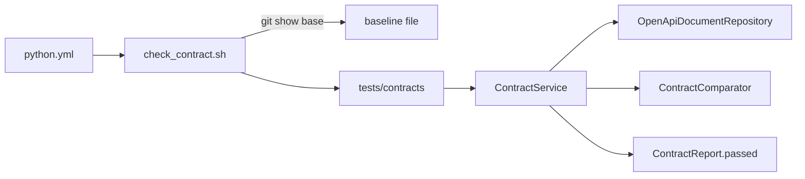

# T0.18: OpenAPI generation and contract check

**Status:** ✅ Done · **Ticket:** [TICKET.md](TICKET.md) · **Choices and trade-offs:** [IMPLEMENTATION.md](IMPLEMENTATION.md) · **Review:** [REVIEW.md](REVIEW.md)

## 🔭 What it does

- `platform` serves its OpenAPI document, generated from its code, and the same document is committed in the repository.
- CI fails when the committed document is stale (it differs from the one the code generates).
- CI fails when a change removes something from the API of the base commit (a path, an operation, a parameter, a schema, a property) or changes a type. An addition passes.
- With no base document (new service, unknown base), only the stale check runs.

## ⚙️ How it works

1. **Export:** a CI script, not a command of the service, imports the service's `AppFactory`, calls `openapi()` and writes `openapi.json`, in [`.github/scripts/export_openapi.py:39-58`](../../../.github/scripts/export_openapi.py#L39-L58). Any failure gives one stderr line and exit code 2 ([`.github/scripts/export_openapi.py:54-55`](../../../.github/scripts/export_openapi.py#L54-L55)). The result is committed at [`backend/services/platform/openapi.json`](../../../backend/services/platform/openapi.json).
2. **Serve:** the document is the one FastAPI serves at `/openapi.json`, checked in [`backend/services/platform/tests/contracts/test_committed_document.py:13-30`](../../../backend/services/platform/tests/contracts/test_committed_document.py#L13-L30). The tests build the real application in [`backend/services/platform/tests/contracts/conftest.py:17-45`](../../../backend/services/platform/tests/contracts/conftest.py#L17-L45), with the company headers because the path is not public.
3. **CI picks the baseline:** the `services` job checks out the full history ([`.github/workflows/python.yml:44`](../../../.github/workflows/python.yml#L44)) and runs the `Contract check` step with the pull request's base SHA or the push's previous commit, passed through `env` ([`.github/workflows/python.yml:57-60`](../../../.github/workflows/python.yml#L57-L60)).
4. **Baseline file:** [`.github/scripts/check_contract.sh:12-28`](../../../.github/scripts/check_contract.sh#L12-L28) passes when the service has no document, validates the base commit and its document, extracts it with `git show` to a temporary file and exports `ERP_CONTRACT_BASELINE`. Otherwise the variable stays unset.
5. **Tests run:** the script runs the service's `tests/contracts` with pytest and keeps the exit code, closing the log group first ([`.github/scripts/check_contract.sh:31-35`](../../../.github/scripts/check_contract.sh#L31-L35)).
6. **Read:** [`backend/services/platform/src/erp_platform/storage/contracts/open_api_document_repository.py:40-68`](../../../backend/services/platform/src/erp_platform/storage/contracts/open_api_document_repository.py#L40-L68) reads a UTF-8 JSON object. An unreadable, malformed or non-object file raises `SEOpenApiDocumentUnreadableError`, with the cause kept and never the content logged.
7. **Combine:** [`backend/services/platform/src/erp_platform/service/contracts/contract_service.py:52-88`](../../../backend/services/platform/src/erp_platform/service/contracts/contract_service.py#L52-L88) sets `stale` when the committed document differs from the generated one (line 72), compares the baseline with the committed document when one is given (line 78), and returns a `ContractReport`.
8. **Compare:** [`backend/services/platform/src/erp_platform/service/contracts/contract_comparator.py:223-238`](../../../backend/services/platform/src/erp_platform/service/contracts/contract_comparator.py#L223-L238) walks paths, operations, parameters and schemas ([`contract_comparator.py:152-221`](../../../backend/services/platform/src/erp_platform/service/contracts/contract_comparator.py#L152-L221)) and returns the changes sorted by location. The kinds are in [`backend/services/platform/src/erp_platform/models/contracts/enums/contract_change_kind.py:20-25`](../../../backend/services/platform/src/erp_platform/models/contracts/enums/contract_change_kind.py#L20-L25).
9. **Verdict:** `ContractReport.passed` is derived: not stale and no breaking change, in [`backend/services/platform/src/erp_platform/models/contracts/contract_report.py:79`](../../../backend/services/platform/src/erp_platform/models/contracts/contract_report.py#L79). The baseline test fails with the list of changes, or skips with a reason when there is no baseline ([`backend/services/platform/tests/contracts/test_contract_baseline.py:13-24`](../../../backend/services/platform/tests/contracts/test_contract_baseline.py#L13-L24)).

10. **Hardened runtime image:** the runtime stage of [`backend/services/platform/Dockerfile:20-24`](../../../backend/services/platform/Dockerfile#L20-L24) runs, in one `RUN` before the user is created, `apt-get update`, `apt-get upgrade`, the removal of the apt lists, `python -m pip uninstall -y pip` and `useradd`, so that the Trivy scan of #894 passes. The `RUN` comes before `/opt/venv` is copied, so `python` is the base image's and the pip removed is the system one. [`backend/services/platform/tests/image/test_dockerfile.py:9-35`](../../../backend/services/platform/tests/image/test_dockerfile.py#L9-L35) reads the text after the last `FROM ` and checks each command is present and sits before `USER ` ([line 29-35](../../../backend/services/platform/tests/image/test_dockerfile.py#L29-L35)). This work was approved as a plan change (K16, K17) and is not in [`TICKET.md`](../../../docs/tickets/T0.18/TICKET.md).



## 🧱 Files and lines changed

<!-- changes -->
| File | Change | Lines in the new version | Added | Removed |
| --- | --- | --- | --- | --- |
| [`.github/scripts/check_contract.sh`](../../../.github/scripts/check_contract.sh) | Added | [1-35](../../../.github/scripts/check_contract.sh#L1) | +35 | −0 |
| [`.github/scripts/export_openapi.py`](../../../.github/scripts/export_openapi.py) | Added | [1-62](../../../.github/scripts/export_openapi.py#L1) | +62 | −0 |
| [`.github/workflows/python.yml`](../../../.github/workflows/python.yml) | Modified | [6-7](../../../.github/workflows/python.yml#L6), [44](../../../.github/workflows/python.yml#L44), [57-60](../../../.github/workflows/python.yml#L57) | +7 | −1 |
| [`backend/services/platform/Dockerfile`](../../../backend/services/platform/Dockerfile) | Modified | [20-24](../../../backend/services/platform/Dockerfile#L20) | +5 | −1 |
| [`backend/services/platform/openapi.json`](../../../backend/services/platform/openapi.json) | Added | [1-53](../../../backend/services/platform/openapi.json#L1) | +53 | −0 |
| [`backend/services/platform/src/erp_platform/models/contracts/__init__.py`](../../../backend/services/platform/src/erp_platform/models/contracts/__init__.py) | Added | ➖ | +0 | −0 |
| [`backend/services/platform/src/erp_platform/models/contracts/contract_change.py`](../../../backend/services/platform/src/erp_platform/models/contracts/contract_change.py) | Added | [1-65](../../../backend/services/platform/src/erp_platform/models/contracts/contract_change.py#L1) | +65 | −0 |
| [`backend/services/platform/src/erp_platform/models/contracts/contract_report.py`](../../../backend/services/platform/src/erp_platform/models/contracts/contract_report.py) | Added | [1-85](../../../backend/services/platform/src/erp_platform/models/contracts/contract_report.py#L1) | +85 | −0 |
| [`backend/services/platform/src/erp_platform/models/contracts/enums/__init__.py`](../../../backend/services/platform/src/erp_platform/models/contracts/enums/__init__.py) | Added | [1-3](../../../backend/services/platform/src/erp_platform/models/contracts/enums/__init__.py#L1) | +3 | −0 |
| [`backend/services/platform/src/erp_platform/models/contracts/enums/contract_change_kind.py`](../../../backend/services/platform/src/erp_platform/models/contracts/enums/contract_change_kind.py) | Added | [1-25](../../../backend/services/platform/src/erp_platform/models/contracts/enums/contract_change_kind.py#L1) | +25 | −0 |
| [`backend/services/platform/src/erp_platform/models/contracts/exceptions/__init__.py`](../../../backend/services/platform/src/erp_platform/models/contracts/exceptions/__init__.py) | Added | [1-22](../../../backend/services/platform/src/erp_platform/models/contracts/exceptions/__init__.py#L1) | +22 | −0 |
| [`backend/services/platform/src/erp_platform/models/contracts/exceptions/contract_change/__init__.py`](../../../backend/services/platform/src/erp_platform/models/contracts/exceptions/contract_change/__init__.py) | Added | [1-11](../../../backend/services/platform/src/erp_platform/models/contracts/exceptions/contract_change/__init__.py#L1) | +11 | −0 |
| [`backend/services/platform/src/erp_platform/models/contracts/exceptions/contract_change/se_contract_change_invalid_kind.py`](../../../backend/services/platform/src/erp_platform/models/contracts/exceptions/contract_change/se_contract_change_invalid_kind.py) | Added | [1-9](../../../backend/services/platform/src/erp_platform/models/contracts/exceptions/contract_change/se_contract_change_invalid_kind.py#L1) | +9 | −0 |
| [`backend/services/platform/src/erp_platform/models/contracts/exceptions/contract_change/se_contract_change_invalid_location.py`](../../../backend/services/platform/src/erp_platform/models/contracts/exceptions/contract_change/se_contract_change_invalid_location.py) | Added | [1-9](../../../backend/services/platform/src/erp_platform/models/contracts/exceptions/contract_change/se_contract_change_invalid_location.py#L1) | +9 | −0 |
| [`backend/services/platform/src/erp_platform/models/contracts/exceptions/contract_change/se_invalid_contract_change_exception.py`](../../../backend/services/platform/src/erp_platform/models/contracts/exceptions/contract_change/se_invalid_contract_change_exception.py) | Added | [1-11](../../../backend/services/platform/src/erp_platform/models/contracts/exceptions/contract_change/se_invalid_contract_change_exception.py#L1) | +11 | −0 |
| [`backend/services/platform/src/erp_platform/models/contracts/exceptions/contract_report/__init__.py`](../../../backend/services/platform/src/erp_platform/models/contracts/exceptions/contract_report/__init__.py) | Added | [1-11](../../../backend/services/platform/src/erp_platform/models/contracts/exceptions/contract_report/__init__.py#L1) | +11 | −0 |
| [`backend/services/platform/src/erp_platform/models/contracts/exceptions/contract_report/se_contract_report_invalid_breaking_changes.py`](../../../backend/services/platform/src/erp_platform/models/contracts/exceptions/contract_report/se_contract_report_invalid_breaking_changes.py) | Added | [1-9](../../../backend/services/platform/src/erp_platform/models/contracts/exceptions/contract_report/se_contract_report_invalid_breaking_changes.py#L1) | +9 | −0 |
| [`backend/services/platform/src/erp_platform/models/contracts/exceptions/contract_report/se_contract_report_invalid_stale.py`](../../../backend/services/platform/src/erp_platform/models/contracts/exceptions/contract_report/se_contract_report_invalid_stale.py) | Added | [1-9](../../../backend/services/platform/src/erp_platform/models/contracts/exceptions/contract_report/se_contract_report_invalid_stale.py#L1) | +9 | −0 |
| [`backend/services/platform/src/erp_platform/models/contracts/exceptions/contract_report/se_invalid_contract_report_exception.py`](../../../backend/services/platform/src/erp_platform/models/contracts/exceptions/contract_report/se_invalid_contract_report_exception.py) | Added | [1-11](../../../backend/services/platform/src/erp_platform/models/contracts/exceptions/contract_report/se_invalid_contract_report_exception.py#L1) | +11 | −0 |
| [`backend/services/platform/src/erp_platform/models/contracts/exceptions/document/__init__.py`](../../../backend/services/platform/src/erp_platform/models/contracts/exceptions/document/__init__.py) | Added | [1-6](../../../backend/services/platform/src/erp_platform/models/contracts/exceptions/document/__init__.py#L1) | +6 | −0 |
| [`backend/services/platform/src/erp_platform/models/contracts/exceptions/document/se_open_api_document_error.py`](../../../backend/services/platform/src/erp_platform/models/contracts/exceptions/document/se_open_api_document_error.py) | Added | [1-5](../../../backend/services/platform/src/erp_platform/models/contracts/exceptions/document/se_open_api_document_error.py#L1) | +5 | −0 |
| [`backend/services/platform/src/erp_platform/models/contracts/exceptions/document/se_open_api_document_unreadable_error.py`](../../../backend/services/platform/src/erp_platform/models/contracts/exceptions/document/se_open_api_document_unreadable_error.py) | Added | [1-7](../../../backend/services/platform/src/erp_platform/models/contracts/exceptions/document/se_open_api_document_unreadable_error.py#L1) | +7 | −0 |
| [`backend/services/platform/src/erp_platform/service/contracts/__init__.py`](../../../backend/services/platform/src/erp_platform/service/contracts/__init__.py) | Added | ➖ | +0 | −0 |
| [`backend/services/platform/src/erp_platform/service/contracts/contract_comparator.py`](../../../backend/services/platform/src/erp_platform/service/contracts/contract_comparator.py) | Added | [1-238](../../../backend/services/platform/src/erp_platform/service/contracts/contract_comparator.py#L1) | +238 | −0 |
| [`backend/services/platform/src/erp_platform/service/contracts/contract_service.py`](../../../backend/services/platform/src/erp_platform/service/contracts/contract_service.py) | Added | [1-88](../../../backend/services/platform/src/erp_platform/service/contracts/contract_service.py#L1) | +88 | −0 |
| [`backend/services/platform/src/erp_platform/storage/contracts/__init__.py`](../../../backend/services/platform/src/erp_platform/storage/contracts/__init__.py) | Added | ➖ | +0 | −0 |
| [`backend/services/platform/src/erp_platform/storage/contracts/open_api_document_repository.py`](../../../backend/services/platform/src/erp_platform/storage/contracts/open_api_document_repository.py) | Added | [1-68](../../../backend/services/platform/src/erp_platform/storage/contracts/open_api_document_repository.py#L1) | +68 | −0 |
| [`backend/services/platform/tests/contracts/conftest.py`](../../../backend/services/platform/tests/contracts/conftest.py) | Added | [1-45](../../../backend/services/platform/tests/contracts/conftest.py#L1) | +45 | −0 |
| [`backend/services/platform/tests/contracts/test_committed_document.py`](../../../backend/services/platform/tests/contracts/test_committed_document.py) | Added | [1-41](../../../backend/services/platform/tests/contracts/test_committed_document.py#L1) | +41 | −0 |
| [`backend/services/platform/tests/contracts/test_contract_baseline.py`](../../../backend/services/platform/tests/contracts/test_contract_baseline.py) | Added | [1-24](../../../backend/services/platform/tests/contracts/test_contract_baseline.py#L1) | +24 | −0 |
| [`backend/services/platform/tests/contracts/test_real_document_changes.py`](../../../backend/services/platform/tests/contracts/test_real_document_changes.py) | Added | [1-56](../../../backend/services/platform/tests/contracts/test_real_document_changes.py#L1) | +56 | −0 |
| [`backend/services/platform/tests/image/test_dockerfile.py`](../../../backend/services/platform/tests/image/test_dockerfile.py) | Added | [1-35](../../../backend/services/platform/tests/image/test_dockerfile.py#L1) | +35 | −0 |
| [`backend/services/platform/tests/models/contracts/enums/test_contract_change_kind.py`](../../../backend/services/platform/tests/models/contracts/enums/test_contract_change_kind.py) | Added | [1-39](../../../backend/services/platform/tests/models/contracts/enums/test_contract_change_kind.py#L1) | +39 | −0 |
| [`backend/services/platform/tests/models/contracts/test_contract_change.py`](../../../backend/services/platform/tests/models/contracts/test_contract_change.py) | Added | [1-80](../../../backend/services/platform/tests/models/contracts/test_contract_change.py#L1) | +80 | −0 |
| [`backend/services/platform/tests/models/contracts/test_contract_report.py`](../../../backend/services/platform/tests/models/contracts/test_contract_report.py) | Added | [1-84](../../../backend/services/platform/tests/models/contracts/test_contract_report.py#L1) | +84 | −0 |
| [`backend/services/platform/tests/service/contracts/contract_comparator/helpers.py`](../../../backend/services/platform/tests/service/contracts/contract_comparator/helpers.py) | Added | [1-134](../../../backend/services/platform/tests/service/contracts/contract_comparator/helpers.py#L1) | +134 | −0 |
| [`backend/services/platform/tests/service/contracts/contract_comparator/test_contract_comparator.py`](../../../backend/services/platform/tests/service/contracts/contract_comparator/test_contract_comparator.py) | Added | [1-175](../../../backend/services/platform/tests/service/contracts/contract_comparator/test_contract_comparator.py#L1) | +175 | −0 |
| [`backend/services/platform/tests/service/contracts/contract_service/conftest.py`](../../../backend/services/platform/tests/service/contracts/contract_service/conftest.py) | Added | [1-45](../../../backend/services/platform/tests/service/contracts/contract_service/conftest.py#L1) | +45 | −0 |
| [`backend/services/platform/tests/service/contracts/contract_service/test_contract_service.py`](../../../backend/services/platform/tests/service/contracts/contract_service/test_contract_service.py) | Added | [1-92](../../../backend/services/platform/tests/service/contracts/contract_service/test_contract_service.py#L1) | +92 | −0 |
| [`backend/services/platform/tests/storage/contracts/test_open_api_document_repository.py`](../../../backend/services/platform/tests/storage/contracts/test_open_api_document_repository.py) | Added | [1-70](../../../backend/services/platform/tests/storage/contracts/test_open_api_document_repository.py#L1) | +70 | −0 |
| [`docs/technical/delivery/ci-cd-and-stages.md`](../../../docs/technical/delivery/ci-cd-and-stages.md) | Modified | [50](../../../docs/technical/delivery/ci-cd-and-stages.md#L50) | +1 | −1 |
| [`docs/technical/interfaces/api.md`](../../../docs/technical/interfaces/api.md) | Modified | [21-22](../../../docs/technical/interfaces/api.md#L21), [28](../../../docs/technical/interfaces/api.md#L28), [31-43](../../../docs/technical/interfaces/api.md#L31) | +16 | −3 |
| [`tests/ci/check_contract/conftest.py`](../../../tests/ci/check_contract/conftest.py) | Added | [1-91](../../../tests/ci/check_contract/conftest.py#L1) | +91 | −0 |
| [`tests/ci/check_contract/test_check_contract.py`](../../../tests/ci/check_contract/test_check_contract.py) | Added | [1-81](../../../tests/ci/check_contract/test_check_contract.py#L1) | +81 | −0 |
| [`tests/ci/export_openapi/conftest.py`](../../../tests/ci/export_openapi/conftest.py) | Added | [1-85](../../../tests/ci/export_openapi/conftest.py#L1) | +85 | −0 |
| [`tests/ci/export_openapi/test_export_openapi.py`](../../../tests/ci/export_openapi/test_export_openapi.py) | Added | [1-84](../../../tests/ci/export_openapi/test_export_openapi.py#L1) | +84 | −0 |
| [`tests/ci/workflows/checks/test_contract_workflow.py`](../../../tests/ci/workflows/checks/test_contract_workflow.py) | Added | [1-49](../../../tests/ci/workflows/checks/test_contract_workflow.py#L1) | +49 | −0 |
| **47 files** | | | **+2181** | **−6** |
<!-- /changes -->

- [`.github/scripts/export_openapi.py`](../../../.github/scripts/export_openapi.py), [`.github/scripts/check_contract.sh`](../../../.github/scripts/check_contract.sh): the two CI scripts (export, baseline and pytest run).
- [`.github/workflows/python.yml`](../../../.github/workflows/python.yml), lines [`41-60`](../../../.github/workflows/python.yml#L41-L60): full checkout and the `Contract check` step.
- [`backend/services/platform/openapi.json`](../../../backend/services/platform/openapi.json): the committed document.
- [`backend/services/platform/src/erp_platform/models/contracts/`](../../../backend/services/platform/src/erp_platform/models/contracts/__init__.py): `ContractChange`, `ContractReport`, the kind enum and the exceptions in three sub-folders (five-file limit).
- [`backend/services/platform/src/erp_platform/service/contracts/`](../../../backend/services/platform/src/erp_platform/service/contracts/contract_service.py): the comparator and the service.
- [`backend/services/platform/src/erp_platform/storage/contracts/open_api_document_repository.py`](../../../backend/services/platform/src/erp_platform/storage/contracts/open_api_document_repository.py): the reader.
- [`backend/services/platform/tests/`](../../../backend/services/platform/tests/contracts/conftest.py): tests of the contract check, the models, the service and the repository, mirroring `src/`.
- [`tests/ci/check_contract/`](../../../tests/ci/check_contract/test_check_contract.py), [`tests/ci/export_openapi/`](../../../tests/ci/export_openapi/test_export_openapi.py), [`tests/ci/workflows/checks/test_contract_workflow.py`](../../../tests/ci/workflows/checks/test_contract_workflow.py): the scripts run with a stand-in `uv` and temporary git repositories, and the workflow step.
- [`backend/services/platform/Dockerfile`](../../../backend/services/platform/Dockerfile), lines [`20-24`](../../../backend/services/platform/Dockerfile#L20-L24): the runtime stage upgrades apt packages and removes system pip before `USER` (K17). [`backend/services/platform/tests/image/test_dockerfile.py`](../../../backend/services/platform/tests/image/test_dockerfile.py): the text test that guards it (K16).
- [`docs/technical/delivery/ci-cd-and-stages.md`](../../../docs/technical/delivery/ci-cd-and-stages.md), lines [`50`](../../../docs/technical/delivery/ci-cd-and-stages.md#L50): the `python.yml` row describes the contract check. [`docs/technical/interfaces/api.md`](../../../docs/technical/interfaces/api.md), lines [`21-32`](../../../docs/technical/interfaces/api.md#L21-L32): the OpenAPI of `platform` and how to regenerate it.

## 🧪 How to test it

```bash
uv run --package platform pytest backend/services/platform/tests -n 2
uv run pytest tests/ci/check_contract tests/ci/export_openapi tests/ci/workflows/checks/test_contract_workflow.py -n 2
uv run --package platform python .github/scripts/export_openapi.py backend/services/platform
bash .github/scripts/check_contract.sh backend/services/platform
```

The first two show every test passing, the third rewrites the committed document (no diff when it is up to date), the last runs the stale-only check.

## 🔗 Evidence

- [Platform tests](tests-evidences/pytest-backend-services-platform.txt): 252 passed, 1 skipped (the baseline test, with no base document).
- [Repository tests](tests-evidences/pytest.txt): 1199 passed.
- [ruff check](tests-evidences/ruff-check.txt), [ruff format](tests-evidences/ruff-format.txt) (39 files already formatted), [mypy](tests-evidences/mypy.txt), [ticket references](tests-evidences/ticket-refs.txt), [plan view](tests-evidences/plan-view.txt).

## 📝 Assumptions accepted

- Package `erp_platform`, the health path `/v1/health`, `ContractChange` fields with no defaults, and pointer locations starting with `#/`: they follow T0.14 and AGENT.md.
- A parameter moved to another `in`, or a type added where there was none, counts as a change; an `x-` key of a path item is not an operation; the six kinds of change have no separate `$ref` kind (a changed `$ref` is `type_changed`).
- A missing or invalid-JSON document raises `SEOpenApiDocumentUnreadableError`, cause kept.
- Export script message and package lookup details (CI-script details no specification settles).
- The health path and `/openapi.json` stay behind the company context, and the tests send the headers (I-T05-02 lists Rights; `conf/app.yaml` belongs to T0.14).
- A blank `ERP_CONTRACT_BASELINE`, or an unknown or zero base, means stale-only.
- The verifier ran local tests with `--all-packages`, with another ticket's untracked `backend/shared/testing` moved aside and restored; the clean-tree evidence is what counts.
- K16: the runtime stage is the text after the last `FROM `, and the checks are literal substrings (`apt-get update`, `apt-get upgrade`, `/var/lib/apt/lists/*`, `pip uninstall -y pip`, the first `USER `); `tests/image` holds two Python files, within the limit of five.
- K17: the `RUN` runs before `/opt/venv` is copied, so it removes the base image's system pip; the uv-built venv has no pip and the HEALTHCHECK needs only python.
- Ticket-level assumptions (sprint anchors, paths chosen in `platform` and `.github`, REQ-T05-01 criterion 2 left to P2, T0.14 as prerequisite).

## 🔜 Follow-ups

| File | What to change |
| --- | --- |
| [`contract_comparator.py`](../../../backend/services/platform/src/erp_platform/service/contracts/contract_comparator.py), [its tests](../../../backend/services/platform/tests/service/contracts/contract_comparator/test_contract_comparator.py) | See `anyOf`/`oneOf`/`allOf`, removed `enum` values, removed responses or request bodies, and newly required request fields. Do it when a second endpoint arrives. |
| [`contract_service.py`](../../../backend/services/platform/src/erp_platform/service/contracts/contract_service.py), [`open_api_document_repository.py`](../../../backend/services/platform/src/erp_platform/storage/contracts/open_api_document_repository.py), [`models/contracts/`](../../../backend/services/platform/src/erp_platform/models/contracts/__init__.py) | The check is generic but lives in `platform`. Move it to a shared library when a second service commits an OpenAPI document. |
| [`.github/scripts/check_contract.sh`](../../../.github/scripts/check_contract.sh), [`tests/ci/check_contract/test_check_contract.py`](../../../tests/ci/check_contract/test_check_contract.py) | Use the same `uv run` invocation as `check_python_project.sh` (or `--all-packages`), so the step does not depend on what an earlier step installed. |
| [`backend/services/platform/openapi.json`](../../../backend/services/platform/openapi.json) | Give the application a real title and version in its builder (T0.14's file), then regenerate. |
| [`docs/technical/interfaces/api.md`](../../../docs/technical/interfaces/api.md) | Rewrite the comma splice and say that `/openapi.json` needs the company headers. |
| [`contract_change.py`](../../../backend/services/platform/src/erp_platform/models/contracts/contract_change.py) | Fix "the live one": the change is between the baseline and the committed document. Same in the `compare` docstring. |
| [`.github/scripts/export_openapi.py`](../../../.github/scripts/export_openapi.py) | Drop or explain `sys.path.insert(0, os.getcwd())` ([line 50](../../../.github/scripts/export_openapi.py#L50)). |
| [`test_contract_comparator.py`](../../../backend/services/platform/tests/service/contracts/contract_comparator/test_contract_comparator.py), [`test_contract_workflow.py`](../../../tests/ci/workflows/checks/test_contract_workflow.py) | Move the module constants `SCHEMA` and `NAME` into ClassVars or `helpers.py`. |
| [`docs/tickets/T0.18/TICKET.md`](../../../docs/tickets/T0.18/TICKET.md) | Add one line saying the ticket also hardens the runtime stage, approved as a plan change (K16, K17). |
| [`backend/services/platform/Dockerfile`](../../../backend/services/platform/Dockerfile), [`.github/workflows/images.yml`](../../../.github/workflows/images.yml) | The build uses `cache-from` and `cache-to` with `mode=max` ([lines 88-89](../../../.github/workflows/images.yml#L88-L89)), so the `apt-get upgrade` layer is reused until the base digest changes and later Debian fixes do not reach the image. Add `no-cache-filters: runtime` or `pull: true`, or a scheduled rebuild without cache. |
| [`backend/services/platform/tests/image/test_dockerfile.py`](../../../backend/services/platform/tests/image/test_dockerfile.py) | The checks are substring matches, so a command in a comment or another spelling (`pip3 uninstall --yes pip`) gives a wrong result. Parse the `RUN` instructions of the stage, comments and continuations joined, if the Dockerfile grows. |
| [`tests/ci/export_openapi/conftest.py`](../../../tests/ci/export_openapi/conftest.py) | Move the `ServiceWriter` helper class to its own file in the folder and import it by its full path. |
