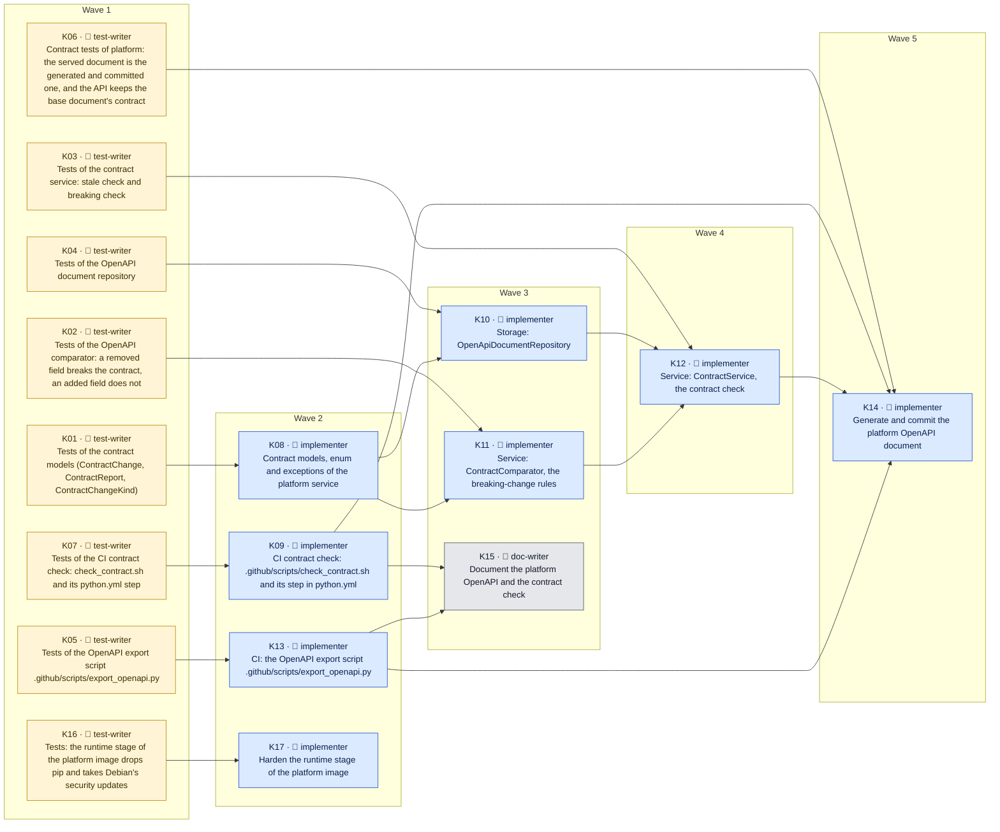

# Plan: T0.18 OpenAPI generation and contract check

**Plan:** 🟢 Approved

**Push:** 🟢 Approved

<!-- ticket:specs -->
## 📚 Specifications

The specification and design pages of [TICKET.md](TICKET.md), copied by `python3 .claude/scripts/tickets/ticket_refs.py sync`.

- [REQ-T05-01](../../specs/03-technical/t05-api-and-webhooks/requirements/req-t05-01-rest-openapi.md)
- [I-T05-02](../../specs/03-technical/t05-api-and-webhooks/interfaces/i-t05-02-openapi-registry.md)
- [REQ-T05-05](../../specs/03-technical/t05-api-and-webhooks/requirements/req-t05-05-contract-tests.md)
- [📜 D406: Back end](../../specs/06-decisions/technical/d406-back-end.md)
- [📜 D426: Testing strategy](../../specs/06-decisions/technical/d426-testing-strategy.md)
- [📜 D419: CI/CD and the image registry](../../specs/06-decisions/technical/d419-ci-cd-and-registry.md)
- [🏗️ Back end](../../technical/architecture/backend.md)
- [🏗️ API](../../technical/interfaces/api.md)
- [🏗️ Tests and traceability](../../technical/delivery/tests-and-traceability.md)
<!-- /ticket:specs -->

## Summary

T0.18 is planned as 15 tasks in 5 waves. Wave 1 has seven test-writer tasks, one per behaviour: the contract models, the OpenAPI comparator (a removed field breaks the contract, an added field does not), the contract service (stale check plus breaking check), the document repository, the OpenAPI export script, the contract tests of the service (the committed document being the one served, and the API keeping the base document's contract), and the CI script with its python.yml step. The build then goes up the layers of `backend/services/platform` one task each: models, storage and comparator, service. The service has no command line (D406, owner decision of 2026-11-27): its FastAPI application serves the document, its tests of `tests/contracts/` are the contract check, and `.github/scripts/export_openapi.py` writes the committed copy. A last implementer task generates and commits `backend/services/platform/openapi.json` with that script. The CI side is one task: `.github/scripts/check_contract.sh` plus a step in the services job of `python.yml`. It runs the stale check every time, and runs the breaking check against the document of the base commit when there is one. A doc-writer task updates the API and CI/CD design pages. The ticket touches no screen, so no Playwright task is needed (TKT-21).

## Assumptions

- The roadmap gives no anchor per ticket, so ticket links point to the sprint anchor (#s03) and the epic link to #epics.
- Acceptance criteria 4 and 5 restate the roadmap's done-when and its 'committed and served' wording; no tool or file path for the document or the check is specified, so the plan chooses them within `backend/services/platform` and `.github`.
- REQ-T05-01 criterion 2 (routing behind the gateway) is taken as closed in P2, per the P0 scope table.
- T0.14 (platform skeleton) is taken as a prerequisite, since the document is generated from its code.
- No Bash tool was available, so check_ticket.py was not run and the PROGRESS.md timestamp table is left empty; the workflow should run the check.
- tests-evidences/ was created with a .gitkeep placeholder.
- The platform service package is assumed to be `erp_platform`, under `backend/services/platform/src/erp_platform/`. T0.14 left the name open and `platform` would shadow the standard library module. If T0.14 chose another name, every brief and file path is read with that name, and each worker reports it in its result.
- The OpenAPI document is committed as JSON at `backend/services/platform/openapi.json`. The specifications name no path. T0.20 and T0.24 will read it from there.
- The document is served at the URL that T0.14's FastAPI application declares (`app.openapi_url`). This ticket does not move it. The specifications do not say whether the OpenAPI URL itself carries `/v1`.
- The stale check compares the parsed JSON, not the text, so that formatting alone never fails CI.
- Breaking changes are removals and changes of `type` or `$ref`. Removals cover paths, operations, operation parameters, component schemas, and properties (nested properties and array items included). Any addition passes, newly required fields included, as REQ-T05-05 criterion 2 says ('a field added, CI passes'). Inline schemas and `anyOf`/`oneOf` branches are not traversed: this is a follow-up for the services that will need them.
- The baseline of the breaking check is the committed document of the pull request's base commit, or of the push's previous commit. When there is none (a workflow_dispatch release run, a first push, a service without a document at its base), only the stale check runs.
- The comparator lives in the platform service's service layer, not in `backend/shared/`, because the ticket's areas are `backend/services/platform` and `.github`. Moving it to a shared library once a second service publishes an OpenAPI is a follow-up.
- The check is written in Python, with no third-party OpenAPI diff tool such as oasdiff, so `uv.lock` and the CI images get no new dependency.
- CI runs the check as a step of the `services` job of `python.yml`, through `.github/scripts/check_contract.sh`, for every service that commits an `openapi.json`. The check is the service's own tests of `tests/contracts/`, which the script runs with the base document named in `ERP_CONTRACT_BASELINE`: a service has no console script ([D406](../../specs/06-decisions/technical/d406-back-end.md), AGENT.md "Layout"). No new workflow and no new `ci.yml` job are added, because `tests/ci/` fixes their lists.
- The `services` job checkout gets `fetch-depth: 0`. With `persist-credentials: false` on a private repository, a later `git fetch` of the base commit would fail. The `repository` job stays shallow (TKT-24).
- The tests of the `.github` changes go in `tests/ci/` (`tests/ci/workflows/checks/` and `tests/ci/check_contract/`), following the existing convention for workflow tests, although the ticket graph names only `.github` and `backend/services/platform` as areas.
- T0.14 provides the application factory `AppFactory.create()` in `api/app_factory.py` ([D406](../../specs/06-decisions/technical/d406-back-end.md), AGENT.md "Layout"), which the contract tests and `.github/scripts/export_openapi.py` use. The service has no command line, so there is no command, no command factory and no `[project.scripts]` entry.
- The export script exits 0 when the document is written and 2 on an error; the contract check fails through pytest's own exit code. The specifications give none.
- The export is a generic script of `.github/scripts/`, not a method of the platform service: it works for every service with the application factory, and the platform's storage layer only reads the document.

## 📚 Specifications

<!-- specs:start -->
<!-- specs:end -->

<!-- plan:graph -->

> [!NOTE]
> Generated from the json block at the end of this page by `python3 .claude/scripts/tickets/plan.py render`.
> To change a task, edit the json block, then render again: never edit this view by hand.

## Waves

| Wave | Tasks | Agents running at once |
| --- | --- | --- |
| 1 | [K01](#k01), [K02](#k02), [K03](#k03), [K04](#k04), [K05](#k05), [K06](#k06), [K07](#k07), [K16](#k16) | 8 of 8 |
| 2 | [K08](#k08), [K09](#k09), [K13](#k13), [K17](#k17) | 4 of 4 |
| 3 | [K10](#k10), [K11](#k11), [K15](#k15) | 3 of 3 |
| 4 | [K12](#k12) | 1 of 1 |
| 5 | [K14](#k14) | 1 of 1 |

| Wave | Task | Agent | Depends on | Unblocks |
| --- | --- | --- | --- | --- |
| 1 | [K01](#k01) Tests of the contract models (ContractChange, ContractReport, ContractChangeKind) | 🧪 test-writer | none | [K08](#k08) |
| 1 | [K02](#k02) Tests of the OpenAPI comparator: a removed field breaks the contract, an added field does not | 🧪 test-writer | none | [K11](#k11) |
| 1 | [K03](#k03) Tests of the contract service: stale check and breaking check | 🧪 test-writer | none | [K12](#k12) |
| 1 | [K04](#k04) Tests of the OpenAPI document repository | 🧪 test-writer | none | [K10](#k10) |
| 1 | [K05](#k05) Tests of the OpenAPI export script .github/scripts/export_openapi.py | 🧪 test-writer | none | [K13](#k13) |
| 1 | [K06](#k06) Contract tests of platform: the served document is the generated and committed one, and the API keeps the base document's contract | 🧪 test-writer | none | [K14](#k14) |
| 1 | [K07](#k07) Tests of the CI contract check: check_contract.sh and its python.yml step | 🧪 test-writer | none | [K09](#k09) |
| 2 | [K08](#k08) Contract models, enum and exceptions of the platform service | 🐍 implementer | [K01](#k01) | [K10](#k10), [K11](#k11) |
| 2 | [K09](#k09) CI contract check: .github/scripts/check_contract.sh and its step in python.yml | 🐍 implementer | [K07](#k07) | [K14](#k14), [K15](#k15) |
| 3 | [K10](#k10) Storage: OpenApiDocumentRepository | 🐍 implementer | [K04](#k04), [K08](#k08) | [K12](#k12) |
| 3 | [K11](#k11) Service: ContractComparator, the breaking-change rules | 🐍 implementer | [K02](#k02), [K08](#k08) | [K12](#k12) |
| 4 | [K12](#k12) Service: ContractService, the contract check | 🐍 implementer | [K03](#k03), [K10](#k10), [K11](#k11) | [K14](#k14) |
| 2 | [K13](#k13) CI: the OpenAPI export script .github/scripts/export_openapi.py | 🐍 implementer | [K05](#k05) | [K14](#k14), [K15](#k15) |
| 5 | [K14](#k14) Generate and commit the platform OpenAPI document | 🐍 implementer | [K06](#k06), [K09](#k09), [K12](#k12), [K13](#k13) | none |
| 3 | [K15](#k15) Document the platform OpenAPI and the contract check | 📝 doc-writer | [K09](#k09), [K13](#k13) | none |
| 1 | [K16](#k16) Tests: the runtime stage of the platform image drops pip and takes Debian's security updates | 🧪 test-writer | none | [K17](#k17) |
| 2 | [K17](#k17) Harden the runtime stage of the platform image | 🐍 implementer | [K16](#k16) | none |

## Dependency graph



## Tasks

### <a id="k01"></a>K01: Tests of the contract models (ContractChange, ContractReport, ContractChangeKind)

| Agent | Wave | Depends on | Unblocks |
| --- | --- | --- | --- |
| 🧪 test-writer | 1 | none | [K08](#k08) |

**Files** (only this task may change them in its wave):

- `backend/services/platform/tests/models/contracts/test_contract_change.py`
- `backend/services/platform/tests/models/contracts/test_contract_report.py`
- `backend/services/platform/tests/models/contracts/enums/test_contract_change_kind.py`

**Done when:** The three files exist; `uv run ruff check backend/services/platform/tests/models/contracts` and `uv run ruff format --check` on them pass; `uv run --package platform pytest backend/services/platform/tests/models/contracts -n 2` collects the tests and fails only because `erp_platform.models.contracts` does not exist yet.

**Brief:**

Write the tests, first and failing, of the models the contract check reports with. They live in the `models` layer of the platform service, package `erp_platform`. The package is the one T0.14 created under `backend/services/platform/src/`: if T0.14 named it differently, use its name everywhere and say so in your result. Specifications: [REQ-T05-05](docs/specs/03-technical/t05-api-and-webhooks/requirements/req-t05-05-contract-tests.md) (contract tests catch breaking changes), [I-T05-02](docs/specs/03-technical/t05-api-and-webhooks/interfaces/i-t05-02-openapi-registry.md), [D406](docs/specs/06-decisions/technical/d406-back-end.md) (OpenAPI generated from the code), [D426](docs/specs/06-decisions/technical/d426-testing-strategy.md) (errors and edge cases tested). Design: [Back end](docs/technical/architecture/backend.md) ('breaking changes are caught in CI'), [Tests and traceability](docs/technical/delivery/tests-and-traceability.md). The contracts the implementation (K08) will meet: (1) `erp_platform.models.contracts.enums.ContractChangeKind`, a `@unique` `StrEnum` with members `PATH_REMOVED='path_removed'`, `OPERATION_REMOVED='operation_removed'`, `PARAMETER_REMOVED='parameter_removed'`, `SCHEMA_REMOVED='schema_removed'`, `PROPERTY_REMOVED='property_removed'` and `TYPE_CHANGED='type_changed'`. (2) `erp_platform.models.contracts.contract_change.ContractChange`, a frozen Pydantic model with `extra='forbid'` and two fields. `kind` (ContractChangeKind, accepts the string value, rejects other strings and non-strings with `SEContractChangeInvalidKind`). `location` (str, a JSON pointer such as `#/components/schemas/Health/properties/status`: stripped, must be non-empty and start with `#/`, otherwise `SEContractChangeInvalidLocation`). (3) `erp_platform.models.contracts.contract_report.ContractReport`, frozen, `extra='forbid'`, with two fields. `stale` (bool, default False, rejects non-bools such as 0 or 'yes' with `SEContractReportInvalidStale`). `breaking_changes` (List[ContractChange], default empty, rejects a non-list with `SEContractReportInvalidBreakingChanges`). It also has a property `passed`, True only when not stale and with no breaking change. The exceptions are imported from `erp_platform.models.contracts.exceptions`, and all subclass `SEInvalidContractChangeException` or `SEInvalidContractReportException`. Follow AGENT.md 'Tests': one `Test<Subject>` class per file, sentence names, `pytest.mark.parametrize` for cases, the specific exception in `pytest.raises`, no mocks, no `__init__.py`. Each model gets the standard set: `test_defaults`, `test_full_valid_construction`, `test_none_becomes_the_default`, `test_rejects_bad_values`, `test_rejects_unknown_keys`, `test_round_trip`. Add a `passed` truth table for ContractReport. The enum test checks that the members and values are exactly those listed. Change only the listed files.

### <a id="k02"></a>K02: Tests of the OpenAPI comparator: a removed field breaks the contract, an added field does not

| Agent | Wave | Depends on | Unblocks |
| --- | --- | --- | --- |
| 🧪 test-writer | 1 | none | [K11](#k11) |

**Files** (only this task may change them in its wave):

- `backend/services/platform/tests/service/contracts/contract_comparator/helpers.py`
- `backend/services/platform/tests/service/contracts/contract_comparator/test_contract_comparator.py`

**Done when:** Both files exist; ruff check and ruff format --check pass on them; `uv run --package platform pytest backend/services/platform/tests/service/contracts/contract_comparator -n 2` collects the tests and fails only because `erp_platform.service.contracts` (or the K08 models) does not exist yet.

**Brief:**

Write the tests, first and failing, of `erp_platform.service.contracts.contract_comparator.ContractComparator`, the business rule of the contract check. Use the platform service package T0.14 created, assumed `erp_platform`, and report its real name if it differs. Specifications: [REQ-T05-05](docs/specs/03-technical/t05-api-and-webhooks/requirements/req-t05-05-contract-tests.md) criteria 1 (a field removed, CI fails) and 2 (a field added, CI passes); [REQ-T05-01](docs/specs/03-technical/t05-api-and-webhooks/requirements/req-t05-01-rest-openapi.md); [D406](docs/specs/06-decisions/technical/d406-back-end.md); [D426](docs/specs/06-decisions/technical/d426-testing-strategy.md). Design: [Back end](docs/technical/architecture/backend.md), [Tests and traceability](docs/technical/delivery/tests-and-traceability.md) ('contract tests generated from each OpenAPI'). The contract: `ContractComparator(logger=None).compare(baseline: Dict[str, JsonValue], current: Dict[str, JsonValue]) -> List[ContractChange]` returns the breaking changes from `baseline` to `current`, sorted by `location`. The `ContractChange` and `ContractChangeKind` models are written in K01/K08 and imported from `erp_platform.models.contracts.contract_change` and `erp_platform.models.contracts.enums`. Locations are JSON pointers, with `~` escaped to `~0` and `/` to `~1`. It reports: a path removed (`PATH_REMOVED`, `#/paths/~1v1~1health`); an operation removed under a kept path, for get, put, post, delete, options, head, patch or trace (`OPERATION_REMOVED`, `#/paths/~1v1~1health/get`); an operation parameter removed, identified by `in` and `name` (`PARAMETER_REMOVED`, `#/paths/<p>/<method>/parameters/<in>/<name>`); a component schema removed (`SCHEMA_REMOVED`, `#/components/schemas/<Name>`); a property removed from a component schema, nested `properties` and array `items` included (`PROPERTY_REMOVED`, `#/components/schemas/<Name>/properties/<field>` or `.../properties/<a>/items/properties/<b>`); and a change of the `type` or `$ref` keyword of a schema or property present in both, including one present on one side only (`TYPE_CHANGED`). Additions are never reported: a path, operation, parameter, schema, property (required ones included) or response added gives an empty list. Identical documents give an empty list. Missing `paths` or `components` sections count as empty. Put small OpenAPI 3.1 fixture documents, written as plain dicts, in `helpers.py`: a baseline with a `/v1/health` get, a query parameter and a `Health` schema with nested properties, plus builders deriving changed copies from it with `copy.deepcopy`. Import them by full path (`from tests.service.contracts.contract_comparator.helpers import ...`). Use parametrize for the cases of one behaviour. Follow AGENT.md 'Tests' (one TestContractComparator class, sentence names, no mocks, no `__init__.py`). Change only the listed files.

### <a id="k03"></a>K03: Tests of the contract service: stale check and breaking check

| Agent | Wave | Depends on | Unblocks |
| --- | --- | --- | --- |
| 🧪 test-writer | 1 | none | [K12](#k12) |

**Files** (only this task may change them in its wave):

- `backend/services/platform/tests/service/contracts/contract_service/conftest.py`
- `backend/services/platform/tests/service/contracts/contract_service/test_contract_service.py`

**Done when:** Both files exist; ruff check and ruff format --check pass on them; `uv run --package platform pytest backend/services/platform/tests/service/contracts/contract_service -n 2` collects the tests and fails only because the service, storage or model modules do not exist yet.

**Brief:**

Write the tests, first and failing, of `erp_platform.service.contracts.contract_service.ContractService` in the platform service. The package is assumed `erp_platform`; use the one T0.14 created and report it if it differs. Specifications: [REQ-T05-05](docs/specs/03-technical/t05-api-and-webhooks/requirements/req-t05-05-contract-tests.md) criteria 1 and 2; [REQ-T05-01](docs/specs/03-technical/t05-api-and-webhooks/requirements/req-t05-01-rest-openapi.md) criterion 1 (the OpenAPI generated from the code); [I-T05-02](docs/specs/03-technical/t05-api-and-webhooks/interfaces/i-t05-02-openapi-registry.md) (the contract published and versioned); [D406](docs/specs/06-decisions/technical/d406-back-end.md); [D426](docs/specs/06-decisions/technical/d426-testing-strategy.md). The TICKET.md criterion it covers: a committed document that differs from the generated one fails. The contract: `ContractService(repository: OpenApiDocumentRepository, comparator: ContractComparator, logger=None)`, where the repository is `erp_platform.storage.contracts.open_api_document_repository` (K04/K10) and the comparator is `erp_platform.service.contracts.contract_comparator` (K02/K11). The service has no `export`: `.github/scripts/export_openapi.py` (K13) writes the committed document. `check(generated, document_path: Path, baseline_path: Optional[Path]) -> ContractReport` reads the committed document. `stale` is True when the committed document, parsed, differs from `generated` (a JSON equality, so formatting does not count). `breaking_changes` is `comparator.compare(baseline, committed)` when `baseline_path` is given and empty when it is None. A missing or unreadable committed document or baseline raises `SEOpenApiDocumentUnreadableError` (from `erp_platform.models.contracts.exceptions`). Cover these cases. Up to date with no baseline passes. A stale document fails. A baseline holding a property the committed document lacks (a removed field) gives one PROPERTY_REMOVED and `passed` False. A committed document with one more property than the baseline (an added field) passes. A committed document holding the generated one with another indentation passes, because formatting does not count. A missing document raises. Use real objects and real files in `tmp_path`, no mocks. The fixtures, a small OpenAPI dict and the service built from the real repository and comparator, go in `conftest.py`. Follow AGENT.md 'Tests'. Change only the listed files.

### <a id="k04"></a>K04: Tests of the OpenAPI document repository

| Agent | Wave | Depends on | Unblocks |
| --- | --- | --- | --- |
| 🧪 test-writer | 1 | none | [K10](#k10) |

**Files** (only this task may change them in its wave):

- `backend/services/platform/tests/storage/contracts/test_open_api_document_repository.py`

**Done when:** The file exists; ruff check and ruff format --check pass on it; `uv run --package platform pytest backend/services/platform/tests/storage/contracts -n 2` collects the tests and fails only because `erp_platform.storage.contracts` does not exist yet.

**Brief:**

Write the tests, first and failing, of `erp_platform.storage.contracts.open_api_document_repository.OpenApiDocumentRepository`, the storage layer that reads the committed OpenAPI document of the platform service. The package is assumed `erp_platform`; use T0.14's real one and report it if it differs. Specifications: [I-T05-02](docs/specs/03-technical/t05-api-and-webhooks/interfaces/i-t05-02-openapi-registry.md) (each service's contract published and versioned), [REQ-T05-01](docs/specs/03-technical/t05-api-and-webhooks/requirements/req-t05-01-rest-openapi.md), [D406](docs/specs/06-decisions/technical/d406-back-end.md), [D426](docs/specs/06-decisions/technical/d426-testing-strategy.md) (error cases tested). The contract: `OpenApiDocumentRepository(logger=None)`. `read(path: Path) -> Dict[str, JsonValue]` parses a UTF-8 JSON file whose top level is an object. It raises `SEOpenApiDocumentUnreadableError` for a missing file, invalid JSON or a top level that is not an object, keeping the cause. It has no `write`: `.github/scripts/export_openapi.py` (K13) writes the document. The exception comes from `erp_platform.models.contracts.exceptions` and subclasses `SEOpenApiDocumentError`. Test a read of a file the test writes, non-ASCII text and key order kept, and each failure. Use real files in `tmp_path`, no mocks, parametrize the unreadable cases. Follow AGENT.md 'Tests'. Change only the listed file.

### <a id="k05"></a>K05: Tests of the OpenAPI export script .github/scripts/export_openapi.py

| Agent | Wave | Depends on | Unblocks |
| --- | --- | --- | --- |
| 🧪 test-writer | 1 | none | [K13](#k13) |

**Files** (only this task may change them in its wave):

- `tests/ci/export_openapi/conftest.py`
- `tests/ci/export_openapi/test_export_openapi.py`

**Done when:** Both files exist; `uv run ruff check tests/ci/export_openapi` and `uv run ruff format --check` on them pass; `uv run pytest tests/ci/export_openapi -n 2` runs and fails only because `.github/scripts/export_openapi.py` does not exist yet.

**Brief:**

Write the tests, first and failing, of `.github/scripts/export_openapi.py`, the CI and developer script that writes the committed OpenAPI document of a service from its code. A service has no command line (D406, owner decision of 2026-11-27; AGENT.md "Layout"): the platform's FastAPI application serves its OpenAPI, the contract check is a test of the service, and the committed copy is written by a script of `.github/scripts/`. Specifications: [REQ-T05-01](docs/specs/03-technical/t05-api-and-webhooks/requirements/req-t05-01-rest-openapi.md) criterion 1 (the OpenAPI generated from the code), [I-T05-02](docs/specs/03-technical/t05-api-and-webhooks/interfaces/i-t05-02-openapi-registry.md) (published and versioned), [D406](docs/specs/06-decisions/technical/d406-back-end.md) (OpenAPI generated from the code; no command line in a package), [D419](docs/specs/06-decisions/technical/d419-ci-cd-and-registry.md) (the pipeline in `.github`). The contract, built in K13: `python3 .github/scripts/export_openapi.py <service folder>`, run from the repository root in the service's environment (`uv run --package <service> python .github/scripts/export_openapi.py backend/services/<service>`). It finds the one package of `<folder>/src/`, changes the working folder to `<folder>` so that `conf/app.yaml` resolves, imports `<package>.api.app_factory`, calls `AppFactory.create()` (the application factory of AGENT.md "Layout") and writes its `openapi()` to `<folder>/openapi.json` as UTF-8 JSON with `indent=2`, `ensure_ascii=False`, the keys in their order and one trailing newline. It exits 0 when written, saying `Wrote <folder>/openapi.json.`, and 2 with a one-line message on stderr when the folder argument is missing, the folder holds no single package in `src/`, or the import or the factory fails. It never prints the document. Cover these cases by running the script with `subprocess` and `sys.executable`, from a temporary working folder, against a stand-in service folder that `conftest.py` writes under `tmp_path`: `src/erp_sample/api/app_factory.py` holds an `AppFactory` whose `create()` classmethod reads `conf/app.yaml` relative to the working folder (which proves the change of folder) and returns an object whose `openapi()` gives a small dict holding non-ASCII text; `PYTHONPATH` names the stand-in `src/`. Assert the exact text written, the exit codes and the messages. Use no mocks: a real script and real files. Follow AGENT.md 'Tests' (one `TestExportOpenapi` class, sentence names, fixtures in `conftest.py`). Change only the listed files.

### <a id="k06"></a>K06: Contract tests of platform: the served document is the generated and committed one, and the API keeps the base document's contract

| Agent | Wave | Depends on | Unblocks |
| --- | --- | --- | --- |
| 🧪 test-writer | 1 | none | [K14](#k14) |

**Files** (only this task may change them in its wave):

- `backend/services/platform/tests/contracts/conftest.py`
- `backend/services/platform/tests/contracts/test_committed_document.py`
- `backend/services/platform/tests/contracts/test_contract_baseline.py`
- `backend/services/platform/tests/contracts/test_real_document_changes.py`

**Done when:** The four files exist; ruff check and ruff format --check pass on them; `uv run --package platform pytest backend/services/platform/tests/contracts -n 2` collects the tests and fails only because the contract modules (K08, K10, K11, K12) or `backend/services/platform/openapi.json` do not exist yet.

**Brief:**

Write the tests, first and failing, that are the contract check of `platform` and that close TICKET.md acceptance criteria 1 to 5. A service has no command line (D406, owner decision of 2026-11-27; AGENT.md "Layout"): the platform's FastAPI application serves its OpenAPI, the contract check is a test of the service, and the committed copy is written by a script of `.github/scripts/`. CI runs these tests with the service's others, and the contract step of K09 runs them again with the base document. Specifications: [REQ-T05-01](docs/specs/03-technical/t05-api-and-webhooks/requirements/req-t05-01-rest-openapi.md) criterion 1 ('Given a service starts, its OpenAPI is served'), [REQ-T05-05](docs/specs/03-technical/t05-api-and-webhooks/requirements/req-t05-05-contract-tests.md) criteria 1 and 2, [I-T05-02](docs/specs/03-technical/t05-api-and-webhooks/interfaces/i-t05-02-openapi-registry.md) (published and versioned, schemas generated from the code), [D406](docs/specs/06-decisions/technical/d406-back-end.md), [D426](docs/specs/06-decisions/technical/d426-testing-strategy.md). Design: [API](docs/technical/interfaces/api.md) (an OpenAPI per service). `conftest.py` holds the shared fixtures: the platform's real FastAPI application built through T0.14's application factory `AppFactory.create()` (`erp_platform.api.app_factory`), with the working folder set to `backend/services/platform` (`monkeypatch.chdir`, located from the test file), no constructor of the app called outside it; its generated document `app.openapi()`; and `ContractService(OpenApiDocumentRepository(), ContractComparator())` (K03, K04, K02: `erp_platform.service.contracts.contract_service`, `erp_platform.storage.contracts.open_api_document_repository`, `erp_platform.service.contracts.contract_comparator`). (1) `test_committed_document.py`, class `TestCommittedDocument`. Serve the application with FastAPI's `TestClient`, a real ASGI client and not a mock. A GET of `app.openapi_url` answers 200 with an `application/json` body. That body equals `app.openapi()`. The committed file `backend/services/platform/openapi.json`, found from the test file's location and parsed with `json.loads` and `encoding='utf-8'`, equals the served body: when it does not, the failure message says the document is stale and gives the command that regenerates it, `uv run --package platform python .github/scripts/export_openapi.py backend/services/platform` (criterion 4). The document declares at least the health path under `/v1` that T0.14 serves. (2) `test_contract_baseline.py`, class `TestContractBaseline`. It reads the environment variable `ERP_CONTRACT_BASELINE`. When it is unset or empty, its test skips with the reason 'No base document: only the stale check runs.'. When it names a file, `ContractService.check(app.openapi(), <the committed openapi.json>, Path(<that file>))` gives a report whose `passed` is True, and the failure message lists each breaking change by kind and location (criteria 2 and 3 in CI). (3) `test_real_document_changes.py`, class `TestRealDocumentChanges`, proves the rule on the real document, with the committed and baseline documents written under `tmp_path` so that it does not depend on the committed file. A baseline holding one more property in one of the real document's component schemas gives one `PROPERTY_REMOVED` and `passed` False: the current API has removed that field (REQ-T05-05 criterion 1). A baseline lacking one property of the real document gives `passed` True: a field was added (criterion 2). The package is assumed `erp_platform`; use T0.14's real one. Follow AGENT.md 'Tests'. Change only the listed files.

### <a id="k07"></a>K07: Tests of the CI contract check: check_contract.sh and its python.yml step

| Agent | Wave | Depends on | Unblocks |
| --- | --- | --- | --- |
| 🧪 test-writer | 1 | none | [K09](#k09) |

**Files** (only this task may change them in its wave):

- `tests/ci/workflows/checks/test_contract_workflow.py`
- `tests/ci/check_contract/conftest.py`
- `tests/ci/check_contract/test_check_contract.py`

**Done when:** The three files exist; `uv run ruff check tests/ci/workflows/checks/test_contract_workflow.py tests/ci/check_contract` and `uv run ruff format --check` on them pass; `uv run pytest tests/ci/workflows/checks/test_contract_workflow.py tests/ci/check_contract -n 2` runs and fails only because `.github/scripts/check_contract.sh` and the python.yml step do not exist yet.

**Brief:**

Write the tests, first and failing, of the CI side of the contract check. The CI check must fail when the committed OpenAPI document is stale or when a change breaks it (TICKET.md criteria 2, 3 and 4). Specifications: [REQ-T05-05](docs/specs/03-technical/t05-api-and-webhooks/requirements/req-t05-05-contract-tests.md) ('Contract tests run in CI and catch breaking changes', criteria 1 and 2), [D419](docs/specs/06-decisions/technical/d419-ci-cd-and-registry.md) (the pipeline in `.github`), [D426](docs/specs/06-decisions/technical/d426-testing-strategy.md). Follow the style of `tests/ci/workflows/checks/test_python_workflow.py` and the helpers of `tests/ci/workflows/helpers.py` (`jobs`, `steps`, `runs`, `step_using`, `with_of`, `ROOT`, `SCRIPTS`). (1) `tests/ci/workflows/checks/test_contract_workflow.py`, class `TestContractWorkflow`, checks `.github/workflows/python.yml` (K09). The `services` job checks out with `fetch-depth: 0`. It has a step named `Contract check` placed after the step with id `check` and before the upload of the test reports. That step's `run` is exactly `bash .github/scripts/check_contract.sh "$FOLDER" "$CONTRACT_BASE"`. Its `env` sets `CONTRACT_BASE` to an expression holding both `github.event.pull_request.base.sha` and `github.event.before`, in `env` and never inside `run` (see `tests/ci/workflows/test_workflow_security.py`). The `repository` job stays shallow. (2) `tests/ci/check_contract/test_check_contract.py`, class `TestCheckContract`, runs `.github/scripts/check_contract.sh <service folder> <base>` under `bash` with `subprocess`, in a temporary git repository built in `conftest.py`. That repository has a `backend/services/platform/openapi.json` committed in a first commit, then changed in a second. A stand-in `uv` executable, written by the fixture into a `bin/` folder put first on `PATH`, records to files its arguments and the content of the file that the environment variable `ERP_CONTRACT_BASELINE` names (or that it is unset), and exits with the code in `STAND_IN_UV_EXIT`. There is no console script: the contract check is the service's own tests of `tests/contracts/` (K06; D406, AGENT.md "Layout"). Assert six behaviours. Without `<folder>/openapi.json`, the script exits 0, says the check is not applicable and never calls `uv`. With the first commit as base, it calls `uv run --package platform pytest backend/services/platform/tests/contracts -n 2`, the package being the service folder's name, with `ERP_CONTRACT_BASELINE` naming a file whose content equals the first commit's document. With an empty base, the all-zero SHA, an unknown commit or a base without the document, it calls `uv` the same way with `ERP_CONTRACT_BASELINE` unset. A `uv` exit of 1 makes the script exit 1. A missing folder argument exits non-zero with its usage. Configure the git identity inside the temporary repository only. Use no mocks: a real git repository and a real stand-in executable. Follow AGENT.md 'Tests'. Change only the listed files.

### <a id="k08"></a>K08: Contract models, enum and exceptions of the platform service

| Agent | Wave | Depends on | Unblocks |
| --- | --- | --- | --- |
| 🐍 implementer | 2 | [K01](#k01) | [K10](#k10), [K11](#k11) |

**Files** (only this task may change them in its wave):

- `backend/services/platform/src/erp_platform/models/contracts/__init__.py`
- `backend/services/platform/src/erp_platform/models/contracts/contract_change.py`
- `backend/services/platform/src/erp_platform/models/contracts/contract_report.py`
- `backend/services/platform/src/erp_platform/models/contracts/enums/__init__.py`
- `backend/services/platform/src/erp_platform/models/contracts/enums/contract_change_kind.py`
- `backend/services/platform/src/erp_platform/models/contracts/exceptions/__init__.py`
- `backend/services/platform/src/erp_platform/models/contracts/exceptions/contract_change/__init__.py`
- `backend/services/platform/src/erp_platform/models/contracts/exceptions/contract_change/se_invalid_contract_change_exception.py`
- `backend/services/platform/src/erp_platform/models/contracts/exceptions/contract_change/se_contract_change_invalid_kind.py`
- `backend/services/platform/src/erp_platform/models/contracts/exceptions/contract_change/se_contract_change_invalid_location.py`
- `backend/services/platform/src/erp_platform/models/contracts/exceptions/contract_report/__init__.py`
- `backend/services/platform/src/erp_platform/models/contracts/exceptions/contract_report/se_invalid_contract_report_exception.py`
- `backend/services/platform/src/erp_platform/models/contracts/exceptions/contract_report/se_contract_report_invalid_stale.py`
- `backend/services/platform/src/erp_platform/models/contracts/exceptions/contract_report/se_contract_report_invalid_breaking_changes.py`
- `backend/services/platform/src/erp_platform/models/contracts/exceptions/document/__init__.py`
- `backend/services/platform/src/erp_platform/models/contracts/exceptions/document/se_open_api_document_error.py`
- `backend/services/platform/src/erp_platform/models/contracts/exceptions/document/se_open_api_document_unreadable_error.py`

**Done when:** `uv run --package platform pytest backend/services/platform/tests/models/contracts -n 2` passes; `uv run ruff check backend/services/platform` and `uv run mypy backend/services/platform/src` pass; `uv run pytest tests/conventions -n 2` passes.

**Brief:**

Implement the `models` layer of the contract check in the platform service, so that the K01 tests pass. The package is assumed `erp_platform`; use T0.14's real one and report it if it differs. Specifications: [REQ-T05-05](docs/specs/03-technical/t05-api-and-webhooks/requirements/req-t05-05-contract-tests.md), [I-T05-02](docs/specs/03-technical/t05-api-and-webhooks/interfaces/i-t05-02-openapi-registry.md), [D406](docs/specs/06-decisions/technical/d406-back-end.md). Design: [Back end](docs/technical/architecture/backend.md). Build these. `ContractChangeKind`, a `@unique` StrEnum: PATH_REMOVED, OPERATION_REMOVED, PARAMETER_REMOVED, SCHEMA_REMOVED, PROPERTY_REMOVED and TYPE_CHANGED, with lowercase snake values, each member under `Attributes:`. `ContractChange`, frozen, `extra='forbid'`, with `kind` and `location`, a stripped JSON pointer starting with `#/`. `ContractReport`, frozen, `extra='forbid'`, with `stale: bool = False` (bool only), `breaking_changes: List[ContractChange] = []` and the `passed` property. Each field has `Field(description=...)` and a `validate_<field>` `mode='before'` validator raising its own exception, `None` becomes the default, and a bool is never accepted where a str or list is expected. The exception hierarchy has three bases. `SEInvalidContractChangeException` has `SEContractChangeInvalidKind` and `SEContractChangeInvalidLocation`. `SEInvalidContractReportException` has `SEContractReportInvalidStale` and `SEContractReportInvalidBreakingChanges`. The storage layer's `SEOpenApiDocumentError` has `SEOpenApiDocumentUnreadableError`, which K10 raises. There is no unwritable error: the repository only reads. Each exception has its own file. Each `exceptions/` `__init__.py` re-exports everything under it through a sorted `__all__`, and so does `enums/__init__.py`. Messages follow AGENT.md 'Messages' (`Invalid <field>: {value!r}.` then `Must be ...`). Follow AGENT.md 'File shape', 'Imports', 'Typing', 'Docstrings', 'Pydantic models'. `models` never logs. Change only the listed files.

### <a id="k09"></a>K09: CI contract check: .github/scripts/check_contract.sh and its step in python.yml

| Agent | Wave | Depends on | Unblocks |
| --- | --- | --- | --- |
| 🐍 implementer | 2 | [K07](#k07) | [K14](#k14), [K15](#k15) |

**Files** (only this task may change them in its wave):

- `.github/scripts/check_contract.sh`
- `.github/workflows/python.yml`

**Done when:** `uv run pytest tests/ci/workflows tests/ci/check_contract tests/ci/detect_changes -n 2` passes; `bash -n .github/scripts/check_contract.sh` passes.

**Brief:**

Make CI run the contract check of every service that commits an OpenAPI document, so that the K07 tests pass. Specifications: [REQ-T05-05](docs/specs/03-technical/t05-api-and-webhooks/requirements/req-t05-05-contract-tests.md) (contract tests run in CI, a removed field fails and an added one passes), [D419](docs/specs/06-decisions/technical/d419-ci-cd-and-registry.md) (the pipeline in `.github`), [D426](docs/specs/06-decisions/technical/d426-testing-strategy.md). Design: [Back end](docs/technical/architecture/backend.md) ('breaking changes are caught in CI'). (1) Create `.github/scripts/check_contract.sh` in the style of `.github/scripts/check_python_project.sh`: a header comment, `set -euo pipefail`, `::group::` lines and the usage `check_contract.sh <service folder> [<base commit>]`. If `<folder>/openapi.json` is missing, say 'No OpenAPI document in &lt;folder>: the contract check is not applicable.' and exit 0. When the base is non-empty, not the all-zero SHA, and `git cat-file -e` finds both the commit and `<base>:<folder>/openapi.json`, extract it with `git show` into a `mktemp` file, removed on exit, and export `ERP_CONTRACT_BASELINE` naming it. Otherwise say that only the stale check runs. Then run `uv run --package "${folder##*/}" pytest "$folder/tests/contracts" -n 2`, with `ERP_CONTRACT_BASELINE` unset when there is no base document, and exit with its code. There is no console script to call: the contract check is the service's tests of `tests/contracts/` (D406, AGENT.md "Layout"). (2) In `.github/workflows/python.yml`, job `services`: give the checkout `fetch-depth: 0` (the checkout keeps `persist-credentials: false`, so no later fetch is possible). After the step with id `check` and before 'Keep the test reports', add a step named `Contract check` with `env: CONTRACT_BASE: ${{ github.event.pull_request.base.sha || github.event.before }}` and `run: bash .github/scripts/check_contract.sh "$FOLDER" "$CONTRACT_BASE"`. Never interpolate an event value inside `run`. Update the header comment of python.yml with one sentence on the contract check. Leave the `packages` and `repository` jobs unchanged: the repository job stays shallow (TKT-24). The other tests of `tests/ci/workflows/` must keep passing. Change only the listed files.

### <a id="k10"></a>K10: Storage: OpenApiDocumentRepository

| Agent | Wave | Depends on | Unblocks |
| --- | --- | --- | --- |
| 🐍 implementer | 3 | [K04](#k04), [K08](#k08) | [K12](#k12) |

**Files** (only this task may change them in its wave):

- `backend/services/platform/src/erp_platform/storage/contracts/__init__.py`
- `backend/services/platform/src/erp_platform/storage/contracts/open_api_document_repository.py`

**Done when:** `uv run --package platform pytest backend/services/platform/tests/storage/contracts -n 2` passes; `uv run ruff check backend/services/platform`, `uv run mypy backend/services/platform/src` and `uv run pytest tests/conventions -n 2` pass.

**Brief:**

Implement `OpenApiDocumentRepository` in the platform service's `storage` layer, so that the K04 tests pass. The package is assumed `erp_platform`; use T0.14's real one. Specifications: [I-T05-02](docs/specs/03-technical/t05-api-and-webhooks/interfaces/i-t05-02-openapi-registry.md) (the contract published and versioned), [REQ-T05-01](docs/specs/03-technical/t05-api-and-webhooks/requirements/req-t05-01-rest-openapi.md), [D406](docs/specs/06-decisions/technical/d406-back-end.md). `read(path: Path) -> Dict[str, JsonValue]` reads UTF-8 JSON and requires an object at the top level. It raises `SEOpenApiDocumentUnreadableError` for a missing file, invalid JSON or a non-object, keeping the cause with `from error`. It has no `write`: `.github/scripts/export_openapi.py` (K13) writes the document. Import the exceptions from `erp_platform.models.contracts.exceptions` (K08). The storage layer reads and writes only: no comparison, no rule. Logging follows AGENT.md: the logger is the last constructor argument; DEBUG for the path read, INFO for the document read, ERROR just before each raise, with lazy arguments and never the document's content. Follow AGENT.md 'File shape' (banners, Google docstrings with Attributes), 'Imports', 'Typing', 'Messages' (the `exception-and-log-messages` skill). Change only the listed files.

### <a id="k11"></a>K11: Service: ContractComparator, the breaking-change rules

| Agent | Wave | Depends on | Unblocks |
| --- | --- | --- | --- |
| 🐍 implementer | 3 | [K02](#k02), [K08](#k08) | [K12](#k12) |

**Files** (only this task may change them in its wave):

- `backend/services/platform/src/erp_platform/service/contracts/__init__.py`
- `backend/services/platform/src/erp_platform/service/contracts/contract_comparator.py`

**Done when:** `uv run --package platform pytest backend/services/platform/tests/service/contracts/contract_comparator -n 2` passes; `uv run ruff check backend/services/platform`, `uv run mypy backend/services/platform/src` and `uv run pytest tests/conventions -n 2` pass.

**Brief:**

Implement `ContractComparator` in the platform service's `service/contracts/` package, so that the K02 tests pass. The package is assumed `erp_platform`; use T0.14's real one. Specifications: [REQ-T05-05](docs/specs/03-technical/t05-api-and-webhooks/requirements/req-t05-05-contract-tests.md) criteria 1 (a field removed fails) and 2 (a field added passes), [REQ-T05-01](docs/specs/03-technical/t05-api-and-webhooks/requirements/req-t05-01-rest-openapi.md), [D406](docs/specs/06-decisions/technical/d406-back-end.md) (business rules as pure functions over data). Design: [Back end](docs/technical/architecture/backend.md). `compare(baseline: Dict[str, JsonValue], current: Dict[str, JsonValue]) -> List[ContractChange]` returns, sorted by location, the breaking changes. These are: a path removed; an operation removed (get, put, post, delete, options, head, patch, trace); an operation parameter removed (by `in` and `name`, location `.../parameters/<in>/<name>`); a component schema removed; a property removed, recursing through nested `properties` and array `items`; and a `type` or `$ref` keyword that differs on a schema or property present on both sides. Locations are JSON pointers with `~0`/`~1` escaping. Additions are never breaking, and missing sections count as empty. Keep it pure: no I/O, and the inputs are never mutated. The method names (`compare`, private helpers starting with `_`) must not clash with another class's method of a different meaning. No nested functions; the recursion goes through private methods. The section names and HTTP methods are `ClassVar` constants in UPPER_CASE. Log one DEBUG line with the number of changes found (AGENT.md 'Logging'), and nothing per node. Follow AGENT.md 'File shape', 'Imports', 'Typing', 'Docstrings' (put the reasons, for example 'additions pass because REQ-T05-05 criterion 2', in Notes). Change only the listed files.

### <a id="k12"></a>K12: Service: ContractService, the contract check

| Agent | Wave | Depends on | Unblocks |
| --- | --- | --- | --- |
| 🐍 implementer | 4 | [K03](#k03), [K10](#k10), [K11](#k11) | [K14](#k14) |

**Files** (only this task may change them in its wave):

- `backend/services/platform/src/erp_platform/service/contracts/contract_service.py`

**Done when:** `uv run --package platform pytest backend/services/platform/tests/service/contracts -n 2` passes; `uv run ruff check backend/services/platform`, `uv run mypy backend/services/platform/src` and `uv run pytest tests/conventions -n 2` pass.

**Brief:**

Implement `ContractService` in `erp_platform/service/contracts/contract_service.py`, so that the K03 tests pass. The package is assumed `erp_platform`; use T0.14's real one. Specifications: [REQ-T05-05](docs/specs/03-technical/t05-api-and-webhooks/requirements/req-t05-05-contract-tests.md), [REQ-T05-01](docs/specs/03-technical/t05-api-and-webhooks/requirements/req-t05-01-rest-openapi.md) criterion 1, [I-T05-02](docs/specs/03-technical/t05-api-and-webhooks/interfaces/i-t05-02-openapi-registry.md), [D406](docs/specs/06-decisions/technical/d406-back-end.md). It also covers TICKET.md criterion 4 (a stale document fails). `ContractService(repository: OpenApiDocumentRepository, comparator: ContractComparator, logger: Optional[Logger] = None)`. It has no `export`: `.github/scripts/export_openapi.py` (K13) writes the document. `check(generated, document_path, baseline_path: Optional[Path]) -> ContractReport` reads the committed document. It is stale when that document differs from `generated` by JSON equality. When there is a baseline, it reads it and puts `comparator.compare(baseline, committed)` in `breaking_changes`. It returns a `ContractReport` (K08). It lets `SEOpenApiDocumentUnreadableError` propagate. The service imports `storage` and `models` only, never `api`. Logging: INFO for the verdict (up to date or stale, and the number of breaking changes), WARNING for a stale document or for breaking changes, DEBUG when no baseline is given. Use lazy arguments. Follow AGENT.md 'File shape', 'Imports', 'Typing', 'Docstrings', 'Logging'. Change only the listed file.

### <a id="k13"></a>K13: CI: the OpenAPI export script .github/scripts/export_openapi.py

| Agent | Wave | Depends on | Unblocks |
| --- | --- | --- | --- |
| 🐍 implementer | 2 | [K05](#k05) | [K14](#k14), [K15](#k15) |

**Files** (only this task may change them in its wave):

- `.github/scripts/export_openapi.py`

**Done when:** `uv run pytest tests/ci/export_openapi -n 2` passes; `python3 -m py_compile .github/scripts/export_openapi.py` passes.

**Brief:**

Write `.github/scripts/export_openapi.py`, so that the K05 tests pass. A service has no command line (D406, owner decision of 2026-11-27; AGENT.md "Layout"): the platform's FastAPI application serves its OpenAPI, the contract check is a test of the service, and the committed copy is written by a script of `.github/scripts/`. Specifications: [REQ-T05-01](docs/specs/03-technical/t05-api-and-webhooks/requirements/req-t05-01-rest-openapi.md) criterion 1, [I-T05-02](docs/specs/03-technical/t05-api-and-webhooks/interfaces/i-t05-02-openapi-registry.md), [D406](docs/specs/06-decisions/technical/d406-back-end.md), [D419](docs/specs/06-decisions/technical/d419-ci-cd-and-registry.md). Design: [API](docs/technical/interfaces/api.md) ('How a service is served'). The contract is the one of K05: `python3 .github/scripts/export_openapi.py <service folder>`, run in the service's environment with `uv run --package <service> python ...`. It finds the one package of `<folder>/src/`, changes the working folder to `<folder>`, imports `<package>.api.app_factory` with `importlib`, calls `AppFactory.create()` and writes `json.dumps(app.openapi(), indent=2, ensure_ascii=False) + '\n'` to `<folder>/openapi.json` in UTF-8. It exits 0 and says `Wrote <folder>/openapi.json.`, or exits 2 with a one-line message on stderr for a missing argument, a folder without a single package, or a failed import or factory. It never prints the document. Write it in the style of `.github/scripts/release_notes.py` and `.github/scripts/detect_changes.py` (read them): a header docstring that says what it does and how to run it, the standard library only. It is a CI and developer script outside the packages, so reading its argument is allowed (AGENT.md: only the harness and CI keep command lines). It works for every service that has the application factory, not only `platform`. Change only the listed file.

### <a id="k14"></a>K14: Generate and commit the platform OpenAPI document

| Agent | Wave | Depends on | Unblocks |
| --- | --- | --- | --- |
| 🐍 implementer | 5 | [K06](#k06), [K09](#k09), [K12](#k12), [K13](#k13) | none |

**Files** (only this task may change them in its wave):

- `backend/services/platform/openapi.json`

**Done when:** `uv run --package platform pytest backend/services/platform/tests/contracts -n 2` passes; `uv run --package platform pytest backend/services/platform/tests -n 2` passes; `bash .github/scripts/check_contract.sh backend/services/platform` exits 0.

**Brief:**

Generate the OpenAPI document of `platform` from its code and add it to the ticket's files at `backend/services/platform/openapi.json`, so that the K06 test passes and CI's stale check starts from an up-to-date document. Specifications: [REQ-T05-01](docs/specs/03-technical/t05-api-and-webhooks/requirements/req-t05-01-rest-openapi.md) criterion 1, [I-T05-02](docs/specs/03-technical/t05-api-and-webhooks/interfaces/i-t05-02-openapi-registry.md) (each service's contract published and versioned, schemas generated from the code), [D406](docs/specs/06-decisions/technical/d406-back-end.md) (OpenAPI generated from the code, never written by hand). TICKET.md criteria 4 and 5. Run `uv run --package platform python .github/scripts/export_openapi.py backend/services/platform` from the repository root (K13). Never edit the file by hand. Check that it holds the `/v1` health path of T0.14 and no secret, host name or environment-specific value: if the generator puts one there, report the task as blocked with the value's location, and do not hand-edit. Change only the listed file.

### <a id="k15"></a>K15: Document the platform OpenAPI and the contract check

| Agent | Wave | Depends on | Unblocks |
| --- | --- | --- | --- |
| 📝 doc-writer | 3 | [K09](#k09), [K13](#k13) | none |

**Files** (only this task may change them in its wave):

- `docs/technical/interfaces/api.md`
- `docs/technical/delivery/ci-cd-and-stages.md`

**Done when:** Both pages describe the export script, the contract tests, the committed document and the CI check as delivered; every link in them resolves (`python3 .claude/scripts/tickets/ticket_refs.py check --ticket T0.18` prints nothing).

**Brief:**

Update two design pages of `docs/technical/` with what this ticket built, in plain British English, without em dashes, in the style of the pages. Specifications to cite: [REQ-T05-01](docs/specs/03-technical/t05-api-and-webhooks/requirements/req-t05-01-rest-openapi.md), [REQ-T05-05](docs/specs/03-technical/t05-api-and-webhooks/requirements/req-t05-05-contract-tests.md), [I-T05-02](docs/specs/03-technical/t05-api-and-webhooks/interfaces/i-t05-02-openapi-registry.md), [D406](docs/specs/06-decisions/technical/d406-back-end.md), [D419](docs/specs/06-decisions/technical/d419-ci-cd-and-registry.md), [D426](docs/specs/06-decisions/technical/d426-testing-strategy.md). (1) `docs/technical/interfaces/api.md`. In 'How a service is served', name what this ticket delivers for the rows 'Export the OpenAPI document' and 'Check the contract': `.github/scripts/export_openapi.py`, with its command and its exit codes 0 and 2, and the tests of `backend/services/platform/tests/contracts/`, with `ERP_CONTRACT_BASELINE`. In 'HTTP', say that `platform` serves its OpenAPI generated from its code at the FastAPI OpenAPI URL, and that the same document is committed at `backend/services/platform/openapi.json`. Give the command that regenerates it, and say that a stale copy fails CI. (2) `docs/technical/delivery/ci-cd-and-stages.md`. In the 'Workflows' table row of `python.yml`, add the contract check: `.github/scripts/check_contract.sh` runs for each service with an `openapi.json`. It fails when the committed document differs from the generated one, or when, against the document of the pull request's base or of the push's previous commit, a path, operation, parameter, schema or property is removed or a `type`/`$ref` changes. Additions pass (REQ-T05-05 criteria 1 and 2), and with no base document only the stale check runs. Read the delivered files (`.github/scripts/check_contract.sh`, `.github/scripts/export_openapi.py`, `.github/workflows/python.yml`, `backend/services/platform/tests/contracts/`) and describe what they do, nothing more. Change no file of `docs/specs/`. Change only the listed files.

### <a id="k16"></a>K16: Tests: the runtime stage of the platform image drops pip and takes Debian's security updates

| Agent | Wave | Depends on | Unblocks |
| --- | --- | --- | --- |
| 🧪 test-writer | 1 | none | [K17](#k17) |

**Files** (only this task may change them in its wave):

- `backend/services/platform/tests/image/test_dockerfile.py`

**Done when:** `uv run --all-packages pytest backend/services/platform/tests/image/test_dockerfile.py -q` fails on the current Dockerfile and passes once K17 is integrated; ruff check and ruff format --check pass on the file.

**Brief:**

CI's image job (`trivy image --severity HIGH,CRITICAL --ignore-unfixed --exit-code 1`, .github/workflows/images.yml) refuses the platform image of #894: libzstd1 1.5.7+dfsg-1 (CVE-2026-124851, fixed in 1.5.7+dfsg-1+deb13u1) from the python:3.13-slim base, and msgpack 1.1.2, urllib3 2.7.0 and setuptools 70.3.0, which are the copies pip vendors in /usr/local/lib/python3.13/site-packages/pip (the service's own /opt/venv is clean). The runtime never runs pip. Write backend/services/platform/tests/image/test_dockerfile.py, one TestDockerfile class, that reads backend/services/platform/Dockerfile (path found from the test file) and checks its last stage (the text after the last `FROM ` line): it runs `apt-get upgrade` after `apt-get update` and removes /var/lib/apt/lists/*, it uninstalls pip (`pip uninstall -y pip`), and both happen before `USER`. The build stage is not checked. No Docker needed, no mock.

### <a id="k17"></a>K17: Harden the runtime stage of the platform image

| Agent | Wave | Depends on | Unblocks |
| --- | --- | --- | --- |
| 🐍 implementer | 2 | [K16](#k16) | none |

**Files** (only this task may change them in its wave):

- `backend/services/platform/Dockerfile`

**Done when:** `uv run --all-packages pytest backend/services/platform/tests/image/test_dockerfile.py backend/services/platform/tests/image -q` passes where Docker is available; where trivy is installed, `trivy image --severity HIGH,CRITICAL --ignore-unfixed --exit-code 1` on the built image exits 0.

**Brief:**

CI's image job (`trivy image --severity HIGH,CRITICAL --ignore-unfixed --exit-code 1`, .github/workflows/images.yml) refuses the platform image of #894: libzstd1 1.5.7+dfsg-1 (CVE-2026-124851, fixed in 1.5.7+dfsg-1+deb13u1) from the python:3.13-slim base, and msgpack 1.1.2, urllib3 2.7.0 and setuptools 70.3.0, which are the copies pip vendors in /usr/local/lib/python3.13/site-packages/pip (the service's own /opt/venv is clean). The runtime never runs pip. In the runtime stage only, replace `RUN useradd --system --uid 10001 --no-create-home simpleerp` with one RUN that does `apt-get update && apt-get upgrade -y --no-install-recommends && rm -rf /var/lib/apt/lists/* && python -m pip uninstall -y pip && useradd --system --uid 10001 --no-create-home simpleerp`. Change nothing else (the K20 COPY of refusal_codes.yaml stays). Checked by the coordinator on 2026-11-27: with this change `trivy image --severity HIGH,CRITICAL --ignore-unfixed` reports 0 findings and the container answers {"status":"ok"} on /v1/health.

<!-- /plan:graph -->

## Task graph

<details>
<summary>🤖 Task graph as read by <code>/ticket-run</code> (json)</summary>

```json
[
  {
    "id": "K01",
    "title": "Tests of the contract models (ContractChange, ContractReport, ContractChangeKind)",
    "agent": "test-writer",
    "depends_on": [],
    "files": [
      "backend/services/platform/tests/models/contracts/test_contract_change.py",
      "backend/services/platform/tests/models/contracts/test_contract_report.py",
      "backend/services/platform/tests/models/contracts/enums/test_contract_change_kind.py"
    ],
    "brief": "Write the tests, first and failing, of the models the contract check reports with. They live in the `models` layer of the platform service, package `erp_platform`. The package is the one T0.14 created under `backend/services/platform/src/`: if T0.14 named it differently, use its name everywhere and say so in your result. Specifications: [REQ-T05-05](docs/specs/03-technical/t05-api-and-webhooks/requirements/req-t05-05-contract-tests.md) (contract tests catch breaking changes), [I-T05-02](docs/specs/03-technical/t05-api-and-webhooks/interfaces/i-t05-02-openapi-registry.md), [D406](docs/specs/06-decisions/technical/d406-back-end.md) (OpenAPI generated from the code), [D426](docs/specs/06-decisions/technical/d426-testing-strategy.md) (errors and edge cases tested). Design: [Back end](docs/technical/architecture/backend.md) ('breaking changes are caught in CI'), [Tests and traceability](docs/technical/delivery/tests-and-traceability.md). The contracts the implementation (K08) will meet: (1) `erp_platform.models.contracts.enums.ContractChangeKind`, a `@unique` `StrEnum` with members `PATH_REMOVED='path_removed'`, `OPERATION_REMOVED='operation_removed'`, `PARAMETER_REMOVED='parameter_removed'`, `SCHEMA_REMOVED='schema_removed'`, `PROPERTY_REMOVED='property_removed'` and `TYPE_CHANGED='type_changed'`. (2) `erp_platform.models.contracts.contract_change.ContractChange`, a frozen Pydantic model with `extra='forbid'` and two fields. `kind` (ContractChangeKind, accepts the string value, rejects other strings and non-strings with `SEContractChangeInvalidKind`). `location` (str, a JSON pointer such as `#/components/schemas/Health/properties/status`: stripped, must be non-empty and start with `#/`, otherwise `SEContractChangeInvalidLocation`). (3) `erp_platform.models.contracts.contract_report.ContractReport`, frozen, `extra='forbid'`, with two fields. `stale` (bool, default False, rejects non-bools such as 0 or 'yes' with `SEContractReportInvalidStale`). `breaking_changes` (List[ContractChange], default empty, rejects a non-list with `SEContractReportInvalidBreakingChanges`). It also has a property `passed`, True only when not stale and with no breaking change. The exceptions are imported from `erp_platform.models.contracts.exceptions`, and all subclass `SEInvalidContractChangeException` or `SEInvalidContractReportException`. Follow AGENT.md 'Tests': one `Test<Subject>` class per file, sentence names, `pytest.mark.parametrize` for cases, the specific exception in `pytest.raises`, no mocks, no `__init__.py`. Each model gets the standard set: `test_defaults`, `test_full_valid_construction`, `test_none_becomes_the_default`, `test_rejects_bad_values`, `test_rejects_unknown_keys`, `test_round_trip`. Add a `passed` truth table for ContractReport. The enum test checks that the members and values are exactly those listed. Change only the listed files.",
    "done_when": "The three files exist; `uv run ruff check backend/services/platform/tests/models/contracts` and `uv run ruff format --check` on them pass; `uv run --package platform pytest backend/services/platform/tests/models/contracts -n 2` collects the tests and fails only because `erp_platform.models.contracts` does not exist yet.",
    "wave": 1
  },
  {
    "id": "K02",
    "title": "Tests of the OpenAPI comparator: a removed field breaks the contract, an added field does not",
    "agent": "test-writer",
    "depends_on": [],
    "files": [
      "backend/services/platform/tests/service/contracts/contract_comparator/helpers.py",
      "backend/services/platform/tests/service/contracts/contract_comparator/test_contract_comparator.py"
    ],
    "brief": "Write the tests, first and failing, of `erp_platform.service.contracts.contract_comparator.ContractComparator`, the business rule of the contract check. Use the platform service package T0.14 created, assumed `erp_platform`, and report its real name if it differs. Specifications: [REQ-T05-05](docs/specs/03-technical/t05-api-and-webhooks/requirements/req-t05-05-contract-tests.md) criteria 1 (a field removed, CI fails) and 2 (a field added, CI passes); [REQ-T05-01](docs/specs/03-technical/t05-api-and-webhooks/requirements/req-t05-01-rest-openapi.md); [D406](docs/specs/06-decisions/technical/d406-back-end.md); [D426](docs/specs/06-decisions/technical/d426-testing-strategy.md). Design: [Back end](docs/technical/architecture/backend.md), [Tests and traceability](docs/technical/delivery/tests-and-traceability.md) ('contract tests generated from each OpenAPI'). The contract: `ContractComparator(logger=None).compare(baseline: Dict[str, JsonValue], current: Dict[str, JsonValue]) -> List[ContractChange]` returns the breaking changes from `baseline` to `current`, sorted by `location`. The `ContractChange` and `ContractChangeKind` models are written in K01/K08 and imported from `erp_platform.models.contracts.contract_change` and `erp_platform.models.contracts.enums`. Locations are JSON pointers, with `~` escaped to `~0` and `/` to `~1`. It reports: a path removed (`PATH_REMOVED`, `#/paths/~1v1~1health`); an operation removed under a kept path, for get, put, post, delete, options, head, patch or trace (`OPERATION_REMOVED`, `#/paths/~1v1~1health/get`); an operation parameter removed, identified by `in` and `name` (`PARAMETER_REMOVED`, `#/paths/<p>/<method>/parameters/<in>/<name>`); a component schema removed (`SCHEMA_REMOVED`, `#/components/schemas/<Name>`); a property removed from a component schema, nested `properties` and array `items` included (`PROPERTY_REMOVED`, `#/components/schemas/<Name>/properties/<field>` or `.../properties/<a>/items/properties/<b>`); and a change of the `type` or `$ref` keyword of a schema or property present in both, including one present on one side only (`TYPE_CHANGED`). Additions are never reported: a path, operation, parameter, schema, property (required ones included) or response added gives an empty list. Identical documents give an empty list. Missing `paths` or `components` sections count as empty. Put small OpenAPI 3.1 fixture documents, written as plain dicts, in `helpers.py`: a baseline with a `/v1/health` get, a query parameter and a `Health` schema with nested properties, plus builders deriving changed copies from it with `copy.deepcopy`. Import them by full path (`from tests.service.contracts.contract_comparator.helpers import ...`). Use parametrize for the cases of one behaviour. Follow AGENT.md 'Tests' (one TestContractComparator class, sentence names, no mocks, no `__init__.py`). Change only the listed files.",
    "done_when": "Both files exist; ruff check and ruff format --check pass on them; `uv run --package platform pytest backend/services/platform/tests/service/contracts/contract_comparator -n 2` collects the tests and fails only because `erp_platform.service.contracts` (or the K08 models) does not exist yet.",
    "wave": 1
  },
  {
    "id": "K03",
    "title": "Tests of the contract service: stale check and breaking check",
    "agent": "test-writer",
    "depends_on": [],
    "files": [
      "backend/services/platform/tests/service/contracts/contract_service/conftest.py",
      "backend/services/platform/tests/service/contracts/contract_service/test_contract_service.py"
    ],
    "brief": "Write the tests, first and failing, of `erp_platform.service.contracts.contract_service.ContractService` in the platform service. The package is assumed `erp_platform`; use the one T0.14 created and report it if it differs. Specifications: [REQ-T05-05](docs/specs/03-technical/t05-api-and-webhooks/requirements/req-t05-05-contract-tests.md) criteria 1 and 2; [REQ-T05-01](docs/specs/03-technical/t05-api-and-webhooks/requirements/req-t05-01-rest-openapi.md) criterion 1 (the OpenAPI generated from the code); [I-T05-02](docs/specs/03-technical/t05-api-and-webhooks/interfaces/i-t05-02-openapi-registry.md) (the contract published and versioned); [D406](docs/specs/06-decisions/technical/d406-back-end.md); [D426](docs/specs/06-decisions/technical/d426-testing-strategy.md). The TICKET.md criterion it covers: a committed document that differs from the generated one fails. The contract: `ContractService(repository: OpenApiDocumentRepository, comparator: ContractComparator, logger=None)`, where the repository is `erp_platform.storage.contracts.open_api_document_repository` (K04/K10) and the comparator is `erp_platform.service.contracts.contract_comparator` (K02/K11). The service has no `export`: `.github/scripts/export_openapi.py` (K13) writes the committed document. `check(generated, document_path: Path, baseline_path: Optional[Path]) -> ContractReport` reads the committed document. `stale` is True when the committed document, parsed, differs from `generated` (a JSON equality, so formatting does not count). `breaking_changes` is `comparator.compare(baseline, committed)` when `baseline_path` is given and empty when it is None. A missing or unreadable committed document or baseline raises `SEOpenApiDocumentUnreadableError` (from `erp_platform.models.contracts.exceptions`). Cover these cases. Up to date with no baseline passes. A stale document fails. A baseline holding a property the committed document lacks (a removed field) gives one PROPERTY_REMOVED and `passed` False. A committed document with one more property than the baseline (an added field) passes. A committed document holding the generated one with another indentation passes, because formatting does not count. A missing document raises. Use real objects and real files in `tmp_path`, no mocks. The fixtures, a small OpenAPI dict and the service built from the real repository and comparator, go in `conftest.py`. Follow AGENT.md 'Tests'. Change only the listed files.",
    "done_when": "Both files exist; ruff check and ruff format --check pass on them; `uv run --package platform pytest backend/services/platform/tests/service/contracts/contract_service -n 2` collects the tests and fails only because the service, storage or model modules do not exist yet.",
    "wave": 1
  },
  {
    "id": "K04",
    "title": "Tests of the OpenAPI document repository",
    "agent": "test-writer",
    "depends_on": [],
    "files": [
      "backend/services/platform/tests/storage/contracts/test_open_api_document_repository.py"
    ],
    "brief": "Write the tests, first and failing, of `erp_platform.storage.contracts.open_api_document_repository.OpenApiDocumentRepository`, the storage layer that reads the committed OpenAPI document of the platform service. The package is assumed `erp_platform`; use T0.14's real one and report it if it differs. Specifications: [I-T05-02](docs/specs/03-technical/t05-api-and-webhooks/interfaces/i-t05-02-openapi-registry.md) (each service's contract published and versioned), [REQ-T05-01](docs/specs/03-technical/t05-api-and-webhooks/requirements/req-t05-01-rest-openapi.md), [D406](docs/specs/06-decisions/technical/d406-back-end.md), [D426](docs/specs/06-decisions/technical/d426-testing-strategy.md) (error cases tested). The contract: `OpenApiDocumentRepository(logger=None)`. `read(path: Path) -> Dict[str, JsonValue]` parses a UTF-8 JSON file whose top level is an object. It raises `SEOpenApiDocumentUnreadableError` for a missing file, invalid JSON or a top level that is not an object, keeping the cause. It has no `write`: `.github/scripts/export_openapi.py` (K13) writes the document. The exception comes from `erp_platform.models.contracts.exceptions` and subclasses `SEOpenApiDocumentError`. Test a read of a file the test writes, non-ASCII text and key order kept, and each failure. Use real files in `tmp_path`, no mocks, parametrize the unreadable cases. Follow AGENT.md 'Tests'. Change only the listed file.",
    "done_when": "The file exists; ruff check and ruff format --check pass on it; `uv run --package platform pytest backend/services/platform/tests/storage/contracts -n 2` collects the tests and fails only because `erp_platform.storage.contracts` does not exist yet.",
    "wave": 1
  },
  {
    "id": "K05",
    "title": "Tests of the OpenAPI export script .github/scripts/export_openapi.py",
    "agent": "test-writer",
    "depends_on": [],
    "files": [
      "tests/ci/export_openapi/conftest.py",
      "tests/ci/export_openapi/test_export_openapi.py"
    ],
    "brief": "Write the tests, first and failing, of `.github/scripts/export_openapi.py`, the CI and developer script that writes the committed OpenAPI document of a service from its code. A service has no command line (D406, owner decision of 2026-11-27; AGENT.md \"Layout\"): the platform's FastAPI application serves its OpenAPI, the contract check is a test of the service, and the committed copy is written by a script of `.github/scripts/`. Specifications: [REQ-T05-01](docs/specs/03-technical/t05-api-and-webhooks/requirements/req-t05-01-rest-openapi.md) criterion 1 (the OpenAPI generated from the code), [I-T05-02](docs/specs/03-technical/t05-api-and-webhooks/interfaces/i-t05-02-openapi-registry.md) (published and versioned), [D406](docs/specs/06-decisions/technical/d406-back-end.md) (OpenAPI generated from the code; no command line in a package), [D419](docs/specs/06-decisions/technical/d419-ci-cd-and-registry.md) (the pipeline in `.github`). The contract, built in K13: `python3 .github/scripts/export_openapi.py <service folder>`, run from the repository root in the service's environment (`uv run --package <service> python .github/scripts/export_openapi.py backend/services/<service>`). It finds the one package of `<folder>/src/`, changes the working folder to `<folder>` so that `conf/app.yaml` resolves, imports `<package>.api.app_factory`, calls `AppFactory.create()` (the application factory of AGENT.md \"Layout\") and writes its `openapi()` to `<folder>/openapi.json` as UTF-8 JSON with `indent=2`, `ensure_ascii=False`, the keys in their order and one trailing newline. It exits 0 when written, saying `Wrote <folder>/openapi.json.`, and 2 with a one-line message on stderr when the folder argument is missing, the folder holds no single package in `src/`, or the import or the factory fails. It never prints the document. Cover these cases by running the script with `subprocess` and `sys.executable`, from a temporary working folder, against a stand-in service folder that `conftest.py` writes under `tmp_path`: `src/erp_sample/api/app_factory.py` holds an `AppFactory` whose `create()` classmethod reads `conf/app.yaml` relative to the working folder (which proves the change of folder) and returns an object whose `openapi()` gives a small dict holding non-ASCII text; `PYTHONPATH` names the stand-in `src/`. Assert the exact text written, the exit codes and the messages. Use no mocks: a real script and real files. Follow AGENT.md 'Tests' (one `TestExportOpenapi` class, sentence names, fixtures in `conftest.py`). Change only the listed files.",
    "done_when": "Both files exist; `uv run ruff check tests/ci/export_openapi` and `uv run ruff format --check` on them pass; `uv run pytest tests/ci/export_openapi -n 2` runs and fails only because `.github/scripts/export_openapi.py` does not exist yet.",
    "wave": 1
  },
  {
    "id": "K06",
    "title": "Contract tests of platform: the served document is the generated and committed one, and the API keeps the base document's contract",
    "agent": "test-writer",
    "depends_on": [],
    "files": [
      "backend/services/platform/tests/contracts/conftest.py",
      "backend/services/platform/tests/contracts/test_committed_document.py",
      "backend/services/platform/tests/contracts/test_contract_baseline.py",
      "backend/services/platform/tests/contracts/test_real_document_changes.py"
    ],
    "brief": "Write the tests, first and failing, that are the contract check of `platform` and that close TICKET.md acceptance criteria 1 to 5. A service has no command line (D406, owner decision of 2026-11-27; AGENT.md \"Layout\"): the platform's FastAPI application serves its OpenAPI, the contract check is a test of the service, and the committed copy is written by a script of `.github/scripts/`. CI runs these tests with the service's others, and the contract step of K09 runs them again with the base document. Specifications: [REQ-T05-01](docs/specs/03-technical/t05-api-and-webhooks/requirements/req-t05-01-rest-openapi.md) criterion 1 ('Given a service starts, its OpenAPI is served'), [REQ-T05-05](docs/specs/03-technical/t05-api-and-webhooks/requirements/req-t05-05-contract-tests.md) criteria 1 and 2, [I-T05-02](docs/specs/03-technical/t05-api-and-webhooks/interfaces/i-t05-02-openapi-registry.md) (published and versioned, schemas generated from the code), [D406](docs/specs/06-decisions/technical/d406-back-end.md), [D426](docs/specs/06-decisions/technical/d426-testing-strategy.md). Design: [API](docs/technical/interfaces/api.md) (an OpenAPI per service). `conftest.py` holds the shared fixtures: the platform's real FastAPI application built through T0.14's application factory `AppFactory.create()` (`erp_platform.api.app_factory`), with the working folder set to `backend/services/platform` (`monkeypatch.chdir`, located from the test file), no constructor of the app called outside it; its generated document `app.openapi()`; and `ContractService(OpenApiDocumentRepository(), ContractComparator())` (K03, K04, K02: `erp_platform.service.contracts.contract_service`, `erp_platform.storage.contracts.open_api_document_repository`, `erp_platform.service.contracts.contract_comparator`). (1) `test_committed_document.py`, class `TestCommittedDocument`. Serve the application with FastAPI's `TestClient`, a real ASGI client and not a mock. A GET of `app.openapi_url` answers 200 with an `application/json` body. That body equals `app.openapi()`. The committed file `backend/services/platform/openapi.json`, found from the test file's location and parsed with `json.loads` and `encoding='utf-8'`, equals the served body: when it does not, the failure message says the document is stale and gives the command that regenerates it, `uv run --package platform python .github/scripts/export_openapi.py backend/services/platform` (criterion 4). The document declares at least the health path under `/v1` that T0.14 serves. (2) `test_contract_baseline.py`, class `TestContractBaseline`. It reads the environment variable `ERP_CONTRACT_BASELINE`. When it is unset or empty, its test skips with the reason 'No base document: only the stale check runs.'. When it names a file, `ContractService.check(app.openapi(), <the committed openapi.json>, Path(<that file>))` gives a report whose `passed` is True, and the failure message lists each breaking change by kind and location (criteria 2 and 3 in CI). (3) `test_real_document_changes.py`, class `TestRealDocumentChanges`, proves the rule on the real document, with the committed and baseline documents written under `tmp_path` so that it does not depend on the committed file. A baseline holding one more property in one of the real document's component schemas gives one `PROPERTY_REMOVED` and `passed` False: the current API has removed that field (REQ-T05-05 criterion 1). A baseline lacking one property of the real document gives `passed` True: a field was added (criterion 2). The package is assumed `erp_platform`; use T0.14's real one. Follow AGENT.md 'Tests'. Change only the listed files.",
    "done_when": "The four files exist; ruff check and ruff format --check pass on them; `uv run --package platform pytest backend/services/platform/tests/contracts -n 2` collects the tests and fails only because the contract modules (K08, K10, K11, K12) or `backend/services/platform/openapi.json` do not exist yet.",
    "wave": 1
  },
  {
    "id": "K07",
    "title": "Tests of the CI contract check: check_contract.sh and its python.yml step",
    "agent": "test-writer",
    "depends_on": [],
    "files": [
      "tests/ci/workflows/checks/test_contract_workflow.py",
      "tests/ci/check_contract/conftest.py",
      "tests/ci/check_contract/test_check_contract.py"
    ],
    "brief": "Write the tests, first and failing, of the CI side of the contract check. The CI check must fail when the committed OpenAPI document is stale or when a change breaks it (TICKET.md criteria 2, 3 and 4). Specifications: [REQ-T05-05](docs/specs/03-technical/t05-api-and-webhooks/requirements/req-t05-05-contract-tests.md) ('Contract tests run in CI and catch breaking changes', criteria 1 and 2), [D419](docs/specs/06-decisions/technical/d419-ci-cd-and-registry.md) (the pipeline in `.github`), [D426](docs/specs/06-decisions/technical/d426-testing-strategy.md). Follow the style of `tests/ci/workflows/checks/test_python_workflow.py` and the helpers of `tests/ci/workflows/helpers.py` (`jobs`, `steps`, `runs`, `step_using`, `with_of`, `ROOT`, `SCRIPTS`). (1) `tests/ci/workflows/checks/test_contract_workflow.py`, class `TestContractWorkflow`, checks `.github/workflows/python.yml` (K09). The `services` job checks out with `fetch-depth: 0`. It has a step named `Contract check` placed after the step with id `check` and before the upload of the test reports. That step's `run` is exactly `bash .github/scripts/check_contract.sh \"$FOLDER\" \"$CONTRACT_BASE\"`. Its `env` sets `CONTRACT_BASE` to an expression holding both `github.event.pull_request.base.sha` and `github.event.before`, in `env` and never inside `run` (see `tests/ci/workflows/test_workflow_security.py`). The `repository` job stays shallow. (2) `tests/ci/check_contract/test_check_contract.py`, class `TestCheckContract`, runs `.github/scripts/check_contract.sh <service folder> <base>` under `bash` with `subprocess`, in a temporary git repository built in `conftest.py`. That repository has a `backend/services/platform/openapi.json` committed in a first commit, then changed in a second. A stand-in `uv` executable, written by the fixture into a `bin/` folder put first on `PATH`, records to files its arguments and the content of the file that the environment variable `ERP_CONTRACT_BASELINE` names (or that it is unset), and exits with the code in `STAND_IN_UV_EXIT`. There is no console script: the contract check is the service's own tests of `tests/contracts/` (K06; D406, AGENT.md \"Layout\"). Assert six behaviours. Without `<folder>/openapi.json`, the script exits 0, says the check is not applicable and never calls `uv`. With the first commit as base, it calls `uv run --package platform pytest backend/services/platform/tests/contracts -n 2`, the package being the service folder's name, with `ERP_CONTRACT_BASELINE` naming a file whose content equals the first commit's document. With an empty base, the all-zero SHA, an unknown commit or a base without the document, it calls `uv` the same way with `ERP_CONTRACT_BASELINE` unset. A `uv` exit of 1 makes the script exit 1. A missing folder argument exits non-zero with its usage. Configure the git identity inside the temporary repository only. Use no mocks: a real git repository and a real stand-in executable. Follow AGENT.md 'Tests'. Change only the listed files.",
    "done_when": "The three files exist; `uv run ruff check tests/ci/workflows/checks/test_contract_workflow.py tests/ci/check_contract` and `uv run ruff format --check` on them pass; `uv run pytest tests/ci/workflows/checks/test_contract_workflow.py tests/ci/check_contract -n 2` runs and fails only because `.github/scripts/check_contract.sh` and the python.yml step do not exist yet.",
    "wave": 1
  },
  {
    "id": "K08",
    "title": "Contract models, enum and exceptions of the platform service",
    "agent": "implementer",
    "depends_on": [
      "K01"
    ],
    "files": [
      "backend/services/platform/src/erp_platform/models/contracts/__init__.py",
      "backend/services/platform/src/erp_platform/models/contracts/contract_change.py",
      "backend/services/platform/src/erp_platform/models/contracts/contract_report.py",
      "backend/services/platform/src/erp_platform/models/contracts/enums/__init__.py",
      "backend/services/platform/src/erp_platform/models/contracts/enums/contract_change_kind.py",
      "backend/services/platform/src/erp_platform/models/contracts/exceptions/__init__.py",
      "backend/services/platform/src/erp_platform/models/contracts/exceptions/contract_change/__init__.py",
      "backend/services/platform/src/erp_platform/models/contracts/exceptions/contract_change/se_invalid_contract_change_exception.py",
      "backend/services/platform/src/erp_platform/models/contracts/exceptions/contract_change/se_contract_change_invalid_kind.py",
      "backend/services/platform/src/erp_platform/models/contracts/exceptions/contract_change/se_contract_change_invalid_location.py",
      "backend/services/platform/src/erp_platform/models/contracts/exceptions/contract_report/__init__.py",
      "backend/services/platform/src/erp_platform/models/contracts/exceptions/contract_report/se_invalid_contract_report_exception.py",
      "backend/services/platform/src/erp_platform/models/contracts/exceptions/contract_report/se_contract_report_invalid_stale.py",
      "backend/services/platform/src/erp_platform/models/contracts/exceptions/contract_report/se_contract_report_invalid_breaking_changes.py",
      "backend/services/platform/src/erp_platform/models/contracts/exceptions/document/__init__.py",
      "backend/services/platform/src/erp_platform/models/contracts/exceptions/document/se_open_api_document_error.py",
      "backend/services/platform/src/erp_platform/models/contracts/exceptions/document/se_open_api_document_unreadable_error.py"
    ],
    "brief": "Implement the `models` layer of the contract check in the platform service, so that the K01 tests pass. The package is assumed `erp_platform`; use T0.14's real one and report it if it differs. Specifications: [REQ-T05-05](docs/specs/03-technical/t05-api-and-webhooks/requirements/req-t05-05-contract-tests.md), [I-T05-02](docs/specs/03-technical/t05-api-and-webhooks/interfaces/i-t05-02-openapi-registry.md), [D406](docs/specs/06-decisions/technical/d406-back-end.md). Design: [Back end](docs/technical/architecture/backend.md). Build these. `ContractChangeKind`, a `@unique` StrEnum: PATH_REMOVED, OPERATION_REMOVED, PARAMETER_REMOVED, SCHEMA_REMOVED, PROPERTY_REMOVED and TYPE_CHANGED, with lowercase snake values, each member under `Attributes:`. `ContractChange`, frozen, `extra='forbid'`, with `kind` and `location`, a stripped JSON pointer starting with `#/`. `ContractReport`, frozen, `extra='forbid'`, with `stale: bool = False` (bool only), `breaking_changes: List[ContractChange] = []` and the `passed` property. Each field has `Field(description=...)` and a `validate_<field>` `mode='before'` validator raising its own exception, `None` becomes the default, and a bool is never accepted where a str or list is expected. The exception hierarchy has three bases. `SEInvalidContractChangeException` has `SEContractChangeInvalidKind` and `SEContractChangeInvalidLocation`. `SEInvalidContractReportException` has `SEContractReportInvalidStale` and `SEContractReportInvalidBreakingChanges`. The storage layer's `SEOpenApiDocumentError` has `SEOpenApiDocumentUnreadableError`, which K10 raises. There is no unwritable error: the repository only reads. Each exception has its own file. Each `exceptions/` `__init__.py` re-exports everything under it through a sorted `__all__`, and so does `enums/__init__.py`. Messages follow AGENT.md 'Messages' (`Invalid <field>: {value!r}.` then `Must be ...`). Follow AGENT.md 'File shape', 'Imports', 'Typing', 'Docstrings', 'Pydantic models'. `models` never logs. Change only the listed files.",
    "done_when": "`uv run --package platform pytest backend/services/platform/tests/models/contracts -n 2` passes; `uv run ruff check backend/services/platform` and `uv run mypy backend/services/platform/src` pass; `uv run pytest tests/conventions -n 2` passes.",
    "wave": 2
  },
  {
    "id": "K09",
    "title": "CI contract check: .github/scripts/check_contract.sh and its step in python.yml",
    "agent": "implementer",
    "depends_on": [
      "K07"
    ],
    "files": [
      ".github/scripts/check_contract.sh",
      ".github/workflows/python.yml"
    ],
    "brief": "Make CI run the contract check of every service that commits an OpenAPI document, so that the K07 tests pass. Specifications: [REQ-T05-05](docs/specs/03-technical/t05-api-and-webhooks/requirements/req-t05-05-contract-tests.md) (contract tests run in CI, a removed field fails and an added one passes), [D419](docs/specs/06-decisions/technical/d419-ci-cd-and-registry.md) (the pipeline in `.github`), [D426](docs/specs/06-decisions/technical/d426-testing-strategy.md). Design: [Back end](docs/technical/architecture/backend.md) ('breaking changes are caught in CI'). (1) Create `.github/scripts/check_contract.sh` in the style of `.github/scripts/check_python_project.sh`: a header comment, `set -euo pipefail`, `::group::` lines and the usage `check_contract.sh <service folder> [<base commit>]`. If `<folder>/openapi.json` is missing, say 'No OpenAPI document in <folder>: the contract check is not applicable.' and exit 0. When the base is non-empty, not the all-zero SHA, and `git cat-file -e` finds both the commit and `<base>:<folder>/openapi.json`, extract it with `git show` into a `mktemp` file, removed on exit, and export `ERP_CONTRACT_BASELINE` naming it. Otherwise say that only the stale check runs. Then run `uv run --package \"${folder##*/}\" pytest \"$folder/tests/contracts\" -n 2`, with `ERP_CONTRACT_BASELINE` unset when there is no base document, and exit with its code. There is no console script to call: the contract check is the service's tests of `tests/contracts/` (D406, AGENT.md \"Layout\"). (2) In `.github/workflows/python.yml`, job `services`: give the checkout `fetch-depth: 0` (the checkout keeps `persist-credentials: false`, so no later fetch is possible). After the step with id `check` and before 'Keep the test reports', add a step named `Contract check` with `env: CONTRACT_BASE: ${{ github.event.pull_request.base.sha || github.event.before }}` and `run: bash .github/scripts/check_contract.sh \"$FOLDER\" \"$CONTRACT_BASE\"`. Never interpolate an event value inside `run`. Update the header comment of python.yml with one sentence on the contract check. Leave the `packages` and `repository` jobs unchanged: the repository job stays shallow (TKT-24). The other tests of `tests/ci/workflows/` must keep passing. Change only the listed files.",
    "done_when": "`uv run pytest tests/ci/workflows tests/ci/check_contract tests/ci/detect_changes -n 2` passes; `bash -n .github/scripts/check_contract.sh` passes.",
    "wave": 2
  },
  {
    "id": "K10",
    "title": "Storage: OpenApiDocumentRepository",
    "agent": "implementer",
    "depends_on": [
      "K04",
      "K08"
    ],
    "files": [
      "backend/services/platform/src/erp_platform/storage/contracts/__init__.py",
      "backend/services/platform/src/erp_platform/storage/contracts/open_api_document_repository.py"
    ],
    "brief": "Implement `OpenApiDocumentRepository` in the platform service's `storage` layer, so that the K04 tests pass. The package is assumed `erp_platform`; use T0.14's real one. Specifications: [I-T05-02](docs/specs/03-technical/t05-api-and-webhooks/interfaces/i-t05-02-openapi-registry.md) (the contract published and versioned), [REQ-T05-01](docs/specs/03-technical/t05-api-and-webhooks/requirements/req-t05-01-rest-openapi.md), [D406](docs/specs/06-decisions/technical/d406-back-end.md). `read(path: Path) -> Dict[str, JsonValue]` reads UTF-8 JSON and requires an object at the top level. It raises `SEOpenApiDocumentUnreadableError` for a missing file, invalid JSON or a non-object, keeping the cause with `from error`. It has no `write`: `.github/scripts/export_openapi.py` (K13) writes the document. Import the exceptions from `erp_platform.models.contracts.exceptions` (K08). The storage layer reads and writes only: no comparison, no rule. Logging follows AGENT.md: the logger is the last constructor argument; DEBUG for the path read, INFO for the document read, ERROR just before each raise, with lazy arguments and never the document's content. Follow AGENT.md 'File shape' (banners, Google docstrings with Attributes), 'Imports', 'Typing', 'Messages' (the `exception-and-log-messages` skill). Change only the listed files.",
    "done_when": "`uv run --package platform pytest backend/services/platform/tests/storage/contracts -n 2` passes; `uv run ruff check backend/services/platform`, `uv run mypy backend/services/platform/src` and `uv run pytest tests/conventions -n 2` pass.",
    "wave": 3
  },
  {
    "id": "K11",
    "title": "Service: ContractComparator, the breaking-change rules",
    "agent": "implementer",
    "depends_on": [
      "K02",
      "K08"
    ],
    "files": [
      "backend/services/platform/src/erp_platform/service/contracts/__init__.py",
      "backend/services/platform/src/erp_platform/service/contracts/contract_comparator.py"
    ],
    "brief": "Implement `ContractComparator` in the platform service's `service/contracts/` package, so that the K02 tests pass. The package is assumed `erp_platform`; use T0.14's real one. Specifications: [REQ-T05-05](docs/specs/03-technical/t05-api-and-webhooks/requirements/req-t05-05-contract-tests.md) criteria 1 (a field removed fails) and 2 (a field added passes), [REQ-T05-01](docs/specs/03-technical/t05-api-and-webhooks/requirements/req-t05-01-rest-openapi.md), [D406](docs/specs/06-decisions/technical/d406-back-end.md) (business rules as pure functions over data). Design: [Back end](docs/technical/architecture/backend.md). `compare(baseline: Dict[str, JsonValue], current: Dict[str, JsonValue]) -> List[ContractChange]` returns, sorted by location, the breaking changes. These are: a path removed; an operation removed (get, put, post, delete, options, head, patch, trace); an operation parameter removed (by `in` and `name`, location `.../parameters/<in>/<name>`); a component schema removed; a property removed, recursing through nested `properties` and array `items`; and a `type` or `$ref` keyword that differs on a schema or property present on both sides. Locations are JSON pointers with `~0`/`~1` escaping. Additions are never breaking, and missing sections count as empty. Keep it pure: no I/O, and the inputs are never mutated. The method names (`compare`, private helpers starting with `_`) must not clash with another class's method of a different meaning. No nested functions; the recursion goes through private methods. The section names and HTTP methods are `ClassVar` constants in UPPER_CASE. Log one DEBUG line with the number of changes found (AGENT.md 'Logging'), and nothing per node. Follow AGENT.md 'File shape', 'Imports', 'Typing', 'Docstrings' (put the reasons, for example 'additions pass because REQ-T05-05 criterion 2', in Notes). Change only the listed files.",
    "done_when": "`uv run --package platform pytest backend/services/platform/tests/service/contracts/contract_comparator -n 2` passes; `uv run ruff check backend/services/platform`, `uv run mypy backend/services/platform/src` and `uv run pytest tests/conventions -n 2` pass.",
    "wave": 3
  },
  {
    "id": "K12",
    "title": "Service: ContractService, the contract check",
    "agent": "implementer",
    "depends_on": [
      "K03",
      "K10",
      "K11"
    ],
    "files": [
      "backend/services/platform/src/erp_platform/service/contracts/contract_service.py"
    ],
    "brief": "Implement `ContractService` in `erp_platform/service/contracts/contract_service.py`, so that the K03 tests pass. The package is assumed `erp_platform`; use T0.14's real one. Specifications: [REQ-T05-05](docs/specs/03-technical/t05-api-and-webhooks/requirements/req-t05-05-contract-tests.md), [REQ-T05-01](docs/specs/03-technical/t05-api-and-webhooks/requirements/req-t05-01-rest-openapi.md) criterion 1, [I-T05-02](docs/specs/03-technical/t05-api-and-webhooks/interfaces/i-t05-02-openapi-registry.md), [D406](docs/specs/06-decisions/technical/d406-back-end.md). It also covers TICKET.md criterion 4 (a stale document fails). `ContractService(repository: OpenApiDocumentRepository, comparator: ContractComparator, logger: Optional[Logger] = None)`. It has no `export`: `.github/scripts/export_openapi.py` (K13) writes the document. `check(generated, document_path, baseline_path: Optional[Path]) -> ContractReport` reads the committed document. It is stale when that document differs from `generated` by JSON equality. When there is a baseline, it reads it and puts `comparator.compare(baseline, committed)` in `breaking_changes`. It returns a `ContractReport` (K08). It lets `SEOpenApiDocumentUnreadableError` propagate. The service imports `storage` and `models` only, never `api`. Logging: INFO for the verdict (up to date or stale, and the number of breaking changes), WARNING for a stale document or for breaking changes, DEBUG when no baseline is given. Use lazy arguments. Follow AGENT.md 'File shape', 'Imports', 'Typing', 'Docstrings', 'Logging'. Change only the listed file.",
    "done_when": "`uv run --package platform pytest backend/services/platform/tests/service/contracts -n 2` passes; `uv run ruff check backend/services/platform`, `uv run mypy backend/services/platform/src` and `uv run pytest tests/conventions -n 2` pass.",
    "wave": 4
  },
  {
    "id": "K13",
    "title": "CI: the OpenAPI export script .github/scripts/export_openapi.py",
    "agent": "implementer",
    "depends_on": [
      "K05"
    ],
    "files": [
      ".github/scripts/export_openapi.py"
    ],
    "brief": "Write `.github/scripts/export_openapi.py`, so that the K05 tests pass. A service has no command line (D406, owner decision of 2026-11-27; AGENT.md \"Layout\"): the platform's FastAPI application serves its OpenAPI, the contract check is a test of the service, and the committed copy is written by a script of `.github/scripts/`. Specifications: [REQ-T05-01](docs/specs/03-technical/t05-api-and-webhooks/requirements/req-t05-01-rest-openapi.md) criterion 1, [I-T05-02](docs/specs/03-technical/t05-api-and-webhooks/interfaces/i-t05-02-openapi-registry.md), [D406](docs/specs/06-decisions/technical/d406-back-end.md), [D419](docs/specs/06-decisions/technical/d419-ci-cd-and-registry.md). Design: [API](docs/technical/interfaces/api.md) ('How a service is served'). The contract is the one of K05: `python3 .github/scripts/export_openapi.py <service folder>`, run in the service's environment with `uv run --package <service> python ...`. It finds the one package of `<folder>/src/`, changes the working folder to `<folder>`, imports `<package>.api.app_factory` with `importlib`, calls `AppFactory.create()` and writes `json.dumps(app.openapi(), indent=2, ensure_ascii=False) + '\\n'` to `<folder>/openapi.json` in UTF-8. It exits 0 and says `Wrote <folder>/openapi.json.`, or exits 2 with a one-line message on stderr for a missing argument, a folder without a single package, or a failed import or factory. It never prints the document. Write it in the style of `.github/scripts/release_notes.py` and `.github/scripts/detect_changes.py` (read them): a header docstring that says what it does and how to run it, the standard library only. It is a CI and developer script outside the packages, so reading its argument is allowed (AGENT.md: only the harness and CI keep command lines). It works for every service that has the application factory, not only `platform`. Change only the listed file.",
    "done_when": "`uv run pytest tests/ci/export_openapi -n 2` passes; `python3 -m py_compile .github/scripts/export_openapi.py` passes.",
    "wave": 2
  },
  {
    "id": "K14",
    "title": "Generate and commit the platform OpenAPI document",
    "agent": "implementer",
    "depends_on": [
      "K06",
      "K09",
      "K12",
      "K13"
    ],
    "files": [
      "backend/services/platform/openapi.json"
    ],
    "brief": "Generate the OpenAPI document of `platform` from its code and add it to the ticket's files at `backend/services/platform/openapi.json`, so that the K06 test passes and CI's stale check starts from an up-to-date document. Specifications: [REQ-T05-01](docs/specs/03-technical/t05-api-and-webhooks/requirements/req-t05-01-rest-openapi.md) criterion 1, [I-T05-02](docs/specs/03-technical/t05-api-and-webhooks/interfaces/i-t05-02-openapi-registry.md) (each service's contract published and versioned, schemas generated from the code), [D406](docs/specs/06-decisions/technical/d406-back-end.md) (OpenAPI generated from the code, never written by hand). TICKET.md criteria 4 and 5. Run `uv run --package platform python .github/scripts/export_openapi.py backend/services/platform` from the repository root (K13). Never edit the file by hand. Check that it holds the `/v1` health path of T0.14 and no secret, host name or environment-specific value: if the generator puts one there, report the task as blocked with the value's location, and do not hand-edit. Change only the listed file.",
    "done_when": "`uv run --package platform pytest backend/services/platform/tests/contracts -n 2` passes; `uv run --package platform pytest backend/services/platform/tests -n 2` passes; `bash .github/scripts/check_contract.sh backend/services/platform` exits 0.",
    "wave": 5
  },
  {
    "id": "K15",
    "title": "Document the platform OpenAPI and the contract check",
    "agent": "doc-writer",
    "depends_on": [
      "K09",
      "K13"
    ],
    "files": [
      "docs/technical/interfaces/api.md",
      "docs/technical/delivery/ci-cd-and-stages.md"
    ],
    "brief": "Update two design pages of `docs/technical/` with what this ticket built, in plain British English, without em dashes, in the style of the pages. Specifications to cite: [REQ-T05-01](docs/specs/03-technical/t05-api-and-webhooks/requirements/req-t05-01-rest-openapi.md), [REQ-T05-05](docs/specs/03-technical/t05-api-and-webhooks/requirements/req-t05-05-contract-tests.md), [I-T05-02](docs/specs/03-technical/t05-api-and-webhooks/interfaces/i-t05-02-openapi-registry.md), [D406](docs/specs/06-decisions/technical/d406-back-end.md), [D419](docs/specs/06-decisions/technical/d419-ci-cd-and-registry.md), [D426](docs/specs/06-decisions/technical/d426-testing-strategy.md). (1) `docs/technical/interfaces/api.md`. In 'How a service is served', name what this ticket delivers for the rows 'Export the OpenAPI document' and 'Check the contract': `.github/scripts/export_openapi.py`, with its command and its exit codes 0 and 2, and the tests of `backend/services/platform/tests/contracts/`, with `ERP_CONTRACT_BASELINE`. In 'HTTP', say that `platform` serves its OpenAPI generated from its code at the FastAPI OpenAPI URL, and that the same document is committed at `backend/services/platform/openapi.json`. Give the command that regenerates it, and say that a stale copy fails CI. (2) `docs/technical/delivery/ci-cd-and-stages.md`. In the 'Workflows' table row of `python.yml`, add the contract check: `.github/scripts/check_contract.sh` runs for each service with an `openapi.json`. It fails when the committed document differs from the generated one, or when, against the document of the pull request's base or of the push's previous commit, a path, operation, parameter, schema or property is removed or a `type`/`$ref` changes. Additions pass (REQ-T05-05 criteria 1 and 2), and with no base document only the stale check runs. Read the delivered files (`.github/scripts/check_contract.sh`, `.github/scripts/export_openapi.py`, `.github/workflows/python.yml`, `backend/services/platform/tests/contracts/`) and describe what they do, nothing more. Change no file of `docs/specs/`. Change only the listed files.",
    "done_when": "Both pages describe the export script, the contract tests, the committed document and the CI check as delivered; every link in them resolves (`python3 .claude/scripts/tickets/ticket_refs.py check --ticket T0.18` prints nothing).",
    "wave": 3
  },
  {
    "id": "K16",
    "title": "Tests: the runtime stage of the platform image drops pip and takes Debian's security updates",
    "agent": "test-writer",
    "depends_on": [],
    "files": [
      "backend/services/platform/tests/image/test_dockerfile.py"
    ],
    "brief": "CI's image job (`trivy image --severity HIGH,CRITICAL --ignore-unfixed --exit-code 1`, .github/workflows/images.yml) refuses the platform image of #894: libzstd1 1.5.7+dfsg-1 (CVE-2026-124851, fixed in 1.5.7+dfsg-1+deb13u1) from the python:3.13-slim base, and msgpack 1.1.2, urllib3 2.7.0 and setuptools 70.3.0, which are the copies pip vendors in /usr/local/lib/python3.13/site-packages/pip (the service's own /opt/venv is clean). The runtime never runs pip. Write backend/services/platform/tests/image/test_dockerfile.py, one TestDockerfile class, that reads backend/services/platform/Dockerfile (path found from the test file) and checks its last stage (the text after the last `FROM ` line): it runs `apt-get upgrade` after `apt-get update` and removes /var/lib/apt/lists/*, it uninstalls pip (`pip uninstall -y pip`), and both happen before `USER`. The build stage is not checked. No Docker needed, no mock.",
    "done_when": "`uv run --all-packages pytest backend/services/platform/tests/image/test_dockerfile.py -q` fails on the current Dockerfile and passes once K17 is integrated; ruff check and ruff format --check pass on the file.",
    "wave": 1
  },
  {
    "id": "K17",
    "title": "Harden the runtime stage of the platform image",
    "agent": "implementer",
    "depends_on": [
      "K16"
    ],
    "files": [
      "backend/services/platform/Dockerfile"
    ],
    "brief": "CI's image job (`trivy image --severity HIGH,CRITICAL --ignore-unfixed --exit-code 1`, .github/workflows/images.yml) refuses the platform image of #894: libzstd1 1.5.7+dfsg-1 (CVE-2026-124851, fixed in 1.5.7+dfsg-1+deb13u1) from the python:3.13-slim base, and msgpack 1.1.2, urllib3 2.7.0 and setuptools 70.3.0, which are the copies pip vendors in /usr/local/lib/python3.13/site-packages/pip (the service's own /opt/venv is clean). The runtime never runs pip. In the runtime stage only, replace `RUN useradd --system --uid 10001 --no-create-home simpleerp` with one RUN that does `apt-get update && apt-get upgrade -y --no-install-recommends && rm -rf /var/lib/apt/lists/* && python -m pip uninstall -y pip && useradd --system --uid 10001 --no-create-home simpleerp`. Change nothing else (the K20 COPY of refusal_codes.yaml stays). Checked by the coordinator on 2026-11-27: with this change `trivy image --severity HIGH,CRITICAL --ignore-unfixed` reports 0 findings and the container answers {\"status\":\"ok\"} on /v1/health.",
    "done_when": "`uv run --all-packages pytest backend/services/platform/tests/image/test_dockerfile.py backend/services/platform/tests/image -q` passes where Docker is available; where trivy is installed, `trivy image --severity HIGH,CRITICAL --ignore-unfixed --exit-code 1` on the built image exits 0.",
    "wave": 2
  }
]
```

</details>
