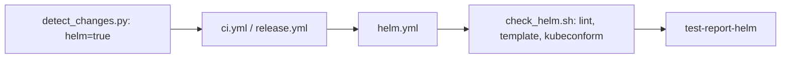

# T0.19: Helm umbrella chart skeleton

**Status:** ✅ Done · **Ticket:** [TICKET.md](TICKET.md) · **Choices and trade-offs:** [IMPLEMENTATION.md](IMPLEMENTATION.md) · **Review:** [REVIEW.md](REVIEW.md)

## 🔭 What it does

- Installs SimpleERP on any Kubernetes with one umbrella chart and one chart per image (`platform`, `backoffice`), from the same images as Compose.
- Writes out every default in the values files, takes the image tag from the commit and keeps every secret out of them.
- Adds a CI check that lints the charts, renders them and validates the manifests against the Kubernetes schemas.
- Selects that check only when Helm files change (or when everything is selected), and keeps its report for the release.

## ⚙️ How it works

1. **The umbrella chart** `simpleerp` has no template of its own. It depends on `platform` and `backoffice`, each switched by `<chart>.enabled`, in [`infra/helm/Chart.yaml:7-13`](../../../infra/helm/Chart.yaml#L7-L13).
2. **Shared values** set the image prefix (`ghcr.io/gpbcom/simpleerp`), the tag (empty by default) and the pull policy, and enable each chart, in [`infra/helm/values.yaml:2-17`](../../../infra/helm/values.yaml#L2-L17).
3. **Chart defaults** list every value the templates read: port 8000, `ClusterIP` and probe `/v1/health` for the platform, in [`infra/helm/charts/platform/values.yaml:11-53`](../../../infra/helm/charts/platform/values.yaml#L11-L53); port 8080 and probe `/` for the back office, in [`infra/helm/charts/backoffice/values.yaml`](../../../infra/helm/charts/backoffice/values.yaml).
4. **The image name** is `<prefix>-<name>:<tag>`, and an empty tag falls back to `appVersion`, in [`infra/helm/charts/platform/templates/_helpers.tpl:20-23`](../../../infra/helm/charts/platform/templates/_helpers.tpl#L20-L23) (the back office has the same helper in [`infra/helm/charts/backoffice/templates/_helpers.tpl`](../../../infra/helm/charts/backoffice/templates/_helpers.tpl)).
5. **The Deployment** renders only when `enabled`, with the image, the HTTP port and the same path for liveness and readiness, in [`infra/helm/charts/platform/templates/deployment.yaml:1-65`](../../../infra/helm/charts/platform/templates/deployment.yaml#L1-L65). The back office does the same in [`infra/helm/charts/backoffice/templates/deployment.yaml:1-65`](../../../infra/helm/charts/backoffice/templates/deployment.yaml#L1-L65).
6. **The Service** is of the type in the values (`ClusterIP`) and targets the named port, in [`infra/helm/charts/platform/templates/service.yaml:1-17`](../../../infra/helm/charts/platform/templates/service.yaml#L1-L17). No Ingress and no Secret exists.
7. **Change detection** sets `helm` when [`infra/helm/Chart.yaml`](../../../infra/helm/Chart.yaml) exists and a changed path is under `infra/helm/`, or when everything is selected, in [`.github/scripts/detect_changes.py:174-219`](../../../.github/scripts/detect_changes.py#L174-L219). `helm.yml` is a shared file, at [`.github/scripts/detect_changes.py:64`](../../../.github/scripts/detect_changes.py#L64).
8. **CI and release call the workflow** under that output, in [`.github/workflows/ci.yml:92-96`](../../../.github/workflows/ci.yml#L92-L96) and [`.github/workflows/release.yml:105-109`](../../../.github/workflows/release.yml#L105-L109). `ci.yml` makes `result` wait for it ([`.github/workflows/ci.yml:110`](../../../.github/workflows/ci.yml#L110)), and `release.yml` does the same for its report job ([`.github/workflows/release.yml:111`](../../../.github/workflows/release.yml#L111)).
9. **The workflow** installs Helm v4.3.2, downloads kubeconform and checks its SHA-256 ([`.github/workflows/helm.yml:14-37`](../../../.github/workflows/helm.yml#L14-L37)), runs the script with `github.sha` as tag ([`.github/workflows/helm.yml:38-41`](../../../.github/workflows/helm.yml#L38-L41)), then uploads `reports/` as `test-report-helm` even on failure ([`.github/workflows/helm.yml:42-48`](../../../.github/workflows/helm.yml#L42-L48)).
10. **The script** lints the umbrella and each chart with `--strict` ([`.github/scripts/check_helm.sh:27-34`](../../../.github/scripts/check_helm.sh#L27-L34)), renders the release with `helm template` ([`.github/scripts/check_helm.sh:39-41`](../../../.github/scripts/check_helm.sh#L39-L41)), and validates it with `kubeconform -strict` against Kubernetes 1.33.0, writing a JUnit `helm.xml` ([`.github/scripts/check_helm.sh:43-50`](../../../.github/scripts/check_helm.sh#L43-L50)).



## 🧱 Files and lines changed

<!-- changes -->
| File | Change | Lines in the new version | Added | Removed |
| --- | --- | --- | --- | --- |
| [`.github/scripts/check_helm.sh`](../../../.github/scripts/check_helm.sh) | Added | [1-50](../../../.github/scripts/check_helm.sh#L1) | +50 | −0 |
| [`.github/scripts/detect_changes.py`](../../../.github/scripts/detect_changes.py) | Modified | [7](../../../.github/scripts/detect_changes.py#L7), [19-22](../../../.github/scripts/detect_changes.py#L19), [25-27](../../../.github/scripts/detect_changes.py#L25), [41](../../../.github/scripts/detect_changes.py#L41), [64](../../../.github/scripts/detect_changes.py#L64), [163](../../../.github/scripts/detect_changes.py#L163), [174](../../../.github/scripts/detect_changes.py#L174), [183](../../../.github/scripts/detect_changes.py#L183), [190-192](../../../.github/scripts/detect_changes.py#L190), [211](../../../.github/scripts/detect_changes.py#L211), [219](../../../.github/scripts/detect_changes.py#L219) | +18 | −6 |
| [`.github/workflows/ci.yml`](../../../.github/workflows/ci.yml) | Modified | [4-5](../../../.github/workflows/ci.yml#L4), [37](../../../.github/workflows/ci.yml#L37), [92-96](../../../.github/workflows/ci.yml#L92), [110](../../../.github/workflows/ci.yml#L110) | +9 | −3 |
| [`.github/workflows/helm.yml`](../../../.github/workflows/helm.yml) | Added | [1-48](../../../.github/workflows/helm.yml#L1) | +48 | −0 |
| [`.github/workflows/release.yml`](../../../.github/workflows/release.yml) | Modified | [5](../../../.github/workflows/release.yml#L5), [70](../../../.github/workflows/release.yml#L70), [105-109](../../../.github/workflows/release.yml#L105), [111](../../../.github/workflows/release.yml#L111) | +8 | −2 |
| [`README.md`](../../../README.md) | Modified | [213-218](../../../README.md#L213) | +6 | −0 |
| [`docs/technical/infrastructure/deployment.md`](../../../docs/technical/infrastructure/deployment.md) | Modified | [7-37](../../../docs/technical/infrastructure/deployment.md#L7), [49](../../../docs/technical/infrastructure/deployment.md#L49) | +32 | −2 |
| [`infra/helm/.helmignore`](../../../infra/helm/.helmignore) | Added | [1-18](../../../infra/helm/.helmignore#L1) | +18 | −0 |
| [`infra/helm/Chart.yaml`](../../../infra/helm/Chart.yaml) | Added | [1-13](../../../infra/helm/Chart.yaml#L1) | +13 | −0 |
| [`infra/helm/README.md`](../../../infra/helm/README.md) | Modified | [3-23](../../../infra/helm/README.md#L3) | +21 | −2 |
| [`infra/helm/charts/backoffice/.helmignore`](../../../infra/helm/charts/backoffice/.helmignore) | Added | [1-18](../../../infra/helm/charts/backoffice/.helmignore#L1) | +18 | −0 |
| [`infra/helm/charts/backoffice/Chart.yaml`](../../../infra/helm/charts/backoffice/Chart.yaml) | Added | [1-6](../../../infra/helm/charts/backoffice/Chart.yaml#L1) | +6 | −0 |
| [`infra/helm/charts/backoffice/templates/_helpers.tpl`](../../../infra/helm/charts/backoffice/templates/_helpers.tpl) | Added | [1-32](../../../infra/helm/charts/backoffice/templates/_helpers.tpl#L1) | +32 | −0 |
| [`infra/helm/charts/backoffice/templates/deployment.yaml`](../../../infra/helm/charts/backoffice/templates/deployment.yaml) | Added | [1-65](../../../infra/helm/charts/backoffice/templates/deployment.yaml#L1) | +65 | −0 |
| [`infra/helm/charts/backoffice/templates/service.yaml`](../../../infra/helm/charts/backoffice/templates/service.yaml) | Added | [1-17](../../../infra/helm/charts/backoffice/templates/service.yaml#L1) | +17 | −0 |
| [`infra/helm/charts/backoffice/values.yaml`](../../../infra/helm/charts/backoffice/values.yaml) | Added | [1-52](../../../infra/helm/charts/backoffice/values.yaml#L1) | +52 | −0 |
| [`infra/helm/charts/platform/.helmignore`](../../../infra/helm/charts/platform/.helmignore) | Added | [1-18](../../../infra/helm/charts/platform/.helmignore#L1) | +18 | −0 |
| [`infra/helm/charts/platform/Chart.yaml`](../../../infra/helm/charts/platform/Chart.yaml) | Added | [1-6](../../../infra/helm/charts/platform/Chart.yaml#L1) | +6 | −0 |
| [`infra/helm/charts/platform/templates/_helpers.tpl`](../../../infra/helm/charts/platform/templates/_helpers.tpl) | Added | [1-23](../../../infra/helm/charts/platform/templates/_helpers.tpl#L1) | +23 | −0 |
| [`infra/helm/charts/platform/templates/deployment.yaml`](../../../infra/helm/charts/platform/templates/deployment.yaml) | Added | [1-65](../../../infra/helm/charts/platform/templates/deployment.yaml#L1) | +65 | −0 |
| [`infra/helm/charts/platform/templates/service.yaml`](../../../infra/helm/charts/platform/templates/service.yaml) | Added | [1-17](../../../infra/helm/charts/platform/templates/service.yaml#L1) | +17 | −0 |
| [`infra/helm/charts/platform/values.yaml`](../../../infra/helm/charts/platform/values.yaml) | Added | [1-53](../../../infra/helm/charts/platform/values.yaml#L1) | +53 | −0 |
| [`infra/helm/templates/.gitkeep`](../../../infra/helm/templates/.gitkeep) | Added | ➖ | +0 | −0 |
| [`infra/helm/values.yaml`](../../../infra/helm/values.yaml) | Added | [1-17](../../../infra/helm/values.yaml#L1) | +17 | −0 |
| [`tests/ci/check_helm/test_check_helm.py`](../../../tests/ci/check_helm/test_check_helm.py) | Added | [1-90](../../../tests/ci/check_helm/test_check_helm.py#L1) | +90 | −0 |
| [`tests/ci/detect_changes/helm/test_helm_changes.py`](../../../tests/ci/detect_changes/helm/test_helm_changes.py) | Added | [1-41](../../../tests/ci/detect_changes/helm/test_helm_changes.py#L1) | +41 | −0 |
| [`tests/ci/detect_changes/helpers.py`](../../../tests/ci/detect_changes/helpers.py) | Modified | [16-25](../../../tests/ci/detect_changes/helpers.py#L16), [70](../../../tests/ci/detect_changes/helpers.py#L70), [111](../../../tests/ci/detect_changes/helpers.py#L111), [123](../../../tests/ci/detect_changes/helpers.py#L123) | +13 | −1 |
| [`tests/ci/detect_changes/test_detect_changes.py`](../../../tests/ci/detect_changes/test_detect_changes.py) | Modified | [14](../../../tests/ci/detect_changes/test_detect_changes.py#L14), [41](../../../tests/ci/detect_changes/test_detect_changes.py#L41) | +2 | −0 |
| [`tests/ci/detect_changes/test_repository_layout.py`](../../../tests/ci/detect_changes/test_repository_layout.py) | Modified | [14](../../../tests/ci/detect_changes/test_repository_layout.py#L14), [17](../../../tests/ci/detect_changes/test_repository_layout.py#L17), [95-100](../../../tests/ci/detect_changes/test_repository_layout.py#L95), [removed after 76](../../../tests/ci/detect_changes/test_repository_layout.py#L76) | +8 | −1 |
| [`tests/ci/detect_changes/test_shared_changes.py`](../../../tests/ci/detect_changes/test_shared_changes.py) | Modified | [47](../../../tests/ci/detect_changes/test_shared_changes.py#L47) | +1 | −0 |
| [`tests/ci/release/test_release_workflow.py`](../../../tests/ci/release/test_release_workflow.py) | Modified | [16](../../../tests/ci/release/test_release_workflow.py#L16), [23](../../../tests/ci/release/test_release_workflow.py#L23), [80-85](../../../tests/ci/release/test_release_workflow.py#L80) | +8 | −1 |
| [`tests/ci/workflows/checks/helm/test_helm_workflow.py`](../../../tests/ci/workflows/checks/helm/test_helm_workflow.py) | Added | [1-81](../../../tests/ci/workflows/checks/helm/test_helm_workflow.py#L1) | +81 | −0 |
| [`tests/ci/workflows/test_ci_workflow.py`](../../../tests/ci/workflows/test_ci_workflow.py) | Modified | [19-28](../../../tests/ci/workflows/test_ci_workflow.py#L19), [93](../../../tests/ci/workflows/test_ci_workflow.py#L93) | +11 | −2 |
| [`tests/ci/workflows/test_workflow_security.py`](../../../tests/ci/workflows/test_workflow_security.py) | Modified | [26](../../../tests/ci/workflows/test_workflow_security.py#L26) | +1 | −0 |
| [`tests/infra/helm/test_charts.py`](../../../tests/infra/helm/test_charts.py) | Added | [1-93](../../../tests/infra/helm/test_charts.py#L1) | +93 | −0 |
| [`tests/infra/helm/test_rendering.py`](../../../tests/infra/helm/test_rendering.py) | Added | [1-82](../../../tests/infra/helm/test_rendering.py#L1) | +82 | −0 |
| [`tests/infra/helm/test_values.py`](../../../tests/infra/helm/test_values.py) | Added | [1-167](../../../tests/infra/helm/test_values.py#L1) | +167 | −0 |
| **37 files** | | | **+1210** | **−20** |
<!-- /changes -->

- CI check: [`.github/scripts/check_helm.sh`](../../../.github/scripts/check_helm.sh) (new, lines [`1-50`](../../../.github/scripts/check_helm.sh#L1-L50)) and [`.github/workflows/helm.yml`](../../../.github/workflows/helm.yml) (new): lint, template, strict schema check and the report.
- Wiring: [`.github/scripts/detect_changes.py`](../../../.github/scripts/detect_changes.py), lines [`174-219`](../../../.github/scripts/detect_changes.py#L174-L219): the seventh output `helm`; [`.github/workflows/ci.yml`](../../../.github/workflows/ci.yml), lines [`92-110`](../../../.github/workflows/ci.yml#L92-L110); [`.github/workflows/release.yml`](../../../.github/workflows/release.yml), lines [`105-111`](../../../.github/workflows/release.yml#L105-L111).
- Umbrella chart: [`infra/helm/Chart.yaml`](../../../infra/helm/Chart.yaml), [`infra/helm/values.yaml`](../../../infra/helm/values.yaml), [`infra/helm/.helmignore`](../../../infra/helm/.helmignore) and [`infra/helm/templates/.gitkeep`](../../../infra/helm/templates/.gitkeep) (an empty folder, since the umbrella renders nothing itself).
- Platform chart: [`infra/helm/charts/platform/Chart.yaml`](../../../infra/helm/charts/platform/Chart.yaml), [`infra/helm/charts/platform/values.yaml`](../../../infra/helm/charts/platform/values.yaml), [`infra/helm/charts/platform/templates/_helpers.tpl`](../../../infra/helm/charts/platform/templates/_helpers.tpl), [`infra/helm/charts/platform/templates/deployment.yaml`](../../../infra/helm/charts/platform/templates/deployment.yaml), [`infra/helm/charts/platform/templates/service.yaml`](../../../infra/helm/charts/platform/templates/service.yaml), [`infra/helm/charts/platform/.helmignore`](../../../infra/helm/charts/platform/.helmignore).
- Back-office chart: [`infra/helm/charts/backoffice/Chart.yaml`](../../../infra/helm/charts/backoffice/Chart.yaml), [`infra/helm/charts/backoffice/values.yaml`](../../../infra/helm/charts/backoffice/values.yaml), [`infra/helm/charts/backoffice/templates/_helpers.tpl`](../../../infra/helm/charts/backoffice/templates/_helpers.tpl), [`infra/helm/charts/backoffice/templates/deployment.yaml`](../../../infra/helm/charts/backoffice/templates/deployment.yaml), [`infra/helm/charts/backoffice/templates/service.yaml`](../../../infra/helm/charts/backoffice/templates/service.yaml), [`infra/helm/charts/backoffice/.helmignore`](../../../infra/helm/charts/backoffice/.helmignore).
- Documentation: [`infra/helm/README.md`](../../../infra/helm/README.md), [`README.md`](../../../README.md) (lines [`213-218`](../../../README.md#L213-L218)) and [`docs/technical/infrastructure/deployment.md`](../../../docs/technical/infrastructure/deployment.md) say how to install and how the tag is set.
- Chart tests: [`tests/infra/helm/test_charts.py`](../../../tests/infra/helm/test_charts.py) (structure, one chart per image), [`tests/infra/helm/test_values.py`](../../../tests/infra/helm/test_values.py) (defaults, no secret), [`tests/infra/helm/test_rendering.py`](../../../tests/infra/helm/test_rendering.py) (`helm template`).
- CI tests: [`tests/ci/check_helm/test_check_helm.py`](../../../tests/ci/check_helm/test_check_helm.py), [`tests/ci/workflows/checks/helm/test_helm_workflow.py`](../../../tests/ci/workflows/checks/helm/test_helm_workflow.py), [`tests/ci/detect_changes/helm/test_helm_changes.py`](../../../tests/ci/detect_changes/helm/test_helm_changes.py), and the updated [`tests/ci/detect_changes/helpers.py`](../../../tests/ci/detect_changes/helpers.py), [`tests/ci/detect_changes/test_detect_changes.py`](../../../tests/ci/detect_changes/test_detect_changes.py), [`tests/ci/detect_changes/test_repository_layout.py`](../../../tests/ci/detect_changes/test_repository_layout.py), [`tests/ci/detect_changes/test_shared_changes.py`](../../../tests/ci/detect_changes/test_shared_changes.py), [`tests/ci/release/test_release_workflow.py`](../../../tests/ci/release/test_release_workflow.py), [`tests/ci/workflows/test_ci_workflow.py`](../../../tests/ci/workflows/test_ci_workflow.py), [`tests/ci/workflows/test_workflow_security.py`](../../../tests/ci/workflows/test_workflow_security.py).

## 🧪 How to test it

```bash
uv run pytest tests/infra/helm -n 2
uv run pytest tests/ci/check_helm tests/ci/workflows tests/ci/detect_changes tests/ci/release -n 2
helm lint --strict --set global.image.tag=abc infra/helm
helm template simpleerp infra/helm --set global.image.tag=abc
bash .github/scripts/check_helm.sh infra/helm abc reports
```

The last command needs `helm` and `kubeconform`. Without kubeconform, three tests are skipped and CI runs them.

## 🔗 Evidence

- [Helm lint, umbrella](tests-evidences/helm-lint-infra-helm.txt), [platform](tests-evidences/helm-lint-infra-helm-charts-platform.txt) and [back office](tests-evidences/helm-lint-infra-helm-charts-backoffice.txt): lint passes.
- [pytest](tests-evidences/pytest.txt): 1275 passed, 3 skipped (the kubeconform tests).
- [ruff check](tests-evidences/ruff-check.txt), [ruff format](tests-evidences/ruff-format.txt) and [mypy](tests-evidences/mypy.txt): clean.
- [Plan view](tests-evidences/plan-view.txt) and [ticket references](tests-evidences/ticket-refs.txt): up to date.

## 📝 Assumptions accepted

- The roadmap anchors only sprints, so the ticket links point to the sprint and epic sections of the phase page. It changes nothing in the behaviour.
- The Installation page's measures are still to be specified, so no budget is taken from it.
- Only the platform and backoffice charts are built, since the roadmap row and the Deployment page name one chart per image and these are the only two images today.
- REQ-T09-02, D421 and D438 are the specification the ticket builds on, since the roadmap row names no use case, rule or entity.

## 🔜 Follow-ups

| File | What to change |
| --- | --- |
| [`.github/workflows/ci.yml`](../../../.github/workflows/ci.yml), [`tests/ci/workflows/test_ci_workflow.py`](../../../tests/ci/workflows/test_ci_workflow.py) | Add `helm` to the `needs` of the `images` job, as `terraform` already is, and add `helm` to `CHECK_JOBS` in the test. A failing Helm check does not stop the images from being built, and a push to develop could still publish them. `result` and automerge still gate the merge, so this is not blocking. |
| [`infra/helm/values.yaml`](../../../infra/helm/values.yaml), [`infra/helm/charts/platform/values.yaml`](../../../infra/helm/charts/platform/values.yaml), [`infra/helm/charts/backoffice/values.yaml`](../../../infra/helm/charts/backoffice/values.yaml), [`infra/helm/charts/platform/templates/_helpers.tpl`](../../../infra/helm/charts/platform/templates/_helpers.tpl), [`infra/helm/charts/backoffice/templates/_helpers.tpl`](../../../infra/helm/charts/backoffice/templates/_helpers.tpl), [`tests/infra/helm/test_rendering.py`](../../../tests/infra/helm/test_rendering.py) | An empty `global.image.tag` falls back to `appVersion` 0.1.0, but no image is published under that tag, so a `helm install` without `--set global.image.tag` ends in ImagePullBackOff. Use `required` on the tag, or keep the fallback and say plainly that the tag must be set. |
| [`infra/helm/charts/platform/templates/deployment.yaml`](../../../infra/helm/charts/platform/templates/deployment.yaml), [`infra/helm/charts/platform/templates/_helpers.tpl`](../../../infra/helm/charts/platform/templates/_helpers.tpl), [`infra/helm/charts/backoffice/templates/deployment.yaml`](../../../infra/helm/charts/backoffice/templates/deployment.yaml), [`infra/helm/charts/backoffice/templates/_helpers.tpl`](../../../infra/helm/charts/backoffice/templates/_helpers.tpl) | The two charts differ for no reason: `if .Values.x` against `with`, the securityContext in another place, and only the back office adds the `helm.sh/chart` label. Align them, or move the shared helpers into a library chart before more charts copy one of the two. |
| [`tests/ci/check_helm/test_check_helm.py`](../../../tests/ci/check_helm/test_check_helm.py), [`tests/infra/helm/test_charts.py`](../../../tests/infra/helm/test_charts.py) | Move the module-level constants (`REPOSITORY`, `SCRIPT`, `HELM_ROOT`, `TAG`, `NEEDS_TOOLS`, `ROOT`, `HELM`, `CHARTS`, `CHART_NAMES`) into ClassVars of the test class, as the other Helm tests do. `tests/conventions` does not enforce this today. |
| [`.github/workflows/release.yml`](../../../.github/workflows/release.yml) | Re-wrap the header comment line this ticket changed (line [`5`](../../../.github/workflows/release.yml#L5)). It runs well past 120 characters. |
| [`docs/tickets/T0.19/tests-evidences/`](tests-evidences/) | Add a local run of `check_helm.sh` with kubeconform installed (the `helm.xml` report), as evidence of the schema validation of criterion 2. The three kubeconform tests were skipped in the recorded run. |
