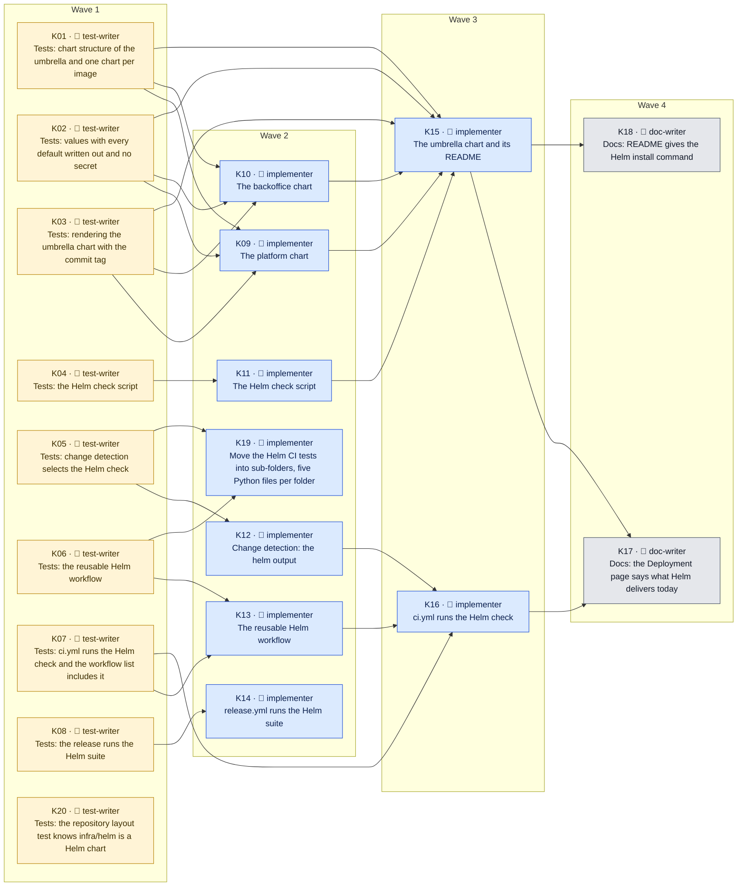

# T0.19: Helm umbrella chart skeleton, plan

**Plan:** 🟢 Approved

**Push:** 🟢 Approved

<!-- ticket:specs -->
## 📚 Specifications

The specification and design pages of [TICKET.md](TICKET.md), copied by `python3 .claude/scripts/tickets/ticket_refs.py sync`.

- [Deployment](../../technical/infrastructure/deployment.md)
- [📌 REQ-T09-02: Compose and Helm everywhere](../../specs/03-technical/t09-install-backups-and-updates/requirements/req-t09-02-compose-and-helm.md)
- [📜 D421: Infrastructure: fully CNCF compatible](../../specs/06-decisions/technical/d421-infrastructure-cncf.md)
- [📜 D438: Repository layout](../../specs/06-decisions/technical/d438-repository-layout.md)
- [Repository layout](../../technical/architecture/repository-layout.md)
- [Installation](../../specs/05-non-functional/installation.md)
<!-- /ticket:specs -->

## Summary

T0.19 delivers the Helm umbrella chart skeleton in `infra/helm` (REQ-T09-02, D421, D438), plus a CI check that runs `helm lint` and `helm template` and validates the rendered manifests against the Kubernetes schemas.

The umbrella chart sits at `infra/helm/`. Under it are one unpacked chart per image, `infra/helm/charts/platform/` and `infra/helm/charts/backoffice/`. This is the layout that `.claude/scripts/tickets/checks.py` (`helm_charts`), its test fixture and `.gitignore` already expect, and it needs no `helm dependency build`.

Each chart renders the image `ghcr.io/gpbcom/simpleerp-<name>:<tag>`. This is the naming rule of `images.yml` and `compose.e2e.yaml`. The tag comes from `global.image.tag`, which CI sets to the commit SHA. Every value the templates read is written out in the values files, and no values file holds a secret.

The CI side has five parts:

- `.github/scripts/check_helm.sh`: lints every chart, renders the umbrella chart and checks the manifests with kubeconform, writing a JUnit report.
- `.github/workflows/helm.yml`: a reusable workflow that runs the script, with pinned tools.
- `detect_changes.py`: a sixth output `helm`, and a chart change also turns on the repository tests.
- `ci.yml`: a `helm` job, gated by the `result` job.
- `release.yml`: the same `helm` suite, so a release still runs every suite and keeps its `test-report-helm` (TKT-26).

The graph has 18 tasks in four waves:

1. Eight test-writer tasks: chart structure, values, rendering, the script, change detection, the helm workflow, `ci.yml` and the workflow security list, and `release.yml`.
2. Six implementer tasks: the platform chart, the backoffice chart, `check_helm.sh`, `detect_changes.py`, `helm.yml` and `release.yml`.
3. The umbrella chart with its README, and the `ci.yml` job.
4. Two doc-writer tasks: the Deployment page and the README.

No front end changes, so there is no Playwright task (TKT-21: `➖ No screen`).

## Assumptions

- The roadmap anchors only sprints, so the ticket and epic links point to the sprint (#s03) and epics (#epics) sections of the phase page.
- The Installation non-functional page has its measures still "To be specified", so the ticket touches no budget.
- Only the charts for platform and backoffice are in scope, as named by the roadmap row.
- The roadmap row names no use case, business rule or entity; REQ-T09-02, D421 and D438 are the specification the ticket builds on.
- `check_ticket.py` was not run by this agent (no shell tool available); the workflow's run will report any problem.
- Chart layout: the umbrella chart is `infra/helm/` itself and the per-image charts are unpacked in `infra/helm/charts/platform/` and `infra/helm/charts/backoffice/`. This is the layout that `.claude/scripts/tickets/checks.py` (`helm_charts`) and its test fixture `tests/harness/checks/runs/test_checks_helm.py` already use, and `.gitignore` (`infra/helm/*/charts/`) leaves it versioned. It needs no `helm dependency build`, so the verifier's plain `helm lint` works.
- "The same images as Compose" is checked against the image naming that `.github/workflows/images.yml` and `compose.e2e.yaml` share, `ghcr.io/<owner>/<repo>-<name>:<tag>` (`${ERP_IMAGE_PREFIX}-<name>:${ERP_IMAGE_TAG}`). The compose file itself is written by T0.21, which comes after this ticket.
- "The image tag taken from the commit": `global.image.tag` is written out as an empty string and CI sets it with `--set global.image.tag=$GITHUB_SHA`, the tag `images.yml` publishes from develop and master. An empty tag falls back to the chart's `appVersion`, so that a plain `helm lint` passes and every default stays written out. The specifications do not settle the default tag.
- The chart versions and the `appVersion` are 0.1.0, the version of the root `pyproject.toml`. No specification sets a chart version.
- Services are ClusterIP with no Ingress, following the one gateway with private services of D421. The gateway chart comes with T2.05.
- Values hold only what a skeleton Deployment and Service read: image, replicas, ports, probe path, an `env` map for the environment overrides of `conf/app.yaml` (D413, Configuration page), resources, security contexts and scheduling, each written out with an empty default. No Secret object is rendered and no values key holds a secret.
- The container ports and probe paths are read from the Dockerfiles and the health route of T0.14 (platform, `/v1` health) and T0.17 (backoffice), which the start rule makes prerequisites. Workers record any value they cannot read there.
- The schema validation uses kubeconform in strict mode against one Kubernetes version pinned in `.github/scripts/check_helm.sh`. The Helm and kubeconform versions are pinned in `helm.yml` (setup-helm by commit SHA, kubeconform by version and SHA-256), as D415 and DEP-4 ask. The specifications name no validator and no Kubernetes version, so the workers record the versions they choose.
- `detect_changes.py` gains a sixth output, `helm`, which is true only when `infra/helm/Chart.yaml` exists. A change under `infra/helm/` also sets the repository flag, so that the chart tests in `tests/infra/helm/` run in CI. `helm.yml` becomes a shared reusable workflow, like the others.
- `release.yml` runs the Helm suite and keeps its kubeconform JUnit report as `test-report-helm`, so that a release still runs every suite of CI (TKT-26). `release_notes.py` already reads any JUnit XML report.
- The chart tests live in `tests/infra/helm/`, mirroring `infra/helm/`, and the script tests in `tests/ci/check_helm/`, mirroring `.github/scripts/` as `tests/ci/detect_changes/` does. Tests that need `helm` or `kubeconform` are skipped when the tool is missing, as TKT-6 treats such checks as not applicable. CI's `helm.yml` runs the full check itself.
- The ticket graph gives T0.19 the area `infra/helm` only, but the CI check also changes `.github/` and `tests/ci/`. T0.08 and T0.18 may change the same CI files, so overlaps are resolved by the integrator at integration time.
- The umbrella `values.yaml` holds `global` and each chart's `enabled` switch, and each chart's own `values.yaml` holds its other defaults, so that the defaults are not written twice and cannot drift.

<!-- plan:graph -->

> [!NOTE]
> Generated from the json block at the end of this page by `python3 .claude/scripts/tickets/plan.py render`.
> To change a task, edit the json block, then render again: never edit this view by hand.

## Waves

| Wave | Tasks | Agents running at once |
| --- | --- | --- |
| 1 | [K01](#k01), [K02](#k02), [K03](#k03), [K04](#k04), [K05](#k05), [K06](#k06), [K07](#k07), [K08](#k08), [K20](#k20) | 8 of 9 |
| 2 | [K09](#k09), [K10](#k10), [K11](#k11), [K12](#k12), [K13](#k13), [K14](#k14), [K19](#k19) | 7 of 7 |
| 3 | [K15](#k15), [K16](#k16) | 2 of 2 |
| 4 | [K17](#k17), [K18](#k18) | 2 of 2 |

| Wave | Task | Agent | Depends on | Unblocks |
| --- | --- | --- | --- | --- |
| 1 | [K01](#k01) Tests: chart structure of the umbrella and one chart per image | 🧪 test-writer | none | [K09](#k09), [K10](#k10), [K15](#k15) |
| 1 | [K02](#k02) Tests: values with every default written out and no secret | 🧪 test-writer | none | [K09](#k09), [K10](#k10), [K15](#k15) |
| 1 | [K03](#k03) Tests: rendering the umbrella chart with the commit tag | 🧪 test-writer | none | [K09](#k09), [K10](#k10), [K15](#k15) |
| 1 | [K04](#k04) Tests: the Helm check script | 🧪 test-writer | none | [K11](#k11) |
| 1 | [K05](#k05) Tests: change detection selects the Helm check | 🧪 test-writer | none | [K12](#k12), [K19](#k19) |
| 1 | [K06](#k06) Tests: the reusable Helm workflow | 🧪 test-writer | none | [K13](#k13), [K19](#k19) |
| 1 | [K07](#k07) Tests: ci.yml runs the Helm check and the workflow list includes it | 🧪 test-writer | none | [K13](#k13), [K16](#k16) |
| 1 | [K08](#k08) Tests: the release runs the Helm suite | 🧪 test-writer | none | [K14](#k14) |
| 2 | [K09](#k09) The platform chart | 🐍 implementer | [K01](#k01), [K02](#k02), [K03](#k03) | [K15](#k15) |
| 2 | [K10](#k10) The backoffice chart | 🐍 implementer | [K01](#k01), [K02](#k02), [K03](#k03) | [K15](#k15) |
| 2 | [K11](#k11) The Helm check script | 🐍 implementer | [K04](#k04) | [K15](#k15) |
| 2 | [K12](#k12) Change detection: the helm output | 🐍 implementer | [K05](#k05) | [K16](#k16) |
| 2 | [K13](#k13) The reusable Helm workflow | 🐍 implementer | [K06](#k06), [K07](#k07) | [K16](#k16) |
| 2 | [K14](#k14) release.yml runs the Helm suite | 🐍 implementer | [K08](#k08) | none |
| 3 | [K15](#k15) The umbrella chart and its README | 🐍 implementer | [K01](#k01), [K02](#k02), [K03](#k03), [K09](#k09), [K10](#k10), [K11](#k11) | [K17](#k17), [K18](#k18) |
| 3 | [K16](#k16) ci.yml runs the Helm check | 🐍 implementer | [K07](#k07), [K12](#k12), [K13](#k13) | [K17](#k17) |
| 4 | [K17](#k17) Docs: the Deployment page says what Helm delivers today | 📝 doc-writer | [K15](#k15), [K16](#k16) | none |
| 4 | [K18](#k18) Docs: README gives the Helm install command | 📝 doc-writer | [K15](#k15) | none |
| 2 | [K19](#k19) Move the Helm CI tests into sub-folders, five Python files per folder | 🐍 implementer | [K05](#k05), [K06](#k06) | none |
| 1 | [K20](#k20) Tests: the repository layout test knows infra/helm is a Helm chart | 🧪 test-writer | none | none |

## Dependency graph



## Tasks

### <a id="k01"></a>K01: Tests: chart structure of the umbrella and one chart per image

| Agent | Wave | Depends on | Unblocks |
| --- | --- | --- | --- |
| 🧪 test-writer | 1 | none | [K09](#k09), [K10](#k10), [K15](#k15) |

**Files** (only this task may change them in its wave):

- `tests/infra/helm/test_charts.py`

**Done when:** `uv run pytest tests/infra/helm/test_charts.py --collect-only -q` exits 0. `uv run ruff check tests/infra/helm/test_charts.py` and `uv run ruff format --check tests/infra/helm/test_charts.py` pass. The tests fail only because the charts do not exist yet.

**Brief:**

Write the tests that fix the shape of the Helm charts of T0.19 (docs/tickets/T0.19/TICKET.md, acceptance criterion 3). Specifications: REQ-T09-02 (docs/specs/03-technical/t09-install-backups-and-updates/requirements/req-t09-02-compose-and-helm.md: Helm installs from the same images as Compose), D438 (docs/specs/06-decisions/technical/d438-repository-layout.md: infra/ holds Helm), D421 (docs/specs/06-decisions/technical/d421-infrastructure-cncf.md), Repository layout (docs/technical/architecture/repository-layout.md: `helm/` holds an umbrella chart and a chart per service), Deployment (docs/technical/infrastructure/deployment.md).

Chart contract of this plan (the implementers follow it):
- Umbrella chart at `infra/helm/`: `Chart.yaml` with `apiVersion: v2`, `name: simpleerp`, `type: application`, `version: 0.1.0`, `appVersion: "0.1.0"`, and `dependencies` naming `platform` and `backoffice` (version `0.1.0`, `condition: <name>.enabled`). The charts sit unpacked in `infra/helm/charts/<name>/`, so they need no `helm dependency build`.
- One chart per image: `infra/helm/charts/platform/` and `infra/helm/charts/backoffice/`. Each has a `Chart.yaml` whose `name` equals its folder (`apiVersion: v2`, `type: application`, `version: 0.1.0`, `appVersion: "0.1.0"`), a `values.yaml`, a `.helmignore`, and `templates/_helpers.tpl`, `templates/deployment.yaml` and `templates/service.yaml`.

Write one class `TestCharts` in `tests/infra/helm/test_charts.py`, mirroring `infra/helm/`. It holds sentence-named tests, with no `__init__.py`, the constants as `ClassVar`s or module-level test constants, and the repository root found from `Path(__file__).resolve().parents[3]`. The tests check that:
- the umbrella `Chart.yaml` has the fields above;
- the umbrella's dependency names are exactly the folders of `infra/helm/charts/` that hold a `Chart.yaml`, and include `platform` and `backoffice`;
- each dependency has the `condition` `<name>.enabled`;
- each chart's `name` equals its folder, and it has the five files listed above;
- each chart matches an image folder holding a `Dockerfile`: `platform` matches `backend/services/platform/Dockerfile`, and `backoffice` matches `frontend/backoffice/Dockerfile`. Use the image naming rule of `.github/scripts/detect_changes.py` (`image_name`: the folder's own name, `portal-<name>` for a portal), so that later charts are covered too.

The tests do not require the set of charts to stay exactly these two, because later phases add charts. Follow AGENT.md, "Tests": `pytest.mark.parametrize` per chart, and YAML read with `yaml.safe_load` and `encoding="utf-8"`. Tests come first (TKT-4): they fail now because `infra/helm` has no chart yet.

### <a id="k02"></a>K02: Tests: values with every default written out and no secret

| Agent | Wave | Depends on | Unblocks |
| --- | --- | --- | --- |
| 🧪 test-writer | 1 | none | [K09](#k09), [K10](#k10), [K15](#k15) |

**Files** (only this task may change them in its wave):

- `tests/infra/helm/test_values.py`

**Done when:** `uv run pytest tests/infra/helm/test_values.py --collect-only -q` exits 0. `uv run ruff check` and `uv run ruff format --check` pass on the file. The tests fail only because the charts do not exist yet.

**Brief:**

Write the tests of the values files of T0.19 (docs/tickets/T0.19/TICKET.md, acceptance criterion 4). Specifications: D421 (docs/specs/06-decisions/technical/d421-infrastructure-cncf.md), REQ-T09-02 (docs/specs/03-technical/t09-install-backups-and-updates/requirements/req-t09-02-compose-and-helm.md), Deployment (docs/technical/infrastructure/deployment.md), D438 (docs/specs/06-decisions/technical/d438-repository-layout.md).

Values contract of this plan:
- Every values file (`infra/helm/values.yaml`, `infra/helm/charts/platform/values.yaml`, `infra/helm/charts/backoffice/values.yaml`) writes out `global.image.prefix: ghcr.io/gpbcom/simpleerp`, `global.image.tag: ""` and `global.image.pullPolicy: IfNotPresent`, with the same values in all three.
- Each chart's values write out `enabled: true`, `image.name: <chart name>`, `replicaCount: 1`, `containerPort`, `service.type: ClusterIP`, `service.port`, `probe.path`, `env: {}`, `resources: {}`, `podSecurityContext: {}`, `securityContext: {}`, `nodeSelector: {}`, `tolerations: []` and `affinity: {}`.
- The umbrella values hold `global` and, per chart, a section with at least `enabled: true`. A key in that section must also exist in the chart's own values.
- Templates read values only through full `.Values.<path>` or `$.Values.<path>` references.

Write one class `TestValues` in `tests/infra/helm/test_values.py`. It is self-contained: no import of another test file, constants as `ClassVar`s, and the root found from `Path(__file__).resolve().parents[3]`. Parametrize per chart (`platform`, `backoffice`) and per values file. The tests check that:
- each values file parses to a mapping;
- the three `global.image` keys are written out with the values above in every values file;
- every `.Values.<dotted.path>` and `$.Values.<dotted.path>` found by a regex in a chart's `templates/*` resolves to a key written in that chart's `values.yaml`, which is "every default written out";
- each chart's `image.name` equals its folder name;
- the umbrella's section for each chart has `enabled: true` and uses no key the chart's own values lack;
- no key in any values file matches, case-insensitively, `password|passwd|secret|token|credential|private_?key|api_?key`. A key ending in `_key` names a secret store entry under AGENT.md (Naming), so it is allowed only with an empty value or a plain entry name;
- no template under `infra/helm` declares `kind: Secret`.

Follow AGENT.md, "Tests". Tests come first (TKT-4).

### <a id="k03"></a>K03: Tests: rendering the umbrella chart with the commit tag

| Agent | Wave | Depends on | Unblocks |
| --- | --- | --- | --- |
| 🧪 test-writer | 1 | none | [K09](#k09), [K10](#k10), [K15](#k15) |

**Files** (only this task may change them in its wave):

- `tests/infra/helm/test_rendering.py`

**Done when:** `uv run pytest tests/infra/helm/test_rendering.py --collect-only -q` exits 0. ruff check and ruff format --check pass on the file. With helm installed, the tests fail only because the charts do not exist yet. Without helm, they are skipped with the stated reason.

**Brief:**

Write the tests that render the charts of T0.19 with `helm template` (docs/tickets/T0.19/TICKET.md, acceptance criteria 2, 3 and 4). Specifications: REQ-T09-02 (docs/specs/03-technical/t09-install-backups-and-updates/requirements/req-t09-02-compose-and-helm.md: Helm installs from the same images as Compose), D421 (docs/specs/06-decisions/technical/d421-infrastructure-cncf.md: one gateway with private services), Deployment (docs/technical/infrastructure/deployment.md).

Rendering contract of this plan:
- `helm template simpleerp infra/helm --set global.image.tag=<tag>` renders one `Deployment` and one `Service` per chart (`platform`, `backoffice`), named `simpleerp-<chart>`.
- Every container image is `ghcr.io/gpbcom/simpleerp-<chart>:<tag>`. This is the naming `${ERP_IMAGE_PREFIX}-<name>:${ERP_IMAGE_TAG}` of `.github/workflows/images.yml` and `compose.e2e.yaml`.
- Without the `--set`, the tag is the chart's `appVersion`, `0.1.0`.
- Every `Service` is `ClusterIP`, because services stay private behind the one gateway of D421. There is no `Ingress` and no `Secret`.
- `--set platform.enabled=false` drops the platform resources.
- Each chart also renders alone: `helm template t infra/helm/charts/<chart>`.

Write one class `TestRendering` in `tests/infra/helm/test_rendering.py`, self-contained, with constants as `ClassVar`s. It runs the real `helm` through `subprocess` and parses the output with `yaml.safe_load_all`. When `shutil.which("helm")` is None, every test is skipped through a class-level `pytest.mark.skipif` whose reason says helm is not on the PATH. This matches the "not applicable" rule of TKT-6: the CI workflow of K13 runs the full check. The tests check:
- the kinds and names;
- the images for a given tag such as `abc1234`;
- the `appVersion` fallback;
- the service types;
- the absence of `Secret` and `Ingress`;
- the `enabled` switch;
- each chart rendered alone.

Follow AGENT.md, "Tests", and do not use `unittest.mock`. Tests come first (TKT-4).

### <a id="k04"></a>K04: Tests: the Helm check script

| Agent | Wave | Depends on | Unblocks |
| --- | --- | --- | --- |
| 🧪 test-writer | 1 | none | [K11](#k11) |

**Files** (only this task may change them in its wave):

- `tests/ci/check_helm/test_check_helm.py`

**Done when:** `uv run pytest tests/ci/check_helm/test_check_helm.py --collect-only -q` exits 0, and ruff check and ruff format --check pass on the file. The tests that always run fail only because the script does not exist yet.

**Brief:**

Write the tests of `.github/scripts/check_helm.sh`, the CI check of T0.19 (docs/tickets/T0.19/TICKET.md, acceptance criteria 1 and 2: `helm lint` and `helm template` pass, and the manifests validate against the Kubernetes schemas). Specifications: REQ-T09-02 (docs/specs/03-technical/t09-install-backups-and-updates/requirements/req-t09-02-compose-and-helm.md), D421 (docs/specs/06-decisions/technical/d421-infrastructure-cncf.md), Deployment (docs/technical/infrastructure/deployment.md).

Script contract of this plan: `bash .github/scripts/check_helm.sh <helm root> <image tag> <reports dir>`.
- A wrong argument count exits 2 with a line starting `usage:` on stderr.
- A missing `helm` or `kubeconform` on the PATH exits 1, naming the missing tool on stderr. These checks come before any other work.
- It runs `helm lint --strict --set global.image.tag=<tag>` on the umbrella `<helm root>` and on every `<helm root>/charts/*/` holding a `Chart.yaml`.
- It renders `helm template simpleerp <helm root> --set global.image.tag=<tag>` into a temporary file it removes.
- It validates that file with `kubeconform -strict -summary` against a Kubernetes version pinned in the script, writing a JUnit report to `<reports dir>/helm.xml`. It creates the folder if needed.
- It exits non-zero on any failure.

Write one class `TestCheckHelm` in `tests/ci/check_helm/test_check_helm.py`, mirroring `.github/scripts/` as `tests/ci/detect_changes/` does. These tests always run:
- a wrong argument count exits 2 with the usage line;
- with `PATH` set to a temporary folder that holds only a link to `bash`, the script exits 1 and names `helm`.

These tests are skipped, with a reason, when `helm` or `kubeconform` is not on the PATH:
- on the real `infra/helm` with tag `abc1234`, the script exits 0 and writes `helm.xml` as JUnit XML (a root `testsuites` or `testsuite` element);
- on a copy of `infra/helm` in `tmp_path` with a broken template, it exits non-zero;
- on a copy where a template adds an unknown field to the Deployment spec, it exits non-zero, because the strict schema check refuses it.

Use `subprocess.run` with `check=False`, and do not use mocks. Follow AGENT.md, "Tests". Tests come first (TKT-4).

### <a id="k05"></a>K05: Tests: change detection selects the Helm check

| Agent | Wave | Depends on | Unblocks |
| --- | --- | --- | --- |
| 🧪 test-writer | 1 | none | [K12](#k12), [K19](#k19) |

**Files** (only this task may change them in its wave):

- `tests/ci/detect_changes/helpers.py`
- `tests/ci/detect_changes/test_detect_changes.py`
- `tests/ci/detect_changes/test_shared_changes.py`
- `tests/ci/detect_changes/test_helm_changes.py`

**Done when:** `uv run pytest tests/ci/detect_changes --collect-only -q` exits 0, and ruff check and ruff format --check pass on the four files. The new and changed tests fail only because `detect_changes.py` has no `helm` output yet.

**Brief:**

Extend the tests of `.github/scripts/detect_changes.py` for the Helm check of T0.19 (docs/tickets/T0.19/TICKET.md, acceptance criterion 1: `helm lint` runs in CI). Specifications: REQ-T09-02 (docs/specs/03-technical/t09-install-backups-and-updates/requirements/req-t09-02-compose-and-helm.md), D438 (docs/specs/06-decisions/technical/d438-repository-layout.md: `infra/helm`), and AGENT.md, "CI/CD" step 1 (run jobs only for what changed).

Detector contract of this plan:
- A sixth output line `helm=true|false` is printed after `images`.
- It is `true` when the umbrella `infra/helm/Chart.yaml` exists and either a path under `infra/helm/` changed or everything is selected (a shared path or `--all`). It is `false` otherwise, so a repository without the chart prints `false`.
- A path under `infra/helm/` also sets `repository=true`, because the chart tests of `tests/infra/helm/` are repository tests.
- `.github/workflows/helm.yml` joins the shared files, like the other reusable workflows.

Changes:
- `helpers.py`: add `HELM_KEY = "helm"` at the end of `KEYS`. Add `"infra/helm/Chart.yaml"` (a minimal `apiVersion: v2` chart) to `REPO_FILES`. `nothing()` gains `helm: "false"` and `everything()` gains `helm: "true"`.
- `test_detect_changes.py`: the contract-order test checks six lines, and that `helm` is `true` or `false`.
- `test_shared_changes.py`: add `.github/workflows/helm.yml` to the shared paths. The repository-without-projects test still expects `helm` to be `false`.
- New `test_helm_changes.py` with class `TestHelmChanges`:
  - a change to `infra/helm/charts/platform/templates/deployment.yaml` or to `infra/helm/values.yaml` gives `{**nothing(), helm: "true", repository: "true"}`;
  - the same change with the umbrella `Chart.yaml` removed gives `nothing()`;
  - a change under `infra/terraform/` or under a service keeps `helm` `false`.

Keep the existing style of the folder (see `helpers.py`). The folder must stay at five Python files or fewer (AGENT.md). Tests come first (TKT-4).

### <a id="k06"></a>K06: Tests: the reusable Helm workflow

| Agent | Wave | Depends on | Unblocks |
| --- | --- | --- | --- |
| 🧪 test-writer | 1 | none | [K13](#k13), [K19](#k19) |

**Files** (only this task may change them in its wave):

- `tests/ci/workflows/checks/test_helm_workflow.py`

**Done when:** `uv run pytest tests/ci/workflows/checks/test_helm_workflow.py --collect-only -q` exits 0, and ruff check and ruff format --check pass on the file. The tests fail only because `helm.yml` does not exist yet.

**Brief:**

Write the tests of the new reusable workflow `.github/workflows/helm.yml`, the CI check of T0.19 (docs/tickets/T0.19/TICKET.md, acceptance criteria 1, 2 and 4: `helm lint` and `helm template` pass in CI, the manifests validate against the Kubernetes schemas, and the image tag comes from the commit). Specifications: REQ-T09-02 (docs/specs/03-technical/t09-install-backups-and-updates/requirements/req-t09-02-compose-and-helm.md), D421 (docs/specs/06-decisions/technical/d421-infrastructure-cncf.md), Deployment (docs/technical/infrastructure/deployment.md).

Workflow contract of this plan:
- The workflow has the name `helm` and the trigger `workflow_call` only. Its workflow-level `permissions` are `contents: read`.
- Its workflow-level `env` holds `KUBECONFORM_VERSION` (`vX.Y.Z`) and `KUBECONFORM_SHA256` (64 lowercase hex characters).
- It has one job, `check`, with a `timeout-minutes`. Its steps are:
  1. `actions/checkout` with `persist-credentials: false`;
  2. `azure/setup-helm` with a `version` input `vX.Y.Z`;
  3. a run step that downloads kubeconform `KUBECONFORM_VERSION` and checks it with `sha256sum` against `KUBECONFORM_SHA256` (`-c` or `--check`);
  4. a run step `bash .github/scripts/check_helm.sh infra/helm "$IMAGE_TAG" reports`, whose step `env` sets `IMAGE_TAG: ${{ github.sha }}`. The tag is the commit, as `images.yml` publishes it;
  5. a single `actions/upload-artifact` step with `if: always()`, `name: test-report-helm`, `path: reports/` and `if-no-files-found: ignore`. This keeps the report for the release (TKT-26).

Write one class `TestHelmWorkflow` in `tests/ci/workflows/checks/test_helm_workflow.py`. Use the helpers of `tests/ci/workflows/helpers.py` (`workflow`, `triggers`, `jobs`, `steps`, `runs`, `step_using`, `with_of`), as `test_python_workflow.py` beside it does. Pinning to a SHA, version comments and injection are already checked for every workflow by `test_workflow_security.py`. Follow AGENT.md, "Tests". Tests come first (TKT-4).

### <a id="k07"></a>K07: Tests: ci.yml runs the Helm check and the workflow list includes it

| Agent | Wave | Depends on | Unblocks |
| --- | --- | --- | --- |
| 🧪 test-writer | 1 | none | [K13](#k13), [K16](#k16) |

**Files** (only this task may change them in its wave):

- `tests/ci/workflows/test_ci_workflow.py`
- `tests/ci/workflows/test_workflow_security.py`

**Done when:** `uv run pytest tests/ci/workflows/test_ci_workflow.py tests/ci/workflows/test_workflow_security.py --collect-only -q` exits 0, and ruff check and ruff format --check pass on both files. The changed tests fail only because `ci.yml`, `detect_changes.py` and `helm.yml` are not changed yet.

**Brief:**

Update the tests of `.github/workflows/ci.yml` and the workflow security list for the Helm check of T0.19 (docs/tickets/T0.19/TICKET.md, acceptance criteria 1 and 2: the check runs in CI). Specifications: REQ-T09-02 (docs/specs/03-technical/t09-install-backups-and-updates/requirements/req-t09-02-compose-and-helm.md), D421 (docs/specs/06-decisions/technical/d421-infrastructure-cncf.md), and AGENT.md, "CI/CD".

Contract of this plan:
- `ci.yml` gains a job `helm` with `needs: changes`, `if: needs.changes.outputs.helm == 'true'` and `uses: ./.github/workflows/helm.yml`.
- The `changes` job outputs a `helm` key, `${{ steps.detect.outputs.helm }}`, which `detect_changes.py` prints as its sixth line.
- The `result` job needs every other job, `helm` included.
- The `images` job keeps `needs: [changes, python, typescript]`.

In `test_ci_workflow.py`:
- add `helm` to `OUTPUT_KEYS` and to `JOBS`;
- add a test that the `helm` job needs `changes`, calls `./.github/workflows/helm.yml`, and runs under `needs.changes.outputs.helm == 'true'`;
- leave `CHECK_JOBS` unchanged.

In `test_workflow_security.py`, add `helm.yml` to `EXPECTED`, keeping it sorted: automerge, ci, gitflow, helm, images, python, release, stage, typescript. Keep the style of the files. Tests come first (TKT-4).

### <a id="k08"></a>K08: Tests: the release runs the Helm suite

| Agent | Wave | Depends on | Unblocks |
| --- | --- | --- | --- |
| 🧪 test-writer | 1 | none | [K14](#k14) |

**Files** (only this task may change them in its wave):

- `tests/ci/release/test_release_workflow.py`

**Done when:** `uv run pytest tests/ci/release/test_release_workflow.py --collect-only -q` exits 0, and ruff check and ruff format --check pass on the file. The changed tests fail only because `release.yml` and `helm.yml` are not changed yet.

**Brief:**

Update the tests of `.github/workflows/release.yml`, so that a release still runs every suite of CI (TKT-26 in `.claude/rules/tickets.md`), now that T0.19 adds the Helm check (docs/tickets/T0.19/TICKET.md, acceptance criteria 1 and 2). Specifications: REQ-T09-02 (docs/specs/03-technical/t09-install-backups-and-updates/requirements/req-t09-02-compose-and-helm.md), D421 (docs/specs/06-decisions/technical/d421-infrastructure-cncf.md).

Contract of this plan:
- `release.yml` gains a job `helm` with `needs: changes`, `if: needs.changes.outputs.helm == 'true'` and `uses: ./.github/workflows/helm.yml`.
- Its `changes` job outputs a `helm` key (`${{ steps.detect.outputs.helm }}`).
- `prepare` needs `helm` too, beside `version`, `changes`, `python` and `typescript`.
- `helm.yml`'s job `check` keeps the report `test-report-helm` with `if: always()`.

In `test_release_workflow.py`:
- add `"helm"` to `SUITES`;
- add `("helm.yml", "check", "test-report-helm")` to `REPORTS`;
- add a test that the `helm` job runs under `needs.changes.outputs.helm == 'true'`, and that the `changes` job outputs `helm`.

Keep the style of the file. Tests come first (TKT-4).

### <a id="k09"></a>K09: The platform chart

| Agent | Wave | Depends on | Unblocks |
| --- | --- | --- | --- |
| 🐍 implementer | 2 | [K01](#k01), [K02](#k02), [K03](#k03) | [K15](#k15) |

**Files** (only this task may change them in its wave):

- `infra/helm/charts/platform/Chart.yaml`
- `infra/helm/charts/platform/values.yaml`
- `infra/helm/charts/platform/.helmignore`
- `infra/helm/charts/platform/templates/_helpers.tpl`
- `infra/helm/charts/platform/templates/deployment.yaml`
- `infra/helm/charts/platform/templates/service.yaml`

**Done when:** `helm lint --strict infra/helm/charts/platform --set global.image.tag=abc1234` passes. `helm template t infra/helm/charts/platform --set global.image.tag=abc1234 | kubeconform -strict -summary` passes when kubeconform is installed. The platform cases of `uv run pytest tests/infra/helm -n 2` pass. The umbrella cases pass after K15.

**Brief:**

Write the Helm chart of the `platform` image in `infra/helm/charts/platform/` (docs/tickets/T0.19/TICKET.md, acceptance criteria 1 to 4). Specifications: REQ-T09-02 (docs/specs/03-technical/t09-install-backups-and-updates/requirements/req-t09-02-compose-and-helm.md: Helm installs from the same images as Compose), D421 (docs/specs/06-decisions/technical/d421-infrastructure-cncf.md: fully CNCF, one gateway with private services), D438 (docs/specs/06-decisions/technical/d438-repository-layout.md), Deployment (docs/technical/infrastructure/deployment.md), Repository layout (docs/technical/architecture/repository-layout.md). The tests to pass are `tests/infra/helm/test_charts.py`, `tests/infra/helm/test_values.py` and `tests/infra/helm/test_rendering.py`. Read them first.

`Chart.yaml`: `apiVersion: v2`, `name: platform`, a one-line `description`, `type: application`, `version: 0.1.0`, `appVersion: "0.1.0"`.

`values.yaml` writes out every value the templates read, each with a one-line comment:
- `global.image.prefix: ghcr.io/gpbcom/simpleerp`, `global.image.tag: ""` (set it to the commit SHA the images were published under, as CI does), `global.image.pullPolicy: IfNotPresent`;
- `enabled: true`, `image.name: platform`, `replicaCount: 1`;
- `containerPort`, which is the port the `platform` image listens on: read it from `backend/services/platform/Dockerfile` (`EXPOSE`) and `conf/app.yaml` of T0.14, and do not invent it;
- `service.type: ClusterIP`, `service.port`;
- `probe.path`, which is the health endpoint of T0.14 under `/v1`: read it from the service's routes;
- `env: {}`, the environment variables that override `conf/app.yaml` (D413);
- `resources: {}`, `podSecurityContext: {}`, `securityContext: {}`, `nodeSelector: {}`, `tolerations: []`, `affinity: {}`.

The values hold no secret and no key named password, secret, token or credential.

`templates/_helpers.tpl`: named templates prefixed `platform.`, because named templates are global across subcharts. They give the full name `<release>-platform`, the standard `app.kubernetes.io/*` labels with `app.kubernetes.io/part-of: simpleerp`, and the image `<global.image.prefix>-<image.name>:<global.image.tag | default .Chart.AppVersion>`.

`templates/deployment.yaml`: one `apps/v1` Deployment with replicas, selector labels, the image and pull policy, the container port, liveness and readiness HTTP probes on `probe.path`, `env` rendered from the map, resources, security contexts, nodeSelector, tolerations and affinity. It is wrapped in `{{- if .Values.enabled }}`.

`templates/service.yaml`: one `v1` Service of `service.type` on `service.port`, targeting the container port, wrapped the same way.

Templates read values only through full `.Values.` or `$.Values.` paths, even inside `with` and `range`. There is no Ingress (the gateway comes in T2.05) and no Secret. `.helmignore` holds the usual Helm ignore list. Record any value you could not read from T0.14 as an assumption (TKT-8).

### <a id="k10"></a>K10: The backoffice chart

| Agent | Wave | Depends on | Unblocks |
| --- | --- | --- | --- |
| 🐍 implementer | 2 | [K01](#k01), [K02](#k02), [K03](#k03) | [K15](#k15) |

**Files** (only this task may change them in its wave):

- `infra/helm/charts/backoffice/Chart.yaml`
- `infra/helm/charts/backoffice/values.yaml`
- `infra/helm/charts/backoffice/.helmignore`
- `infra/helm/charts/backoffice/templates/_helpers.tpl`
- `infra/helm/charts/backoffice/templates/deployment.yaml`
- `infra/helm/charts/backoffice/templates/service.yaml`

**Done when:** `helm lint --strict infra/helm/charts/backoffice --set global.image.tag=abc1234` passes. `helm template t infra/helm/charts/backoffice --set global.image.tag=abc1234 | kubeconform -strict -summary` passes when kubeconform is installed. The backoffice cases of `uv run pytest tests/infra/helm -n 2` pass. The umbrella cases pass after K15.

**Brief:**

Write the Helm chart of the `backoffice` image in `infra/helm/charts/backoffice/` (docs/tickets/T0.19/TICKET.md, acceptance criteria 1 to 4). Specifications: REQ-T09-02 (docs/specs/03-technical/t09-install-backups-and-updates/requirements/req-t09-02-compose-and-helm.md: Helm installs from the same images as Compose), D421 (docs/specs/06-decisions/technical/d421-infrastructure-cncf.md: fully CNCF, one gateway with private services), D438 (docs/specs/06-decisions/technical/d438-repository-layout.md), Deployment (docs/technical/infrastructure/deployment.md), Repository layout (docs/technical/architecture/repository-layout.md). The tests to pass are `tests/infra/helm/test_charts.py`, `tests/infra/helm/test_values.py` and `tests/infra/helm/test_rendering.py`. Read them first.

`Chart.yaml`: `apiVersion: v2`, `name: backoffice`, a one-line `description`, `type: application`, `version: 0.1.0`, `appVersion: "0.1.0"`.

`values.yaml` writes out every value the templates read, each with a one-line comment:
- `global.image.prefix: ghcr.io/gpbcom/simpleerp`, `global.image.tag: ""` (set it to the commit SHA the images were published under, as CI does), `global.image.pullPolicy: IfNotPresent`;
- `enabled: true`, `image.name: backoffice`, `replicaCount: 1`;
- `containerPort`, which is the port the back-office image serves on: read it from `frontend/backoffice/Dockerfile` (`EXPOSE` or its web server configuration) of T0.17, and do not invent it;
- `service.type: ClusterIP`, `service.port`;
- `probe.path`, the path that answers once the app is served (`/` unless the image of T0.17 offers another);
- `env: {}`, `resources: {}`, `podSecurityContext: {}`, `securityContext: {}`, `nodeSelector: {}`, `tolerations: []`, `affinity: {}`.

The values hold no secret and no key named password, secret, token or credential.

`templates/_helpers.tpl`: named templates prefixed `backoffice.`, because named templates are global across subcharts. They give the full name `<release>-backoffice`, the standard `app.kubernetes.io/*` labels with `app.kubernetes.io/part-of: simpleerp`, and the image `<global.image.prefix>-<image.name>:<global.image.tag | default .Chart.AppVersion>`.

`templates/deployment.yaml`: one `apps/v1` Deployment with replicas, selector labels, the image and pull policy, the container port, liveness and readiness HTTP probes on `probe.path`, `env` rendered from the map, resources, security contexts, nodeSelector, tolerations and affinity. It is wrapped in `{{- if .Values.enabled }}`.

`templates/service.yaml`: one `v1` Service of `service.type` on `service.port`, targeting the container port, wrapped the same way.

Templates read values only through full `.Values.` or `$.Values.` paths. There is no Ingress and no Secret. Keep the same structure as the platform chart of K09, which is written in parallel from the same contract. `.helmignore` holds the usual Helm ignore list. Record any value you could not read from T0.17 as an assumption (TKT-8).

### <a id="k11"></a>K11: The Helm check script

| Agent | Wave | Depends on | Unblocks |
| --- | --- | --- | --- |
| 🐍 implementer | 2 | [K04](#k04) | [K15](#k15) |

**Files** (only this task may change them in its wave):

- `.github/scripts/check_helm.sh`

**Done when:** `bash -n .github/scripts/check_helm.sh` passes. `uv run pytest tests/ci/check_helm/test_check_helm.py -n 2` passes its always-run tests. With helm and kubeconform installed, its other tests pass once the charts of K09, K10 and K15 are integrated (the verifier reruns them).

**Brief:**

Write `.github/scripts/check_helm.sh`, the CI check of T0.19 (docs/tickets/T0.19/TICKET.md, acceptance criteria 1 and 2: `helm lint` and `helm template` pass, and the rendered manifests validate against the Kubernetes schemas). Specifications: REQ-T09-02 (docs/specs/03-technical/t09-install-backups-and-updates/requirements/req-t09-02-compose-and-helm.md), D421 (docs/specs/06-decisions/technical/d421-infrastructure-cncf.md), Deployment (docs/technical/infrastructure/deployment.md). The tests to pass are `tests/ci/check_helm/test_check_helm.py`. Read them first. Follow the style of `.github/scripts/check_python_project.sh`: a header comment saying what it does and how to call it, `set -euo pipefail`, and quoted variables.

Contract: `bash .github/scripts/check_helm.sh <helm root> <image tag> <reports dir>`.
1. With other than three arguments, print `usage: check_helm.sh <helm root> <image tag> <reports dir>` on stderr and exit 2.
2. If `helm` or `kubeconform` is missing (`command -v`), say which one on stderr and exit 1. Do this before any other command.
3. Run `helm lint --strict --set global.image.tag=<tag>` on `<helm root>` and on every `<helm root>/charts/*/` that holds a `Chart.yaml`.
4. Run `helm template simpleerp <helm root> --set global.image.tag=<tag>` into a `mktemp` file, removed by a `trap`.
5. `mkdir -p <reports dir>`, then run `kubeconform -strict -summary -kubernetes-version "$KUBERNETES_VERSION" -output junit` on that file, writing `<reports dir>/helm.xml` and also echoing the result to the log. `KUBERNETES_VERSION` is pinned once at the top of the script as a written-out `X.Y.Z`: the latest Kubernetes release whose schemas kubeconform's default catalogue publishes when you write this. Record the version you chose as an assumption (TKT-8).
6. Exit non-zero on any failure.

Without network or charts you can still check the usage and missing-tool paths. Use a `helm create` chart in a temporary folder to try the rest.

### <a id="k12"></a>K12: Change detection: the helm output

| Agent | Wave | Depends on | Unblocks |
| --- | --- | --- | --- |
| 🐍 implementer | 2 | [K05](#k05) | [K16](#k16) |

**Files** (only this task may change them in its wave):

- `.github/scripts/detect_changes.py`

**Done when:** `uv run pytest tests/ci/detect_changes -n 2` passes. `uv run ruff check .github/scripts/detect_changes.py` and `uv run ruff format --check .github/scripts/detect_changes.py` pass.

**Brief:**

Extend `.github/scripts/detect_changes.py` so that CI runs the Helm check of T0.19 when the charts change (docs/tickets/T0.19/TICKET.md, acceptance criterion 1). Specifications: REQ-T09-02 (docs/specs/03-technical/t09-install-backups-and-updates/requirements/req-t09-02-compose-and-helm.md), D438 (docs/specs/06-decisions/technical/d438-repository-layout.md: `infra/helm`), and AGENT.md, "CI/CD" step 1. The tests to pass are `tests/ci/detect_changes/` (`helpers.py`, `test_detect_changes.py`, `test_shared_changes.py`, `test_helm_changes.py`). Read them first.

Changes:
- Add a `HELM = "infra/helm"` constant.
- Print a sixth line `helm=true|false` after `images`. It is `true` only when `<root>/infra/helm/Chart.yaml` exists and either a changed path starts with `infra/helm/` or everything is selected (a shared path or `--all`). A folder that does not exist yet is never selected, as the docstring already says of the other outputs.
- A path under `infra/helm/` also sets `repository` to true, because the chart tests live in `tests/infra/helm/`.
- Add `.github/workflows/helm.yml` to `SHARED_FILES`.
- Update the module docstring to six lines, describing `helm` and the new `repository` trigger.

Keep the file's existing CI-script style: module-level constants and functions, as it has today. Keep `main()` and the exit codes as they are.

### <a id="k13"></a>K13: The reusable Helm workflow

| Agent | Wave | Depends on | Unblocks |
| --- | --- | --- | --- |
| 🐍 implementer | 2 | [K06](#k06), [K07](#k07) | [K16](#k16) |

**Files** (only this task may change them in its wave):

- `.github/workflows/helm.yml`

**Done when:** `uv run pytest tests/ci/workflows/checks/test_helm_workflow.py tests/ci/workflows/test_workflow_security.py -n 2` passes.

**Brief:**

Write `.github/workflows/helm.yml`, the reusable CI workflow of T0.19 (docs/tickets/T0.19/TICKET.md, acceptance criteria 1, 2 and 4: `helm lint` and `helm template` pass in CI, the manifests validate against the Kubernetes schemas, and the image tag comes from the commit). Specifications: REQ-T09-02 (docs/specs/03-technical/t09-install-backups-and-updates/requirements/req-t09-02-compose-and-helm.md), D421 (docs/specs/06-decisions/technical/d421-infrastructure-cncf.md), Deployment (docs/technical/infrastructure/deployment.md). The tests to pass are `tests/ci/workflows/checks/test_helm_workflow.py` and `tests/ci/workflows/test_workflow_security.py`. Read them first, and follow `.github/workflows/python.yml` for the style: a header comment saying it is reusable only, called by `ci.yml` and `release.yml`, and that it keeps its report as `test-report-helm` (TKT-26).

Content:
- `name: helm`; `on: workflow_call` with no inputs; `permissions: contents: read`.
- A workflow-level `env` with `KUBECONFORM_VERSION` (`vX.Y.Z`, the latest release) and `KUBECONFORM_SHA256`, the SHA-256 of its `kubeconform-linux-amd64.tar.gz` taken from the release's checksum file.
- One job, `check`: `runs-on: ubuntu-latest` and a `timeout-minutes`. Its steps are:
  1. `actions/checkout` pinned to the same SHA as the other workflows, with `persist-credentials: false`;
  2. `azure/setup-helm` pinned to a full 40-character commit SHA with a `# vX.Y.Z` comment (resolve it with `git ls-remote https://github.com/Azure/setup-helm refs/tags/<tag>`), with `version: vX.Y.Z`, the latest stable Helm;
  3. download kubeconform, check it with `echo "$KUBECONFORM_SHA256  <file>" | sha256sum --check`, then extract it into a folder added to `$GITHUB_PATH`;
  4. `bash .github/scripts/check_helm.sh infra/helm "$IMAGE_TAG" reports`, with step `env` `IMAGE_TAG: ${{ github.sha }}`. Never interpolate `${{ }}` inside `run:`;
  5. `actions/upload-artifact` pinned as in `python.yml`, with `if: always()`, `name: test-report-helm`, `path: reports/` and `if-no-files-found: ignore`.

Record the versions you chose (TKT-8). If you cannot resolve a SHA or a checksum, report `blocked` rather than invent one.

### <a id="k14"></a>K14: release.yml runs the Helm suite

| Agent | Wave | Depends on | Unblocks |
| --- | --- | --- | --- |
| 🐍 implementer | 2 | [K08](#k08) | none |

**Files** (only this task may change them in its wave):

- `.github/workflows/release.yml`

**Done when:** `uv run pytest tests/ci/release/test_release_workflow.py tests/ci/workflows/test_workflow_security.py -n 2` passes, the second once K13's `helm.yml` is integrated.

**Brief:**

Add the Helm check of T0.19 to `.github/workflows/release.yml`, so that a release still runs every suite of CI and keeps its reports (TKT-26 in `.claude/rules/tickets.md`; docs/tickets/T0.19/TICKET.md, acceptance criteria 1 and 2). Specifications: REQ-T09-02 (docs/specs/03-technical/t09-install-backups-and-updates/requirements/req-t09-02-compose-and-helm.md), D421 (docs/specs/06-decisions/technical/d421-infrastructure-cncf.md). The tests to pass are `tests/ci/release/test_release_workflow.py`. Read them first.

Changes:
- The `changes` job outputs `helm: ${{ steps.detect.outputs.helm }}`. `detect_changes.py --all` prints it, from K12.
- A new job `helm` with `needs: changes`, `if: needs.changes.outputs.helm == 'true'` and `uses: ./.github/workflows/helm.yml`. It comes after `typescript`.
- `prepare.needs` becomes `[version, changes, python, typescript, helm]`, with its condition unchanged.
- The header comment mentions the Helm suite.

Change nothing else.

### <a id="k15"></a>K15: The umbrella chart and its README

| Agent | Wave | Depends on | Unblocks |
| --- | --- | --- | --- |
| 🐍 implementer | 3 | [K01](#k01), [K02](#k02), [K03](#k03), [K09](#k09), [K10](#k10), [K11](#k11) | [K17](#k17), [K18](#k18) |

**Files** (only this task may change them in its wave):

- `infra/helm/Chart.yaml`
- `infra/helm/values.yaml`
- `infra/helm/.helmignore`
- `infra/helm/README.md`
- `infra/helm/templates/.gitkeep`

**Done when:** `helm lint --strict infra/helm --set global.image.tag=abc1234` and `helm lint infra/helm` pass. `bash .github/scripts/check_helm.sh infra/helm abc1234 /tmp/t019-reports` exits 0 when helm and kubeconform are installed. `uv run pytest tests/infra/helm tests/ci/check_helm -n 2` passes, with the helm-dependent tests skipped only when helm or kubeconform is missing.

**Brief:**

Write the umbrella chart of T0.19 at `infra/helm/` (docs/tickets/T0.19/TICKET.md, acceptance criteria 1 to 4). Specifications: REQ-T09-02 (docs/specs/03-technical/t09-install-backups-and-updates/requirements/req-t09-02-compose-and-helm.md: given a cluster, Helm installs it, from the same images as Compose), D421 (docs/specs/06-decisions/technical/d421-infrastructure-cncf.md), D438 (docs/specs/06-decisions/technical/d438-repository-layout.md), Deployment (docs/technical/infrastructure/deployment.md), Repository layout (docs/technical/architecture/repository-layout.md: an umbrella chart and a chart per service). The tests to pass are `tests/infra/helm/` (`test_charts.py`, `test_values.py`, `test_rendering.py`) and `tests/ci/check_helm/test_check_helm.py`. The charts `infra/helm/charts/platform` and `infra/helm/charts/backoffice` exist from K09 and K10.

`Chart.yaml`: `apiVersion: v2`, `name: simpleerp`, a one-line `description`, `type: application`, `version: 0.1.0`, `appVersion: "0.1.0"`. Its `dependencies` are `platform` and `backoffice`, each with `version: 0.1.0` and `condition: platform.enabled` or `condition: backoffice.enabled`. They sit unpacked in `charts/`, so that a plain `helm lint infra/helm` (run by `.claude/scripts/tickets/checks.py`) and `helm template` work without `helm dependency build`. If Helm refuses a dependency with no `repository`, use the form that keeps that true, and say so in your result.

`values.yaml`, with every default written out and a comment per key:
- `global.image.prefix: ghcr.io/gpbcom/simpleerp`, the `${ERP_IMAGE_PREFIX}` of `.github/workflows/images.yml` and `compose.e2e.yaml`;
- `global.image.tag: ""`, to be set to the commit SHA the images were published under. CI passes `--set global.image.tag=$GITHUB_SHA`, and an empty tag falls back to the chart's `appVersion`;
- `global.image.pullPolicy: IfNotPresent`;
- `platform.enabled: true` and `backoffice.enabled: true`, with a comment that each chart's own `values.yaml` holds its other defaults.

The values hold no secret.

`.helmignore`: the usual Helm ignore list.

`README.md`: create it, or update the one T0.01 wrote. It covers what the folder holds (the umbrella chart, and one chart per image under `charts/`), the install command `helm install simpleerp infra/helm --namespace simpleerp --create-namespace --set global.image.tag=<commit SHA>`, where the images come from, and the local check `bash .github/scripts/check_helm.sh infra/helm <tag> reports`. Write it in plain British English with no em dashes (AGENT.md). The umbrella chart has no template of its own, and `helm lint --strict` refuses a chart without a templates/ folder ('templates/: directory does not exist'), so also add an empty infra/helm/templates/.gitkeep (found by the earlier run of K15).

### <a id="k16"></a>K16: ci.yml runs the Helm check

| Agent | Wave | Depends on | Unblocks |
| --- | --- | --- | --- |
| 🐍 implementer | 3 | [K07](#k07), [K12](#k12), [K13](#k13) | [K17](#k17) |

**Files** (only this task may change them in its wave):

- `.github/workflows/ci.yml`

**Done when:** `uv run pytest tests/ci/workflows -n 2` passes.

**Brief:**

Wire the Helm check of T0.19 into `.github/workflows/ci.yml` (docs/tickets/T0.19/TICKET.md, acceptance criteria 1 and 2: `helm lint` and `helm template` run in CI). Specifications: REQ-T09-02 (docs/specs/03-technical/t09-install-backups-and-updates/requirements/req-t09-02-compose-and-helm.md), D421 (docs/specs/06-decisions/technical/d421-infrastructure-cncf.md), and AGENT.md, "CI/CD" (run only what changed, one result gate). The tests to pass are `tests/ci/workflows/test_ci_workflow.py` and `tests/ci/workflows/test_workflow_security.py`. Read them first.

Changes:
- The `changes` job outputs `helm: ${{ steps.detect.outputs.helm }}`. `detect_changes.py` prints it, from K12.
- A new job `helm` after `typescript`, with `needs: changes`, `if: needs.changes.outputs.helm == 'true'` and `uses: ./.github/workflows/helm.yml`, which exists from K13.
- `result.needs` becomes `[changes, python, typescript, helm, images]`.
- `images.needs` stays as it is.
- The header comment mentions the Helm check (helm.yml).

Change nothing else.

### <a id="k17"></a>K17: Docs: the Deployment page says what Helm delivers today

| Agent | Wave | Depends on | Unblocks |
| --- | --- | --- | --- |
| 📝 doc-writer | 4 | [K15](#k15), [K16](#k16) | none |

**Files** (only this task may change them in its wave):

- `docs/technical/infrastructure/deployment.md`

**Done when:** The "Today" section of `docs/technical/infrastructure/deployment.md` describes the charts, the values, the install command and the CI check, and every link in it resolves to an existing file.

**Brief:**

Update the "Today" section of the design page Deployment (`docs/technical/infrastructure/deployment.md`) for what T0.19 built (docs/tickets/T0.19/TICKET.md). It currently says "Nothing built yet". Pages it applies: REQ-T09-02 (docs/specs/03-technical/t09-install-backups-and-updates/requirements/req-t09-02-compose-and-helm.md), D421 (docs/specs/06-decisions/technical/d421-infrastructure-cncf.md), D438 (docs/specs/06-decisions/technical/d438-repository-layout.md), Repository layout (docs/technical/architecture/repository-layout.md).

Read `infra/helm/Chart.yaml`, `infra/helm/values.yaml`, `infra/helm/README.md`, `infra/helm/charts/*/values.yaml`, `.github/scripts/check_helm.sh` and `.github/workflows/helm.yml`. Then say, in a few short paragraphs or a table:
- the umbrella chart `infra/helm` and its two charts `platform` and `backoffice`, one per image;
- the images `ghcr.io/gpbcom/simpleerp-<name>`, the same as Compose;
- the `global.image.tag` set to the commit SHA;
- every default written out and no secret in values;
- services private (ClusterIP), with no ingress yet;
- the install command of `infra/helm/README.md`;
- the CI check (`helm lint`, `helm template`, kubeconform against the Kubernetes schemas, report `test-report-helm`), which runs when `infra/helm/` changes.

Link the files with paths relative to the page. Leave the "Target design" section as it is, and update the "Last reviewed" line with today's date and T0.19. Do not touch `docs/specs/`. Write in plain British English with no em dashes (AGENT.md).

### <a id="k18"></a>K18: Docs: README gives the Helm install command

| Agent | Wave | Depends on | Unblocks |
| --- | --- | --- | --- |
| 📝 doc-writer | 4 | [K15](#k15) | none |

**Files** (only this task may change them in its wave):

- `README.md`

**Done when:** `README.md` shows the Helm install command matching `infra/helm/README.md` and links `infra/helm/README.md`, and the link resolves.

**Brief:**

Update the root `README.md` for T0.19 (docs/tickets/T0.19/TICKET.md). Pages it applies: REQ-T09-02 (docs/specs/03-technical/t09-install-backups-and-updates/requirements/req-t09-02-compose-and-helm.md: given a cluster, Helm installs it, from the same images as Compose), D421 (docs/specs/06-decisions/technical/d421-infrastructure-cncf.md), Deployment (docs/technical/infrastructure/deployment.md).

In the section "Run it on a laptop" (anchor `run-it`), the line "On a server, the same images run with Docker Compose; on a cluster, with Helm." stays. After it, add a short fenced block with the install command that `infra/helm/README.md` gives (`helm install simpleerp infra/helm ... --set global.image.tag=<commit SHA>`), and one sentence linking `infra/helm/README.md`. If the requirements table above lists the tools a contributor needs, add Helm only when the table lists the tools of a cluster install. Otherwise leave it.

Change nothing else in the README. Write in plain British English with no em dashes (AGENT.md).

### <a id="k19"></a>K19: Move the Helm CI tests into sub-folders, five Python files per folder

| Agent | Wave | Depends on | Unblocks |
| --- | --- | --- | --- |
| 🐍 implementer | 2 | [K05](#k05), [K06](#k06) | none |

**Files** (only this task may change them in its wave):

- `tests/ci/detect_changes/test_helm_changes.py`
- `tests/ci/detect_changes/helm/test_helm_changes.py`
- `tests/ci/workflows/checks/test_helm_workflow.py`
- `tests/ci/workflows/checks/helm/test_helm_workflow.py`

**Done when:** The two old paths are gone; `uv run --all-packages pytest tests/ci/detect_changes/helm/test_helm_changes.py tests/ci/workflows/checks/helm/test_helm_workflow.py --collect-only -q` collects the same tests as before; `uv run --all-packages pytest tests/conventions -q -n 2` passes with T0.18's test_contract_workflow.py present; ruff check and ruff format --check pass on the moved files.

**Brief:**

tests/ci/detect_changes/ holds six Python files with tests/ci/detect_changes/test_helm_changes.py (helpers, test_detect_changes, test_images, test_repository_layout, test_shared_changes, test_helm_changes), and tests/ci/workflows/checks/ reaches six once T0.18's test_contract_workflow.py lands beside tests/ci/workflows/checks/test_helm_workflow.py. tests/conventions/test_structure.py::TestStructure::test_no_folder_holds_more_than_five_python_files fails on both (AGENT.md, File shape: more than five files go into sub-folders). Move tests/ci/detect_changes/test_helm_changes.py to tests/ci/detect_changes/helm/test_helm_changes.py and tests/ci/workflows/checks/test_helm_workflow.py to tests/ci/workflows/checks/helm/test_helm_workflow.py, unchanged: their imports are absolute (tests.ci.detect_changes.helpers, tests.ci.workflows.helpers), as tests/ci/detect_changes/terraform/test_terraform.py already does. Delete the old files. No __init__.py (AGENT.md, Tests).

### <a id="k20"></a>K20: Tests: the repository layout test knows infra/helm is a Helm chart

| Agent | Wave | Depends on | Unblocks |
| --- | --- | --- | --- |
| 🧪 test-writer | 1 | none | none |

**Files** (only this task may change them in its wave):

- `tests/ci/detect_changes/test_repository_layout.py`

**Done when:** `uv run --all-packages pytest tests/ci/detect_changes/test_repository_layout.py -q` passes with infra/helm/Chart.yaml present; ruff check and ruff format --check pass on the file.

**Brief:**

tests/ci/detect_changes/test_repository_layout.py::TestRepositoryLayout::test_a_readme_of_a_folder_without_a_project_selects_nothing lists infra/helm/README.md among the folders without a project. With this ticket infra/helm/ holds the umbrella Chart.yaml, so the detector rightly selects helm and repository for that README (the rule of K12 and tests/ci/detect_changes/helm/test_helm_changes.py), and the case fails. Remove "infra/helm/README.md" from that parametrize list, and add one test to the same class, `test_a_change_to_the_helm_chart_selects_helm_and_the_repository_tests`, which runs run_detector(self.ROOT, ["infra/helm/README.md"]) on the real repository and asserts self.selected(result, expected) == expected with expected = {HELM_KEY: "true", REPOSITORY_KEY: "true"} (import both from tests.ci.detect_changes.helpers, as the file already imports IMAGES_KEY). Change nothing else in the file. Tests come first (TKT-4); the folder keeps five Python files.

<!-- /plan:graph -->

## Task graph

<details>
<summary>🤖 Task graph as read by <code>/ticket-run</code> (json)</summary>

```json
[
  {
    "id": "K01",
    "title": "Tests: chart structure of the umbrella and one chart per image",
    "agent": "test-writer",
    "depends_on": [],
    "files": [
      "tests/infra/helm/test_charts.py"
    ],
    "brief": "Write the tests that fix the shape of the Helm charts of T0.19 (docs/tickets/T0.19/TICKET.md, acceptance criterion 3). Specifications: REQ-T09-02 (docs/specs/03-technical/t09-install-backups-and-updates/requirements/req-t09-02-compose-and-helm.md: Helm installs from the same images as Compose), D438 (docs/specs/06-decisions/technical/d438-repository-layout.md: infra/ holds Helm), D421 (docs/specs/06-decisions/technical/d421-infrastructure-cncf.md), Repository layout (docs/technical/architecture/repository-layout.md: `helm/` holds an umbrella chart and a chart per service), Deployment (docs/technical/infrastructure/deployment.md).\n\nChart contract of this plan (the implementers follow it):\n- Umbrella chart at `infra/helm/`: `Chart.yaml` with `apiVersion: v2`, `name: simpleerp`, `type: application`, `version: 0.1.0`, `appVersion: \"0.1.0\"`, and `dependencies` naming `platform` and `backoffice` (version `0.1.0`, `condition: <name>.enabled`). The charts sit unpacked in `infra/helm/charts/<name>/`, so they need no `helm dependency build`.\n- One chart per image: `infra/helm/charts/platform/` and `infra/helm/charts/backoffice/`. Each has a `Chart.yaml` whose `name` equals its folder (`apiVersion: v2`, `type: application`, `version: 0.1.0`, `appVersion: \"0.1.0\"`), a `values.yaml`, a `.helmignore`, and `templates/_helpers.tpl`, `templates/deployment.yaml` and `templates/service.yaml`.\n\nWrite one class `TestCharts` in `tests/infra/helm/test_charts.py`, mirroring `infra/helm/`. It holds sentence-named tests, with no `__init__.py`, the constants as `ClassVar`s or module-level test constants, and the repository root found from `Path(__file__).resolve().parents[3]`. The tests check that:\n- the umbrella `Chart.yaml` has the fields above;\n- the umbrella's dependency names are exactly the folders of `infra/helm/charts/` that hold a `Chart.yaml`, and include `platform` and `backoffice`;\n- each dependency has the `condition` `<name>.enabled`;\n- each chart's `name` equals its folder, and it has the five files listed above;\n- each chart matches an image folder holding a `Dockerfile`: `platform` matches `backend/services/platform/Dockerfile`, and `backoffice` matches `frontend/backoffice/Dockerfile`. Use the image naming rule of `.github/scripts/detect_changes.py` (`image_name`: the folder's own name, `portal-<name>` for a portal), so that later charts are covered too.\n\nThe tests do not require the set of charts to stay exactly these two, because later phases add charts. Follow AGENT.md, \"Tests\": `pytest.mark.parametrize` per chart, and YAML read with `yaml.safe_load` and `encoding=\"utf-8\"`. Tests come first (TKT-4): they fail now because `infra/helm` has no chart yet.",
    "done_when": "`uv run pytest tests/infra/helm/test_charts.py --collect-only -q` exits 0. `uv run ruff check tests/infra/helm/test_charts.py` and `uv run ruff format --check tests/infra/helm/test_charts.py` pass. The tests fail only because the charts do not exist yet.",
    "wave": 1
  },
  {
    "id": "K02",
    "title": "Tests: values with every default written out and no secret",
    "agent": "test-writer",
    "depends_on": [],
    "files": [
      "tests/infra/helm/test_values.py"
    ],
    "brief": "Write the tests of the values files of T0.19 (docs/tickets/T0.19/TICKET.md, acceptance criterion 4). Specifications: D421 (docs/specs/06-decisions/technical/d421-infrastructure-cncf.md), REQ-T09-02 (docs/specs/03-technical/t09-install-backups-and-updates/requirements/req-t09-02-compose-and-helm.md), Deployment (docs/technical/infrastructure/deployment.md), D438 (docs/specs/06-decisions/technical/d438-repository-layout.md).\n\nValues contract of this plan:\n- Every values file (`infra/helm/values.yaml`, `infra/helm/charts/platform/values.yaml`, `infra/helm/charts/backoffice/values.yaml`) writes out `global.image.prefix: ghcr.io/gpbcom/simpleerp`, `global.image.tag: \"\"` and `global.image.pullPolicy: IfNotPresent`, with the same values in all three.\n- Each chart's values write out `enabled: true`, `image.name: <chart name>`, `replicaCount: 1`, `containerPort`, `service.type: ClusterIP`, `service.port`, `probe.path`, `env: {}`, `resources: {}`, `podSecurityContext: {}`, `securityContext: {}`, `nodeSelector: {}`, `tolerations: []` and `affinity: {}`.\n- The umbrella values hold `global` and, per chart, a section with at least `enabled: true`. A key in that section must also exist in the chart's own values.\n- Templates read values only through full `.Values.<path>` or `$.Values.<path>` references.\n\nWrite one class `TestValues` in `tests/infra/helm/test_values.py`. It is self-contained: no import of another test file, constants as `ClassVar`s, and the root found from `Path(__file__).resolve().parents[3]`. Parametrize per chart (`platform`, `backoffice`) and per values file. The tests check that:\n- each values file parses to a mapping;\n- the three `global.image` keys are written out with the values above in every values file;\n- every `.Values.<dotted.path>` and `$.Values.<dotted.path>` found by a regex in a chart's `templates/*` resolves to a key written in that chart's `values.yaml`, which is \"every default written out\";\n- each chart's `image.name` equals its folder name;\n- the umbrella's section for each chart has `enabled: true` and uses no key the chart's own values lack;\n- no key in any values file matches, case-insensitively, `password|passwd|secret|token|credential|private_?key|api_?key`. A key ending in `_key` names a secret store entry under AGENT.md (Naming), so it is allowed only with an empty value or a plain entry name;\n- no template under `infra/helm` declares `kind: Secret`.\n\nFollow AGENT.md, \"Tests\". Tests come first (TKT-4).",
    "done_when": "`uv run pytest tests/infra/helm/test_values.py --collect-only -q` exits 0. `uv run ruff check` and `uv run ruff format --check` pass on the file. The tests fail only because the charts do not exist yet.",
    "wave": 1
  },
  {
    "id": "K03",
    "title": "Tests: rendering the umbrella chart with the commit tag",
    "agent": "test-writer",
    "depends_on": [],
    "files": [
      "tests/infra/helm/test_rendering.py"
    ],
    "brief": "Write the tests that render the charts of T0.19 with `helm template` (docs/tickets/T0.19/TICKET.md, acceptance criteria 2, 3 and 4). Specifications: REQ-T09-02 (docs/specs/03-technical/t09-install-backups-and-updates/requirements/req-t09-02-compose-and-helm.md: Helm installs from the same images as Compose), D421 (docs/specs/06-decisions/technical/d421-infrastructure-cncf.md: one gateway with private services), Deployment (docs/technical/infrastructure/deployment.md).\n\nRendering contract of this plan:\n- `helm template simpleerp infra/helm --set global.image.tag=<tag>` renders one `Deployment` and one `Service` per chart (`platform`, `backoffice`), named `simpleerp-<chart>`.\n- Every container image is `ghcr.io/gpbcom/simpleerp-<chart>:<tag>`. This is the naming `${ERP_IMAGE_PREFIX}-<name>:${ERP_IMAGE_TAG}` of `.github/workflows/images.yml` and `compose.e2e.yaml`.\n- Without the `--set`, the tag is the chart's `appVersion`, `0.1.0`.\n- Every `Service` is `ClusterIP`, because services stay private behind the one gateway of D421. There is no `Ingress` and no `Secret`.\n- `--set platform.enabled=false` drops the platform resources.\n- Each chart also renders alone: `helm template t infra/helm/charts/<chart>`.\n\nWrite one class `TestRendering` in `tests/infra/helm/test_rendering.py`, self-contained, with constants as `ClassVar`s. It runs the real `helm` through `subprocess` and parses the output with `yaml.safe_load_all`. When `shutil.which(\"helm\")` is None, every test is skipped through a class-level `pytest.mark.skipif` whose reason says helm is not on the PATH. This matches the \"not applicable\" rule of TKT-6: the CI workflow of K13 runs the full check. The tests check:\n- the kinds and names;\n- the images for a given tag such as `abc1234`;\n- the `appVersion` fallback;\n- the service types;\n- the absence of `Secret` and `Ingress`;\n- the `enabled` switch;\n- each chart rendered alone.\n\nFollow AGENT.md, \"Tests\", and do not use `unittest.mock`. Tests come first (TKT-4).",
    "done_when": "`uv run pytest tests/infra/helm/test_rendering.py --collect-only -q` exits 0. ruff check and ruff format --check pass on the file. With helm installed, the tests fail only because the charts do not exist yet. Without helm, they are skipped with the stated reason.",
    "wave": 1
  },
  {
    "id": "K04",
    "title": "Tests: the Helm check script",
    "agent": "test-writer",
    "depends_on": [],
    "files": [
      "tests/ci/check_helm/test_check_helm.py"
    ],
    "brief": "Write the tests of `.github/scripts/check_helm.sh`, the CI check of T0.19 (docs/tickets/T0.19/TICKET.md, acceptance criteria 1 and 2: `helm lint` and `helm template` pass, and the manifests validate against the Kubernetes schemas). Specifications: REQ-T09-02 (docs/specs/03-technical/t09-install-backups-and-updates/requirements/req-t09-02-compose-and-helm.md), D421 (docs/specs/06-decisions/technical/d421-infrastructure-cncf.md), Deployment (docs/technical/infrastructure/deployment.md).\n\nScript contract of this plan: `bash .github/scripts/check_helm.sh <helm root> <image tag> <reports dir>`.\n- A wrong argument count exits 2 with a line starting `usage:` on stderr.\n- A missing `helm` or `kubeconform` on the PATH exits 1, naming the missing tool on stderr. These checks come before any other work.\n- It runs `helm lint --strict --set global.image.tag=<tag>` on the umbrella `<helm root>` and on every `<helm root>/charts/*/` holding a `Chart.yaml`.\n- It renders `helm template simpleerp <helm root> --set global.image.tag=<tag>` into a temporary file it removes.\n- It validates that file with `kubeconform -strict -summary` against a Kubernetes version pinned in the script, writing a JUnit report to `<reports dir>/helm.xml`. It creates the folder if needed.\n- It exits non-zero on any failure.\n\nWrite one class `TestCheckHelm` in `tests/ci/check_helm/test_check_helm.py`, mirroring `.github/scripts/` as `tests/ci/detect_changes/` does. These tests always run:\n- a wrong argument count exits 2 with the usage line;\n- with `PATH` set to a temporary folder that holds only a link to `bash`, the script exits 1 and names `helm`.\n\nThese tests are skipped, with a reason, when `helm` or `kubeconform` is not on the PATH:\n- on the real `infra/helm` with tag `abc1234`, the script exits 0 and writes `helm.xml` as JUnit XML (a root `testsuites` or `testsuite` element);\n- on a copy of `infra/helm` in `tmp_path` with a broken template, it exits non-zero;\n- on a copy where a template adds an unknown field to the Deployment spec, it exits non-zero, because the strict schema check refuses it.\n\nUse `subprocess.run` with `check=False`, and do not use mocks. Follow AGENT.md, \"Tests\". Tests come first (TKT-4).",
    "done_when": "`uv run pytest tests/ci/check_helm/test_check_helm.py --collect-only -q` exits 0, and ruff check and ruff format --check pass on the file. The tests that always run fail only because the script does not exist yet.",
    "wave": 1
  },
  {
    "id": "K05",
    "title": "Tests: change detection selects the Helm check",
    "agent": "test-writer",
    "depends_on": [],
    "files": [
      "tests/ci/detect_changes/helpers.py",
      "tests/ci/detect_changes/test_detect_changes.py",
      "tests/ci/detect_changes/test_shared_changes.py",
      "tests/ci/detect_changes/test_helm_changes.py"
    ],
    "brief": "Extend the tests of `.github/scripts/detect_changes.py` for the Helm check of T0.19 (docs/tickets/T0.19/TICKET.md, acceptance criterion 1: `helm lint` runs in CI). Specifications: REQ-T09-02 (docs/specs/03-technical/t09-install-backups-and-updates/requirements/req-t09-02-compose-and-helm.md), D438 (docs/specs/06-decisions/technical/d438-repository-layout.md: `infra/helm`), and AGENT.md, \"CI/CD\" step 1 (run jobs only for what changed).\n\nDetector contract of this plan:\n- A sixth output line `helm=true|false` is printed after `images`.\n- It is `true` when the umbrella `infra/helm/Chart.yaml` exists and either a path under `infra/helm/` changed or everything is selected (a shared path or `--all`). It is `false` otherwise, so a repository without the chart prints `false`.\n- A path under `infra/helm/` also sets `repository=true`, because the chart tests of `tests/infra/helm/` are repository tests.\n- `.github/workflows/helm.yml` joins the shared files, like the other reusable workflows.\n\nChanges:\n- `helpers.py`: add `HELM_KEY = \"helm\"` at the end of `KEYS`. Add `\"infra/helm/Chart.yaml\"` (a minimal `apiVersion: v2` chart) to `REPO_FILES`. `nothing()` gains `helm: \"false\"` and `everything()` gains `helm: \"true\"`.\n- `test_detect_changes.py`: the contract-order test checks six lines, and that `helm` is `true` or `false`.\n- `test_shared_changes.py`: add `.github/workflows/helm.yml` to the shared paths. The repository-without-projects test still expects `helm` to be `false`.\n- New `test_helm_changes.py` with class `TestHelmChanges`:\n  - a change to `infra/helm/charts/platform/templates/deployment.yaml` or to `infra/helm/values.yaml` gives `{**nothing(), helm: \"true\", repository: \"true\"}`;\n  - the same change with the umbrella `Chart.yaml` removed gives `nothing()`;\n  - a change under `infra/terraform/` or under a service keeps `helm` `false`.\n\nKeep the existing style of the folder (see `helpers.py`). The folder must stay at five Python files or fewer (AGENT.md). Tests come first (TKT-4).",
    "done_when": "`uv run pytest tests/ci/detect_changes --collect-only -q` exits 0, and ruff check and ruff format --check pass on the four files. The new and changed tests fail only because `detect_changes.py` has no `helm` output yet.",
    "wave": 1
  },
  {
    "id": "K06",
    "title": "Tests: the reusable Helm workflow",
    "agent": "test-writer",
    "depends_on": [],
    "files": [
      "tests/ci/workflows/checks/test_helm_workflow.py"
    ],
    "brief": "Write the tests of the new reusable workflow `.github/workflows/helm.yml`, the CI check of T0.19 (docs/tickets/T0.19/TICKET.md, acceptance criteria 1, 2 and 4: `helm lint` and `helm template` pass in CI, the manifests validate against the Kubernetes schemas, and the image tag comes from the commit). Specifications: REQ-T09-02 (docs/specs/03-technical/t09-install-backups-and-updates/requirements/req-t09-02-compose-and-helm.md), D421 (docs/specs/06-decisions/technical/d421-infrastructure-cncf.md), Deployment (docs/technical/infrastructure/deployment.md).\n\nWorkflow contract of this plan:\n- The workflow has the name `helm` and the trigger `workflow_call` only. Its workflow-level `permissions` are `contents: read`.\n- Its workflow-level `env` holds `KUBECONFORM_VERSION` (`vX.Y.Z`) and `KUBECONFORM_SHA256` (64 lowercase hex characters).\n- It has one job, `check`, with a `timeout-minutes`. Its steps are:\n  1. `actions/checkout` with `persist-credentials: false`;\n  2. `azure/setup-helm` with a `version` input `vX.Y.Z`;\n  3. a run step that downloads kubeconform `KUBECONFORM_VERSION` and checks it with `sha256sum` against `KUBECONFORM_SHA256` (`-c` or `--check`);\n  4. a run step `bash .github/scripts/check_helm.sh infra/helm \"$IMAGE_TAG\" reports`, whose step `env` sets `IMAGE_TAG: ${{ github.sha }}`. The tag is the commit, as `images.yml` publishes it;\n  5. a single `actions/upload-artifact` step with `if: always()`, `name: test-report-helm`, `path: reports/` and `if-no-files-found: ignore`. This keeps the report for the release (TKT-26).\n\nWrite one class `TestHelmWorkflow` in `tests/ci/workflows/checks/test_helm_workflow.py`. Use the helpers of `tests/ci/workflows/helpers.py` (`workflow`, `triggers`, `jobs`, `steps`, `runs`, `step_using`, `with_of`), as `test_python_workflow.py` beside it does. Pinning to a SHA, version comments and injection are already checked for every workflow by `test_workflow_security.py`. Follow AGENT.md, \"Tests\". Tests come first (TKT-4).",
    "done_when": "`uv run pytest tests/ci/workflows/checks/test_helm_workflow.py --collect-only -q` exits 0, and ruff check and ruff format --check pass on the file. The tests fail only because `helm.yml` does not exist yet.",
    "wave": 1
  },
  {
    "id": "K07",
    "title": "Tests: ci.yml runs the Helm check and the workflow list includes it",
    "agent": "test-writer",
    "depends_on": [],
    "files": [
      "tests/ci/workflows/test_ci_workflow.py",
      "tests/ci/workflows/test_workflow_security.py"
    ],
    "brief": "Update the tests of `.github/workflows/ci.yml` and the workflow security list for the Helm check of T0.19 (docs/tickets/T0.19/TICKET.md, acceptance criteria 1 and 2: the check runs in CI). Specifications: REQ-T09-02 (docs/specs/03-technical/t09-install-backups-and-updates/requirements/req-t09-02-compose-and-helm.md), D421 (docs/specs/06-decisions/technical/d421-infrastructure-cncf.md), and AGENT.md, \"CI/CD\".\n\nContract of this plan:\n- `ci.yml` gains a job `helm` with `needs: changes`, `if: needs.changes.outputs.helm == 'true'` and `uses: ./.github/workflows/helm.yml`.\n- The `changes` job outputs a `helm` key, `${{ steps.detect.outputs.helm }}`, which `detect_changes.py` prints as its sixth line.\n- The `result` job needs every other job, `helm` included.\n- The `images` job keeps `needs: [changes, python, typescript]`.\n\nIn `test_ci_workflow.py`:\n- add `helm` to `OUTPUT_KEYS` and to `JOBS`;\n- add a test that the `helm` job needs `changes`, calls `./.github/workflows/helm.yml`, and runs under `needs.changes.outputs.helm == 'true'`;\n- leave `CHECK_JOBS` unchanged.\n\nIn `test_workflow_security.py`, add `helm.yml` to `EXPECTED`, keeping it sorted: automerge, ci, gitflow, helm, images, python, release, stage, typescript. Keep the style of the files. Tests come first (TKT-4).",
    "done_when": "`uv run pytest tests/ci/workflows/test_ci_workflow.py tests/ci/workflows/test_workflow_security.py --collect-only -q` exits 0, and ruff check and ruff format --check pass on both files. The changed tests fail only because `ci.yml`, `detect_changes.py` and `helm.yml` are not changed yet.",
    "wave": 1
  },
  {
    "id": "K08",
    "title": "Tests: the release runs the Helm suite",
    "agent": "test-writer",
    "depends_on": [],
    "files": [
      "tests/ci/release/test_release_workflow.py"
    ],
    "brief": "Update the tests of `.github/workflows/release.yml`, so that a release still runs every suite of CI (TKT-26 in `.claude/rules/tickets.md`), now that T0.19 adds the Helm check (docs/tickets/T0.19/TICKET.md, acceptance criteria 1 and 2). Specifications: REQ-T09-02 (docs/specs/03-technical/t09-install-backups-and-updates/requirements/req-t09-02-compose-and-helm.md), D421 (docs/specs/06-decisions/technical/d421-infrastructure-cncf.md).\n\nContract of this plan:\n- `release.yml` gains a job `helm` with `needs: changes`, `if: needs.changes.outputs.helm == 'true'` and `uses: ./.github/workflows/helm.yml`.\n- Its `changes` job outputs a `helm` key (`${{ steps.detect.outputs.helm }}`).\n- `prepare` needs `helm` too, beside `version`, `changes`, `python` and `typescript`.\n- `helm.yml`'s job `check` keeps the report `test-report-helm` with `if: always()`.\n\nIn `test_release_workflow.py`:\n- add `\"helm\"` to `SUITES`;\n- add `(\"helm.yml\", \"check\", \"test-report-helm\")` to `REPORTS`;\n- add a test that the `helm` job runs under `needs.changes.outputs.helm == 'true'`, and that the `changes` job outputs `helm`.\n\nKeep the style of the file. Tests come first (TKT-4).",
    "done_when": "`uv run pytest tests/ci/release/test_release_workflow.py --collect-only -q` exits 0, and ruff check and ruff format --check pass on the file. The changed tests fail only because `release.yml` and `helm.yml` are not changed yet.",
    "wave": 1
  },
  {
    "id": "K09",
    "title": "The platform chart",
    "agent": "implementer",
    "depends_on": [
      "K01",
      "K02",
      "K03"
    ],
    "files": [
      "infra/helm/charts/platform/Chart.yaml",
      "infra/helm/charts/platform/values.yaml",
      "infra/helm/charts/platform/.helmignore",
      "infra/helm/charts/platform/templates/_helpers.tpl",
      "infra/helm/charts/platform/templates/deployment.yaml",
      "infra/helm/charts/platform/templates/service.yaml"
    ],
    "brief": "Write the Helm chart of the `platform` image in `infra/helm/charts/platform/` (docs/tickets/T0.19/TICKET.md, acceptance criteria 1 to 4). Specifications: REQ-T09-02 (docs/specs/03-technical/t09-install-backups-and-updates/requirements/req-t09-02-compose-and-helm.md: Helm installs from the same images as Compose), D421 (docs/specs/06-decisions/technical/d421-infrastructure-cncf.md: fully CNCF, one gateway with private services), D438 (docs/specs/06-decisions/technical/d438-repository-layout.md), Deployment (docs/technical/infrastructure/deployment.md), Repository layout (docs/technical/architecture/repository-layout.md). The tests to pass are `tests/infra/helm/test_charts.py`, `tests/infra/helm/test_values.py` and `tests/infra/helm/test_rendering.py`. Read them first.\n\n`Chart.yaml`: `apiVersion: v2`, `name: platform`, a one-line `description`, `type: application`, `version: 0.1.0`, `appVersion: \"0.1.0\"`.\n\n`values.yaml` writes out every value the templates read, each with a one-line comment:\n- `global.image.prefix: ghcr.io/gpbcom/simpleerp`, `global.image.tag: \"\"` (set it to the commit SHA the images were published under, as CI does), `global.image.pullPolicy: IfNotPresent`;\n- `enabled: true`, `image.name: platform`, `replicaCount: 1`;\n- `containerPort`, which is the port the `platform` image listens on: read it from `backend/services/platform/Dockerfile` (`EXPOSE`) and `conf/app.yaml` of T0.14, and do not invent it;\n- `service.type: ClusterIP`, `service.port`;\n- `probe.path`, which is the health endpoint of T0.14 under `/v1`: read it from the service's routes;\n- `env: {}`, the environment variables that override `conf/app.yaml` (D413);\n- `resources: {}`, `podSecurityContext: {}`, `securityContext: {}`, `nodeSelector: {}`, `tolerations: []`, `affinity: {}`.\n\nThe values hold no secret and no key named password, secret, token or credential.\n\n`templates/_helpers.tpl`: named templates prefixed `platform.`, because named templates are global across subcharts. They give the full name `<release>-platform`, the standard `app.kubernetes.io/*` labels with `app.kubernetes.io/part-of: simpleerp`, and the image `<global.image.prefix>-<image.name>:<global.image.tag | default .Chart.AppVersion>`.\n\n`templates/deployment.yaml`: one `apps/v1` Deployment with replicas, selector labels, the image and pull policy, the container port, liveness and readiness HTTP probes on `probe.path`, `env` rendered from the map, resources, security contexts, nodeSelector, tolerations and affinity. It is wrapped in `{{- if .Values.enabled }}`.\n\n`templates/service.yaml`: one `v1` Service of `service.type` on `service.port`, targeting the container port, wrapped the same way.\n\nTemplates read values only through full `.Values.` or `$.Values.` paths, even inside `with` and `range`. There is no Ingress (the gateway comes in T2.05) and no Secret. `.helmignore` holds the usual Helm ignore list. Record any value you could not read from T0.14 as an assumption (TKT-8).",
    "done_when": "`helm lint --strict infra/helm/charts/platform --set global.image.tag=abc1234` passes. `helm template t infra/helm/charts/platform --set global.image.tag=abc1234 | kubeconform -strict -summary` passes when kubeconform is installed. The platform cases of `uv run pytest tests/infra/helm -n 2` pass. The umbrella cases pass after K15.",
    "wave": 2
  },
  {
    "id": "K10",
    "title": "The backoffice chart",
    "agent": "implementer",
    "depends_on": [
      "K01",
      "K02",
      "K03"
    ],
    "files": [
      "infra/helm/charts/backoffice/Chart.yaml",
      "infra/helm/charts/backoffice/values.yaml",
      "infra/helm/charts/backoffice/.helmignore",
      "infra/helm/charts/backoffice/templates/_helpers.tpl",
      "infra/helm/charts/backoffice/templates/deployment.yaml",
      "infra/helm/charts/backoffice/templates/service.yaml"
    ],
    "brief": "Write the Helm chart of the `backoffice` image in `infra/helm/charts/backoffice/` (docs/tickets/T0.19/TICKET.md, acceptance criteria 1 to 4). Specifications: REQ-T09-02 (docs/specs/03-technical/t09-install-backups-and-updates/requirements/req-t09-02-compose-and-helm.md: Helm installs from the same images as Compose), D421 (docs/specs/06-decisions/technical/d421-infrastructure-cncf.md: fully CNCF, one gateway with private services), D438 (docs/specs/06-decisions/technical/d438-repository-layout.md), Deployment (docs/technical/infrastructure/deployment.md), Repository layout (docs/technical/architecture/repository-layout.md). The tests to pass are `tests/infra/helm/test_charts.py`, `tests/infra/helm/test_values.py` and `tests/infra/helm/test_rendering.py`. Read them first.\n\n`Chart.yaml`: `apiVersion: v2`, `name: backoffice`, a one-line `description`, `type: application`, `version: 0.1.0`, `appVersion: \"0.1.0\"`.\n\n`values.yaml` writes out every value the templates read, each with a one-line comment:\n- `global.image.prefix: ghcr.io/gpbcom/simpleerp`, `global.image.tag: \"\"` (set it to the commit SHA the images were published under, as CI does), `global.image.pullPolicy: IfNotPresent`;\n- `enabled: true`, `image.name: backoffice`, `replicaCount: 1`;\n- `containerPort`, which is the port the back-office image serves on: read it from `frontend/backoffice/Dockerfile` (`EXPOSE` or its web server configuration) of T0.17, and do not invent it;\n- `service.type: ClusterIP`, `service.port`;\n- `probe.path`, the path that answers once the app is served (`/` unless the image of T0.17 offers another);\n- `env: {}`, `resources: {}`, `podSecurityContext: {}`, `securityContext: {}`, `nodeSelector: {}`, `tolerations: []`, `affinity: {}`.\n\nThe values hold no secret and no key named password, secret, token or credential.\n\n`templates/_helpers.tpl`: named templates prefixed `backoffice.`, because named templates are global across subcharts. They give the full name `<release>-backoffice`, the standard `app.kubernetes.io/*` labels with `app.kubernetes.io/part-of: simpleerp`, and the image `<global.image.prefix>-<image.name>:<global.image.tag | default .Chart.AppVersion>`.\n\n`templates/deployment.yaml`: one `apps/v1` Deployment with replicas, selector labels, the image and pull policy, the container port, liveness and readiness HTTP probes on `probe.path`, `env` rendered from the map, resources, security contexts, nodeSelector, tolerations and affinity. It is wrapped in `{{- if .Values.enabled }}`.\n\n`templates/service.yaml`: one `v1` Service of `service.type` on `service.port`, targeting the container port, wrapped the same way.\n\nTemplates read values only through full `.Values.` or `$.Values.` paths. There is no Ingress and no Secret. Keep the same structure as the platform chart of K09, which is written in parallel from the same contract. `.helmignore` holds the usual Helm ignore list. Record any value you could not read from T0.17 as an assumption (TKT-8).",
    "done_when": "`helm lint --strict infra/helm/charts/backoffice --set global.image.tag=abc1234` passes. `helm template t infra/helm/charts/backoffice --set global.image.tag=abc1234 | kubeconform -strict -summary` passes when kubeconform is installed. The backoffice cases of `uv run pytest tests/infra/helm -n 2` pass. The umbrella cases pass after K15.",
    "wave": 2
  },
  {
    "id": "K11",
    "title": "The Helm check script",
    "agent": "implementer",
    "depends_on": [
      "K04"
    ],
    "files": [
      ".github/scripts/check_helm.sh"
    ],
    "brief": "Write `.github/scripts/check_helm.sh`, the CI check of T0.19 (docs/tickets/T0.19/TICKET.md, acceptance criteria 1 and 2: `helm lint` and `helm template` pass, and the rendered manifests validate against the Kubernetes schemas). Specifications: REQ-T09-02 (docs/specs/03-technical/t09-install-backups-and-updates/requirements/req-t09-02-compose-and-helm.md), D421 (docs/specs/06-decisions/technical/d421-infrastructure-cncf.md), Deployment (docs/technical/infrastructure/deployment.md). The tests to pass are `tests/ci/check_helm/test_check_helm.py`. Read them first. Follow the style of `.github/scripts/check_python_project.sh`: a header comment saying what it does and how to call it, `set -euo pipefail`, and quoted variables.\n\nContract: `bash .github/scripts/check_helm.sh <helm root> <image tag> <reports dir>`.\n1. With other than three arguments, print `usage: check_helm.sh <helm root> <image tag> <reports dir>` on stderr and exit 2.\n2. If `helm` or `kubeconform` is missing (`command -v`), say which one on stderr and exit 1. Do this before any other command.\n3. Run `helm lint --strict --set global.image.tag=<tag>` on `<helm root>` and on every `<helm root>/charts/*/` that holds a `Chart.yaml`.\n4. Run `helm template simpleerp <helm root> --set global.image.tag=<tag>` into a `mktemp` file, removed by a `trap`.\n5. `mkdir -p <reports dir>`, then run `kubeconform -strict -summary -kubernetes-version \"$KUBERNETES_VERSION\" -output junit` on that file, writing `<reports dir>/helm.xml` and also echoing the result to the log. `KUBERNETES_VERSION` is pinned once at the top of the script as a written-out `X.Y.Z`: the latest Kubernetes release whose schemas kubeconform's default catalogue publishes when you write this. Record the version you chose as an assumption (TKT-8).\n6. Exit non-zero on any failure.\n\nWithout network or charts you can still check the usage and missing-tool paths. Use a `helm create` chart in a temporary folder to try the rest.",
    "done_when": "`bash -n .github/scripts/check_helm.sh` passes. `uv run pytest tests/ci/check_helm/test_check_helm.py -n 2` passes its always-run tests. With helm and kubeconform installed, its other tests pass once the charts of K09, K10 and K15 are integrated (the verifier reruns them).",
    "wave": 2
  },
  {
    "id": "K12",
    "title": "Change detection: the helm output",
    "agent": "implementer",
    "depends_on": [
      "K05"
    ],
    "files": [
      ".github/scripts/detect_changes.py"
    ],
    "brief": "Extend `.github/scripts/detect_changes.py` so that CI runs the Helm check of T0.19 when the charts change (docs/tickets/T0.19/TICKET.md, acceptance criterion 1). Specifications: REQ-T09-02 (docs/specs/03-technical/t09-install-backups-and-updates/requirements/req-t09-02-compose-and-helm.md), D438 (docs/specs/06-decisions/technical/d438-repository-layout.md: `infra/helm`), and AGENT.md, \"CI/CD\" step 1. The tests to pass are `tests/ci/detect_changes/` (`helpers.py`, `test_detect_changes.py`, `test_shared_changes.py`, `test_helm_changes.py`). Read them first.\n\nChanges:\n- Add a `HELM = \"infra/helm\"` constant.\n- Print a sixth line `helm=true|false` after `images`. It is `true` only when `<root>/infra/helm/Chart.yaml` exists and either a changed path starts with `infra/helm/` or everything is selected (a shared path or `--all`). A folder that does not exist yet is never selected, as the docstring already says of the other outputs.\n- A path under `infra/helm/` also sets `repository` to true, because the chart tests live in `tests/infra/helm/`.\n- Add `.github/workflows/helm.yml` to `SHARED_FILES`.\n- Update the module docstring to six lines, describing `helm` and the new `repository` trigger.\n\nKeep the file's existing CI-script style: module-level constants and functions, as it has today. Keep `main()` and the exit codes as they are.",
    "done_when": "`uv run pytest tests/ci/detect_changes -n 2` passes. `uv run ruff check .github/scripts/detect_changes.py` and `uv run ruff format --check .github/scripts/detect_changes.py` pass.",
    "wave": 2
  },
  {
    "id": "K13",
    "title": "The reusable Helm workflow",
    "agent": "implementer",
    "depends_on": [
      "K06",
      "K07"
    ],
    "files": [
      ".github/workflows/helm.yml"
    ],
    "brief": "Write `.github/workflows/helm.yml`, the reusable CI workflow of T0.19 (docs/tickets/T0.19/TICKET.md, acceptance criteria 1, 2 and 4: `helm lint` and `helm template` pass in CI, the manifests validate against the Kubernetes schemas, and the image tag comes from the commit). Specifications: REQ-T09-02 (docs/specs/03-technical/t09-install-backups-and-updates/requirements/req-t09-02-compose-and-helm.md), D421 (docs/specs/06-decisions/technical/d421-infrastructure-cncf.md), Deployment (docs/technical/infrastructure/deployment.md). The tests to pass are `tests/ci/workflows/checks/test_helm_workflow.py` and `tests/ci/workflows/test_workflow_security.py`. Read them first, and follow `.github/workflows/python.yml` for the style: a header comment saying it is reusable only, called by `ci.yml` and `release.yml`, and that it keeps its report as `test-report-helm` (TKT-26).\n\nContent:\n- `name: helm`; `on: workflow_call` with no inputs; `permissions: contents: read`.\n- A workflow-level `env` with `KUBECONFORM_VERSION` (`vX.Y.Z`, the latest release) and `KUBECONFORM_SHA256`, the SHA-256 of its `kubeconform-linux-amd64.tar.gz` taken from the release's checksum file.\n- One job, `check`: `runs-on: ubuntu-latest` and a `timeout-minutes`. Its steps are:\n  1. `actions/checkout` pinned to the same SHA as the other workflows, with `persist-credentials: false`;\n  2. `azure/setup-helm` pinned to a full 40-character commit SHA with a `# vX.Y.Z` comment (resolve it with `git ls-remote https://github.com/Azure/setup-helm refs/tags/<tag>`), with `version: vX.Y.Z`, the latest stable Helm;\n  3. download kubeconform, check it with `echo \"$KUBECONFORM_SHA256  <file>\" | sha256sum --check`, then extract it into a folder added to `$GITHUB_PATH`;\n  4. `bash .github/scripts/check_helm.sh infra/helm \"$IMAGE_TAG\" reports`, with step `env` `IMAGE_TAG: ${{ github.sha }}`. Never interpolate `${{ }}` inside `run:`;\n  5. `actions/upload-artifact` pinned as in `python.yml`, with `if: always()`, `name: test-report-helm`, `path: reports/` and `if-no-files-found: ignore`.\n\nRecord the versions you chose (TKT-8). If you cannot resolve a SHA or a checksum, report `blocked` rather than invent one.",
    "done_when": "`uv run pytest tests/ci/workflows/checks/test_helm_workflow.py tests/ci/workflows/test_workflow_security.py -n 2` passes.",
    "wave": 2
  },
  {
    "id": "K14",
    "title": "release.yml runs the Helm suite",
    "agent": "implementer",
    "depends_on": [
      "K08"
    ],
    "files": [
      ".github/workflows/release.yml"
    ],
    "brief": "Add the Helm check of T0.19 to `.github/workflows/release.yml`, so that a release still runs every suite of CI and keeps its reports (TKT-26 in `.claude/rules/tickets.md`; docs/tickets/T0.19/TICKET.md, acceptance criteria 1 and 2). Specifications: REQ-T09-02 (docs/specs/03-technical/t09-install-backups-and-updates/requirements/req-t09-02-compose-and-helm.md), D421 (docs/specs/06-decisions/technical/d421-infrastructure-cncf.md). The tests to pass are `tests/ci/release/test_release_workflow.py`. Read them first.\n\nChanges:\n- The `changes` job outputs `helm: ${{ steps.detect.outputs.helm }}`. `detect_changes.py --all` prints it, from K12.\n- A new job `helm` with `needs: changes`, `if: needs.changes.outputs.helm == 'true'` and `uses: ./.github/workflows/helm.yml`. It comes after `typescript`.\n- `prepare.needs` becomes `[version, changes, python, typescript, helm]`, with its condition unchanged.\n- The header comment mentions the Helm suite.\n\nChange nothing else.",
    "done_when": "`uv run pytest tests/ci/release/test_release_workflow.py tests/ci/workflows/test_workflow_security.py -n 2` passes, the second once K13's `helm.yml` is integrated.",
    "wave": 2
  },
  {
    "id": "K15",
    "title": "The umbrella chart and its README",
    "agent": "implementer",
    "depends_on": [
      "K01",
      "K02",
      "K03",
      "K09",
      "K10",
      "K11"
    ],
    "files": [
      "infra/helm/Chart.yaml",
      "infra/helm/values.yaml",
      "infra/helm/.helmignore",
      "infra/helm/README.md",
      "infra/helm/templates/.gitkeep"
    ],
    "brief": "Write the umbrella chart of T0.19 at `infra/helm/` (docs/tickets/T0.19/TICKET.md, acceptance criteria 1 to 4). Specifications: REQ-T09-02 (docs/specs/03-technical/t09-install-backups-and-updates/requirements/req-t09-02-compose-and-helm.md: given a cluster, Helm installs it, from the same images as Compose), D421 (docs/specs/06-decisions/technical/d421-infrastructure-cncf.md), D438 (docs/specs/06-decisions/technical/d438-repository-layout.md), Deployment (docs/technical/infrastructure/deployment.md), Repository layout (docs/technical/architecture/repository-layout.md: an umbrella chart and a chart per service). The tests to pass are `tests/infra/helm/` (`test_charts.py`, `test_values.py`, `test_rendering.py`) and `tests/ci/check_helm/test_check_helm.py`. The charts `infra/helm/charts/platform` and `infra/helm/charts/backoffice` exist from K09 and K10.\n\n`Chart.yaml`: `apiVersion: v2`, `name: simpleerp`, a one-line `description`, `type: application`, `version: 0.1.0`, `appVersion: \"0.1.0\"`. Its `dependencies` are `platform` and `backoffice`, each with `version: 0.1.0` and `condition: platform.enabled` or `condition: backoffice.enabled`. They sit unpacked in `charts/`, so that a plain `helm lint infra/helm` (run by `.claude/scripts/tickets/checks.py`) and `helm template` work without `helm dependency build`. If Helm refuses a dependency with no `repository`, use the form that keeps that true, and say so in your result.\n\n`values.yaml`, with every default written out and a comment per key:\n- `global.image.prefix: ghcr.io/gpbcom/simpleerp`, the `${ERP_IMAGE_PREFIX}` of `.github/workflows/images.yml` and `compose.e2e.yaml`;\n- `global.image.tag: \"\"`, to be set to the commit SHA the images were published under. CI passes `--set global.image.tag=$GITHUB_SHA`, and an empty tag falls back to the chart's `appVersion`;\n- `global.image.pullPolicy: IfNotPresent`;\n- `platform.enabled: true` and `backoffice.enabled: true`, with a comment that each chart's own `values.yaml` holds its other defaults.\n\nThe values hold no secret.\n\n`.helmignore`: the usual Helm ignore list.\n\n`README.md`: create it, or update the one T0.01 wrote. It covers what the folder holds (the umbrella chart, and one chart per image under `charts/`), the install command `helm install simpleerp infra/helm --namespace simpleerp --create-namespace --set global.image.tag=<commit SHA>`, where the images come from, and the local check `bash .github/scripts/check_helm.sh infra/helm <tag> reports`. Write it in plain British English with no em dashes (AGENT.md). The umbrella chart has no template of its own, and `helm lint --strict` refuses a chart without a templates/ folder ('templates/: directory does not exist'), so also add an empty infra/helm/templates/.gitkeep (found by the earlier run of K15).",
    "done_when": "`helm lint --strict infra/helm --set global.image.tag=abc1234` and `helm lint infra/helm` pass. `bash .github/scripts/check_helm.sh infra/helm abc1234 /tmp/t019-reports` exits 0 when helm and kubeconform are installed. `uv run pytest tests/infra/helm tests/ci/check_helm -n 2` passes, with the helm-dependent tests skipped only when helm or kubeconform is missing.",
    "wave": 3
  },
  {
    "id": "K16",
    "title": "ci.yml runs the Helm check",
    "agent": "implementer",
    "depends_on": [
      "K07",
      "K12",
      "K13"
    ],
    "files": [
      ".github/workflows/ci.yml"
    ],
    "brief": "Wire the Helm check of T0.19 into `.github/workflows/ci.yml` (docs/tickets/T0.19/TICKET.md, acceptance criteria 1 and 2: `helm lint` and `helm template` run in CI). Specifications: REQ-T09-02 (docs/specs/03-technical/t09-install-backups-and-updates/requirements/req-t09-02-compose-and-helm.md), D421 (docs/specs/06-decisions/technical/d421-infrastructure-cncf.md), and AGENT.md, \"CI/CD\" (run only what changed, one result gate). The tests to pass are `tests/ci/workflows/test_ci_workflow.py` and `tests/ci/workflows/test_workflow_security.py`. Read them first.\n\nChanges:\n- The `changes` job outputs `helm: ${{ steps.detect.outputs.helm }}`. `detect_changes.py` prints it, from K12.\n- A new job `helm` after `typescript`, with `needs: changes`, `if: needs.changes.outputs.helm == 'true'` and `uses: ./.github/workflows/helm.yml`, which exists from K13.\n- `result.needs` becomes `[changes, python, typescript, helm, images]`.\n- `images.needs` stays as it is.\n- The header comment mentions the Helm check (helm.yml).\n\nChange nothing else.",
    "done_when": "`uv run pytest tests/ci/workflows -n 2` passes.",
    "wave": 3
  },
  {
    "id": "K17",
    "title": "Docs: the Deployment page says what Helm delivers today",
    "agent": "doc-writer",
    "depends_on": [
      "K15",
      "K16"
    ],
    "files": [
      "docs/technical/infrastructure/deployment.md"
    ],
    "brief": "Update the \"Today\" section of the design page Deployment (`docs/technical/infrastructure/deployment.md`) for what T0.19 built (docs/tickets/T0.19/TICKET.md). It currently says \"Nothing built yet\". Pages it applies: REQ-T09-02 (docs/specs/03-technical/t09-install-backups-and-updates/requirements/req-t09-02-compose-and-helm.md), D421 (docs/specs/06-decisions/technical/d421-infrastructure-cncf.md), D438 (docs/specs/06-decisions/technical/d438-repository-layout.md), Repository layout (docs/technical/architecture/repository-layout.md).\n\nRead `infra/helm/Chart.yaml`, `infra/helm/values.yaml`, `infra/helm/README.md`, `infra/helm/charts/*/values.yaml`, `.github/scripts/check_helm.sh` and `.github/workflows/helm.yml`. Then say, in a few short paragraphs or a table:\n- the umbrella chart `infra/helm` and its two charts `platform` and `backoffice`, one per image;\n- the images `ghcr.io/gpbcom/simpleerp-<name>`, the same as Compose;\n- the `global.image.tag` set to the commit SHA;\n- every default written out and no secret in values;\n- services private (ClusterIP), with no ingress yet;\n- the install command of `infra/helm/README.md`;\n- the CI check (`helm lint`, `helm template`, kubeconform against the Kubernetes schemas, report `test-report-helm`), which runs when `infra/helm/` changes.\n\nLink the files with paths relative to the page. Leave the \"Target design\" section as it is, and update the \"Last reviewed\" line with today's date and T0.19. Do not touch `docs/specs/`. Write in plain British English with no em dashes (AGENT.md).",
    "done_when": "The \"Today\" section of `docs/technical/infrastructure/deployment.md` describes the charts, the values, the install command and the CI check, and every link in it resolves to an existing file.",
    "wave": 4
  },
  {
    "id": "K18",
    "title": "Docs: README gives the Helm install command",
    "agent": "doc-writer",
    "depends_on": [
      "K15"
    ],
    "files": [
      "README.md"
    ],
    "brief": "Update the root `README.md` for T0.19 (docs/tickets/T0.19/TICKET.md). Pages it applies: REQ-T09-02 (docs/specs/03-technical/t09-install-backups-and-updates/requirements/req-t09-02-compose-and-helm.md: given a cluster, Helm installs it, from the same images as Compose), D421 (docs/specs/06-decisions/technical/d421-infrastructure-cncf.md), Deployment (docs/technical/infrastructure/deployment.md).\n\nIn the section \"Run it on a laptop\" (anchor `run-it`), the line \"On a server, the same images run with Docker Compose; on a cluster, with Helm.\" stays. After it, add a short fenced block with the install command that `infra/helm/README.md` gives (`helm install simpleerp infra/helm ... --set global.image.tag=<commit SHA>`), and one sentence linking `infra/helm/README.md`. If the requirements table above lists the tools a contributor needs, add Helm only when the table lists the tools of a cluster install. Otherwise leave it.\n\nChange nothing else in the README. Write in plain British English with no em dashes (AGENT.md).",
    "done_when": "`README.md` shows the Helm install command matching `infra/helm/README.md` and links `infra/helm/README.md`, and the link resolves.",
    "wave": 4
  },
  {
    "id": "K19",
    "title": "Move the Helm CI tests into sub-folders, five Python files per folder",
    "agent": "implementer",
    "depends_on": [
      "K05",
      "K06"
    ],
    "files": [
      "tests/ci/detect_changes/test_helm_changes.py",
      "tests/ci/detect_changes/helm/test_helm_changes.py",
      "tests/ci/workflows/checks/test_helm_workflow.py",
      "tests/ci/workflows/checks/helm/test_helm_workflow.py"
    ],
    "brief": "tests/ci/detect_changes/ holds six Python files with tests/ci/detect_changes/test_helm_changes.py (helpers, test_detect_changes, test_images, test_repository_layout, test_shared_changes, test_helm_changes), and tests/ci/workflows/checks/ reaches six once T0.18's test_contract_workflow.py lands beside tests/ci/workflows/checks/test_helm_workflow.py. tests/conventions/test_structure.py::TestStructure::test_no_folder_holds_more_than_five_python_files fails on both (AGENT.md, File shape: more than five files go into sub-folders). Move tests/ci/detect_changes/test_helm_changes.py to tests/ci/detect_changes/helm/test_helm_changes.py and tests/ci/workflows/checks/test_helm_workflow.py to tests/ci/workflows/checks/helm/test_helm_workflow.py, unchanged: their imports are absolute (tests.ci.detect_changes.helpers, tests.ci.workflows.helpers), as tests/ci/detect_changes/terraform/test_terraform.py already does. Delete the old files. No __init__.py (AGENT.md, Tests).",
    "done_when": "The two old paths are gone; `uv run --all-packages pytest tests/ci/detect_changes/helm/test_helm_changes.py tests/ci/workflows/checks/helm/test_helm_workflow.py --collect-only -q` collects the same tests as before; `uv run --all-packages pytest tests/conventions -q -n 2` passes with T0.18's test_contract_workflow.py present; ruff check and ruff format --check pass on the moved files.",
    "wave": 2
  },
  {
    "id": "K20",
    "title": "Tests: the repository layout test knows infra/helm is a Helm chart",
    "agent": "test-writer",
    "depends_on": [],
    "files": [
      "tests/ci/detect_changes/test_repository_layout.py"
    ],
    "brief": "tests/ci/detect_changes/test_repository_layout.py::TestRepositoryLayout::test_a_readme_of_a_folder_without_a_project_selects_nothing lists infra/helm/README.md among the folders without a project. With this ticket infra/helm/ holds the umbrella Chart.yaml, so the detector rightly selects helm and repository for that README (the rule of K12 and tests/ci/detect_changes/helm/test_helm_changes.py), and the case fails. Remove \"infra/helm/README.md\" from that parametrize list, and add one test to the same class, `test_a_change_to_the_helm_chart_selects_helm_and_the_repository_tests`, which runs run_detector(self.ROOT, [\"infra/helm/README.md\"]) on the real repository and asserts self.selected(result, expected) == expected with expected = {HELM_KEY: \"true\", REPOSITORY_KEY: \"true\"} (import both from tests.ci.detect_changes.helpers, as the file already imports IMAGES_KEY). Change nothing else in the file. Tests come first (TKT-4); the folder keeps five Python files.",
    "done_when": "`uv run --all-packages pytest tests/ci/detect_changes/test_repository_layout.py -q` passes with infra/helm/Chart.yaml present; ruff check and ruff format --check pass on the file.",
    "wave": 1
  }
]
```

</details>
