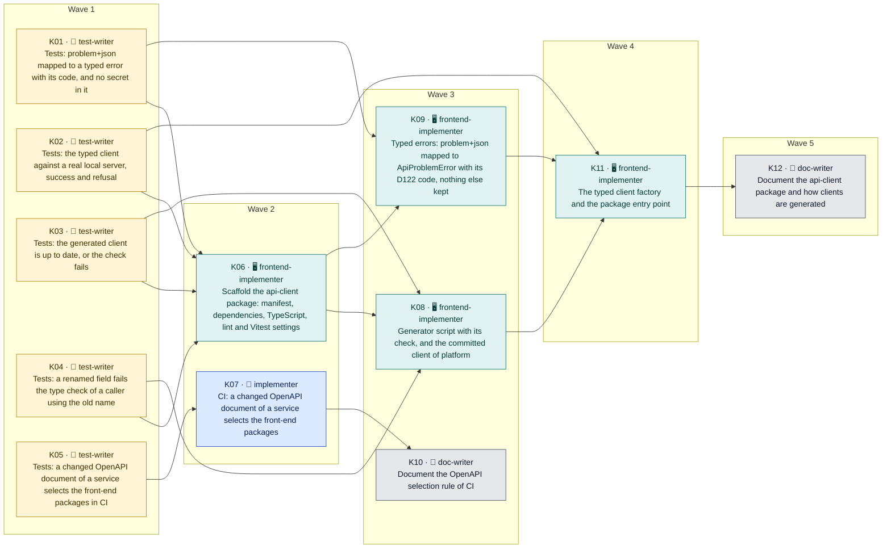

# T0.20: Typed API client package: plan

**Plan:** 🟢 Approved

**Push:** 🟢 Approved

<!-- ticket:specs -->
## 📚 Specifications

The specification and design pages of [TICKET.md](TICKET.md), copied by `python3 .claude/scripts/tickets/ticket_refs.py sync`.

- [Back end](../../technical/architecture/backend.md)
- [📜 D406](../../specs/06-decisions/technical/d406-back-end.md)
- [📌 REQ-T05-03](../../specs/03-technical/t05-api-and-webhooks/requirements/req-t05-03-problem-json.md)
- [📜 D122](../../specs/06-decisions/ux/d122-error-message-standard.md)
- [📜 D438: Repository layout](../../specs/06-decisions/technical/d438-repository-layout.md)
- [📜 D407: Front end](../../specs/06-decisions/technical/d407-front-end.md)
- [📌 REQ-T05-01: REST with OpenAPI behind one gateway](../../specs/03-technical/t05-api-and-webhooks/requirements/req-t05-01-rest-openapi.md)
- [📌 REQ-T05-05: Contracts tested](../../specs/03-technical/t05-api-and-webhooks/requirements/req-t05-05-contract-tests.md)
- [🔌 I-T05-02: OpenAPI registry](../../specs/03-technical/t05-api-and-webhooks/interfaces/i-t05-02-openapi-registry.md)
- [🏗️ Front end](../../technical/architecture/frontend.md)
- [🏗️ API](../../technical/interfaces/api.md)
<!-- /ticket:specs -->

## Summary

T0.20 builds `frontend/packages/api-client`, a TypeScript package. It generates types from the OpenAPI document of `platform` that T0.18 committed, using openapi-typescript (MIT), and wraps openapi-fetch (MIT) in a typed client. A refused call rejects with a typed error that keeps only an allow-list of fields (D122 code and HTTP status), so no secret can reach it. A Vitest test fails when the committed client no longer matches the document. CI's change detection is also extended so that a change to a service's committed OpenAPI document alone runs the front-end packages' checks.

There are 12 tasks in 5 waves. Wave 1 has 5 test-writers: problem mapping, client against a real local HTTP server, stale-client check, renamed field caught by tsc, and detect_changes cases. Wave 2 has the package scaffold, which alone owns `pnpm-lock.yaml`, and the detect_changes implementation. Wave 3 has the generator with the committed `src/generated/platform.ts`, the typed errors and the CI page. Wave 4 has the client factory and `src/index.ts`. Wave 5 has the package README and the API page.

The ticket lists no screen ("No screen"), so no Playwright task is needed (TKT-21).

## Assumptions

- The roadmap row names no generator tool, so the plan chooses one that respects D406 and the licences; the ticket fixes none.
- The problem+json field carrying the D122 code is taken from T0.14 and T0.18, not invented here.
- Criterion 4 reads REQ-T05-03 criterion 2 (no secret in an error) as applying to the typed error the client builds.
- The roadmap lists no use case, business rule or entity for this ticket, so the criteria cite requirements.
- No screen: the package is a library with no UI; the error on screen is T0.23.
- I did not run check_ticket.py. The workflow runs it next. docs/tickets/T0.20/tests-evidences/.gitkeep holds the empty evidences folder.
- T0.18 committed the platform OpenAPI document somewhere in `backend/services/platform`, but its path is not specified yet. The workers find it with `git ls-files backend/services/platform | grep -i openapi` once T0.18 is merged (the start rule makes it a prerequisite). They do not invent it.
- The problem+json body member that carries the D122 code is the one T0.14's handler writes. The workers read it from the delivered code, and report `blocked` if no member carries a code (TICKET assumption 2).
- Generator choice: openapi-typescript for the types plus openapi-fetch for the typed calls. Both are MIT, compatible with AGPL-3.0 (D415, supply chain page) and lightweight. The specifications name no tool (TICKET assumption 1).
- Criterion 4 is met by an allow-list. The typed error keeps only the D122 code and the HTTP status: no `detail`, `title`, `instance`, extension members, headers or request. Showing title, why and action on screen is T0.23's work, and highlighting the faulty field (D122 item 4) is left as a follow-up.
- A failure response that is not problem+json, or has no code, gives a distinct `ApiUnexpectedResponseError` carrying only the status. This avoids inventing a fallback D122 code.
- The stale check runs as a Vitest test in the package's `test` script, which CI's `typescript.yml` already runs. It is also available as `check:generated`. Nothing is built: the package is consumed as source through `exports` pointing at `src/index.ts`.
- The generated file is formatted with the workspace's prettier configuration, so the editor hook `.claude/hooks/formatters.json` (prettier on `frontend/**/*.ts`) leaves it unchanged and the check stays stable.
- Without a CI change, a pull request that only regenerates `platform`'s document would select `platform` alone, and the stale client would pass. So `.github/scripts/detect_changes.py` and `tests/ci/detect_changes/` are changed (K05, K07). The ticket graph gives T0.20 only the area `frontend/packages/api-client`, so the start rule does not lock `.github` or `tests/ci` for this ticket. Another open ticket on those files could conflict.
- AGENT.md's CI/CD list of shared paths is not updated: no agent of the plan owns AGENT.md. `docs/technical/delivery/ci-cd-and-stages.md` records the new rule instead, and updating AGENT.md is a follow-up.
- The package is `@simpleerp/api-client`: every npm package of SimpleERP uses the `@simpleerp` scope (owner decision, 2026-11-27). `pnpm-workspace.yaml` (T0.01) is assumed to include `frontend/packages/*`. If it does not, K06 reports `blocked`.
- Vitest unit tests live in `frontend/packages/api-client/tests/`, mirroring `src/`, which matches the hooks' `tests/` pattern. Playwright is not needed because the ticket builds no screen (TICKET.md: "No screen").

<!-- plan:graph -->

> [!NOTE]
> Generated from the json block at the end of this page by `python3 .claude/scripts/tickets/plan.py render`.
> To change a task, edit the json block, then render again: never edit this view by hand.

## Waves

| Wave | Tasks | Agents running at once |
| --- | --- | --- |
| 1 | [K01](#k01), [K02](#k02), [K03](#k03), [K04](#k04), [K05](#k05) | 5 of 5 |
| 2 | [K06](#k06), [K07](#k07) | 2 of 2 |
| 3 | [K08](#k08), [K09](#k09), [K10](#k10) | 3 of 3 |
| 4 | [K11](#k11) | 1 of 1 |
| 5 | [K12](#k12) | 1 of 1 |

| Wave | Task | Agent | Depends on | Unblocks |
| --- | --- | --- | --- | --- |
| 1 | [K01](#k01) Tests: problem+json mapped to a typed error with its code, and no secret in it | 🧪 test-writer | none | [K06](#k06), [K09](#k09) |
| 1 | [K02](#k02) Tests: the typed client against a real local server, success and refusal | 🧪 test-writer | none | [K06](#k06), [K11](#k11) |
| 1 | [K03](#k03) Tests: the generated client is up to date, or the check fails | 🧪 test-writer | none | [K06](#k06), [K08](#k08) |
| 1 | [K04](#k04) Tests: a renamed field fails the type check of a caller using the old name | 🧪 test-writer | none | [K06](#k06), [K08](#k08) |
| 1 | [K05](#k05) Tests: a changed OpenAPI document of a service selects the front-end packages in CI | 🧪 test-writer | none | [K07](#k07) |
| 2 | [K06](#k06) Scaffold the api-client package: manifest, dependencies, TypeScript, lint and Vitest settings | 🖥️ frontend-implementer | [K01](#k01), [K02](#k02), [K03](#k03), [K04](#k04) | [K08](#k08), [K09](#k09) |
| 2 | [K07](#k07) CI: a changed OpenAPI document of a service selects the front-end packages | 🐍 implementer | [K05](#k05) | [K10](#k10) |
| 3 | [K08](#k08) Generator script with its check, and the committed client of platform | 🖥️ frontend-implementer | [K03](#k03), [K04](#k04), [K06](#k06) | [K11](#k11) |
| 3 | [K09](#k09) Typed errors: problem+json mapped to ApiProblemError with its D122 code, nothing else kept | 🖥️ frontend-implementer | [K01](#k01), [K06](#k06) | [K11](#k11) |
| 3 | [K10](#k10) Document the OpenAPI selection rule of CI | 📝 doc-writer | [K07](#k07) | none |
| 4 | [K11](#k11) The typed client factory and the package entry point | 🖥️ frontend-implementer | [K02](#k02), [K08](#k08), [K09](#k09) | [K12](#k12) |
| 5 | [K12](#k12) Document the api-client package and how clients are generated | 📝 doc-writer | [K11](#k11) | none |

## Dependency graph



## Tasks

### <a id="k01"></a>K01: Tests: problem+json mapped to a typed error with its code, and no secret in it

| Agent | Wave | Depends on | Unblocks |
| --- | --- | --- | --- |
| 🧪 test-writer | 1 | none | [K06](#k06), [K09](#k09) |

**Files** (only this task may change them in its wave):

- `frontend/packages/api-client/tests/problem/to-api-error.test.ts`
- `frontend/packages/api-client/tests/problem/api-problem-error.test.ts`

**Done when:** Both test files exist and cover every case above. Once K06 and K09 are integrated, `pnpm --filter ./frontend/packages/api-client exec vitest run tests/problem` passes. Before that it fails only because `src/problem/` is missing.

**Brief:**

Write the Vitest unit tests for the error mapping of the typed API client of T0.20. They are TypeScript tests (the Python rules of AGENT.md do not apply), named as sentences, in one `describe` block per file, run in the node environment.

Specifications applied: [REQ-T05-03](docs/specs/03-technical/t05-api-and-webhooks/requirements/req-t05-03-problem-json.md) (criterion 1: a refused call gives a problem+json body with its code; criterion 2: no secret in an error), [D122](docs/specs/06-decisions/ux/d122-error-message-standard.md) and its [error messages pattern](docs/specs/04-ux/design-system/patterns/error-messages.md) (the support reference code), [API](docs/technical/interfaces/api.md) (`application/problem+json` errors carrying the D122 codes), [D407](docs/specs/06-decisions/technical/d407-front-end.md) (TypeScript). Ticket: docs/tickets/T0.20/TICKET.md, criteria 3 and 4.

**The error code member:** read the problem+json handler that T0.14 delivered in `backend/services/platform/src/` (and the problem schema in the OpenAPI document of T0.18, if it has one) to find the name of the body member that carries the D122 code. Do not invent it. If no member carries a code, report `blocked` and say so.

**The interface under test** (fixed by the plan, implemented by K09 in `src/problem/`):
- `toApiError(status: number, contentType: string | null, body: unknown): ApiProblemError | ApiUnexpectedResponseError`, exported from `src/problem/to-api-error.ts`.
- `ApiProblemError extends Error` (`src/problem/api-problem-error.ts`): `name === 'ApiProblemError'`, readonly `code: string` (the D122 code, trimmed) and readonly `status: number` (the HTTP status of the response, never the body's `status`). It has no other own enumerable fields.
- `ApiUnexpectedResponseError extends Error` (`src/problem/api-unexpected-response-error.ts`): `name === 'ApiUnexpectedResponseError'`, readonly `status: number` only.

Cases to cover in to-api-error.test.ts:
- An `application/problem+json` body with a string code gives `ApiProblemError` with that code and the response status. The same holds with `; charset=utf-8` and with upper-case content types.
- A code with surrounding spaces is trimmed.
- The following give `ApiUnexpectedResponseError` with the status and nothing from the body: a missing, empty, blank or non-string code; a body that is not an object (string, array, null); a content type that is not problem+json (`application/json`, `text/html`, null).
- **No secret (criterion 4):** take a problem+json body that also holds `detail: 'password=hunter2'`, `token: 'eyJ-secret'`, `authorization: 'Bearer s3cr3t'`, `stack`, `instance: '/v1/x?api_key=k3y'` and `title`. Neither `JSON.stringify(error)`, `String(error)`, `error.message`, `Object.values(error)` nor `Object.keys(error)` may contain any of those values. Use `it.each` for the secrets.

Cases to cover in api-problem-error.test.ts:
- Both classes are `instanceof Error` and of their own class.
- Their `message` names the code and the status (resp. the status) and nothing else from the body.
- The fields are read-only at the type level, using `// @ts-expect-error` on an assignment.

Import from the source files by relative path (`../../src/problem/to-api-error`). The package is scaffolded in wave 2 (K06), so these tests are expected to fail until K09 exists.

### <a id="k02"></a>K02: Tests: the typed client against a real local server, success and refusal

| Agent | Wave | Depends on | Unblocks |
| --- | --- | --- | --- |
| 🧪 test-writer | 1 | none | [K06](#k06), [K11](#k11) |

**Files** (only this task may change them in its wave):

- `frontend/packages/api-client/tests/client/create-api-client.test.ts`
- `frontend/packages/api-client/tests/helpers/problem-server.ts`

**Done when:** Both files exist and cover the cases above. Once K06, K08, K09 and K11 are integrated, `pnpm --filter ./frontend/packages/api-client exec vitest run tests/client` passes.

**Brief:**

Write the Vitest tests of the typed client of T0.20 end to end, against a real local HTTP server (AGENT.md "Tests": prefer real things to mocks; no mock of `fetch`).

Specifications applied: [D406](docs/specs/06-decisions/technical/d406-back-end.md) (clients generated from the OpenAPI), [REQ-T05-01](docs/specs/03-technical/t05-api-and-webhooks/requirements/req-t05-01-rest-openapi.md) (the OpenAPI as the source of the client), [REQ-T05-03](docs/specs/03-technical/t05-api-and-webhooks/requirements/req-t05-03-problem-json.md) (criteria 1 and 2), [D122](docs/specs/06-decisions/ux/d122-error-message-standard.md), [API](docs/technical/interfaces/api.md) (`/v1`, problem+json). Ticket: docs/tickets/T0.20/TICKET.md, criteria 3 and 4.

`tests/helpers/problem-server.ts` holds one helper class, `ProblemServer`, built on `node:http`. It listens on `127.0.0.1` port 0, answers each request with a status, content type and body given by the test, records the requests it received (method, path, headers), and exposes `url` and `close()`.

**The interface under test** (fixed by the plan, implemented by K11): `createApiClient(options: { baseUrl: string; headers?: HeadersInit; fetch?: typeof fetch })` exported from `src/index.ts`. It returns an openapi-fetch client typed by the generated `paths` of `platform`. On a non-2xx response its calls reject with `ApiProblemError` or `ApiUnexpectedResponseError`, as `toApiError` maps them (see K01). `src/index.ts` also exports `ApiProblemError`, `ApiUnexpectedResponseError`, `toApiError` and the generated `paths` type of platform.

Use the health endpoint under `/v1` that T0.14 delivered: read its exact path and response from the OpenAPI document that T0.18 committed in `backend/services/platform` (`git ls-files backend/services/platform | grep -i openapi`). Do not invent it.

Cases to cover:
- A 200 on the health path resolves with the typed `data`.
- A 4xx `application/problem+json` body with the code member (the name T0.14's handler writes) rejects with `ApiProblemError` carrying that code and the HTTP status.
- A 500 `text/html` rejects with `ApiUnexpectedResponseError` with status 500.
- The client sends the given headers to the server.
- **No secret (criterion 4):** a call made with `headers: { Authorization: 'Bearer s3cr3t-token' }` that is refused with a problem+json body also holding `detail`, `token` and `instance` secrets gives an error whose `JSON.stringify`, `String`, `message` and `Object.values` contain neither the token nor the body's secrets.

Close the server in `afterEach`.

### <a id="k03"></a>K03: Tests: the generated client is up to date, or the check fails

| Agent | Wave | Depends on | Unblocks |
| --- | --- | --- | --- |
| 🧪 test-writer | 1 | none | [K06](#k06), [K08](#k08) |

**Files** (only this task may change them in its wave):

- `frontend/packages/api-client/tests/generate/check-generated.test.ts`
- `frontend/packages/api-client/tests/fixtures/check/openapi-v1.json`
- `frontend/packages/api-client/tests/fixtures/check/openapi-v2.json`

**Done when:** The three files exist and cover the cases above. Once K06 and K08 are integrated, `pnpm --filter ./frontend/packages/api-client exec vitest run tests/generate/check-generated.test.ts` passes.

**Brief:**

Write the Vitest tests proving that a stale generated client fails the check (ticket criterion 1). They run the generator script as a child process (`node:child_process` `spawnSync`, using `process.execPath`), in temporary folders (`node:fs` `mkdtempSync` under `os.tmpdir()`).

Specifications applied: [REQ-T05-01](docs/specs/03-technical/t05-api-and-webhooks/requirements/req-t05-01-rest-openapi.md) (each service publishes an OpenAPI generated from its code, the source of the client), [REQ-T05-05](docs/specs/03-technical/t05-api-and-webhooks/requirements/req-t05-05-contract-tests.md) (contracts checked in CI), [D406](docs/specs/06-decisions/technical/d406-back-end.md) (clients generated from the OpenAPI), [I-T05-02](docs/specs/03-technical/t05-api-and-webhooks/interfaces/i-t05-02-openapi-registry.md), [Back end](docs/technical/architecture/backend.md) (Contracts: one change updates all). Ticket: docs/tickets/T0.20/TICKET.md, criterion 1.

**The script interface** (fixed by the plan, implemented by K08): `node scripts/generate.mjs --input <openapi.json> --output <file.ts> [--check]`, run from the package folder.
- Without `--check`, it writes the types that openapi-typescript generates from the input, formatted with the workspace's prettier configuration for the output path, and exits 0.
- With `--check`, it writes nothing. It exits 0 when the output file equals what it would write. Otherwise it exits 1 with a message on stderr that names the stale output file and the command that regenerates it (`pnpm --filter ./frontend/packages/api-client run generate`). It also exits 1 when the output file is missing.
- A missing or unreadable input, or a bad argument, exits 2 with a message on stderr.

Fixtures: two small valid OpenAPI 3.1 documents. `openapi-v1.json` has one `GET /v1/items` returning an object with a `name` string. `openapi-v2.json` is the same with one more property.

Cases to cover:
- Generating v1 then checking v1 exits 0.
- Generating v1 then checking v2 exits 1, names the output file and leaves it unchanged.
- Checking against a missing output exits 1.
- Generating twice gives the same bytes (deterministic).
- A missing input exits 2.
- **The committed client is up to date:** `--check` with the real OpenAPI document of `platform` that T0.18 committed (find its path with `git ls-files backend/services/platform | grep -i openapi`) and `src/generated/platform.ts` exits 0.

### <a id="k04"></a>K04: Tests: a renamed field fails the type check of a caller using the old name

| Agent | Wave | Depends on | Unblocks |
| --- | --- | --- | --- |
| 🧪 test-writer | 1 | none | [K06](#k06), [K08](#k08) |

**Files** (only this task may change them in its wave):

- `frontend/packages/api-client/tests/generate/renamed-field.test.ts`
- `frontend/packages/api-client/tests/fixtures/renamed/openapi-before.json`
- `frontend/packages/api-client/tests/fixtures/renamed/openapi-after.json`

**Done when:** The three files exist. Once K06 and K08 are integrated, `pnpm --filter ./frontend/packages/api-client exec vitest run tests/generate/renamed-field.test.ts` passes.

**Brief:**

Write the Vitest test proving ticket criterion 2: a field renamed in the OpenAPI document, with the client regenerated, makes the type check of a caller that still uses the old name fail.

Specifications applied: [REQ-T05-05](docs/specs/03-technical/t05-api-and-webhooks/requirements/req-t05-05-contract-tests.md) (breaking changes caught), [D406](docs/specs/06-decisions/technical/d406-back-end.md) (clients generated from the OpenAPI), [D407](docs/specs/06-decisions/technical/d407-front-end.md) (strict TypeScript). Ticket: docs/tickets/T0.20/TICKET.md, criterion 2.

Fixtures: two small valid OpenAPI 3.1 documents. Both have `GET /v1/items/{id}` returning an object with a required string property. It is named `displayName` in `openapi-before.json` and `label` in `openapi-after.json`; nothing else differs.

The test works in a temporary folder:
1. It runs `node scripts/generate.mjs --input <fixture> --output <tmp>/schema.ts` (the interface fixed in K03's brief, implemented by K08).
2. It writes a small caller `<tmp>/caller.ts` that imports `paths` from `./schema` and reads the property of the 200 response, typed `paths['/v1/items/{id}']['get']['responses'][200]['content']['application/json']`.
3. It writes a strict `tsconfig.json` (`strict`, `noEmit`, `module`/`moduleResolution` `NodeNext` or `Bundler`).
4. It runs the package's TypeScript compiler (`node_modules/typescript/bin/tsc -p <tmp>`) as a child process.

Cases to cover, with `it.each` where they share a shape:
- The caller using `displayName` against the before-schema compiles (exit 0). This is the control.
- The same caller against the after-schema fails (non-zero exit), and the compiler output names `displayName`.
- A caller using `label` against the after-schema compiles.

Give the test a timeout of at least 60 s, as it spawns tsc.

### <a id="k05"></a>K05: Tests: a changed OpenAPI document of a service selects the front-end packages in CI

| Agent | Wave | Depends on | Unblocks |
| --- | --- | --- | --- |
| 🧪 test-writer | 1 | none | [K07](#k07) |

**Files** (only this task may change them in its wave):

- `tests/ci/detect_changes/test_detect_changes.py`
- `tests/ci/detect_changes/helpers.py`

**Done when:** `uv run pytest tests/ci/detect_changes -n 2` fails only on the new cases before K07, and passes after it. `uv run ruff check tests/ci/detect_changes` and `uv run ruff format --check tests/ci/detect_changes` pass.

**Brief:**

Add pytest cases to `tests/ci/detect_changes/test_detect_changes.py`, and any fixture they need to `helpers.py`, so that a change to a service's committed OpenAPI document runs the checks of the client generated from it. Without this, a pull request that only regenerates the platform document never runs the api-client's stale check (ticket criterion 1). Follow AGENT.md "Tests": one `TestDetectChanges` class, tests named as sentences, `pytest.mark.parametrize` for cases of one behaviour, no mocks, a real temporary repository through `write_repo`.

Specifications applied: [REQ-T05-05](docs/specs/03-technical/t05-api-and-webhooks/requirements/req-t05-05-contract-tests.md) (contract tests run in CI), [REQ-T05-01](docs/specs/03-technical/t05-api-and-webhooks/requirements/req-t05-01-rest-openapi.md), [D406](docs/specs/06-decisions/technical/d406-back-end.md) (one change updates all the generated clients), [D438](docs/specs/06-decisions/technical/d438-repository-layout.md) (the layout `detect_changes.py` reads). Ticket: docs/tickets/T0.20/TICKET.md, criterion 1 and "What it delivers" (CI fails when the client is stale).

**The rule under test** (fixed by the plan, implemented by K07 in `.github/scripts/detect_changes.py`): a changed path `backend/services/<service>/<document>` selects what a change under `frontend/packages/` selects. `<document>` is the committed OpenAPI document, with the same relative path inside the service as the one T0.18 committed for `platform` (`git ls-files backend/services/platform | grep -i openapi`). That means every front-end project with a `package.json` and every front-end image, plus the service itself and its image as before. Read the existing helpers first and reuse them.

Cases to cover:
- A change to only that document of one service selects that service and its image, every TypeScript project and every front-end image.
- The same document name elsewhere in the service (for example under `tests/`) does not select the front ends.
- Another file of the service still selects only the service. The existing test of that behaviour must keep passing.
- With no front-end project, nothing extra is selected.

### <a id="k06"></a>K06: Scaffold the api-client package: manifest, dependencies, TypeScript, lint and Vitest settings

| Agent | Wave | Depends on | Unblocks |
| --- | --- | --- | --- |
| 🖥️ frontend-implementer | 2 | [K01](#k01), [K02](#k02), [K03](#k03), [K04](#k04) | [K08](#k08), [K09](#k09) |

**Files** (only this task may change them in its wave):

- `frontend/packages/api-client/package.json`
- `frontend/packages/api-client/tsconfig.json`
- `frontend/packages/api-client/eslint.config.js`
- `frontend/packages/api-client/vitest.config.ts`
- `frontend/packages/api-client/src/index.ts`
- `pnpm-lock.yaml`

**Done when:** `pnpm install --frozen-lockfile` succeeds. `pnpm --filter ./frontend/packages/api-client run lint` and `pnpm --filter ./frontend/packages/api-client run typecheck` pass, ignoring only the errors in the test files of K01 to K04 that import modules not written yet. `pnpm --filter ./frontend/packages/api-client exec vitest --version` prints a version.

**Brief:**

Create the pnpm package `frontend/packages/api-client`, which the tests of K01 to K04 run in.

Specifications applied: [D438](docs/specs/06-decisions/technical/d438-repository-layout.md) (shared TypeScript packages under `frontend/packages/<pkg>`), [D407](docs/specs/06-decisions/technical/d407-front-end.md) and [Front end](docs/technical/architecture/frontend.md) (Vue 3, TypeScript, Vite), [D406](docs/specs/06-decisions/technical/d406-back-end.md) (clients generated from the OpenAPI), [Supply chain and licences](docs/technical/security/supply-chain-and-licences.md) (every dependency pinned in the lock, licences compatible with AGPL-3.0). Ticket: docs/tickets/T0.20/TICKET.md.

**package.json:**
- The name is `@simpleerp/api-client` (the `@simpleerp` scope of every npm package). It is `private`, `type: module`, and its `exports`/`types` point at `./src/index.ts`, so the Vite apps consume the source and nothing is built.
- `dependencies`: `openapi-fetch` (MIT), with an exact version.
- `devDependencies`, with exact versions: `openapi-typescript` (MIT), `typescript`, `vitest`, `@types/node`, `prettier` if the workspace root does not provide it, and the shared config package as `workspace:*`.
- `scripts`:
  - `lint`: `eslint .`
  - `typecheck`: `tsc --noEmit`
  - `test`: `vitest run`
  - `generate`: `node scripts/generate.mjs --input ../../../backend/services/platform/<doc> --output src/generated/platform.ts`
  - `check:generated`: the same with `--check`
  - `<doc>` is the OpenAPI document T0.18 committed: `git ls-files backend/services/platform | grep -i openapi`.

**Settings:**
- `tsconfig.json` extends the strict settings of `frontend/packages/config` and includes `src`, `tests` and `scripts`. It excludes `tests/fixtures`.
- `eslint.config.js` uses the shared eslint settings and ignores `src/generated/`.
- `vitest.config.ts` uses the node environment, includes `tests/**/*.test.ts` and sets a test timeout of 60 s.
- `src/index.ts` is a placeholder (`export {};`) that K11 replaces.

**Lock file:** run `pnpm install` so that `pnpm-lock.yaml` gains the new importer. Do not edit the lock file by hand. Check that `pnpm-workspace.yaml` already includes `frontend/packages/*` (T0.01). If it does not, report it as `blocked` rather than editing it.

Record the choice of openapi-typescript with openapi-fetch against the alternatives (openapi-generator, orval, @hey-api/openapi-ts) as an implementation decision in your result.

### <a id="k07"></a>K07: CI: a changed OpenAPI document of a service selects the front-end packages

| Agent | Wave | Depends on | Unblocks |
| --- | --- | --- | --- |
| 🐍 implementer | 2 | [K05](#k05) | [K10](#k10) |

**Files** (only this task may change them in its wave):

- `.github/scripts/detect_changes.py`

**Done when:** `uv run pytest tests/ci/detect_changes -n 2` passes. `uv run ruff check .github/scripts/detect_changes.py` and `uv run ruff format --check .github/scripts/detect_changes.py` pass.

**Brief:**

Extend `.github/scripts/detect_changes.py` so that a changed committed OpenAPI document of a service selects what a change under `frontend/packages/` selects: every front-end project with a `package.json` and every front-end image, besides the service and its image. The api-client's stale check (Vitest, K03) then runs on a pull request that only regenerates the document.

Specifications applied: [REQ-T05-05](docs/specs/03-technical/t05-api-and-webhooks/requirements/req-t05-05-contract-tests.md) (contracts checked in CI), [REQ-T05-01](docs/specs/03-technical/t05-api-and-webhooks/requirements/req-t05-01-rest-openapi.md), [D406](docs/specs/06-decisions/technical/d406-back-end.md), [D438](docs/specs/06-decisions/technical/d438-repository-layout.md). Ticket: docs/tickets/T0.20/TICKET.md, criterion 1.

The document's path inside a service is the one T0.18 committed for `platform` (`git ls-files backend/services/platform | grep -i openapi`). Match `backend/services/<service>/<that relative path>` for any service, so that later services are covered with no change, and keep the rule a named module constant like the script's others.

Update the module docstring to state the new rule. Keep the five output lines and their order unchanged. Do not touch the workflows.

### <a id="k08"></a>K08: Generator script with its check, and the committed client of platform

| Agent | Wave | Depends on | Unblocks |
| --- | --- | --- | --- |
| 🖥️ frontend-implementer | 3 | [K03](#k03), [K04](#k04), [K06](#k06) | [K11](#k11) |

**Files** (only this task may change them in its wave):

- `frontend/packages/api-client/scripts/generate.mjs`
- `frontend/packages/api-client/src/generated/platform.ts`

**Done when:** `pnpm --filter ./frontend/packages/api-client exec vitest run tests/generate` passes. `pnpm --filter ./frontend/packages/api-client run check:generated` exits 0, and `pnpm --filter ./frontend/packages/api-client run lint` passes.

**Brief:**

Write `scripts/generate.mjs`, an ES module for Node 22 annotated with JSDoc types, then run it to commit `src/generated/platform.ts`.

Specifications applied: [D406](docs/specs/06-decisions/technical/d406-back-end.md) (clients generated from the OpenAPI), [REQ-T05-01](docs/specs/03-technical/t05-api-and-webhooks/requirements/req-t05-01-rest-openapi.md), [REQ-T05-05](docs/specs/03-technical/t05-api-and-webhooks/requirements/req-t05-05-contract-tests.md), [I-T05-02](docs/specs/03-technical/t05-api-and-webhooks/interfaces/i-t05-02-openapi-registry.md), [Back end](docs/technical/architecture/backend.md) (Contracts). Ticket: docs/tickets/T0.20/TICKET.md, criteria 1 and 2.

**Interface** (fixed by the plan, tested by K03 and K04): `node scripts/generate.mjs --input <openapi.json> --output <file.ts> [--check]`.
- It generates the types with openapi-typescript's Node API (`openapiTS` and `astToString`), behind a header line saying the file is generated and naming the regenerate command.
- It formats them with prettier's API, using `resolveConfig` for the output path, so that the editor hook's prettier run leaves the file unchanged.
- Without `--check`, it writes the file (creating its folder) and exits 0.
- With `--check`, it writes nothing. It exits 0 when the file equals the generated text. Otherwise, or when the file is missing, it exits 1 with a stderr message naming the stale file and `pnpm --filter ./frontend/packages/api-client run generate`.
- A missing or unreadable input, or a bad or missing argument, exits 2 with a usage message on stderr.
- The output is deterministic: no date or absolute path in it.

Then run `pnpm --filter ./frontend/packages/api-client run generate` and keep the resulting `src/generated/platform.ts`. Never edit it by hand.

### <a id="k09"></a>K09: Typed errors: problem+json mapped to ApiProblemError with its D122 code, nothing else kept

| Agent | Wave | Depends on | Unblocks |
| --- | --- | --- | --- |
| 🖥️ frontend-implementer | 3 | [K01](#k01), [K06](#k06) | [K11](#k11) |

**Files** (only this task may change them in its wave):

- `frontend/packages/api-client/src/problem/api-problem-error.ts`
- `frontend/packages/api-client/src/problem/api-unexpected-response-error.ts`
- `frontend/packages/api-client/src/problem/to-api-error.ts`

**Done when:** `pnpm --filter ./frontend/packages/api-client exec vitest run tests/problem` passes. `pnpm --filter ./frontend/packages/api-client run lint` and `pnpm --filter ./frontend/packages/api-client run typecheck` report no error in `src/problem/`.

**Brief:**

Implement the typed errors of the client in `src/problem/`, one class per file.

Specifications applied: [REQ-T05-03](docs/specs/03-technical/t05-api-and-webhooks/requirements/req-t05-03-problem-json.md) (criterion 1: problem+json with its code; criterion 2: no secret in an error), [D122](docs/specs/06-decisions/ux/d122-error-message-standard.md) and its [error messages pattern](docs/specs/04-ux/design-system/patterns/error-messages.md) (the support reference code), [API](docs/technical/interfaces/api.md). Ticket: docs/tickets/T0.20/TICKET.md, criteria 3 and 4.

**Interface** (fixed by the plan, tested by K01):
- `ApiProblemError extends Error`: `name = 'ApiProblemError'`, readonly `code: string` and readonly `status: number`. The message is a short English sentence naming the code and the status.
- `ApiUnexpectedResponseError extends Error`: `name = 'ApiUnexpectedResponseError'`, readonly `status: number`.
- `toApiError(status, contentType, body)`:
  - It returns `ApiProblemError` when the content type's media type is `application/problem+json` (case-insensitive, parameters ignored), the body is a plain object, and the code member is a non-blank string. The code is trimmed.
  - In every other case it returns `ApiUnexpectedResponseError`.
  - The status is always the HTTP status argument.

The code member is the body member that T0.14's problem+json handler in `backend/services/platform/src/` writes. Read it there and keep its name as one exported constant in `to-api-error.ts`.

**Allow-list (criterion 4):** the errors copy the code and the status only. They never keep the body, `detail`, `title`, `instance`, extension members, headers or the request, as own or inherited fields, in the message or in a `cause`. This is how no secret can reach them.

The code shown on screen with its title, why and action is T0.23's work, not this task's.

### <a id="k10"></a>K10: Document the OpenAPI selection rule of CI

| Agent | Wave | Depends on | Unblocks |
| --- | --- | --- | --- |
| 📝 doc-writer | 3 | [K07](#k07) | none |

**Files** (only this task may change them in its wave):

- `docs/technical/delivery/ci-cd-and-stages.md`

**Done when:** The page states the rule with the document path that `.github/scripts/detect_changes.py` matches, and `git diff docs/technical/delivery/ci-cd-and-stages.md` shows only that addition.

**Brief:**

In `docs/technical/delivery/ci-cd-and-stages.md`, next to the sentence "A change in `backend/models/`, `backend/shared/`, `frontend/packages/` ... selects every service and front end", add one or two sentences. They say that a change to a service's committed OpenAPI document also selects every front-end project and front-end image, so that the stale check of the generated client in `frontend/packages/api-client` runs (T0.20).

Specifications applied: [REQ-T05-05](docs/specs/03-technical/t05-api-and-webhooks/requirements/req-t05-05-contract-tests.md), [D406](docs/specs/06-decisions/technical/d406-back-end.md), [D438](docs/specs/06-decisions/technical/d438-repository-layout.md). Ticket: docs/tickets/T0.20/TICKET.md.

Read `.github/scripts/detect_changes.py` as K07 left it, and state the exact document path it matches. Write plain British English with no em dashes. Change nothing else in the page.

### <a id="k11"></a>K11: The typed client factory and the package entry point

| Agent | Wave | Depends on | Unblocks |
| --- | --- | --- | --- |
| 🖥️ frontend-implementer | 4 | [K02](#k02), [K08](#k08), [K09](#k09) | [K12](#k12) |

**Files** (only this task may change them in its wave):

- `frontend/packages/api-client/src/client/create-api-client.ts`
- `frontend/packages/api-client/src/index.ts`

**Done when:** `pnpm --filter ./frontend/packages/api-client run test`, `pnpm --filter ./frontend/packages/api-client run lint` and `pnpm --filter ./frontend/packages/api-client run typecheck` pass.

**Brief:**

Implement `createApiClient` in `src/client/create-api-client.ts`, and replace the placeholder `src/index.ts` with the package's public exports.

Specifications applied: [D406](docs/specs/06-decisions/technical/d406-back-end.md) (clients generated from the OpenAPI), [REQ-T05-01](docs/specs/03-technical/t05-api-and-webhooks/requirements/req-t05-01-rest-openapi.md) (`/v1`), [REQ-T05-03](docs/specs/03-technical/t05-api-and-webhooks/requirements/req-t05-03-problem-json.md) (criteria 1 and 2), [D122](docs/specs/06-decisions/ux/d122-error-message-standard.md), [API](docs/technical/interfaces/api.md), [D407](docs/specs/06-decisions/technical/d407-front-end.md). Ticket: docs/tickets/T0.20/TICKET.md, criteria 2, 3 and 4.

**Interface** (fixed by the plan, tested by K02):
- `createApiClient(options: { baseUrl: string; headers?: HeadersInit; fetch?: typeof fetch })` returns an openapi-fetch `createClient<paths>` typed by `paths` from `src/generated/platform.ts`, so a renamed field breaks the callers' type check.
- An openapi-fetch middleware's `onResponse` makes every non-2xx response reject with `toApiError(response.status, response.headers.get('content-type'), body)` from `src/problem/to-api-error.ts`. The body is read as JSON only when the media type is problem+json, and the error is built from the status, the content type and that body only.
- The thrown error never references the `Request`, its headers (such as `Authorization`) or the `Response`.

`src/index.ts` exports `createApiClient`, `ApiProblemError`, `ApiUnexpectedResponseError`, `toApiError`, the code member constant and the generated `paths` type of platform (as a named type export, for example `PlatformPaths`).

### <a id="k12"></a>K12: Document the api-client package and how clients are generated

| Agent | Wave | Depends on | Unblocks |
| --- | --- | --- | --- |
| 📝 doc-writer | 5 | [K11](#k11) | none |

**Files** (only this task may change them in its wave):

- `frontend/packages/api-client/README.md`
- `docs/technical/interfaces/api.md`

**Done when:** The README exists with those sections, and its commands match the `scripts` of `frontend/packages/api-client/package.json`. `git diff docs/technical/interfaces/api.md` shows only the added client lines.

**Brief:**

Write `frontend/packages/api-client/README.md` and add a short client section to `docs/technical/interfaces/api.md`.

Specifications applied: [D406](docs/specs/06-decisions/technical/d406-back-end.md), [REQ-T05-01](docs/specs/03-technical/t05-api-and-webhooks/requirements/req-t05-01-rest-openapi.md), [REQ-T05-03](docs/specs/03-technical/t05-api-and-webhooks/requirements/req-t05-03-problem-json.md), [REQ-T05-05](docs/specs/03-technical/t05-api-and-webhooks/requirements/req-t05-05-contract-tests.md), [D122](docs/specs/06-decisions/ux/d122-error-message-standard.md), [D438](docs/specs/06-decisions/technical/d438-repository-layout.md), [API](docs/technical/interfaces/api.md), [Back end](docs/technical/architecture/backend.md). Ticket: docs/tickets/T0.20/TICKET.md.

The README says:
- what the package is: a client typed from the committed OpenAPI document of `platform`;
- how to use `createApiClient`, with one short example on the health endpoint;
- what a refused call gives: `ApiProblemError` with `code` and `status`, or `ApiUnexpectedResponseError` with `status`, and why nothing else from the body is kept (no secret, REQ-T05-03);
- how to regenerate (`pnpm --filter ./frontend/packages/api-client run generate`) and check (`run check:generated`), and that the Vitest suite and CI fail when the client is stale;
- that `src/generated/` is never edited by hand.

In `api.md`, add a few lines saying that the typed front-end client lives in `frontend/packages/api-client`, is generated from each service's committed OpenAPI document, and maps problem+json errors to a typed error carrying the D122 code. Leave the rest of the page as it is.

Read the delivered code first and state only what it does. Write plain British English with no em dashes.

<!-- /plan:graph -->

## Task graph

<details>
<summary>🤖 Task graph as read by <code>/ticket-run</code> (json)</summary>

```json
[
  {
    "id": "K01",
    "title": "Tests: problem+json mapped to a typed error with its code, and no secret in it",
    "agent": "test-writer",
    "depends_on": [],
    "files": [
      "frontend/packages/api-client/tests/problem/to-api-error.test.ts",
      "frontend/packages/api-client/tests/problem/api-problem-error.test.ts"
    ],
    "brief": "Write the Vitest unit tests for the error mapping of the typed API client of T0.20. They are TypeScript tests (the Python rules of AGENT.md do not apply), named as sentences, in one `describe` block per file, run in the node environment.\n\nSpecifications applied: [REQ-T05-03](docs/specs/03-technical/t05-api-and-webhooks/requirements/req-t05-03-problem-json.md) (criterion 1: a refused call gives a problem+json body with its code; criterion 2: no secret in an error), [D122](docs/specs/06-decisions/ux/d122-error-message-standard.md) and its [error messages pattern](docs/specs/04-ux/design-system/patterns/error-messages.md) (the support reference code), [API](docs/technical/interfaces/api.md) (`application/problem+json` errors carrying the D122 codes), [D407](docs/specs/06-decisions/technical/d407-front-end.md) (TypeScript). Ticket: docs/tickets/T0.20/TICKET.md, criteria 3 and 4.\n\n**The error code member:** read the problem+json handler that T0.14 delivered in `backend/services/platform/src/` (and the problem schema in the OpenAPI document of T0.18, if it has one) to find the name of the body member that carries the D122 code. Do not invent it. If no member carries a code, report `blocked` and say so.\n\n**The interface under test** (fixed by the plan, implemented by K09 in `src/problem/`):\n- `toApiError(status: number, contentType: string | null, body: unknown): ApiProblemError | ApiUnexpectedResponseError`, exported from `src/problem/to-api-error.ts`.\n- `ApiProblemError extends Error` (`src/problem/api-problem-error.ts`): `name === 'ApiProblemError'`, readonly `code: string` (the D122 code, trimmed) and readonly `status: number` (the HTTP status of the response, never the body's `status`). It has no other own enumerable fields.\n- `ApiUnexpectedResponseError extends Error` (`src/problem/api-unexpected-response-error.ts`): `name === 'ApiUnexpectedResponseError'`, readonly `status: number` only.\n\nCases to cover in to-api-error.test.ts:\n- An `application/problem+json` body with a string code gives `ApiProblemError` with that code and the response status. The same holds with `; charset=utf-8` and with upper-case content types.\n- A code with surrounding spaces is trimmed.\n- The following give `ApiUnexpectedResponseError` with the status and nothing from the body: a missing, empty, blank or non-string code; a body that is not an object (string, array, null); a content type that is not problem+json (`application/json`, `text/html`, null).\n- **No secret (criterion 4):** take a problem+json body that also holds `detail: 'password=hunter2'`, `token: 'eyJ-secret'`, `authorization: 'Bearer s3cr3t'`, `stack`, `instance: '/v1/x?api_key=k3y'` and `title`. Neither `JSON.stringify(error)`, `String(error)`, `error.message`, `Object.values(error)` nor `Object.keys(error)` may contain any of those values. Use `it.each` for the secrets.\n\nCases to cover in api-problem-error.test.ts:\n- Both classes are `instanceof Error` and of their own class.\n- Their `message` names the code and the status (resp. the status) and nothing else from the body.\n- The fields are read-only at the type level, using `// @ts-expect-error` on an assignment.\n\nImport from the source files by relative path (`../../src/problem/to-api-error`). The package is scaffolded in wave 2 (K06), so these tests are expected to fail until K09 exists.",
    "done_when": "Both test files exist and cover every case above. Once K06 and K09 are integrated, `pnpm --filter ./frontend/packages/api-client exec vitest run tests/problem` passes. Before that it fails only because `src/problem/` is missing.",
    "wave": 1
  },
  {
    "id": "K02",
    "title": "Tests: the typed client against a real local server, success and refusal",
    "agent": "test-writer",
    "depends_on": [],
    "files": [
      "frontend/packages/api-client/tests/client/create-api-client.test.ts",
      "frontend/packages/api-client/tests/helpers/problem-server.ts"
    ],
    "brief": "Write the Vitest tests of the typed client of T0.20 end to end, against a real local HTTP server (AGENT.md \"Tests\": prefer real things to mocks; no mock of `fetch`).\n\nSpecifications applied: [D406](docs/specs/06-decisions/technical/d406-back-end.md) (clients generated from the OpenAPI), [REQ-T05-01](docs/specs/03-technical/t05-api-and-webhooks/requirements/req-t05-01-rest-openapi.md) (the OpenAPI as the source of the client), [REQ-T05-03](docs/specs/03-technical/t05-api-and-webhooks/requirements/req-t05-03-problem-json.md) (criteria 1 and 2), [D122](docs/specs/06-decisions/ux/d122-error-message-standard.md), [API](docs/technical/interfaces/api.md) (`/v1`, problem+json). Ticket: docs/tickets/T0.20/TICKET.md, criteria 3 and 4.\n\n`tests/helpers/problem-server.ts` holds one helper class, `ProblemServer`, built on `node:http`. It listens on `127.0.0.1` port 0, answers each request with a status, content type and body given by the test, records the requests it received (method, path, headers), and exposes `url` and `close()`.\n\n**The interface under test** (fixed by the plan, implemented by K11): `createApiClient(options: { baseUrl: string; headers?: HeadersInit; fetch?: typeof fetch })` exported from `src/index.ts`. It returns an openapi-fetch client typed by the generated `paths` of `platform`. On a non-2xx response its calls reject with `ApiProblemError` or `ApiUnexpectedResponseError`, as `toApiError` maps them (see K01). `src/index.ts` also exports `ApiProblemError`, `ApiUnexpectedResponseError`, `toApiError` and the generated `paths` type of platform.\n\nUse the health endpoint under `/v1` that T0.14 delivered: read its exact path and response from the OpenAPI document that T0.18 committed in `backend/services/platform` (`git ls-files backend/services/platform | grep -i openapi`). Do not invent it.\n\nCases to cover:\n- A 200 on the health path resolves with the typed `data`.\n- A 4xx `application/problem+json` body with the code member (the name T0.14's handler writes) rejects with `ApiProblemError` carrying that code and the HTTP status.\n- A 500 `text/html` rejects with `ApiUnexpectedResponseError` with status 500.\n- The client sends the given headers to the server.\n- **No secret (criterion 4):** a call made with `headers: { Authorization: 'Bearer s3cr3t-token' }` that is refused with a problem+json body also holding `detail`, `token` and `instance` secrets gives an error whose `JSON.stringify`, `String`, `message` and `Object.values` contain neither the token nor the body's secrets.\n\nClose the server in `afterEach`.",
    "done_when": "Both files exist and cover the cases above. Once K06, K08, K09 and K11 are integrated, `pnpm --filter ./frontend/packages/api-client exec vitest run tests/client` passes.",
    "wave": 1
  },
  {
    "id": "K03",
    "title": "Tests: the generated client is up to date, or the check fails",
    "agent": "test-writer",
    "depends_on": [],
    "files": [
      "frontend/packages/api-client/tests/generate/check-generated.test.ts",
      "frontend/packages/api-client/tests/fixtures/check/openapi-v1.json",
      "frontend/packages/api-client/tests/fixtures/check/openapi-v2.json"
    ],
    "brief": "Write the Vitest tests proving that a stale generated client fails the check (ticket criterion 1). They run the generator script as a child process (`node:child_process` `spawnSync`, using `process.execPath`), in temporary folders (`node:fs` `mkdtempSync` under `os.tmpdir()`).\n\nSpecifications applied: [REQ-T05-01](docs/specs/03-technical/t05-api-and-webhooks/requirements/req-t05-01-rest-openapi.md) (each service publishes an OpenAPI generated from its code, the source of the client), [REQ-T05-05](docs/specs/03-technical/t05-api-and-webhooks/requirements/req-t05-05-contract-tests.md) (contracts checked in CI), [D406](docs/specs/06-decisions/technical/d406-back-end.md) (clients generated from the OpenAPI), [I-T05-02](docs/specs/03-technical/t05-api-and-webhooks/interfaces/i-t05-02-openapi-registry.md), [Back end](docs/technical/architecture/backend.md) (Contracts: one change updates all). Ticket: docs/tickets/T0.20/TICKET.md, criterion 1.\n\n**The script interface** (fixed by the plan, implemented by K08): `node scripts/generate.mjs --input <openapi.json> --output <file.ts> [--check]`, run from the package folder.\n- Without `--check`, it writes the types that openapi-typescript generates from the input, formatted with the workspace's prettier configuration for the output path, and exits 0.\n- With `--check`, it writes nothing. It exits 0 when the output file equals what it would write. Otherwise it exits 1 with a message on stderr that names the stale output file and the command that regenerates it (`pnpm --filter ./frontend/packages/api-client run generate`). It also exits 1 when the output file is missing.\n- A missing or unreadable input, or a bad argument, exits 2 with a message on stderr.\n\nFixtures: two small valid OpenAPI 3.1 documents. `openapi-v1.json` has one `GET /v1/items` returning an object with a `name` string. `openapi-v2.json` is the same with one more property.\n\nCases to cover:\n- Generating v1 then checking v1 exits 0.\n- Generating v1 then checking v2 exits 1, names the output file and leaves it unchanged.\n- Checking against a missing output exits 1.\n- Generating twice gives the same bytes (deterministic).\n- A missing input exits 2.\n- **The committed client is up to date:** `--check` with the real OpenAPI document of `platform` that T0.18 committed (find its path with `git ls-files backend/services/platform | grep -i openapi`) and `src/generated/platform.ts` exits 0.",
    "done_when": "The three files exist and cover the cases above. Once K06 and K08 are integrated, `pnpm --filter ./frontend/packages/api-client exec vitest run tests/generate/check-generated.test.ts` passes.",
    "wave": 1
  },
  {
    "id": "K04",
    "title": "Tests: a renamed field fails the type check of a caller using the old name",
    "agent": "test-writer",
    "depends_on": [],
    "files": [
      "frontend/packages/api-client/tests/generate/renamed-field.test.ts",
      "frontend/packages/api-client/tests/fixtures/renamed/openapi-before.json",
      "frontend/packages/api-client/tests/fixtures/renamed/openapi-after.json"
    ],
    "brief": "Write the Vitest test proving ticket criterion 2: a field renamed in the OpenAPI document, with the client regenerated, makes the type check of a caller that still uses the old name fail.\n\nSpecifications applied: [REQ-T05-05](docs/specs/03-technical/t05-api-and-webhooks/requirements/req-t05-05-contract-tests.md) (breaking changes caught), [D406](docs/specs/06-decisions/technical/d406-back-end.md) (clients generated from the OpenAPI), [D407](docs/specs/06-decisions/technical/d407-front-end.md) (strict TypeScript). Ticket: docs/tickets/T0.20/TICKET.md, criterion 2.\n\nFixtures: two small valid OpenAPI 3.1 documents. Both have `GET /v1/items/{id}` returning an object with a required string property. It is named `displayName` in `openapi-before.json` and `label` in `openapi-after.json`; nothing else differs.\n\nThe test works in a temporary folder:\n1. It runs `node scripts/generate.mjs --input <fixture> --output <tmp>/schema.ts` (the interface fixed in K03's brief, implemented by K08).\n2. It writes a small caller `<tmp>/caller.ts` that imports `paths` from `./schema` and reads the property of the 200 response, typed `paths['/v1/items/{id}']['get']['responses'][200]['content']['application/json']`.\n3. It writes a strict `tsconfig.json` (`strict`, `noEmit`, `module`/`moduleResolution` `NodeNext` or `Bundler`).\n4. It runs the package's TypeScript compiler (`node_modules/typescript/bin/tsc -p <tmp>`) as a child process.\n\nCases to cover, with `it.each` where they share a shape:\n- The caller using `displayName` against the before-schema compiles (exit 0). This is the control.\n- The same caller against the after-schema fails (non-zero exit), and the compiler output names `displayName`.\n- A caller using `label` against the after-schema compiles.\n\nGive the test a timeout of at least 60 s, as it spawns tsc.",
    "done_when": "The three files exist. Once K06 and K08 are integrated, `pnpm --filter ./frontend/packages/api-client exec vitest run tests/generate/renamed-field.test.ts` passes.",
    "wave": 1
  },
  {
    "id": "K05",
    "title": "Tests: a changed OpenAPI document of a service selects the front-end packages in CI",
    "agent": "test-writer",
    "depends_on": [],
    "files": [
      "tests/ci/detect_changes/test_detect_changes.py",
      "tests/ci/detect_changes/helpers.py"
    ],
    "brief": "Add pytest cases to `tests/ci/detect_changes/test_detect_changes.py`, and any fixture they need to `helpers.py`, so that a change to a service's committed OpenAPI document runs the checks of the client generated from it. Without this, a pull request that only regenerates the platform document never runs the api-client's stale check (ticket criterion 1). Follow AGENT.md \"Tests\": one `TestDetectChanges` class, tests named as sentences, `pytest.mark.parametrize` for cases of one behaviour, no mocks, a real temporary repository through `write_repo`.\n\nSpecifications applied: [REQ-T05-05](docs/specs/03-technical/t05-api-and-webhooks/requirements/req-t05-05-contract-tests.md) (contract tests run in CI), [REQ-T05-01](docs/specs/03-technical/t05-api-and-webhooks/requirements/req-t05-01-rest-openapi.md), [D406](docs/specs/06-decisions/technical/d406-back-end.md) (one change updates all the generated clients), [D438](docs/specs/06-decisions/technical/d438-repository-layout.md) (the layout `detect_changes.py` reads). Ticket: docs/tickets/T0.20/TICKET.md, criterion 1 and \"What it delivers\" (CI fails when the client is stale).\n\n**The rule under test** (fixed by the plan, implemented by K07 in `.github/scripts/detect_changes.py`): a changed path `backend/services/<service>/<document>` selects what a change under `frontend/packages/` selects. `<document>` is the committed OpenAPI document, with the same relative path inside the service as the one T0.18 committed for `platform` (`git ls-files backend/services/platform | grep -i openapi`). That means every front-end project with a `package.json` and every front-end image, plus the service itself and its image as before. Read the existing helpers first and reuse them.\n\nCases to cover:\n- A change to only that document of one service selects that service and its image, every TypeScript project and every front-end image.\n- The same document name elsewhere in the service (for example under `tests/`) does not select the front ends.\n- Another file of the service still selects only the service. The existing test of that behaviour must keep passing.\n- With no front-end project, nothing extra is selected.",
    "done_when": "`uv run pytest tests/ci/detect_changes -n 2` fails only on the new cases before K07, and passes after it. `uv run ruff check tests/ci/detect_changes` and `uv run ruff format --check tests/ci/detect_changes` pass.",
    "wave": 1
  },
  {
    "id": "K06",
    "title": "Scaffold the api-client package: manifest, dependencies, TypeScript, lint and Vitest settings",
    "agent": "frontend-implementer",
    "depends_on": [
      "K01",
      "K02",
      "K03",
      "K04"
    ],
    "files": [
      "frontend/packages/api-client/package.json",
      "frontend/packages/api-client/tsconfig.json",
      "frontend/packages/api-client/eslint.config.js",
      "frontend/packages/api-client/vitest.config.ts",
      "frontend/packages/api-client/src/index.ts",
      "pnpm-lock.yaml"
    ],
    "brief": "Create the pnpm package `frontend/packages/api-client`, which the tests of K01 to K04 run in.\n\nSpecifications applied: [D438](docs/specs/06-decisions/technical/d438-repository-layout.md) (shared TypeScript packages under `frontend/packages/<pkg>`), [D407](docs/specs/06-decisions/technical/d407-front-end.md) and [Front end](docs/technical/architecture/frontend.md) (Vue 3, TypeScript, Vite), [D406](docs/specs/06-decisions/technical/d406-back-end.md) (clients generated from the OpenAPI), [Supply chain and licences](docs/technical/security/supply-chain-and-licences.md) (every dependency pinned in the lock, licences compatible with AGPL-3.0). Ticket: docs/tickets/T0.20/TICKET.md.\n\n**package.json:**\n- The name is `@simpleerp/api-client` (the `@simpleerp` scope of every npm package). It is `private`, `type: module`, and its `exports`/`types` point at `./src/index.ts`, so the Vite apps consume the source and nothing is built.\n- `dependencies`: `openapi-fetch` (MIT), with an exact version.\n- `devDependencies`, with exact versions: `openapi-typescript` (MIT), `typescript`, `vitest`, `@types/node`, `prettier` if the workspace root does not provide it, and the shared config package as `workspace:*`.\n- `scripts`:\n  - `lint`: `eslint .`\n  - `typecheck`: `tsc --noEmit`\n  - `test`: `vitest run`\n  - `generate`: `node scripts/generate.mjs --input ../../../backend/services/platform/<doc> --output src/generated/platform.ts`\n  - `check:generated`: the same with `--check`\n  - `<doc>` is the OpenAPI document T0.18 committed: `git ls-files backend/services/platform | grep -i openapi`.\n\n**Settings:**\n- `tsconfig.json` extends the strict settings of `frontend/packages/config` and includes `src`, `tests` and `scripts`. It excludes `tests/fixtures`.\n- `eslint.config.js` uses the shared eslint settings and ignores `src/generated/`.\n- `vitest.config.ts` uses the node environment, includes `tests/**/*.test.ts` and sets a test timeout of 60 s.\n- `src/index.ts` is a placeholder (`export {};`) that K11 replaces.\n\n**Lock file:** run `pnpm install` so that `pnpm-lock.yaml` gains the new importer. Do not edit the lock file by hand. Check that `pnpm-workspace.yaml` already includes `frontend/packages/*` (T0.01). If it does not, report it as `blocked` rather than editing it.\n\nRecord the choice of openapi-typescript with openapi-fetch against the alternatives (openapi-generator, orval, @hey-api/openapi-ts) as an implementation decision in your result.",
    "done_when": "`pnpm install --frozen-lockfile` succeeds. `pnpm --filter ./frontend/packages/api-client run lint` and `pnpm --filter ./frontend/packages/api-client run typecheck` pass, ignoring only the errors in the test files of K01 to K04 that import modules not written yet. `pnpm --filter ./frontend/packages/api-client exec vitest --version` prints a version.",
    "wave": 2
  },
  {
    "id": "K07",
    "title": "CI: a changed OpenAPI document of a service selects the front-end packages",
    "agent": "implementer",
    "depends_on": [
      "K05"
    ],
    "files": [
      ".github/scripts/detect_changes.py"
    ],
    "brief": "Extend `.github/scripts/detect_changes.py` so that a changed committed OpenAPI document of a service selects what a change under `frontend/packages/` selects: every front-end project with a `package.json` and every front-end image, besides the service and its image. The api-client's stale check (Vitest, K03) then runs on a pull request that only regenerates the document.\n\nSpecifications applied: [REQ-T05-05](docs/specs/03-technical/t05-api-and-webhooks/requirements/req-t05-05-contract-tests.md) (contracts checked in CI), [REQ-T05-01](docs/specs/03-technical/t05-api-and-webhooks/requirements/req-t05-01-rest-openapi.md), [D406](docs/specs/06-decisions/technical/d406-back-end.md), [D438](docs/specs/06-decisions/technical/d438-repository-layout.md). Ticket: docs/tickets/T0.20/TICKET.md, criterion 1.\n\nThe document's path inside a service is the one T0.18 committed for `platform` (`git ls-files backend/services/platform | grep -i openapi`). Match `backend/services/<service>/<that relative path>` for any service, so that later services are covered with no change, and keep the rule a named module constant like the script's others.\n\nUpdate the module docstring to state the new rule. Keep the five output lines and their order unchanged. Do not touch the workflows.",
    "done_when": "`uv run pytest tests/ci/detect_changes -n 2` passes. `uv run ruff check .github/scripts/detect_changes.py` and `uv run ruff format --check .github/scripts/detect_changes.py` pass.",
    "wave": 2
  },
  {
    "id": "K08",
    "title": "Generator script with its check, and the committed client of platform",
    "agent": "frontend-implementer",
    "depends_on": [
      "K03",
      "K04",
      "K06"
    ],
    "files": [
      "frontend/packages/api-client/scripts/generate.mjs",
      "frontend/packages/api-client/src/generated/platform.ts"
    ],
    "brief": "Write `scripts/generate.mjs`, an ES module for Node 22 annotated with JSDoc types, then run it to commit `src/generated/platform.ts`.\n\nSpecifications applied: [D406](docs/specs/06-decisions/technical/d406-back-end.md) (clients generated from the OpenAPI), [REQ-T05-01](docs/specs/03-technical/t05-api-and-webhooks/requirements/req-t05-01-rest-openapi.md), [REQ-T05-05](docs/specs/03-technical/t05-api-and-webhooks/requirements/req-t05-05-contract-tests.md), [I-T05-02](docs/specs/03-technical/t05-api-and-webhooks/interfaces/i-t05-02-openapi-registry.md), [Back end](docs/technical/architecture/backend.md) (Contracts). Ticket: docs/tickets/T0.20/TICKET.md, criteria 1 and 2.\n\n**Interface** (fixed by the plan, tested by K03 and K04): `node scripts/generate.mjs --input <openapi.json> --output <file.ts> [--check]`.\n- It generates the types with openapi-typescript's Node API (`openapiTS` and `astToString`), behind a header line saying the file is generated and naming the regenerate command.\n- It formats them with prettier's API, using `resolveConfig` for the output path, so that the editor hook's prettier run leaves the file unchanged.\n- Without `--check`, it writes the file (creating its folder) and exits 0.\n- With `--check`, it writes nothing. It exits 0 when the file equals the generated text. Otherwise, or when the file is missing, it exits 1 with a stderr message naming the stale file and `pnpm --filter ./frontend/packages/api-client run generate`.\n- A missing or unreadable input, or a bad or missing argument, exits 2 with a usage message on stderr.\n- The output is deterministic: no date or absolute path in it.\n\nThen run `pnpm --filter ./frontend/packages/api-client run generate` and keep the resulting `src/generated/platform.ts`. Never edit it by hand.",
    "done_when": "`pnpm --filter ./frontend/packages/api-client exec vitest run tests/generate` passes. `pnpm --filter ./frontend/packages/api-client run check:generated` exits 0, and `pnpm --filter ./frontend/packages/api-client run lint` passes.",
    "wave": 3
  },
  {
    "id": "K09",
    "title": "Typed errors: problem+json mapped to ApiProblemError with its D122 code, nothing else kept",
    "agent": "frontend-implementer",
    "depends_on": [
      "K01",
      "K06"
    ],
    "files": [
      "frontend/packages/api-client/src/problem/api-problem-error.ts",
      "frontend/packages/api-client/src/problem/api-unexpected-response-error.ts",
      "frontend/packages/api-client/src/problem/to-api-error.ts"
    ],
    "brief": "Implement the typed errors of the client in `src/problem/`, one class per file.\n\nSpecifications applied: [REQ-T05-03](docs/specs/03-technical/t05-api-and-webhooks/requirements/req-t05-03-problem-json.md) (criterion 1: problem+json with its code; criterion 2: no secret in an error), [D122](docs/specs/06-decisions/ux/d122-error-message-standard.md) and its [error messages pattern](docs/specs/04-ux/design-system/patterns/error-messages.md) (the support reference code), [API](docs/technical/interfaces/api.md). Ticket: docs/tickets/T0.20/TICKET.md, criteria 3 and 4.\n\n**Interface** (fixed by the plan, tested by K01):\n- `ApiProblemError extends Error`: `name = 'ApiProblemError'`, readonly `code: string` and readonly `status: number`. The message is a short English sentence naming the code and the status.\n- `ApiUnexpectedResponseError extends Error`: `name = 'ApiUnexpectedResponseError'`, readonly `status: number`.\n- `toApiError(status, contentType, body)`:\n  - It returns `ApiProblemError` when the content type's media type is `application/problem+json` (case-insensitive, parameters ignored), the body is a plain object, and the code member is a non-blank string. The code is trimmed.\n  - In every other case it returns `ApiUnexpectedResponseError`.\n  - The status is always the HTTP status argument.\n\nThe code member is the body member that T0.14's problem+json handler in `backend/services/platform/src/` writes. Read it there and keep its name as one exported constant in `to-api-error.ts`.\n\n**Allow-list (criterion 4):** the errors copy the code and the status only. They never keep the body, `detail`, `title`, `instance`, extension members, headers or the request, as own or inherited fields, in the message or in a `cause`. This is how no secret can reach them.\n\nThe code shown on screen with its title, why and action is T0.23's work, not this task's.",
    "done_when": "`pnpm --filter ./frontend/packages/api-client exec vitest run tests/problem` passes. `pnpm --filter ./frontend/packages/api-client run lint` and `pnpm --filter ./frontend/packages/api-client run typecheck` report no error in `src/problem/`.",
    "wave": 3
  },
  {
    "id": "K10",
    "title": "Document the OpenAPI selection rule of CI",
    "agent": "doc-writer",
    "depends_on": [
      "K07"
    ],
    "files": [
      "docs/technical/delivery/ci-cd-and-stages.md"
    ],
    "brief": "In `docs/technical/delivery/ci-cd-and-stages.md`, next to the sentence \"A change in `backend/models/`, `backend/shared/`, `frontend/packages/` ... selects every service and front end\", add one or two sentences. They say that a change to a service's committed OpenAPI document also selects every front-end project and front-end image, so that the stale check of the generated client in `frontend/packages/api-client` runs (T0.20).\n\nSpecifications applied: [REQ-T05-05](docs/specs/03-technical/t05-api-and-webhooks/requirements/req-t05-05-contract-tests.md), [D406](docs/specs/06-decisions/technical/d406-back-end.md), [D438](docs/specs/06-decisions/technical/d438-repository-layout.md). Ticket: docs/tickets/T0.20/TICKET.md.\n\nRead `.github/scripts/detect_changes.py` as K07 left it, and state the exact document path it matches. Write plain British English with no em dashes. Change nothing else in the page.",
    "done_when": "The page states the rule with the document path that `.github/scripts/detect_changes.py` matches, and `git diff docs/technical/delivery/ci-cd-and-stages.md` shows only that addition.",
    "wave": 3
  },
  {
    "id": "K11",
    "title": "The typed client factory and the package entry point",
    "agent": "frontend-implementer",
    "depends_on": [
      "K02",
      "K08",
      "K09"
    ],
    "files": [
      "frontend/packages/api-client/src/client/create-api-client.ts",
      "frontend/packages/api-client/src/index.ts"
    ],
    "brief": "Implement `createApiClient` in `src/client/create-api-client.ts`, and replace the placeholder `src/index.ts` with the package's public exports.\n\nSpecifications applied: [D406](docs/specs/06-decisions/technical/d406-back-end.md) (clients generated from the OpenAPI), [REQ-T05-01](docs/specs/03-technical/t05-api-and-webhooks/requirements/req-t05-01-rest-openapi.md) (`/v1`), [REQ-T05-03](docs/specs/03-technical/t05-api-and-webhooks/requirements/req-t05-03-problem-json.md) (criteria 1 and 2), [D122](docs/specs/06-decisions/ux/d122-error-message-standard.md), [API](docs/technical/interfaces/api.md), [D407](docs/specs/06-decisions/technical/d407-front-end.md). Ticket: docs/tickets/T0.20/TICKET.md, criteria 2, 3 and 4.\n\n**Interface** (fixed by the plan, tested by K02):\n- `createApiClient(options: { baseUrl: string; headers?: HeadersInit; fetch?: typeof fetch })` returns an openapi-fetch `createClient<paths>` typed by `paths` from `src/generated/platform.ts`, so a renamed field breaks the callers' type check.\n- An openapi-fetch middleware's `onResponse` makes every non-2xx response reject with `toApiError(response.status, response.headers.get('content-type'), body)` from `src/problem/to-api-error.ts`. The body is read as JSON only when the media type is problem+json, and the error is built from the status, the content type and that body only.\n- The thrown error never references the `Request`, its headers (such as `Authorization`) or the `Response`.\n\n`src/index.ts` exports `createApiClient`, `ApiProblemError`, `ApiUnexpectedResponseError`, `toApiError`, the code member constant and the generated `paths` type of platform (as a named type export, for example `PlatformPaths`).",
    "done_when": "`pnpm --filter ./frontend/packages/api-client run test`, `pnpm --filter ./frontend/packages/api-client run lint` and `pnpm --filter ./frontend/packages/api-client run typecheck` pass.",
    "wave": 4
  },
  {
    "id": "K12",
    "title": "Document the api-client package and how clients are generated",
    "agent": "doc-writer",
    "depends_on": [
      "K11"
    ],
    "files": [
      "frontend/packages/api-client/README.md",
      "docs/technical/interfaces/api.md"
    ],
    "brief": "Write `frontend/packages/api-client/README.md` and add a short client section to `docs/technical/interfaces/api.md`.\n\nSpecifications applied: [D406](docs/specs/06-decisions/technical/d406-back-end.md), [REQ-T05-01](docs/specs/03-technical/t05-api-and-webhooks/requirements/req-t05-01-rest-openapi.md), [REQ-T05-03](docs/specs/03-technical/t05-api-and-webhooks/requirements/req-t05-03-problem-json.md), [REQ-T05-05](docs/specs/03-technical/t05-api-and-webhooks/requirements/req-t05-05-contract-tests.md), [D122](docs/specs/06-decisions/ux/d122-error-message-standard.md), [D438](docs/specs/06-decisions/technical/d438-repository-layout.md), [API](docs/technical/interfaces/api.md), [Back end](docs/technical/architecture/backend.md). Ticket: docs/tickets/T0.20/TICKET.md.\n\nThe README says:\n- what the package is: a client typed from the committed OpenAPI document of `platform`;\n- how to use `createApiClient`, with one short example on the health endpoint;\n- what a refused call gives: `ApiProblemError` with `code` and `status`, or `ApiUnexpectedResponseError` with `status`, and why nothing else from the body is kept (no secret, REQ-T05-03);\n- how to regenerate (`pnpm --filter ./frontend/packages/api-client run generate`) and check (`run check:generated`), and that the Vitest suite and CI fail when the client is stale;\n- that `src/generated/` is never edited by hand.\n\nIn `api.md`, add a few lines saying that the typed front-end client lives in `frontend/packages/api-client`, is generated from each service's committed OpenAPI document, and maps problem+json errors to a typed error carrying the D122 code. Leave the rest of the page as it is.\n\nRead the delivered code first and state only what it does. Write plain British English with no em dashes.",
    "done_when": "The README exists with those sections, and its commands match the `scripts` of `frontend/packages/api-client/package.json`. `git diff docs/technical/interfaces/api.md` shows only the added client lines.",
    "wave": 5
  }
]
```

</details>
