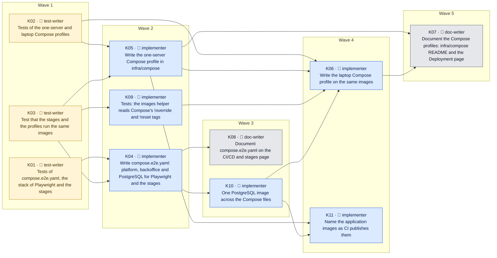

**Plan:** 🟢 Approved

**Push:** 🟢 Approved

<!-- ticket:specs -->
## 📚 Specifications

The specification and design pages of [TICKET.md](TICKET.md), copied by `python3 .claude/scripts/tickets/ticket_refs.py sync`.

- [CI/CD and stages](../../technical/delivery/ci-cd-and-stages.md#stages-dev-and-qa)
- [Deployment](../../technical/infrastructure/deployment.md)
- [📌 REQ-T09-02](../../specs/03-technical/t09-install-backups-and-updates/requirements/req-t09-02-compose-and-helm.md)
- [📜 D408](../../specs/06-decisions/technical/d408-performance-and-profiles.md)
- [📜 D421](../../specs/06-decisions/technical/d421-infrastructure-cncf.md)
- [📜 D18](../../specs/06-decisions/foundations/d18-installation.md)
- [📦 Installation](../../specs/05-non-functional/installation.md)
<!-- /ticket:specs -->

# T0.21: Compose stack and its profiles

## Summary

I've planned T0.21 as 8 tasks in 4 waves. Every Compose file gets its own tests in the first wave, and the two documentation tasks wait for the code they describe.

- **Wave 1, three test tasks:** K01 tests `compose.e2e.yaml`, K02 tests the one-server and laptop profiles, and K03 checks that every file uses the same images.
- **Wave 2:** K04 writes `compose.e2e.yaml` at the repository root, and K05 writes the one-server profile `infra/compose/compose.yaml` with its `.gitignore`.
- **Wave 3:** K06 adds the laptop file `infra/compose/compose.laptop.yaml` on top of the one-server file. K08 updates the stages page `docs/technical/delivery/ci-cd-and-stages.md`.
- **Wave 4:** K07 updates `infra/compose/README.md` and the deployment page `docs/technical/infrastructure/deployment.md`.

No task changes `.github/`. `images.yml` and `stage.yml` already run `docker compose -f compose.e2e.yaml up --wait` and set the two image variables. So `compose.e2e.yaml` is written to the names those two workflows already use, and it needs no other variable.

## Assumptions

The specifications leave several things open, so the plan records them as assumptions to review before approval:

- The roadmap row has no ticket anchor: links use the sprint anchor `#s04`, and the epic link uses `#epics` because the page has no per-epic anchor.
- Acceptance criterion 3 (laptop profile uses the same images as the one-server profile) is derived from the roadmap row; the specifications give no other measure for the laptop profile before T0.25.
- Criterion 1 reads "healthy" as what `up --wait` waits for; the services' health checks come from their own tickets (T0.14, T0.17).
- The Installation page's Measures section is "To be specified", so the budget line only restates its requirement of one Compose command.
- I could not run `check_ticket.py` (no shell tool available in this session), so `TICKET.md` is not yet checked by it. I added an empty `tests-evidences/.gitkeep` to create the folder.
- The repository-level tests of the Compose files go in a new `tests/infra/compose/` folder, which mirrors `infra/compose/` as `tests/ci/` mirrors `.github/`. The tests are split into `e2e/`, `profiles/` and `images/` sub-folders so that test tasks of the same wave never share a file.
- The one-server profile is `infra/compose/compose.yaml`, and the laptop profile is the override `infra/compose/compose.laptop.yaml` laid on top of it. Because the override sets no `image`, both profiles run the same images by construction. The specifications name neither file.
- The PostgreSQL service is named `postgres`. It uses the official `postgres` image pinned by tag and digest, because D415 locks dependencies. The specifications name no PostgreSQL version: the implementer picks the current major version and reports it.
- Only `ERP_IMAGE_PREFIX` and `ERP_IMAGE_TAG` are required by `compose.e2e.yaml`, because they are the only variables `images.yml` and `stage.yml` set. Host ports default through `${ERP_<NAME>_PORT:-<default>}`. No workflow of `.github/` is changed.
- The throwaway e2e stack uses `POSTGRES_HOST_AUTH_METHOD=trust`, with the database reachable only on the stack's private network. CI provides no secret store, and `AGENT.md` forbids secrets in configuration. The profiles read the password from a Compose secret file, `infra/compose/secrets/postgres_password`, which the operator creates and git ignores.
- D421 asks for one gateway with private services, but no gateway exists in P0. PostgreSQL publishes no port, while `platform` and `backoffice` publish theirs for Playwright, Bruno and the user.
- In the one-server profile, PostgreSQL data sits on a named volume and every service has `restart: unless-stopped`. This is the conservative choice for a server install that must keep its data, and the specifications do not say it.
- The laptop profile differs from the one-server profile only by binding its published ports to `127.0.0.1`. It sets no memory or CPU limit, because the 8 GB budget of D408 is measured by T0.25 and a limit set before that would be invented.
- The profiles' image tag has no default and is never `latest`. It is the commit SHA under which CI publishes signed images, consistent with T0.19's "the image tag from the commit". The prefix defaults to `ghcr.io/gpbcom/simpleerp`, the registry `images.yml` pushes to.
- The health checks call `platform`'s `/v1/health` (T0.14, the P0 demo) and `backoffice`'s root page, using a tool present in each image. How `platform` connects to the database and how `backoffice` reaches `platform` follow the configuration that T0.14 and T0.17 deliver. If `platform` has no database setting yet, it is left unwired and reported.
- The Compose checks that need Docker (`docker compose config`) are skipped when `docker` is not on the PATH, like the other environment checks of TKT-6. Starting the stack for real, acceptance criterion 1, is observed in CI's `images.yml` job and in `stage.yml`, which already run `up --wait`.

<!-- plan:graph -->

> [!NOTE]
> Generated from the json block at the end of this page by `python3 .claude/scripts/tickets/plan.py render`.
> To change a task, edit the json block, then render again: never edit this view by hand.

## Waves

| Wave | Tasks | Agents running at once |
| --- | --- | --- |
| 1 | [K01](#k01), [K02](#k02), [K03](#k03) | 3 of 3 |
| 2 | [K04](#k04), [K05](#k05), [K09](#k09) | 3 of 3 |
| 3 | [K08](#k08), [K10](#k10) | 2 of 2 |
| 4 | [K06](#k06), [K11](#k11) | 2 of 2 |
| 5 | [K07](#k07) | 1 of 1 |

| Wave | Task | Agent | Depends on | Unblocks |
| --- | --- | --- | --- | --- |
| 1 | [K01](#k01) Tests of compose.e2e.yaml, the stack of Playwright and the stages | 🧪 test-writer | none | [K04](#k04) |
| 1 | [K02](#k02) Tests of the one-server and laptop Compose profiles | 🧪 test-writer | none | [K05](#k05), [K06](#k06) |
| 1 | [K03](#k03) Test that the stages and the profiles run the same images | 🧪 test-writer | none | [K04](#k04), [K05](#k05), [K09](#k09) |
| 2 | [K04](#k04) Write compose.e2e.yaml: platform, backoffice and PostgreSQL for Playwright and the stages | 🐍 implementer | [K01](#k01), [K03](#k03) | [K08](#k08), [K10](#k10) |
| 2 | [K05](#k05) Write the one-server Compose profile in infra/compose | 🐍 implementer | [K02](#k02), [K03](#k03) | [K06](#k06), [K07](#k07), [K11](#k11) |
| 4 | [K06](#k06) Write the laptop Compose profile on the same images | 🐍 implementer | [K02](#k02), [K05](#k05), [K09](#k09), [K10](#k10) | [K07](#k07) |
| 3 | [K08](#k08) Document compose.e2e.yaml on the CI/CD and stages page | 📝 doc-writer | [K04](#k04) | none |
| 5 | [K07](#k07) Document the Compose profiles: infra/compose README and the Deployment page | 📝 doc-writer | [K05](#k05), [K06](#k06) | none |
| 2 | [K09](#k09) Tests: the images helper reads Compose's !override and !reset tags | 🐍 implementer | [K03](#k03) | [K06](#k06) |
| 3 | [K10](#k10) One PostgreSQL image across the Compose files | 🐍 implementer | [K04](#k04) | [K06](#k06), [K11](#k11) |
| 4 | [K11](#k11) Name the application images as CI publishes them | 🐍 implementer | [K05](#k05), [K10](#k10) | none |

## Dependency graph



## Tasks

### <a id="k01"></a>K01: Tests of compose.e2e.yaml, the stack of Playwright and the stages

| Agent | Wave | Depends on | Unblocks |
| --- | --- | --- | --- |
| 🧪 test-writer | 1 | none | [K04](#k04) |

**Files** (only this task may change them in its wave):

- `tests/infra/compose/e2e/test_compose_e2e.py`
- `tests/infra/compose/e2e/helpers.py`

**Done when:** `uv run pytest tests/infra/compose/e2e -n 2` runs and fails only because `compose.e2e.yaml` is missing. `uv run ruff check tests/infra/compose/e2e`, `uv run ruff format --check tests/infra/compose/e2e` and `uv run pytest tests/conventions -n 2` pass.

**Brief:**

Write, before any implementation, the repository-level pytest tests of `compose.e2e.yaml` at the repository root, the stack that CI's `images.yml` (job `e2e`) and `stage.yml` start with `docker compose -f compose.e2e.yaml up --detach --wait` for Playwright and the stages.

Specifications applied: [REQ-T09-02](docs/specs/03-technical/t09-install-backups-and-updates/requirements/req-t09-02-compose-and-helm.md) (Compose and Helm from the same images), [D18](docs/specs/06-decisions/foundations/d18-installation.md), [D421](docs/specs/06-decisions/technical/d421-infrastructure-cncf.md) (one gateway with private services), the design page [CI/CD and stages](docs/technical/delivery/ci-cd-and-stages.md#stages-dev-and-qa), and the layout of [D438](docs/specs/06-decisions/technical/d438-repository-layout.md). Read `.github/workflows/images.yml` (job `e2e`), `.github/workflows/stage.yml` and `.github/scripts/detect_changes.py` (`image_name`) to see what the workflows expect of the file. Follow the Tests section of `AGENT.md`: one `TestComposeE2e` class, test names written as sentences, no mocks, `pytest.mark.parametrize` for cases of one behaviour, and shared functions in `helpers.py`, imported by their full path `tests.infra.compose.e2e.helpers`. Load YAML with `yaml.safe_load` and `encoding="utf-8"`, as `tests/ci/workflows/helpers.py` does.

The tests assert that:
1. `compose.e2e.yaml` exists at the root and declares exactly the services `platform`, `backoffice` and `postgres`.
2. The image of `platform` is `${ERP_IMAGE_PREFIX}-platform:${ERP_IMAGE_TAG}` and that of `backoffice` is `${ERP_IMAGE_PREFIX}-backoffice:${ERP_IMAGE_TAG}`. These are the exact references `images.yml` matches against `docker compose config --images` and `stage.yml` pulls.
3. Each of these two services has a `build` with context `.` (the repository root, AGENT.md "Docker images") and `dockerfile` `backend/services/platform/Dockerfile` or `frontend/backoffice/Dockerfile`. `stage.yml` falls back to `docker compose build`.
4. The `postgres` image is the official PostgreSQL image pinned by digest (`@sha256:`), and has no `build`.
5. Every service has a `healthcheck`, so that `up --wait` waits for it to be healthy. The healthcheck of `platform` calls `/v1/health`, and that of `postgres` uses `pg_isready`.
6. `platform` depends on `postgres` and `backoffice` depends on `platform`, each with `condition: service_healthy`.
7. `postgres` publishes no port (private service, D421).
8. No environment entry whose name contains `PASSWORD` or `SECRET` holds a literal value.
9. The only variables used without a default (`${VAR}` or `${VAR:?...}`) are `ERP_IMAGE_PREFIX` and `ERP_IMAGE_TAG`, the two that `images.yml` and `stage.yml` set.
10. When `docker` is on the PATH, `docker compose -f compose.e2e.yaml config --quiet` and `config --images` succeed with only those two variables set, and list `<prefix>-platform:<tag>`, `<prefix>-backoffice:<tag>` and the postgres image. Skip with `pytest.skip` when docker is missing.

The tests must fail now only because `compose.e2e.yaml` does not exist yet.

### <a id="k02"></a>K02: Tests of the one-server and laptop Compose profiles

| Agent | Wave | Depends on | Unblocks |
| --- | --- | --- | --- |
| 🧪 test-writer | 1 | none | [K05](#k05), [K06](#k06) |

**Files** (only this task may change them in its wave):

- `tests/infra/compose/profiles/test_one_server_profile.py`
- `tests/infra/compose/profiles/test_laptop_profile.py`
- `tests/infra/compose/profiles/helpers.py`

**Done when:** `uv run pytest tests/infra/compose/profiles -n 2` runs and fails only because `infra/compose/compose.yaml`, `compose.laptop.yaml` and `.gitignore` are missing. `uv run ruff check tests/infra/compose/profiles`, `uv run ruff format --check tests/infra/compose/profiles` and `uv run pytest tests/conventions -n 2` pass.

**Brief:**

Write, before any implementation, the repository-level pytest tests of the two Compose profiles in `infra/compose/`.
- The one-server profile is `infra/compose/compose.yaml`.
- The laptop profile is the override `infra/compose/compose.laptop.yaml`, started with `docker compose -f infra/compose/compose.yaml -f infra/compose/compose.laptop.yaml up -d --wait`.

Specifications applied: [REQ-T09-02](docs/specs/03-technical/t09-install-backups-and-updates/requirements/req-t09-02-compose-and-helm.md) criterion 1 (given one server, Compose installs it), [Installation](docs/specs/05-non-functional/installation.md) (one Docker Compose command for one company, the same images as Helm), [D18](docs/specs/06-decisions/foundations/d18-installation.md), [D408](docs/specs/06-decisions/technical/d408-performance-and-profiles.md) (the laptop profile on the same images), [D421](docs/specs/06-decisions/technical/d421-infrastructure-cncf.md) (private services), the design page [Deployment](docs/technical/infrastructure/deployment.md), and the layout of [D438](docs/specs/06-decisions/technical/d438-repository-layout.md) (`infra/compose`). Follow the Tests section of `AGENT.md`: one `Test<Subject>` class per file (`TestOneServerProfile`, `TestLaptopProfile`), test names written as sentences, no mocks, and shared functions in `helpers.py`, imported as `tests.infra.compose.profiles.helpers`. Use `yaml.safe_load` with `encoding="utf-8"`.

`test_one_server_profile.py` asserts that:
1. `infra/compose/compose.yaml` exists and declares exactly the services `platform`, `backoffice` and `postgres`.
2. The images of `platform` and `backoffice` are `${ERP_IMAGE_PREFIX...}-platform:${ERP_IMAGE_TAG...}` and `${ERP_IMAGE_PREFIX...}-backoffice:${ERP_IMAGE_TAG...}`. Parse the variable names, whatever their default or `:?` message. Neither service has a `build`, because the profile installs from the published images.
3. The `postgres` image is pinned by digest (`@sha256:`).
4. Every service has a `healthcheck`.
5. Every service has `restart: unless-stopped`.
6. `postgres` keeps its data on a named volume and publishes no port.
7. The PostgreSQL password comes from a Compose `secrets:` entry backed by a `file:` under `infra/compose/secrets/` (read through `POSTGRES_PASSWORD_FILE`). No environment entry whose name contains `PASSWORD` or `SECRET` holds a literal value.
8. `infra/compose/.gitignore` ignores `secrets/`.
9. When `docker` is on the PATH, `docker compose -f infra/compose/compose.yaml config --quiet` succeeds with only `ERP_IMAGE_TAG` set, which proves one command is enough. Create a throwaway secret file under `tmp_path` and point the run at it, or skip the check when the file is required and absent. Skip with `pytest.skip` when docker is missing.

`test_laptop_profile.py` asserts that:
1. `infra/compose/compose.laptop.yaml` exists and sets no `image` and no `build` on any service.
2. It only names services that `compose.yaml` declares.
3. Every port it publishes is bound to `127.0.0.1`.
4. When docker is on the PATH, `config --images` of the two files merged equals that of `compose.yaml` alone, for the same `ERP_IMAGE_PREFIX` and `ERP_IMAGE_TAG`. This is acceptance criterion 3, the same images as the one-server profile. Otherwise skip.

The tests must fail now only because the files do not exist yet.

### <a id="k03"></a>K03: Test that the stages and the profiles run the same images

| Agent | Wave | Depends on | Unblocks |
| --- | --- | --- | --- |
| 🧪 test-writer | 1 | none | [K04](#k04), [K05](#k05), [K09](#k09) |

**Files** (only this task may change them in its wave):

- `tests/infra/compose/images/test_same_images.py`
- `tests/infra/compose/images/helpers.py`

**Done when:** `uv run pytest tests/infra/compose/images -n 2` runs and fails only because the Compose files are missing. `uv run ruff check tests/infra/compose/images`, `uv run ruff format --check tests/infra/compose/images` and `uv run pytest tests/conventions -n 2` pass.

**Brief:**

Write, before any implementation, one repository-level pytest file, class `TestSameImages`. It proves that `compose.e2e.yaml` (root), `infra/compose/compose.yaml` (one-server profile) and the merge of `infra/compose/compose.yaml` with `infra/compose/compose.laptop.yaml` (laptop profile) resolve to the same images for the same `ERP_IMAGE_PREFIX` and `ERP_IMAGE_TAG`.

Specifications applied: [REQ-T09-02](docs/specs/03-technical/t09-install-backups-and-updates/requirements/req-t09-02-compose-and-helm.md) (Compose and Helm from the same images), [D18](docs/specs/06-decisions/foundations/d18-installation.md), [D408](docs/specs/06-decisions/technical/d408-performance-and-profiles.md) (the laptop and cloud profiles on the same images), [D421](docs/specs/06-decisions/technical/d421-infrastructure-cncf.md), [Installation](docs/specs/05-non-functional/installation.md), the design pages [CI/CD and stages](docs/technical/delivery/ci-cd-and-stages.md#stages-dev-and-qa) and [Deployment](docs/technical/infrastructure/deployment.md), and the layout of [D438](docs/specs/06-decisions/technical/d438-repository-layout.md).

In `helpers.py`, write a small resolver of Compose's `${VAR}`, `${VAR:-default}` and `${VAR:?message}` forms. Parametrise over the services `platform`, `backoffice` and `postgres`. For a given prefix and tag (for example `ghcr.io/gpbcom/simpleerp` and a 40-character SHA), assert that the resolved `image` of each service is identical in the three files, the PostgreSQL digest included. When `docker` is on the PATH, also compare the output of `docker compose ... config --images` for the three. Otherwise skip only that part with `pytest.skip`.

Follow the Tests section of `AGENT.md`: test names written as sentences, no mocks, and helpers imported as `tests.infra.compose.images.helpers`. The tests must fail now only because the Compose files do not exist yet.

### <a id="k04"></a>K04: Write compose.e2e.yaml: platform, backoffice and PostgreSQL for Playwright and the stages

| Agent | Wave | Depends on | Unblocks |
| --- | --- | --- | --- |
| 🐍 implementer | 2 | [K01](#k01), [K03](#k03) | [K08](#k08), [K10](#k10) |

**Files** (only this task may change them in its wave):

- `compose.e2e.yaml`

**Done when:** `uv run pytest tests/infra/compose/e2e -n 2` passes. `uv run pytest tests/ci -n 2` still passes. When docker is available, `ERP_IMAGE_PREFIX=ghcr.io/gpbcom/simpleerp ERP_IMAGE_TAG=local docker compose -f compose.e2e.yaml config --quiet` exits 0. `tests/infra/compose/images` passes once K05 and K06 are integrated.

**Brief:**

Create `compose.e2e.yaml` at the repository root, the stack that `images.yml` (job `e2e`) and `stage.yml` start with `docker compose -f compose.e2e.yaml up --detach --wait`. It starts the real images of `platform`, `backoffice` and PostgreSQL. Make the tests of K01 and K03 pass without changing them: `tests/infra/compose/e2e/` and `tests/infra/compose/images/`.

Specifications applied: [REQ-T09-02](docs/specs/03-technical/t09-install-backups-and-updates/requirements/req-t09-02-compose-and-helm.md), [D18](docs/specs/06-decisions/foundations/d18-installation.md), [D421](docs/specs/06-decisions/technical/d421-infrastructure-cncf.md) (private services), [D408](docs/specs/06-decisions/technical/d408-performance-and-profiles.md) (same images), the design page [CI/CD and stages](docs/technical/delivery/ci-cd-and-stages.md#stages-dev-and-qa), and [D438](docs/specs/06-decisions/technical/d438-repository-layout.md) with `AGENT.md` ("Docker images": build context is the repository root).

Rules:
- **Images:** `platform` uses `${ERP_IMAGE_PREFIX}-platform:${ERP_IMAGE_TAG}` and `backoffice` uses `${ERP_IMAGE_PREFIX}-backoffice:${ERP_IMAGE_TAG}`, exactly as `images.yml` and `stage.yml` expect.
- **Build:** each has a `build` with context `.` and dockerfile `backend/services/platform/Dockerfile` or `frontend/backoffice/Dockerfile`, for `stage.yml`'s `docker compose build` fallback.
- **PostgreSQL image:** the official `postgres` image, pinned by tag and digest. Report the version chosen as a decision.
- **Health:** every service has a healthcheck, so `up --wait` waits for it. For `platform`, call `/v1/health` with a tool the image actually holds; read `backend/services/platform/Dockerfile` from T0.14. For `backoffice`, request its root page on the port its image exposes. For `postgres`, use `pg_isready`.
- **Order:** `platform` depends on `postgres` and `backoffice` on `platform`, each with `condition: service_healthy`.
- **Long-running services only:** no one-shot container, because `stage.yml`'s smoke test fails on any container that is not running.
- **Ports:** `postgres` publishes no port. `backoffice` and `platform` publish their ports on the runner for Playwright and Bruno, with host ports given as `${ERP_<NAME>_PORT:-<default>}`.
- **Variables:** only `ERP_IMAGE_PREFIX` and `ERP_IMAGE_TAG` lack a default.
- **Secrets:** no secret value in the file. This throwaway stack's database is reachable only on the stack's private network, with `POSTGRES_HOST_AUTH_METHOD=trust`.
- **Wiring:** wire `platform` to the database and `backoffice` to `platform` through the environment variables their own configuration reads. Look in `backend/services/platform/conf/app.yaml` (T0.14, environment overrides of T0.06) and in `frontend/backoffice` (T0.17). If `platform` has no database setting yet, leave it unwired and report it as an assumption.

Report every choice where an alternative existed, for `IMPLEMENTATION.md`.

### <a id="k05"></a>K05: Write the one-server Compose profile in infra/compose

| Agent | Wave | Depends on | Unblocks |
| --- | --- | --- | --- |
| 🐍 implementer | 2 | [K02](#k02), [K03](#k03) | [K06](#k06), [K07](#k07), [K11](#k11) |

**Files** (only this task may change them in its wave):

- `infra/compose/compose.yaml`
- `infra/compose/.gitignore`

**Done when:** `uv run pytest tests/infra/compose/profiles/test_one_server_profile.py -n 2` passes. When docker is available, `ERP_IMAGE_TAG=local docker compose -f infra/compose/compose.yaml config --quiet` exits 0, with a throwaway `infra/compose/secrets/postgres_password` that is removed afterwards and never handed off.

**Brief:**

Create the one-server profile `infra/compose/compose.yaml`, which installs SimpleERP for one company on one server with one command: `ERP_IMAGE_TAG=<commit sha> docker compose -f infra/compose/compose.yaml up -d --wait`. Also create `infra/compose/.gitignore`, which ignores `secrets/`. Make the tests of `tests/infra/compose/profiles/test_one_server_profile.py` (K02) pass without changing them. `tests/infra/compose/images` (K03) must pass once K04 and K06 are integrated.

Specifications applied: [REQ-T09-02](docs/specs/03-technical/t09-install-backups-and-updates/requirements/req-t09-02-compose-and-helm.md) criterion 1 (given one server, Compose installs it), [Installation](docs/specs/05-non-functional/installation.md) (one Docker Compose command, the same images as Helm), [D18](docs/specs/06-decisions/foundations/d18-installation.md), [D421](docs/specs/06-decisions/technical/d421-infrastructure-cncf.md) (private services), [D408](docs/specs/06-decisions/technical/d408-performance-and-profiles.md), the design page [Deployment](docs/technical/infrastructure/deployment.md), and [D438](docs/specs/06-decisions/technical/d438-repository-layout.md) (`infra/compose`).

Rules:
- **Services:** exactly `platform`, `backoffice` and `postgres`.
- **Images:** `${ERP_IMAGE_PREFIX:-ghcr.io/gpbcom/simpleerp}-platform:${ERP_IMAGE_TAG:?<message>}` and the same for `-backoffice`. These are the published images that CI signs and tags with the commit SHA, the same as `compose.e2e.yaml`. The tag defaults to nothing, never `latest`. Write the `:?` message as a full British English sentence.
- **No build:** neither service has a `build`.
- **PostgreSQL image:** the same `postgres` image, pinned by tag and digest, as K04 uses. If K04's choice is not visible in your worktree, use the current official major version and report it so the integrator aligns both files.
- **Health and restart:** every service has a healthcheck (`/v1/health` for `platform`, `pg_isready` for `postgres`) and `restart: unless-stopped`.
- **Order:** `platform` depends on `postgres` and `backoffice` on `platform`, each with `condition: service_healthy`.
- **PostgreSQL storage and access:** data on a named volume, and no published port.
- **Password:** read through `POSTGRES_PASSWORD_FILE` from a Compose secret with `file: ./secrets/postgres_password`, which the operator creates. No secret value is ever in the file (AGENT.md: secrets never appear in configuration).
- **Ports:** `backoffice` and `platform` publish their ports as `${ERP_<NAME>_PORT:-<default>}`.
- **Wiring:** wire the services through the environment variables their own configuration reads (`backend/services/platform/conf/app.yaml`, `frontend/backoffice`), as K04 does.

Report every choice where an alternative existed, and every assumption.

### <a id="k06"></a>K06: Write the laptop Compose profile on the same images

| Agent | Wave | Depends on | Unblocks |
| --- | --- | --- | --- |
| 🐍 implementer | 4 | [K02](#k02), [K05](#k05), [K09](#k09), [K10](#k10) | [K07](#k07) |

**Files** (only this task may change them in its wave):

- `infra/compose/compose.laptop.yaml`

**Done when:** `uv run pytest tests/infra/compose/profiles -n 2` and `uv run pytest tests/infra/compose/images -n 2` pass (with K04 integrated). When docker is available, `ERP_IMAGE_TAG=local docker compose -f infra/compose/compose.yaml -f infra/compose/compose.laptop.yaml config --images` lists the same images as the one-server profile alone.

**Brief:**

Create the laptop profile `infra/compose/compose.laptop.yaml`, an override of the one-server profile `infra/compose/compose.yaml` written by K05. It is started with `docker compose -f infra/compose/compose.yaml -f infra/compose/compose.laptop.yaml up -d --wait`. Make `tests/infra/compose/profiles/test_laptop_profile.py` (K02) and `tests/infra/compose/images` (K03) pass without changing them.

Specifications applied: [D408](docs/specs/06-decisions/technical/d408-performance-and-profiles.md) (a laptop profile, and cloud profiles on the same images), [D421](docs/specs/06-decisions/technical/d421-infrastructure-cncf.md), [REQ-T09-02](docs/specs/03-technical/t09-install-backups-and-updates/requirements/req-t09-02-compose-and-helm.md), [Installation](docs/specs/05-non-functional/installation.md) (laptop profile), the design page [Deployment](docs/technical/infrastructure/deployment.md), and [D438](docs/specs/06-decisions/technical/d438-repository-layout.md).

Rules:
- The override sets no `image` and no `build`, so the laptop runs exactly the images of the one-server profile (acceptance criterion 3).
- It only names services of `compose.yaml`.
- It binds every published port to `127.0.0.1`, because a laptop serves only its own user.
- It sets no memory or CPU limit. The 8 GB budget of D408 is measured by T0.25, and a limit set before that measure would be invented.
- The PostgreSQL password secret stays the base file's.

Report every choice where an alternative existed, and every assumption.

### <a id="k08"></a>K08: Document compose.e2e.yaml on the CI/CD and stages page

| Agent | Wave | Depends on | Unblocks |
| --- | --- | --- | --- |
| 📝 doc-writer | 3 | [K04](#k04) | none |

**Files** (only this task may change them in its wave):

- `docs/technical/delivery/ci-cd-and-stages.md`

**Done when:** The "Stages: dev and QA" section describes `compose.e2e.yaml` as integrated, the obsolete "Until ... `compose.e2e.yaml` exists" sentence is gone, and every relative link of the page still resolves.

**Brief:**

Update the design page `docs/technical/delivery/ci-cd-and-stages.md` now that `compose.e2e.yaml` exists at the repository root (K04). Read the integrated `compose.e2e.yaml`, `.github/workflows/images.yml` and `.github/workflows/stage.yml`, and invent nothing beyond them.

Specifications applied: the design page [CI/CD and stages](docs/technical/delivery/ci-cd-and-stages.md#stages-dev-and-qa), [REQ-T09-02](docs/specs/03-technical/t09-install-backups-and-updates/requirements/req-t09-02-compose-and-helm.md), [D421](docs/specs/06-decisions/technical/d421-infrastructure-cncf.md), and [D438](docs/specs/06-decisions/technical/d438-repository-layout.md).

In the section "Stages: dev and QA":
- Replace the sentence that begins "Until the first service has a Dockerfile and `compose.e2e.yaml` exists" with a short description of the stack. `compose.e2e.yaml` starts `platform`, `backoffice` and PostgreSQL from the images named `${ERP_IMAGE_PREFIX}-<name>:${ERP_IMAGE_TAG}`, waits for every health check, publishes the back office and the API for Playwright and Bruno, and keeps the database private. Add the command to start it locally with the two variables set.
- Add one line saying it runs the same images as the Compose profiles of `infra/compose/`.

Update the `Last reviewed:` line. Write plain British English, with no em dashes. Change no other file, and no page under `docs/specs/`.

### <a id="k07"></a>K07: Document the Compose profiles: infra/compose README and the Deployment page

| Agent | Wave | Depends on | Unblocks |
| --- | --- | --- | --- |
| 📝 doc-writer | 5 | [K05](#k05), [K06](#k06) | none |

**Files** (only this task may change them in its wave):

- `infra/compose/README.md`
- `docs/technical/infrastructure/deployment.md`

**Done when:** Both files describe the profiles exactly as the integrated Compose files define them. Every relative link resolves, checked with `grep -o '](\.\{1,2\}/[^)]*' infra/compose/README.md docs/technical/infrastructure/deployment.md` and an `ls` of each target. No file under `docs/specs/` is changed.

**Brief:**

Document the two Compose profiles that K05 and K06 delivered. Read `infra/compose/compose.yaml`, `infra/compose/compose.laptop.yaml` and `infra/compose/.gitignore` as integrated, and invent nothing beyond them.

Specifications applied: [REQ-T09-02](docs/specs/03-technical/t09-install-backups-and-updates/requirements/req-t09-02-compose-and-helm.md), [Installation](docs/specs/05-non-functional/installation.md), [D18](docs/specs/06-decisions/foundations/d18-installation.md), [D408](docs/specs/06-decisions/technical/d408-performance-and-profiles.md), [D421](docs/specs/06-decisions/technical/d421-infrastructure-cncf.md), [D438](docs/specs/06-decisions/technical/d438-repository-layout.md), and the design page [Deployment](docs/technical/infrastructure/deployment.md).

1. In `infra/compose/README.md` (created by T0.01; create it if absent), say what the folder holds:
   - the one-server profile and its single install command, with `ERP_IMAGE_TAG` set to a published commit SHA and the optional `ERP_IMAGE_PREFIX` and port variables;
   - the password file the operator creates in `infra/compose/secrets/postgres_password`, which git ignores;
   - the laptop profile and its command;
   - that both profiles run the same images as `compose.e2e.yaml` and the Helm charts;
   - that the laptop's memory budget is measured later (T0.25).
2. In `docs/technical/infrastructure/deployment.md`, replace "Nothing built yet." under "Today" with what now exists: the Compose profiles in `infra/compose/` and `compose.e2e.yaml` for the stages. Keep the target design section as it is, and update the `Last reviewed:` line.

Write plain British English, with no em dashes. Do not change any page under `docs/specs/`.

### <a id="k09"></a>K09: Tests: the images helper reads Compose's !override and !reset tags

| Agent | Wave | Depends on | Unblocks |
| --- | --- | --- | --- |
| 🐍 implementer | 2 | [K03](#k03) | [K06](#k06) |

**Files** (only this task may change them in its wave):

- `tests/infra/compose/images/helpers.py`

**Done when:** `uv run --all-packages pytest tests/infra/compose/images -q` no longer fails with a ConstructorError; ruff check and ruff format --check pass on tests/infra/compose/images/helpers.py.

**Brief:**

K06's laptop profile uses `ports: !override` (Compose appends port lists on merge, so a plain list would also publish the base 0.0.0.0 ports). The YAML loader of tests/infra/compose/images/helpers.py uses yaml.safe_load, which refuses the tag, so six tests of tests/infra/compose/images/test_same_images.py fail with a ConstructorError. Give it a loader that reads `!override` and `!reset` as their plain value, the way tests/infra/compose/profiles/helpers.py already does (its ComposeLoader). Change nothing else in the file.

### <a id="k10"></a>K10: One PostgreSQL image across the Compose files

| Agent | Wave | Depends on | Unblocks |
| --- | --- | --- | --- |
| 🐍 implementer | 3 | [K04](#k04) | [K06](#k06), [K11](#k11) |

**Files** (only this task may change them in its wave):

- `compose.e2e.yaml`

**Done when:** `uv run --all-packages pytest tests/infra/compose -q` has no failure about the PostgreSQL image; where Docker is available, `docker compose -f compose.e2e.yaml config --images` lists the same postgres image as infra/compose/compose.yaml.

**Brief:**

tests/infra/compose/images/test_same_images.py::test_the_postgresql_image_is_pinned_by_digest_in_every_file fails: compose.e2e.yaml (K04) pins postgres:17-alpine@sha256:f9cf3e1f... while infra/compose/compose.yaml (K05) pins postgres:18-alpine@sha256:0115267ab5a509022df9319c77be365cef335adb71556c75f60f5360ee247e71. The specifications fix no PostgreSQL version; the conservative choice recorded by K05 is the newest major, 18 (TKT-8). Set the postgres image of compose.e2e.yaml to exactly `postgres:18-alpine@sha256:0115267ab5a509022df9319c77be365cef335adb71556c75f60f5360ee247e71`. Change nothing else in the file, and check the data volume path still suits PostgreSQL 18 (its images keep PGDATA under /var/lib/postgresql).

### <a id="k11"></a>K11: Name the application images as CI publishes them

| Agent | Wave | Depends on | Unblocks |
| --- | --- | --- | --- |
| 🐍 implementer | 4 | [K05](#k05), [K10](#k10) | none |

**Files** (only this task may change them in its wave):

- `infra/compose/compose.yaml`

**Done when:** `uv run --all-packages pytest tests/infra/compose -q` passes; `grep -n 'simpleerp}/' infra/compose/compose.yaml` prints nothing.

**Brief:**

tests/infra/compose/images/test_same_images.py fails: infra/compose/compose.yaml names the images `${ERP_IMAGE_PREFIX:-ghcr.io/gpbcom/simpleerp}/platform` and `/backoffice` (a slash), while compose.e2e.yaml names them `${ERP_IMAGE_PREFIX}-platform` and `-backoffice`, as .github/workflows/images.yml publishes them (`ghcr.io/<owner>/<repo>-<name>`, its header) and as T0.19's Helm charts pull them (`<global.image.prefix>-<name>:<tag>`). In infra/compose/compose.yaml, lines 27 and 42, replace `}/platform:` with `}-platform:` and `}/backoffice:` with `}-backoffice:`. Change nothing else.

<!-- /plan:graph -->

## Task graph

<details>
<summary>🤖 Task graph as read by <code>/ticket-run</code> (json)</summary>

```json
[
  {
    "id": "K01",
    "title": "Tests of compose.e2e.yaml, the stack of Playwright and the stages",
    "agent": "test-writer",
    "depends_on": [],
    "files": [
      "tests/infra/compose/e2e/test_compose_e2e.py",
      "tests/infra/compose/e2e/helpers.py"
    ],
    "brief": "Write, before any implementation, the repository-level pytest tests of `compose.e2e.yaml` at the repository root, the stack that CI's `images.yml` (job `e2e`) and `stage.yml` start with `docker compose -f compose.e2e.yaml up --detach --wait` for Playwright and the stages.\n\nSpecifications applied: [REQ-T09-02](docs/specs/03-technical/t09-install-backups-and-updates/requirements/req-t09-02-compose-and-helm.md) (Compose and Helm from the same images), [D18](docs/specs/06-decisions/foundations/d18-installation.md), [D421](docs/specs/06-decisions/technical/d421-infrastructure-cncf.md) (one gateway with private services), the design page [CI/CD and stages](docs/technical/delivery/ci-cd-and-stages.md#stages-dev-and-qa), and the layout of [D438](docs/specs/06-decisions/technical/d438-repository-layout.md). Read `.github/workflows/images.yml` (job `e2e`), `.github/workflows/stage.yml` and `.github/scripts/detect_changes.py` (`image_name`) to see what the workflows expect of the file. Follow the Tests section of `AGENT.md`: one `TestComposeE2e` class, test names written as sentences, no mocks, `pytest.mark.parametrize` for cases of one behaviour, and shared functions in `helpers.py`, imported by their full path `tests.infra.compose.e2e.helpers`. Load YAML with `yaml.safe_load` and `encoding=\"utf-8\"`, as `tests/ci/workflows/helpers.py` does.\n\nThe tests assert that:\n1. `compose.e2e.yaml` exists at the root and declares exactly the services `platform`, `backoffice` and `postgres`.\n2. The image of `platform` is `${ERP_IMAGE_PREFIX}-platform:${ERP_IMAGE_TAG}` and that of `backoffice` is `${ERP_IMAGE_PREFIX}-backoffice:${ERP_IMAGE_TAG}`. These are the exact references `images.yml` matches against `docker compose config --images` and `stage.yml` pulls.\n3. Each of these two services has a `build` with context `.` (the repository root, AGENT.md \"Docker images\") and `dockerfile` `backend/services/platform/Dockerfile` or `frontend/backoffice/Dockerfile`. `stage.yml` falls back to `docker compose build`.\n4. The `postgres` image is the official PostgreSQL image pinned by digest (`@sha256:`), and has no `build`.\n5. Every service has a `healthcheck`, so that `up --wait` waits for it to be healthy. The healthcheck of `platform` calls `/v1/health`, and that of `postgres` uses `pg_isready`.\n6. `platform` depends on `postgres` and `backoffice` depends on `platform`, each with `condition: service_healthy`.\n7. `postgres` publishes no port (private service, D421).\n8. No environment entry whose name contains `PASSWORD` or `SECRET` holds a literal value.\n9. The only variables used without a default (`${VAR}` or `${VAR:?...}`) are `ERP_IMAGE_PREFIX` and `ERP_IMAGE_TAG`, the two that `images.yml` and `stage.yml` set.\n10. When `docker` is on the PATH, `docker compose -f compose.e2e.yaml config --quiet` and `config --images` succeed with only those two variables set, and list `<prefix>-platform:<tag>`, `<prefix>-backoffice:<tag>` and the postgres image. Skip with `pytest.skip` when docker is missing.\n\nThe tests must fail now only because `compose.e2e.yaml` does not exist yet.",
    "done_when": "`uv run pytest tests/infra/compose/e2e -n 2` runs and fails only because `compose.e2e.yaml` is missing. `uv run ruff check tests/infra/compose/e2e`, `uv run ruff format --check tests/infra/compose/e2e` and `uv run pytest tests/conventions -n 2` pass.",
    "wave": 1
  },
  {
    "id": "K02",
    "title": "Tests of the one-server and laptop Compose profiles",
    "agent": "test-writer",
    "depends_on": [],
    "files": [
      "tests/infra/compose/profiles/test_one_server_profile.py",
      "tests/infra/compose/profiles/test_laptop_profile.py",
      "tests/infra/compose/profiles/helpers.py"
    ],
    "brief": "Write, before any implementation, the repository-level pytest tests of the two Compose profiles in `infra/compose/`.\n- The one-server profile is `infra/compose/compose.yaml`.\n- The laptop profile is the override `infra/compose/compose.laptop.yaml`, started with `docker compose -f infra/compose/compose.yaml -f infra/compose/compose.laptop.yaml up -d --wait`.\n\nSpecifications applied: [REQ-T09-02](docs/specs/03-technical/t09-install-backups-and-updates/requirements/req-t09-02-compose-and-helm.md) criterion 1 (given one server, Compose installs it), [Installation](docs/specs/05-non-functional/installation.md) (one Docker Compose command for one company, the same images as Helm), [D18](docs/specs/06-decisions/foundations/d18-installation.md), [D408](docs/specs/06-decisions/technical/d408-performance-and-profiles.md) (the laptop profile on the same images), [D421](docs/specs/06-decisions/technical/d421-infrastructure-cncf.md) (private services), the design page [Deployment](docs/technical/infrastructure/deployment.md), and the layout of [D438](docs/specs/06-decisions/technical/d438-repository-layout.md) (`infra/compose`). Follow the Tests section of `AGENT.md`: one `Test<Subject>` class per file (`TestOneServerProfile`, `TestLaptopProfile`), test names written as sentences, no mocks, and shared functions in `helpers.py`, imported as `tests.infra.compose.profiles.helpers`. Use `yaml.safe_load` with `encoding=\"utf-8\"`.\n\n`test_one_server_profile.py` asserts that:\n1. `infra/compose/compose.yaml` exists and declares exactly the services `platform`, `backoffice` and `postgres`.\n2. The images of `platform` and `backoffice` are `${ERP_IMAGE_PREFIX...}-platform:${ERP_IMAGE_TAG...}` and `${ERP_IMAGE_PREFIX...}-backoffice:${ERP_IMAGE_TAG...}`. Parse the variable names, whatever their default or `:?` message. Neither service has a `build`, because the profile installs from the published images.\n3. The `postgres` image is pinned by digest (`@sha256:`).\n4. Every service has a `healthcheck`.\n5. Every service has `restart: unless-stopped`.\n6. `postgres` keeps its data on a named volume and publishes no port.\n7. The PostgreSQL password comes from a Compose `secrets:` entry backed by a `file:` under `infra/compose/secrets/` (read through `POSTGRES_PASSWORD_FILE`). No environment entry whose name contains `PASSWORD` or `SECRET` holds a literal value.\n8. `infra/compose/.gitignore` ignores `secrets/`.\n9. When `docker` is on the PATH, `docker compose -f infra/compose/compose.yaml config --quiet` succeeds with only `ERP_IMAGE_TAG` set, which proves one command is enough. Create a throwaway secret file under `tmp_path` and point the run at it, or skip the check when the file is required and absent. Skip with `pytest.skip` when docker is missing.\n\n`test_laptop_profile.py` asserts that:\n1. `infra/compose/compose.laptop.yaml` exists and sets no `image` and no `build` on any service.\n2. It only names services that `compose.yaml` declares.\n3. Every port it publishes is bound to `127.0.0.1`.\n4. When docker is on the PATH, `config --images` of the two files merged equals that of `compose.yaml` alone, for the same `ERP_IMAGE_PREFIX` and `ERP_IMAGE_TAG`. This is acceptance criterion 3, the same images as the one-server profile. Otherwise skip.\n\nThe tests must fail now only because the files do not exist yet.",
    "done_when": "`uv run pytest tests/infra/compose/profiles -n 2` runs and fails only because `infra/compose/compose.yaml`, `compose.laptop.yaml` and `.gitignore` are missing. `uv run ruff check tests/infra/compose/profiles`, `uv run ruff format --check tests/infra/compose/profiles` and `uv run pytest tests/conventions -n 2` pass.",
    "wave": 1
  },
  {
    "id": "K03",
    "title": "Test that the stages and the profiles run the same images",
    "agent": "test-writer",
    "depends_on": [],
    "files": [
      "tests/infra/compose/images/test_same_images.py",
      "tests/infra/compose/images/helpers.py"
    ],
    "brief": "Write, before any implementation, one repository-level pytest file, class `TestSameImages`. It proves that `compose.e2e.yaml` (root), `infra/compose/compose.yaml` (one-server profile) and the merge of `infra/compose/compose.yaml` with `infra/compose/compose.laptop.yaml` (laptop profile) resolve to the same images for the same `ERP_IMAGE_PREFIX` and `ERP_IMAGE_TAG`.\n\nSpecifications applied: [REQ-T09-02](docs/specs/03-technical/t09-install-backups-and-updates/requirements/req-t09-02-compose-and-helm.md) (Compose and Helm from the same images), [D18](docs/specs/06-decisions/foundations/d18-installation.md), [D408](docs/specs/06-decisions/technical/d408-performance-and-profiles.md) (the laptop and cloud profiles on the same images), [D421](docs/specs/06-decisions/technical/d421-infrastructure-cncf.md), [Installation](docs/specs/05-non-functional/installation.md), the design pages [CI/CD and stages](docs/technical/delivery/ci-cd-and-stages.md#stages-dev-and-qa) and [Deployment](docs/technical/infrastructure/deployment.md), and the layout of [D438](docs/specs/06-decisions/technical/d438-repository-layout.md).\n\nIn `helpers.py`, write a small resolver of Compose's `${VAR}`, `${VAR:-default}` and `${VAR:?message}` forms. Parametrise over the services `platform`, `backoffice` and `postgres`. For a given prefix and tag (for example `ghcr.io/gpbcom/simpleerp` and a 40-character SHA), assert that the resolved `image` of each service is identical in the three files, the PostgreSQL digest included. When `docker` is on the PATH, also compare the output of `docker compose ... config --images` for the three. Otherwise skip only that part with `pytest.skip`.\n\nFollow the Tests section of `AGENT.md`: test names written as sentences, no mocks, and helpers imported as `tests.infra.compose.images.helpers`. The tests must fail now only because the Compose files do not exist yet.",
    "done_when": "`uv run pytest tests/infra/compose/images -n 2` runs and fails only because the Compose files are missing. `uv run ruff check tests/infra/compose/images`, `uv run ruff format --check tests/infra/compose/images` and `uv run pytest tests/conventions -n 2` pass.",
    "wave": 1
  },
  {
    "id": "K04",
    "title": "Write compose.e2e.yaml: platform, backoffice and PostgreSQL for Playwright and the stages",
    "agent": "implementer",
    "depends_on": [
      "K01",
      "K03"
    ],
    "files": [
      "compose.e2e.yaml"
    ],
    "brief": "Create `compose.e2e.yaml` at the repository root, the stack that `images.yml` (job `e2e`) and `stage.yml` start with `docker compose -f compose.e2e.yaml up --detach --wait`. It starts the real images of `platform`, `backoffice` and PostgreSQL. Make the tests of K01 and K03 pass without changing them: `tests/infra/compose/e2e/` and `tests/infra/compose/images/`.\n\nSpecifications applied: [REQ-T09-02](docs/specs/03-technical/t09-install-backups-and-updates/requirements/req-t09-02-compose-and-helm.md), [D18](docs/specs/06-decisions/foundations/d18-installation.md), [D421](docs/specs/06-decisions/technical/d421-infrastructure-cncf.md) (private services), [D408](docs/specs/06-decisions/technical/d408-performance-and-profiles.md) (same images), the design page [CI/CD and stages](docs/technical/delivery/ci-cd-and-stages.md#stages-dev-and-qa), and [D438](docs/specs/06-decisions/technical/d438-repository-layout.md) with `AGENT.md` (\"Docker images\": build context is the repository root).\n\nRules:\n- **Images:** `platform` uses `${ERP_IMAGE_PREFIX}-platform:${ERP_IMAGE_TAG}` and `backoffice` uses `${ERP_IMAGE_PREFIX}-backoffice:${ERP_IMAGE_TAG}`, exactly as `images.yml` and `stage.yml` expect.\n- **Build:** each has a `build` with context `.` and dockerfile `backend/services/platform/Dockerfile` or `frontend/backoffice/Dockerfile`, for `stage.yml`'s `docker compose build` fallback.\n- **PostgreSQL image:** the official `postgres` image, pinned by tag and digest. Report the version chosen as a decision.\n- **Health:** every service has a healthcheck, so `up --wait` waits for it. For `platform`, call `/v1/health` with a tool the image actually holds; read `backend/services/platform/Dockerfile` from T0.14. For `backoffice`, request its root page on the port its image exposes. For `postgres`, use `pg_isready`.\n- **Order:** `platform` depends on `postgres` and `backoffice` on `platform`, each with `condition: service_healthy`.\n- **Long-running services only:** no one-shot container, because `stage.yml`'s smoke test fails on any container that is not running.\n- **Ports:** `postgres` publishes no port. `backoffice` and `platform` publish their ports on the runner for Playwright and Bruno, with host ports given as `${ERP_<NAME>_PORT:-<default>}`.\n- **Variables:** only `ERP_IMAGE_PREFIX` and `ERP_IMAGE_TAG` lack a default.\n- **Secrets:** no secret value in the file. This throwaway stack's database is reachable only on the stack's private network, with `POSTGRES_HOST_AUTH_METHOD=trust`.\n- **Wiring:** wire `platform` to the database and `backoffice` to `platform` through the environment variables their own configuration reads. Look in `backend/services/platform/conf/app.yaml` (T0.14, environment overrides of T0.06) and in `frontend/backoffice` (T0.17). If `platform` has no database setting yet, leave it unwired and report it as an assumption.\n\nReport every choice where an alternative existed, for `IMPLEMENTATION.md`.",
    "done_when": "`uv run pytest tests/infra/compose/e2e -n 2` passes. `uv run pytest tests/ci -n 2` still passes. When docker is available, `ERP_IMAGE_PREFIX=ghcr.io/gpbcom/simpleerp ERP_IMAGE_TAG=local docker compose -f compose.e2e.yaml config --quiet` exits 0. `tests/infra/compose/images` passes once K05 and K06 are integrated.",
    "wave": 2
  },
  {
    "id": "K05",
    "title": "Write the one-server Compose profile in infra/compose",
    "agent": "implementer",
    "depends_on": [
      "K02",
      "K03"
    ],
    "files": [
      "infra/compose/compose.yaml",
      "infra/compose/.gitignore"
    ],
    "brief": "Create the one-server profile `infra/compose/compose.yaml`, which installs SimpleERP for one company on one server with one command: `ERP_IMAGE_TAG=<commit sha> docker compose -f infra/compose/compose.yaml up -d --wait`. Also create `infra/compose/.gitignore`, which ignores `secrets/`. Make the tests of `tests/infra/compose/profiles/test_one_server_profile.py` (K02) pass without changing them. `tests/infra/compose/images` (K03) must pass once K04 and K06 are integrated.\n\nSpecifications applied: [REQ-T09-02](docs/specs/03-technical/t09-install-backups-and-updates/requirements/req-t09-02-compose-and-helm.md) criterion 1 (given one server, Compose installs it), [Installation](docs/specs/05-non-functional/installation.md) (one Docker Compose command, the same images as Helm), [D18](docs/specs/06-decisions/foundations/d18-installation.md), [D421](docs/specs/06-decisions/technical/d421-infrastructure-cncf.md) (private services), [D408](docs/specs/06-decisions/technical/d408-performance-and-profiles.md), the design page [Deployment](docs/technical/infrastructure/deployment.md), and [D438](docs/specs/06-decisions/technical/d438-repository-layout.md) (`infra/compose`).\n\nRules:\n- **Services:** exactly `platform`, `backoffice` and `postgres`.\n- **Images:** `${ERP_IMAGE_PREFIX:-ghcr.io/gpbcom/simpleerp}-platform:${ERP_IMAGE_TAG:?<message>}` and the same for `-backoffice`. These are the published images that CI signs and tags with the commit SHA, the same as `compose.e2e.yaml`. The tag defaults to nothing, never `latest`. Write the `:?` message as a full British English sentence.\n- **No build:** neither service has a `build`.\n- **PostgreSQL image:** the same `postgres` image, pinned by tag and digest, as K04 uses. If K04's choice is not visible in your worktree, use the current official major version and report it so the integrator aligns both files.\n- **Health and restart:** every service has a healthcheck (`/v1/health` for `platform`, `pg_isready` for `postgres`) and `restart: unless-stopped`.\n- **Order:** `platform` depends on `postgres` and `backoffice` on `platform`, each with `condition: service_healthy`.\n- **PostgreSQL storage and access:** data on a named volume, and no published port.\n- **Password:** read through `POSTGRES_PASSWORD_FILE` from a Compose secret with `file: ./secrets/postgres_password`, which the operator creates. No secret value is ever in the file (AGENT.md: secrets never appear in configuration).\n- **Ports:** `backoffice` and `platform` publish their ports as `${ERP_<NAME>_PORT:-<default>}`.\n- **Wiring:** wire the services through the environment variables their own configuration reads (`backend/services/platform/conf/app.yaml`, `frontend/backoffice`), as K04 does.\n\nReport every choice where an alternative existed, and every assumption.",
    "done_when": "`uv run pytest tests/infra/compose/profiles/test_one_server_profile.py -n 2` passes. When docker is available, `ERP_IMAGE_TAG=local docker compose -f infra/compose/compose.yaml config --quiet` exits 0, with a throwaway `infra/compose/secrets/postgres_password` that is removed afterwards and never handed off.",
    "wave": 2
  },
  {
    "id": "K06",
    "title": "Write the laptop Compose profile on the same images",
    "agent": "implementer",
    "depends_on": [
      "K02",
      "K05",
      "K09",
      "K10"
    ],
    "files": [
      "infra/compose/compose.laptop.yaml"
    ],
    "brief": "Create the laptop profile `infra/compose/compose.laptop.yaml`, an override of the one-server profile `infra/compose/compose.yaml` written by K05. It is started with `docker compose -f infra/compose/compose.yaml -f infra/compose/compose.laptop.yaml up -d --wait`. Make `tests/infra/compose/profiles/test_laptop_profile.py` (K02) and `tests/infra/compose/images` (K03) pass without changing them.\n\nSpecifications applied: [D408](docs/specs/06-decisions/technical/d408-performance-and-profiles.md) (a laptop profile, and cloud profiles on the same images), [D421](docs/specs/06-decisions/technical/d421-infrastructure-cncf.md), [REQ-T09-02](docs/specs/03-technical/t09-install-backups-and-updates/requirements/req-t09-02-compose-and-helm.md), [Installation](docs/specs/05-non-functional/installation.md) (laptop profile), the design page [Deployment](docs/technical/infrastructure/deployment.md), and [D438](docs/specs/06-decisions/technical/d438-repository-layout.md).\n\nRules:\n- The override sets no `image` and no `build`, so the laptop runs exactly the images of the one-server profile (acceptance criterion 3).\n- It only names services of `compose.yaml`.\n- It binds every published port to `127.0.0.1`, because a laptop serves only its own user.\n- It sets no memory or CPU limit. The 8 GB budget of D408 is measured by T0.25, and a limit set before that measure would be invented.\n- The PostgreSQL password secret stays the base file's.\n\nReport every choice where an alternative existed, and every assumption.",
    "done_when": "`uv run pytest tests/infra/compose/profiles -n 2` and `uv run pytest tests/infra/compose/images -n 2` pass (with K04 integrated). When docker is available, `ERP_IMAGE_TAG=local docker compose -f infra/compose/compose.yaml -f infra/compose/compose.laptop.yaml config --images` lists the same images as the one-server profile alone.",
    "wave": 4
  },
  {
    "id": "K08",
    "title": "Document compose.e2e.yaml on the CI/CD and stages page",
    "agent": "doc-writer",
    "depends_on": [
      "K04"
    ],
    "files": [
      "docs/technical/delivery/ci-cd-and-stages.md"
    ],
    "brief": "Update the design page `docs/technical/delivery/ci-cd-and-stages.md` now that `compose.e2e.yaml` exists at the repository root (K04). Read the integrated `compose.e2e.yaml`, `.github/workflows/images.yml` and `.github/workflows/stage.yml`, and invent nothing beyond them.\n\nSpecifications applied: the design page [CI/CD and stages](docs/technical/delivery/ci-cd-and-stages.md#stages-dev-and-qa), [REQ-T09-02](docs/specs/03-technical/t09-install-backups-and-updates/requirements/req-t09-02-compose-and-helm.md), [D421](docs/specs/06-decisions/technical/d421-infrastructure-cncf.md), and [D438](docs/specs/06-decisions/technical/d438-repository-layout.md).\n\nIn the section \"Stages: dev and QA\":\n- Replace the sentence that begins \"Until the first service has a Dockerfile and `compose.e2e.yaml` exists\" with a short description of the stack. `compose.e2e.yaml` starts `platform`, `backoffice` and PostgreSQL from the images named `${ERP_IMAGE_PREFIX}-<name>:${ERP_IMAGE_TAG}`, waits for every health check, publishes the back office and the API for Playwright and Bruno, and keeps the database private. Add the command to start it locally with the two variables set.\n- Add one line saying it runs the same images as the Compose profiles of `infra/compose/`.\n\nUpdate the `Last reviewed:` line. Write plain British English, with no em dashes. Change no other file, and no page under `docs/specs/`.",
    "done_when": "The \"Stages: dev and QA\" section describes `compose.e2e.yaml` as integrated, the obsolete \"Until ... `compose.e2e.yaml` exists\" sentence is gone, and every relative link of the page still resolves.",
    "wave": 3
  },
  {
    "id": "K07",
    "title": "Document the Compose profiles: infra/compose README and the Deployment page",
    "agent": "doc-writer",
    "depends_on": [
      "K05",
      "K06"
    ],
    "files": [
      "infra/compose/README.md",
      "docs/technical/infrastructure/deployment.md"
    ],
    "brief": "Document the two Compose profiles that K05 and K06 delivered. Read `infra/compose/compose.yaml`, `infra/compose/compose.laptop.yaml` and `infra/compose/.gitignore` as integrated, and invent nothing beyond them.\n\nSpecifications applied: [REQ-T09-02](docs/specs/03-technical/t09-install-backups-and-updates/requirements/req-t09-02-compose-and-helm.md), [Installation](docs/specs/05-non-functional/installation.md), [D18](docs/specs/06-decisions/foundations/d18-installation.md), [D408](docs/specs/06-decisions/technical/d408-performance-and-profiles.md), [D421](docs/specs/06-decisions/technical/d421-infrastructure-cncf.md), [D438](docs/specs/06-decisions/technical/d438-repository-layout.md), and the design page [Deployment](docs/technical/infrastructure/deployment.md).\n\n1. In `infra/compose/README.md` (created by T0.01; create it if absent), say what the folder holds:\n   - the one-server profile and its single install command, with `ERP_IMAGE_TAG` set to a published commit SHA and the optional `ERP_IMAGE_PREFIX` and port variables;\n   - the password file the operator creates in `infra/compose/secrets/postgres_password`, which git ignores;\n   - the laptop profile and its command;\n   - that both profiles run the same images as `compose.e2e.yaml` and the Helm charts;\n   - that the laptop's memory budget is measured later (T0.25).\n2. In `docs/technical/infrastructure/deployment.md`, replace \"Nothing built yet.\" under \"Today\" with what now exists: the Compose profiles in `infra/compose/` and `compose.e2e.yaml` for the stages. Keep the target design section as it is, and update the `Last reviewed:` line.\n\nWrite plain British English, with no em dashes. Do not change any page under `docs/specs/`.",
    "done_when": "Both files describe the profiles exactly as the integrated Compose files define them. Every relative link resolves, checked with `grep -o '](\\.\\{1,2\\}/[^)]*' infra/compose/README.md docs/technical/infrastructure/deployment.md` and an `ls` of each target. No file under `docs/specs/` is changed.",
    "wave": 5
  },
  {
    "id": "K09",
    "title": "Tests: the images helper reads Compose's !override and !reset tags",
    "agent": "implementer",
    "depends_on": [
      "K03"
    ],
    "files": [
      "tests/infra/compose/images/helpers.py"
    ],
    "brief": "K06's laptop profile uses `ports: !override` (Compose appends port lists on merge, so a plain list would also publish the base 0.0.0.0 ports). The YAML loader of tests/infra/compose/images/helpers.py uses yaml.safe_load, which refuses the tag, so six tests of tests/infra/compose/images/test_same_images.py fail with a ConstructorError. Give it a loader that reads `!override` and `!reset` as their plain value, the way tests/infra/compose/profiles/helpers.py already does (its ComposeLoader). Change nothing else in the file.",
    "done_when": "`uv run --all-packages pytest tests/infra/compose/images -q` no longer fails with a ConstructorError; ruff check and ruff format --check pass on tests/infra/compose/images/helpers.py.",
    "wave": 2
  },
  {
    "id": "K10",
    "title": "One PostgreSQL image across the Compose files",
    "agent": "implementer",
    "depends_on": [
      "K04"
    ],
    "files": [
      "compose.e2e.yaml"
    ],
    "brief": "tests/infra/compose/images/test_same_images.py::test_the_postgresql_image_is_pinned_by_digest_in_every_file fails: compose.e2e.yaml (K04) pins postgres:17-alpine@sha256:f9cf3e1f... while infra/compose/compose.yaml (K05) pins postgres:18-alpine@sha256:0115267ab5a509022df9319c77be365cef335adb71556c75f60f5360ee247e71. The specifications fix no PostgreSQL version; the conservative choice recorded by K05 is the newest major, 18 (TKT-8). Set the postgres image of compose.e2e.yaml to exactly `postgres:18-alpine@sha256:0115267ab5a509022df9319c77be365cef335adb71556c75f60f5360ee247e71`. Change nothing else in the file, and check the data volume path still suits PostgreSQL 18 (its images keep PGDATA under /var/lib/postgresql).",
    "done_when": "`uv run --all-packages pytest tests/infra/compose -q` has no failure about the PostgreSQL image; where Docker is available, `docker compose -f compose.e2e.yaml config --images` lists the same postgres image as infra/compose/compose.yaml.",
    "wave": 3
  },
  {
    "id": "K11",
    "title": "Name the application images as CI publishes them",
    "agent": "implementer",
    "depends_on": [
      "K05",
      "K10"
    ],
    "files": [
      "infra/compose/compose.yaml"
    ],
    "brief": "tests/infra/compose/images/test_same_images.py fails: infra/compose/compose.yaml names the images `${ERP_IMAGE_PREFIX:-ghcr.io/gpbcom/simpleerp}/platform` and `/backoffice` (a slash), while compose.e2e.yaml names them `${ERP_IMAGE_PREFIX}-platform` and `-backoffice`, as .github/workflows/images.yml publishes them (`ghcr.io/<owner>/<repo>-<name>`, its header) and as T0.19's Helm charts pull them (`<global.image.prefix>-<name>:<tag>`). In infra/compose/compose.yaml, lines 27 and 42, replace `}/platform:` with `}-platform:` and `}/backoffice:` with `}-backoffice:`. Change nothing else.",
    "done_when": "`uv run --all-packages pytest tests/infra/compose -q` passes; `grep -n 'simpleerp}/' infra/compose/compose.yaml` prints nothing.",
    "wave": 4
  }
]
```

</details>
