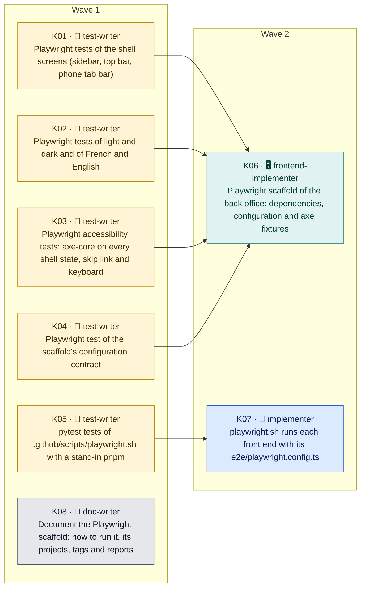

# T0.22: Playwright scaffold against the real images, plan

**Plan:** 🟢 Approved

**Push:** 🟢 Approved

<!-- ticket:specs -->
## 📚 Specifications

The specification and design pages of [TICKET.md](TICKET.md), copied by `python3 .claude/scripts/tickets/ticket_refs.py sync`.

- [🏗️ Tests and traceability](../../technical/delivery/tests-and-traceability.md#levels)
- [🏗️ CI/CD and stages](../../technical/delivery/ci-cd-and-stages.md#stages-dev-and-qa)
- [🏗️ CI/CD and stages](../../technical/delivery/ci-cd-and-stages.md#workflows)
- [📜 D426 Testing strategy](../../specs/06-decisions/technical/d426-testing-strategy.md)
- [📜 D47 App shell](../../specs/06-decisions/ux/d47-app-shell.md)
- [📜 D43 Light and dark modes](../../specs/06-decisions/ux/d43-light-and-dark.md)
- [📜 D21 Languages](../../specs/06-decisions/foundations/d21-languages.md)
- [📜 D46 Accessibility standard](../../specs/06-decisions/ux/d46-accessibility-standard.md)
- [🏗️ Tests and traceability](../../technical/delivery/tests-and-traceability.md)
- [🏗️ CI/CD and stages](../../technical/delivery/ci-cd-and-stages.md)
- [🏗️ Front end](../../technical/architecture/frontend.md)
- [♿ Accessibility](../../specs/05-non-functional/accessibility.md)
<!-- /ticket:specs -->

## Summary

T0.22 builds the Playwright scaffold of the back office in 8 tasks over 2 waves. Wave 1 has 5 test-writer tasks and the docs task running beside them. Four Playwright tasks in frontend/backoffice/e2e/ each cover one concern: the shell screens of T0.17 (TKT-21), themes and languages, accessibility, and the configuration contract. A fifth task writes a pytest suite for .github/scripts/playwright.sh. Wave 2 has two tasks. A frontend-implementer adds the scaffold: dependencies, lock file, e2e/playwright.config.ts with four projects (light-en, dark-en, light-fr, dark-fr), trace, video and screenshot kept on failure, and an HTML report in frontend/backoffice/playwright-report/. It also adds the axe-core fixtures. An implementer changes playwright.sh to pass --config e2e/playwright.config.ts when that file exists. The CI workflows already call playwright.sh and already upload the reports, so neither workflow changes. The Playwright tests can only run once T0.17 (the shell) and T0.21 (compose.e2e.yaml) are done. The start rule ensures that.

## Assumptions

- No screen page exists for the app shell, so Screens touched says no screen: the ticket tests the shell that T0.17 builds.
- The roadmap names no use case or business rule, so the acceptance criteria cite decisions (D426, D43, D21, D46, D47).
- Roadmap rows have no per-ticket anchor, so links use the sprint anchors (#s04, #s03) and #epics.
- The exact set of @smoke tests beyond the shell in light and dark, French and English, plus an accessibility check, is not specified and is left to the plan.
- Accessibility and localisation non-functional pages have measures still to be specified, so no budget is touched.
- check_ticket.py could not be run because no shell tool was available in this session; links and IDs were checked by hand against the files found.
- T0.17 has no PLAN.md yet and its TICKET.md lists no screen page (it says '➖ No screen' and leaves the shell's screens to T0.22). So the shell's screens tested here come from T0.17's acceptance criteria 3 to 7, D47 and C-08: sidebar expanded, sidebar collapsed to icons, top bar places, phone bottom tab bar, theme and language, skip link and aria-current. There is no mock-up folder under docs/specs/04-ux/mockups/src/ for the shell. The tablet layout of responsive.md is not tested, because T0.17 does not deliver it.
- The TICKET places the Playwright configuration in frontend/backoffice/e2e/. Playwright only finds a config in the working directory by default, so .github/scripts/playwright.sh gets a small change: it passes --config e2e/playwright.config.ts when that file exists. The config writes its reports to ../playwright-report and ../test-results, so images.yml and stage.yml collect them unchanged.
- Test files are named *.e2e.ts, so that the default include of the Vitest setup T0.17 built never picks them up and none of T0.17's files needs changing.
- The exact smoke set is not specified (TICKET assumption 4). Every test of this ticket is tagged @smoke, so the dev stage runs them all and QA runs the same suite until more tests come.
- Viewports follow D121: desktop 1440 x 900 for the four projects, phone 390 x 844 in the phone tests.
- The app takes its language from the browser's locale when the user has not chosen one. The language tests set the Playwright locale ('en-GB' or 'fr-FR') and compare the texts with the catalogues of frontend/packages/i18n. If T0.16 or T0.17 built it differently, the test-writer uses the app's own language switch and records it.
- The specifications name no base URL for the stack. The config reads ERP_E2E_BASE_URL and defaults to the backoffice port that compose.e2e.yaml (T0.21) publishes.
- The axe-core check uses the tags wcag2a, wcag2aa, wcag21a, wcag21aa and wcag22aa for WCAG 2.2 AA (D46). The RGAA 4.1 checklist stays a manual audit, as the design system's accessibility page says. No measure is tested, because docs/specs/05-non-functional/accessibility.md has none yet.
- No retries are configured, and trace and video are 'retain-on-failure', so a first failure always keeps its evidence. No JUnit report of Playwright is added for the release test report (TKT-26), because the TICKET does not ask for one. It can become a follow-up.
- The theme tests read the active theme from the marker T0.17 built (an attribute or class on the document) and compare computed background colours. No specification names the marker, so the test-writer takes it from the shell's source.
- The pytest tests of playwright.sh go to a new tests/ci/playwright/ folder. pnpm-lock.yaml is owned by the frontend-implementer task that adds the Playwright dependencies, because it is the workspace lock those dependencies change.

<!-- plan:graph -->

> [!NOTE]
> Generated from the json block at the end of this page by `python3 .claude/scripts/tickets/plan.py render`.
> To change a task, edit the json block, then render again: never edit this view by hand.

## Waves

| Wave | Tasks | Agents running at once |
| --- | --- | --- |
| 1 | [K01](#k01), [K02](#k02), [K03](#k03), [K04](#k04), [K05](#k05), [K08](#k08) | 6 of 6 |
| 2 | [K06](#k06), [K07](#k07) | 2 of 2 |

| Wave | Task | Agent | Depends on | Unblocks |
| --- | --- | --- | --- | --- |
| 1 | [K01](#k01) Playwright tests of the shell screens (sidebar, top bar, phone tab bar) | 🧪 test-writer | none | [K06](#k06) |
| 1 | [K02](#k02) Playwright tests of light and dark and of French and English | 🧪 test-writer | none | [K06](#k06) |
| 1 | [K03](#k03) Playwright accessibility tests: axe-core on every shell state, skip link and keyboard | 🧪 test-writer | none | [K06](#k06) |
| 1 | [K04](#k04) Playwright test of the scaffold's configuration contract | 🧪 test-writer | none | [K06](#k06) |
| 1 | [K05](#k05) pytest tests of .github/scripts/playwright.sh with a stand-in pnpm | 🧪 test-writer | none | [K07](#k07) |
| 1 | [K08](#k08) Document the Playwright scaffold: how to run it, its projects, tags and reports | 📝 doc-writer | none | none |
| 2 | [K06](#k06) Playwright scaffold of the back office: dependencies, configuration and axe fixtures | 🖥️ frontend-implementer | [K01](#k01), [K02](#k02), [K03](#k03), [K04](#k04) | none |
| 2 | [K07](#k07) playwright.sh runs each front end with its e2e/playwright.config.ts | 🐍 implementer | [K05](#k05) | none |

## Dependency graph



## Tasks

### <a id="k01"></a>K01: Playwright tests of the shell screens (sidebar, top bar, phone tab bar)

| Agent | Wave | Depends on | Unblocks |
| --- | --- | --- | --- |
| 🧪 test-writer | 1 | none | [K06](#k06) |

**Files** (only this task may change them in its wave):

- `frontend/backoffice/e2e/shell/sidebar.e2e.ts`
- `frontend/backoffice/e2e/shell/top-bar.e2e.ts`
- `frontend/backoffice/e2e/shell/phone.e2e.ts`

**Done when:** The three files exist. `grep -L "@smoke" frontend/backoffice/e2e/shell/*.e2e.ts` prints nothing. `grep -l "from '@playwright/test'" frontend/backoffice/e2e/shell/*.e2e.ts` prints nothing. `pnpm --filter ./frontend/backoffice exec eslint e2e/shell` reports no error except unresolved imports of e2e/fixtures/ (written in wave 2).

**Brief:**

Write the Playwright tests of the back-office shell's screens (TKT-21, acceptance criterion 4 of docs/tickets/T0.22/TICKET.md). They run against the real images of compose.e2e.yaml, never a dev server. Specifications: D47 docs/specs/06-decisions/ux/d47-app-shell.md (collapsible left sidebar; top bar with global search, the AI assistant, notifications, the site switcher and the user menu; a bottom tab bar on phones), D426 docs/specs/06-decisions/technical/d426-testing-strategy.md (tests on the real images), docs/technical/delivery/tests-and-traceability.md (GUI level: Playwright in frontend/&lt;app>/e2e/), docs/technical/architecture/frontend.md, plus docs/specs/04-ux/design-system/components/c-08-navigation.md (variants: sidebar expanded or collapsed to icons, phone bottom tab bar; a named nav landmark; aria-current on the current page) and docs/specs/04-ux/design-system/responsive.md. The shell's states are the acceptance criteria 3 to 6 of docs/tickets/T0.17/TICKET.md. Before writing locators, read the shell that T0.17 built in frontend/backoffice/src/ (read only, never change it). Prefer roles and accessible names (getByRole('navigation', { name }), 'banner', 'main') over CSS classes.

The scaffold contract (frontend-implementer K06 builds it in wave 2, so the imports resolve only after it): import `test` and `expect` only from '../fixtures/test' (relative to this folder), never from '@playwright/test'. Every test carries `{ tag: '@smoke' }`. Each file has one `test.describe` named after the screen. Tests use relative URLs (page.goto('/')), because baseURL comes from the config. The config runs every test in four desktop projects (1440 x 900, D121): light-en, dark-en, light-fr, dark-fr. A test that needs the project's language reads `test.info().project.use.locale` and never hard-codes English text: take labels from the catalogues of frontend/packages/i18n.

Tests:
- sidebar.e2e.ts: the expanded sidebar shows the symbol and its items with labels in a named nav landmark, and the current page's item carries aria-current="page". When the user collapses it with its control, it shows icons only (item labels hidden, the items still reachable and named). Expanding it again restores the labels.
- top-bar.e2e.ts: the banner holds the places for search, the assistant, notifications, the site switcher and the user menu, each visible and named.
- phone.e2e.ts: `test.use({ viewport: { width: 390, height: 844 }, isMobile: true, hasTouch: true })` (phone size of D121 docs/specs/06-decisions/ux/d121-mockup-sizes.md). The bottom tab bar is visible as a named nav landmark, the sidebar is not visible, and the tabs are those T0.17 built from C-08's anatomy ([Home] [Tasks] [Assistant] [Me]).

The accessibility scan runs automatically through the fixture, so do not call axe here. Write in TypeScript, strict, with no `any`.

### <a id="k02"></a>K02: Playwright tests of light and dark and of French and English

| Agent | Wave | Depends on | Unblocks |
| --- | --- | --- | --- |
| 🧪 test-writer | 1 | none | [K06](#k06) |

**Files** (only this task may change them in its wave):

- `frontend/backoffice/e2e/preferences/theme.e2e.ts`
- `frontend/backoffice/e2e/preferences/language.e2e.ts`

**Done when:** Both files exist. `grep -L "@smoke" frontend/backoffice/e2e/preferences/*.e2e.ts` prints nothing. `pnpm --filter ./frontend/backoffice exec eslint e2e/preferences` reports no error except unresolved imports of e2e/fixtures/.

**Brief:**

Write the Playwright tests proving the shell renders in light and dark and in French and English (acceptance criterion 3 of docs/tickets/T0.22/TICKET.md). They run against the real images of compose.e2e.yaml. Specifications: D43 docs/specs/06-decisions/ux/d43-light-and-dark.md (light and dark themes following the device's setting, with a manual switch per user), D21 docs/specs/06-decisions/foundations/d21-languages.md (French and English at launch, every text in translation files), D47 docs/specs/06-decisions/ux/d47-app-shell.md, D426 docs/specs/06-decisions/technical/d426-testing-strategy.md, docs/technical/delivery/tests-and-traceability.md, and acceptance criteria 2 and 7 of docs/tickets/T0.17/TICKET.md. Read, without changing them, the shell of frontend/backoffice/src/ (where it marks the active theme and where its manual theme switch is) and the catalogues of frontend/packages/i18n (T0.16).

The scaffold contract (K06 builds it in wave 2): import `test` and `expect` only from '../fixtures/test'. Every test carries `{ tag: '@smoke' }`. Use relative URLs. Every test runs in the four projects light-en, dark-en, light-fr and dark-fr, which set `colorScheme` and `locale` ('en-GB' or 'fr-FR'). Read the expected theme and language from `test.info().project.use.colorScheme` and `.locale`, so that one test covers all four projects.

Tests:
- theme.e2e.ts: the theme follows the device. The theme the shell marks as active (as T0.17 marks it) matches the project's colorScheme, and the page's computed background colour differs between the two themes. The manual switch overrides the device: after using it, the active theme is the other one.
- language.e2e.ts: the app renders in the project's language. `<html lang>` starts with 'fr' or 'en', and the skip link and at least the sidebar's first item show the texts of that language's catalogue in frontend/packages/i18n. No visible text of the shell is a raw catalogue key.

TypeScript, strict, no `any`.

### <a id="k03"></a>K03: Playwright accessibility tests: axe-core on every shell state, skip link and keyboard

| Agent | Wave | Depends on | Unblocks |
| --- | --- | --- | --- |
| 🧪 test-writer | 1 | none | [K06](#k06) |

**Files** (only this task may change them in its wave):

- `frontend/backoffice/e2e/accessibility/axe.e2e.ts`
- `frontend/backoffice/e2e/accessibility/keyboard.e2e.ts`

**Done when:** Both files exist. `grep -L "@smoke" frontend/backoffice/e2e/accessibility/*.e2e.ts` prints nothing. `pnpm --filter ./frontend/backoffice exec eslint e2e/accessibility` reports no error except unresolved imports of e2e/fixtures/.

**Brief:**

Write the accessibility check of the shell (acceptance criterion 3 of docs/tickets/T0.22/TICKET.md). Specifications: D46 docs/specs/06-decisions/ux/d46-accessibility-standard.md (WCAG 2.2 level AA everywhere, plus RGAA 4.1), docs/specs/05-non-functional/accessibility.md (its measures are still to be specified, so no budget is tested), and docs/specs/04-ux/design-system/accessibility.md ('axe-core runs in every Playwright test of the front ends (TEST-6), and a violation fails the test'). Also D47 docs/specs/06-decisions/ux/d47-app-shell.md, D426 docs/specs/06-decisions/technical/d426-testing-strategy.md, docs/technical/delivery/tests-and-traceability.md, docs/specs/04-ux/design-system/components/c-08-navigation.md ('skip to content' first, aria-current, every item reachable by keyboard) and acceptance criterion 6 of docs/tickets/T0.17/TICKET.md. Read the shell in frontend/backoffice/src/ without changing it.

The scaffold contract (K06 builds it in wave 2): import `test` and `expect` from '../fixtures/test', and `expectNoAccessibilityViolations(page: Page): Promise<void>` from '../fixtures/accessibility'. That function runs @axe-core/playwright with the tags wcag2a, wcag2aa, wcag21a, wcag21aa and wcag22aa, and fails with the list of violations. The `test` of the fixture also runs the same scan after every test that opened a page of the app. Every test carries `{ tag: '@smoke' }`, uses relative URLs, and runs in the four projects light-en, dark-en, light-fr and dark-fr.

Tests:
- axe.e2e.ts: call expectNoAccessibilityViolations explicitly on the shell with the sidebar expanded, with it collapsed, with the user menu open (if T0.17 builds it as a menu), and at the phone size 390 x 844 (D121) with the bottom tab bar.
- keyboard.e2e.ts: the first Tab focuses the 'skip to content' link, with its catalogue text for the project's language. Activating it moves focus to the main landmark. The current page's navigation item carries aria-current="page". Every sidebar item and every top-bar place can be reached with Tab, and focus is visible on each (a non-empty outline or box-shadow).

TypeScript, strict, no `any`.

### <a id="k04"></a>K04: Playwright test of the scaffold's configuration contract

| Agent | Wave | Depends on | Unblocks |
| --- | --- | --- | --- |
| 🧪 test-writer | 1 | none | [K06](#k06) |

**Files** (only this task may change them in its wave):

- `frontend/backoffice/e2e/scaffold/config.e2e.ts`

**Done when:** The file exists. `grep -c "@smoke" frontend/backoffice/e2e/scaffold/config.e2e.ts` is at least 1. `pnpm --filter ./frontend/backoffice exec eslint e2e/scaffold` reports no error except unresolved imports of e2e/fixtures/.

**Brief:**

Write one Playwright test file that proves, from inside the run, that the configuration keeps the evidence of a failure and runs against the real images (acceptance criteria 1 and 2 of docs/tickets/T0.22/TICKET.md). Specifications: D426 docs/specs/06-decisions/technical/d426-testing-strategy.md (tests on the real images), docs/technical/delivery/tests-and-traceability.md (GUI level against the real images of compose.e2e.yaml), docs/technical/delivery/ci-cd-and-stages.md (images.yml and stage.yml run Playwright; dev runs @smoke), and AGENT.md 'Front ends' (tests never run against a development server). Import `test` and `expect` from '../fixtures/test' (K06 writes it in wave 2). Tag every test `{ tag: '@smoke' }`. Do not open a page.

Assert, through `test.info()`:
- project.use.trace is 'retain-on-failure', project.use.video is 'retain-on-failure' and project.use.screenshot is 'only-on-failure';
- config.webServer is null (no development server);
- config.reporter holds an 'html' reporter whose outputFolder ends with 'frontend/backoffice/playwright-report' and whose open option is 'never';
- project.outputDir ends with 'frontend/backoffice/test-results' (where playwright.sh, images.yml and stage.yml collect the results);
- the project names are exactly light-en, dark-en, light-fr and dark-fr. The current project's colorScheme and locale match its name ('en-GB' or 'fr-FR'), and its viewport is 1440 x 900 (D121 docs/specs/06-decisions/ux/d121-mockup-sizes.md);
- project.use.baseURL equals process.env.ERP_E2E_BASE_URL when that variable is set.

TypeScript, strict, no `any`.

### <a id="k05"></a>K05: pytest tests of .github/scripts/playwright.sh with a stand-in pnpm

| Agent | Wave | Depends on | Unblocks |
| --- | --- | --- | --- |
| 🧪 test-writer | 1 | none | [K07](#k07) |

**Files** (only this task may change them in its wave):

- `tests/ci/playwright/test_playwright_script.py`
- `tests/ci/playwright/helpers.py`

**Done when:** `uv run ruff check tests/ci/playwright` and `uv run ruff format --check tests/ci/playwright` pass. `uv run pytest tests/ci/playwright -n 2` runs: the --config test fails against the current script (tests first) and the others pass.

**Brief:**

Write the repository-level tests of `.github/scripts/playwright.sh`, the script that runs every front end's Playwright suite in CI (images.yml) and in stage.yml (acceptance criteria 1 and 2 of docs/tickets/T0.22/TICKET.md). Specifications: docs/technical/delivery/ci-cd-and-stages.md (#workflows: images.yml runs Playwright against the real images; #stages-dev-and-qa: dev runs Playwright @smoke, QA the full suite), docs/technical/delivery/tests-and-traceability.md, and D426 docs/specs/06-decisions/technical/d426-testing-strategy.md. Read the current script (it loops over frontend/*/e2e and frontend/portals/*/e2e, runs `pnpm exec playwright install --with-deps chromium` then `pnpm exec playwright test "$@"` in each project, goes on after a failure, and exits 1 if any failed). Read tests/ci/release/helpers.py for how the repository runs a bash script with a stand-in executable.

Follow AGENT.md 'Tests': one `TestPlaywrightScript` class, tests named as sentences, no mocks. Use a real stand-in `pnpm`: an executable written into tmp_path and put first on PATH. It appends its working directory and arguments to a log file and exits non-zero when the working directory holds a marker file `fail`. Build a temporary repository layout in tmp_path with frontend/backoffice/e2e/ and run the real script from the repository with cwd=tmp_path through subprocess. Put shared builders in helpers.py and import them as `from tests.ci.playwright.helpers import ...`.

Tests:
- when frontend/&lt;app>/e2e/playwright.config.ts exists, the script runs `playwright test --config e2e/playwright.config.ts` in frontend/&lt;app>, followed by the extra arguments. This one fails until K07 changes the script;
- extra arguments such as `--grep @smoke` reach `playwright test` unchanged;
- a front end without e2e/playwright.config.ts gets no --config;
- a portal under frontend/portals/&lt;portal>/e2e is run too;
- one failing front end makes the script exit 1, and the other front ends still run;
- with no e2e folder, the script exits 0 and says Playwright is not applicable.

### <a id="k08"></a>K08: Document the Playwright scaffold: how to run it, its projects, tags and reports

| Agent | Wave | Depends on | Unblocks |
| --- | --- | --- | --- |
| 📝 doc-writer | 1 | none | none |

**Files** (only this task may change them in its wave):

- `docs/technical/delivery/tests-and-traceability.md`
- `docs/technical/architecture/frontend.md`
- `frontend/backoffice/README.md`

**Done when:** `grep -n 'ERP_E2E_BASE_URL' docs/technical/delivery/tests-and-traceability.md` finds the new section. `grep -n 'e2e' docs/technical/architecture/frontend.md frontend/backoffice/README.md` finds the new lines. Every relative link added in the three files opens an existing file.

**Brief:**

Document the Playwright scaffold T0.22 delivers (docs/tickets/T0.22/TICKET.md). Specifications: D426 docs/specs/06-decisions/technical/d426-testing-strategy.md, D43 docs/specs/06-decisions/ux/d43-light-and-dark.md, D21 docs/specs/06-decisions/foundations/d21-languages.md, D46 docs/specs/06-decisions/ux/d46-accessibility-standard.md, D47 docs/specs/06-decisions/ux/d47-app-shell.md, docs/technical/delivery/ci-cd-and-stages.md. Plain British English, no em dashes, links relative to each file. Never change docs/specs/.

What is being built (state exactly this):
- the configuration is frontend/backoffice/e2e/playwright.config.ts, with tests named *.e2e.ts under e2e/shell/, e2e/preferences/, e2e/accessibility/ and e2e/scaffold/, and fixtures in e2e/fixtures/;
- four projects, light-en, dark-en, light-fr and dark-fr, at 1440 x 900, plus the phone size 390 x 844 in the phone tests (D121);
- every test of this ticket is tagged @smoke. The dev stage runs `--grep @smoke` and QA the full suite;
- axe-core (WCAG 2.2 AA tags) runs after every test, and a violation fails it;
- trace, video and screenshot are kept on failure in frontend/backoffice/test-results/, and the HTML report in frontend/backoffice/playwright-report/, which images.yml uploads on failure and stage.yml always keeps;
- the base URL comes from ERP_E2E_BASE_URL, defaulting to the backoffice port that compose.e2e.yaml publishes;
- there is never a development server;
- `.github/scripts/playwright.sh` passes `--config e2e/playwright.config.ts` to each front end that has one.

Changes:
1. docs/technical/delivery/tests-and-traceability.md: add a section 'Playwright' after 'Levels' with the points above and the local commands in a bash block: `docker compose -f compose.e2e.yaml up --detach --wait`, `bash .github/scripts/playwright.sh --grep @smoke`, and `pnpm --filter ./frontend/backoffice exec playwright show-report playwright-report`. Update 'Last reviewed'.
2. docs/technical/architecture/frontend.md, section 'Today': one or two lines saying the back office has Playwright tests in frontend/backoffice/e2e/ against the real images, linking the new section. Update 'Last reviewed'.
3. frontend/backoffice/README.md (create the section if the file exists, or the file if it does not): a short 'End-to-end tests' section linking the tests-and-traceability section.

### <a id="k06"></a>K06: Playwright scaffold of the back office: dependencies, configuration and axe fixtures

| Agent | Wave | Depends on | Unblocks |
| --- | --- | --- | --- |
| 🖥️ frontend-implementer | 2 | [K01](#k01), [K02](#k02), [K03](#k03), [K04](#k04) | none |

**Files** (only this task may change them in its wave):

- `frontend/backoffice/package.json`
- `pnpm-lock.yaml`
- `frontend/backoffice/.gitignore`
- `frontend/backoffice/e2e/playwright.config.ts`
- `frontend/backoffice/e2e/tsconfig.json`
- `frontend/backoffice/e2e/fixtures/test.ts`
- `frontend/backoffice/e2e/fixtures/accessibility.ts`

**Done when:** `pnpm install --frozen-lockfile` passes. `pnpm --filter ./frontend/backoffice run lint` and `pnpm --filter ./frontend/backoffice run typecheck` pass. `cd frontend/backoffice && pnpm exec playwright test --config e2e/playwright.config.ts --list` lists every *.e2e.ts test under the four projects. With the stack up (`docker compose -f compose.e2e.yaml up --detach --wait`), `cd frontend/backoffice && pnpm exec playwright test --config e2e/playwright.config.ts --grep @smoke` exits 0. A deliberately failing run leaves its trace, video and screenshot in frontend/backoffice/test-results/ and the HTML report in frontend/backoffice/playwright-report/.

**Brief:**

Build the Playwright scaffold the wave-1 tests of frontend/backoffice/e2e/ need (docs/tickets/T0.22/TICKET.md, 'What it delivers' and acceptance criteria 1 to 3). Specifications: D426 docs/specs/06-decisions/technical/d426-testing-strategy.md, D43 docs/specs/06-decisions/ux/d43-light-and-dark.md, D21 docs/specs/06-decisions/foundations/d21-languages.md, D46 docs/specs/06-decisions/ux/d46-accessibility-standard.md, docs/specs/05-non-functional/accessibility.md, D47 docs/specs/06-decisions/ux/d47-app-shell.md, docs/technical/delivery/tests-and-traceability.md (#levels: Playwright in frontend/&lt;app>/e2e/ against the real images of compose.e2e.yaml), docs/technical/delivery/ci-cd-and-stages.md, docs/technical/architecture/frontend.md, docs/specs/04-ux/design-system/accessibility.md (axe-core in every Playwright test, a violation fails it) and AGENT.md 'Front ends' (never a development server). Do not change the tests written in wave 1. If one of them is wrong, report it in blocked_by (TKT-19).

Deliver:
1. frontend/backoffice/package.json: devDependencies @playwright/test and @axe-core/playwright at pinned versions. Extend the `typecheck` script so that it also checks e2e/ (`tsc -p e2e/tsconfig.json --noEmit`), and make `lint` cover e2e/. Update pnpm-lock.yaml with `pnpm install` (D415: the lock stays pinned).
2. frontend/backoffice/e2e/playwright.config.ts (defineConfig). Set testDir '.' and testMatch '**/*.e2e.ts', so that Vitest's default include never picks the files. Set no webServer, and forbidOnly in CI. Keep trace 'retain-on-failure', video 'retain-on-failure' and screenshot 'only-on-failure'. Use the reporters list and html with outputFolder '../playwright-report' and open 'never', and outputDir '../test-results', which resolve to frontend/backoffice/playwright-report/ and test-results/, the folders playwright.sh, images.yml and stage.yml collect. Take baseURL from process.env.ERP_E2E_BASE_URL. Its default is the URL where compose.e2e.yaml (T0.21) publishes the backoffice service: read that file for the port. Define four chromium projects at viewport 1440 x 900 (D121 docs/specs/06-decisions/ux/d121-mockup-sizes.md): light-en (colorScheme 'light', locale 'en-GB'), dark-en, light-fr ('fr-FR') and dark-fr.
3. frontend/backoffice/e2e/tsconfig.json: strict, extending the shared settings of frontend/packages/config when the app's own tsconfig does, covering e2e/**/*.ts.
4. frontend/backoffice/e2e/fixtures/accessibility.ts: export `expectNoAccessibilityViolations(page: Page): Promise<void>`. It runs AxeBuilder with the tags wcag2a, wcag2aa, wcag21a, wcag21aa and wcag22aa, and fails with each violation's id, help and targets.
5. frontend/backoffice/e2e/fixtures/test.ts: export `test`, extended from @playwright/test with an automatic fixture. After each test whose page has left about:blank, the fixture calls expectNoAccessibilityViolations. Also export `expect`.
6. frontend/backoffice/.gitignore (create or extend): playwright-report/ and test-results/.

No `any`. Follow the app's eslint and strict TypeScript settings (T0.02).

### <a id="k07"></a>K07: playwright.sh runs each front end with its e2e/playwright.config.ts

| Agent | Wave | Depends on | Unblocks |
| --- | --- | --- | --- |
| 🐍 implementer | 2 | [K05](#k05) | none |

**Files** (only this task may change them in its wave):

- `.github/scripts/playwright.sh`

**Done when:** `bash -n .github/scripts/playwright.sh` passes. `uv run pytest tests/ci/playwright -n 2` passes. `uv run pytest tests/ci/workflows -n 2` still passes.

**Brief:**

Change `.github/scripts/playwright.sh` so that it runs the Playwright configuration that T0.22 places in `frontend/<app>/e2e/` (docs/tickets/T0.22/TICKET.md, 'What it delivers': the script runs them in CI and in stage.yml, and a failure uploads the HTML report). Specifications: docs/technical/delivery/ci-cd-and-stages.md (#workflows, #stages-dev-and-qa: dev runs Playwright @smoke, QA the full suite), docs/technical/delivery/tests-and-traceability.md, and D426 docs/specs/06-decisions/technical/d426-testing-strategy.md. When `$e2e/playwright.config.ts` exists, run `pnpm exec playwright test --config e2e/playwright.config.ts "$@"` inside the project. Otherwise keep `pnpm exec playwright test "$@"`. Keep everything else: the loop over frontend/*/e2e and frontend/portals/*/e2e, the browser install, the GitHub groups and error lines, going on after a failure, exit 1 if any failed, and the 'not applicable' message. Update the header comment. The reports still land in frontend/&lt;app>/playwright-report/ and test-results/, which images.yml ('Keep the Playwright reports', on failure) and stage.yml ('Collect the Playwright reports') already upload. Do not change those workflows. The tests are tests/ci/playwright/test_playwright_script.py (K05). Do not change them. If one is wrong, report it in blocked_by (TKT-19).

<!-- /plan:graph -->

## Task graph

<details>
<summary>🤖 Task graph as read by <code>/ticket-run</code> (json)</summary>

```json
[
  {
    "id": "K01",
    "title": "Playwright tests of the shell screens (sidebar, top bar, phone tab bar)",
    "agent": "test-writer",
    "depends_on": [],
    "files": [
      "frontend/backoffice/e2e/shell/sidebar.e2e.ts",
      "frontend/backoffice/e2e/shell/top-bar.e2e.ts",
      "frontend/backoffice/e2e/shell/phone.e2e.ts"
    ],
    "brief": "Write the Playwright tests of the back-office shell's screens (TKT-21, acceptance criterion 4 of docs/tickets/T0.22/TICKET.md). They run against the real images of compose.e2e.yaml, never a dev server. Specifications: D47 docs/specs/06-decisions/ux/d47-app-shell.md (collapsible left sidebar; top bar with global search, the AI assistant, notifications, the site switcher and the user menu; a bottom tab bar on phones), D426 docs/specs/06-decisions/technical/d426-testing-strategy.md (tests on the real images), docs/technical/delivery/tests-and-traceability.md (GUI level: Playwright in frontend/<app>/e2e/), docs/technical/architecture/frontend.md, plus docs/specs/04-ux/design-system/components/c-08-navigation.md (variants: sidebar expanded or collapsed to icons, phone bottom tab bar; a named nav landmark; aria-current on the current page) and docs/specs/04-ux/design-system/responsive.md. The shell's states are the acceptance criteria 3 to 6 of docs/tickets/T0.17/TICKET.md. Before writing locators, read the shell that T0.17 built in frontend/backoffice/src/ (read only, never change it). Prefer roles and accessible names (getByRole('navigation', { name }), 'banner', 'main') over CSS classes.\n\nThe scaffold contract (frontend-implementer K06 builds it in wave 2, so the imports resolve only after it): import `test` and `expect` only from '../fixtures/test' (relative to this folder), never from '@playwright/test'. Every test carries `{ tag: '@smoke' }`. Each file has one `test.describe` named after the screen. Tests use relative URLs (page.goto('/')), because baseURL comes from the config. The config runs every test in four desktop projects (1440 x 900, D121): light-en, dark-en, light-fr, dark-fr. A test that needs the project's language reads `test.info().project.use.locale` and never hard-codes English text: take labels from the catalogues of frontend/packages/i18n.\n\nTests:\n- sidebar.e2e.ts: the expanded sidebar shows the symbol and its items with labels in a named nav landmark, and the current page's item carries aria-current=\"page\". When the user collapses it with its control, it shows icons only (item labels hidden, the items still reachable and named). Expanding it again restores the labels.\n- top-bar.e2e.ts: the banner holds the places for search, the assistant, notifications, the site switcher and the user menu, each visible and named.\n- phone.e2e.ts: `test.use({ viewport: { width: 390, height: 844 }, isMobile: true, hasTouch: true })` (phone size of D121 docs/specs/06-decisions/ux/d121-mockup-sizes.md). The bottom tab bar is visible as a named nav landmark, the sidebar is not visible, and the tabs are those T0.17 built from C-08's anatomy ([Home] [Tasks] [Assistant] [Me]).\n\nThe accessibility scan runs automatically through the fixture, so do not call axe here. Write in TypeScript, strict, with no `any`.",
    "done_when": "The three files exist. `grep -L \"@smoke\" frontend/backoffice/e2e/shell/*.e2e.ts` prints nothing. `grep -l \"from '@playwright/test'\" frontend/backoffice/e2e/shell/*.e2e.ts` prints nothing. `pnpm --filter ./frontend/backoffice exec eslint e2e/shell` reports no error except unresolved imports of e2e/fixtures/ (written in wave 2).",
    "wave": 1
  },
  {
    "id": "K02",
    "title": "Playwright tests of light and dark and of French and English",
    "agent": "test-writer",
    "depends_on": [],
    "files": [
      "frontend/backoffice/e2e/preferences/theme.e2e.ts",
      "frontend/backoffice/e2e/preferences/language.e2e.ts"
    ],
    "brief": "Write the Playwright tests proving the shell renders in light and dark and in French and English (acceptance criterion 3 of docs/tickets/T0.22/TICKET.md). They run against the real images of compose.e2e.yaml. Specifications: D43 docs/specs/06-decisions/ux/d43-light-and-dark.md (light and dark themes following the device's setting, with a manual switch per user), D21 docs/specs/06-decisions/foundations/d21-languages.md (French and English at launch, every text in translation files), D47 docs/specs/06-decisions/ux/d47-app-shell.md, D426 docs/specs/06-decisions/technical/d426-testing-strategy.md, docs/technical/delivery/tests-and-traceability.md, and acceptance criteria 2 and 7 of docs/tickets/T0.17/TICKET.md. Read, without changing them, the shell of frontend/backoffice/src/ (where it marks the active theme and where its manual theme switch is) and the catalogues of frontend/packages/i18n (T0.16).\n\nThe scaffold contract (K06 builds it in wave 2): import `test` and `expect` only from '../fixtures/test'. Every test carries `{ tag: '@smoke' }`. Use relative URLs. Every test runs in the four projects light-en, dark-en, light-fr and dark-fr, which set `colorScheme` and `locale` ('en-GB' or 'fr-FR'). Read the expected theme and language from `test.info().project.use.colorScheme` and `.locale`, so that one test covers all four projects.\n\nTests:\n- theme.e2e.ts: the theme follows the device. The theme the shell marks as active (as T0.17 marks it) matches the project's colorScheme, and the page's computed background colour differs between the two themes. The manual switch overrides the device: after using it, the active theme is the other one.\n- language.e2e.ts: the app renders in the project's language. `<html lang>` starts with 'fr' or 'en', and the skip link and at least the sidebar's first item show the texts of that language's catalogue in frontend/packages/i18n. No visible text of the shell is a raw catalogue key.\n\nTypeScript, strict, no `any`.",
    "done_when": "Both files exist. `grep -L \"@smoke\" frontend/backoffice/e2e/preferences/*.e2e.ts` prints nothing. `pnpm --filter ./frontend/backoffice exec eslint e2e/preferences` reports no error except unresolved imports of e2e/fixtures/.",
    "wave": 1
  },
  {
    "id": "K03",
    "title": "Playwright accessibility tests: axe-core on every shell state, skip link and keyboard",
    "agent": "test-writer",
    "depends_on": [],
    "files": [
      "frontend/backoffice/e2e/accessibility/axe.e2e.ts",
      "frontend/backoffice/e2e/accessibility/keyboard.e2e.ts"
    ],
    "brief": "Write the accessibility check of the shell (acceptance criterion 3 of docs/tickets/T0.22/TICKET.md). Specifications: D46 docs/specs/06-decisions/ux/d46-accessibility-standard.md (WCAG 2.2 level AA everywhere, plus RGAA 4.1), docs/specs/05-non-functional/accessibility.md (its measures are still to be specified, so no budget is tested), and docs/specs/04-ux/design-system/accessibility.md ('axe-core runs in every Playwright test of the front ends (TEST-6), and a violation fails the test'). Also D47 docs/specs/06-decisions/ux/d47-app-shell.md, D426 docs/specs/06-decisions/technical/d426-testing-strategy.md, docs/technical/delivery/tests-and-traceability.md, docs/specs/04-ux/design-system/components/c-08-navigation.md ('skip to content' first, aria-current, every item reachable by keyboard) and acceptance criterion 6 of docs/tickets/T0.17/TICKET.md. Read the shell in frontend/backoffice/src/ without changing it.\n\nThe scaffold contract (K06 builds it in wave 2): import `test` and `expect` from '../fixtures/test', and `expectNoAccessibilityViolations(page: Page): Promise<void>` from '../fixtures/accessibility'. That function runs @axe-core/playwright with the tags wcag2a, wcag2aa, wcag21a, wcag21aa and wcag22aa, and fails with the list of violations. The `test` of the fixture also runs the same scan after every test that opened a page of the app. Every test carries `{ tag: '@smoke' }`, uses relative URLs, and runs in the four projects light-en, dark-en, light-fr and dark-fr.\n\nTests:\n- axe.e2e.ts: call expectNoAccessibilityViolations explicitly on the shell with the sidebar expanded, with it collapsed, with the user menu open (if T0.17 builds it as a menu), and at the phone size 390 x 844 (D121) with the bottom tab bar.\n- keyboard.e2e.ts: the first Tab focuses the 'skip to content' link, with its catalogue text for the project's language. Activating it moves focus to the main landmark. The current page's navigation item carries aria-current=\"page\". Every sidebar item and every top-bar place can be reached with Tab, and focus is visible on each (a non-empty outline or box-shadow).\n\nTypeScript, strict, no `any`.",
    "done_when": "Both files exist. `grep -L \"@smoke\" frontend/backoffice/e2e/accessibility/*.e2e.ts` prints nothing. `pnpm --filter ./frontend/backoffice exec eslint e2e/accessibility` reports no error except unresolved imports of e2e/fixtures/.",
    "wave": 1
  },
  {
    "id": "K04",
    "title": "Playwright test of the scaffold's configuration contract",
    "agent": "test-writer",
    "depends_on": [],
    "files": [
      "frontend/backoffice/e2e/scaffold/config.e2e.ts"
    ],
    "brief": "Write one Playwright test file that proves, from inside the run, that the configuration keeps the evidence of a failure and runs against the real images (acceptance criteria 1 and 2 of docs/tickets/T0.22/TICKET.md). Specifications: D426 docs/specs/06-decisions/technical/d426-testing-strategy.md (tests on the real images), docs/technical/delivery/tests-and-traceability.md (GUI level against the real images of compose.e2e.yaml), docs/technical/delivery/ci-cd-and-stages.md (images.yml and stage.yml run Playwright; dev runs @smoke), and AGENT.md 'Front ends' (tests never run against a development server). Import `test` and `expect` from '../fixtures/test' (K06 writes it in wave 2). Tag every test `{ tag: '@smoke' }`. Do not open a page.\n\nAssert, through `test.info()`:\n- project.use.trace is 'retain-on-failure', project.use.video is 'retain-on-failure' and project.use.screenshot is 'only-on-failure';\n- config.webServer is null (no development server);\n- config.reporter holds an 'html' reporter whose outputFolder ends with 'frontend/backoffice/playwright-report' and whose open option is 'never';\n- project.outputDir ends with 'frontend/backoffice/test-results' (where playwright.sh, images.yml and stage.yml collect the results);\n- the project names are exactly light-en, dark-en, light-fr and dark-fr. The current project's colorScheme and locale match its name ('en-GB' or 'fr-FR'), and its viewport is 1440 x 900 (D121 docs/specs/06-decisions/ux/d121-mockup-sizes.md);\n- project.use.baseURL equals process.env.ERP_E2E_BASE_URL when that variable is set.\n\nTypeScript, strict, no `any`.",
    "done_when": "The file exists. `grep -c \"@smoke\" frontend/backoffice/e2e/scaffold/config.e2e.ts` is at least 1. `pnpm --filter ./frontend/backoffice exec eslint e2e/scaffold` reports no error except unresolved imports of e2e/fixtures/.",
    "wave": 1
  },
  {
    "id": "K05",
    "title": "pytest tests of .github/scripts/playwright.sh with a stand-in pnpm",
    "agent": "test-writer",
    "depends_on": [],
    "files": [
      "tests/ci/playwright/test_playwright_script.py",
      "tests/ci/playwright/helpers.py"
    ],
    "brief": "Write the repository-level tests of `.github/scripts/playwright.sh`, the script that runs every front end's Playwright suite in CI (images.yml) and in stage.yml (acceptance criteria 1 and 2 of docs/tickets/T0.22/TICKET.md). Specifications: docs/technical/delivery/ci-cd-and-stages.md (#workflows: images.yml runs Playwright against the real images; #stages-dev-and-qa: dev runs Playwright @smoke, QA the full suite), docs/technical/delivery/tests-and-traceability.md, and D426 docs/specs/06-decisions/technical/d426-testing-strategy.md. Read the current script (it loops over frontend/*/e2e and frontend/portals/*/e2e, runs `pnpm exec playwright install --with-deps chromium` then `pnpm exec playwright test \"$@\"` in each project, goes on after a failure, and exits 1 if any failed). Read tests/ci/release/helpers.py for how the repository runs a bash script with a stand-in executable.\n\nFollow AGENT.md 'Tests': one `TestPlaywrightScript` class, tests named as sentences, no mocks. Use a real stand-in `pnpm`: an executable written into tmp_path and put first on PATH. It appends its working directory and arguments to a log file and exits non-zero when the working directory holds a marker file `fail`. Build a temporary repository layout in tmp_path with frontend/backoffice/e2e/ and run the real script from the repository with cwd=tmp_path through subprocess. Put shared builders in helpers.py and import them as `from tests.ci.playwright.helpers import ...`.\n\nTests:\n- when frontend/<app>/e2e/playwright.config.ts exists, the script runs `playwright test --config e2e/playwright.config.ts` in frontend/<app>, followed by the extra arguments. This one fails until K07 changes the script;\n- extra arguments such as `--grep @smoke` reach `playwright test` unchanged;\n- a front end without e2e/playwright.config.ts gets no --config;\n- a portal under frontend/portals/<portal>/e2e is run too;\n- one failing front end makes the script exit 1, and the other front ends still run;\n- with no e2e folder, the script exits 0 and says Playwright is not applicable.",
    "done_when": "`uv run ruff check tests/ci/playwright` and `uv run ruff format --check tests/ci/playwright` pass. `uv run pytest tests/ci/playwright -n 2` runs: the --config test fails against the current script (tests first) and the others pass.",
    "wave": 1
  },
  {
    "id": "K08",
    "title": "Document the Playwright scaffold: how to run it, its projects, tags and reports",
    "agent": "doc-writer",
    "depends_on": [],
    "files": [
      "docs/technical/delivery/tests-and-traceability.md",
      "docs/technical/architecture/frontend.md",
      "frontend/backoffice/README.md"
    ],
    "brief": "Document the Playwright scaffold T0.22 delivers (docs/tickets/T0.22/TICKET.md). Specifications: D426 docs/specs/06-decisions/technical/d426-testing-strategy.md, D43 docs/specs/06-decisions/ux/d43-light-and-dark.md, D21 docs/specs/06-decisions/foundations/d21-languages.md, D46 docs/specs/06-decisions/ux/d46-accessibility-standard.md, D47 docs/specs/06-decisions/ux/d47-app-shell.md, docs/technical/delivery/ci-cd-and-stages.md. Plain British English, no em dashes, links relative to each file. Never change docs/specs/.\n\nWhat is being built (state exactly this):\n- the configuration is frontend/backoffice/e2e/playwright.config.ts, with tests named *.e2e.ts under e2e/shell/, e2e/preferences/, e2e/accessibility/ and e2e/scaffold/, and fixtures in e2e/fixtures/;\n- four projects, light-en, dark-en, light-fr and dark-fr, at 1440 x 900, plus the phone size 390 x 844 in the phone tests (D121);\n- every test of this ticket is tagged @smoke. The dev stage runs `--grep @smoke` and QA the full suite;\n- axe-core (WCAG 2.2 AA tags) runs after every test, and a violation fails it;\n- trace, video and screenshot are kept on failure in frontend/backoffice/test-results/, and the HTML report in frontend/backoffice/playwright-report/, which images.yml uploads on failure and stage.yml always keeps;\n- the base URL comes from ERP_E2E_BASE_URL, defaulting to the backoffice port that compose.e2e.yaml publishes;\n- there is never a development server;\n- `.github/scripts/playwright.sh` passes `--config e2e/playwright.config.ts` to each front end that has one.\n\nChanges:\n1. docs/technical/delivery/tests-and-traceability.md: add a section 'Playwright' after 'Levels' with the points above and the local commands in a bash block: `docker compose -f compose.e2e.yaml up --detach --wait`, `bash .github/scripts/playwright.sh --grep @smoke`, and `pnpm --filter ./frontend/backoffice exec playwright show-report playwright-report`. Update 'Last reviewed'.\n2. docs/technical/architecture/frontend.md, section 'Today': one or two lines saying the back office has Playwright tests in frontend/backoffice/e2e/ against the real images, linking the new section. Update 'Last reviewed'.\n3. frontend/backoffice/README.md (create the section if the file exists, or the file if it does not): a short 'End-to-end tests' section linking the tests-and-traceability section.",
    "done_when": "`grep -n 'ERP_E2E_BASE_URL' docs/technical/delivery/tests-and-traceability.md` finds the new section. `grep -n 'e2e' docs/technical/architecture/frontend.md frontend/backoffice/README.md` finds the new lines. Every relative link added in the three files opens an existing file.",
    "wave": 1
  },
  {
    "id": "K06",
    "title": "Playwright scaffold of the back office: dependencies, configuration and axe fixtures",
    "agent": "frontend-implementer",
    "depends_on": [
      "K01",
      "K02",
      "K03",
      "K04"
    ],
    "files": [
      "frontend/backoffice/package.json",
      "pnpm-lock.yaml",
      "frontend/backoffice/.gitignore",
      "frontend/backoffice/e2e/playwright.config.ts",
      "frontend/backoffice/e2e/tsconfig.json",
      "frontend/backoffice/e2e/fixtures/test.ts",
      "frontend/backoffice/e2e/fixtures/accessibility.ts"
    ],
    "brief": "Build the Playwright scaffold the wave-1 tests of frontend/backoffice/e2e/ need (docs/tickets/T0.22/TICKET.md, 'What it delivers' and acceptance criteria 1 to 3). Specifications: D426 docs/specs/06-decisions/technical/d426-testing-strategy.md, D43 docs/specs/06-decisions/ux/d43-light-and-dark.md, D21 docs/specs/06-decisions/foundations/d21-languages.md, D46 docs/specs/06-decisions/ux/d46-accessibility-standard.md, docs/specs/05-non-functional/accessibility.md, D47 docs/specs/06-decisions/ux/d47-app-shell.md, docs/technical/delivery/tests-and-traceability.md (#levels: Playwright in frontend/<app>/e2e/ against the real images of compose.e2e.yaml), docs/technical/delivery/ci-cd-and-stages.md, docs/technical/architecture/frontend.md, docs/specs/04-ux/design-system/accessibility.md (axe-core in every Playwright test, a violation fails it) and AGENT.md 'Front ends' (never a development server). Do not change the tests written in wave 1. If one of them is wrong, report it in blocked_by (TKT-19).\n\nDeliver:\n1. frontend/backoffice/package.json: devDependencies @playwright/test and @axe-core/playwright at pinned versions. Extend the `typecheck` script so that it also checks e2e/ (`tsc -p e2e/tsconfig.json --noEmit`), and make `lint` cover e2e/. Update pnpm-lock.yaml with `pnpm install` (D415: the lock stays pinned).\n2. frontend/backoffice/e2e/playwright.config.ts (defineConfig). Set testDir '.' and testMatch '**/*.e2e.ts', so that Vitest's default include never picks the files. Set no webServer, and forbidOnly in CI. Keep trace 'retain-on-failure', video 'retain-on-failure' and screenshot 'only-on-failure'. Use the reporters list and html with outputFolder '../playwright-report' and open 'never', and outputDir '../test-results', which resolve to frontend/backoffice/playwright-report/ and test-results/, the folders playwright.sh, images.yml and stage.yml collect. Take baseURL from process.env.ERP_E2E_BASE_URL. Its default is the URL where compose.e2e.yaml (T0.21) publishes the backoffice service: read that file for the port. Define four chromium projects at viewport 1440 x 900 (D121 docs/specs/06-decisions/ux/d121-mockup-sizes.md): light-en (colorScheme 'light', locale 'en-GB'), dark-en, light-fr ('fr-FR') and dark-fr.\n3. frontend/backoffice/e2e/tsconfig.json: strict, extending the shared settings of frontend/packages/config when the app's own tsconfig does, covering e2e/**/*.ts.\n4. frontend/backoffice/e2e/fixtures/accessibility.ts: export `expectNoAccessibilityViolations(page: Page): Promise<void>`. It runs AxeBuilder with the tags wcag2a, wcag2aa, wcag21a, wcag21aa and wcag22aa, and fails with each violation's id, help and targets.\n5. frontend/backoffice/e2e/fixtures/test.ts: export `test`, extended from @playwright/test with an automatic fixture. After each test whose page has left about:blank, the fixture calls expectNoAccessibilityViolations. Also export `expect`.\n6. frontend/backoffice/.gitignore (create or extend): playwright-report/ and test-results/.\n\nNo `any`. Follow the app's eslint and strict TypeScript settings (T0.02).",
    "done_when": "`pnpm install --frozen-lockfile` passes. `pnpm --filter ./frontend/backoffice run lint` and `pnpm --filter ./frontend/backoffice run typecheck` pass. `cd frontend/backoffice && pnpm exec playwright test --config e2e/playwright.config.ts --list` lists every *.e2e.ts test under the four projects. With the stack up (`docker compose -f compose.e2e.yaml up --detach --wait`), `cd frontend/backoffice && pnpm exec playwright test --config e2e/playwright.config.ts --grep @smoke` exits 0. A deliberately failing run leaves its trace, video and screenshot in frontend/backoffice/test-results/ and the HTML report in frontend/backoffice/playwright-report/.",
    "wave": 2
  },
  {
    "id": "K07",
    "title": "playwright.sh runs each front end with its e2e/playwright.config.ts",
    "agent": "implementer",
    "depends_on": [
      "K05"
    ],
    "files": [
      ".github/scripts/playwright.sh"
    ],
    "brief": "Change `.github/scripts/playwright.sh` so that it runs the Playwright configuration that T0.22 places in `frontend/<app>/e2e/` (docs/tickets/T0.22/TICKET.md, 'What it delivers': the script runs them in CI and in stage.yml, and a failure uploads the HTML report). Specifications: docs/technical/delivery/ci-cd-and-stages.md (#workflows, #stages-dev-and-qa: dev runs Playwright @smoke, QA the full suite), docs/technical/delivery/tests-and-traceability.md, and D426 docs/specs/06-decisions/technical/d426-testing-strategy.md. When `$e2e/playwright.config.ts` exists, run `pnpm exec playwright test --config e2e/playwright.config.ts \"$@\"` inside the project. Otherwise keep `pnpm exec playwright test \"$@\"`. Keep everything else: the loop over frontend/*/e2e and frontend/portals/*/e2e, the browser install, the GitHub groups and error lines, going on after a failure, exit 1 if any failed, and the 'not applicable' message. Update the header comment. The reports still land in frontend/<app>/playwright-report/ and test-results/, which images.yml ('Keep the Playwright reports', on failure) and stage.yml ('Collect the Playwright reports') already upload. Do not change those workflows. The tests are tests/ci/playwright/test_playwright_script.py (K05). Do not change them. If one is wrong, report it in blocked_by (TKT-19).",
    "done_when": "`bash -n .github/scripts/playwright.sh` passes. `uv run pytest tests/ci/playwright -n 2` passes. `uv run pytest tests/ci/workflows -n 2` still passes.",
    "wave": 2
  }
]
```

</details>
