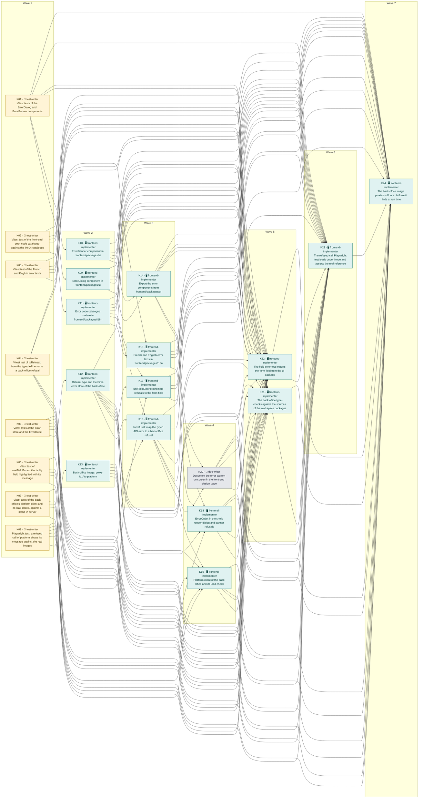

# T0.23: Plan

**Plan:** 🟢 Approved

**Push:** 🟢 Approved


<!-- ticket:specs -->
## 📚 Specifications

The specification and design pages of [TICKET.md](TICKET.md), copied by `python3 .claude/scripts/tickets/ticket_refs.py sync`.

- [📜 D122 Error message standard](../../specs/06-decisions/ux/d122-error-message-standard.md)
- [📌 REQ-T05-03 problem+json errors](../../specs/03-technical/t05-api-and-webhooks/requirements/req-t05-03-problem-json.md)
- [📜 D407 Front end](../../specs/06-decisions/technical/d407-front-end.md)
- [📜 D21 Languages](../../specs/06-decisions/foundations/d21-languages.md)
- [📜 D46 Accessibility standard](../../specs/06-decisions/ux/d46-accessibility-standard.md)
- [🏗️ Front end](../../technical/architecture/frontend.md)
- [🏗️ API](../../technical/interfaces/api.md)
- [♿ Accessibility](../../specs/05-non-functional/accessibility.md)
<!-- /ticket:specs -->

## Summary

T0.23 delivers the D122 error message pattern on screen. Two components go in `frontend/packages/ui`: `ErrorDialog`, the alertdialog of the pattern mock-up, and `ErrorBanner`, the banner at the top of the page. `frontend/packages/i18n` gets a code-to-keys error catalogue, checked against the T0.04 YAML, and the French and English title, why and action texts. `frontend/backoffice` gets the wiring: a refused platform call reaches the typed client of T0.20, becomes a language-neutral `Refusal`, goes into a Pinia store, and an `ErrorOutlet` mounted in the shell renders it in the current language. It also gets field errors bound to the T0.15 form field, a same-origin `/v1` proxy in the back-office image, and a Playwright test against the real images.

The plan has 20 tasks in 4 waves. Wave 1 holds 8 test-writer tasks (Vitest per behaviour, and Playwright in `frontend/backoffice/e2e/`). Wave 2 holds the leaf implementations: the two components, the catalogue, the store and the proxy. Wave 3 holds the ui exports, the texts, `toRefusal` and `useFieldErrors`. Wave 4 holds the outlet, the platform client with the load check, and the doc update beside them. No file is shared within a wave. `pnpm-lock.yaml` is changed in wave 2 (K11) and wave 3 (K16) only.

The ticket lists no screen (`No screen`), so no screen-state test is needed under TKT-21. The Playwright task K08 is in wave 1, and every frontend-implementer task depends on it.

## Assumptions

- The roadmap gives no screen page for this ticket, so `TICKET.md` says `No screen` and relies on the Playwright test against the shell.
- The accessibility budget page has no measure specified yet, so no budget is listed.
- The ticket anchor is the sprint anchor `#s04`, as the phase page has no per-ticket anchor.
- `check_ticket.py` could not be run by the planner (no shell tool), so the workflow's check is the first validation. Link titles are written as the page titles show them, with ID text such as `D122` and `REQ-T05-03`.
- None of the front-end code exists yet: T0.15, T0.16, T0.17, T0.20 and T0.22 are planned but not built. The plan names its files after the layout those tickets are expected to set: Vitest tests in `tests/` mirroring `src/`, i18n catalogues per language under `src/catalogues/<lang>/`, `frontend/backoffice/src/App.vue`, `src/main.ts` and `nginx.conf`. If the merged tickets chose other paths, the task paths are corrected at the gate as an approved plan change (TKT-11), not by the workers.
- T0.17 does not depend on T0.20, so the back office probably makes no call to `platform`. For a refused call to have a place to show in P0, the shell makes one call when it loads: the health call of T0.14, through the typed client. The Playwright test reroutes that one request with `page.route` and `route.continue({ url })` to the call `platform` refuses without a company context, the same one T0.24's Bruno collection tests. The answer is therefore the real problem+json of the real image, and no response is fulfilled by hand. The person should confirm this at plan approval.
- The browser reaches `platform` on the same origin: the back-office image proxies `/v1/` to the `platform` service of `compose.e2e.yaml` (host and port from T0.21).
- Presentation: a refusal of a call the user did not start, such as the load check, shows in the banner at the top of the page. A refusal of a user's action shows in the dialog of the mock-up. A refusal naming a field shows next to that field, with the code's why as the message. The pattern allows "a dialog or a banner" and does not say which one when.
- The code-to-keys-and-reference mapping comes from the T0.04 YAML catalogue. The front end holds its own copy in `frontend/packages/i18n/src/errors/errorCatalog.ts`, kept identical by a Vitest test that reads the YAML. That test needs the `yaml` dev dependency (ISC licence).
- The action button carries the code's action label. What it does is not in the catalogue: it runs the caller's `onAction` (a retry for the load check), then closes the message. Cancel only closes it.
- Unknown codes and failures that are not problem+json show a fallback message (`errors.fallback.*`). An unknown code keeps the code as its reference, and a failure without a code shows no reference. The pattern's "what still works" banner for outside services down or no network is left as a follow-up.
- The values in the why sentence come from the problem+json body's members that the T0.20 typed error exposes, used only where a text names the placeholder. The raw body and the detail text are never stored or logged (REQ-T05-03 criterion 2).
- The field highlight, the (!) icon, `aria-invalid` and `aria-describedby` come from T0.15's form field error state (C-02). If it lacks them, task K17 reports itself blocked instead of working around it.
- T0.04's own assumption says the texts belong to P2 (T10). The ticket says T0.23 writes the French and English texts in `frontend/packages/i18n`, so this plan writes them; the P2 review workflow will review them later.
- `TICKET.md` says `No screen`, so TKT-21 asks for no screen-state test. The Playwright test K08 is in wave 1, and every frontend-implementer task depends on it, directly or through earlier tasks.

<!-- plan:graph -->

> [!NOTE]
> Generated from the json block at the end of this page by `python3 .claude/scripts/tickets/plan.py render`.
> To change a task, edit the json block, then render again: never edit this view by hand.

## Waves

| Wave | Tasks | Agents running at once |
| --- | --- | --- |
| 1 | [K01](#k01), [K02](#k02), [K03](#k03), [K04](#k04), [K05](#k05), [K06](#k06), [K07](#k07), [K08](#k08) | 8 of 8 |
| 2 | [K09](#k09), [K10](#k10), [K11](#k11), [K12](#k12), [K13](#k13) | 5 of 5 |
| 3 | [K14](#k14), [K15](#k15), [K16](#k16), [K17](#k17) | 4 of 4 |
| 4 | [K18](#k18), [K19](#k19), [K20](#k20) | 3 of 3 |
| 5 | [K21](#k21), [K22](#k22) | 2 of 2 |
| 6 | [K23](#k23) | 1 of 1 |
| 7 | [K24](#k24) | 1 of 1 |

| Wave | Task | Agent | Depends on | Unblocks |
| --- | --- | --- | --- | --- |
| 1 | [K01](#k01) Vitest tests of the ErrorDialog and ErrorBanner components | 🧪 test-writer | none | [K09](#k09), [K10](#k10), [K21](#k21), [K22](#k22), [K23](#k23), [K24](#k24) |
| 1 | [K02](#k02) Vitest test of the front-end error code catalogue against the T0.04 catalogue | 🧪 test-writer | none | [K11](#k11), [K21](#k21), [K22](#k22), [K23](#k23), [K24](#k24) |
| 1 | [K03](#k03) Vitest test of the French and English error texts | 🧪 test-writer | none | [K15](#k15), [K21](#k21), [K22](#k22), [K23](#k23), [K24](#k24) |
| 1 | [K04](#k04) Vitest test of toRefusal: from the typed API error to a back-office refusal | 🧪 test-writer | none | [K16](#k16), [K21](#k21), [K22](#k22), [K23](#k23), [K24](#k24) |
| 1 | [K05](#k05) Vitest tests of the error store and the ErrorOutlet | 🧪 test-writer | none | [K12](#k12), [K18](#k18), [K21](#k21), [K22](#k22), [K23](#k23), [K24](#k24) |
| 1 | [K06](#k06) Vitest test of useFieldErrors: the faulty field highlighted with its message | 🧪 test-writer | none | [K17](#k17), [K21](#k21), [K22](#k22), [K23](#k23), [K24](#k24) |
| 1 | [K07](#k07) Vitest tests of the back office's platform client and its load check, against a stand-in server | 🧪 test-writer | none | [K19](#k19), [K21](#k21), [K22](#k22), [K23](#k23), [K24](#k24) |
| 1 | [K08](#k08) Playwright test: a refused call of platform shows its message against the real images | 🧪 test-writer | none | [K13](#k13), [K19](#k19), [K21](#k21), [K22](#k22), [K23](#k23), [K24](#k24) |
| 2 | [K09](#k09) ErrorDialog component in frontend/packages/ui | 🖥️ frontend-implementer | [K01](#k01) | [K14](#k14), [K21](#k21), [K22](#k22), [K23](#k23), [K24](#k24) |
| 2 | [K10](#k10) ErrorBanner component in frontend/packages/ui | 🖥️ frontend-implementer | [K01](#k01) | [K14](#k14), [K21](#k21), [K22](#k22), [K23](#k23), [K24](#k24) |
| 2 | [K11](#k11) Error code catalogue module in frontend/packages/i18n | 🖥️ frontend-implementer | [K02](#k02) | [K15](#k15), [K16](#k16), [K17](#k17), [K21](#k21), [K22](#k22), [K23](#k23), [K24](#k24) |
| 2 | [K12](#k12) Refusal type and the Pinia error store of the back office | 🖥️ frontend-implementer | [K05](#k05) | [K16](#k16), [K17](#k17), [K18](#k18), [K19](#k19), [K21](#k21), [K22](#k22), [K23](#k23), [K24](#k24) |
| 2 | [K13](#k13) Back-office image: proxy /v1/ to platform | 🖥️ frontend-implementer | [K08](#k08) | [K19](#k19), [K21](#k21), [K22](#k22), [K23](#k23), [K24](#k24) |
| 3 | [K14](#k14) Export the error components from frontend/packages/ui | 🖥️ frontend-implementer | [K09](#k09), [K10](#k10) | [K18](#k18), [K20](#k20), [K21](#k21), [K22](#k22), [K23](#k23), [K24](#k24) |
| 3 | [K15](#k15) French and English error texts in frontend/packages/i18n | 🖥️ frontend-implementer | [K03](#k03), [K11](#k11) | [K18](#k18), [K21](#k21), [K22](#k22), [K23](#k23), [K24](#k24) |
| 3 | [K16](#k16) toRefusal: map the typed API error to a back-office refusal | 🖥️ frontend-implementer | [K04](#k04), [K11](#k11), [K12](#k12) | [K19](#k19), [K20](#k20), [K21](#k21), [K22](#k22), [K23](#k23), [K24](#k24) |
| 3 | [K17](#k17) useFieldErrors: bind field refusals to the form field | 🖥️ frontend-implementer | [K06](#k06), [K11](#k11), [K12](#k12) | [K21](#k21), [K22](#k22), [K23](#k23), [K24](#k24) |
| 4 | [K18](#k18) ErrorOutlet in the shell: render dialog and banner refusals | 🖥️ frontend-implementer | [K05](#k05), [K12](#k12), [K14](#k14), [K15](#k15) | [K21](#k21), [K22](#k22), [K23](#k23), [K24](#k24) |
| 4 | [K19](#k19) Platform client of the back office and its load check | 🖥️ frontend-implementer | [K07](#k07), [K08](#k08), [K12](#k12), [K13](#k13), [K16](#k16) | [K21](#k21), [K22](#k22), [K23](#k23), [K24](#k24) |
| 4 | [K20](#k20) Document the error pattern on screen in the front-end design page | 📝 doc-writer | [K14](#k14), [K16](#k16) | [K21](#k21), [K22](#k22), [K23](#k23), [K24](#k24) |
| 5 | [K21](#k21) The back office type-checks against the sources of the workspace packages | 🖥️ frontend-implementer | [K01](#k01), [K02](#k02), [K03](#k03), [K04](#k04), [K05](#k05), [K06](#k06), [K07](#k07), [K08](#k08), [K09](#k09), [K10](#k10), [K11](#k11), [K12](#k12), [K13](#k13), [K14](#k14), [K15](#k15), [K16](#k16), [K17](#k17), [K18](#k18), [K19](#k19), [K20](#k20) | [K23](#k23), [K24](#k24) |
| 5 | [K22](#k22) The field-error test imports the form field from the ui package | 🖥️ frontend-implementer | [K01](#k01), [K02](#k02), [K03](#k03), [K04](#k04), [K05](#k05), [K06](#k06), [K07](#k07), [K08](#k08), [K09](#k09), [K10](#k10), [K11](#k11), [K12](#k12), [K13](#k13), [K14](#k14), [K15](#k15), [K16](#k16), [K17](#k17), [K18](#k18), [K19](#k19), [K20](#k20) | [K23](#k23), [K24](#k24) |
| 6 | [K23](#k23) The refused-call Playwright test loads under Node and asserts the real reference | 🖥️ frontend-implementer | [K01](#k01), [K02](#k02), [K03](#k03), [K04](#k04), [K05](#k05), [K06](#k06), [K07](#k07), [K08](#k08), [K09](#k09), [K10](#k10), [K11](#k11), [K12](#k12), [K13](#k13), [K14](#k14), [K15](#k15), [K16](#k16), [K17](#k17), [K18](#k18), [K19](#k19), [K20](#k20), [K21](#k21), [K22](#k22) | [K24](#k24) |
| 7 | [K24](#k24) The back-office image proxies /v1/ to a platform it finds at run time | 🖥️ frontend-implementer | [K01](#k01), [K02](#k02), [K03](#k03), [K04](#k04), [K05](#k05), [K06](#k06), [K07](#k07), [K08](#k08), [K09](#k09), [K10](#k10), [K11](#k11), [K12](#k12), [K13](#k13), [K14](#k14), [K15](#k15), [K16](#k16), [K17](#k17), [K18](#k18), [K19](#k19), [K20](#k20), [K21](#k21), [K22](#k22), [K23](#k23) | none |

## Dependency graph



## Tasks

### <a id="k01"></a>K01: Vitest tests of the ErrorDialog and ErrorBanner components

| Agent | Wave | Depends on | Unblocks |
| --- | --- | --- | --- |
| 🧪 test-writer | 1 | none | [K09](#k09), [K10](#k10), [K21](#k21), [K22](#k22), [K23](#k23), [K24](#k24) |

**Files** (only this task may change them in its wave):

- `frontend/packages/ui/tests/errors/ErrorDialog.test.ts`
- `frontend/packages/ui/tests/errors/ErrorBanner.test.ts`

**Done when:** `pnpm --filter ./frontend/packages/ui run lint` passes on the two files, and `pnpm --filter ./frontend/packages/ui exec vitest run tests/errors` fails only because `src/errors/ErrorDialog.vue` and `src/errors/ErrorBanner.vue` do not exist yet.

**Brief:**

Write the Vitest component tests of the two error components of the error message pattern, before they exist, in `frontend/packages/ui` (D407: Vue 3, TypeScript, Vite).

Specifications applied: D122 (docs/specs/06-decisions/ux/d122-error-message-standard.md), the Error messages pattern (docs/specs/04-ux/design-system/patterns/error-messages.md) and its HTML mock-up (docs/specs/04-ux/mockups/src/design-system/error-messages-desktop.html), D46 (docs/specs/06-decisions/ux/d46-accessibility-standard.md), D407 (docs/specs/06-decisions/technical/d407-front-end.md), Front end (docs/technical/architecture/frontend.md). Also C-05 Modal (docs/specs/04-ux/design-system/components/c-05-modal.md), on which the dialog is built.

The components to test, as the implementers will build them:
- `frontend/packages/ui/src/errors/ErrorDialog.vue`. Props: `title`, `why`, `actionLabel`, `cancelLabel`, `reference`, `referenceLabel` (the localised prefix, e.g. 'ref.'), `open`. Emits `action` and `cancel`. It is built on the T0.15 modal.
- `frontend/packages/ui/src/errors/ErrorBanner.vue`. Props: `title`, `why`, `actionLabel` (optional), `reference`, `referenceLabel`. Emits `action` and `dismiss`.
- Both receive texts that are already translated, so they hold no text of their own.

Behaviours to test for ErrorDialog (`ErrorDialog.test.ts`):
- It renders the title, the one-sentence why, the main action button with its label (primary), a Cancel button, and the small support reference at the bottom ('ref. SITE-CLOSE-01' as in the mock-up).
- It has `role="alertdialog"`, is labelled by the title (`aria-labelledby`) and described by the why (`aria-describedby`).
- Focus moves into the dialog when it opens.
- Clicking the action emits `action`; Cancel and Escape emit `cancel`.
- The (!) circle-alert Lucide icon is present beside the title, with the error colour token, and the words are always present (D46: colour never alone).
- No violation is found by the same automated accessibility check T0.15 uses for its components.
- It renders in light and in dark, the way the T0.15 tests switch themes.

Behaviours to test for ErrorBanner (`ErrorBanner.test.ts`):
- It renders title, why, the optional action button and the reference.
- It has `role="alert"`, so it is announced.
- It shows the icon with the words.
- action emits `action`.
- No accessibility violation; light and dark.

Follow the test layout, mounting helper, theme switch and accessibility helper that T0.15 set up in `frontend/packages/ui` (read its EXPLAIN.md). Tests are named as sentences. No mock of the modal: mount the real T0.15 component. Change only the two files listed.

### <a id="k02"></a>K02: Vitest test of the front-end error code catalogue against the T0.04 catalogue

| Agent | Wave | Depends on | Unblocks |
| --- | --- | --- | --- |
| 🧪 test-writer | 1 | none | [K11](#k11), [K21](#k21), [K22](#k22), [K23](#k23), [K24](#k24) |

**Files** (only this task may change them in its wave):

- `frontend/packages/i18n/tests/errors/errorCatalog.test.ts`

**Done when:** `pnpm --filter ./frontend/packages/i18n run lint` passes on the file, and `pnpm --filter ./frontend/packages/i18n exec vitest run tests/errors/errorCatalog.test.ts` fails only because `src/errors/errorCatalog.ts` (or the `yaml` dev dependency) does not exist yet.

**Brief:**

Write the Vitest test of `frontend/packages/i18n/src/errors/errorCatalog.ts`, before it exists. The module will map each D122 error code to its title key, why key, action key and support reference, for the front ends.

Specifications applied: D122 (docs/specs/06-decisions/ux/d122-error-message-standard.md), the Error messages pattern (docs/specs/04-ux/design-system/patterns/error-messages.md), REQ-T05-03 (docs/specs/03-technical/t05-api-and-webhooks/requirements/req-t05-03-problem-json.md), D21 (docs/specs/06-decisions/foundations/d21-languages.md), API (docs/technical/interfaces/api.md).

The module's interface, as the implementer will build it:
- `errorCatalog`: a readonly record from code to `{ titleKey, whyKey, actionKey, reference }`.
- `resolveErrorCode(code: string)`: returns the entry, or the fallback entry for an unknown or missing code. The fallback has the keys `errors.fallback.title`, `errors.fallback.why` and `errors.fallback.action`, and no reference.
- `ERROR_COMMON_KEYS`: the keys of the shared labels, `errors.common.cancel` and `errors.common.reference`.

Behaviours to test:
- **Same codes as the source.** The catalogue holds exactly the codes of the error code catalogue that T0.04 wrote in `backend/models/conf/catalogs/` (read its real file name in T0.04's EXPLAIN.md). Each code has the same three message keys and the same support reference. A code added to the backend catalogue and not to the front end fails the test, and the reverse fails too.
- **Unknown codes.** An unknown code resolves to the fallback.
- **No duplicates.** No two codes share a support reference.

Read the YAML with a YAML parser added as a dev dependency of `frontend/packages/i18n`. Task K11 adds it, so name it `yaml`, the conservative choice (ISC licence).

Follow T0.16's test layout in `frontend/packages/i18n` (its EXPLAIN.md). Change only the file listed.

### <a id="k03"></a>K03: Vitest test of the French and English error texts

| Agent | Wave | Depends on | Unblocks |
| --- | --- | --- | --- |
| 🧪 test-writer | 1 | none | [K15](#k15), [K21](#k21), [K22](#k22), [K23](#k23), [K24](#k24) |

**Files** (only this task may change them in its wave):

- `frontend/packages/i18n/tests/errors/errorTexts.test.ts`

**Done when:** `pnpm --filter ./frontend/packages/i18n run lint` passes on the file, and `pnpm --filter ./frontend/packages/i18n exec vitest run tests/errors/errorTexts.test.ts` fails only because the error catalogue or the `errors.json` texts do not exist yet.

**Brief:**

Write the Vitest test of the error message texts in French and English, before they exist. The texts will live in `frontend/packages/i18n/src/catalogues/en/errors.json` and `frontend/packages/i18n/src/catalogues/fr/errors.json`, which T0.16's catalogue loading picks up.

Specifications applied: D122 (docs/specs/06-decisions/ux/d122-error-message-standard.md), the Error messages pattern (docs/specs/04-ux/design-system/patterns/error-messages.md), D21 (docs/specs/06-decisions/foundations/d21-languages.md), REQ-T05-03 (docs/specs/03-technical/t05-api-and-webhooks/requirements/req-t05-03-problem-json.md). Also Tone of voice (docs/specs/04-ux/visual-identity/tone-of-voice.md).

Behaviours to test:
- **Every key, in both languages.** Every title, why and action key of `errorCatalog` (from `src/errors/errorCatalog.ts`, task K11) has a non-empty text in English and in French. So do the fallback keys `errors.fallback.title|why|action` and the common keys `errors.common.cancel|reference`. A key missing in one language fails, as T0.16's key check does.
- **No code or jargon.** No title, why or action text contains its error code or its support reference (D122: no code or jargon in the message itself).
- **One sentence.** Each why text is one sentence ending with a full stop.
- **Values interpolated.** A why that names a placeholder (`{name}`) is interpolated by T0.16's translation function with the value given, in both languages.
- **Language switch.** Switching the language through T0.16's API changes the text of a title without a reload.

Use T0.16's translation API and test layout (its EXPLAIN.md). Change only the file listed.

### <a id="k04"></a>K04: Vitest test of toRefusal: from the typed API error to a back-office refusal

| Agent | Wave | Depends on | Unblocks |
| --- | --- | --- | --- |
| 🧪 test-writer | 1 | none | [K16](#k16), [K21](#k21), [K22](#k22), [K23](#k23), [K24](#k24) |

**Files** (only this task may change them in its wave):

- `frontend/backoffice/tests/errors/toRefusal.test.ts`

**Done when:** `pnpm --filter ./frontend/backoffice run lint` passes on the file, and `pnpm --filter ./frontend/backoffice exec vitest run tests/errors/toRefusal.test.ts` fails only because `src/errors/toRefusal.ts` does not exist yet.

**Brief:**

Write the Vitest test of `frontend/backoffice/src/errors/toRefusal.ts`, before it exists. Its `toRefusal(error, presentation)` turns what a call of the typed API client (T0.20) threw into a `Refusal`: the language-neutral description of the message, held by the store and rendered by the outlet.

The `Refusal` type (`frontend/backoffice/src/errors/Refusal.ts`, task K12) has these fields:
- `id`: unique string.
- `code`: string, or null.
- `titleKey`, `whyKey`, `actionKey`.
- `reference`: string, or null.
- `params`: a record of strings.
- `field`: string, or null.
- `presentation`: `'dialog' | 'banner' | 'field'`.

Specifications applied: D122 (docs/specs/06-decisions/ux/d122-error-message-standard.md), REQ-T05-03 (docs/specs/03-technical/t05-api-and-webhooks/requirements/req-t05-03-problem-json.md), the Error messages pattern (docs/specs/04-ux/design-system/patterns/error-messages.md), API (docs/technical/interfaces/api.md), Front end (docs/technical/architecture/frontend.md).

Behaviours to test:
- **Known code.** The typed problem+json error of T0.20 with a known code gives that code's three keys and its support reference, taken from `resolveErrorCode` of `@<scope>/i18n` (task K11).
- **Unknown code.** An unknown code gives the fallback keys, and the code itself as the reference, so that support can still find it.
- **Not a problem+json.** A failure that is not a problem+json (a network failure, a non-JSON answer) gives the fallback keys, with no reference.
- **Field errors.** A typed error naming a field gives `presentation: 'field'` and that `field`, whatever presentation was asked.
- **Values.** The values the body carries for the why sentence become `params`, as strings.
- **No secret.** No field of the Refusal holds the raw body or a stack trace (REQ-T05-03 criterion 2).

Build the typed errors with the real error class and constructor that T0.20 exports (read its EXPLAIN.md for the field that carries the code, the field and the values); no mock. Follow T0.17's Vitest layout in `frontend/backoffice`. Change only the file listed.

### <a id="k05"></a>K05: Vitest tests of the error store and the ErrorOutlet

| Agent | Wave | Depends on | Unblocks |
| --- | --- | --- | --- |
| 🧪 test-writer | 1 | none | [K12](#k12), [K18](#k18), [K21](#k21), [K22](#k22), [K23](#k23), [K24](#k24) |

**Files** (only this task may change them in its wave):

- `frontend/backoffice/tests/stores/errors.test.ts`
- `frontend/backoffice/tests/errors/ErrorOutlet.test.ts`

**Done when:** `pnpm --filter ./frontend/backoffice run lint` passes on the two files, and `pnpm --filter ./frontend/backoffice exec vitest run tests/stores/errors.test.ts tests/errors/ErrorOutlet.test.ts` fails only because `src/stores/errors.ts` and `src/errors/ErrorOutlet.vue` do not exist yet.

**Brief:**

Write the Vitest tests of two back-office pieces, before they exist:
- The Pinia store `frontend/backoffice/src/stores/errors.ts` (`useErrorStore`), task K12. It holds the `Refusal`s of `frontend/backoffice/src/errors/Refusal.ts`, with the fields id, code, titleKey, whyKey, actionKey, reference, params, field and presentation ('dialog' | 'banner' | 'field').
- The component `frontend/backoffice/src/errors/ErrorOutlet.vue`, task K18. It renders the store's dialog and banner refusals with the ui components ErrorDialog and ErrorBanner.

Specifications applied: D122 (docs/specs/06-decisions/ux/d122-error-message-standard.md), the Error messages pattern (docs/specs/04-ux/design-system/patterns/error-messages.md) and its mock-up (docs/specs/04-ux/mockups/src/design-system/error-messages-desktop.html), D21 (docs/specs/06-decisions/foundations/d21-languages.md), D46 (docs/specs/06-decisions/ux/d46-accessibility-standard.md), D407 (docs/specs/06-decisions/technical/d407-front-end.md).

Store behaviours (`errors.test.ts`):
- `show(refusal, onAction?)` adds a refusal. `dismiss(id)` removes it.
- `dialog` is the latest refusal with presentation 'dialog'. `banner` is the latest with 'banner'.
- `fieldErrors` maps each field name to its refusal with presentation 'field'. `clearField(name)` removes one.
- `act(id)` calls the onAction given at `show` (if any) and then dismisses the refusal.
- The store keeps keys and params, never translated text.

Outlet behaviours (`ErrorOutlet.test.ts`, mounted with a real Pinia, the real T0.16 i18n plugin and the real ui components):
- A dialog refusal renders the ErrorDialog with the translated title, why, action label, Cancel and 'ref. &lt;reference>'.
- A banner refusal renders the ErrorBanner at the top.
- **Language switch.** Switching from English to French re-renders the same message in French without a reload (D21).
- The action calls `act`; Cancel dismisses.
- A refusal without a reference shows no reference line.
- A field refusal is not rendered by the outlet.

Follow T0.17's Vitest layout. Change only the two files listed.

### <a id="k06"></a>K06: Vitest test of useFieldErrors: the faulty field highlighted with its message

| Agent | Wave | Depends on | Unblocks |
| --- | --- | --- | --- |
| 🧪 test-writer | 1 | none | [K17](#k17), [K21](#k21), [K22](#k22), [K23](#k23), [K24](#k24) |

**Files** (only this task may change them in its wave):

- `frontend/backoffice/tests/errors/useFieldErrors.test.ts`

**Done when:** `pnpm --filter ./frontend/backoffice run lint` passes on the file, and `pnpm --filter ./frontend/backoffice exec vitest run tests/errors/useFieldErrors.test.ts` fails only because `src/errors/useFieldErrors.ts` does not exist yet.

**Brief:**

Write the Vitest test of the composable `frontend/backoffice/src/errors/useFieldErrors.ts`, before it exists (task K17).

The composable's interface:
- `useFieldErrors()` returns `errorFor(field)`: the translated why of the field's refusal in the error store, or undefined.
- It also returns `focusFirstFaulty(root)` and `clear(field)`.

Specifications applied: the Error messages pattern (docs/specs/04-ux/design-system/patterns/error-messages.md: faulty field highlighted with the message next to it, focus moves to the first faulty field, `aria-describedby`), D122 (docs/specs/06-decisions/ux/d122-error-message-standard.md), D46 (docs/specs/06-decisions/ux/d46-accessibility-standard.md). Also C-02 Form field (docs/specs/04-ux/design-system/components/c-02-form-field.md: the error state, a 2 px error edge and the message under it, `aria-invalid`).

Behaviours to test, mounting the real T0.15 form field with its error bound to `errorFor('<name>')`:
- **Highlighted with its message.** A refusal with presentation 'field' for that field puts the form field in its error state: `aria-invalid="true"`, the message next to the field with the (!) icon, and the input's `aria-describedby` pointing to the message's id.
- **Current language.** The message is the why text of the code in the current language, and it changes with the language.
- **Focus.** `focusFirstFaulty` moves the focus to the first faulty field in document order.
- **Clearing.** `clear` removes the highlight and the message.
- **Announced.** The message is announced to screen readers, as the form field's error does.

Use a real Pinia, the real T0.16 i18n plugin and the T0.15 form field (read the ui EXPLAIN.md for its error prop). Change only the file listed.

### <a id="k07"></a>K07: Vitest tests of the back office's platform client and its load check, against a stand-in server

| Agent | Wave | Depends on | Unblocks |
| --- | --- | --- | --- |
| 🧪 test-writer | 1 | none | [K19](#k19), [K21](#k21), [K22](#k22), [K23](#k23), [K24](#k24) |

**Files** (only this task may change them in its wave):

- `frontend/backoffice/tests/api/platformClient.test.ts`
- `frontend/backoffice/tests/api/checkPlatform.test.ts`
- `frontend/backoffice/tests/api/standInPlatform.ts`

**Done when:** `pnpm --filter ./frontend/backoffice run lint` passes on the three files, and `pnpm --filter ./frontend/backoffice exec vitest run tests/api` fails only because `src/api/platformClient.ts` and `src/api/checkPlatform.ts` do not exist yet.

**Brief:**

Write the Vitest tests of the wiring between the typed API client (T0.20) and the error store, before it exists:
- `frontend/backoffice/src/api/platformClient.ts` (task K19) creates the back office's one instance of the T0.20 client for `platform`, with the same-origin base `/v1`. It exports `callPlatform(call, { presentation, onAction })`, which runs a typed call. On a refusal it puts `toRefusal(error, presentation)` into the error store (with onAction) and rethrows. The default presentation is 'dialog'.
- `frontend/backoffice/src/api/checkPlatform.ts` (task K19) exports `checkPlatform()`, called once when the app starts (from `main.ts`). It runs the platform health call of T0.14 through `callPlatform` with presentation 'banner' and with itself as the retry onAction.

Specifications applied: D122 (docs/specs/06-decisions/ux/d122-error-message-standard.md), REQ-T05-03 (docs/specs/03-technical/t05-api-and-webhooks/requirements/req-t05-03-problem-json.md), the Error messages pattern (docs/specs/04-ux/design-system/patterns/error-messages.md), API (docs/technical/interfaces/api.md), Front end (docs/technical/architecture/frontend.md).

`standInPlatform.ts` is a helper class: a real local HTTP stand-in server (Node `http`, no mock library, as AGENT.md asks). It answers the health path of T0.14, and answers a refused call with an `application/problem+json` body carrying a D122 code. Copy the body's shape from T0.14's problem+json handler and its OpenAPI (T0.18).

Behaviours to test:
- A successful call adds nothing to the store.
- **Refused call.** It puts one dialog refusal with the code's keys and reference into the store, and the caller still receives the typed error.
- A refused call with presentation 'banner' gives a banner refusal.
- `act` on that refusal runs the onAction.
- **Network failure.** A server that is down gives a fallback refusal (no reference) and no unhandled rejection.
- `checkPlatform` with a healthy stand-in adds nothing.
- `checkPlatform` against a refusal adds one banner refusal, and its action calls the health path again.

Point the client at the stand-in through the base-URL option T0.20's client offers. Change only the three files listed.

### <a id="k08"></a>K08: Playwright test: a refused call of platform shows its message against the real images

| Agent | Wave | Depends on | Unblocks |
| --- | --- | --- | --- |
| 🧪 test-writer | 1 | none | [K13](#k13), [K19](#k19), [K21](#k21), [K22](#k22), [K23](#k23), [K24](#k24) |

**Files** (only this task may change them in its wave):

- `frontend/backoffice/e2e/errors/refused-call.spec.ts`

**Done when:** `pnpm --filter ./frontend/backoffice run lint` passes on the file, and `docker compose -f compose.e2e.yaml up --wait` then `pnpm --filter ./frontend/backoffice exec playwright test e2e/errors/refused-call.spec.ts` fails only because the back office does not yet call platform or show the message (the tests compile and reach the page).

**Brief:**

Write the Playwright test proving T0.23's acceptance criteria 1, 3 and 4 against the real images that `compose.e2e.yaml` starts (T0.21). It never runs against a development server (AGENT.md, TKT-21). Use the configuration, fixtures, theme and language helpers and accessibility check that T0.22 set up in `frontend/backoffice/e2e/` (read its EXPLAIN.md).

Specifications applied: D122 (docs/specs/06-decisions/ux/d122-error-message-standard.md), REQ-T05-03 (docs/specs/03-technical/t05-api-and-webhooks/requirements/req-t05-03-problem-json.md), the Error messages pattern (docs/specs/04-ux/design-system/patterns/error-messages.md) and its mock-up (docs/specs/04-ux/mockups/src/design-system/error-messages-desktop.html), D21 (docs/specs/06-decisions/foundations/d21-languages.md), D46 (docs/specs/06-decisions/ux/d46-accessibility-standard.md), Front end (docs/technical/architecture/frontend.md).

How the refusal is produced:
- When the shell loads, the back office makes one call to `platform`: the health call of T0.14, through its typed client, same-origin under `/v1/`, proxied to `platform` by the back-office image (task K13).
- The test reroutes that one request with `page.route(...)` and `route.continue({ url })` to the call `platform` refuses: the call T0.14 refuses without a company context, the same one T0.24's Bruno collection tests.
- So the answer is the real problem+json of the real `platform` image, and nothing is fulfilled by hand.
- Read the refused path and its code from T0.14's code and its OpenAPI (T0.18). Read the expected texts from the `errors.json` catalogues of `frontend/packages/i18n` (task K15) through the code's keys in `errorCatalog`, so that the test does not copy the texts.

Tests, each in English and in French (parametrised), and in light and dark where T0.22's helpers make it cheap:
- The banner at the top of the page shows the title, the why and the action button of that code, and 'ref. &lt;reference>' small at the bottom.
- It is announced (`role="alert"`). The (!) icon and the words are present with the error colour (D46).
- T0.22's accessibility check finds no violation on the page with the banner.
- Clicking the action retries the health call without the reroute, and the banner goes away.

Change only the file listed.

### <a id="k09"></a>K09: ErrorDialog component in frontend/packages/ui

| Agent | Wave | Depends on | Unblocks |
| --- | --- | --- | --- |
| 🖥️ frontend-implementer | 2 | [K01](#k01) | [K14](#k14), [K21](#k21), [K22](#k22), [K23](#k23), [K24](#k24) |

**Files** (only this task may change them in its wave):

- `frontend/packages/ui/src/errors/ErrorDialog.vue`

**Done when:** `pnpm --filter ./frontend/packages/ui exec vitest run tests/errors/ErrorDialog.test.ts` passes, and `pnpm --filter ./frontend/packages/ui run lint` and `pnpm --filter ./frontend/packages/ui run typecheck` pass.

**Brief:**

Build `frontend/packages/ui/src/errors/ErrorDialog.vue` until the tests of `frontend/packages/ui/tests/errors/ErrorDialog.test.ts` (task K01) pass.

Specifications applied: D122 (docs/specs/06-decisions/ux/d122-error-message-standard.md), the Error messages pattern (docs/specs/04-ux/design-system/patterns/error-messages.md) and its mock-up (docs/specs/04-ux/mockups/src/design-system/error-messages-desktop.html: the `.dialog` with `.ttl`, `p`, `.acts` and `.ref`), D46 (docs/specs/06-decisions/ux/d46-accessibility-standard.md), D407 (docs/specs/06-decisions/technical/d407-front-end.md), Front end (docs/technical/architecture/frontend.md). Also C-05 Modal (docs/specs/04-ux/design-system/components/c-05-modal.md).

What to build:
- Build it on the T0.15 modal, with `role="alertdialog"`, `aria-labelledby` pointing to the title and `aria-describedby` pointing to the why. Focus moves into it when it opens.
- Props: `title`, `why`, `actionLabel`, `cancelLabel`, `reference` (optional), `referenceLabel`, `open`.
- Events: `action`, and `cancel` (button and Escape).
- Layout, as the mock-up draws it:
  - the Lucide circle-alert icon served by the package (D45), in `color-error`, beside the title;
  - the why under the title;
  - Cancel, then the primary action, aligned right;
  - the reference right-aligned at the bottom in the code font, muted and small.
- Use only the tokens of `frontend/packages/tokens` and the T0.15 button. The component holds no text of its own: every text comes from its props.

Change only the file listed.

### <a id="k10"></a>K10: ErrorBanner component in frontend/packages/ui

| Agent | Wave | Depends on | Unblocks |
| --- | --- | --- | --- |
| 🖥️ frontend-implementer | 2 | [K01](#k01) | [K14](#k14), [K21](#k21), [K22](#k22), [K23](#k23), [K24](#k24) |

**Files** (only this task may change them in its wave):

- `frontend/packages/ui/src/errors/ErrorBanner.vue`

**Done when:** `pnpm --filter ./frontend/packages/ui exec vitest run tests/errors/ErrorBanner.test.ts` passes, and `pnpm --filter ./frontend/packages/ui run lint` and `pnpm --filter ./frontend/packages/ui run typecheck` pass.

**Brief:**

Build `frontend/packages/ui/src/errors/ErrorBanner.vue` until the tests of `frontend/packages/ui/tests/errors/ErrorBanner.test.ts` (task K01) pass.

Specifications applied: D122 (docs/specs/06-decisions/ux/d122-error-message-standard.md), the Error messages pattern (docs/specs/04-ux/design-system/patterns/error-messages.md: rule refusals in a dialog or a banner at the top of the page) and its mock-up (docs/specs/04-ux/mockups/src/design-system/error-messages-desktop.html: `.banner.err`), D46 (docs/specs/06-decisions/ux/d46-accessibility-standard.md), D407 (docs/specs/06-decisions/technical/d407-front-end.md), Front end (docs/technical/architecture/frontend.md).

What to build:
- A banner with `role="alert"`, on the `error-bg` surface with the error colour.
- Props: `title`, `why`, `actionLabel` (optional), `reference` (optional), `referenceLabel`.
- Events: `action`, `dismiss`.
- Content: the Lucide circle-alert icon from the package (D45), the title, the why, the action as a T0.15 button when given, and the reference small in the code font.
- Use only tokens. It holds no text of its own.

Change only the file listed.

### <a id="k11"></a>K11: Error code catalogue module in frontend/packages/i18n

| Agent | Wave | Depends on | Unblocks |
| --- | --- | --- | --- |
| 🖥️ frontend-implementer | 2 | [K02](#k02) | [K15](#k15), [K16](#k16), [K17](#k17), [K21](#k21), [K22](#k22), [K23](#k23), [K24](#k24) |

**Files** (only this task may change them in its wave):

- `frontend/packages/i18n/src/errors/errorCatalog.ts`
- `frontend/packages/i18n/src/index.ts`
- `frontend/packages/i18n/package.json`
- `pnpm-lock.yaml`

**Done when:** `pnpm --filter ./frontend/packages/i18n exec vitest run tests/errors/errorCatalog.test.ts` passes, `pnpm install --frozen-lockfile` passes, and `pnpm --filter ./frontend/packages/i18n run lint` and `pnpm --filter ./frontend/packages/i18n run typecheck` pass.

**Brief:**

Build `frontend/packages/i18n/src/errors/errorCatalog.ts` until `frontend/packages/i18n/tests/errors/errorCatalog.test.ts` (task K02) passes.

Specifications applied: D122 (docs/specs/06-decisions/ux/d122-error-message-standard.md), the Error messages pattern (docs/specs/04-ux/design-system/patterns/error-messages.md), REQ-T05-03 (docs/specs/03-technical/t05-api-and-webhooks/requirements/req-t05-03-problem-json.md), D21 (docs/specs/06-decisions/foundations/d21-languages.md), API (docs/technical/interfaces/api.md).

What to build:
- `errorCatalog`: a readonly record from code to `{ titleKey, whyKey, actionKey, reference }`, holding exactly the codes, keys and references of the T0.04 catalogue in `backend/models/conf/catalogs/`. The test fails on any drift.
- `resolveErrorCode(code)`: returns the entry, or the fallback entry for an unknown, null or empty code. The fallback keys are `errors.fallback.title|why|action`, with no reference.
- `ERROR_COMMON_KEYS`: `errors.common.cancel` and `errors.common.reference`.
- Export them, and their types, from `frontend/packages/i18n/src/index.ts`.
- Add the `yaml` package (ISC) as a dev dependency of `frontend/packages/i18n/package.json`, at a pinned version (D415), and update `pnpm-lock.yaml` with `pnpm install` for this package only.

Change only the files listed.

### <a id="k12"></a>K12: Refusal type and the Pinia error store of the back office

| Agent | Wave | Depends on | Unblocks |
| --- | --- | --- | --- |
| 🖥️ frontend-implementer | 2 | [K05](#k05) | [K16](#k16), [K17](#k17), [K18](#k18), [K19](#k19), [K21](#k21), [K22](#k22), [K23](#k23), [K24](#k24) |

**Files** (only this task may change them in its wave):

- `frontend/backoffice/src/errors/Refusal.ts`
- `frontend/backoffice/src/stores/errors.ts`

**Done when:** `pnpm --filter ./frontend/backoffice exec vitest run tests/stores/errors.test.ts` passes, and `pnpm --filter ./frontend/backoffice run lint` and `pnpm --filter ./frontend/backoffice run typecheck` pass.

**Brief:**

Build the `Refusal` type in `frontend/backoffice/src/errors/Refusal.ts` and the Pinia store `useErrorStore` in `frontend/backoffice/src/stores/errors.ts`, until `frontend/backoffice/tests/stores/errors.test.ts` (task K05) passes.

Specifications applied: D122 (docs/specs/06-decisions/ux/d122-error-message-standard.md), the Error messages pattern (docs/specs/04-ux/design-system/patterns/error-messages.md), D21 (docs/specs/06-decisions/foundations/d21-languages.md), D407 (docs/specs/06-decisions/technical/d407-front-end.md: Pinia for state), Front end (docs/technical/architecture/frontend.md).

The `Refusal` type has these fields:
- `id`: string.
- `code`: string, or null.
- `titleKey`, `whyKey`, `actionKey`: strings.
- `reference`: string, or null.
- `params`: Readonly&lt;Record&lt;string, string>>.
- `field`: string, or null.
- `presentation`: `'dialog' | 'banner' | 'field'`.

The store:
- `show(refusal, onAction?)` and `dismiss(id)`.
- Getters `dialog` and `banner`, the latest of each presentation.
- `fieldErrors`, keyed by field, and `clearField(name)`.
- `act(id)`, which calls the onAction and then dismisses.

The store holds keys and params only, never translated text, so that a language switch re-renders the message (D21). It never holds the raw problem+json body (REQ-T05-03 criterion 2).

Follow the store layout of T0.17. Change only the files listed.

### <a id="k13"></a>K13: Back-office image: proxy /v1/ to platform

| Agent | Wave | Depends on | Unblocks |
| --- | --- | --- | --- |
| 🖥️ frontend-implementer | 2 | [K08](#k08) | [K19](#k19), [K21](#k21), [K22](#k22), [K23](#k23), [K24](#k24) |

**Files** (only this task may change them in its wave):

- `frontend/backoffice/nginx.conf`

**Done when:** The back-office image builds from the repository root with its Dockerfile. With `docker compose -f compose.e2e.yaml up --wait`, a `curl` of `<backoffice URL>/v1/<the T0.14 health path>` answers 200, and a `curl` of the refused call answers its problem+json with `Content-Type: application/problem+json`.

**Brief:**

Make the browser reach `platform` from the back office on the same origin. The web-server configuration of the back-office image that T0.17 built (`frontend/backoffice/nginx.conf`) gets a location for `/v1/` that proxies to the `platform` service of `compose.e2e.yaml` (T0.21), keeping the path, the method, the body and the `Content-Type` of the answer, so that `application/problem+json` reaches the client unchanged. The single-page fallback of T0.17 stays for every other path.

Specifications applied: REQ-T05-03 (docs/specs/03-technical/t05-api-and-webhooks/requirements/req-t05-03-problem-json.md), API (docs/technical/interfaces/api.md: one gateway, `/v1` in the path), Front end (docs/technical/architecture/frontend.md: Playwright against the real images), D438 (docs/specs/06-decisions/technical/d438-repository-layout.md: one image per front end, built from the repository root).

Details:
- Read the platform host name and port from `compose.e2e.yaml`.
- Write no secret and no host outside the Compose network.
- If T0.17 configured the upstream some other way (an environment template read at start), keep its mechanism and extend it, within this file.

The check is the Playwright test of task K08, which needs the whole ticket. For this task, the image must build and `/v1/<health path>` must answer through the back-office container.

Change only the file listed.

### <a id="k14"></a>K14: Export the error components from frontend/packages/ui

| Agent | Wave | Depends on | Unblocks |
| --- | --- | --- | --- |
| 🖥️ frontend-implementer | 3 | [K09](#k09), [K10](#k10) | [K18](#k18), [K20](#k20), [K21](#k21), [K22](#k22), [K23](#k23), [K24](#k24) |

**Files** (only this task may change them in its wave):

- `frontend/packages/ui/src/index.ts`

**Done when:** `pnpm --filter ./frontend/packages/ui exec vitest run tests/errors` passes, and `pnpm --filter ./frontend/packages/ui run lint`, `pnpm --filter ./frontend/packages/ui run typecheck` and the package's build (if T0.15 defines one) pass.

**Brief:**

Export `ErrorDialog` and `ErrorBanner` (from `frontend/packages/ui/src/errors/`) and the types of their props from the package entry, `frontend/packages/ui/src/index.ts`, beside the T0.15 components, so that `frontend/backoffice` imports them from the package.

Specifications applied: the Error messages pattern (docs/specs/04-ux/design-system/patterns/error-messages.md), D122 (docs/specs/06-decisions/ux/d122-error-message-standard.md), D407 (docs/specs/06-decisions/technical/d407-front-end.md: the component library of `frontend/packages/`), Front end (docs/technical/architecture/frontend.md).

Change only the file listed.

### <a id="k15"></a>K15: French and English error texts in frontend/packages/i18n

| Agent | Wave | Depends on | Unblocks |
| --- | --- | --- | --- |
| 🖥️ frontend-implementer | 3 | [K03](#k03), [K11](#k11) | [K18](#k18), [K21](#k21), [K22](#k22), [K23](#k23), [K24](#k24) |

**Files** (only this task may change them in its wave):

- `frontend/packages/i18n/src/catalogues/en/errors.json`
- `frontend/packages/i18n/src/catalogues/fr/errors.json`

**Done when:** `pnpm --filter ./frontend/packages/i18n exec vitest run tests/errors` passes, and T0.16's catalogue check (`pnpm --filter ./frontend/packages/i18n run lint` and its key check) passes.

**Brief:**

Write the title, why and action texts, in English and in French, for every code of `errorCatalog` (task K11), together with the fallback keys `errors.fallback.title|why|action` and the common keys `errors.common.cancel` ('Cancel' / 'Annuler') and `errors.common.reference` ('ref.' / 'réf.'). Keep going until `frontend/packages/i18n/tests/errors/errorTexts.test.ts` (task K03) and T0.16's missing-key check pass.

Specifications applied: D122 (docs/specs/06-decisions/ux/d122-error-message-standard.md), the Error messages pattern (docs/specs/04-ux/design-system/patterns/error-messages.md: title in plain words, why in one sentence with the real values, the action that fixes it), D21 (docs/specs/06-decisions/foundations/d21-languages.md). Also Tone of voice (docs/specs/04-ux/visual-identity/tone-of-voice.md: never blame, no jargon).

Writing rules:
- Plain words, no code, no technical term and no English jargon in the French texts.
- Values go in as T0.16 placeholders (`{name}`) only where the problem+json of the code carries them.
- British English, no em dash.
- Use the pattern's own example where its code exists: 'This site still has stock' / 'See what is left'.
- Put the files where T0.16's loading picks up a catalogue per language. If T0.16 keeps one file per language instead, report the task as blocked with the path to use, rather than editing another file.

Change only the files listed.

### <a id="k16"></a>K16: toRefusal: map the typed API error to a back-office refusal

| Agent | Wave | Depends on | Unblocks |
| --- | --- | --- | --- |
| 🖥️ frontend-implementer | 3 | [K04](#k04), [K11](#k11), [K12](#k12) | [K19](#k19), [K20](#k20), [K21](#k21), [K22](#k22), [K23](#k23), [K24](#k24) |

**Files** (only this task may change them in its wave):

- `frontend/backoffice/src/errors/toRefusal.ts`
- `frontend/backoffice/package.json`
- `pnpm-lock.yaml`

**Done when:** `pnpm --filter ./frontend/backoffice exec vitest run tests/errors/toRefusal.test.ts` passes, `pnpm install --frozen-lockfile` passes, and `pnpm --filter ./frontend/backoffice run lint` and `pnpm --filter ./frontend/backoffice run typecheck` pass.

**Brief:**

Build `toRefusal(error: unknown, presentation: 'dialog' | 'banner'): Refusal` in `frontend/backoffice/src/errors/toRefusal.ts`, until `frontend/backoffice/tests/errors/toRefusal.test.ts` (task K04) passes.

Specifications applied: D122 (docs/specs/06-decisions/ux/d122-error-message-standard.md), REQ-T05-03 (docs/specs/03-technical/t05-api-and-webhooks/requirements/req-t05-03-problem-json.md), the Error messages pattern (docs/specs/04-ux/design-system/patterns/error-messages.md), API (docs/technical/interfaces/api.md), Front end (docs/technical/architecture/frontend.md).

Mapping rules:
- **Known code.** A typed problem+json error of T0.20 with a known code gives that code's keys and its reference, through `resolveErrorCode` of the i18n package (task K11).
- **Unknown code.** The fallback keys, with the code as the reference.
- **Anything else** (network failure, not a problem+json): the fallback keys, with no reference.
- **Field.** When the typed error names a field: presentation 'field', with that field.
- **Values.** The values the body carries become string `params`.
- **Ids.** `id` comes from `crypto.randomUUID()`.
- **No secret.** Never copy the raw body, the detail text or a stack trace (REQ-T05-03 criterion 2).

The `Refusal` type is in `frontend/backoffice/src/errors/Refusal.ts` (task K12).

Dependencies: add to `frontend/backoffice/package.json`, as workspace dependencies, the api-client of T0.20, and the ui and i18n packages if T0.17 did not already add them. Update `pnpm-lock.yaml` with `pnpm install`.

Change only the files listed.

### <a id="k17"></a>K17: useFieldErrors: bind field refusals to the form field

| Agent | Wave | Depends on | Unblocks |
| --- | --- | --- | --- |
| 🖥️ frontend-implementer | 3 | [K06](#k06), [K11](#k11), [K12](#k12) | [K21](#k21), [K22](#k22), [K23](#k23), [K24](#k24) |

**Files** (only this task may change them in its wave):

- `frontend/backoffice/src/errors/useFieldErrors.ts`

**Done when:** `pnpm --filter ./frontend/backoffice exec vitest run tests/errors/useFieldErrors.test.ts` passes, and `pnpm --filter ./frontend/backoffice run lint` and `pnpm --filter ./frontend/backoffice run typecheck` pass.

**Brief:**

Build the composable `useFieldErrors()` in `frontend/backoffice/src/errors/useFieldErrors.ts` until `frontend/backoffice/tests/errors/useFieldErrors.test.ts` (task K06) passes.

It returns:
- `errorFor(field)`: the translated why of the field's refusal in `useErrorStore().fieldErrors` (task K12), with its params, through T0.16's reactive translation, so that it follows the language. Undefined when the field has no refusal.
- `focusFirstFaulty(root)`: moves the focus to the first element with `aria-invalid="true"` under root.
- `clear(field)`.

The T0.15 form field's error prop does the highlight, the (!) icon, `aria-invalid` and `aria-describedby`.

Specifications applied: the Error messages pattern (docs/specs/04-ux/design-system/patterns/error-messages.md: faulty field highlighted with its message, focus to the first faulty field, `aria-describedby`), D122 (docs/specs/06-decisions/ux/d122-error-message-standard.md), D46 (docs/specs/06-decisions/ux/d46-accessibility-standard.md), D21 (docs/specs/06-decisions/foundations/d21-languages.md). Also C-02 Form field (docs/specs/04-ux/design-system/components/c-02-form-field.md).

If T0.15's form field has no error prop that does the highlight and the linking, report the task as blocked, naming what is missing, rather than working around it.

Change only the file listed.

### <a id="k18"></a>K18: ErrorOutlet in the shell: render dialog and banner refusals

| Agent | Wave | Depends on | Unblocks |
| --- | --- | --- | --- |
| 🖥️ frontend-implementer | 4 | [K05](#k05), [K12](#k12), [K14](#k14), [K15](#k15) | [K21](#k21), [K22](#k22), [K23](#k23), [K24](#k24) |

**Files** (only this task may change them in its wave):

- `frontend/backoffice/src/errors/ErrorOutlet.vue`
- `frontend/backoffice/src/App.vue`

**Done when:** `pnpm --filter ./frontend/backoffice exec vitest run tests/errors/ErrorOutlet.test.ts` passes, T0.17's existing Vitest tests still pass (`pnpm --filter ./frontend/backoffice exec vitest run`, apart from tests of tasks not yet integrated), and `pnpm --filter ./frontend/backoffice run lint` and `pnpm --filter ./frontend/backoffice run typecheck` pass.

**Brief:**

Build `frontend/backoffice/src/errors/ErrorOutlet.vue` until `frontend/backoffice/tests/errors/ErrorOutlet.test.ts` (task K05) passes, and mount it in the shell, `frontend/backoffice/src/App.vue` (T0.17).

What the outlet does:
- It reads `useErrorStore()` (task K12).
- It renders `banner` with the ui `ErrorBanner` at the top of the main content, below the top bar and above the page, as the mock-up places it.
- It renders `dialog` with the ui `ErrorDialog` (task K14).
- It translates the title, why (with params), action, `errors.common.cancel` and `errors.common.reference` through T0.16's reactive translation, so that a language switch re-renders the message without a reload.
- The action calls `act(id)`. Cancel or dismiss calls `dismiss(id)`.
- With no reference, it shows no reference line.
- It renders no field refusal; those are handled by useFieldErrors.

Keep the 'skip to content' link first and the shell's landmarks unchanged (T0.17, D46).

Specifications applied: D122 (docs/specs/06-decisions/ux/d122-error-message-standard.md), the Error messages pattern (docs/specs/04-ux/design-system/patterns/error-messages.md) and its mock-up (docs/specs/04-ux/mockups/src/design-system/error-messages-desktop.html), D21 (docs/specs/06-decisions/foundations/d21-languages.md), D46 (docs/specs/06-decisions/ux/d46-accessibility-standard.md), D407 (docs/specs/06-decisions/technical/d407-front-end.md), Front end (docs/technical/architecture/frontend.md).

Change only the files listed.

### <a id="k19"></a>K19: Platform client of the back office and its load check

| Agent | Wave | Depends on | Unblocks |
| --- | --- | --- | --- |
| 🖥️ frontend-implementer | 4 | [K07](#k07), [K08](#k08), [K12](#k12), [K13](#k13), [K16](#k16) | [K21](#k21), [K22](#k22), [K23](#k23), [K24](#k24) |

**Files** (only this task may change them in its wave):

- `frontend/backoffice/src/api/platformClient.ts`
- `frontend/backoffice/src/api/checkPlatform.ts`
- `frontend/backoffice/src/main.ts`

**Done when:** `pnpm --filter ./frontend/backoffice exec vitest run tests/api` passes, `pnpm --filter ./frontend/backoffice run lint` and `pnpm --filter ./frontend/backoffice run typecheck` pass, and, after the back-office image is rebuilt, `docker compose -f compose.e2e.yaml up --wait` then `pnpm --filter ./frontend/backoffice exec playwright test e2e/errors/refused-call.spec.ts` passes.

**Brief:**

Wire the refused calls of `platform` to the message on screen.

What to build:
- `frontend/backoffice/src/api/platformClient.ts` creates the back office's one instance of the T0.20 typed client, base `/v1` on the same origin, proxied by the image (task K13). It exports `callPlatform(call, { presentation = 'dialog', onAction })`. On a thrown error it does `useErrorStore().show(toRefusal(error, presentation), onAction)` (tasks K12 and K16) and rethrows.
- `frontend/backoffice/src/api/checkPlatform.ts` exports `checkPlatform()`. It calls T0.14's health endpoint through `callPlatform`, with presentation 'banner' and itself as the retry action, and catches the rethrown error, so that the shell keeps running.
- `frontend/backoffice/src/main.ts` (T0.17) calls `checkPlatform()` once after the app is mounted with Pinia and i18n.

Keep going until the tests of `frontend/backoffice/tests/api/` (task K07) pass and the Playwright test `frontend/backoffice/e2e/errors/refused-call.spec.ts` (task K08) passes against the real images.

Specifications applied: D122 (docs/specs/06-decisions/ux/d122-error-message-standard.md), REQ-T05-03 (docs/specs/03-technical/t05-api-and-webhooks/requirements/req-t05-03-problem-json.md), the Error messages pattern (docs/specs/04-ux/design-system/patterns/error-messages.md), API (docs/technical/interfaces/api.md), Front end (docs/technical/architecture/frontend.md).

Never log the problem body. Change only the files listed.

### <a id="k20"></a>K20: Document the error pattern on screen in the front-end design page

| Agent | Wave | Depends on | Unblocks |
| --- | --- | --- | --- |
| 📝 doc-writer | 4 | [K14](#k14), [K16](#k16) | [K21](#k21), [K22](#k22), [K23](#k23), [K24](#k24) |

**Files** (only this task may change them in its wave):

- `docs/technical/architecture/frontend.md`

**Done when:** `docs/technical/architecture/frontend.md` has the section, every link in it resolves to an existing file, and `grep -n 'D122' docs/technical/architecture/frontend.md` finds it.

**Brief:**

Update `docs/technical/architecture/frontend.md` with a short section on how errors reach the screen, in plain British English with no em dash. Keep 'Target design' as it is, and update 'Last reviewed'.

What the section says:
- `platform` answers a refusal as problem+json with a D122 code (REQ-T05-03).
- The typed client of `frontend/packages/api-client` throws a typed error with that code.
- `frontend/backoffice/src/api/platformClient.ts` turns it into a `Refusal` (keys and reference from `errorCatalog` of `frontend/packages/i18n`, kept in step with the T0.04 catalogue by a test) and puts it into the Pinia error store.
- The `ErrorOutlet` of the shell renders it with the ui `ErrorDialog` or `ErrorBanner`, translated in the current language.
- Field refusals go to the form field through `useFieldErrors`.
- Which presentation is used when: a dialog for a user's action, a banner for a call the user did not start, next to the field for a field.
- Where the French and English texts live.
- That the store keeps keys, never text, so that a language switch re-renders the message.
- Link the files by their repository paths.

Specifications applied: D122 (docs/specs/06-decisions/ux/d122-error-message-standard.md), the Error messages pattern (docs/specs/04-ux/design-system/patterns/error-messages.md), REQ-T05-03 (docs/specs/03-technical/t05-api-and-webhooks/requirements/req-t05-03-problem-json.md), D407 (docs/specs/06-decisions/technical/d407-front-end.md), D21 (docs/specs/06-decisions/foundations/d21-languages.md), D46 (docs/specs/06-decisions/ux/d46-accessibility-standard.md), API (docs/technical/interfaces/api.md).

Do not change any page of `docs/specs/`. Change only the file listed.

### <a id="k21"></a>K21: The back office type-checks against the sources of the workspace packages

| Agent | Wave | Depends on | Unblocks |
| --- | --- | --- | --- |
| 🖥️ frontend-implementer | 5 | [K01](#k01), [K02](#k02), [K03](#k03), [K04](#k04), [K05](#k05), [K06](#k06), [K07](#k07), [K08](#k08), [K09](#k09), [K10](#k10), [K11](#k11), [K12](#k12), [K13](#k13), [K14](#k14), [K15](#k15), [K16](#k16), [K17](#k17), [K18](#k18), [K19](#k19), [K20](#k20) | [K23](#k23), [K24](#k24) |

**Files** (only this task may change them in its wave):

- `frontend/backoffice/tsconfig.app.json`
- `frontend/backoffice/tsconfig.vitest.json`

**Done when:** `pnpm --filter ./frontend/backoffice run typecheck` reports no TS2307 for @simpleerp/ui; `pnpm --filter ./frontend/backoffice run test` passes.

**Brief:**

`pnpm --filter ./frontend/backoffice run typecheck` fails in the ticket's clean tree: src/errors/ErrorOutlet.vue(5,42): TS2307 Cannot find module '@simpleerp/ui'. @simpleerp/ui exports its sources only under the `development` condition (`".": {"development": "./src/index.ts", "default": "./dist/ui.js"}`), and a clean tree has no dist/, while vue-tsc resolves the default condition. Vite already resolves `development`. In both files, add `"customConditions": ["development"]` to compilerOptions, so that vue-tsc resolves every @simpleerp/* workspace package to its sources, as Vite does (moduleResolution is Bundler in @simpleerp/config). Change nothing else.

### <a id="k22"></a>K22: The field-error test imports the form field from the ui package

| Agent | Wave | Depends on | Unblocks |
| --- | --- | --- | --- |
| 🖥️ frontend-implementer | 5 | [K01](#k01), [K02](#k02), [K03](#k03), [K04](#k04), [K05](#k05), [K06](#k06), [K07](#k07), [K08](#k08), [K09](#k09), [K10](#k10), [K11](#k11), [K12](#k12), [K13](#k13), [K14](#k14), [K15](#k15), [K16](#k16), [K17](#k17), [K18](#k18), [K19](#k19), [K20](#k20) | [K23](#k23), [K24](#k24) |

**Files** (only this task may change them in its wave):

- `frontend/backoffice/tests/errors/useFieldErrors.test.ts`

**Done when:** `pnpm --filter ./frontend/backoffice run typecheck` reports no TS6307; `pnpm --filter ./frontend/backoffice run test` passes the field-error tests.

**Brief:**

`typecheck` fails with TS6307: frontend/backoffice/tests/errors/useFieldErrors.test.ts line 10 imports `../../../packages/ui/src/components/UiFormField.vue`, a file outside the back office's TypeScript project (tsconfig.vitest.json lists tests/ and src/ only). @simpleerp/ui exports UiFormField from its index. Replace line 10 with `import { UiFormField } from '@simpleerp/ui'` in the import group of the other @simpleerp packages. Change nothing else.

### <a id="k23"></a>K23: The refused-call Playwright test loads under Node and asserts the real reference

| Agent | Wave | Depends on | Unblocks |
| --- | --- | --- | --- |
| 🖥️ frontend-implementer | 6 | [K01](#k01), [K02](#k02), [K03](#k03), [K04](#k04), [K05](#k05), [K06](#k06), [K07](#k07), [K08](#k08), [K09](#k09), [K10](#k10), [K11](#k11), [K12](#k12), [K13](#k13), [K14](#k14), [K15](#k15), [K16](#k16), [K17](#k17), [K18](#k18), [K19](#k19), [K20](#k20), [K21](#k21), [K22](#k22) | [K24](#k24) |

**Files** (only this task may change them in its wave):

- `frontend/packages/i18n/src/errors/errorCatalog.ts`
- `frontend/backoffice/e2e/errors/refused-call.e2e.ts`

**Done when:** `pnpm --filter ./frontend/packages/i18n run test` and `pnpm --filter ./frontend/backoffice run typecheck` pass; `npx playwright test -c e2e/playwright.config.ts --list` (from frontend/backoffice) lists the refused-call tests instead of failing to load them.

**Brief:**

The Playwright test frontend/backoffice/e2e/errors/refused-call.e2e.ts cannot load: Playwright runs it under Node's ES modules, and frontend/packages/i18n/src/errors/errorCatalog.ts imports its JSON (lines 3 and 4) without an import attribute, so Node refuses: `TypeError: Module ".../frontend/packages/i18n/src/catalogues/en/errors.json" needs an import attribute of "type: json"`. Vite and Vitest accept the bare import, which is why the unit tests pass. 1. In frontend/packages/i18n/src/errors/errorCatalog.ts, write the two imports as `import en from '../catalogues/en/errors.json' with { type: 'json' }` and the same for fr, as T0.22's e2e tests already do (frontend/backoffice/e2e/shell/phone.e2e.ts). 2. In frontend/backoffice/e2e/errors/refused-call.e2e.ts, drop the `?? REFUSED_CODE` fallback of the reference assertion: the catalogue now holds the reference of CONTEXT-COMPANY-01, so assert `entry.reference` is defined and use it. Keep REFUSED_CODE = 'CONTEXT-COMPANY-01': the real platform image answers GET /v1/anything without a company with 400 problem+json, code CONTEXT-COMPANY-01 (checked on 2026-11-28 directly and through the back office proxy; evidence in docs/tickets/T0.23/tests-evidences/playwright-refused-call.txt, where the 16 tests passed with change 1). Change nothing else.

### <a id="k24"></a>K24: The back-office image proxies /v1/ to a platform it finds at run time

| Agent | Wave | Depends on | Unblocks |
| --- | --- | --- | --- |
| 🖥️ frontend-implementer | 7 | [K01](#k01), [K02](#k02), [K03](#k03), [K04](#k04), [K05](#k05), [K06](#k06), [K07](#k07), [K08](#k08), [K09](#k09), [K10](#k10), [K11](#k11), [K12](#k12), [K13](#k13), [K14](#k14), [K15](#k15), [K16](#k16), [K17](#k17), [K18](#k18), [K19](#k19), [K20](#k20), [K21](#k21), [K22](#k22), [K23](#k23) | none |

**Files** (only this task may change them in its wave):

- `frontend/backoffice/nginx.conf`
- `frontend/backoffice/Dockerfile`
- `docs/tickets/T0.23/tests-evidences/playwright-refused-call.txt`

**Done when:** The image alone stays up and serves / with no `platform` host; under compose.e2e.yaml the refused call answers CONTEXT-COMPANY-01 through the proxy and the 16 refused-call Playwright tests pass, as docs/tickets/T0.23/tests-evidences/playwright-refused-call.txt shows; `pnpm --filter ./frontend/backoffice run test` passes; no container, volume or image of the check is left.

**Brief:**

Review finding (rounds 1 to 3): frontend/backoffice/nginx.conf:18-19 proxies `/v1/` to the fixed `http://platform:8000`, and frontend/backoffice/Dockerfile:18 copies the file to conf.d/default.conf. nginx resolves `platform` when it starts, so the back-office image exits with `host not found in upstream` wherever no host is called `platform`, for example in a Helm release of T0.19, where the host is `<release>-platform`. develop's nginx.conf had no /v1/ proxy: this ticket introduced it, so it is fixed here. Follow the reviewer's fix, using the template mechanism of the nginx-unprivileged base image: (1) in frontend/backoffice/Dockerfile, copy frontend/backoffice/nginx.conf to /etc/nginx/templates/default.conf.template instead of conf.d/default.conf, and set `ENV ERP_PLATFORM_URL=http://platform:8000 NGINX_ENTRYPOINT_LOCAL_RESOLVERS=1`; (2) in frontend/backoffice/nginx.conf, in the /v1/ location, use `resolver ${NGINX_LOCAL_RESOLVERS} valid=10s;`, `set $erp_platform ${ERP_PLATFORM_URL};` and `proxy_pass $erp_platform;`, and keep every other line as it is (the image's envsubst only replaces variables defined in its environment, so nginx's own $host and the like stay). (3) Prove it on real containers: build the image (`docker build -f frontend/backoffice/Dockerfile -t simpleerp-k24-backoffice:check .`), run it alone with no `platform` host and check it stays up and serves / ; then build the platform image the same way and run `ERP_IMAGE_PREFIX=simpleerp-k24 ERP_IMAGE_TAG=check docker compose -p k24 -f compose.e2e.yaml up -d --wait` (tag the images accordingly), check `curl -s localhost:8080/v1/anything` answers 400 problem+json with code CONTEXT-COMPANY-01, and run, from frontend/backoffice, `ERP_E2E_BASE_URL=http://localhost:8080 npx playwright test -c e2e/playwright.config.ts errors/refused-call --reporter=list`. Write the commands and their full outputs to docs/tickets/T0.23/tests-evidences/playwright-refused-call.txt, replacing its content. When done, remove what you made (TKT-27): `docker compose -p k24 -f compose.e2e.yaml down --volumes`, the images you built, and Playwright's test-results and report folders.

<!-- /plan:graph -->

## Task graph

<details>
<summary>🤖 Task graph as read by <code>/ticket-run</code> (json)</summary>

```json
[
  {
    "id": "K01",
    "title": "Vitest tests of the ErrorDialog and ErrorBanner components",
    "agent": "test-writer",
    "depends_on": [],
    "files": [
      "frontend/packages/ui/tests/errors/ErrorDialog.test.ts",
      "frontend/packages/ui/tests/errors/ErrorBanner.test.ts"
    ],
    "brief": "Write the Vitest component tests of the two error components of the error message pattern, before they exist, in `frontend/packages/ui` (D407: Vue 3, TypeScript, Vite).\n\nSpecifications applied: D122 (docs/specs/06-decisions/ux/d122-error-message-standard.md), the Error messages pattern (docs/specs/04-ux/design-system/patterns/error-messages.md) and its HTML mock-up (docs/specs/04-ux/mockups/src/design-system/error-messages-desktop.html), D46 (docs/specs/06-decisions/ux/d46-accessibility-standard.md), D407 (docs/specs/06-decisions/technical/d407-front-end.md), Front end (docs/technical/architecture/frontend.md). Also C-05 Modal (docs/specs/04-ux/design-system/components/c-05-modal.md), on which the dialog is built.\n\nThe components to test, as the implementers will build them:\n- `frontend/packages/ui/src/errors/ErrorDialog.vue`. Props: `title`, `why`, `actionLabel`, `cancelLabel`, `reference`, `referenceLabel` (the localised prefix, e.g. 'ref.'), `open`. Emits `action` and `cancel`. It is built on the T0.15 modal.\n- `frontend/packages/ui/src/errors/ErrorBanner.vue`. Props: `title`, `why`, `actionLabel` (optional), `reference`, `referenceLabel`. Emits `action` and `dismiss`.\n- Both receive texts that are already translated, so they hold no text of their own.\n\nBehaviours to test for ErrorDialog (`ErrorDialog.test.ts`):\n- It renders the title, the one-sentence why, the main action button with its label (primary), a Cancel button, and the small support reference at the bottom ('ref. SITE-CLOSE-01' as in the mock-up).\n- It has `role=\"alertdialog\"`, is labelled by the title (`aria-labelledby`) and described by the why (`aria-describedby`).\n- Focus moves into the dialog when it opens.\n- Clicking the action emits `action`; Cancel and Escape emit `cancel`.\n- The (!) circle-alert Lucide icon is present beside the title, with the error colour token, and the words are always present (D46: colour never alone).\n- No violation is found by the same automated accessibility check T0.15 uses for its components.\n- It renders in light and in dark, the way the T0.15 tests switch themes.\n\nBehaviours to test for ErrorBanner (`ErrorBanner.test.ts`):\n- It renders title, why, the optional action button and the reference.\n- It has `role=\"alert\"`, so it is announced.\n- It shows the icon with the words.\n- action emits `action`.\n- No accessibility violation; light and dark.\n\nFollow the test layout, mounting helper, theme switch and accessibility helper that T0.15 set up in `frontend/packages/ui` (read its EXPLAIN.md). Tests are named as sentences. No mock of the modal: mount the real T0.15 component. Change only the two files listed.",
    "done_when": "`pnpm --filter ./frontend/packages/ui run lint` passes on the two files, and `pnpm --filter ./frontend/packages/ui exec vitest run tests/errors` fails only because `src/errors/ErrorDialog.vue` and `src/errors/ErrorBanner.vue` do not exist yet.",
    "wave": 1
  },
  {
    "id": "K02",
    "title": "Vitest test of the front-end error code catalogue against the T0.04 catalogue",
    "agent": "test-writer",
    "depends_on": [],
    "files": [
      "frontend/packages/i18n/tests/errors/errorCatalog.test.ts"
    ],
    "brief": "Write the Vitest test of `frontend/packages/i18n/src/errors/errorCatalog.ts`, before it exists. The module will map each D122 error code to its title key, why key, action key and support reference, for the front ends.\n\nSpecifications applied: D122 (docs/specs/06-decisions/ux/d122-error-message-standard.md), the Error messages pattern (docs/specs/04-ux/design-system/patterns/error-messages.md), REQ-T05-03 (docs/specs/03-technical/t05-api-and-webhooks/requirements/req-t05-03-problem-json.md), D21 (docs/specs/06-decisions/foundations/d21-languages.md), API (docs/technical/interfaces/api.md).\n\nThe module's interface, as the implementer will build it:\n- `errorCatalog`: a readonly record from code to `{ titleKey, whyKey, actionKey, reference }`.\n- `resolveErrorCode(code: string)`: returns the entry, or the fallback entry for an unknown or missing code. The fallback has the keys `errors.fallback.title`, `errors.fallback.why` and `errors.fallback.action`, and no reference.\n- `ERROR_COMMON_KEYS`: the keys of the shared labels, `errors.common.cancel` and `errors.common.reference`.\n\nBehaviours to test:\n- **Same codes as the source.** The catalogue holds exactly the codes of the error code catalogue that T0.04 wrote in `backend/models/conf/catalogs/` (read its real file name in T0.04's EXPLAIN.md). Each code has the same three message keys and the same support reference. A code added to the backend catalogue and not to the front end fails the test, and the reverse fails too.\n- **Unknown codes.** An unknown code resolves to the fallback.\n- **No duplicates.** No two codes share a support reference.\n\nRead the YAML with a YAML parser added as a dev dependency of `frontend/packages/i18n`. Task K11 adds it, so name it `yaml`, the conservative choice (ISC licence).\n\nFollow T0.16's test layout in `frontend/packages/i18n` (its EXPLAIN.md). Change only the file listed.",
    "done_when": "`pnpm --filter ./frontend/packages/i18n run lint` passes on the file, and `pnpm --filter ./frontend/packages/i18n exec vitest run tests/errors/errorCatalog.test.ts` fails only because `src/errors/errorCatalog.ts` (or the `yaml` dev dependency) does not exist yet.",
    "wave": 1
  },
  {
    "id": "K03",
    "title": "Vitest test of the French and English error texts",
    "agent": "test-writer",
    "depends_on": [],
    "files": [
      "frontend/packages/i18n/tests/errors/errorTexts.test.ts"
    ],
    "brief": "Write the Vitest test of the error message texts in French and English, before they exist. The texts will live in `frontend/packages/i18n/src/catalogues/en/errors.json` and `frontend/packages/i18n/src/catalogues/fr/errors.json`, which T0.16's catalogue loading picks up.\n\nSpecifications applied: D122 (docs/specs/06-decisions/ux/d122-error-message-standard.md), the Error messages pattern (docs/specs/04-ux/design-system/patterns/error-messages.md), D21 (docs/specs/06-decisions/foundations/d21-languages.md), REQ-T05-03 (docs/specs/03-technical/t05-api-and-webhooks/requirements/req-t05-03-problem-json.md). Also Tone of voice (docs/specs/04-ux/visual-identity/tone-of-voice.md).\n\nBehaviours to test:\n- **Every key, in both languages.** Every title, why and action key of `errorCatalog` (from `src/errors/errorCatalog.ts`, task K11) has a non-empty text in English and in French. So do the fallback keys `errors.fallback.title|why|action` and the common keys `errors.common.cancel|reference`. A key missing in one language fails, as T0.16's key check does.\n- **No code or jargon.** No title, why or action text contains its error code or its support reference (D122: no code or jargon in the message itself).\n- **One sentence.** Each why text is one sentence ending with a full stop.\n- **Values interpolated.** A why that names a placeholder (`{name}`) is interpolated by T0.16's translation function with the value given, in both languages.\n- **Language switch.** Switching the language through T0.16's API changes the text of a title without a reload.\n\nUse T0.16's translation API and test layout (its EXPLAIN.md). Change only the file listed.",
    "done_when": "`pnpm --filter ./frontend/packages/i18n run lint` passes on the file, and `pnpm --filter ./frontend/packages/i18n exec vitest run tests/errors/errorTexts.test.ts` fails only because the error catalogue or the `errors.json` texts do not exist yet.",
    "wave": 1
  },
  {
    "id": "K04",
    "title": "Vitest test of toRefusal: from the typed API error to a back-office refusal",
    "agent": "test-writer",
    "depends_on": [],
    "files": [
      "frontend/backoffice/tests/errors/toRefusal.test.ts"
    ],
    "brief": "Write the Vitest test of `frontend/backoffice/src/errors/toRefusal.ts`, before it exists. Its `toRefusal(error, presentation)` turns what a call of the typed API client (T0.20) threw into a `Refusal`: the language-neutral description of the message, held by the store and rendered by the outlet.\n\nThe `Refusal` type (`frontend/backoffice/src/errors/Refusal.ts`, task K12) has these fields:\n- `id`: unique string.\n- `code`: string, or null.\n- `titleKey`, `whyKey`, `actionKey`.\n- `reference`: string, or null.\n- `params`: a record of strings.\n- `field`: string, or null.\n- `presentation`: `'dialog' | 'banner' | 'field'`.\n\nSpecifications applied: D122 (docs/specs/06-decisions/ux/d122-error-message-standard.md), REQ-T05-03 (docs/specs/03-technical/t05-api-and-webhooks/requirements/req-t05-03-problem-json.md), the Error messages pattern (docs/specs/04-ux/design-system/patterns/error-messages.md), API (docs/technical/interfaces/api.md), Front end (docs/technical/architecture/frontend.md).\n\nBehaviours to test:\n- **Known code.** The typed problem+json error of T0.20 with a known code gives that code's three keys and its support reference, taken from `resolveErrorCode` of `@<scope>/i18n` (task K11).\n- **Unknown code.** An unknown code gives the fallback keys, and the code itself as the reference, so that support can still find it.\n- **Not a problem+json.** A failure that is not a problem+json (a network failure, a non-JSON answer) gives the fallback keys, with no reference.\n- **Field errors.** A typed error naming a field gives `presentation: 'field'` and that `field`, whatever presentation was asked.\n- **Values.** The values the body carries for the why sentence become `params`, as strings.\n- **No secret.** No field of the Refusal holds the raw body or a stack trace (REQ-T05-03 criterion 2).\n\nBuild the typed errors with the real error class and constructor that T0.20 exports (read its EXPLAIN.md for the field that carries the code, the field and the values); no mock. Follow T0.17's Vitest layout in `frontend/backoffice`. Change only the file listed.",
    "done_when": "`pnpm --filter ./frontend/backoffice run lint` passes on the file, and `pnpm --filter ./frontend/backoffice exec vitest run tests/errors/toRefusal.test.ts` fails only because `src/errors/toRefusal.ts` does not exist yet.",
    "wave": 1
  },
  {
    "id": "K05",
    "title": "Vitest tests of the error store and the ErrorOutlet",
    "agent": "test-writer",
    "depends_on": [],
    "files": [
      "frontend/backoffice/tests/stores/errors.test.ts",
      "frontend/backoffice/tests/errors/ErrorOutlet.test.ts"
    ],
    "brief": "Write the Vitest tests of two back-office pieces, before they exist:\n- The Pinia store `frontend/backoffice/src/stores/errors.ts` (`useErrorStore`), task K12. It holds the `Refusal`s of `frontend/backoffice/src/errors/Refusal.ts`, with the fields id, code, titleKey, whyKey, actionKey, reference, params, field and presentation ('dialog' | 'banner' | 'field').\n- The component `frontend/backoffice/src/errors/ErrorOutlet.vue`, task K18. It renders the store's dialog and banner refusals with the ui components ErrorDialog and ErrorBanner.\n\nSpecifications applied: D122 (docs/specs/06-decisions/ux/d122-error-message-standard.md), the Error messages pattern (docs/specs/04-ux/design-system/patterns/error-messages.md) and its mock-up (docs/specs/04-ux/mockups/src/design-system/error-messages-desktop.html), D21 (docs/specs/06-decisions/foundations/d21-languages.md), D46 (docs/specs/06-decisions/ux/d46-accessibility-standard.md), D407 (docs/specs/06-decisions/technical/d407-front-end.md).\n\nStore behaviours (`errors.test.ts`):\n- `show(refusal, onAction?)` adds a refusal. `dismiss(id)` removes it.\n- `dialog` is the latest refusal with presentation 'dialog'. `banner` is the latest with 'banner'.\n- `fieldErrors` maps each field name to its refusal with presentation 'field'. `clearField(name)` removes one.\n- `act(id)` calls the onAction given at `show` (if any) and then dismisses the refusal.\n- The store keeps keys and params, never translated text.\n\nOutlet behaviours (`ErrorOutlet.test.ts`, mounted with a real Pinia, the real T0.16 i18n plugin and the real ui components):\n- A dialog refusal renders the ErrorDialog with the translated title, why, action label, Cancel and 'ref. <reference>'.\n- A banner refusal renders the ErrorBanner at the top.\n- **Language switch.** Switching from English to French re-renders the same message in French without a reload (D21).\n- The action calls `act`; Cancel dismisses.\n- A refusal without a reference shows no reference line.\n- A field refusal is not rendered by the outlet.\n\nFollow T0.17's Vitest layout. Change only the two files listed.",
    "done_when": "`pnpm --filter ./frontend/backoffice run lint` passes on the two files, and `pnpm --filter ./frontend/backoffice exec vitest run tests/stores/errors.test.ts tests/errors/ErrorOutlet.test.ts` fails only because `src/stores/errors.ts` and `src/errors/ErrorOutlet.vue` do not exist yet.",
    "wave": 1
  },
  {
    "id": "K06",
    "title": "Vitest test of useFieldErrors: the faulty field highlighted with its message",
    "agent": "test-writer",
    "depends_on": [],
    "files": [
      "frontend/backoffice/tests/errors/useFieldErrors.test.ts"
    ],
    "brief": "Write the Vitest test of the composable `frontend/backoffice/src/errors/useFieldErrors.ts`, before it exists (task K17).\n\nThe composable's interface:\n- `useFieldErrors()` returns `errorFor(field)`: the translated why of the field's refusal in the error store, or undefined.\n- It also returns `focusFirstFaulty(root)` and `clear(field)`.\n\nSpecifications applied: the Error messages pattern (docs/specs/04-ux/design-system/patterns/error-messages.md: faulty field highlighted with the message next to it, focus moves to the first faulty field, `aria-describedby`), D122 (docs/specs/06-decisions/ux/d122-error-message-standard.md), D46 (docs/specs/06-decisions/ux/d46-accessibility-standard.md). Also C-02 Form field (docs/specs/04-ux/design-system/components/c-02-form-field.md: the error state, a 2 px error edge and the message under it, `aria-invalid`).\n\nBehaviours to test, mounting the real T0.15 form field with its error bound to `errorFor('<name>')`:\n- **Highlighted with its message.** A refusal with presentation 'field' for that field puts the form field in its error state: `aria-invalid=\"true\"`, the message next to the field with the (!) icon, and the input's `aria-describedby` pointing to the message's id.\n- **Current language.** The message is the why text of the code in the current language, and it changes with the language.\n- **Focus.** `focusFirstFaulty` moves the focus to the first faulty field in document order.\n- **Clearing.** `clear` removes the highlight and the message.\n- **Announced.** The message is announced to screen readers, as the form field's error does.\n\nUse a real Pinia, the real T0.16 i18n plugin and the T0.15 form field (read the ui EXPLAIN.md for its error prop). Change only the file listed.",
    "done_when": "`pnpm --filter ./frontend/backoffice run lint` passes on the file, and `pnpm --filter ./frontend/backoffice exec vitest run tests/errors/useFieldErrors.test.ts` fails only because `src/errors/useFieldErrors.ts` does not exist yet.",
    "wave": 1
  },
  {
    "id": "K07",
    "title": "Vitest tests of the back office's platform client and its load check, against a stand-in server",
    "agent": "test-writer",
    "depends_on": [],
    "files": [
      "frontend/backoffice/tests/api/platformClient.test.ts",
      "frontend/backoffice/tests/api/checkPlatform.test.ts",
      "frontend/backoffice/tests/api/standInPlatform.ts"
    ],
    "brief": "Write the Vitest tests of the wiring between the typed API client (T0.20) and the error store, before it exists:\n- `frontend/backoffice/src/api/platformClient.ts` (task K19) creates the back office's one instance of the T0.20 client for `platform`, with the same-origin base `/v1`. It exports `callPlatform(call, { presentation, onAction })`, which runs a typed call. On a refusal it puts `toRefusal(error, presentation)` into the error store (with onAction) and rethrows. The default presentation is 'dialog'.\n- `frontend/backoffice/src/api/checkPlatform.ts` (task K19) exports `checkPlatform()`, called once when the app starts (from `main.ts`). It runs the platform health call of T0.14 through `callPlatform` with presentation 'banner' and with itself as the retry onAction.\n\nSpecifications applied: D122 (docs/specs/06-decisions/ux/d122-error-message-standard.md), REQ-T05-03 (docs/specs/03-technical/t05-api-and-webhooks/requirements/req-t05-03-problem-json.md), the Error messages pattern (docs/specs/04-ux/design-system/patterns/error-messages.md), API (docs/technical/interfaces/api.md), Front end (docs/technical/architecture/frontend.md).\n\n`standInPlatform.ts` is a helper class: a real local HTTP stand-in server (Node `http`, no mock library, as AGENT.md asks). It answers the health path of T0.14, and answers a refused call with an `application/problem+json` body carrying a D122 code. Copy the body's shape from T0.14's problem+json handler and its OpenAPI (T0.18).\n\nBehaviours to test:\n- A successful call adds nothing to the store.\n- **Refused call.** It puts one dialog refusal with the code's keys and reference into the store, and the caller still receives the typed error.\n- A refused call with presentation 'banner' gives a banner refusal.\n- `act` on that refusal runs the onAction.\n- **Network failure.** A server that is down gives a fallback refusal (no reference) and no unhandled rejection.\n- `checkPlatform` with a healthy stand-in adds nothing.\n- `checkPlatform` against a refusal adds one banner refusal, and its action calls the health path again.\n\nPoint the client at the stand-in through the base-URL option T0.20's client offers. Change only the three files listed.",
    "done_when": "`pnpm --filter ./frontend/backoffice run lint` passes on the three files, and `pnpm --filter ./frontend/backoffice exec vitest run tests/api` fails only because `src/api/platformClient.ts` and `src/api/checkPlatform.ts` do not exist yet.",
    "wave": 1
  },
  {
    "id": "K08",
    "title": "Playwright test: a refused call of platform shows its message against the real images",
    "agent": "test-writer",
    "depends_on": [],
    "files": [
      "frontend/backoffice/e2e/errors/refused-call.spec.ts"
    ],
    "brief": "Write the Playwright test proving T0.23's acceptance criteria 1, 3 and 4 against the real images that `compose.e2e.yaml` starts (T0.21). It never runs against a development server (AGENT.md, TKT-21). Use the configuration, fixtures, theme and language helpers and accessibility check that T0.22 set up in `frontend/backoffice/e2e/` (read its EXPLAIN.md).\n\nSpecifications applied: D122 (docs/specs/06-decisions/ux/d122-error-message-standard.md), REQ-T05-03 (docs/specs/03-technical/t05-api-and-webhooks/requirements/req-t05-03-problem-json.md), the Error messages pattern (docs/specs/04-ux/design-system/patterns/error-messages.md) and its mock-up (docs/specs/04-ux/mockups/src/design-system/error-messages-desktop.html), D21 (docs/specs/06-decisions/foundations/d21-languages.md), D46 (docs/specs/06-decisions/ux/d46-accessibility-standard.md), Front end (docs/technical/architecture/frontend.md).\n\nHow the refusal is produced:\n- When the shell loads, the back office makes one call to `platform`: the health call of T0.14, through its typed client, same-origin under `/v1/`, proxied to `platform` by the back-office image (task K13).\n- The test reroutes that one request with `page.route(...)` and `route.continue({ url })` to the call `platform` refuses: the call T0.14 refuses without a company context, the same one T0.24's Bruno collection tests.\n- So the answer is the real problem+json of the real `platform` image, and nothing is fulfilled by hand.\n- Read the refused path and its code from T0.14's code and its OpenAPI (T0.18). Read the expected texts from the `errors.json` catalogues of `frontend/packages/i18n` (task K15) through the code's keys in `errorCatalog`, so that the test does not copy the texts.\n\nTests, each in English and in French (parametrised), and in light and dark where T0.22's helpers make it cheap:\n- The banner at the top of the page shows the title, the why and the action button of that code, and 'ref. <reference>' small at the bottom.\n- It is announced (`role=\"alert\"`). The (!) icon and the words are present with the error colour (D46).\n- T0.22's accessibility check finds no violation on the page with the banner.\n- Clicking the action retries the health call without the reroute, and the banner goes away.\n\nChange only the file listed.",
    "done_when": "`pnpm --filter ./frontend/backoffice run lint` passes on the file, and `docker compose -f compose.e2e.yaml up --wait` then `pnpm --filter ./frontend/backoffice exec playwright test e2e/errors/refused-call.spec.ts` fails only because the back office does not yet call platform or show the message (the tests compile and reach the page).",
    "wave": 1
  },
  {
    "id": "K09",
    "title": "ErrorDialog component in frontend/packages/ui",
    "agent": "frontend-implementer",
    "depends_on": [
      "K01"
    ],
    "files": [
      "frontend/packages/ui/src/errors/ErrorDialog.vue"
    ],
    "brief": "Build `frontend/packages/ui/src/errors/ErrorDialog.vue` until the tests of `frontend/packages/ui/tests/errors/ErrorDialog.test.ts` (task K01) pass.\n\nSpecifications applied: D122 (docs/specs/06-decisions/ux/d122-error-message-standard.md), the Error messages pattern (docs/specs/04-ux/design-system/patterns/error-messages.md) and its mock-up (docs/specs/04-ux/mockups/src/design-system/error-messages-desktop.html: the `.dialog` with `.ttl`, `p`, `.acts` and `.ref`), D46 (docs/specs/06-decisions/ux/d46-accessibility-standard.md), D407 (docs/specs/06-decisions/technical/d407-front-end.md), Front end (docs/technical/architecture/frontend.md). Also C-05 Modal (docs/specs/04-ux/design-system/components/c-05-modal.md).\n\nWhat to build:\n- Build it on the T0.15 modal, with `role=\"alertdialog\"`, `aria-labelledby` pointing to the title and `aria-describedby` pointing to the why. Focus moves into it when it opens.\n- Props: `title`, `why`, `actionLabel`, `cancelLabel`, `reference` (optional), `referenceLabel`, `open`.\n- Events: `action`, and `cancel` (button and Escape).\n- Layout, as the mock-up draws it:\n  - the Lucide circle-alert icon served by the package (D45), in `color-error`, beside the title;\n  - the why under the title;\n  - Cancel, then the primary action, aligned right;\n  - the reference right-aligned at the bottom in the code font, muted and small.\n- Use only the tokens of `frontend/packages/tokens` and the T0.15 button. The component holds no text of its own: every text comes from its props.\n\nChange only the file listed.",
    "done_when": "`pnpm --filter ./frontend/packages/ui exec vitest run tests/errors/ErrorDialog.test.ts` passes, and `pnpm --filter ./frontend/packages/ui run lint` and `pnpm --filter ./frontend/packages/ui run typecheck` pass.",
    "wave": 2
  },
  {
    "id": "K10",
    "title": "ErrorBanner component in frontend/packages/ui",
    "agent": "frontend-implementer",
    "depends_on": [
      "K01"
    ],
    "files": [
      "frontend/packages/ui/src/errors/ErrorBanner.vue"
    ],
    "brief": "Build `frontend/packages/ui/src/errors/ErrorBanner.vue` until the tests of `frontend/packages/ui/tests/errors/ErrorBanner.test.ts` (task K01) pass.\n\nSpecifications applied: D122 (docs/specs/06-decisions/ux/d122-error-message-standard.md), the Error messages pattern (docs/specs/04-ux/design-system/patterns/error-messages.md: rule refusals in a dialog or a banner at the top of the page) and its mock-up (docs/specs/04-ux/mockups/src/design-system/error-messages-desktop.html: `.banner.err`), D46 (docs/specs/06-decisions/ux/d46-accessibility-standard.md), D407 (docs/specs/06-decisions/technical/d407-front-end.md), Front end (docs/technical/architecture/frontend.md).\n\nWhat to build:\n- A banner with `role=\"alert\"`, on the `error-bg` surface with the error colour.\n- Props: `title`, `why`, `actionLabel` (optional), `reference` (optional), `referenceLabel`.\n- Events: `action`, `dismiss`.\n- Content: the Lucide circle-alert icon from the package (D45), the title, the why, the action as a T0.15 button when given, and the reference small in the code font.\n- Use only tokens. It holds no text of its own.\n\nChange only the file listed.",
    "done_when": "`pnpm --filter ./frontend/packages/ui exec vitest run tests/errors/ErrorBanner.test.ts` passes, and `pnpm --filter ./frontend/packages/ui run lint` and `pnpm --filter ./frontend/packages/ui run typecheck` pass.",
    "wave": 2
  },
  {
    "id": "K11",
    "title": "Error code catalogue module in frontend/packages/i18n",
    "agent": "frontend-implementer",
    "depends_on": [
      "K02"
    ],
    "files": [
      "frontend/packages/i18n/src/errors/errorCatalog.ts",
      "frontend/packages/i18n/src/index.ts",
      "frontend/packages/i18n/package.json",
      "pnpm-lock.yaml"
    ],
    "brief": "Build `frontend/packages/i18n/src/errors/errorCatalog.ts` until `frontend/packages/i18n/tests/errors/errorCatalog.test.ts` (task K02) passes.\n\nSpecifications applied: D122 (docs/specs/06-decisions/ux/d122-error-message-standard.md), the Error messages pattern (docs/specs/04-ux/design-system/patterns/error-messages.md), REQ-T05-03 (docs/specs/03-technical/t05-api-and-webhooks/requirements/req-t05-03-problem-json.md), D21 (docs/specs/06-decisions/foundations/d21-languages.md), API (docs/technical/interfaces/api.md).\n\nWhat to build:\n- `errorCatalog`: a readonly record from code to `{ titleKey, whyKey, actionKey, reference }`, holding exactly the codes, keys and references of the T0.04 catalogue in `backend/models/conf/catalogs/`. The test fails on any drift.\n- `resolveErrorCode(code)`: returns the entry, or the fallback entry for an unknown, null or empty code. The fallback keys are `errors.fallback.title|why|action`, with no reference.\n- `ERROR_COMMON_KEYS`: `errors.common.cancel` and `errors.common.reference`.\n- Export them, and their types, from `frontend/packages/i18n/src/index.ts`.\n- Add the `yaml` package (ISC) as a dev dependency of `frontend/packages/i18n/package.json`, at a pinned version (D415), and update `pnpm-lock.yaml` with `pnpm install` for this package only.\n\nChange only the files listed.",
    "done_when": "`pnpm --filter ./frontend/packages/i18n exec vitest run tests/errors/errorCatalog.test.ts` passes, `pnpm install --frozen-lockfile` passes, and `pnpm --filter ./frontend/packages/i18n run lint` and `pnpm --filter ./frontend/packages/i18n run typecheck` pass.",
    "wave": 2
  },
  {
    "id": "K12",
    "title": "Refusal type and the Pinia error store of the back office",
    "agent": "frontend-implementer",
    "depends_on": [
      "K05"
    ],
    "files": [
      "frontend/backoffice/src/errors/Refusal.ts",
      "frontend/backoffice/src/stores/errors.ts"
    ],
    "brief": "Build the `Refusal` type in `frontend/backoffice/src/errors/Refusal.ts` and the Pinia store `useErrorStore` in `frontend/backoffice/src/stores/errors.ts`, until `frontend/backoffice/tests/stores/errors.test.ts` (task K05) passes.\n\nSpecifications applied: D122 (docs/specs/06-decisions/ux/d122-error-message-standard.md), the Error messages pattern (docs/specs/04-ux/design-system/patterns/error-messages.md), D21 (docs/specs/06-decisions/foundations/d21-languages.md), D407 (docs/specs/06-decisions/technical/d407-front-end.md: Pinia for state), Front end (docs/technical/architecture/frontend.md).\n\nThe `Refusal` type has these fields:\n- `id`: string.\n- `code`: string, or null.\n- `titleKey`, `whyKey`, `actionKey`: strings.\n- `reference`: string, or null.\n- `params`: Readonly<Record<string, string>>.\n- `field`: string, or null.\n- `presentation`: `'dialog' | 'banner' | 'field'`.\n\nThe store:\n- `show(refusal, onAction?)` and `dismiss(id)`.\n- Getters `dialog` and `banner`, the latest of each presentation.\n- `fieldErrors`, keyed by field, and `clearField(name)`.\n- `act(id)`, which calls the onAction and then dismisses.\n\nThe store holds keys and params only, never translated text, so that a language switch re-renders the message (D21). It never holds the raw problem+json body (REQ-T05-03 criterion 2).\n\nFollow the store layout of T0.17. Change only the files listed.",
    "done_when": "`pnpm --filter ./frontend/backoffice exec vitest run tests/stores/errors.test.ts` passes, and `pnpm --filter ./frontend/backoffice run lint` and `pnpm --filter ./frontend/backoffice run typecheck` pass.",
    "wave": 2
  },
  {
    "id": "K13",
    "title": "Back-office image: proxy /v1/ to platform",
    "agent": "frontend-implementer",
    "depends_on": [
      "K08"
    ],
    "files": [
      "frontend/backoffice/nginx.conf"
    ],
    "brief": "Make the browser reach `platform` from the back office on the same origin. The web-server configuration of the back-office image that T0.17 built (`frontend/backoffice/nginx.conf`) gets a location for `/v1/` that proxies to the `platform` service of `compose.e2e.yaml` (T0.21), keeping the path, the method, the body and the `Content-Type` of the answer, so that `application/problem+json` reaches the client unchanged. The single-page fallback of T0.17 stays for every other path.\n\nSpecifications applied: REQ-T05-03 (docs/specs/03-technical/t05-api-and-webhooks/requirements/req-t05-03-problem-json.md), API (docs/technical/interfaces/api.md: one gateway, `/v1` in the path), Front end (docs/technical/architecture/frontend.md: Playwright against the real images), D438 (docs/specs/06-decisions/technical/d438-repository-layout.md: one image per front end, built from the repository root).\n\nDetails:\n- Read the platform host name and port from `compose.e2e.yaml`.\n- Write no secret and no host outside the Compose network.\n- If T0.17 configured the upstream some other way (an environment template read at start), keep its mechanism and extend it, within this file.\n\nThe check is the Playwright test of task K08, which needs the whole ticket. For this task, the image must build and `/v1/<health path>` must answer through the back-office container.\n\nChange only the file listed.",
    "done_when": "The back-office image builds from the repository root with its Dockerfile. With `docker compose -f compose.e2e.yaml up --wait`, a `curl` of `<backoffice URL>/v1/<the T0.14 health path>` answers 200, and a `curl` of the refused call answers its problem+json with `Content-Type: application/problem+json`.",
    "wave": 2
  },
  {
    "id": "K14",
    "title": "Export the error components from frontend/packages/ui",
    "agent": "frontend-implementer",
    "depends_on": [
      "K09",
      "K10"
    ],
    "files": [
      "frontend/packages/ui/src/index.ts"
    ],
    "brief": "Export `ErrorDialog` and `ErrorBanner` (from `frontend/packages/ui/src/errors/`) and the types of their props from the package entry, `frontend/packages/ui/src/index.ts`, beside the T0.15 components, so that `frontend/backoffice` imports them from the package.\n\nSpecifications applied: the Error messages pattern (docs/specs/04-ux/design-system/patterns/error-messages.md), D122 (docs/specs/06-decisions/ux/d122-error-message-standard.md), D407 (docs/specs/06-decisions/technical/d407-front-end.md: the component library of `frontend/packages/`), Front end (docs/technical/architecture/frontend.md).\n\nChange only the file listed.",
    "done_when": "`pnpm --filter ./frontend/packages/ui exec vitest run tests/errors` passes, and `pnpm --filter ./frontend/packages/ui run lint`, `pnpm --filter ./frontend/packages/ui run typecheck` and the package's build (if T0.15 defines one) pass.",
    "wave": 3
  },
  {
    "id": "K15",
    "title": "French and English error texts in frontend/packages/i18n",
    "agent": "frontend-implementer",
    "depends_on": [
      "K03",
      "K11"
    ],
    "files": [
      "frontend/packages/i18n/src/catalogues/en/errors.json",
      "frontend/packages/i18n/src/catalogues/fr/errors.json"
    ],
    "brief": "Write the title, why and action texts, in English and in French, for every code of `errorCatalog` (task K11), together with the fallback keys `errors.fallback.title|why|action` and the common keys `errors.common.cancel` ('Cancel' / 'Annuler') and `errors.common.reference` ('ref.' / 'réf.'). Keep going until `frontend/packages/i18n/tests/errors/errorTexts.test.ts` (task K03) and T0.16's missing-key check pass.\n\nSpecifications applied: D122 (docs/specs/06-decisions/ux/d122-error-message-standard.md), the Error messages pattern (docs/specs/04-ux/design-system/patterns/error-messages.md: title in plain words, why in one sentence with the real values, the action that fixes it), D21 (docs/specs/06-decisions/foundations/d21-languages.md). Also Tone of voice (docs/specs/04-ux/visual-identity/tone-of-voice.md: never blame, no jargon).\n\nWriting rules:\n- Plain words, no code, no technical term and no English jargon in the French texts.\n- Values go in as T0.16 placeholders (`{name}`) only where the problem+json of the code carries them.\n- British English, no em dash.\n- Use the pattern's own example where its code exists: 'This site still has stock' / 'See what is left'.\n- Put the files where T0.16's loading picks up a catalogue per language. If T0.16 keeps one file per language instead, report the task as blocked with the path to use, rather than editing another file.\n\nChange only the files listed.",
    "done_when": "`pnpm --filter ./frontend/packages/i18n exec vitest run tests/errors` passes, and T0.16's catalogue check (`pnpm --filter ./frontend/packages/i18n run lint` and its key check) passes.",
    "wave": 3
  },
  {
    "id": "K16",
    "title": "toRefusal: map the typed API error to a back-office refusal",
    "agent": "frontend-implementer",
    "depends_on": [
      "K04",
      "K11",
      "K12"
    ],
    "files": [
      "frontend/backoffice/src/errors/toRefusal.ts",
      "frontend/backoffice/package.json",
      "pnpm-lock.yaml"
    ],
    "brief": "Build `toRefusal(error: unknown, presentation: 'dialog' | 'banner'): Refusal` in `frontend/backoffice/src/errors/toRefusal.ts`, until `frontend/backoffice/tests/errors/toRefusal.test.ts` (task K04) passes.\n\nSpecifications applied: D122 (docs/specs/06-decisions/ux/d122-error-message-standard.md), REQ-T05-03 (docs/specs/03-technical/t05-api-and-webhooks/requirements/req-t05-03-problem-json.md), the Error messages pattern (docs/specs/04-ux/design-system/patterns/error-messages.md), API (docs/technical/interfaces/api.md), Front end (docs/technical/architecture/frontend.md).\n\nMapping rules:\n- **Known code.** A typed problem+json error of T0.20 with a known code gives that code's keys and its reference, through `resolveErrorCode` of the i18n package (task K11).\n- **Unknown code.** The fallback keys, with the code as the reference.\n- **Anything else** (network failure, not a problem+json): the fallback keys, with no reference.\n- **Field.** When the typed error names a field: presentation 'field', with that field.\n- **Values.** The values the body carries become string `params`.\n- **Ids.** `id` comes from `crypto.randomUUID()`.\n- **No secret.** Never copy the raw body, the detail text or a stack trace (REQ-T05-03 criterion 2).\n\nThe `Refusal` type is in `frontend/backoffice/src/errors/Refusal.ts` (task K12).\n\nDependencies: add to `frontend/backoffice/package.json`, as workspace dependencies, the api-client of T0.20, and the ui and i18n packages if T0.17 did not already add them. Update `pnpm-lock.yaml` with `pnpm install`.\n\nChange only the files listed.",
    "done_when": "`pnpm --filter ./frontend/backoffice exec vitest run tests/errors/toRefusal.test.ts` passes, `pnpm install --frozen-lockfile` passes, and `pnpm --filter ./frontend/backoffice run lint` and `pnpm --filter ./frontend/backoffice run typecheck` pass.",
    "wave": 3
  },
  {
    "id": "K17",
    "title": "useFieldErrors: bind field refusals to the form field",
    "agent": "frontend-implementer",
    "depends_on": [
      "K06",
      "K11",
      "K12"
    ],
    "files": [
      "frontend/backoffice/src/errors/useFieldErrors.ts"
    ],
    "brief": "Build the composable `useFieldErrors()` in `frontend/backoffice/src/errors/useFieldErrors.ts` until `frontend/backoffice/tests/errors/useFieldErrors.test.ts` (task K06) passes.\n\nIt returns:\n- `errorFor(field)`: the translated why of the field's refusal in `useErrorStore().fieldErrors` (task K12), with its params, through T0.16's reactive translation, so that it follows the language. Undefined when the field has no refusal.\n- `focusFirstFaulty(root)`: moves the focus to the first element with `aria-invalid=\"true\"` under root.\n- `clear(field)`.\n\nThe T0.15 form field's error prop does the highlight, the (!) icon, `aria-invalid` and `aria-describedby`.\n\nSpecifications applied: the Error messages pattern (docs/specs/04-ux/design-system/patterns/error-messages.md: faulty field highlighted with its message, focus to the first faulty field, `aria-describedby`), D122 (docs/specs/06-decisions/ux/d122-error-message-standard.md), D46 (docs/specs/06-decisions/ux/d46-accessibility-standard.md), D21 (docs/specs/06-decisions/foundations/d21-languages.md). Also C-02 Form field (docs/specs/04-ux/design-system/components/c-02-form-field.md).\n\nIf T0.15's form field has no error prop that does the highlight and the linking, report the task as blocked, naming what is missing, rather than working around it.\n\nChange only the file listed.",
    "done_when": "`pnpm --filter ./frontend/backoffice exec vitest run tests/errors/useFieldErrors.test.ts` passes, and `pnpm --filter ./frontend/backoffice run lint` and `pnpm --filter ./frontend/backoffice run typecheck` pass.",
    "wave": 3
  },
  {
    "id": "K18",
    "title": "ErrorOutlet in the shell: render dialog and banner refusals",
    "agent": "frontend-implementer",
    "depends_on": [
      "K05",
      "K12",
      "K14",
      "K15"
    ],
    "files": [
      "frontend/backoffice/src/errors/ErrorOutlet.vue",
      "frontend/backoffice/src/App.vue"
    ],
    "brief": "Build `frontend/backoffice/src/errors/ErrorOutlet.vue` until `frontend/backoffice/tests/errors/ErrorOutlet.test.ts` (task K05) passes, and mount it in the shell, `frontend/backoffice/src/App.vue` (T0.17).\n\nWhat the outlet does:\n- It reads `useErrorStore()` (task K12).\n- It renders `banner` with the ui `ErrorBanner` at the top of the main content, below the top bar and above the page, as the mock-up places it.\n- It renders `dialog` with the ui `ErrorDialog` (task K14).\n- It translates the title, why (with params), action, `errors.common.cancel` and `errors.common.reference` through T0.16's reactive translation, so that a language switch re-renders the message without a reload.\n- The action calls `act(id)`. Cancel or dismiss calls `dismiss(id)`.\n- With no reference, it shows no reference line.\n- It renders no field refusal; those are handled by useFieldErrors.\n\nKeep the 'skip to content' link first and the shell's landmarks unchanged (T0.17, D46).\n\nSpecifications applied: D122 (docs/specs/06-decisions/ux/d122-error-message-standard.md), the Error messages pattern (docs/specs/04-ux/design-system/patterns/error-messages.md) and its mock-up (docs/specs/04-ux/mockups/src/design-system/error-messages-desktop.html), D21 (docs/specs/06-decisions/foundations/d21-languages.md), D46 (docs/specs/06-decisions/ux/d46-accessibility-standard.md), D407 (docs/specs/06-decisions/technical/d407-front-end.md), Front end (docs/technical/architecture/frontend.md).\n\nChange only the files listed.",
    "done_when": "`pnpm --filter ./frontend/backoffice exec vitest run tests/errors/ErrorOutlet.test.ts` passes, T0.17's existing Vitest tests still pass (`pnpm --filter ./frontend/backoffice exec vitest run`, apart from tests of tasks not yet integrated), and `pnpm --filter ./frontend/backoffice run lint` and `pnpm --filter ./frontend/backoffice run typecheck` pass.",
    "wave": 4
  },
  {
    "id": "K19",
    "title": "Platform client of the back office and its load check",
    "agent": "frontend-implementer",
    "depends_on": [
      "K07",
      "K08",
      "K12",
      "K13",
      "K16"
    ],
    "files": [
      "frontend/backoffice/src/api/platformClient.ts",
      "frontend/backoffice/src/api/checkPlatform.ts",
      "frontend/backoffice/src/main.ts"
    ],
    "brief": "Wire the refused calls of `platform` to the message on screen.\n\nWhat to build:\n- `frontend/backoffice/src/api/platformClient.ts` creates the back office's one instance of the T0.20 typed client, base `/v1` on the same origin, proxied by the image (task K13). It exports `callPlatform(call, { presentation = 'dialog', onAction })`. On a thrown error it does `useErrorStore().show(toRefusal(error, presentation), onAction)` (tasks K12 and K16) and rethrows.\n- `frontend/backoffice/src/api/checkPlatform.ts` exports `checkPlatform()`. It calls T0.14's health endpoint through `callPlatform`, with presentation 'banner' and itself as the retry action, and catches the rethrown error, so that the shell keeps running.\n- `frontend/backoffice/src/main.ts` (T0.17) calls `checkPlatform()` once after the app is mounted with Pinia and i18n.\n\nKeep going until the tests of `frontend/backoffice/tests/api/` (task K07) pass and the Playwright test `frontend/backoffice/e2e/errors/refused-call.spec.ts` (task K08) passes against the real images.\n\nSpecifications applied: D122 (docs/specs/06-decisions/ux/d122-error-message-standard.md), REQ-T05-03 (docs/specs/03-technical/t05-api-and-webhooks/requirements/req-t05-03-problem-json.md), the Error messages pattern (docs/specs/04-ux/design-system/patterns/error-messages.md), API (docs/technical/interfaces/api.md), Front end (docs/technical/architecture/frontend.md).\n\nNever log the problem body. Change only the files listed.",
    "done_when": "`pnpm --filter ./frontend/backoffice exec vitest run tests/api` passes, `pnpm --filter ./frontend/backoffice run lint` and `pnpm --filter ./frontend/backoffice run typecheck` pass, and, after the back-office image is rebuilt, `docker compose -f compose.e2e.yaml up --wait` then `pnpm --filter ./frontend/backoffice exec playwright test e2e/errors/refused-call.spec.ts` passes.",
    "wave": 4
  },
  {
    "id": "K20",
    "title": "Document the error pattern on screen in the front-end design page",
    "agent": "doc-writer",
    "depends_on": [
      "K14",
      "K16"
    ],
    "files": [
      "docs/technical/architecture/frontend.md"
    ],
    "brief": "Update `docs/technical/architecture/frontend.md` with a short section on how errors reach the screen, in plain British English with no em dash. Keep 'Target design' as it is, and update 'Last reviewed'.\n\nWhat the section says:\n- `platform` answers a refusal as problem+json with a D122 code (REQ-T05-03).\n- The typed client of `frontend/packages/api-client` throws a typed error with that code.\n- `frontend/backoffice/src/api/platformClient.ts` turns it into a `Refusal` (keys and reference from `errorCatalog` of `frontend/packages/i18n`, kept in step with the T0.04 catalogue by a test) and puts it into the Pinia error store.\n- The `ErrorOutlet` of the shell renders it with the ui `ErrorDialog` or `ErrorBanner`, translated in the current language.\n- Field refusals go to the form field through `useFieldErrors`.\n- Which presentation is used when: a dialog for a user's action, a banner for a call the user did not start, next to the field for a field.\n- Where the French and English texts live.\n- That the store keeps keys, never text, so that a language switch re-renders the message.\n- Link the files by their repository paths.\n\nSpecifications applied: D122 (docs/specs/06-decisions/ux/d122-error-message-standard.md), the Error messages pattern (docs/specs/04-ux/design-system/patterns/error-messages.md), REQ-T05-03 (docs/specs/03-technical/t05-api-and-webhooks/requirements/req-t05-03-problem-json.md), D407 (docs/specs/06-decisions/technical/d407-front-end.md), D21 (docs/specs/06-decisions/foundations/d21-languages.md), D46 (docs/specs/06-decisions/ux/d46-accessibility-standard.md), API (docs/technical/interfaces/api.md).\n\nDo not change any page of `docs/specs/`. Change only the file listed.",
    "done_when": "`docs/technical/architecture/frontend.md` has the section, every link in it resolves to an existing file, and `grep -n 'D122' docs/technical/architecture/frontend.md` finds it.",
    "wave": 4
  },
  {
    "id": "K21",
    "title": "The back office type-checks against the sources of the workspace packages",
    "agent": "frontend-implementer",
    "depends_on": [
      "K01",
      "K02",
      "K03",
      "K04",
      "K05",
      "K06",
      "K07",
      "K08",
      "K09",
      "K10",
      "K11",
      "K12",
      "K13",
      "K14",
      "K15",
      "K16",
      "K17",
      "K18",
      "K19",
      "K20"
    ],
    "files": [
      "frontend/backoffice/tsconfig.app.json",
      "frontend/backoffice/tsconfig.vitest.json"
    ],
    "brief": "`pnpm --filter ./frontend/backoffice run typecheck` fails in the ticket's clean tree: src/errors/ErrorOutlet.vue(5,42): TS2307 Cannot find module '@simpleerp/ui'. @simpleerp/ui exports its sources only under the `development` condition (`\".\": {\"development\": \"./src/index.ts\", \"default\": \"./dist/ui.js\"}`), and a clean tree has no dist/, while vue-tsc resolves the default condition. Vite already resolves `development`. In both files, add `\"customConditions\": [\"development\"]` to compilerOptions, so that vue-tsc resolves every @simpleerp/* workspace package to its sources, as Vite does (moduleResolution is Bundler in @simpleerp/config). Change nothing else.",
    "done_when": "`pnpm --filter ./frontend/backoffice run typecheck` reports no TS2307 for @simpleerp/ui; `pnpm --filter ./frontend/backoffice run test` passes.",
    "wave": 5
  },
  {
    "id": "K22",
    "title": "The field-error test imports the form field from the ui package",
    "agent": "frontend-implementer",
    "depends_on": [
      "K01",
      "K02",
      "K03",
      "K04",
      "K05",
      "K06",
      "K07",
      "K08",
      "K09",
      "K10",
      "K11",
      "K12",
      "K13",
      "K14",
      "K15",
      "K16",
      "K17",
      "K18",
      "K19",
      "K20"
    ],
    "files": [
      "frontend/backoffice/tests/errors/useFieldErrors.test.ts"
    ],
    "brief": "`typecheck` fails with TS6307: frontend/backoffice/tests/errors/useFieldErrors.test.ts line 10 imports `../../../packages/ui/src/components/UiFormField.vue`, a file outside the back office's TypeScript project (tsconfig.vitest.json lists tests/ and src/ only). @simpleerp/ui exports UiFormField from its index. Replace line 10 with `import { UiFormField } from '@simpleerp/ui'` in the import group of the other @simpleerp packages. Change nothing else.",
    "done_when": "`pnpm --filter ./frontend/backoffice run typecheck` reports no TS6307; `pnpm --filter ./frontend/backoffice run test` passes the field-error tests.",
    "wave": 5
  },
  {
    "id": "K23",
    "title": "The refused-call Playwright test loads under Node and asserts the real reference",
    "agent": "frontend-implementer",
    "depends_on": [
      "K01",
      "K02",
      "K03",
      "K04",
      "K05",
      "K06",
      "K07",
      "K08",
      "K09",
      "K10",
      "K11",
      "K12",
      "K13",
      "K14",
      "K15",
      "K16",
      "K17",
      "K18",
      "K19",
      "K20",
      "K21",
      "K22"
    ],
    "files": [
      "frontend/packages/i18n/src/errors/errorCatalog.ts",
      "frontend/backoffice/e2e/errors/refused-call.e2e.ts"
    ],
    "brief": "The Playwright test frontend/backoffice/e2e/errors/refused-call.e2e.ts cannot load: Playwright runs it under Node's ES modules, and frontend/packages/i18n/src/errors/errorCatalog.ts imports its JSON (lines 3 and 4) without an import attribute, so Node refuses: `TypeError: Module \".../frontend/packages/i18n/src/catalogues/en/errors.json\" needs an import attribute of \"type: json\"`. Vite and Vitest accept the bare import, which is why the unit tests pass. 1. In frontend/packages/i18n/src/errors/errorCatalog.ts, write the two imports as `import en from '../catalogues/en/errors.json' with { type: 'json' }` and the same for fr, as T0.22's e2e tests already do (frontend/backoffice/e2e/shell/phone.e2e.ts). 2. In frontend/backoffice/e2e/errors/refused-call.e2e.ts, drop the `?? REFUSED_CODE` fallback of the reference assertion: the catalogue now holds the reference of CONTEXT-COMPANY-01, so assert `entry.reference` is defined and use it. Keep REFUSED_CODE = 'CONTEXT-COMPANY-01': the real platform image answers GET /v1/anything without a company with 400 problem+json, code CONTEXT-COMPANY-01 (checked on 2026-11-28 directly and through the back office proxy; evidence in docs/tickets/T0.23/tests-evidences/playwright-refused-call.txt, where the 16 tests passed with change 1). Change nothing else.",
    "done_when": "`pnpm --filter ./frontend/packages/i18n run test` and `pnpm --filter ./frontend/backoffice run typecheck` pass; `npx playwright test -c e2e/playwright.config.ts --list` (from frontend/backoffice) lists the refused-call tests instead of failing to load them.",
    "wave": 6
  },
  {
    "id": "K24",
    "title": "The back-office image proxies /v1/ to a platform it finds at run time",
    "agent": "frontend-implementer",
    "depends_on": [
      "K01",
      "K02",
      "K03",
      "K04",
      "K05",
      "K06",
      "K07",
      "K08",
      "K09",
      "K10",
      "K11",
      "K12",
      "K13",
      "K14",
      "K15",
      "K16",
      "K17",
      "K18",
      "K19",
      "K20",
      "K21",
      "K22",
      "K23"
    ],
    "files": [
      "frontend/backoffice/nginx.conf",
      "frontend/backoffice/Dockerfile",
      "docs/tickets/T0.23/tests-evidences/playwright-refused-call.txt"
    ],
    "brief": "Review finding (rounds 1 to 3): frontend/backoffice/nginx.conf:18-19 proxies `/v1/` to the fixed `http://platform:8000`, and frontend/backoffice/Dockerfile:18 copies the file to conf.d/default.conf. nginx resolves `platform` when it starts, so the back-office image exits with `host not found in upstream` wherever no host is called `platform`, for example in a Helm release of T0.19, where the host is `<release>-platform`. develop's nginx.conf had no /v1/ proxy: this ticket introduced it, so it is fixed here. Follow the reviewer's fix, using the template mechanism of the nginx-unprivileged base image: (1) in frontend/backoffice/Dockerfile, copy frontend/backoffice/nginx.conf to /etc/nginx/templates/default.conf.template instead of conf.d/default.conf, and set `ENV ERP_PLATFORM_URL=http://platform:8000 NGINX_ENTRYPOINT_LOCAL_RESOLVERS=1`; (2) in frontend/backoffice/nginx.conf, in the /v1/ location, use `resolver ${NGINX_LOCAL_RESOLVERS} valid=10s;`, `set $erp_platform ${ERP_PLATFORM_URL};` and `proxy_pass $erp_platform;`, and keep every other line as it is (the image's envsubst only replaces variables defined in its environment, so nginx's own $host and the like stay). (3) Prove it on real containers: build the image (`docker build -f frontend/backoffice/Dockerfile -t simpleerp-k24-backoffice:check .`), run it alone with no `platform` host and check it stays up and serves / ; then build the platform image the same way and run `ERP_IMAGE_PREFIX=simpleerp-k24 ERP_IMAGE_TAG=check docker compose -p k24 -f compose.e2e.yaml up -d --wait` (tag the images accordingly), check `curl -s localhost:8080/v1/anything` answers 400 problem+json with code CONTEXT-COMPANY-01, and run, from frontend/backoffice, `ERP_E2E_BASE_URL=http://localhost:8080 npx playwright test -c e2e/playwright.config.ts errors/refused-call --reporter=list`. Write the commands and their full outputs to docs/tickets/T0.23/tests-evidences/playwright-refused-call.txt, replacing its content. When done, remove what you made (TKT-27): `docker compose -p k24 -f compose.e2e.yaml down --volumes`, the images you built, and Playwright's test-results and report folders.",
    "done_when": "The image alone stays up and serves / with no `platform` host; under compose.e2e.yaml the refused call answers CONTEXT-COMPANY-01 through the proxy and the 16 refused-call Playwright tests pass, as docs/tickets/T0.23/tests-evidences/playwright-refused-call.txt shows; `pnpm --filter ./frontend/backoffice run test` passes; no container, volume or image of the check is left.",
    "wave": 7
  }
]
```

</details>
