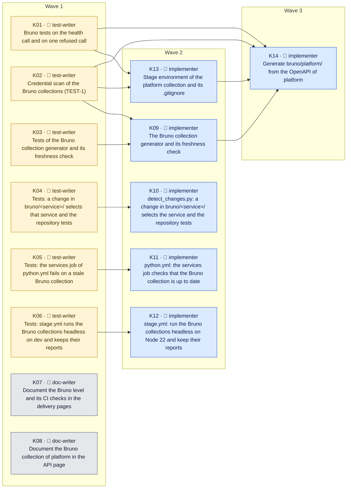

# T0.24: Bruno collection scaffold, plan

**Plan:** 🟢 Approved

**Push:** 🟢 Approved

<!-- ticket:specs -->
## 📚 Specifications

The specification and design pages of [TICKET.md](TICKET.md), copied by `python3 .claude/scripts/tickets/ticket_refs.py sync`.

- [D406](../../specs/06-decisions/technical/d406-back-end.md)
- [REQ-T05-03](../../specs/03-technical/t05-api-and-webhooks/requirements/req-t05-03-problem-json.md)
- [D426](../../specs/06-decisions/technical/d426-testing-strategy.md)
- [CI/CD and stages](../../technical/delivery/ci-cd-and-stages.md#stages-dev-and-qa)
- [📌 REQ-T05-01 REST with OpenAPI behind one gateway](../../specs/03-technical/t05-api-and-webhooks/requirements/req-t05-01-rest-openapi.md)
- [📌 REQ-T05-05 Contracts tested](../../specs/03-technical/t05-api-and-webhooks/requirements/req-t05-05-contract-tests.md)
- [🏗️ Back end](../../technical/architecture/backend.md)
- [🏗️ Tests and traceability](../../technical/delivery/tests-and-traceability.md)
- [🏗️ API](../../technical/interfaces/api.md)
<!-- /ticket:specs -->

## Summary

T0.24 delivers the Bruno collection scaffold of `platform` in 14 tasks over three waves.

- **Wave 1 (8 tasks, the maximum that runs at once):** six test-writer tasks and two doc tasks.
  - The Bruno tests on the health call and on one refused call that answers problem+json.
  - A credential scan of `bruno/` (TEST-1).
  - The tests of the generator and of its freshness check.
  - The tests of the `detect_changes.py` mapping, the `python.yml` freshness step and the `stage.yml` Bruno step.
  - Two doc-writer tasks, on the delivery pages and on the API page.
- **Wave 2 (5 tasks):** the implementers write the generator `.github/scripts/bruno_collection.py`, the `detect_changes.py` change, the `python.yml` step, the `stage.yml` step (Node 22, pinned CLI, JUnit and JSON reports, no headers or bodies in the reports) and the stage environment with its `.gitignore`.
- **Wave 3 (1 task):** generates `bruno/platform/` from the committed OpenAPI of `platform` and checks it end to end against the `compose.e2e.yaml` stack.

The ticket builds no screen, so no Playwright task is needed (TKT-21).

## Assumptions

- TEST-1 is cited by the roadmap row and D426 but no page defines it; read as no credential in a committed file, taking the most conservative form (no secret value anywhere in `bruno/`).
- The roadmap row names no Bruno CLI; the tool to run headless and write the JUnit and JSON reports is left to the plan.
- `tests-and-traceability.md` marks `bruno/` as 'to come', so this ticket creates it.
- The roadmap ticket row has no anchor of its own, so the ticket link uses the sprint anchor `#s04`.
- `check_ticket.py` was not run: this session has no shell tool, so the workflow's own run must validate the links and anchors.
- No budget of `docs/specs/05-non-functional/` is given to the ticket by the roadmap row or the specifications.
- The `tests-evidences` folder holds a `.gitkeep` so that git keeps it.
- The prerequisites T0.14 (the `platform` skeleton, its health route and its problem+json handler), T0.18 (the committed OpenAPI document of `platform`) and T0.21 (`compose.e2e.yaml`) are merged before the run. No specification names the OpenAPI file path, the health path, the refused call, the name of the code field or the host port of `platform`, so the briefs tell the workers to read them from the code those tickets delivered.
- The generator is a repository script, `.github/scripts/bruno_collection.py`, rather than the Bruno CLI's OpenAPI importer. This keeps the output deterministic, so a byte comparison can detect a stale collection, and lets the check run in CI without Node. It follows the style of the existing `.github/scripts/detect_changes.py` (module functions), since the Python rules of AGENT.md apply to `backend/`, `plugins/` and `sdk/` only.
- The generator owns only `bruno/<service>/bruno.json`, `collection.bru` and `requests/`. The hand-written tests (`tests/`), the stage environment (`environments/stage.bru`) and `.gitignore` sit outside what it writes and what `check` compares, so that regeneration never erases the tests on the health call and the refused call.
- Generated requests use `auth: none` and an empty `{}` JSON body skeleton, and never copy OpenAPI examples or defaults. This is the most conservative reading of TEST-1, because examples may hold credential-like values.
- The roadmap's Where names `backend/services/platform`, but the ticket needs no change in the service: the collection lives in `bruno/platform/` (the folder the design pages name) and the CI changes are in `.github`.
- The freshness check runs as a step of the `services` job of `python.yml` (`uv run python .github/scripts/bruno_collection.py check --service "$FOLDER"`). For it to run when only the collection changes, `detect_changes.py` maps `bruno/<service>/` to that service. It also sets `repository=true` for any change under `bruno/`, so that the credential scan of `tests/ci/bruno_credentials/` runs.
- TEST-1 is read as `TICKET.md` reads it: no credential in a committed file. The scan in `tests/ci/bruno_credentials/` covers the usual shapes: literal auth blocks, credential headers, secret-named variables, bearer tokens, JWTs, private keys, GitHub and AWS keys, URLs with a user and password, and any `.env` file. Each collection's `.gitignore` keeps a local `.env` out.
- `stage.yml` already holds a Bruno step pinned to `@usebruno/cli@4.2.1`, with JUnit and JSON reporters and no headers or bodies in the reports. The plan keeps that version and only adds Node 22 (the toolchain of `.claude/rules/tickets.md`) before the step. The step runs the whole collection, the generated requests included, which in P0 are only the safe GET calls of `platform`.
- The generated request file names depend on the operationIds of T0.18's document, which are unknown when the plan is written. K14 therefore owns the folder `bruno/platform/requests/` rather than named files.
- The refused call is the one T0.14's own test of REQ-T05-03 criterion 1 uses. If there are several, the plan takes one that needs no credential: a call under `/v1` without the company context, or an unknown route under `/v1`.
- "No secret in the body" (REQ-T05-03 criterion 2) is checked in the Bruno test like this: no key or value matching password, secret, token, authorization or api_key, and no stack trace.

<!-- plan:graph -->

> [!NOTE]
> Generated from the json block at the end of this page by `python3 .claude/scripts/tickets/plan.py render`.
> To change a task, edit the json block, then render again: never edit this view by hand.

## Waves

| Wave | Tasks | Agents running at once |
| --- | --- | --- |
| 1 | [K01](#k01), [K02](#k02), [K03](#k03), [K04](#k04), [K05](#k05), [K06](#k06), [K07](#k07), [K08](#k08) | 8 of 8 |
| 2 | [K09](#k09), [K10](#k10), [K11](#k11), [K12](#k12), [K13](#k13) | 5 of 5 |
| 3 | [K14](#k14) | 1 of 1 |

| Wave | Task | Agent | Depends on | Unblocks |
| --- | --- | --- | --- | --- |
| 1 | [K01](#k01) Bruno tests on the health call and on one refused call | 🧪 test-writer | none | [K13](#k13), [K14](#k14) |
| 1 | [K02](#k02) Credential scan of the Bruno collections (TEST-1) | 🧪 test-writer | none | [K09](#k09), [K13](#k13), [K14](#k14) |
| 1 | [K03](#k03) Tests of the Bruno collection generator and its freshness check | 🧪 test-writer | none | [K09](#k09) |
| 1 | [K04](#k04) Tests: a change in bruno/<service>/ selects that service and the repository tests | 🧪 test-writer | none | [K10](#k10) |
| 1 | [K05](#k05) Tests: the services job of python.yml fails on a stale Bruno collection | 🧪 test-writer | none | [K11](#k11) |
| 1 | [K06](#k06) Tests: stage.yml runs the Bruno collections headless on dev and keeps their reports | 🧪 test-writer | none | [K12](#k12) |
| 1 | [K07](#k07) Document the Bruno level and its CI checks in the delivery pages | 📝 doc-writer | none | none |
| 1 | [K08](#k08) Document the Bruno collection of platform in the API page | 📝 doc-writer | none | none |
| 2 | [K09](#k09) The Bruno collection generator and its freshness check | 🐍 implementer | [K03](#k03), [K02](#k02) | [K14](#k14) |
| 2 | [K10](#k10) detect_changes.py: a change in bruno/<service>/ selects the service and the repository tests | 🐍 implementer | [K04](#k04) | none |
| 2 | [K11](#k11) python.yml: the services job checks that the Bruno collection is up to date | 🐍 implementer | [K05](#k05) | none |
| 2 | [K12](#k12) stage.yml: run the Bruno collections headless on Node 22 and keep their reports | 🐍 implementer | [K06](#k06) | none |
| 2 | [K13](#k13) Stage environment of the platform collection and its .gitignore | 🐍 implementer | [K01](#k01), [K02](#k02) | [K14](#k14) |
| 3 | [K14](#k14) Generate bruno/platform/ from the OpenAPI of platform | 🐍 implementer | [K09](#k09), [K13](#k13), [K01](#k01), [K02](#k02) | none |

## Dependency graph



## Tasks

### <a id="k01"></a>K01: Bruno tests on the health call and on one refused call

| Agent | Wave | Depends on | Unblocks |
| --- | --- | --- | --- |
| 🧪 test-writer | 1 | none | [K13](#k13), [K14](#k14) |

**Files** (only this task may change them in its wave):

- `bruno/platform/tests/health.bru`
- `bruno/platform/tests/refused-call.bru`

**Done when:** Both files exist with a `tests { }` block and no literal credential, and `uv run pytest tests/ci/bruno_credentials -n 2 -k committed` reports no finding in them once K02 is integrated. After K13 and K14, with `docker compose -f compose.e2e.yaml up --detach --wait` running, `cd bruno/platform && npx --yes @usebruno/cli@4.2.1 run tests --env stage` passes both tests.

**Brief:**

Write the two hand-written Bruno requests, with their tests, that the collection of `platform` runs headless on the dev stage. They live in `bruno/platform/tests/`, which the generator never touches.

Specifications: REQ-T05-03 `docs/specs/03-technical/t05-api-and-webhooks/requirements/req-t05-03-problem-json.md` (criterion 1: a refused call gives a problem+json body with its code; criterion 2: no secret in an error). REQ-T05-01 `docs/specs/03-technical/t05-api-and-webhooks/requirements/req-t05-01-rest-openapi.md`. D426 `docs/specs/06-decisions/technical/d426-testing-strategy.md` (synthetic data only, TEST-1: no credential in a committed file). D122 `docs/specs/06-decisions/ux/d122-error-message-standard.md` (the error code). Design pages: `docs/technical/delivery/tests-and-traceability.md` and `docs/technical/delivery/ci-cd-and-stages.md#stages-dev-and-qa`. Ticket: `docs/tickets/T0.24/TICKET.md`, criteria 2, 3 and 4.

Read first: the health route and the problem+json handler of `backend/services/platform/src/` (T0.14), and the test of `backend/services/platform/tests/` that proves REQ-T05-03 criterion 1. Use the same health path (for example `/v1/health`) and the same refused call. If several calls are refused, take one that needs no credential: a call under `/v1` without the company context, or an unknown route under `/v1`, whichever T0.14's tests use. Use the exact name of the code field that T0.14's handler writes.

Files, in Bruno's `.bru` format, each with `meta { name, type: http, seq }`, a request block with `url: {{baseUrl}}<path>`, `body: none` and `auth: none`, and a `tests { }` block that uses `test(...)`, `expect(...)` and `res.getStatus()`, `res.getHeader()` and `res.getBody()` (safe sandbox):
- `bruno/platform/tests/health.bru`: GET of the health path. The status is 200 and the body is the one T0.14 documents.
- `bruno/platform/tests/refused-call.bru`: the refused call.
  - The status is the 4xx that `platform` returns.
  - `Content-Type` starts with `application/problem+json`.
  - The body has `status`, `title` and a non-empty code string.
  - The body holds no secret: no key or value matching `password`, `secret`, `token`, `authorization` or `api_key`, case-insensitive, and no `Traceback` or stack trace.

The variable is `baseUrl`, which `bruno/platform/environments/stage.bru` defines (K13). No header carries a credential, and no literal token, password or key appears anywhere (TEST-1). Write no other file. Tests need no docstrings (AGENT.md, Tests).

### <a id="k02"></a>K02: Credential scan of the Bruno collections (TEST-1)

| Agent | Wave | Depends on | Unblocks |
| --- | --- | --- | --- |
| 🧪 test-writer | 1 | none | [K09](#k09), [K13](#k13), [K14](#k14) |

**Files** (only this task may change them in its wave):

- `tests/ci/bruno_credentials/helpers.py`
- `tests/ci/bruno_credentials/test_bruno_credentials.py`

**Done when:** `uv run pytest tests/ci/bruno_credentials -n 2` runs. Every planted-sample and placeholder test passes now. The `.gitignore` test fails only because `bruno/platform/.gitignore` does not exist yet, and passes once K13 is integrated. `uv run ruff check tests/ci/bruno_credentials` and `uv run ruff format --check tests/ci/bruno_credentials` pass.

**Brief:**

Write a repository-level test that fails when any file of `bruno/` holds a credential. It is the enforcer of ticket criterion 4.

Specifications: D426 `docs/specs/06-decisions/technical/d426-testing-strategy.md` (TEST-1 to TEST-9 apply; TEST-1 is read as the roadmap row reads it: no credential in a committed file). REQ-T05-03 `docs/specs/03-technical/t05-api-and-webhooks/requirements/req-t05-03-problem-json.md` (criterion 2, no secret). Design page: `docs/technical/delivery/tests-and-traceability.md`. Ticket: `docs/tickets/T0.24/TICKET.md`, criterion 4 and its first assumption (the most conservative form: no secret, token or password value anywhere in `bruno/`).

`tests/ci/bruno_credentials/helpers.py` holds the scanner, as plain functions and constants like `tests/ci/detect_changes/helpers.py`.
- It lists the files of `bruno/` with `git ls-files --cached --others --exclude-standard -- bruno`, so that a new, uncommitted file is scanned and an ignored local `.env` is not. Outside a git repository it falls back to `Path.rglob`.
- It flags any `.env` file in that list.
- It flags any `auth:basic`, `auth:bearer`, `auth:apikey`, `auth:digest`, `auth:oauth2`, `auth:awsv4`, `auth:ntlm` or `auth:wsse` block with a literal value.
- It flags an `Authorization`, `Proxy-Authorization`, `Cookie` or `X-Api-Key` header with a literal value.
- It flags a `vars` or `vars:*` entry whose name matches `password|passwd|secret|token|api[_-]?key|client[_-]?secret|private[_-]?key` with a literal value.
- It flags these literal patterns anywhere: `Bearer <literal>`, a JWT (`eyJ...\.eyJ...\.`), `-----BEGIN ... PRIVATE KEY-----`, `ghp_` or `github_pat_`, `AKIA[0-9A-Z]{16}`, and a URL with a user and password (`scheme://user:pass@`).
- Allowed values: empty, `{{name}}` and `{{process.env.NAME}}`. The name list of `vars:secret [ ... ]` is allowed, because Bruno keeps those values out of the file.

`test_bruno_credentials.py` holds one class, `TestBrunoCredentials`, with these tests:
- parametrised planted samples in `tmp_path` that are each flagged;
- placeholders that are not flagged;
- the committed `bruno/` of the repository has no finding, and the failure message lists file and line;
- each collection folder `bruno/<name>/` has a `.gitignore` that ignores `.env`, which K13 provides.

Use synthetic values only. Follow AGENT.md, Tests: names as sentences, `pytest.mark.parametrize`, no mocks, no `__init__.py`. Imports go by full path, `from tests.ci.bruno_credentials.helpers import ...`.

### <a id="k03"></a>K03: Tests of the Bruno collection generator and its freshness check

| Agent | Wave | Depends on | Unblocks |
| --- | --- | --- | --- |
| 🧪 test-writer | 1 | none | [K09](#k09) |

**Files** (only this task may change them in its wave):

- `tests/ci/bruno_collection/helpers.py`
- `tests/ci/bruno_collection/test_generate.py`
- `tests/ci/bruno_collection/test_check.py`

**Done when:** `uv run pytest tests/ci/bruno_collection -n 2` is collected and fails only because `.github/scripts/bruno_collection.py` does not exist yet. `uv run ruff check tests/ci/bruno_collection` and `uv run ruff format --check tests/ci/bruno_collection` pass.

**Brief:**

Write the tests of `.github/scripts/bruno_collection.py` (written by K09). It generates `bruno/<service>/` from the committed OpenAPI of `backend/services/<service>/`, and its `check` fails when the committed collection is stale.

Specifications: D406 `docs/specs/06-decisions/technical/d406-back-end.md` (the Bruno collection generated from the contract). REQ-T05-01 `docs/specs/03-technical/t05-api-and-webhooks/requirements/req-t05-01-rest-openapi.md`. REQ-T05-05 `docs/specs/03-technical/t05-api-and-webhooks/requirements/req-t05-05-contract-tests.md` (contract tests in CI catch changes). D426 `docs/specs/06-decisions/technical/d426-testing-strategy.md` (TEST-1). Design pages: `docs/technical/architecture/backend.md` and `docs/technical/interfaces/api.md`. Ticket: `docs/tickets/T0.24/TICKET.md`, criteria 1, 4 and 6.

**Contract to test:**

Command line:
- `python3 .github/scripts/bruno_collection.py generate --service backend/services/<name> [--root <repo root>]`
- `python3 .github/scripts/bruno_collection.py check --service backend/services/<name> [--root <repo root>]`

Exit codes: 0 when all is well; 1 for a stale collection or a missing or unreadable OpenAPI when a collection exists; 2 for bad arguments, which prints a usage line.

The OpenAPI is the file T0.18 committed. Read `backend/services/platform/` to find its path relative to the service folder, and put that path in a `helpers.py` constant `OPENAPI`. The collection is `bruno/<name>/`.

`generate` owns only `bruno.json`, `collection.bru` and `requests/`, and never touches `tests/`, `environments/` or `.gitignore`.
- `bruno.json` is `{"version": "1", "name": "<name>", "type": "collection", "ignore": ["node_modules", ".git"]}`.
- `collection.bru` holds a `docs` block saying the collection is generated and naming the command.
- `requests/<tag>/<operationId>.bru` is one file per operation, under the slug of its first tag, or `default` when it has none. Its `meta` has the name (summary or operationId), `type: http` and a 1-based `seq` within the folder. Its request block uses the method, `url: {{baseUrl}}<path>` with `{param}` written `{{param}}`, and `auth: none`. Query parameters go in `params:query` as disabled entries with empty values. A JSON request body is the skeleton `{}`. Examples and defaults are never copied, and security schemes never produce a value.
- The output is byte-identical across runs, with LF line endings and no timestamp.
- A request file whose operation disappeared is removed.

`check` regenerates in memory and compares. It lists every missing, changed or unexpected generated file, one per line, then the `generate` command to run, and exits 1. With no `bruno/<name>/` it prints that there is nothing to check and exits 0.

**Files:**
- `helpers.py`: the script path, as in `tests/ci/detect_changes/helpers.py`, the `OPENAPI` constant, a synthetic OpenAPI fixture (a health GET, a tagged GET with a path and a query parameter, a POST with a JSON body whose example holds a fake password, and a bearer security scheme), and functions that write a fake service into a `tmp_path` root and run the script with `subprocess`.
- `test_generate.py` (`TestGenerate`): one file per operation, in the right folder with the right URL; deterministic output; stale request files removed; `tests/` and `environments/` left untouched; no example, password or token from the fixture in any generated file.
- `test_check.py` (`TestCheck`): a fresh collection passes; an operation added, removed or renamed in the OpenAPI fails and names the file; a hand-edited generated file fails; an extra file in `requests/` fails; a changed file under `tests/` passes; no collection passes; a missing OpenAPI with a collection present fails; bad arguments exit 2.

Follow AGENT.md, Tests. Each file holds one class, there are no mocks, and parametrised cases share a behaviour.

### <a id="k04"></a>K04: Tests: a change in bruno/<service>/ selects that service and the repository tests

| Agent | Wave | Depends on | Unblocks |
| --- | --- | --- | --- |
| 🧪 test-writer | 1 | none | [K10](#k10) |

**Files** (only this task may change them in its wave):

- `tests/ci/detect_changes/bruno/test_bruno_changes.py`

**Done when:** `uv run pytest tests/ci/detect_changes/bruno/test_bruno_changes.py -n 2` runs and fails only on the new Bruno rule that K10 adds. `uv run ruff check tests/ci/detect_changes` passes.

**Brief:**

Write the tests of the new rule of `.github/scripts/detect_changes.py` (changed by K10). A changed path under `bruno/<name>/` selects `backend/services/<name>` when that service exists, so that its job runs the freshness check. It also sets `repository=true`, so that the credential scan of `tests/ci/bruno_credentials/` runs.

Specifications: REQ-T05-05 `docs/specs/03-technical/t05-api-and-webhooks/requirements/req-t05-05-contract-tests.md` (contract tests in CI). D426 `docs/specs/06-decisions/technical/d426-testing-strategy.md` (TEST-1). Design page: `docs/technical/delivery/ci-cd-and-stages.md` (CI detects what changed). Ticket: `docs/tickets/T0.24/TICKET.md`, criteria 4 and 6.

Create `tests/ci/detect_changes/bruno/test_bruno_changes.py` with one class, `TestBrunoChanges`. Use the existing `tests.ci.detect_changes.helpers` (`detect`, `compact`, `SALES` and the others), and do not change that file.

Cases:
- `bruno/sales/tests/health.bru` gives services `[SALES]`, repository `true`, no images, no packages and no TypeScript.
- `bruno/sales/requests/default/x.bru` gives the same.
- `bruno/unknown/x.bru` gives services `[]` and repository `true`.
- `bruno/README.md` gives services `[]` and repository `true`.
- A Bruno change together with a `frontend/backoffice/` change keeps both selections.

Follow AGENT.md, Tests: names as sentences and `parametrize` for cases of one behaviour.

### <a id="k05"></a>K05: Tests: the services job of python.yml fails on a stale Bruno collection

| Agent | Wave | Depends on | Unblocks |
| --- | --- | --- | --- |
| 🧪 test-writer | 1 | none | [K11](#k11) |

**Files** (only this task may change them in its wave):

- `tests/ci/workflows/checks/test_python_workflow.py`

**Done when:** `uv run pytest tests/ci/workflows/checks/test_python_workflow.py -n 2` keeps every existing test passing, and the new tests fail only because K11 has not added the step. `uv run ruff check tests/ci/workflows` passes.

**Brief:**

Add tests to `tests/ci/workflows/checks/test_python_workflow.py`, keeping its single class `TestPythonWorkflow` and every existing test. They prove that the `services` job of `.github/workflows/python.yml` (changed by K11) runs the Bruno freshness check of each service.

Specifications: REQ-T05-05 `docs/specs/03-technical/t05-api-and-webhooks/requirements/req-t05-05-contract-tests.md`. D406 `docs/specs/06-decisions/technical/d406-back-end.md` (the collection generated from the contract). Design page: `docs/technical/delivery/ci-cd-and-stages.md` (`python.yml` row). Ticket: `docs/tickets/T0.24/TICKET.md`, criterion 6 (a collection that no longer matches the OpenAPI fails CI).

The new tests assert these, with the helpers of `tests.ci.workflows.helpers`:
- The `services` job has a step named `Bruno collection up to date (REQ-T05-05)`.
- That step comes after `Install the workspace`.
- Its `run` holds `uv run python .github/scripts/bruno_collection.py check --service "$FOLDER"`.
- It has no `if:` that would skip it on pull requests, and no `continue-on-error`.
- It reads no `${{ inputs` directly.

The script itself says there is nothing to check when a service has no collection, as K03 tests.

### <a id="k06"></a>K06: Tests: stage.yml runs the Bruno collections headless on dev and keeps their reports

| Agent | Wave | Depends on | Unblocks |
| --- | --- | --- | --- |
| 🧪 test-writer | 1 | none | [K12](#k12) |

**Files** (only this task may change them in its wave):

- `tests/ci/workflows/test_stage_workflow.py`

**Done when:** `uv run pytest tests/ci/workflows/test_stage_workflow.py -n 2` runs. The existing tests still pass, and the new tests fail only on what K12 changes: the Node 22 setup before the Bruno step. `uv run ruff check tests/ci/workflows` passes.

**Brief:**

Add tests to `tests/ci/workflows/test_stage_workflow.py`, keeping its single class `TestStageWorkflow` and every existing test. They cover the Bruno step of `.github/workflows/stage.yml` (changed by K12).

Specifications: design page `docs/technical/delivery/ci-cd-and-stages.md#stages-dev-and-qa` (the dev stage runs the smoke test, unit tests, Bruno and Playwright `@smoke`) and `docs/technical/delivery/tests-and-traceability.md` (the API level is the Bruno collection, run headless on dev and QA). REQ-T05-03 `docs/specs/03-technical/t05-api-and-webhooks/requirements/req-t05-03-problem-json.md` (criterion 2, no secret: the reports keep no header and no body). D426 `docs/specs/06-decisions/technical/d426-testing-strategy.md` (TEST-1, TEST-9: every report kept). Ticket: `docs/tickets/T0.24/TICKET.md`, criterion 5.

The step is named `Bruno collection (TEST-1)`. Assert that:
- Its `if` requires `steps.compose.outputs.present == 'true'` and `hashFiles('bruno/**') != ''`, and has no condition on `env.STAGE`, so it runs on dev and on QA.
- Its `run` loops over `bruno/*/` and runs `@usebruno/cli@<x.y.z>` with an exact pinned version (a regex on `@usebruno/cli@\d+\.\d+\.\d+`), with `run`, `--env stage`, `--reporter-junit "$REPORTS/bruno-$name.xml"`, `--reporter-json "$REPORTS/bruno-$name.json"`, `--reporter-skip-all-headers` and `--reporter-skip-body`.
- It fails the job when a collection fails (`exit "$status"`).
- A step that uses `actions/setup-node` with `node-version: "22"` comes before it and runs when compose is present and a collection exists.
- The upload step `Keep the reports (TEST-9)` still keeps `stage-reports/` with `if: always()`.

Update `test_without_compose_e2e_the_stage_says_there_are_no_images_yet_and_succeeds` so that the Bruno step is in its list.

### <a id="k07"></a>K07: Document the Bruno level and its CI checks in the delivery pages

| Agent | Wave | Depends on | Unblocks |
| --- | --- | --- | --- |
| 📝 doc-writer | 1 | none | none |

**Files** (only this task may change them in its wave):

- `docs/technical/delivery/tests-and-traceability.md`
- `docs/technical/delivery/ci-cd-and-stages.md`

**Done when:** Both pages describe the generator command, the `tests/` folder, the freshness check, the credential scan and the stage reports. `grep -n 'to come' docs/technical/delivery/tests-and-traceability.md` no longer matches the API row. Every relative link of the two pages resolves.

**Brief:**

Update two design pages to say what T0.24 delivers. Write plain British English with no em dashes, and update each page's `Last reviewed` date.

Specifications: D406 `docs/specs/06-decisions/technical/d406-back-end.md`, D426 `docs/specs/06-decisions/technical/d426-testing-strategy.md` (TEST-1), REQ-T05-03 `docs/specs/03-technical/t05-api-and-webhooks/requirements/req-t05-03-problem-json.md` and REQ-T05-05 `docs/specs/03-technical/t05-api-and-webhooks/requirements/req-t05-05-contract-tests.md`. Ticket: `docs/tickets/T0.24/TICKET.md`.

- `docs/technical/delivery/tests-and-traceability.md`: in the Levels table, the API row drops `(to come)`. Add a short section with these points:
  - Each service has one collection, `bruno/<service>/`.
  - Its `bruno.json`, `collection.bru` and `requests/` are generated from the service's committed OpenAPI by `python3 .github/scripts/bruno_collection.py generate --service backend/services/<service>`, and must not be edited by hand.
  - Its hand-written tests are in `tests/`: for `platform`, the health call and a refused call answering problem+json with its code.
  - The stage environment is `environments/stage.bru`, which holds only `baseUrl`.
  - No credential is committed (TEST-1): `tests/ci/bruno_credentials/` scans `bruno/`, and each collection's `.gitignore` keeps a local `.env` out.
- `docs/technical/delivery/ci-cd-and-stages.md`:
  - The `python.yml` row adds that each service job checks that `bruno/<service>/` is up to date with the OpenAPI (REQ-T05-05) and fails otherwise.
  - The `ci.yml` and detection text says that a change under `bruno/<service>/` selects that service and the repository tests.
  - The Stages section says that the Bruno step runs every collection headless with the pinned Bruno CLI on Node 22, and keeps `bruno-<name>.xml` (JUnit) and `bruno-<name>.json` in the stage reports artifact, without headers or bodies.

State nothing the ticket and the specifications do not state. Change no file of `docs/specs/`.

### <a id="k08"></a>K08: Document the Bruno collection of platform in the API page

| Agent | Wave | Depends on | Unblocks |
| --- | --- | --- | --- |
| 📝 doc-writer | 1 | none | none |

**Files** (only this task may change them in its wave):

- `docs/technical/interfaces/api.md`

**Done when:** `docs/technical/interfaces/api.md` names `bruno/platform/`, the generate command, the `tests/` folder and the local run, and every relative link in it resolves.

**Brief:**

Update the HTTP section of `docs/technical/interfaces/api.md`. Keep what T0.14 and T0.18 wrote about the endpoints of `platform` and their OpenAPI, and add a short paragraph on the Bruno collection.

The paragraph says:
- `bruno/platform/` is generated from the committed OpenAPI of `platform` (D406), one request per operation under `requests/<tag>/`.
- To regenerate it, run `python3 .github/scripts/bruno_collection.py generate --service backend/services/platform`. CI fails while it is stale (REQ-T05-05).
- Hand-written requests with tests live in `bruno/platform/tests/`: the health call, and one refused call whose body is problem+json with its code and no secret (REQ-T05-03).
- To run the collection locally against `compose.e2e.yaml`, run `cd bruno/platform && npx --yes @usebruno/cli@4.2.1 run --env stage`.
- Any local secret goes in an ignored `.env` and never in a committed file (TEST-1, D426).

Update `Last reviewed`. Write plain British English with no em dashes.

Specifications: D406 `docs/specs/06-decisions/technical/d406-back-end.md`, REQ-T05-01 `docs/specs/03-technical/t05-api-and-webhooks/requirements/req-t05-01-rest-openapi.md`, REQ-T05-03 `docs/specs/03-technical/t05-api-and-webhooks/requirements/req-t05-03-problem-json.md`, REQ-T05-05 `docs/specs/03-technical/t05-api-and-webhooks/requirements/req-t05-05-contract-tests.md` and D426 `docs/specs/06-decisions/technical/d426-testing-strategy.md`. Ticket: `docs/tickets/T0.24/TICKET.md`. Change no file of `docs/specs/`.

### <a id="k09"></a>K09: The Bruno collection generator and its freshness check

| Agent | Wave | Depends on | Unblocks |
| --- | --- | --- | --- |
| 🐍 implementer | 2 | [K03](#k03), [K02](#k02) | [K14](#k14) |

**Files** (only this task may change them in its wave):

- `.github/scripts/bruno_collection.py`

**Done when:** `uv run pytest tests/ci/bruno_collection -n 2` passes. `uv run ruff check .github/scripts` and `uv run ruff format --check .github/scripts` pass.

**Brief:**

Write `.github/scripts/bruno_collection.py` so that every test of `tests/ci/bruno_collection/` (K03) passes. It has two subcommands:
- `generate --service backend/services/<name> [--root <repo root>]`
- `check --service backend/services/<name> [--root <repo root>]`

Read the tests and their `helpers.py` first: they are the contract. That includes the `OPENAPI` path relative to the service folder, which is the document T0.18 committed. Use the same constant in the script.

Specifications: D406 `docs/specs/06-decisions/technical/d406-back-end.md` (the Bruno collection generated from the contract). REQ-T05-01 `docs/specs/03-technical/t05-api-and-webhooks/requirements/req-t05-01-rest-openapi.md`. REQ-T05-05 `docs/specs/03-technical/t05-api-and-webhooks/requirements/req-t05-05-contract-tests.md` (a stale collection fails CI). D426 `docs/specs/06-decisions/technical/d426-testing-strategy.md` (TEST-1: the generator never writes a credential, never copies an example or a default value, and uses `auth: none`). Design pages: `docs/technical/architecture/backend.md` and `docs/technical/interfaces/api.md`. Ticket: `docs/tickets/T0.24/TICKET.md`, criteria 1, 4 and 6.

Style:
- Follow the existing `.github/scripts/detect_changes.py`: a module docstring with the usage, `from __future__ import annotations`, module constants, small typed functions with docstrings, `argparse` with `exit_on_error=False`, and `main()` returning the exit code (0, 1 or 2).
- Use `typing` generics (`List`, `Dict`, `Optional`), open files with `encoding="utf-8"`, and write LF line endings.
- Use only the standard library if T0.18 commits JSON. If it commits YAML, use PyYAML, which the uv workspace already provides, since CI runs the script with `uv run python`.

Behaviour:
- The output is deterministic: operations sorted by path then method, `seq` numbered within each folder, and no timestamp.
- `generate` writes only `bruno.json`, `collection.bru` and `requests/`, and removes request files that are no longer generated.
- `check` compares in memory and lists missing, changed and unexpected generated files.
- With no collection, `check` prints that there is nothing to check and exits 0.

Write no other file. In particular, do not generate `bruno/platform/` yet: K14 does.

### <a id="k10"></a>K10: detect_changes.py: a change in bruno/<service>/ selects the service and the repository tests

| Agent | Wave | Depends on | Unblocks |
| --- | --- | --- | --- |
| 🐍 implementer | 2 | [K04](#k04) | none |

**Files** (only this task may change them in its wave):

- `.github/scripts/detect_changes.py`

**Done when:** `uv run pytest tests/ci/detect_changes -n 2` passes. `uv run ruff check .github/scripts` and `uv run ruff format --check .github/scripts` pass.

**Brief:**

Change `.github/scripts/detect_changes.py` so that the tests of `tests/ci/detect_changes/bruno/test_bruno_changes.py` (K04) pass and every existing test of `tests/ci/detect_changes/` still passes.

- A changed path `bruno/<name>/...` adds `backend/services/<name>` to `services` when that service is discovered, and sets `repository=true`. Use a module constant such as `BRUNO = "bruno"`.
- `bruno/` alone, or an unknown collection, sets only `repository=true`.
- A Bruno change selects no image.
- Update the module docstring to describe the new rule.

Specifications: REQ-T05-05 `docs/specs/03-technical/t05-api-and-webhooks/requirements/req-t05-05-contract-tests.md` (the freshness check must run when the collection changes). D426 `docs/specs/06-decisions/technical/d426-testing-strategy.md` (TEST-1, the credential scan runs with the repository tests). Design page: `docs/technical/delivery/ci-cd-and-stages.md`. Ticket: `docs/tickets/T0.24/TICKET.md`, criteria 4 and 6.

Keep the file's existing style. Write no other file.

### <a id="k11"></a>K11: python.yml: the services job checks that the Bruno collection is up to date

| Agent | Wave | Depends on | Unblocks |
| --- | --- | --- | --- |
| 🐍 implementer | 2 | [K05](#k05) | none |

**Files** (only this task may change them in its wave):

- `.github/workflows/python.yml`

**Done when:** `uv run pytest tests/ci/workflows -n 2` passes, the new tests of K05 included.

**Brief:**

Add to the `services` job of `.github/workflows/python.yml` a step named `Bruno collection up to date (REQ-T05-05)`.

- It goes after `Install the workspace`, beside the OpenAPI contract check that T0.18 added if it is in this job, and before the upload step.
- Its `run` is `uv run python .github/scripts/bruno_collection.py check --service "$FOLDER"`.
- It has no extra `if`: the script itself says there is nothing to check for a service without a collection.
- It reads no `${{ inputs` in a `run` (see `tests/ci/workflows/test_workflow_security.py`).
- Update the header comment of the workflow in one line.

The tests of `tests/ci/workflows/checks/test_python_workflow.py` (K05) must pass, with every other test of `tests/ci/workflows/`.

Specifications: REQ-T05-05 `docs/specs/03-technical/t05-api-and-webhooks/requirements/req-t05-05-contract-tests.md` and D406 `docs/specs/06-decisions/technical/d406-back-end.md`. Design page: `docs/technical/delivery/ci-cd-and-stages.md`. Ticket: `docs/tickets/T0.24/TICKET.md`, criterion 6. Write no other file.

### <a id="k12"></a>K12: stage.yml: run the Bruno collections headless on Node 22 and keep their reports

| Agent | Wave | Depends on | Unblocks |
| --- | --- | --- | --- |
| 🐍 implementer | 2 | [K06](#k06) | none |

**Files** (only this task may change them in its wave):

- `.github/workflows/stage.yml`

**Done when:** `uv run pytest tests/ci/workflows -n 2` passes, the new tests of K06 included.

**Brief:**

Change `.github/workflows/stage.yml` so that the tests of `tests/ci/workflows/test_stage_workflow.py` (K06) pass, with every other test of `tests/ci/workflows/`.

- Before the step `Bruno collection (TEST-1)`, set up Node 22 with the pinned `actions/setup-node` already used in the file, when compose is present and `bruno/**` exists. Keep the later pnpm and Node setup of Playwright working: reuse or reorder the steps, without duplicating a pnpm cache setup that has no lock file.
- Keep the Bruno step's existing behaviour:
  - it loops over `bruno/*/` and runs the pinned `@usebruno/cli@4.2.1` with `run --env stage`;
  - it writes `--reporter-json "$REPORTS/bruno-$name.json"` and `--reporter-junit "$REPORTS/bruno-$name.xml"`;
  - it uses `--reporter-skip-all-headers --reporter-skip-body`, so that no secret reaches a report (REQ-T05-03 criterion 2);
  - it ends with `exit "$status"`;
  - it runs on dev and on QA.
- The report upload keeps `if: always()`.

Specifications: design page `docs/technical/delivery/ci-cd-and-stages.md#stages-dev-and-qa` and `docs/technical/delivery/tests-and-traceability.md`. REQ-T05-03 `docs/specs/03-technical/t05-api-and-webhooks/requirements/req-t05-03-problem-json.md`. D426 `docs/specs/06-decisions/technical/d426-testing-strategy.md` (TEST-1, TEST-9). Ticket: `docs/tickets/T0.24/TICKET.md`, criterion 5. Write no other file.

### <a id="k13"></a>K13: Stage environment of the platform collection and its .gitignore

| Agent | Wave | Depends on | Unblocks |
| --- | --- | --- | --- |
| 🐍 implementer | 2 | [K01](#k01), [K02](#k02) | [K14](#k14) |

**Files** (only this task may change them in its wave):

- `bruno/platform/environments/stage.bru`
- `bruno/platform/.gitignore`

**Done when:** `uv run pytest tests/ci/bruno_credentials -n 2` passes, the `.gitignore` test included, and `git check-ignore bruno/platform/.env` prints the path.

**Brief:**

Write the two hand-written support files of the collection.

- `bruno/platform/environments/stage.bru` holds `vars { baseUrl: http://localhost:<port> }`. Take the port from the `platform` service of `compose.e2e.yaml` (T0.21): the host port the runner reaches in `stage.yml`. It holds no other variable and no credential. If a later call ever needs one, it is listed by name only under `vars:secret [ ... ]` or read from `{{process.env.NAME}}`.
- `bruno/platform/.gitignore` ignores `.env`, so that a local secret file is never committed (TEST-1).

The tests that use these files are `bruno/platform/tests/*.bru` (K01), which use the variable `baseUrl`, and `tests/ci/bruno_credentials/` (K02).

Specifications: D426 `docs/specs/06-decisions/technical/d426-testing-strategy.md` (TEST-1, synthetic data only). REQ-T05-03 `docs/specs/03-technical/t05-api-and-webhooks/requirements/req-t05-03-problem-json.md` (criterion 2). Design page: `docs/technical/delivery/ci-cd-and-stages.md#stages-dev-and-qa`. Ticket: `docs/tickets/T0.24/TICKET.md`, criteria 4 and 5. Write no other file.

### <a id="k14"></a>K14: Generate bruno/platform/ from the OpenAPI of platform

| Agent | Wave | Depends on | Unblocks |
| --- | --- | --- | --- |
| 🐍 implementer | 3 | [K09](#k09), [K13](#k13), [K01](#k01), [K02](#k02) | none |

**Files** (only this task may change them in its wave):

- `bruno/platform/bruno.json`
- `bruno/platform/collection.bru`
- `bruno/platform/requests/`

**Done when:** `python3 .github/scripts/bruno_collection.py check --service backend/services/platform` exits 0, and `uv run pytest tests/ci/bruno_credentials -n 2` passes. Against the running `compose.e2e.yaml` stack, the Bruno run passes the health test and the refused-call test, and writes its JUnit and JSON reports.

**Brief:**

Run `python3 .github/scripts/bruno_collection.py generate --service backend/services/platform` (K09) to write the generated part of the collection from the OpenAPI that T0.18 committed:
- `bruno/platform/bruno.json`;
- `bruno/platform/collection.bru`;
- one `.bru` per operation under `bruno/platform/requests/<tag>/`. The file names come from the document's operationIds, so the task owns the whole `requests/` folder.

Do not edit the generated files by hand. If the output is wrong, report it as `blocked_by` on `.github/scripts/bruno_collection.py`, with what to change (TKT-19). Do not touch `bruno/platform/tests/`, `environments/` or `.gitignore`.

Then check the collection end to end:
1. Start `docker compose -f compose.e2e.yaml up --detach --wait`.
2. Run `cd bruno/platform && npx --yes @usebruno/cli@4.2.1 run --env stage --reporter-junit /tmp/bruno.xml --reporter-json /tmp/bruno.json --reporter-skip-all-headers --reporter-skip-body`.
3. Report the result.
4. Stop the stack with `docker compose -f compose.e2e.yaml down --volumes`.

If Docker is not available, report the step as not run, with the reason: that is an environment issue, not a failure.

Specifications: D406 `docs/specs/06-decisions/technical/d406-back-end.md`, REQ-T05-01 `docs/specs/03-technical/t05-api-and-webhooks/requirements/req-t05-01-rest-openapi.md`, REQ-T05-03 `docs/specs/03-technical/t05-api-and-webhooks/requirements/req-t05-03-problem-json.md`, REQ-T05-05 `docs/specs/03-technical/t05-api-and-webhooks/requirements/req-t05-05-contract-tests.md` and D426 `docs/specs/06-decisions/technical/d426-testing-strategy.md` (TEST-1). Design pages: `docs/technical/architecture/backend.md`, `docs/technical/interfaces/api.md` and `docs/technical/delivery/ci-cd-and-stages.md#stages-dev-and-qa`. Ticket: `docs/tickets/T0.24/TICKET.md`, criteria 1 to 4.

<!-- /plan:graph -->

## Task graph

<details>
<summary>🤖 Task graph as read by <code>/ticket-run</code> (json)</summary>

```json
[
  {
    "id": "K01",
    "title": "Bruno tests on the health call and on one refused call",
    "agent": "test-writer",
    "depends_on": [],
    "files": [
      "bruno/platform/tests/health.bru",
      "bruno/platform/tests/refused-call.bru"
    ],
    "brief": "Write the two hand-written Bruno requests, with their tests, that the collection of `platform` runs headless on the dev stage. They live in `bruno/platform/tests/`, which the generator never touches.\n\nSpecifications: REQ-T05-03 `docs/specs/03-technical/t05-api-and-webhooks/requirements/req-t05-03-problem-json.md` (criterion 1: a refused call gives a problem+json body with its code; criterion 2: no secret in an error). REQ-T05-01 `docs/specs/03-technical/t05-api-and-webhooks/requirements/req-t05-01-rest-openapi.md`. D426 `docs/specs/06-decisions/technical/d426-testing-strategy.md` (synthetic data only, TEST-1: no credential in a committed file). D122 `docs/specs/06-decisions/ux/d122-error-message-standard.md` (the error code). Design pages: `docs/technical/delivery/tests-and-traceability.md` and `docs/technical/delivery/ci-cd-and-stages.md#stages-dev-and-qa`. Ticket: `docs/tickets/T0.24/TICKET.md`, criteria 2, 3 and 4.\n\nRead first: the health route and the problem+json handler of `backend/services/platform/src/` (T0.14), and the test of `backend/services/platform/tests/` that proves REQ-T05-03 criterion 1. Use the same health path (for example `/v1/health`) and the same refused call. If several calls are refused, take one that needs no credential: a call under `/v1` without the company context, or an unknown route under `/v1`, whichever T0.14's tests use. Use the exact name of the code field that T0.14's handler writes.\n\nFiles, in Bruno's `.bru` format, each with `meta { name, type: http, seq }`, a request block with `url: {{baseUrl}}<path>`, `body: none` and `auth: none`, and a `tests { }` block that uses `test(...)`, `expect(...)` and `res.getStatus()`, `res.getHeader()` and `res.getBody()` (safe sandbox):\n- `bruno/platform/tests/health.bru`: GET of the health path. The status is 200 and the body is the one T0.14 documents.\n- `bruno/platform/tests/refused-call.bru`: the refused call.\n  - The status is the 4xx that `platform` returns.\n  - `Content-Type` starts with `application/problem+json`.\n  - The body has `status`, `title` and a non-empty code string.\n  - The body holds no secret: no key or value matching `password`, `secret`, `token`, `authorization` or `api_key`, case-insensitive, and no `Traceback` or stack trace.\n\nThe variable is `baseUrl`, which `bruno/platform/environments/stage.bru` defines (K13). No header carries a credential, and no literal token, password or key appears anywhere (TEST-1). Write no other file. Tests need no docstrings (AGENT.md, Tests).",
    "done_when": "Both files exist with a `tests { }` block and no literal credential, and `uv run pytest tests/ci/bruno_credentials -n 2 -k committed` reports no finding in them once K02 is integrated. After K13 and K14, with `docker compose -f compose.e2e.yaml up --detach --wait` running, `cd bruno/platform && npx --yes @usebruno/cli@4.2.1 run tests --env stage` passes both tests.",
    "wave": 1
  },
  {
    "id": "K02",
    "title": "Credential scan of the Bruno collections (TEST-1)",
    "agent": "test-writer",
    "depends_on": [],
    "files": [
      "tests/ci/bruno_credentials/helpers.py",
      "tests/ci/bruno_credentials/test_bruno_credentials.py"
    ],
    "brief": "Write a repository-level test that fails when any file of `bruno/` holds a credential. It is the enforcer of ticket criterion 4.\n\nSpecifications: D426 `docs/specs/06-decisions/technical/d426-testing-strategy.md` (TEST-1 to TEST-9 apply; TEST-1 is read as the roadmap row reads it: no credential in a committed file). REQ-T05-03 `docs/specs/03-technical/t05-api-and-webhooks/requirements/req-t05-03-problem-json.md` (criterion 2, no secret). Design page: `docs/technical/delivery/tests-and-traceability.md`. Ticket: `docs/tickets/T0.24/TICKET.md`, criterion 4 and its first assumption (the most conservative form: no secret, token or password value anywhere in `bruno/`).\n\n`tests/ci/bruno_credentials/helpers.py` holds the scanner, as plain functions and constants like `tests/ci/detect_changes/helpers.py`.\n- It lists the files of `bruno/` with `git ls-files --cached --others --exclude-standard -- bruno`, so that a new, uncommitted file is scanned and an ignored local `.env` is not. Outside a git repository it falls back to `Path.rglob`.\n- It flags any `.env` file in that list.\n- It flags any `auth:basic`, `auth:bearer`, `auth:apikey`, `auth:digest`, `auth:oauth2`, `auth:awsv4`, `auth:ntlm` or `auth:wsse` block with a literal value.\n- It flags an `Authorization`, `Proxy-Authorization`, `Cookie` or `X-Api-Key` header with a literal value.\n- It flags a `vars` or `vars:*` entry whose name matches `password|passwd|secret|token|api[_-]?key|client[_-]?secret|private[_-]?key` with a literal value.\n- It flags these literal patterns anywhere: `Bearer <literal>`, a JWT (`eyJ...\\.eyJ...\\.`), `-----BEGIN ... PRIVATE KEY-----`, `ghp_` or `github_pat_`, `AKIA[0-9A-Z]{16}`, and a URL with a user and password (`scheme://user:pass@`).\n- Allowed values: empty, `{{name}}` and `{{process.env.NAME}}`. The name list of `vars:secret [ ... ]` is allowed, because Bruno keeps those values out of the file.\n\n`test_bruno_credentials.py` holds one class, `TestBrunoCredentials`, with these tests:\n- parametrised planted samples in `tmp_path` that are each flagged;\n- placeholders that are not flagged;\n- the committed `bruno/` of the repository has no finding, and the failure message lists file and line;\n- each collection folder `bruno/<name>/` has a `.gitignore` that ignores `.env`, which K13 provides.\n\nUse synthetic values only. Follow AGENT.md, Tests: names as sentences, `pytest.mark.parametrize`, no mocks, no `__init__.py`. Imports go by full path, `from tests.ci.bruno_credentials.helpers import ...`.",
    "done_when": "`uv run pytest tests/ci/bruno_credentials -n 2` runs. Every planted-sample and placeholder test passes now. The `.gitignore` test fails only because `bruno/platform/.gitignore` does not exist yet, and passes once K13 is integrated. `uv run ruff check tests/ci/bruno_credentials` and `uv run ruff format --check tests/ci/bruno_credentials` pass.",
    "wave": 1
  },
  {
    "id": "K03",
    "title": "Tests of the Bruno collection generator and its freshness check",
    "agent": "test-writer",
    "depends_on": [],
    "files": [
      "tests/ci/bruno_collection/helpers.py",
      "tests/ci/bruno_collection/test_generate.py",
      "tests/ci/bruno_collection/test_check.py"
    ],
    "brief": "Write the tests of `.github/scripts/bruno_collection.py` (written by K09). It generates `bruno/<service>/` from the committed OpenAPI of `backend/services/<service>/`, and its `check` fails when the committed collection is stale.\n\nSpecifications: D406 `docs/specs/06-decisions/technical/d406-back-end.md` (the Bruno collection generated from the contract). REQ-T05-01 `docs/specs/03-technical/t05-api-and-webhooks/requirements/req-t05-01-rest-openapi.md`. REQ-T05-05 `docs/specs/03-technical/t05-api-and-webhooks/requirements/req-t05-05-contract-tests.md` (contract tests in CI catch changes). D426 `docs/specs/06-decisions/technical/d426-testing-strategy.md` (TEST-1). Design pages: `docs/technical/architecture/backend.md` and `docs/technical/interfaces/api.md`. Ticket: `docs/tickets/T0.24/TICKET.md`, criteria 1, 4 and 6.\n\n**Contract to test:**\n\nCommand line:\n- `python3 .github/scripts/bruno_collection.py generate --service backend/services/<name> [--root <repo root>]`\n- `python3 .github/scripts/bruno_collection.py check --service backend/services/<name> [--root <repo root>]`\n\nExit codes: 0 when all is well; 1 for a stale collection or a missing or unreadable OpenAPI when a collection exists; 2 for bad arguments, which prints a usage line.\n\nThe OpenAPI is the file T0.18 committed. Read `backend/services/platform/` to find its path relative to the service folder, and put that path in a `helpers.py` constant `OPENAPI`. The collection is `bruno/<name>/`.\n\n`generate` owns only `bruno.json`, `collection.bru` and `requests/`, and never touches `tests/`, `environments/` or `.gitignore`.\n- `bruno.json` is `{\"version\": \"1\", \"name\": \"<name>\", \"type\": \"collection\", \"ignore\": [\"node_modules\", \".git\"]}`.\n- `collection.bru` holds a `docs` block saying the collection is generated and naming the command.\n- `requests/<tag>/<operationId>.bru` is one file per operation, under the slug of its first tag, or `default` when it has none. Its `meta` has the name (summary or operationId), `type: http` and a 1-based `seq` within the folder. Its request block uses the method, `url: {{baseUrl}}<path>` with `{param}` written `{{param}}`, and `auth: none`. Query parameters go in `params:query` as disabled entries with empty values. A JSON request body is the skeleton `{}`. Examples and defaults are never copied, and security schemes never produce a value.\n- The output is byte-identical across runs, with LF line endings and no timestamp.\n- A request file whose operation disappeared is removed.\n\n`check` regenerates in memory and compares. It lists every missing, changed or unexpected generated file, one per line, then the `generate` command to run, and exits 1. With no `bruno/<name>/` it prints that there is nothing to check and exits 0.\n\n**Files:**\n- `helpers.py`: the script path, as in `tests/ci/detect_changes/helpers.py`, the `OPENAPI` constant, a synthetic OpenAPI fixture (a health GET, a tagged GET with a path and a query parameter, a POST with a JSON body whose example holds a fake password, and a bearer security scheme), and functions that write a fake service into a `tmp_path` root and run the script with `subprocess`.\n- `test_generate.py` (`TestGenerate`): one file per operation, in the right folder with the right URL; deterministic output; stale request files removed; `tests/` and `environments/` left untouched; no example, password or token from the fixture in any generated file.\n- `test_check.py` (`TestCheck`): a fresh collection passes; an operation added, removed or renamed in the OpenAPI fails and names the file; a hand-edited generated file fails; an extra file in `requests/` fails; a changed file under `tests/` passes; no collection passes; a missing OpenAPI with a collection present fails; bad arguments exit 2.\n\nFollow AGENT.md, Tests. Each file holds one class, there are no mocks, and parametrised cases share a behaviour.",
    "done_when": "`uv run pytest tests/ci/bruno_collection -n 2` is collected and fails only because `.github/scripts/bruno_collection.py` does not exist yet. `uv run ruff check tests/ci/bruno_collection` and `uv run ruff format --check tests/ci/bruno_collection` pass.",
    "wave": 1
  },
  {
    "id": "K04",
    "title": "Tests: a change in bruno/<service>/ selects that service and the repository tests",
    "agent": "test-writer",
    "depends_on": [],
    "files": [
      "tests/ci/detect_changes/bruno/test_bruno_changes.py"
    ],
    "brief": "Write the tests of the new rule of `.github/scripts/detect_changes.py` (changed by K10). A changed path under `bruno/<name>/` selects `backend/services/<name>` when that service exists, so that its job runs the freshness check. It also sets `repository=true`, so that the credential scan of `tests/ci/bruno_credentials/` runs.\n\nSpecifications: REQ-T05-05 `docs/specs/03-technical/t05-api-and-webhooks/requirements/req-t05-05-contract-tests.md` (contract tests in CI). D426 `docs/specs/06-decisions/technical/d426-testing-strategy.md` (TEST-1). Design page: `docs/technical/delivery/ci-cd-and-stages.md` (CI detects what changed). Ticket: `docs/tickets/T0.24/TICKET.md`, criteria 4 and 6.\n\nCreate `tests/ci/detect_changes/bruno/test_bruno_changes.py` with one class, `TestBrunoChanges`. Use the existing `tests.ci.detect_changes.helpers` (`detect`, `compact`, `SALES` and the others), and do not change that file.\n\nCases:\n- `bruno/sales/tests/health.bru` gives services `[SALES]`, repository `true`, no images, no packages and no TypeScript.\n- `bruno/sales/requests/default/x.bru` gives the same.\n- `bruno/unknown/x.bru` gives services `[]` and repository `true`.\n- `bruno/README.md` gives services `[]` and repository `true`.\n- A Bruno change together with a `frontend/backoffice/` change keeps both selections.\n\nFollow AGENT.md, Tests: names as sentences and `parametrize` for cases of one behaviour.",
    "done_when": "`uv run pytest tests/ci/detect_changes/bruno/test_bruno_changes.py -n 2` runs and fails only on the new Bruno rule that K10 adds. `uv run ruff check tests/ci/detect_changes` passes.",
    "wave": 1
  },
  {
    "id": "K05",
    "title": "Tests: the services job of python.yml fails on a stale Bruno collection",
    "agent": "test-writer",
    "depends_on": [],
    "files": [
      "tests/ci/workflows/checks/test_python_workflow.py"
    ],
    "brief": "Add tests to `tests/ci/workflows/checks/test_python_workflow.py`, keeping its single class `TestPythonWorkflow` and every existing test. They prove that the `services` job of `.github/workflows/python.yml` (changed by K11) runs the Bruno freshness check of each service.\n\nSpecifications: REQ-T05-05 `docs/specs/03-technical/t05-api-and-webhooks/requirements/req-t05-05-contract-tests.md`. D406 `docs/specs/06-decisions/technical/d406-back-end.md` (the collection generated from the contract). Design page: `docs/technical/delivery/ci-cd-and-stages.md` (`python.yml` row). Ticket: `docs/tickets/T0.24/TICKET.md`, criterion 6 (a collection that no longer matches the OpenAPI fails CI).\n\nThe new tests assert these, with the helpers of `tests.ci.workflows.helpers`:\n- The `services` job has a step named `Bruno collection up to date (REQ-T05-05)`.\n- That step comes after `Install the workspace`.\n- Its `run` holds `uv run python .github/scripts/bruno_collection.py check --service \"$FOLDER\"`.\n- It has no `if:` that would skip it on pull requests, and no `continue-on-error`.\n- It reads no `${{ inputs` directly.\n\nThe script itself says there is nothing to check when a service has no collection, as K03 tests.",
    "done_when": "`uv run pytest tests/ci/workflows/checks/test_python_workflow.py -n 2` keeps every existing test passing, and the new tests fail only because K11 has not added the step. `uv run ruff check tests/ci/workflows` passes.",
    "wave": 1
  },
  {
    "id": "K06",
    "title": "Tests: stage.yml runs the Bruno collections headless on dev and keeps their reports",
    "agent": "test-writer",
    "depends_on": [],
    "files": [
      "tests/ci/workflows/test_stage_workflow.py"
    ],
    "brief": "Add tests to `tests/ci/workflows/test_stage_workflow.py`, keeping its single class `TestStageWorkflow` and every existing test. They cover the Bruno step of `.github/workflows/stage.yml` (changed by K12).\n\nSpecifications: design page `docs/technical/delivery/ci-cd-and-stages.md#stages-dev-and-qa` (the dev stage runs the smoke test, unit tests, Bruno and Playwright `@smoke`) and `docs/technical/delivery/tests-and-traceability.md` (the API level is the Bruno collection, run headless on dev and QA). REQ-T05-03 `docs/specs/03-technical/t05-api-and-webhooks/requirements/req-t05-03-problem-json.md` (criterion 2, no secret: the reports keep no header and no body). D426 `docs/specs/06-decisions/technical/d426-testing-strategy.md` (TEST-1, TEST-9: every report kept). Ticket: `docs/tickets/T0.24/TICKET.md`, criterion 5.\n\nThe step is named `Bruno collection (TEST-1)`. Assert that:\n- Its `if` requires `steps.compose.outputs.present == 'true'` and `hashFiles('bruno/**') != ''`, and has no condition on `env.STAGE`, so it runs on dev and on QA.\n- Its `run` loops over `bruno/*/` and runs `@usebruno/cli@<x.y.z>` with an exact pinned version (a regex on `@usebruno/cli@\\d+\\.\\d+\\.\\d+`), with `run`, `--env stage`, `--reporter-junit \"$REPORTS/bruno-$name.xml\"`, `--reporter-json \"$REPORTS/bruno-$name.json\"`, `--reporter-skip-all-headers` and `--reporter-skip-body`.\n- It fails the job when a collection fails (`exit \"$status\"`).\n- A step that uses `actions/setup-node` with `node-version: \"22\"` comes before it and runs when compose is present and a collection exists.\n- The upload step `Keep the reports (TEST-9)` still keeps `stage-reports/` with `if: always()`.\n\nUpdate `test_without_compose_e2e_the_stage_says_there_are_no_images_yet_and_succeeds` so that the Bruno step is in its list.",
    "done_when": "`uv run pytest tests/ci/workflows/test_stage_workflow.py -n 2` runs. The existing tests still pass, and the new tests fail only on what K12 changes: the Node 22 setup before the Bruno step. `uv run ruff check tests/ci/workflows` passes.",
    "wave": 1
  },
  {
    "id": "K07",
    "title": "Document the Bruno level and its CI checks in the delivery pages",
    "agent": "doc-writer",
    "depends_on": [],
    "files": [
      "docs/technical/delivery/tests-and-traceability.md",
      "docs/technical/delivery/ci-cd-and-stages.md"
    ],
    "brief": "Update two design pages to say what T0.24 delivers. Write plain British English with no em dashes, and update each page's `Last reviewed` date.\n\nSpecifications: D406 `docs/specs/06-decisions/technical/d406-back-end.md`, D426 `docs/specs/06-decisions/technical/d426-testing-strategy.md` (TEST-1), REQ-T05-03 `docs/specs/03-technical/t05-api-and-webhooks/requirements/req-t05-03-problem-json.md` and REQ-T05-05 `docs/specs/03-technical/t05-api-and-webhooks/requirements/req-t05-05-contract-tests.md`. Ticket: `docs/tickets/T0.24/TICKET.md`.\n\n- `docs/technical/delivery/tests-and-traceability.md`: in the Levels table, the API row drops `(to come)`. Add a short section with these points:\n  - Each service has one collection, `bruno/<service>/`.\n  - Its `bruno.json`, `collection.bru` and `requests/` are generated from the service's committed OpenAPI by `python3 .github/scripts/bruno_collection.py generate --service backend/services/<service>`, and must not be edited by hand.\n  - Its hand-written tests are in `tests/`: for `platform`, the health call and a refused call answering problem+json with its code.\n  - The stage environment is `environments/stage.bru`, which holds only `baseUrl`.\n  - No credential is committed (TEST-1): `tests/ci/bruno_credentials/` scans `bruno/`, and each collection's `.gitignore` keeps a local `.env` out.\n- `docs/technical/delivery/ci-cd-and-stages.md`:\n  - The `python.yml` row adds that each service job checks that `bruno/<service>/` is up to date with the OpenAPI (REQ-T05-05) and fails otherwise.\n  - The `ci.yml` and detection text says that a change under `bruno/<service>/` selects that service and the repository tests.\n  - The Stages section says that the Bruno step runs every collection headless with the pinned Bruno CLI on Node 22, and keeps `bruno-<name>.xml` (JUnit) and `bruno-<name>.json` in the stage reports artifact, without headers or bodies.\n\nState nothing the ticket and the specifications do not state. Change no file of `docs/specs/`.",
    "done_when": "Both pages describe the generator command, the `tests/` folder, the freshness check, the credential scan and the stage reports. `grep -n 'to come' docs/technical/delivery/tests-and-traceability.md` no longer matches the API row. Every relative link of the two pages resolves.",
    "wave": 1
  },
  {
    "id": "K08",
    "title": "Document the Bruno collection of platform in the API page",
    "agent": "doc-writer",
    "depends_on": [],
    "files": [
      "docs/technical/interfaces/api.md"
    ],
    "brief": "Update the HTTP section of `docs/technical/interfaces/api.md`. Keep what T0.14 and T0.18 wrote about the endpoints of `platform` and their OpenAPI, and add a short paragraph on the Bruno collection.\n\nThe paragraph says:\n- `bruno/platform/` is generated from the committed OpenAPI of `platform` (D406), one request per operation under `requests/<tag>/`.\n- To regenerate it, run `python3 .github/scripts/bruno_collection.py generate --service backend/services/platform`. CI fails while it is stale (REQ-T05-05).\n- Hand-written requests with tests live in `bruno/platform/tests/`: the health call, and one refused call whose body is problem+json with its code and no secret (REQ-T05-03).\n- To run the collection locally against `compose.e2e.yaml`, run `cd bruno/platform && npx --yes @usebruno/cli@4.2.1 run --env stage`.\n- Any local secret goes in an ignored `.env` and never in a committed file (TEST-1, D426).\n\nUpdate `Last reviewed`. Write plain British English with no em dashes.\n\nSpecifications: D406 `docs/specs/06-decisions/technical/d406-back-end.md`, REQ-T05-01 `docs/specs/03-technical/t05-api-and-webhooks/requirements/req-t05-01-rest-openapi.md`, REQ-T05-03 `docs/specs/03-technical/t05-api-and-webhooks/requirements/req-t05-03-problem-json.md`, REQ-T05-05 `docs/specs/03-technical/t05-api-and-webhooks/requirements/req-t05-05-contract-tests.md` and D426 `docs/specs/06-decisions/technical/d426-testing-strategy.md`. Ticket: `docs/tickets/T0.24/TICKET.md`. Change no file of `docs/specs/`.",
    "done_when": "`docs/technical/interfaces/api.md` names `bruno/platform/`, the generate command, the `tests/` folder and the local run, and every relative link in it resolves.",
    "wave": 1
  },
  {
    "id": "K09",
    "title": "The Bruno collection generator and its freshness check",
    "agent": "implementer",
    "depends_on": [
      "K03",
      "K02"
    ],
    "files": [
      ".github/scripts/bruno_collection.py"
    ],
    "brief": "Write `.github/scripts/bruno_collection.py` so that every test of `tests/ci/bruno_collection/` (K03) passes. It has two subcommands:\n- `generate --service backend/services/<name> [--root <repo root>]`\n- `check --service backend/services/<name> [--root <repo root>]`\n\nRead the tests and their `helpers.py` first: they are the contract. That includes the `OPENAPI` path relative to the service folder, which is the document T0.18 committed. Use the same constant in the script.\n\nSpecifications: D406 `docs/specs/06-decisions/technical/d406-back-end.md` (the Bruno collection generated from the contract). REQ-T05-01 `docs/specs/03-technical/t05-api-and-webhooks/requirements/req-t05-01-rest-openapi.md`. REQ-T05-05 `docs/specs/03-technical/t05-api-and-webhooks/requirements/req-t05-05-contract-tests.md` (a stale collection fails CI). D426 `docs/specs/06-decisions/technical/d426-testing-strategy.md` (TEST-1: the generator never writes a credential, never copies an example or a default value, and uses `auth: none`). Design pages: `docs/technical/architecture/backend.md` and `docs/technical/interfaces/api.md`. Ticket: `docs/tickets/T0.24/TICKET.md`, criteria 1, 4 and 6.\n\nStyle:\n- Follow the existing `.github/scripts/detect_changes.py`: a module docstring with the usage, `from __future__ import annotations`, module constants, small typed functions with docstrings, `argparse` with `exit_on_error=False`, and `main()` returning the exit code (0, 1 or 2).\n- Use `typing` generics (`List`, `Dict`, `Optional`), open files with `encoding=\"utf-8\"`, and write LF line endings.\n- Use only the standard library if T0.18 commits JSON. If it commits YAML, use PyYAML, which the uv workspace already provides, since CI runs the script with `uv run python`.\n\nBehaviour:\n- The output is deterministic: operations sorted by path then method, `seq` numbered within each folder, and no timestamp.\n- `generate` writes only `bruno.json`, `collection.bru` and `requests/`, and removes request files that are no longer generated.\n- `check` compares in memory and lists missing, changed and unexpected generated files.\n- With no collection, `check` prints that there is nothing to check and exits 0.\n\nWrite no other file. In particular, do not generate `bruno/platform/` yet: K14 does.",
    "done_when": "`uv run pytest tests/ci/bruno_collection -n 2` passes. `uv run ruff check .github/scripts` and `uv run ruff format --check .github/scripts` pass.",
    "wave": 2
  },
  {
    "id": "K10",
    "title": "detect_changes.py: a change in bruno/<service>/ selects the service and the repository tests",
    "agent": "implementer",
    "depends_on": [
      "K04"
    ],
    "files": [
      ".github/scripts/detect_changes.py"
    ],
    "brief": "Change `.github/scripts/detect_changes.py` so that the tests of `tests/ci/detect_changes/bruno/test_bruno_changes.py` (K04) pass and every existing test of `tests/ci/detect_changes/` still passes.\n\n- A changed path `bruno/<name>/...` adds `backend/services/<name>` to `services` when that service is discovered, and sets `repository=true`. Use a module constant such as `BRUNO = \"bruno\"`.\n- `bruno/` alone, or an unknown collection, sets only `repository=true`.\n- A Bruno change selects no image.\n- Update the module docstring to describe the new rule.\n\nSpecifications: REQ-T05-05 `docs/specs/03-technical/t05-api-and-webhooks/requirements/req-t05-05-contract-tests.md` (the freshness check must run when the collection changes). D426 `docs/specs/06-decisions/technical/d426-testing-strategy.md` (TEST-1, the credential scan runs with the repository tests). Design page: `docs/technical/delivery/ci-cd-and-stages.md`. Ticket: `docs/tickets/T0.24/TICKET.md`, criteria 4 and 6.\n\nKeep the file's existing style. Write no other file.",
    "done_when": "`uv run pytest tests/ci/detect_changes -n 2` passes. `uv run ruff check .github/scripts` and `uv run ruff format --check .github/scripts` pass.",
    "wave": 2
  },
  {
    "id": "K11",
    "title": "python.yml: the services job checks that the Bruno collection is up to date",
    "agent": "implementer",
    "depends_on": [
      "K05"
    ],
    "files": [
      ".github/workflows/python.yml"
    ],
    "brief": "Add to the `services` job of `.github/workflows/python.yml` a step named `Bruno collection up to date (REQ-T05-05)`.\n\n- It goes after `Install the workspace`, beside the OpenAPI contract check that T0.18 added if it is in this job, and before the upload step.\n- Its `run` is `uv run python .github/scripts/bruno_collection.py check --service \"$FOLDER\"`.\n- It has no extra `if`: the script itself says there is nothing to check for a service without a collection.\n- It reads no `${{ inputs` in a `run` (see `tests/ci/workflows/test_workflow_security.py`).\n- Update the header comment of the workflow in one line.\n\nThe tests of `tests/ci/workflows/checks/test_python_workflow.py` (K05) must pass, with every other test of `tests/ci/workflows/`.\n\nSpecifications: REQ-T05-05 `docs/specs/03-technical/t05-api-and-webhooks/requirements/req-t05-05-contract-tests.md` and D406 `docs/specs/06-decisions/technical/d406-back-end.md`. Design page: `docs/technical/delivery/ci-cd-and-stages.md`. Ticket: `docs/tickets/T0.24/TICKET.md`, criterion 6. Write no other file.",
    "done_when": "`uv run pytest tests/ci/workflows -n 2` passes, the new tests of K05 included.",
    "wave": 2
  },
  {
    "id": "K12",
    "title": "stage.yml: run the Bruno collections headless on Node 22 and keep their reports",
    "agent": "implementer",
    "depends_on": [
      "K06"
    ],
    "files": [
      ".github/workflows/stage.yml"
    ],
    "brief": "Change `.github/workflows/stage.yml` so that the tests of `tests/ci/workflows/test_stage_workflow.py` (K06) pass, with every other test of `tests/ci/workflows/`.\n\n- Before the step `Bruno collection (TEST-1)`, set up Node 22 with the pinned `actions/setup-node` already used in the file, when compose is present and `bruno/**` exists. Keep the later pnpm and Node setup of Playwright working: reuse or reorder the steps, without duplicating a pnpm cache setup that has no lock file.\n- Keep the Bruno step's existing behaviour:\n  - it loops over `bruno/*/` and runs the pinned `@usebruno/cli@4.2.1` with `run --env stage`;\n  - it writes `--reporter-json \"$REPORTS/bruno-$name.json\"` and `--reporter-junit \"$REPORTS/bruno-$name.xml\"`;\n  - it uses `--reporter-skip-all-headers --reporter-skip-body`, so that no secret reaches a report (REQ-T05-03 criterion 2);\n  - it ends with `exit \"$status\"`;\n  - it runs on dev and on QA.\n- The report upload keeps `if: always()`.\n\nSpecifications: design page `docs/technical/delivery/ci-cd-and-stages.md#stages-dev-and-qa` and `docs/technical/delivery/tests-and-traceability.md`. REQ-T05-03 `docs/specs/03-technical/t05-api-and-webhooks/requirements/req-t05-03-problem-json.md`. D426 `docs/specs/06-decisions/technical/d426-testing-strategy.md` (TEST-1, TEST-9). Ticket: `docs/tickets/T0.24/TICKET.md`, criterion 5. Write no other file.",
    "done_when": "`uv run pytest tests/ci/workflows -n 2` passes, the new tests of K06 included.",
    "wave": 2
  },
  {
    "id": "K13",
    "title": "Stage environment of the platform collection and its .gitignore",
    "agent": "implementer",
    "depends_on": [
      "K01",
      "K02"
    ],
    "files": [
      "bruno/platform/environments/stage.bru",
      "bruno/platform/.gitignore"
    ],
    "brief": "Write the two hand-written support files of the collection.\n\n- `bruno/platform/environments/stage.bru` holds `vars { baseUrl: http://localhost:<port> }`. Take the port from the `platform` service of `compose.e2e.yaml` (T0.21): the host port the runner reaches in `stage.yml`. It holds no other variable and no credential. If a later call ever needs one, it is listed by name only under `vars:secret [ ... ]` or read from `{{process.env.NAME}}`.\n- `bruno/platform/.gitignore` ignores `.env`, so that a local secret file is never committed (TEST-1).\n\nThe tests that use these files are `bruno/platform/tests/*.bru` (K01), which use the variable `baseUrl`, and `tests/ci/bruno_credentials/` (K02).\n\nSpecifications: D426 `docs/specs/06-decisions/technical/d426-testing-strategy.md` (TEST-1, synthetic data only). REQ-T05-03 `docs/specs/03-technical/t05-api-and-webhooks/requirements/req-t05-03-problem-json.md` (criterion 2). Design page: `docs/technical/delivery/ci-cd-and-stages.md#stages-dev-and-qa`. Ticket: `docs/tickets/T0.24/TICKET.md`, criteria 4 and 5. Write no other file.",
    "done_when": "`uv run pytest tests/ci/bruno_credentials -n 2` passes, the `.gitignore` test included, and `git check-ignore bruno/platform/.env` prints the path.",
    "wave": 2
  },
  {
    "id": "K14",
    "title": "Generate bruno/platform/ from the OpenAPI of platform",
    "agent": "implementer",
    "depends_on": [
      "K09",
      "K13",
      "K01",
      "K02"
    ],
    "files": [
      "bruno/platform/bruno.json",
      "bruno/platform/collection.bru",
      "bruno/platform/requests/"
    ],
    "brief": "Run `python3 .github/scripts/bruno_collection.py generate --service backend/services/platform` (K09) to write the generated part of the collection from the OpenAPI that T0.18 committed:\n- `bruno/platform/bruno.json`;\n- `bruno/platform/collection.bru`;\n- one `.bru` per operation under `bruno/platform/requests/<tag>/`. The file names come from the document's operationIds, so the task owns the whole `requests/` folder.\n\nDo not edit the generated files by hand. If the output is wrong, report it as `blocked_by` on `.github/scripts/bruno_collection.py`, with what to change (TKT-19). Do not touch `bruno/platform/tests/`, `environments/` or `.gitignore`.\n\nThen check the collection end to end:\n1. Start `docker compose -f compose.e2e.yaml up --detach --wait`.\n2. Run `cd bruno/platform && npx --yes @usebruno/cli@4.2.1 run --env stage --reporter-junit /tmp/bruno.xml --reporter-json /tmp/bruno.json --reporter-skip-all-headers --reporter-skip-body`.\n3. Report the result.\n4. Stop the stack with `docker compose -f compose.e2e.yaml down --volumes`.\n\nIf Docker is not available, report the step as not run, with the reason: that is an environment issue, not a failure.\n\nSpecifications: D406 `docs/specs/06-decisions/technical/d406-back-end.md`, REQ-T05-01 `docs/specs/03-technical/t05-api-and-webhooks/requirements/req-t05-01-rest-openapi.md`, REQ-T05-03 `docs/specs/03-technical/t05-api-and-webhooks/requirements/req-t05-03-problem-json.md`, REQ-T05-05 `docs/specs/03-technical/t05-api-and-webhooks/requirements/req-t05-05-contract-tests.md` and D426 `docs/specs/06-decisions/technical/d426-testing-strategy.md` (TEST-1). Design pages: `docs/technical/architecture/backend.md`, `docs/technical/interfaces/api.md` and `docs/technical/delivery/ci-cd-and-stages.md#stages-dev-and-qa`. Ticket: `docs/tickets/T0.24/TICKET.md`, criteria 1 to 4.",
    "done_when": "`python3 .github/scripts/bruno_collection.py check --service backend/services/platform` exits 0, and `uv run pytest tests/ci/bruno_credentials -n 2` passes. Against the running `compose.e2e.yaml` stack, the Bruno run passes the health test and the refused-call test, and writes its JUnit and JSON reports.",
    "wave": 3
  }
]
```

</details>
